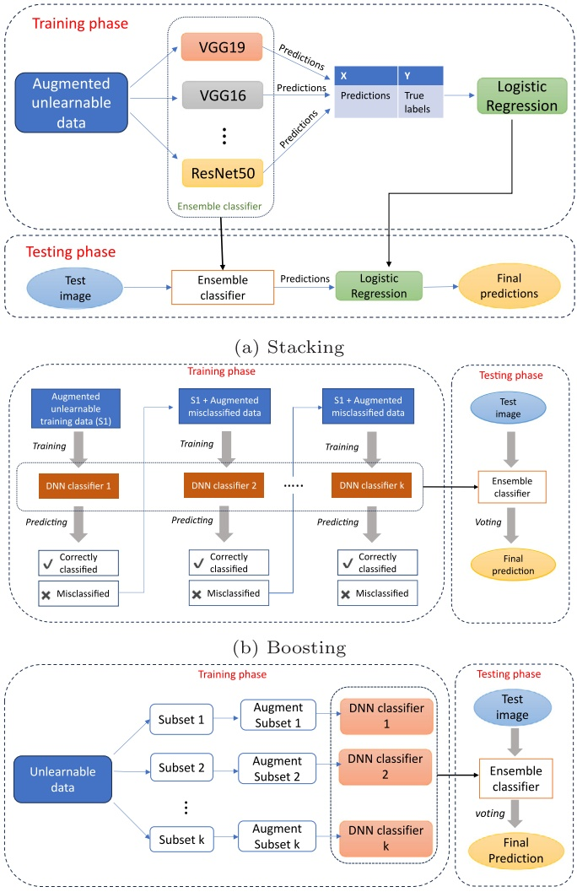
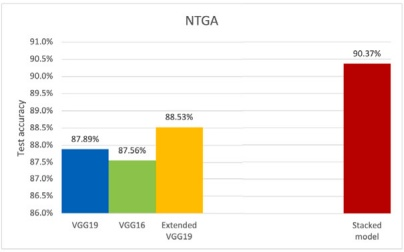
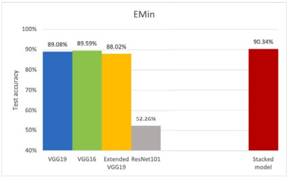
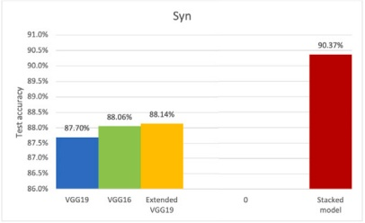
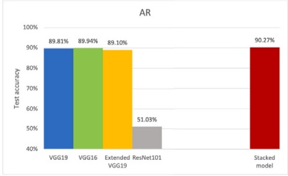
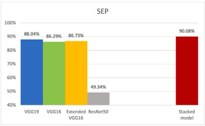
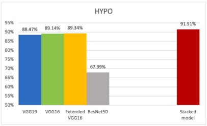
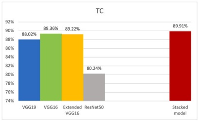
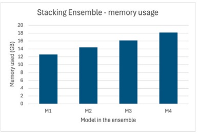

# Advancing ensemble learning against unlearnable data

**Thushari Hapuarachchi , Kaiqi Xiong** ∗

**ICNS Lab and Cyber Florida, University of South Florida, Tampa, 33620, FL, USA**

## A R T I C L E I N F O

**Communicated by D. Macciò**

**Keywords:**

**Data protection approaches**

**Deep neural networks**

**Ensemble learning**

**Unlearnable data**

## A B S T R A C T

**The unauthorized acquisition of image data for training deep neural network (DNN) models raises significant privacy concerns. A potential solution to address this concern is to render data unlearnable, disrupting the training process of DNN models. Given the unpredictable nature of the machine learning techniques that unauthorized users may employ, unlearnable data should possess the capability to guard against various advanced machine learning approaches, including ensemble learning. In this research, we propose frameworks to advance conventional ensemble learning methods, including stacking, boosting, and bagging, for defeating twelve existing data protection approaches by making their generated unlearnable data into learnable ones. Our extensive experiments reveal that the model ensembles resulted from the proposed frameworks attain an average test accuracy surpassing 89% on unlearnable CIFAR-10 datasets generated by the twelve existing approaches. These resulting findings suggest that all twelve existing approaches fail to the avoidance of data unauthorized use, and there is an urgent need to develop a new data protection approach for preventing data from such misuse.**

## 1. Introduction

**These days, the Internet, including social media platforms like Facebook and Instagram, is brimming with freely available personal data. The illegitimate scraping of these data for training Deep Neural Network (DNN) models has become a severe issue. Data protection approaches, also known as unlearnable data [1], are proposed to prevent such unauthorized utilization of image data for DNN model training. Unlearnable data should be able to protect data from use in any advanced machine learning methods. Ensemble learning is a popular advanced machine learning approach involving training multiple learners and combining their outcomes to achieve enhanced performance and more generalization capabilities compared to their individual learners [2]. Because of their high performance, ensemble learning methods are applicable regardless of the field [3–6]. In this paper, we enhance and implement ensemble learning on the unlearnable data while incorporating nonlinear transformations [7]. Recent studies reveal that simple data augmentation, including nonlinear transformations, can effectively challenge the unlearnable data generated by the data protection approaches [7–11]. This research advances conventional ensemble learning, one of the widely used machine learning techniques, to defeat the unlearnable data.**

**Unlearnable data is assumed to disrupt DNN training, leading to models with poor generalizability. On the other hand, ensemble learning methods are used to improve the generalizability of conventional** **models. Therefore, we are advancing ensemble learning methods to overcome the challenge posed by unlearnable data.**

**Ensemble learning is a critical concept in machine learning because it combines multiple models to improve the overall performance of a system. Instead of relying on a single model to make predictions, ensemble methods aggregate the predictions of multiple models, often leading to better accuracy, robustness, and generalization. In this research, we explore the capability of ensemble learning for unlearnable datasets. Specifically, our research question: How can we leverage ensemble learning to break unlearnable data? However, applying ensemble learning to Hapuarachchi et al. [7] is not straightforward. Instead, there are several major challenges. Some of these challenges include: (1) increased training and testing time, (2) model overfitting, (3) hyperparameter tuning difficulty, (4) data quality dependence, (5) struggling in ensemble selection and combination, and (6) data splitting bias in model training. In this paper, we present our experimental approaches to addressing those challenges.**

**To the best of our knowledge, this is the first study to explore the feasibility of applying ensemble learning methods to unlearnable data. Numerous studies have been conducted to demonstrate the vulnerability of unlearnable data to data augmentation and adversarial training [12,13]. Our study also includes data augmentation techniques, specifically nonlinear transformations, such as grayscale, while employing ensemble learning methods. We choose nonlinear transformation techniques because they are reported to be more effective at** **mitigating the effects of unlearnable perturbations than the conventional linear transformation techniques in Sandoval-Segura et al. [11]. In this study, we focus on conventional ensemble learning based on DNNs rather than other advanced architectures such as Vision Transformers (ViTs) [14]. One reason is that unlearnable data are primarily designed to disrupt the training of DNNs [1,15]. We aim to demonstrate the feasibility of applying ensemble learning using architectures that these data are intended to disrupt. Another reason is that using ViTs has several key disadvantages compared to conventional ensemble learning, despite their higher performance. These include high computational costs, longer training times, and the difficulty of interpreting transformers [16]. Applying ViTs to unlearnable data may further increase these challenges due to the complexity of the training data. Therefore, this study focuses on conventional ensemble learning rather than advanced learning methods like ViTs.**

<small>∗ Corresponding author.</small>

<small>E-mail addresses: [saumya2@usf.edu](mailto:saumya2@usf.edu) (T. Hapuarachchi), [xiongk@usf.edu](mailto:xiongk@usf.edu) (K. Xiong).</small>

Fig. 1. The first row gives the unlearnable data protection approaches. Unlearnable examples and their corresponding perturbations are displayed. The test accuracies in the final row are sourced from the respective papers, representing the accuracy of a model trained on an unlearnable CIFAR-10 dataset generated by each approach.

**There are three primary ensemble learning methods: stacking, boosting, and bagging [2]. We have applied all three methods, respectively, to unlearnable data. We propose three new ensemble learning frameworks corresponding to these three conventional ensemble learning, where we leverage nonlinear transformations to improve conventional ensemble learning methods for breaking the unlearnable data. The proposed frameworks result in model ensembles with enhanced generalization capabilities. For instance, in the proposed boosting framework, it is essential to assign greater weights to misclassified units from the preceding model. We implement this step by generating additional images through various nonlinear transformation techniques.**

**In this study, we defeat unlearnable data protected by the twelve major data protection approaches including Neural Tangent Generalization Attacks (NTGA) [15], Error-Minimizing (EMin) [1], Error-Maximizing (EMax) [17], DeepConfuse (DC) [18], Synthetic (Syn) [19], Autoregressive (AR) [20], Robust Error-Minimizing (REM) [12], One-Pixel Shortcut (OPS) [21], Entangled-Features (EntF) [22], Self-Ensemble Protection (SEP) [23], Hypocritical (HYPO) [24], and TensorClog (TC) [25]. Specifically, these unlearnable data are crafted by adding imperceptible perturbation to the original data through the aforementioned twelve approaches, which are used to solve a bilevel optimization problem. Fig. 1 showcases sample images generated by each of the mentioned approaches, along with their corresponding perturbations. The perturbations are derived by subtracting the unlearnable image from the original one. The final row in Fig. 1 presents the test accuracy of a model trained on an unlearnable CIFAR-10 dataset protected by each approach as reported in the respective papers. The test accuracy for a DNN model trained on a clean CIFAR-10 dataset is approximately 95% [17]. The presence of unlearnability demonstrates a decrease in test accuracy, as depicted in Fig. 1. In this study, our goal is to improve those test accuracies by developing the new ensemble learning framework. Through the execution of this study, we have contributed in the following ways.**

**• As far as we know, our study pioneers the application of ensemble learning methods to DNN models trained on unlearnable data. Through comprehensive experiments, we illustrate that ensemble learning methods prove effective for unlearnable data when** **accompanied by methodological advancements including data augmentation through nonlinear transformations.**

**• We propose three frameworks within ensemble learning, namely stacking, boosting, and bagging, to effectively address the challenges presented by unlearnable data. The proposed frameworks include several advantages compared to conventional ensemble learning methods. In the boosting method, we opt to amplify the significance of misclassified data by employing nonlinear transformations, as it proves to be a potent strategy for overcoming unlearnability. In the stacking method, we leverage models with diverse DNN architectures, recognizing that unlearnable data may display varying performance characteristics depending on the architecture employed. In the bagging method, we strategically choose overlapping subsets to expand the training data, effectively mitigating potential overfitting issues in individual models induced by unlearnability.**
**• Through our extensive experiments, we showcase that the proposed ensemble frameworks significantly improve test accuracy when compared to the baseline models trained on unlearnable data. These experiments were conducted on unlearnable CIFAR-10 datasets generated by the above twelve data protection approaches. We attained an average test accuracy surpassing 89% for at least one of the three ensembles trained on all the unlearnable datasets.**

**The rest of the paper is organized as follows. In Section 2, we provide the necessary background information of unlearnable data and ensemble learning methods. Section 3 gives the related work of the studied problem and the proposed methodology. Furthermore, we present our proposed ensemble learning frameworks in Section 4. The experimental results are given in Section 5. Section 6 includes the additional discussions of the experimental results. Finally, we conclude our study with future work in Section 7.**

## 2. Background

**Unlearnable data: Unlearnable data are crafted using availability attacks, also known as generalization attacks. Generalization attacks aims to craft imperceptible perturbations,** 𝛿**, for all images in a training set by solving the following optimization problem [1,17]:**

$$
\underset {\| \delta \| _ {p} \leq \epsilon} {\arg \max} \left[ \mathcal {L} \left(f \left(X _ {v}; \theta^ {*}\right), Y _ {v}\right) \right] \tag {1}
$$

**subject to**

$$
\theta^ {*} \in \arg \min _ {\theta} \left[ \mathcal {L} \left(f \left(X _ {T} + \delta ; \theta\right), Y _ {T}\right) \right], \tag {2}
$$

**where** $X _ { T }$ and $Y _ { T }$ **represent sets of input images and target labels in the training set respectively. Similarly,** $X _ { v }$ **and** $Y _ { v }$ denote sets of images and **target labels in a validation set respectively.** 𝛿 **is a set of perturbation that is added to the set of input images** $X _ { T }$ **. The DNN model** 𝑓 **with a set of parameters,** $\theta ,$ **has a loss function of** 𝐿**. Eq. (2) finds the optimal set of parameters,** $\theta ^ { * }$ **, that minimizes the training loss, indicating that** **the model is well-trained. Eq. (1) searches for perturbation** 𝛿 **that lead to high validation losses, which makes it difficult for the model to provide precise results on unknown data without perturbations (clean data). The perturbations are anticipated to be smaller than** $\epsilon _ { \flat }$ **ensuring they remain unnoticeable. In this study, we use unlearnable datasets generated by the above twelve different approaches.**

**Ensemble learning: In ensemble learning, multiple learners work together to solve a single problem. The main objective of an ensemble learning process is first training a set of individual learners and then combining their training outputs/results using some mechanism [26, 27]. That is, ensemble learning methods can be formulated as follows [28–30]:**

$$
\underset {G} {\arg \min} \left[ \mathcal {L} \left(G \left(f _ {1} \left(X _ {v}\right), f _ {2} \left(X _ {v}\right), \dots f _ {k} \left(X _ {v}\right)\right), Y _ {v}\right) \right], \tag {3}
$$

**where** $G   \in   \mathcal { G }$ **represents an aggregator, which is a mechanism to combine models** $f _ { 1 } , f _ { 2 } , \ldots , f _ { k }$ **together.**  **denotes a set of all the mechanisms that combines models** $f _ { 1 } , f _ { 2 } , \ldots , f _ { k } .$ . Here, $X _ { v }$ **and** $Y _ { v }$ **denotes the sets of images and target labels in the validation set respectively.**  **means the loss function. The goal of the above optimization problem is to discover the aggregator** 𝐺 **that results in a minimal loss.**

**There are three fundamental ensemble learning methods: stacking, boosting, and bagging [2]. (1). The boosting method uses the input data** $( X _ { T } )$ **to first train a weak classifier. Then, the predictions of the weak classifier are then compared with the true labels** $( Y _ { T } )$ **, and misclassified training samples are selected. Next, misclassified samples are assigned higher weights than other samples in the dataset, so that the next model pays more attention to these samples during training [10,30]. (2). The stacking method uses different algorithms on the same training dataset. Thus, different algorithms can be trained in parallel and the predictions can be obtained from each model. To combine the predictions obtained from each model, a meta-learner is used. As it learns from the predictions of different algorithms, the meta-learner is usually simple. Therefore, linear classifiers, such as logistic regression, are often used as meta-learners [2]. (3). The bagging method randomly divides the dataset into subsets. After several subsets are generated, base learners are trained independently. A more accurate estimate is obtained based on the average or the majority of these predictions, depending on the task, i.e., regression or classification [2,30].**

**The frameworks for the three ensemble methods are standalone and can be implemented independently, as shown in the next subsections. However, it is advisable to choose a base model with superior performance for boosting and bagging. In our study, we first experimented with several models before deciding on the one to use for boosting and bagging based on its performance. In the future, the stacking method could help in determine the most appropriate model for other approaches. However, in this research, we executed the three frameworks independently.**

## 3. Related work

**Unlearnable data has become a prominent topic in recent years [17, 31]. Every year, several studies are conducted to develop novel unlearnable datasets as well as to explore the vulnerabilities of existing methods [32–36]. Common attacks against unlearnable data include adversarial training [12,37] and data augmentation using both linear and nonlinear transformations. [7,11,20]. In this study, we leverage nonlinear transformations proposed in Hapuarachchi et al. [7] to obtain robust models against unlearnable data and employ them in constructing ensembles.**

**Unlearnable data is a rapidly growing field where advanced unlearnable data generation approaches are being introduced at a fast pace. These advanced approaches focus on protecting data against advanced learning methods or can be applied to different types of data. The study by Liu et al. [38] generated unlearnable datasets to protect against unauthorized contrastive learning, an unsupervised learning mechanism. Additionally, they addressed both image and** **text classification. Furthermore, [39] proposed unlearnable datasets for protecting against image segmentation models. On the other hand, Wang et al. [40] created unlearnable 3D data. As the first study to apply ensemble learning to unlearnable data, this research primarily focuses on breaking unlearnable data generated for supervised image classification, which could potentially be extended to such advanced methods in the future. On the other hand, machine unlearning [41] is process of removing data from the training set used to build the DNN model on the data owner’s request to protect the data privacy. In this case, the original data should be removed from the training set. However, as shown in Chen et al. [41], machine unlearning can leave traces of the removed data in the model, making it vulnerable to membership inference attacks. Moreover, Huang et al. [42] found that these machine unlearning methods make machine learning models in cloud platforms vulnerable to backdoor attacks. In contrast, unlearnable data avoid DNN model learning from the data even they are included in the training dataset.**

**Data augmentation is a widely used approach to attacking unlearnability. Liu et al. [8] showed that the effect of unlearnable data can be mitigated by simply converting the image to grayscale. Recently, it is shown that advanced data augmentation techniques such as CutMix [43] and Mixup [44] have been shown to defeat data poisoning attacks [45] including unlearnable data [9,43]. Furthermore, Dolatabadi et al. [46] proposed a mechanism to defeat data protection approaches called dAta aVailAbiliTy Attacks defuseR (AVATAR), which involves a reverse diffusion process to denoise the unlearnable data. Furthermore, Liu et al. [32] showed that image compression techniques such as JPEG can also be used to remove unlearnability. Yu et al. [47] proposed an approach to extract original images from unlearnable data using auto-encoders.**

**Many studies has been done to break unlearnable data using adversarial training. Tao et al. [48] investigated the test-time robustness of adversarial training performed on unlearnable data. Fu et al. [12] showed that unlearnable data crafted with EMin [1], EMax [17], and NTGA [15] are vulnerable to adversarial training. REM [12] is an improved version of EMin designed to challenge adversarial training by generating unlearnable perturbations while training on adversarial perturbations. However, a recent study of Liu et al. [34] further enhanced REM by training on random perturbations instead of adversarial perturbations. Unlike these studies, we propose ensemble learning frameworks that can avoid the effect of unlearnable data. We demonstrate that unlearnable data remain applicable in ensemble learning, providing a slight improvement over conventional methods.**

**Recently, researchers were intrigued by the revelation that many of the existing unlearnable perturbations, including EMin, EMax, and NTGA, are linearly separable [19,49]. Ren et al. [50] used the linear separability of class-wise unlearnable perturbations to protect data against unsupervised learning. Zhu et al. [51] developed a method for detecting unlearnable examples based on linear separability. Sandoval-Segura et al. [11] proposed an Orthogonal Projection Attack (OPA) by capturing these linearly separable perturbations in the unlearnable data through a logistic regression model. They also demonstrated that their attack method is more computationally cost-effective than adversarial training. Although the method is most effective for unlearnable datasets perturbed by class-wise perturbations, further improvements are needed for better performance against sample-wise perturbations. As a result, Hapuarachchi et al. [7] proposed nonlinear transformation techniques against unlearnable datasets. These nonlinear transformations are proven to be effective than OPA, as they better capture the effects of nonlinear perturbations, such as AR [20]. Hence, in our research, we chose to adopt nonlinear transformation techniques such as erode, dilate, and pixel manipulation, as proposed by Hapuarachchi et al. [7].**

**In contrast to existing studies, we use these nonlinear transformation techniques to enhance existing ensemble learning methods for application on unlearnable datasets. To the best of our knowledge, this is the first study to leverage ensemble learning methods with unlearnable datasets.**

## 4. Methodology

**To break the unlearnable data generated by the twelve existing data protection approaches, the first step was to formulate conventional ensemble learning as a triple-level optimization problem and then propose new frameworks to advance existing ensemble learning.**

## 4.1. Ensemble learning against unlearnable data

**Based on the mathematical expression of ensemble learning methods given in Eq. (3), this research further articulated the goal of improving ensemble learning methods against unlearnable data as follows:**

$$
\underset {G} {\arg \min} \left[ \mathcal {L} \left(G \left(f _ {1} ^ {*} \left(X _ {v}\right), f _ {2} ^ {*} \left(X _ {v}\right), \dots f _ {k} ^ {*} \left(X _ {v}\right)\right), Y _ {v}\right) \right] \tag {4}
$$

**subject to**

$$
A ^ {*}, f _ {i} ^ {*} \in \underset {A, f _ {i}} {\arg \min} \left[ \max _ {\| \delta \| _ {p} \leq \epsilon} \left[ \mathcal {L} \left(f _ {i} \left(X _ {v}; \theta^ {*}\right), Y _ {v}\right) \right] \right] \tag {5}
$$

**which is further subject to**

$$
\theta^ {*} \in \underset {\theta} {\arg \min} \left[ \mathcal {L} \left(f _ {i} \left(A \left(X _ {T} + \delta\right); \theta\right), Y _ {T}\right) \right], \tag {6}
$$

**for any given** $A \subseteq { \mathcal { A } } ,$ **, where**  **represents a set of all the nonlinear transformation techniques applied to the unlearnable training dataset to mitigate the effects of unlearnable perturbations. The term,** $f _ { i } ,$ denotes a DNN model with a set of parameters, 𝜃.

**Eqs. (4), (5), and (6) present a three-level optimization problem consisting of three minimization and one maximization problems. To solve it for** $G ,$ **the proposed methodology used the bottom-up approach by starting from its lowest-level, or its second-level constraint and then moved it up. That is, this research tried to find the maximal space of variables in the sub-optimization problem given in the constraint of an optimization problem before solving the (original) optimization problem. Below is an detailed explanation.**

**First, in Eq. (6),** $f _ { i }$ **and** 𝐴 **were fixed. Eq. (6) aimed to identify the optimal set of model parameters,** $\theta ^ { * }$ **, by training a given DNN model,** $f _ { i } ,$ **on the unlearnable dataset augmented using a given nonlinear transformation techniques in a subset of** **. Second, when moved to the next level constraint or the first-level constraint, Eq. (5) found two outputs. (a). The optimal model architecture** $f _ { i } ^ { * }$ **. (b). The optimal subset of nonlinear transformation techniques,** $A ^ { * } .$ **These were chosen by evaluating** $\theta ^ { * }$ **in the maximal space of variables generated by Eq. (6), for a given** $f _ { i }$ **and** 𝐴 on a validation set. Eq. (5) found the $f _ { i }$ and 𝐴 **that gave the minimum validation loss. This meant the highest generalizability. To obtain the desired DNN models** $f _ { 1 } ^ { * } , f _ { 2 } ^ { * } , \ldots f _ { k } ^ { * }$ for the ensemble, this process would be repeated several times. Finally, Eq. (4) was used to find the aggregator $G \in { \mathcal { G } } ,$ where $\mathcal { G }$ represented a set of all the mechanisms that combined the individual models $f _ { i } ^ { * }$ to achieve better accuracy than the individual models alone. To summary, the goal for solving the three-level optimization problem was to find $A ^ { * } , f _ { i } ^ { * }$ , and 𝐺 under the three ensemble learning methods described in Section 2.

**Solving the above three-level optimization problem was not straightforward. In fact, it was a challenging task since it involved four complex sub-optimization problems. Let** 𝑁 **be the total number of all nonlinear transformations. Then, the dimension of** $\mathcal { A }   =   2 ^ { N }$ **. As seen, the dimension of**  **was increasing exponentially with** 𝑁**. This implies that the above three-level optimization problem in Eq. (4)–(6) had a parameter space with a very high dimension that was increasing exponentially with** $N ,$ **so it was extremely time consuming to search for an optimal solution of the optimization in the parameter space, which could not be done in polynomial time. Therefore, this research proposed and developed a heuristic approach to making such searching feasible so that the approach could be used in real-world applications. That is, the resulting solution was sub-optimal rather than optimal.**

**The following paragraphs present our approach of finding each of** $A ^ { * } , f _ { 1 } ^ { * } , f _ { 2 } ^ { * } \ldots f _ { k } ^ { * } ,$ **, and** 𝐺.

**To avoid search for each element in the parameter space of**  **that required exponential time, an optimal-expanding approach [7] was developed. This approach first (1) chose those nonlinear transformations commonly used in literature (e.g., grayscale, erode, pixel manipulation) as**  **instead of all nonlinear transformations and identified which nonlinear transformation can produce the highest test accuracy of training models; such a nonlinear transformation would be used to form a base set. Note that each element of**  **was a single nonlinear transformation rather than a subset of nonlinear transformations in** , **i.e.,** B C A and B **had a much lower dimension than** A**. The next step was to (2) choose the rest of nonlinear transformations in**  **one-by-one and identify which nonlinear transformation could achieve the highest test accuracy of training models, along with the base set. If the highest test accuracy was higher than the previously highest accuracy, then the new nonlinear transformation would be added to the base set. That is, this step expanded the base set. (3) The above process was continued until all the elements in**  **were checked. The resulting set was our solution for** $A ^ { * }$ **. Let the dimension of**  **be** 𝑛**. Thus, the above optimalexpanding approach had the time complexity of** $n { + } ( n { - } 1 ) { + } \cdots { + } 1 = O ( n ^ { 2 } )$ **which was in quadratic polynomial time.**

**Algorithm 1 outlined the steps of finding** $A ^ { * }$ **. At the beginning of the process,** 𝐴 **was an empty set, and** $V _ { 0 }$ **represented the validation accuracy of the model trained on the unlearnable dataset (**𝑈**). Algorithm 1 first randomly chose a nonlinear transformation technique from the set** $B ,$ and named it $A _ { 1 } .$ In general, the nonlinear transformation chosen at the 𝑖th iteration is denoted as $A _ { i }$ . Then, the transformation was applied to the unlearnable dataset, which denoted by the notation $A _ { i } ( U )$ . Next, a DNN model was trained on the transformed dataset, $A _ { i } ( U ) ,$ and the validation accuracy, $V _ { i }$ was obtained. If the validation accuracy improved due to the transformation, $A _ { i }$ was added into the set of 𝐴. The next iteration chose $A _ { i + 1 }$ from the set ${ \mathcal { B } } \backslash \{ A _ { 1 } , \ldots , A _ { i } \} , { \mathrm {  ~ i . e . ~ } }$ , the transformations selected in the previous iterations are removed from  before the next transformation is chosen. That is, this algorithm selects transformations without any replacement. After repeating this process for a specified number of iterations 𝑛 i.e., the dimension of $B ,$ **the resulting set** 𝐴 **was chosen as** $A ^ { * } .$

Algorithm 1: Selecting nonlinear transformation techniques

for $i = 1$ to $n$ do
    1. Randomly select $A_i$ from $\mathcal{B} \setminus \{A_1, \ldots, A_{i-1}\}$.
    2. Transform unlearnable dataset. $U \to A_i(U)$
    3. $A(U) \leftarrow A(U) \cup A_i(U)$
    4. Train a DNN model using $A(U)$ and obtain validation accuracy $(V_i)$.
    5. if $V_i &gt; V_{i-1}$ then
        $A \leftarrow A \cup A_i$
    end
end
return $A$

**When selecting** $f _ { i } ^ { * } ,$ **this research considered various pretrained DNN architectures in Keras,**<strong>1</strong>**such as Residual Network (ResNet) and Visual Geometry Group (VGG). They were further modified by adding additional layers and dropout layers, adjusting the number of neurons, changing the number of epochs, and tuning other hyperparameters. These hyperparameters were selected based on the final test accuracy of the ensemble obtained through several experimental trials.**

**In order for us to solve the above three-level optimization, the next key step was to choose an aggregator** 𝐺 **from a set of all aggregator mechanisms**  **under each ensemble learning method. This step incorporated the default aggregators used in conventional ensemble learning methods directly, without going through an optimization procedure, because their purposes and conditions matched our framework. For** **instance, a meta-learner was utilized as the aggregator for the stacking method because different model architectures were included in the stacking ensemble. Different architectures led to significant differences in model performance. A meta-learner could induce which models were reliable and which were not, rather than a voting mechanism. In contrast, bagging and boosting methods used a voting mechanism as an aggregator. These methods incorporated the same model architecture for all models, but used different input data. Therefore, in contrast to the stacking method, no significant difference in the performance of the individual models was observed. Hence, instead of using a meta-learner as an aggregator, the proposed bagging and boosting frameworks employed a voting mechanism. It is important to point out that these choices of aggregators were also similar to those defined in conventional ensemble learning methods, as explained in Section 2.**

<small>1 [https://keras.io/api/applications/](https://keras.io/api/applications/)</small>

Algorithm 2: Proposed Stacking Ensemble Framework

Data: Unlearnable training images (T), Pretrained models
    (M₁, M₂, ..., Mₖ), Number of iterations (k), Nonlinear
    transformation techniques (A), Clean test dataset, Target test
    accuracy (α)
Result: The stacking ensemble
Augment T and create T₁ (T₁ ← A(T)) ;
for i ← 1 to k do
    1. Train several pretrained models M₁, ..., Mᵢ on T₁;
    2. Make predictions on T using M₁, ..., Mᵢ;
    3. Train a logistic regression model L by considering predictions as
    feature variables (X) and true labels of T as target variables (Y);
    4. Generate test predictions and calculate test accuracy (d);
    if d &gt; α then
        STOP
    end
end
return {M₁, M₂, ..., Mₖ} ∪ L

## 4.2. Stacking ensemble against unlearnable data

**To design the framework for advancing the conventional stacking ensemble method, the process followed the fundamental stacking ensemble concept but with some modifications as shown in Fig. 2(a). The first step of the proposed ensemble learning framework was to augment the unlearnable training dataset using nonlinear transformation techniques such as grayscaling. Next, several DNN models were trained with different architectures on the augmented training dataset, such as VGG and ResNet [52]. The third step made predictions on the unlearnable training set using the DNN models trained in the previous step. The predictions were obtained in terms of probabilities, not target classes. Then, a meta-learner, i.e., a logistic regression model, was fitted considering these predicted probabilities as independent variables (X) and the true labels as target variable (Y). The framework chose logistic regression because it was the most commonly used meta-learner in stacking. The output of the meta-learner was the final prediction given by the ensemble.**

**In the testing phase, the framework obtained predictions for test images using each DNN model in the ensemble. These predictions (in terms of probabilities) were then fed into the trained meta-learner, i.e., a logistic regression model. The final prediction of the test image was the output of the meta-learner. As shown in the Algorithm 2, the different DNN models were added to the ensemble one by one until the ensemble reached the desired test accuracy. Due to the unlearnability, the performance of the individual models varied greatly depending on the architecture. Therefore, the individual performance of the model was also a concern when selecting the model for the ensemble.**

**In the proposed stacking ensemble, the novelty primarily lies in applying nonlinear transformation techniques and utilizing diverse DNNs architectures. These steps enable us to address the vulnerabilities of** **unlearnable data to data transformations and different model architectures simultaneously. At the same time, these steps overcome the challenge of balancing the diversity among individual models while maintaining the accuracy. Although both nonlinear transformations and diverse architectures have been explored separately in earlier research on unlearnable data, this study combines them to achieve significantly better performance.**

(c) Bagging

Fig. 2. Proposed ensemble learning frameworks for unlearnable data.

## 4.3. Boosting ensemble against unlearnable data

**This section presents our approach to advance the conventional boosting ensemble method. The boosting ensemble method sequentially created a series of models that focus on the samples misclassified by the previous model when training the next model. All samples were assigned the same weight at the beginning of the process. In each iteration, the weights of the misclassified samples were increased, because the subsequent model should pay more attention to the misclassified samples than to the others [30].**

**The proposed boosting framework leveraged nonlinear transformations with the conventional boosting ensemble method, as graphically illustrated in Fig. 2(b). Algorithm 3 explicitly stated our training procedure for obtaining the boosting ensemble. The first step was to use nonlinear transformation techniques such as grayscale and pixel** **manipulation to augment the unlearnable training dataset. These transformation techniques helped to mitigate the unlearnability of the training data. The next step trained a pretrained DNN model, such as VGG [52], using the augmented data. The number of training epochs was decided to ensure that the model was not overfitted. Using the trained model, predictions were made on the unlearnable training set. The misclassified samples were again augmented and combined with the training set. As a result, the misclassified samples were repeated in the new training set more than the other samples, so they were amplified in the next model. Next, the augmented training set was used to train another DNN model. Then, the new trained model made predictions again on the unlearnable dataset, and misclassified samples were added to the training set to train the next model. This predictionaugmentation process was repeated for some** 𝑘 **times, resulting in an ensemble model with** 𝑘 **models. The predicted class of a test image was obtained based on the voting of the predictions given by all** 𝑘 **models. The framework determined the number of boosting iterations** 𝑘 **based on the final test accuracy.**

Algorithm 3: Proposed Boosting Ensemble Framework

Data: Unlearnable training images (T), Pretrained model (M), Number of iterations (k), Nonlinear transformation techniques (A)
Result: The boosting ensemble
Augment T and create $S_1$ ($S_1 \leftarrow A(T)$);
for $i \leftarrow 1$ to $k$ do
    1. Train pretrained model $M$ using $S_i$ to obtain model $M_i$;
    2. Make predictions on $T$ using $M_i$;
    3. Select misclassified images ($D_i$) and make additional augmented images $A(D_i)$;
    4. Combine additional images with original training set ($S_{i+1} \leftarrow S_i + A(D_i)$);
end
return $\{M_1, M_2, \ldots, M_k\}$

**In the boosting ensemble, the main contribution lay in how the weights of misclassified images were increased. However, simply increasing the weight of an image did not help when the images were unlearnable. In such cases, the images were repeated with different transformations. This approach helped mitigate overfitting caused by unlearnable data as well as excessive training in ensemble learning. To avoid making the process overly complex and to prevent high execution time, the same transformations were applied in each iteration. The hyperparameters, such as number of epochs, were also carefully tuned to reduce overfitting.**

## 4.4. Bagging ensemble against unlearnable data

**The proposed bagging framework added several modifications to the conventional bagging ensemble method for successful use against unlearnable data. First, the framework split the training data using random sampling to generate** 𝑘 **different subsets. A DNN model was trained on each subset, resulting in** 𝑘 **models. The** 𝑘 **models were combined using majority voting to obtain a strong classifier [2]. Fig. 2(c) graphically illustrates the proposed framework by incorporating nonlinear transformations in the conventional bagging method.**

**The first step of the framework divided the unlearnable training dataset into balanced non overlapping subsets. However, the bagging ensemble trained on these subsets exhibited weak performance. This could be attributed to the reduced amount of data in each subset. Therefore, the proposed framework implemented overlapping splits to increase the distinct data in each subset. The overlap percentage was gradually increased to determine the optimal percentage. The next step of the framework was to augment each subset with various nonlinear transformation techniques, including grayscale, pixel manip ulation, erode and dilate. Then, a pretrained model, such as VGG19,** **was trained on each augmented subset. The proposed framework optimized the model architecture based on its performance (validation accuracy) after training. Algorithm 4 shows our procedure for building the bagging ensemble. The testing phase collected predictions from each trained model and derived the final prediction using a majority voting approach.**

Algorithm 4: Proposed Bagging Ensemble Framework

Data: Unlearnable training images (T), Pretrained model (M), Number of subsets (k), Nonlinear transformation techniques (A), Overlap percentage (p)
Result: The bagging ensemble
Split the training set into k subsets $T_1, T_2, \ldots, T_k$ with an overlap percentage of p;
for $i \leftarrow 1$ to k do
    1. Augment $T_i$ subset $(T_i' \leftarrow A(T_i))$;
    2. Obtain model $M_i$ by training pretrained model M on $T_i'$ subset;
end
return $\{M_1, M_2, \ldots, M_k\}$

**The novelty in the proposed bagging ensemble lay in the addition of overlapping subsets while improving the variations in the data. In the bagging ensemble method, the challenge was that the models did not have unique training images to learn from. In order for us to address this bias in data splitting, the existing images were modified using nonlinear transformations, and overlapping subsets were implemented. This approach addressed the challenges posed by unlearnable data simultaneously. Balanced subsets were used, ensuring that even the overlapping data portion remained balanced.**

**Our experiments specifically used six nonlinear transformation techniques: erode, dilate, grayscale, and pixel manipulation with respect to three channels. Erode and dilate transformations were morphological operations that use kernel functions to process images [53]. These operations allowed nonlinear perturbations to be captured by applying a structuring element to an image. The erode transformation reduced the boundaries of bright regions, while the dilate transformation expands them. These transformations can effectively emphasize or suppress certain features in an image, making them useful for capturing complex, nonlinear changes in pixel intensity. On the other hand, pixel manipulation and grayscale transformations focused on simplifying and reducing the complexity of the image’s color channels. These transformations converted the image from color (RGB) to a single intensity value, effectively reducing the information in the three color channels to one. By replacing the values of all three color channels of each pixel with a single value, these transformations diminished the impact of channel-wise perturbations [8]. Our experiments implemented three transformation techniques under pixel manipulation based on which color channel value (R, G or B) is used for replacement [7].**

**This paragraph explains how the challenges identified in Section 1 were addressed using the frameworks described above. (1) Increased training and testing time: Ensemble learning methods demand substantial training and testing time because they involve multiple models. To address this issue, extensive experiments were conducted to look for a number of epochs to trade balance accuracy and training time. Our experimental results concluded that the number of training epochs was limited to no more than 35. That is, this research chose a different setting than Hapuarachchi et al. [7], where 80 epochs was used in training some models. (2) Model overfitting: As noted in Hapuarachchi et al. [7], overfitting was inevitable when dealing with unlearnable data. By limiting the training epochs, the tendency for overfitting in the models was also reduced. (3) Hyperparameter tuning difficulty: This study tuned and finalized the choice of hyperparameters, such as model architectures, nonlinear transformations, and learning rates, through a lot of experiments. Because of the complexity of the hyperparameter selection, the proposed frameworks attempted to find a set of suboptimal hyperparameters. Through many experimental trials, the** **same nonlinear transformations were chosen across all models in the ensemble learning and the model architecture was fixed to VGG19 in both bagging and stacking ensembles. (4) Data quality dependence: The proposed frameworks were designed to ensure that they were independent of a dataset. Only the hyperparameters were tailored to the specific datasets. This research demonstrated this by applying our framework to diverse datasets, including CIFAR-10, ImageNet, MNIST and CIFAR-100. (5) Struggling in ensemble selection and combination: This has been the first study that applies ensemble learning to unlearnable data. Since ensemble had different types and there were a variety of models, the choice of which ensemble method to be used was challenging. Before exploring advanced ensemble methods, this study opted for simple and traditional techniques. (6) Data splitting bias in model training: This paper applied data splitting only in the bagging ensemble method. The bagging ensemble framework mitigated bias by splitting datasets class-wise and introducing overlapping splits.**

## 5. Experimental results

**The proposed ensemble learning frameworks are evaluated on unlearnable CIFAR-10 datasets crafted by the above twelve existing approaches, which include NTGA [15], EMin [1], EMax [17], DC [18], Syn [19], AR [20], REM [12], OPS [21], EntF [22], SEP [23], HYPO [24], and TC [25].**

**In our experiments, datasets perturbed with NTGA are obtained from Kaggle, as released by [15]. CIFAR-10 datasets crafted by EMin, EMax, DC, and Syn are collected from [19]. All other datasets were generated using the code published in their respective GitHub repositories. We provide links to those repositories in the supplementary materials. We chose to conduct our experiments using the TensorFlow framework for its versatility and the availability of pretrained DNN models with diverse architectures.**

**We incorporated nonlinear transformation techniques (**𝐴**) outlined in Hapuarachchi et al. [7] to this study due to their effectiveness against various unlearnable datasets compared to other methods [11]. Therefore, we restricted the set of nonlinear transformation techniques**  **to six (**𝑁**) nonlinear transformations in [7]. They are grayscale, three pixel manipulation techniques with respect to three color channel values, erode, and dilate [8,32,53]. We began our search for** 𝐴∗ **with the set of nonlinear transformations** 𝐴**, chosen by [7] with respect to each dataset. Then, we further modified** 𝐴 **by adding or removing nonlinear transformation techniques in**  **one by one, based on the final validation accuracy of the ensemble. After several rounds of trial and error, we chose the** 𝐴 **that gives the highest final validation accuracy as** 𝐴∗**. We implemented these transformations using functions from the OpenCV library. Grayscale conversion and pixel manipulation were performed through functions available in OpenCV for modifying pixel values.**<strong>2</strong> **As an example, we replaced all channel values with the same color channel value, resulting in a gray image with enhanced brightness in areas containing pixels with the selected color channel. Erode transformation was performed with cv.erode to expand darker areas of the image, while dilate transformation, performed with cv.dilate, expands lighter areas.**

## 5.1. The stacking ensemble

**In the proposed stacking framework, we trained different model architectures on the augmented unlearnable data. Pretrained DNN models, namely VGG19, VGG16, ResNet50, and ResNet101 from the Tensorflow Keras Applications,**<strong>3</strong> **were selected. We also built Extended-VGG19/16 models by adding four fully connected layers of 1024, 512, 128, and 64 neurons, respectively, using the ReLU activation function.**

**For all the models, the last layer was a fully connected layer with ten neurons and a SoftMax activation function, since there are ten output classes. We trained the models for up to 35 epochs to avoid overfitting. The nonlinear transformation techniques used in this case include pixel manipulation, grayscale, erode and dilate. Supplementary materials provide detailed information on the nonlinear transformation techniques used for each dataset. As a meta-learner, we employed the most commonly used learner, logistic regression, from the Scikit-learn library. Specifically, we utilized the liblinear solver for the logistic regression model, based on our experimental trials. Table 1 summarizes the performance of our proposed stacked ensembles trained on each unlearnable dataset including the DNN models used for each ensemble. In the table, we present the average test accuracy after repeating the experiments for five times. The Column 2 of the Table 1 shows the test accuracy under a baseline. For the baseline, we chose a pretrained ResNet50 model since the ResNet architecture is one of the most commonly used surrogate models for creating unlearnable perturbations [1, 12,17]. We also applied the same nonlinear transformation techniques to the baseline as we used in the stacking ensemble to demonstrate the impact of the ensemble. The proposed stacking ensembles achieved more than 89% on all twelve approaches representing a significant improvement over the baseline.**

**In these experiments, we set the target accuracy (**𝛼**) in Algorithm 1 to 90% or 89% if the algorithm could not reach 90%. Therefore, our framework consistently achieved 90% or 89% accuracy. However,** 𝛼 **should be adjusted based on the dataset and the expected performance of the ensemble. For example,** 𝛼 **was set to 98% for the MNIST dataset because the MNIST dataset is a simple dataset, and it is known to achieve high test accuracy. In general,** 𝛼 **should be a realistic target test accuracy that can be achieved by training on a given dataset.**

**Fig. 3 shows the test accuracy of each DNN model in the stacking ensemble and the test accuracy of the meta-learner. Fig. 3(a) shows the proposed model ensemble trained on unlearnable CIFAR-10 dataset with NTGA perturbations. The proposed stacking ensemble consists of VGG19, VGG16, and Extended-VGG19 models, each with individual test accuracies of 87.89%, 87.56%, and 88.53%, respectively. After combining the predictions using the logistic regression model, the enhanced stacked model achieved a test accuracy of 90.37%. Based on Figs. 3(b)–3(l), it is noticeable that the ResNet models exhibited lower accuracy compared to the VGG models. This discrepancy may arise because most unlearnable approaches used the ResNet architecture as a surrogate model when crafting perturbations [1,12,17]. However, incorporating ResNet models can potentially improve the performance of the logistic regression model because it increases the number of feature variables, thereby increasing the amount of information incorporated into the model.**

## 5.2. The boosting ensemble

**In our proposed boosting ensemble framework, the first step is to augment the unlearnable training set. In this case, we used almost identical experimental settings for all unlearnable datasets. The non-linear transformation techniques employed in this step included erode, grayscale and pixel manipulation [8,53]. While we applied two transformation techniques for the NTGA, EMax, AR, REM, OPS, HYPO, and TC approaches and expanded their dataset sizes to twice the original size, we only applied grayscale transformation for other approaches. Moreover, we modified the training and validation set’s rotation range, width shift, height shift, shear intensity, and zoom range using the Keras ImageDataGenerator function in training. As for the model, we chose VGG19 pretrained on ImageNet, followed by an additional convolutional layer with ten neurons and a Softmax activation function corresponding to the ten target classes. To avoid overfitting, we limited the training of the models up to 30 epochs. The supplementary materials provide information on the specific experimental settings for each dataset.**

<small>2 [https://docs.opencv.org/4.x/d3/df2/tutorial\_py\_basic\_ops.html](https://docs.opencv.org/4.x/d3/df2/tutorial_py_basic_ops.html)</small>

<small>3 [https://keras.io/api/applications/](https://keras.io/api/applications/)</small>

Table 1 The test accuracies of the proposed stacking ensembles trained on unlearnable CIFAR-10 datasets are presented. The second column specifies the DNN model architectures in the proposed stacking ensemble. The baseline shown in Column 2 gives the test accuracy obtained using ResNet50 with the same nonlinear transformations. .

| Unlearnable dataset | Baseline (ResNet50) | Models in the ensemble | Test accuracy |
| --- | --- | --- | --- |
| NTGA [15] | 65.11% | VGG19/ VGG16/ ExtendedVGG19 | 90.17 ± 0.15% |
| EMin [1] | 73.88% | VGG19/ VGG16/ ExtendedVGG19/ ResNet101 | 90.15 ± 0.21% |
| EMax [17] | 66.18% | VGG19/ VGG16/ ExtendedVGG19 | 90.30 ± 0.25% |
| DC [18] | 62.84% | VGG19/ VGG16/ ExtendedVGG16/ ResNet50 | 90.17 ± 0.07% |
| Syn [19] | 59.52% | VGG19/ VGG16/ ExtendedVGG19 | 90.11 ± 0.34% |
| AR [20] | 71.37% | VGG19/ VGG16/ ExtendedVGG19/ ResNet101 | 90.00 ± 0.71% |
| REM [12] | 69.13% | VGG19/ VGG16/ ExtendedVGG16/ ResNet50 | 89.07 ± 0.55% |
| OPS [21] | 51.09% | VGG19/ VGG16/ ExtendedVGG19/ ResNet50 | 89.71 ± 0.35% |
| EntF [22] | 60.75% | VGG19/ VGG16/ ExtendedVGG16/ ResNet50 | 90.96 ± 0.13% |
| SEP [23] | 49.34% | VGG19/ VGG16/ ExtendedVGG16/ ResNet50 | 89.89 ± 0.17% |
| HYPO [24] | 67.99% | VGG19/ VGG16/ ExtendedVGG16/ ResNet50 | 91.37 ± 0.14% |
| TC [25] | 80.24% | VGG19/ VGG16/ ExtendedVGG16/ ResNet50 | 89.46 ± 0.26% |

bar

| Category | Test accuracy (%) |
| --- | --- |
| VGG19 | 87.89 |
| VGG16 | 87.56 |
| Extended VGG19 | 88.53 |
| Stacked model | 90.37 |

(a) NTGA

bar

| Category | Test accuracy (%) |
| --- | --- |
| VGG19 | 89.08 |
| VGG16 | 89.59 |
| Extended VGG19 | 88.02 |
| ResNet101 | 52.20 |
| Stacked model | 90.34 |

(b) EMin

bar

| Category | Test accuracy (%) |
| --- | --- |
| VGG19 | 89.00 |
| VGG16 | 88.49 |
| Extended VGG19 | 88.78 |
| Stacked model | 90.26 |

(c) EMax

bar

| Category | Test accuracy (%) |
| --- | --- |
| VGG19 | 88.68 |
| VGG16 | 88.57 |
| Extended VGG16 | 88.75 |
| ResNet50 | 62.84 |
| Stacked model | 90.19 |

(d) DC

bar

| Category | Test accuracy (%) |
| --- | --- |
| VGG19 | 87.70 |
| VGG16 | 88.06 |
| Extended VGG19 | 88.14 |
| 0 | — |
| Stacked model | 90.37 |

(e) Syn

bar

| Category | Test accuracy (%) |
| --- | --- |
| VGG19 | 89.81 |
| VGG16 | 89.94 |
| Extended VGG19 | 89.10 |
| ResNet101 | 51.03 |
| Stacked model | 90.27 |

(f) AR

bar

| Category | Value (%) |
| --- | --- |
| VGG19 | 86.35 |
| VGG16 | 87.52 |
| Extended VGG16 | 87.99 |
| ResNet50 | 69.13 |
| Stacked model | 88.63 |

(g) REM

bar

| Category | Value (%) |
| --- | --- |
| VGG19 | 88.52 |
| VGG16 | 87.43 |
| Extended VGG19 | 87.73 |
| ResNet50 | 51.09 |
| Stacked model | 90.28 |

(h) OPS

bar

| Category | Value (%) |
| --- | --- |
| VGG19 | 89.48 |
| VGG16 | 88.16 |
| Extended VGG16 | 89.32 |
| ResNet50 | 60.75 |
| Stacked model | 91.12 |

(i) EntF

bar

| Category | Value (%) |
| --- | --- |
| VGG19 | 88.04 |
| VGG16 | 86.29 |
| Extended VGG16 | 86.73 |
| ResNet50 | 49.34 |
| Stacked model | 90.08 |

(j) SEP

bar

| Category | Value (%) |
| --- | --- |
| VGG19 | 88.47 |
| VGG16 | 89.14 |
| Extended VGG16 | 89.34 |
| ResNet50 | 67.99 |
| Stacked model | 91.51 |

(k) HYPO

bar

| Category | TC (%) |
| --- | --- |
| VGG19 | 88.02 |
| VGG16 | 89.36 |
| Extended VGG16 | 89.22 |
| ResNet50 | 80.24 |
| Stacked model | 89.91 |

(1) TC

Fig. 3. Test accuracy of each DNN model in the proposed stacked ensembles.

**After making predictions on the training set using the trained model, we augment the misclassified images incorporating nonlinear transformations. In this case, we used the same techniques as in the first step, including dilate [53]. The weights assigned between correctly classified and misclassified images were set to 1:5 for the DC, EMin, Syn, EntF, and SEP approaches. Hence, the misclassified images appear five times more often than the others in the training set. For the other approaches, except AR, the weights between correctly classified and misclassified** **images were set to 2:5, since the training set was expanded twice in the first step. Pixel manipulation and erode were applied to misclassified AR images, resulting in a 2:4 weight ratio between misclassified and correctly classified images.**

**We repeated the prediction-augmentation process ten or fifteen times depending on the test accuracy of the ensemble. We chose fifteen iterations if the final test accuracy was less than 89% after ten trials. The final test accuracy was determined by voting among the** **resulting ten or fifteen models. Fig. 4 displays the test accuracies of each model over the iterations. An increasing or decreasing pattern is not apparent in the test accuracies over the iterations. Therefore, we focus on the final test accuracy of the ensemble to determine the number of iterations. The final test accuracies of the ensemble classifier are shown in the last column of Table 2. We repeated each experiment five times and recorded the mean and standard deviation for more consistency. Examining the lines in Fig. 4, we can see that the majority of the individual models have a test accuracy below 85%. However, the final model ensembles demonstrate an average test accuracy over 87% (Table 2), indicating the improvement achieved by the ensemble approach.**

line

| Boosting iteration | NTGA | EMin | Emax | DC | Syn | AR | REM | EntF | SEP | HYPO | TC |
| --- | --- | --- | --- | --- | --- | --- | --- | --- | --- | --- | --- |
| 1 | ~84.5% | ~86.8% | ~82.8% | ~84.5% | ~85.2% | ~86.8% | ~85.8% | ~85.8% | ~85.8% | ~82.8% | ~86.8% |
| 2 | ~83.8% | ~83.8% | ~84.8% | ~81.5% | ~86.2% | ~87.8% | ~85.8% | ~85.8% | ~86.2% | ~82.8% | ~85.8% |
| 3 | ~84.8% | ~86.2% | ~84.8% | ~84.8% | ~85.2% | ~87.5% | ~85.8% | ~85.2% | ~86.2% | ~82.8% | ~85.2% |
| 4 | ~85.2% | ~82.5% | ~84.8% | ~84.2% | ~85.2% | ~87.2% | ~85.2% | ~85.2% | ~84.2% | ~82.2% | ~87.2% |
| 5 | ~84.2% | ~84.2% | ~84.2% | ~84.2% | ~86.2% | ~87.5% | ~85.2% | ~84.2% | ~84.2% | ~82.8% | ~86.2% |
| 6 | ~83.8% | ~83.8% | ~83.8% | ~82.5% | ~85.2% | ~87.8% | ~85.2% | ~83.8% | ~84.2% | ~82.5% | ~86.8% |
| 7 | ~83.2% | ~82.5% | ~83.2% | ~82.5% | ~85.8% | ~88.5% | ~85.2% | ~83.2% | ~84.2% | ~82.5% | ~86.8% |
| 8 | ~84.8% | ~85.8% | ~84.8% | ~83.8% | ~84.8% | ~87.2% | ~84.8% | ~84.8% | ~84.8% | ~81.5% | ~86.8% |
| 9 | ~84.2% | ~84.2% | ~84.2% | ~83.2% | ~85.2% | ~88.2% | ~84.2% | ~84.2% | ~84.2% | ~83.2% | ~84.8% |
| 10 | ~83.8% | ~85.2% | ~83.8% | ~82.5% | ~86.2% | ~88.0% | ~84.2% | ~83.8% | ~84.2% | ~78.2% | ~84.8% |
| 11 | ~84.8% | ~84.8% | ~84.8% | ~84.8% | ~86.2% | ~86.8% | ~84.8% | ~84.8% | ~84.8% | ~84.2% | ~86.8% |
| 12 | ~84.2% | ~83.8% | ~84.2% | ~83.2% | ~85.2% | ~87.8% | ~84.8% | ~84.2% | ~85.2% | ~82.8% | ~86.8% |
| 13 | ~85.8% | ~85.8% | ~85.8% | ~82.5% | ~86.2% | ~86.2% | ~84.8% | ~85.8% | ~85.2% | ~80.2% | ~86.2% |
| 14 | ~84.2% | ~84.2% | ~84.2% | ~83.8% | ~86.2% | ~86.8% | ~83.8% | ~84.2% | ~83.2% | ~81.2% | ~86.8% |
| 15 | ~83.8% | ~83.8% | ~83.8% | ~83.8% | ~85.8% | ~87.8% | ~83.8% | ~83.8% | ~83.8% | ~82.2% | ~87.8% |

Fig. 4. Test accuracy of each model over boosting iterations.

Table 2 The test accuracy of the proposed boosting ensemble trained on each unlearnable CIFAR-10 dataset is provided. The second column (𝑘) presents how many times the prediction-augmentation process has been repeated, while weights indicates the frequency of misclassified images compared to others in the training set.

| Unlearnable dataset | Iterations (k) | Weights | Test accuracy (%) |
| --- | --- | --- | --- |
| NTGA [15] | 10 | 2:5 | 89.23 ± 0.19 |
| EMin [1] | 15 | 1:5 | 89.80 ± 0.27 |
| EMax [17] | 10 | 2:5 | 89.04 ± 0.16 |
| DC [18] | 15 | 1:5 | 89.21 ± 0.52 |
| Syn [19] | 10 | 1:5 | 90.05 ± 0.19 |
| AR [20] | 15 | 2:4 | 89.28 ± 0.23 |
| REM [12] | 15 | 2:5 | 87.77 ± 0.19 |
| OPS [21] | 15 | 2:5 | 88.60 ± 0.25 |
| EntF [22] | 10 | 1:5 | 90.14 ± 0.20 |
| SEP [23] | 10 | 1:5 | 90.20 ± 0.20 |
| HYPO [24] | 15 | 2:5 | 87.86 ± 0.15 |
| TC [25] | 10 | 2:5 | 91.04 ± 0.22 |

## 5.3. The bagging ensemble

**The first step in building a bagging ensemble is to split the dataset into subsets. We split the unlearnable training set into five subsets to demonstrate the applicability of the proposed bagging framework. The unlearnable CIFAR-10 dataset created by NTGA consists of 40,000 training images. When the dataset is divided without overlap, each subset contains 8000 images. In this case, the test accuracy of the built ensemble is lower than 85% for the NTGA dataset, as shown in the first row of Table 3. This may be due to the smaller number of unique images in each subset. Therefore, we decided to use overlapping subsets, resulting in larger datasets. We first selected a class-balanced portion of the training set and shared it with all the five subsets. The overlap percentage is then defined as the size of the shared portion divided by the total training set size. The remaining training data were evenly split among the five subsets, while it was also ensured that each subset receives a class-balanced dataset.**

**The test accuracies based on different overlap percentages are pre-sented in Table 3. The size of the overlapping dataset is gradually increased to 5000, 10,000, and so on. We randomly selected 5000** **images, which is 13% of the total dataset, and included them in all subsets. The remaining 35,000 images were randomly divided into five non-overlapping subsets, to ensure an equal distribution of data from each class across all the subsets. The last column of Table 3, labeled ‘Difference’, gives the accuracy improvement based on the percentages of the data overlap given in the previous row. When 5000 images are shared, the accuracy improvement over no overlap is 0.0126. The threshold of 89% was reached when a 75% data overlap was used. However, a significant improvement was observed when a 63% overlap was used. For this reason, we chose 75% and 63% as the percentages of the data overlap, respectively, for other unlearnable datasets.**

Table 3 Test accuracy of the proposed bagging ensemble using different overlap percentages.

| Overlap amount | Test accuracy | Difference |
| --- | --- | --- |
| 0 (0%) | 84.35% | - |
| 5000 (13%) | 85.61% | 0.0126 |
| 10000 (25%) | 87.05% | 0.0144 |
| 15000 (38%) | 86.96% | -0.0009 |
| 20000 (50%) | 87.66% | 0.007 |
| 25000 (63%) | 88.98% | 0.0132 |
| 30000 (75%) | 89.17% | 0.0019 |
| 35000 (88%) | 89.45% | 0.0028 |
| 40000 (100%) | 89.4% | -0.0005 |

Table 4 The average test accuracy of the proposed bagging ensembles trained on unlearnable CIFAR-10 datasets.

<table><tr><td rowspan="2">Unlearnabledataset</td><td colspan="2">Test accuracy</td></tr><tr><td>63% overlap</td><td>75% overlap</td></tr><tr><td>NTGA [15]</td><td>88.32 ± 0.48%</td><td>89.03 ± 0.18%</td></tr><tr><td>EMin [1]</td><td>90.38 ± 0.34%</td><td>90.84 ± 0.29%</td></tr><tr><td>EMax [17]</td><td>90.31 ± 0.25%</td><td>90.69 ± 0.18%</td></tr><tr><td>DC [18]</td><td>89.67 ± 0.39%</td><td>90.04 ± 0.36%</td></tr><tr><td>Syn [19]</td><td>91.13 ± 0.25%</td><td>91.51 ± 0.21%</td></tr><tr><td>AR [20]</td><td>91.49 ± 0.18%</td><td>91.6 ± 0.36%</td></tr><tr><td>REM [12]</td><td>88.4 ± 0.42%</td><td>89.15 ± 0.18%</td></tr><tr><td>OPS [21]</td><td>90.16 ± 0.27%</td><td>90.38 ± 0.16%</td></tr><tr><td>EntF [22]</td><td>89.62 ± 0.29%</td><td>90.12 ± 0.11%</td></tr><tr><td>SEP [23]</td><td>89.14 ± 0.18%</td><td>89.66 ± 0.30%</td></tr><tr><td>HYPO [24]</td><td>89.92 ± 0.2%</td><td>89.93 ± 0.22%</td></tr><tr><td>TC [25]</td><td>90.02 ± 0.05%</td><td>90.85 ± 0.06%</td></tr></table>

**The experimental settings used under each unlearnable dataset are almost identical, except that we use slightly different nonlinear transformation techniques for each one. We augmented each subset several times using the same nonlinear transformation techniques, pixel manipulation, erode, dilate and grayscale. Detailed information on the transformation techniques used for each dataset can be found in the supplementary materials. We used the pretrained VGG19 model on ImageNet as it was the best option based on our experiments. We supplemented the pretrained model with an additional fully connected layer containing ten neurons corresponding to each output class, employing the Softmax activation function. Each model is trained for 30 epochs of training to control overfitting and the execution time. The average test accuracy of the bagging ensemble trained on each unlearnable dataset is shown in Table 4. The average and standard deviation are calculated using five trials. All the datasets obtained more than 89% average test accuracy on the proposed bagging ensemble with 75% overlap. Based on these results, it is shown that the proposed bagging ensemble framework can overcome the unlearnability in these twelve approaches.**

## 5.4. Comparison with existing attack methods

**We compared the highest test accuracy achieved by using the three proposed frameworks with those obtained from other existing attack methods, including CutMix [43], Mixup [44], adversarial training [13],** **and nonlinear transformations [7]. To make a fair comparison, we used the VGG19 model architecture across all four attack methods. In CutMix, we randomly selected a region of the image and replaced it with a corresponding region from another image, with the labels mixed proportionally to the area of the cutout. In Mixup, we combined two images by performing a linear combination of their pixel values. We used random values drawn from a Beta distribution as the weights for the linear combination. We also merged the labels of the two images together using the same linear combination. For adversarial training, we adopted the implementation of Fu et al. [12], where we used the Projected Gradient Descent (PGD) noise with a perturbation range of 4/255 and a step size of 0.8/255. Column 6 of Table 5 gives the test accuracies obtained by applying the approach in Hapuarachchi et al. [7]. Additionally, in column 2, we reported the test accuracies of VGG19 models trained on unlearnable data without the use of any attack method.**

Table 5 The test accuracy of the unlearnable data generated by existing 12 methods, where VGG19 was used as a base model and the test accuracy of our method was calculated based on the average of the highest test accuracy obtained by the three ensemble learning frameworks we proposed.

| Unlearnable dataset | No attack (%) | CutMix (%) | Mixup (%) | Adversarial training(%) | Nonlinear transformations(%) | Our method(%) |
| --- | --- | --- | --- | --- | --- | --- |
| NTGA | 36.57 | 40.97 | 40.08 | 83.41 | 87.75 | 90.17 |
| EMin | 24.34 | 21.98 | 35.43 | 72.86 | 81.46 | 90.84 |
| Emax | 82.35 | 81.88 | 81.09 | 84.77 | 91.82 | 90.69 |
| DC | 20.61 | 15.64 | 20.27 | 84.45 | 86.74 | 90.30 |
| Syn | 28.68 | 25.86 | 26.11 | 85.32 | 87.37 | 91.51 |
| AR | 49.38 | 32.25 | 66.97 | 79.94 | 86.63 | 91.60 |
| REM | 44.04 | 36.96 | 46.24 | 50.46 | 83.68 | 89.15 |
| OPS | 22.16 | 40.89 | 33.33 | 11.17 | 86.64 | 90.38 |
| EntF | 83.55 | 83.92 | 80.04 | 87.75 | 89.48 | 90.96 |
| SEP | 85.47 | 82.77 | 82.74 | 86.23 | 87.60 | 90.20 |
| HYPO | 35.36 | 40.18 | 38.53 | 64.84 | 88.73 | 91.37 |
| TC | 83.67 | 74.72 | 82.31 | 90.62 | 90.04 | 91.04 |

Table 6 Test accuracy improvement of our method compared to the nonlinear transformations method and other three existing methods.

| Unlearnable dataset | No attack(%) | CutMix (%) | Mixup (%) | Adversarial training(%) | Nonlinear transformations(%) |
| --- | --- | --- | --- | --- | --- |
| NTGA | +53.60 | +49.20 | +50.09 | +6.76 | +2.42 |
| EMin | +66.50 | +68.86 | +55.41 | +17.98 | +9.38 |
| Emax | +8.34 | +8.81 | +9.60 | +5.92 | -1.13 |
| DC | +69.69 | +74.66 | +70.03 | +5.85 | +3.56 |
| Syn | +62.83 | +65.65 | +65.40 | +6.19 | +4.14 |
| AR | +42.22 | +59.35 | +24.63 | +11.66 | +4.97 |
| REM | +45.11 | +52.19 | +42.91 | +38.69 | +5.47 |
| OPS | +68.22 | +49.49 | +57.05 | +79.21 | +3.74 |
| EntF | +7.41 | +7.04 | +10.92 | +8.66 | +3.21 |
| SEP | +4.73 | +7.43 | +7.46 | +3.97 | +2.60 |
| HYPO | +56.01 | +51.19 | +52.84 | +26.53 | +2.64 |
| TC | +7.37 | +16.32 | +8.73 | +0.42 | +0.94 |

**In Table 5, we provide empirical evidence to show how nonlinear transformations disrupt the effectiveness of unlearnable perturbations with both linear and nonlinear perturbations. Columns 2 and 5 show the test accuracies of the VGG19 model trained without and with nonlinear transformations respectively. The nonlinear transformations used in this case are the same as those used in Hapuarachchi et al. [7]. While the effects of linearly separable perturbations, such as NTGA, EMin, EMax, DC, Syn, and REM, are mitigated, resulting in very high test accuracy, nonlinear perturbations such as AR are defeated by these transformations too.**

**Table 6 gives the test accuracy improvement of our method compared to the other four existing attack methods. Our method clearly outperformed CutMix and Mixup. Compared to adversarial training, our method demonstrated a significant improvement (more than 10%) in the test accuracy for the EMin, AR, REM, OPS, and HYPO datasets,** **along with a marginal improvement over the others. Furthermore, our method achieved a marginal improvement over the nonlinear transformations approach [7], except for the EMin dataset. Given the marginal improvement and the higher complexity of the proposed method compared to the nonlinear transformations approach [7], the effectiveness of adopting the proposed method can be questioned. However, the bagging and stacking methods can be easily parallelized to save time and improve efficiency. To enhance the performance of our method, we plan to modify the traditional aggregators, explore more diverse model architectures, and adjust the nonlinear transformation based on the model architecture in the future.**

## 5.5. Experimental settings

**The experiments were conducted using the following package versions: Python 3.9.13, TensorFlow 2.4.1, NumPy 1.23.1, OpenCV-Python 4.6.0.66, and Pandas 2.2.3. The datasets were either gathered or generated from the sources listed in Table 1 of the supplementary materials. All ensemble learning frameworks used pretrained models in Keras, such as ResNet and VGG. The optimizer was set to stochastic gradient descent (SGD) with a momentum of 0.9. Categorical cross-entropy was used as the loss function, while accuracy—the proportion of correct predictions—served as the evaluation metric. Learning rates and number of epochs are varied across experiments, and they are detailed in the supplementary materials. Further details on hyperparameter tuning and settings for nonlinear transformations are provided in the supplementary materials. The experimental settings for the baseline and the other attacks for comparison are included in Section 5.4.**

**Determining hyperparameters, such as the number of epochs, was critical. In our experiments, the number of epochs was carefully determined to reduce overfitting and execution time. Furthermore, the training time per model was constrained to ensure efficiency. For the number of epochs in the models, a range of 25 to 35 is considered to limit training time and control execution time. As shown in Table G-I in the supplementary materials, the best accuracy was achieved at 30 epochs, making it the chosen value for the NTGA dataset. The other hyperparameter considered is the learning rate. Based on the experiments, the learning rate was chosen within a range of 0.1 to 0.001. Starting from 0.001, the learning rate was gradually increased, as shown in Tables E-III, F-III, and G-IV in the supplementary materials, until the value yielding the highest test accuracy was identified. The search was stopped once the desired test accuracy was achieved. Similarly, when selecting hyperparameters, both test accuracy improvement and execution time are taken into consideration. When selecting the model architectures, our search space consisted of the pretrained models listed in Keras Applications [54]. We initially chose the most commonly used models in the literature, such as ResNet and VGG architectures. We then incrementally added different model architectures from [54] until the ensemble achieved the desired test accuracy.**

**Additionally, the number of boosting iterations was chosen systematically. We limited our search in the range from 8 to 20 by considering execution time. For instance, as shown in Table F-I in the supplementary materials, when the number of iterations was increased from 10 to 15, and 15 to 20 the accuracy improved only slightly, and the gain was very limited. On the other hand, the execution time increased significantly because five additional models were added to the ensemble. Therefore, to save execution time, 10 iterations were chosen. Other parameters, such as the weights in the boosting ensemble, were selected in a similar manner as shown in Table F-II in the supplementary materials. Moreover, the main hyperparameter in the bagging ensemble—the overlap percentage—was carefully determined based on the overall test accuracy, as discussed in Section 5.**

**We used the NVIDIA GeForce GTX 1070 Ti GPU in the USF research cluster [55] to conduct our experiments. Each experiment was conducted using a single GPU. The training time of the proposed ensemble learning methods primarily depends on the number of models in the** **ensemble and how many times the dataset is expanded. Otherwise, the training time remains constant across the twelve datasets. To provide a general understanding of the training time for each approach, we present the training and testing times for experiments related to the EMin dataset in Table 7. For other datasets, the training time varies slightly depending on the number of models in the ensemble and how many times the dataset is expanded. In general, the boosting approach takes the longest time due to the larger number of models in the ensemble. Fig. 5 shows the memory usage for each model. The memory usage gradually increases with the number of models in each ensemble, with the maximum memory usage reaching approximately 20 GB.**

bar

| Model in the ensemble | Memory used (GB) |
| --- | --- |
| M1 | ~12.5 |
| M2 | ~14.5 |
| M3 | ~16.0 |
| M4 | ~18.0 |

(a) Staking

bar

| Model in the ensemble | Memory used (GB) |
| --- | --- |
| M1 | ~5.5 |
| M2 | ~10.1 |
| M3 | ~10.6 |
| M4 | ~11.6 |
| M5 | ~11.6 |
| M6 | ~12.4 |
| M7 | ~13.7 |
| M8 | ~15.1 |
| M9 | ~16.3 |
| M10 | ~16.7 |

(b) Boosting

bar

| Model in the ensemble | Memory used (GB) |
| --- | --- |
| M1 | ~13 |
| M2 | ~15 |
| M3 | ~16.5 |
| M4 | ~18 |
| M5 | ~20 |

(c) Bagging

Fig. 5. The memory usage on each model in the ensembles.

Table 7 Training and testing time of the ensembles.

| Framework | Training time | Testing time |
| --- | --- | --- |
| Stacking | 2 h and 15 min. | 13 s |
| Boosting | 3 h and 57 min | 51 s |
| Bagging | 2 h and 42 min | 25 s |

## 6. Discussions

**We discuss the challenges, findings, and limitations of our study, with some additional experimental results, and our plans for future work. In this research, we demonstrated that we can successfully improve existing ensemble learning frameworks to mitigate the effects of unlearnable perturbations. We used the proposed frameworks to show that unlearnable data are vulnerable to such advanced machine learning techniques and require further improvement. Thus, our work is intended to show the weakness of existing unlearnable perturbations, rather than to provide an approach for learning from unlearnable data.**

**Overall, our results show that the proposed ensemble learning frameworks can be effectively implemented on unlearnable data by overcoming the challenges associated with it. The first challenge is to ensure that the base models in the ensembles are sufficiently diverse to contribute unique insights while maintaining individual accuracy. The performance of diverse models on unlearnable data varies significantly due to the effects of added perturbations. Therefore, selecting diverse models with strong individual performance on unlearnable data poses a serious trade-off compared to traditional ensemble learning on clean data. As a result, we had to rely on similar model architectures, primarily VGG, to ensure reasonable performance. The second challenge arose from the difficulty of addressing the first: using highly correlated base models reduces the benefit of the ensemble and yields only marginal improvements. We believe that adjusting the nonlinear transformation based on the model architecture, which we did not consider in our study, may be a good approach to address this issue. We plan to explore this in the future. The third challenge is the extensive computational cost, as ensemble learning requires training multiple models and aggregating their predictions. When applied to unlearnable data, this challenge is amplified due to the need for more iterations to achieve convergence, especially when using extensive data** **augmentation techniques. To manage time and computational cost, we limited the number of training epochs per each model. Overcoming these challenges requires careful design, experimentation, and domain expertise in order to adapt the ensemble methodology to specific use cases, all of which we have attempted to do as effectively as possible in this study.**

Table 8 The effect of model architecture for defeating unlearnable data created by ResNet18.

| Model | EMin | EMax | REM | EntF | SEP | TC |
| --- | --- | --- | --- | --- | --- | --- |
| VGG19 | 81.46% | 91.82% | 83.68% | 87.75% | 87.60% | 90.10% |
| ResNet50 | 74.52% | 82.02% | 75.91% | 78.38% | 83.67% | 84.29% |

**In the proposed stacking method, we used a logistic model with the liblinear solver as the meta-learner. We also noticed that the metalearner did not significantly improve the performance compared to the individual models in the cases of EMax and EMin. In addition, the ResNet architecture did not perform well against most of the unlearnable datasets. Most studies use a ResNet architecture as a base model when developing unlearnable perturbations. Hence, ResNet architectures are more likely to be vulnerable to unlearnable datasets than the other architectures. In our study, ResNet18 is used as the base model to generate EMin, EMax, REM, EntF, SEP, and TC perturbations, as it is the default architecture in their respective codes. Our experimental results in Fig. 3 implies that the ResNet models have lower accuracy compared to VGG. However, in those experiments, some hyperparameters, such as the number of epochs and the learning rate, are not the same for each of the models. Therefore, we cannot conclude that the lower accuracy is due to the difference in the model architecture. Hence, we conducted additional experiments to explicitly compare the impact of model architectures, where we used VGG19 and ResNet50, respectively. In these experiments, we kept all other parameters the same except for the model architecture. These experimental results are displayed in Table 8. As noted, there is a significant reduction in accuracy for ResNet50 in comparison to VGG19. However, we did not evaluate other datasets since they did not use ResNet18 as a base model. For instance, the DC and NTGA datasets are generated using an 8-layer U-Net and a 3-layer convolutional network, respectively. The HYPO dataset is generated utilizing VGG16, following the default settings in its code. Furthermore, Syn, AR, and OPS perturbations are model-free attacks [56] that do not involve surrogate models. Hence, further analysis is required to evaluate the transferability of other datasets, including those based on model-free attacks. However, the outputs of the ResNet model help us to improve the performance of the meta-learner by adding predictor variables to the logistic regression model.**

**For the bagging and boosting ensembles, we chose VGG as our base model. While we experimented with various base models, including ResNet, we ultimately selected VGG due to its superior performance. This was further validated by the stacking ensembles, which demonstrated better results with VGG compared to other models. It should be noted that we conducted the three frameworks independently. In the future, we plan to combine all three frameworks and create a single approach that is more robust against unlearnable data.**

Table 9 The test accuracy of the unlearnable MNIST and ImageNet datasets generated by NTGA.

| Unlearnable dataset | No attack(%) | Nonlinear transformations (%) | Stacking (%) | Boosting (%) | Bagging (%) |
| --- | --- | --- | --- | --- | --- |
| MNIST | 22.83 | 98.87 | 98.82 | 99.02 | 99.13 |
| ImageNet | 74.47 | 91.43 | 91.43 | 94.28 | 92.85 |

**In the proposed bagging method, we suggest splitting dataset with large overlap to achieve better performance. This approach is different from the conventional bagging method, which aims to reduce the variance within the dataset by splitting it into distinct subsets. In our experiments with unlearnable CIFAR-10 datasets, we observed better results with larger datasets, which led us to choose subsets with large overlap. In addition, we only considered five subsets in the experiments of the bagging method. It is interesting to explore the performance of the proposed bagging ensemble when the number of subsets varies.**

**In this study, we only used the unlearnable versions of the CIFAR-10 dataset because it is the most commonly used dataset by authors to generate unlearnable examples, making it a prevalent choice across all twelve approaches [1,12,15,17–25]. Moreover, unlearnable versions of datasets such as MNIST and ImageNet are not consistently implemented across all approaches. To address this gap we plan to expand our experiments for MNIST and ImageNet datasets in the future. The frameworks presented in this paper will remain unchanged, as they are not dependent on specific datasets. For instance, we conducted experiments to break the unlearnable MNIST and 2-class ImageNet datasets generated by the NTGA approach, which were presented in Yuan et al. [15]. To apply our method to the MNIST and ImageNet datasets, we followed the same frameworks as in Section 4 with different hyperparameters such as model architectures, nonlinear transformations, a number of epochs, and a batch size. Table 9 shows our experimental results. Tables H, I, J in the supplementary materials provide the experimental settings used for these datasets. The stacking ensemble did not improve accuracy over the nonlinear transformation approach. However, the boosting and bagging ensembles achieved slightly better test accuracy than the nonlinear transformation approach. The challenge in applying our method to different datasets lies in determining model architectures, nonlinear transformations, and other hyperparameters. It is clear that the hyperparameters are highly dependent on the dataset, but the overall framework remains the same.**

**The experimental evaluation of this paper was primarily conduced on CIFAR-10 because most of existing studies concerning with the twelve data protection approaches are heavily focused on CIFAR-10. We further evaluated the proposed frameworks on unlearnable CIFAR-100 datasets generated by the three data protection approaches: EMin, Syn, and OPS. Some approaches, such as NTGA and Deepconfuse, do not provide unlearnable versions of the CIFAR-100 dataset. It requires further experimentation to generate unlearnable CIFAR-100 versions using these approaches, which is challenging due to the constraints of computational power and storage. Instead, we used these three approaches to demonstrate the generalizability of the proposed frameworks. First, we trained a single pretrained VGG16 model on the clean and unlearnable CIFAR-100 datasets to assess the performance of the datasets. The model trained on the clean CIFAR-100 achieved a test accuracy of 61.38%, while the models trained on the EMin, Syn, and OPS datasets resulted in test accuracies of 26.36%, 28.67%, and 45.91%, respectively. We then applied our ensemble learning frameworks to the unlearnable datasets. Table 10 presents the results of the stacking ensemble implemented on the unlearnable CIFAR-100 datasets. We achieved a test accuracy comparable to the model trained on the clean dataset. Table 11 shows the results obtained after applying the boosting ensemble framework. We chose VGG16 as the model architecture since it achieved the highest accuracies in the stacking ensemble. Table 12 provides the test accuracies obtained by applying the bagging ensemble. We observed a significant reduction in accuracy** **compared to the stacking and boosting ensembles. This may be due to the fact that the CIFAR-100 dataset contains a limited number of images (400) for each class. When these images are divided across five subsets, each subset receives only a small number of images per class. Therefore, the bagging ensemble requires further improvement to address this challenge, particularly when the number of classes is high and the number of images per class is small.**

**In our proposed frameworks, we introduced several innovative steps to reduce the impact of unlearnable datasets when applying ensemble learning to them. In the boosting method, we increased the weights of misclassified images by repeating them and applying nonlinear transformations on them. In the stacking method, we utilized different DNN architectures to incorporate the diversity of base models needed for ensemble learning. In the bagging method, we introduced overlapping subsets to reduce the bias in the data, and to mitigate the overfitting caused by unlearnable data. Another notable contribution of this paper is the improvement in performance compared to existing studies. Our experiments demonstrate that our method outperforms four prominent attack techniques across eleven unlearnable datasets.**

## 7. Conclusions

**Unlearnable data are designed to prevent the use of those original data in unauthorized DNN training. There are a variety of approaches proposed to generate such unlearnable images. Ensemble learning, recognized as one of the most advanced machine learning techniques, has been widely utilized by DNN practitioners. This research explored the vulnerability of the twelve well-known unlearnable datasets by proposing three ensemble learning frameworks. We advanced conventional ensemble learning methods to address the challenges associated with unlearnable data, particularly their poor generalization ability. We evaluated the proposed frameworks using unlearnable CIFAR-10 datasets generated through twelve different approaches. The extensive results from our experiments emphasize the pressing need to investigate new, robust data protection methods capable of effectively tackling the challenges presented by advanced machine learning. A patent application related to this work has been filed.**

## CRediT authorship contribution statement

**Thushari Hapuarachchi: Writing – original draft, Methodology, Investigation, Formal analysis, Data curation, Conceptualization. Kaiqi Xiong: Writing – review & editing, Supervision, Methodology, Conceptualization.**

## Declaration of competing interest

**The authors declare that they have no known competing financial interests or personal relationships that could have appeared to influence the work reported in this paper.**

## Acknowledgments

**We acknowledge the National Science Foundation (NSF) for partially sponsoring the work under grants #1620868, #2228562, and #2236283. We also thank Cyber Florida for a seed grant. The views and conclusions contained herein are those of the authors and should not be interpreted as necessarily representing the official policies, either expressed or implied by NSF.**

## Appendix A. Supplementary data

**Supplementary material related to this article can be found online at** [**https://doi.org/10.1016/j.neucom.2025.130422**](https://doi.org/10.1016/j.neucom.2025.130422)**.**

Table 10 The stacking ensemble on unlearnable CIFAR-100 datasets.

| Dataset | No attack (VGG16) | Models in the ensemble | Nonlinear transformations used | Test accuracy |
| --- | --- | --- | --- | --- |
| Clean | 61.38% | - | - | - |
| EMin [1] | 26.39% | VGG19/VGG16/ExtendedVGG19/ ResNet101 | Pixel manipulation (twice) and grayscale | 61.31% |
| Syn [19] | 28.67% | VGG19/VGG16/ExtendedVGG19/ ResNet101 | Pixel manipulation (twice) and grayscale | 61.60% |
| OPS [21] | 45.91% | VGG19/VGG16/ExtendedVGG19 | pixel manipulation, grayscale, dilate and erode | 61.21% |

Table 11 The boosting ensemble on unlearnable CIFAR-100 datasets.

<table><tr><td rowspan="2">Dataset</td><td rowspan="2">Iterations</td><td rowspan="2">Weights</td><td colspan="2">Nonlinear transformations used on</td><td rowspan="2">Test accuracy</td></tr><tr><td>full dataset</td><td>misclassified data</td></tr><tr><td>EMin [1]</td><td>10</td><td>1:5</td><td>grayscale</td><td>pixel manipulation (thrice) and erode</td><td>60.81%</td></tr><tr><td>Syn [19]</td><td>10</td><td>1:5</td><td>grayscale</td><td>pixel manipulation (thrice) and erode</td><td>62.58%</td></tr><tr><td>OPS [21]</td><td>10</td><td>2:5</td><td>erode</td><td>pixel manipulation (twice) and dilate</td><td>60.14%</td></tr></table>

Table 12 The bagging ensemble on unlearnable CIFAR-100 datasets.

| Dataset | Nonlinear transformations used | Test accuracy (75% overlap) |
| --- | --- | --- |
| EMin [1] | Pixel manipulation (thrice) and grayscale | 56.31% |
| Syn [19] | Pixel manipulation (thrice), grayscale and erode | 56.48% |
| OPS [21] | Pixel manipulation (twice), grayscale, erode and dilate | 60.76% |

## Data availability

**Data will be made available on request.**

## References

[1] [H. Huang, X. Ma, S.M. Erfani, J. Bailey, Y. Wang, Unlearnable examples: Making personal data unexploitable, in: 9th International Conference on Learning Representations, Austria, 2021.](http://refhub.elsevier.com/S0925-2312%2825%2901094-X/sb1)
[2] [D.M. Ibomoiye, Y. Sun, A survey of ensemble learning: Concepts, algorithms, applications, and prospects, IEEE Access 10 (2022) 99129–99149.](http://refhub.elsevier.com/S0925-2312%2825%2901094-X/sb2)
[3] [G. Wen, Z. Hou, H. Li, D. Li, L. Jiang, E. Xun, Ensemble of deep neural networks with probability-based fusion for facial expression recognition, Cogn. Comput. 9 (5) (2017) 597–610.](http://refhub.elsevier.com/S0925-2312%2825%2901094-X/sb3)
[4] Y. Abouelnaga, O.S. Ali, H. Rady, M. Moustafa, CIFAR-10: KNN-based ensemble of classifiers, 2016, CoRR, [arXiv:1611.04905](http://arxiv.org/abs/1611.04905).
[5] [Y. Xiao, J. Wu, Z. Lin, X. Zhao, A deep learning-based multi-model ensemble method for cancer prediction, Comput. Methods Programs Biomed. 153 (2018) 1–9.](http://refhub.elsevier.com/S0925-2312%2825%2901094-X/sb5)
[6] [S.S. Menon, K. Krishnamurthy, Multimodal ensemble deep learning to predict disruptive behavior disorders in children, Front. Neuroinformatics 15 (2021) 742807.](http://refhub.elsevier.com/S0925-2312%2825%2901094-X/sb6)
[7] T. Hapuarachchi, J. Lin, K. Xiong, M. Rahouti, G. Ost, Nonlinear transformations against unlearnable datasets, 2024, CoRR [abs/2406.02883](http://arxiv.org/abs/2406.02883).
[8] [Z. Liu, Z. Zhao, A. Kolmus, T. Berns, T. van Laarhoven, T. Heskes, M.A. Larson, Going grayscale: The road to understanding and improving unlearnable examples, 2021, CoRR.](http://refhub.elsevier.com/S0925-2312%2825%2901094-X/sb8)
[9] [E. Borgnia, V. Cherepanova, L. Fowl, A. Ghiasi, J. Geiping, M. Goldblum, T. Goldstein, A. Gupta, Strong data augmentation sanitizes poisoning and backdoor attacks without an accuracy tradeoff, in: International Conference on Acoustics, Speech and Signal Processing, Toronto, on, Canada, 2021, pp. 3855–3859.](http://refhub.elsevier.com/S0925-2312%2825%2901094-X/sb9)
[10] [N.C. Oza, K. Tumer, Classifier ensembles: Select real-world applications, Inf. Fusion 9 (1) (2008) 4–20.](http://refhub.elsevier.com/S0925-2312%2825%2901094-X/sb10)
[11] [P.S. Segura, V. Singla, J. Geiping, M. Goldblum, T. Goldstein, What can we learn from unlearnable datasets? in: Neural Information Processing Systems, New Orleans, la, USA, 2023, pp. 75372–75391.](http://refhub.elsevier.com/S0925-2312%2825%2901094-X/sb11)
[12] [S. Fu, F. He, Y. Liu, L. Shen, D. Tao, Robust unlearnable examples: Protecting data privacy against adversarial learning, in: The Tenth International Conference on Learning Representations, 2022.](http://refhub.elsevier.com/S0925-2312%2825%2901094-X/sb12)
[13] [A. Madry, A. Makelov, L. Schmidt, D. Tsipras, A. Vladu, Towards deep learning models resistant to adversarial attacks, in: 6th International Conference on Learning Representations, Vancouver, BC, Canada, 2018.](http://refhub.elsevier.com/S0925-2312%2825%2901094-X/sb13)
[14] A. Dosovitskiy, L. Beyer, A. Kolesnikov, D. Weissenborn, X. Zhai, T. Unterthiner, M. Dehghani, M. Minderer, G. Heigold, S. Gelly, et al., An image is worth 16x16 words: Transformers for image recognition at scale, 2020, CoRR, [arXiv: 2010.11929](http://arxiv.org/abs/2010.11929).
[15] [C. Yuan, S. Wu, Neural tangent generalization attacks, in: 38th International Conference on Machine Learning, vol. 139, 2021, pp. 12230–12240.](http://refhub.elsevier.com/S0925-2312%2825%2901094-X/sb15)
[16] [S. Jamil, M. Jalil Piran, O.-J. Kwon, A comprehensive survey of transformers for computer vision, Drones 7 (5) (2023) 287.](http://refhub.elsevier.com/S0925-2312%2825%2901094-X/sb16)
[17] [L. Fowl, M. Goldblum, P. Chiang, J. Geiping, W. Czaja, T. Goldstein, Adversarial examples make strong poisons, in: Neural Information Processing Systems, 2021, pp. 30339–30351.](http://refhub.elsevier.com/S0925-2312%2825%2901094-X/sb17)
[18] [J. Feng, Q. Cai, Z. Zhou, Learning to confuse: Generating training time adversarial data with auto-encoder, in: Neural Information Processing Systems, Vancouver, BC, Canada, 2019, pp. 11971–11981.](http://refhub.elsevier.com/S0925-2312%2825%2901094-X/sb18)
[19] [D. Yu, H. Zhang, W. Chen, J. Yin, T. Liu, Availability attacks create shortcuts, in: The 28th Conference on Knowledge Discovery and Data Mining, Washington, DC, USA, 2022, pp. 2367–2376.](http://refhub.elsevier.com/S0925-2312%2825%2901094-X/sb19)
[20] [P.S. Segura, V. Singla, J. Geiping, M. Goldblum, T. Goldstein, D. Jacobs, Autoregressive perturbations for data poisoning, in: Neural Information Processing Systems, New Orleans, la, USA, 2022, pp. 27374–27386.](http://refhub.elsevier.com/S0925-2312%2825%2901094-X/sb20)
[21] [S. Wu, S. Chen, C. Xie, X. Huang, One-pixel shortcut: On the learning preference of deep neural networks, in: The Eleventh International Conference on Learning Representations, Kigali, Rwanda, 2023.](http://refhub.elsevier.com/S0925-2312%2825%2901094-X/sb21)
[22] [R. Wen, Z. Zhao, Z. Liu, M. Backes, T. Wang, Y. Zhang, Is adversarial training really a silver bullet for mitigating data poisoning? in: The Eleventh International Conference on Learning Representations, Kigali, Rwanda, 2023.](http://refhub.elsevier.com/S0925-2312%2825%2901094-X/sb22)
[23] [S. Chen, G. Yuan, X. Cheng, Y. Gong, M. Qin, Y. Wang, X. Huang, Self-ensemble protection: Training checkpoints are good data protectors, in: The Eleventh International Conference on Learning Representations, Kigali, Rwanda, 2023.](http://refhub.elsevier.com/S0925-2312%2825%2901094-X/sb23)
[24] [L. Tao, L. Feng, J. Yi, S. Huang, S. Chen, Better safe than sorry: Preventing delusive adversaries with adversarial training, in: Neural Information Processing Systems, 2021, pp. 16209–16225.](http://refhub.elsevier.com/S0925-2312%2825%2901094-X/sb24)
[25] [J. Shen, X. Zhu, D. Ma, TensorClog: An imperceptible poisoning attack on deep neural network applications, IEEE Access 7 (2019) 41498–41506.](http://refhub.elsevier.com/S0925-2312%2825%2901094-X/sb25)
[26] [Z.-H. Zhou, Ensemble learning, in: Machine Learning, Springer, Singapore, 2021.](http://refhub.elsevier.com/S0925-2312%2825%2901094-X/sb26)
[27] [Z.-H. Zhou, Ensemble Methods: Foundations and Algorithms, CRC Press, 2012.](http://refhub.elsevier.com/S0925-2312%2825%2901094-X/sb27)
[28] [M. Perrone, L. Cooper, When networks disagree: Ensemble methods for hybrid neural networks, Neural Netw. Speech Image Process. (1993).](http://refhub.elsevier.com/S0925-2312%2825%2901094-X/sb28)
[29] M. Shahhosseini, G. Hu, H. Pham, Optimizing ensemble weights and hyperparameters of machine learning models for regression problems, 2019, CoRR, [arXiv:1908.05287](http://arxiv.org/abs/1908.05287).
[30] [O. Sagi, L. Rokach, Ensemble learning: A survey, WIREs Data Min. Knowl. Discov. 8 (4) (2018).](http://refhub.elsevier.com/S0925-2312%2825%2901094-X/sb30)
[31] [V.S. Sadasivan, M. Soltanolkotabi, S. Feizi, CUDA: convolution-based unlearnable datasets, in: Conference on Computer Vision and Pattern Recognition, Vancouver, BC, Canada, 2023, pp. 3862–3871.](http://refhub.elsevier.com/S0925-2312%2825%2901094-X/sb31)
[32] [Z. Liu, Z. Zhao, M.A. Larson, Image shortcut squeezing: Countering perturbative availability poisons with compression, in: International Conference on Machine Learning, Honolulu, Hawaii, vol. 202, 2023, pp. 22473–22487.](http://refhub.elsevier.com/S0925-2312%2825%2901094-X/sb32)
[33] [H. He, K. Zha, D. Katabi, Indiscriminate poisoning attacks on unsupervised contrastive learning, in: The Eleventh International Conference on Learning Representations, Kigali, Rwanda, OpenReview.net, 2023.](http://refhub.elsevier.com/S0925-2312%2825%2901094-X/sb33)
[34] [Y. Liu, K. Xu, X. Chen, L. Sun, Stable unlearnable example: Enhancing the robustness of unlearnable examples via stable error-minimizing noise, in: AAAI, 2024, pp. 3783–3791.](http://refhub.elsevier.com/S0925-2312%2825%2901094-X/sb34)
[35] [X. Liu, X. Jia, Y. Xun, S. Liang, X. Cao, Multimodal unlearnable examples: Protecting data against multimodal contrastive learning, 2024, CoRR.](http://refhub.elsevier.com/S0925-2312%2825%2901094-X/sb35)
[36] [S. Liu, Y. Wang, X. Gao, Game-theoretic unlearnable example generator, in: Thirty-Eighth Conference on Artificial Intelligence, Vancouver, Canada, 2024, pp. 21349–21358.](http://refhub.elsevier.com/S0925-2312%2825%2901094-X/sb36)
[37] [L. Dang, T. Hapuarachchi, K. Xiong, J. Lin, Improving machine learning robustness via adversarial training, in: 2023 32nd International Conference on Computer Communications and Networks (ICCCN), 2023, pp. 1–10.](http://refhub.elsevier.com/S0925-2312%2825%2901094-X/sb37)
[38] [X. Liu, X. Jia, Y. Xun, S. Liang, X. Cao, Multimodal unlearnable examples: Protecting data against multimodal contrastive learning, in: International Conference on Multimedia, 2024, pp. 8024–8033.](http://refhub.elsevier.com/S0925-2312%2825%2901094-X/sb38)
[39] [Y. Sun, H. Zhang, T. Zhang, X. Ma, Y. Jiang, Unseg: One universal unlearnable example generator is enough against all image segmentation, in: Neural Information Processing Systems, 2024.](http://refhub.elsevier.com/S0925-2312%2825%2901094-X/sb39)
[40] [X. Wang, M. Li, W. Liu, H. Zhang, S. Hu, Y. Zhang, Z. Zhou, H. Jin, Unlearnable 3D point clouds: Class-wise transformation is all you need, in: Neural Information Processing Systems, 2024, pp. 99404–99432.](http://refhub.elsevier.com/S0925-2312%2825%2901094-X/sb40)
[41] [M. Chen, Z. Zhang, T. Wang, M. Backes, M. Humbert, Y. Zhang, When machine unlearning jeopardizes privacy, in: ACM SIGSAC Conference on Computer and Communications Security, New York, NY, USA, 2021, pp. 896–911.](http://refhub.elsevier.com/S0925-2312%2825%2901094-X/sb41)
[42] [Z. Huang, Y. Mao, S. Zhong, UBA-Inf: Unlearning activated backdoor attack with Influence-Driven camouflage, in: 33rd USENIX Security Symposium, Philadelphia, PA, 2024, pp. 4211–4228.](http://refhub.elsevier.com/S0925-2312%2825%2901094-X/sb42)
[43] [S. Yun, D. Han, S. Chun, S.J. Oh, Y. Yoo, J. Choe, CutMix: Regularization strategy to train strong classifiers with localizable features, in: International Conference on Computer Vision, Seoul, Korea (South), 2019, pp. 6022–6031.](http://refhub.elsevier.com/S0925-2312%2825%2901094-X/sb43)
[44] [H. Zhang, M. Ciss, Y.N. Dauphin, D. Lopez-Paz, mixup: Beyond empirical risk minimization, in: International Conference on Learning Representations, 2018.](http://refhub.elsevier.com/S0925-2312%2825%2901094-X/sb44)
[45] [J. Lin, L. Dang, M. Rahouti, K. Xiong, Machine learning attack models, in: AI, Machine Learning and Deep Learning, CRC Press, 2023, pp. 3–33.](http://refhub.elsevier.com/S0925-2312%2825%2901094-X/sb45)
[46] [H.M. Dolatabadi, S.M. Erfani, C. Leckie, The devil’s advocate: Shattering the illusion of unexploitable data using diffusion models, in: Conference on Secure and Trustworthy Machine Learning, Toronto, on, Canada, IEEE, 2024, pp. 358–386.](http://refhub.elsevier.com/S0925-2312%2825%2901094-X/sb46)
[47] [Y. Yu, Y. Wang, S. Xia, W. Yang, S. Lu, Y. Tan, A.C. Kot, Purify unlearnable examples via rate-constrained variational autoencoders, in: Forty-First International Conference on Machine Learning, Vienna, Austria, 2024, pp. 57678–57702.](http://refhub.elsevier.com/S0925-2312%2825%2901094-X/sb47)
[48] [L. Tao, L. Feng, H. Wei, J. Yi, S. Huang, S. Chen, Can adversarial training be manipulated by non-robust features? in: Neural Information Processing Systems, New Orleans, la, USA, 2022, pp. 26504–26518.](http://refhub.elsevier.com/S0925-2312%2825%2901094-X/sb48)
[49] [V.S. Sadasivan, M. Soltanolkotabi, S. Feizi, FUN: Filter-based unlearnable datasets, 2023.](http://refhub.elsevier.com/S0925-2312%2825%2901094-X/sb49)
[50] [J. Ren, H. Xu, Y. Wan, X. Ma, L. Sun, J. Tang, Transferable unlearnable examples, in: The Eleventh International Conference on Learning Representations, Kigali, Rwanda, 2023.](http://refhub.elsevier.com/S0925-2312%2825%2901094-X/sb50)
[51] [Y. Zhu, L. Yu, X. Gao, Detection and defense of unlearnable examples, in: Thirty-Eighth Conference on Artificial Intelligence, Vancouver, Canada, 2024, pp. 17211–17219.](http://refhub.elsevier.com/S0925-2312%2825%2901094-X/sb51)
[52] [K. Simonyan, A. Zisserman, Very deep convolutional networks for large-scale image recognition, in: 3rd International Conference on Learning Representations, San Diego, CA, USA, 2015.](http://refhub.elsevier.com/S0925-2312%2825%2901094-X/sb52)
[53] [S.S. Chen, R.M. Haralick, Recursive erosion, dilation, opening, and closing transforms, IEEE Trans. Image Process. 4 (3) (1995) 335–345.](http://refhub.elsevier.com/S0925-2312%2825%2901094-X/sb53)
[54] Keras applications, 1999, [https://keras.io/api/applications/](https://keras.io/api/applications/).
[55] USF research computing, 2025, [https://wiki.rc.usf.edu/index.php/Main\_Page](https://wiki.rc.usf.edu/index.php/Main_Page).
[56] [B. Fang, B. Li, S. Wu, S. Ding, R. Yi, L. Ma, Re-thinking data availability attacks against deep neural networks, in: Conference on Computer Vision and Pattern Recognition, Seattle, WA, USA, IEEE, 2024, pp. 12215–12224.](http://refhub.elsevier.com/S0925-2312%2825%2901094-X/sb56)

natural_image

Portrait of a smiling woman with long dark hair wearing a floral-patterned top (no text or symbols visible)

**Thushari Hapuarachchi is currently pursuing a Ph.D. degree in Statistics at the University of South Florida. Her research interests lie in the field of machine learning/deep learning for cybersecurity attacks, such as adversarial attacks and data poisoning attacks.**

natural_image

Portrait of a man wearing glasses and a light blue shirt (no text or symbols visible)

**Kaiqi Xiong received the Ph.D. degree in computer science from the North Carolina State University. Before returning to academia, he was with IT industry for several years. He is currently a Professor with the Intelligent Computer Networking and Security Laboratory (ICNS), University of South Florida, affiliated with the Florida Center for Cybersecurity, the Department of Mathematics and Statistics, and the Department of Electrical Engineering. His research was supported by the National Science Foundation (NSF), NSF/BBN, the Air Force Research Laboratory, Amazon AWS, the Florida Center for Cybersecurity, and the Office of Naval Research. His research interests include security, networking, data analytics (particularly cybersecurity for machine learning and machine learning for cybersecurity), and quantum computing, with applications to various cyber–physical systems, including cloud computing, sensor networks, the Internet of Things, emergency response systems, and power grids. He received the Best Demo Award at the 22nd GENI Engineering Conference and the U.S. Ignite Application Summit with his team, in 2015. He also received the best paper award at several conferences.**