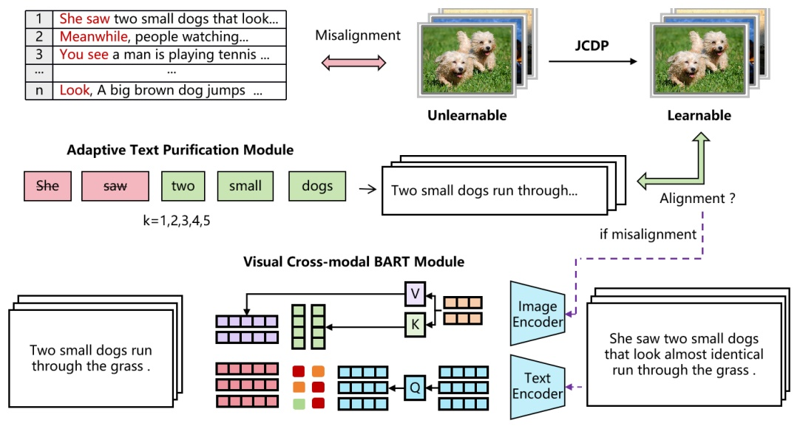
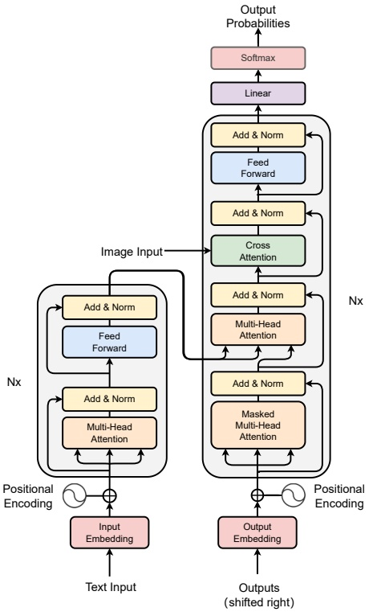
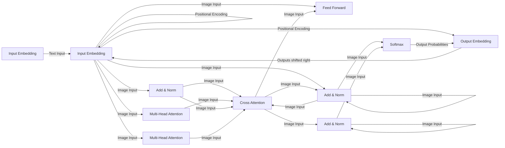
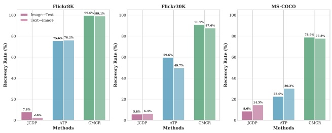

# Cross-Modal Collaborative Recovery: Breaking Multimodal Unlearnable Examples Protection

1st Ruijia Li

School of Cyber Science and Engineering

Zhengzhou University

Zhengzhou, China

ruijia\_li@gs.zzu.edu.cn

2nd Zijiao Zhang

School of Cyber Science and Engineering

Zhengzhou University

Zhengzhou, China

zzj@zzu.edu.cn

3rd Ximin Huang

Network Management Center

Zhengzhou University

Zhengzhou, China

hxm@zzu.edu.cn

4th Hongwei Hu

Network Management Center

Zhengzhou University

Zhengzhou, China

hhw@zzu.edu.cn

5th Xining Gao

School of Cyber Science and Engineering

Zhengzhou University

Zhengzhou, China

gxn@gs.zzu.edu.cn

**Abstract—With the rapid development of multimodal machine learning, data security has become a critical bottleneck constraining multimodal artificial intelligence advancement. Multimodal unlearnable examples, as an emerging data protection paradigm, prevent unauthorized model training by disrupting cross-modal semantic consistency through adversarial perturbations and trigger identifiers. However, existing multimodal protection mechanisms suffer from significant robustness deficiencies and security vulnerabilities. This paper conducts a systematic security evaluation of multimodal unlearnable examples and proposes a Cross-Modal Collaborative Recovery (CMCR) attack framework. CMCR integrates Joint Conditional Diffusion Purification for image denoising, Adaptive Text Purification for trigger removal, and Visual Cross-modal BART for cross-modal reconstruction. Experiments demonstrate that CMCR successfully restores imagetext retrieval performance to levels approaching clean data across different model architectures, achieving an average recovery rate of 89.0%. Our results reveal that current multimodal unlearnable examples have security vulnerabilities and insufficient robustness against coordinated cross-modal attacks.**

**Index Terms—multimodal unlearnable examples, cross-modal attack, vision-language models, diffusion models, data privacy protection**

## I. Introduction

With the rapid advancement of multimodal learning, largescale Vision-Language Models (VLMs) like CLIP have demonstrated exceptional performance in image retrieval, content generation, and multimodal understanding [1]. These models are trained via contrastive learning on massive imagetext pairs from the internet [2]. However, this raises critical privacy concerns as personal information may be incorporated into training sets, exposing models to membership inference attacks [3], prompt injection attacks [4], and model inversion attacks [5].

To address these challenges, unlearnable examples have emerged as a defense mechanism [6]. By injecting imperceptible perturbations, this approach disrupts model learning while preserving human perception. Recent advances extend this to multimodal scenarios, disrupting cross-modal semantic consistency through joint adversarial optimization [7].

However, multimodal environments introduce distinct vulnerabilities that existing protections fail to address. Cross-modal information redundancy provides multiple attack surfaces, while semantic alignment enables coordinated attacks. Current research focuses on protection design without considering advanced threat models, evaluating only isolated unimodal attacks. This neglects cascading failures where compromising one modality enables attacks on another. For instance, purifying text allows recovered semantics to guide image purification, creating synergistic effects that existing defenses cannot counter.

To reveal these limitations and establish foundations for robust protection, we propose a Cross-Modal Collaborative Recovery (CMCR) framework following responsible disclosure principles. Unlike independent single-modal approaches, CMCR exploits cross-modal semantic relationships where one modality’s recovery guides the other. By integrating diffusion purification, trigger removal, and cross-modal reconstruction, we systematically analyze vulnerabilities of multimodal unlearnable examples.

**Ethical Considerations**: This research follows responsible disclosure principles in security research. By exposing protection vulnerabilities, we aim to motivate robust defense development, similar to adversarial attack research advancing model robustness. Our findings serve as red-team analysis to advance multimodal security rather than enable unauthorized exploitation.

## Contributions:

• We design an adaptive token-level trigger excision scheme collaborating with diffusion models to defeat multimodal protection mechanisms.

• We propose the CMCR framework, achieving end-to-end neutralization of multimodal unlearnable example protections.
• We propose a vision-guided BART-based scheme leveraging cross-modal semantics for coordinated purification.

## II. Related Work

## A. Unlearnable Examples

Unlearnable examples prevent unauthorized model training by injecting imperceptible adversarial perturbations [8] that disrupt model generalization. Existing research primarily focuses on single-modality image classification. Perturbation generation methods include model-free approaches like LSP and CUDA [9], [10] that construct pixel-level noise patterns, and model-based approaches like GUE, CSD, UCs, and DH [11]–[14] that utilize surrogate models. Error-Minimization (EM) [15] generates robust perturbations by minimizing training error, while UDP and EUDP [16], [17] protect diffusion models by adjusting sampling distributions.

Multi-step Error Minimization (MEM) first extended unlearnable examples to multimodal domains, disrupting semantic alignment of image-text pairs in VLMs like CLIP [18]. Currently, MEM represents the only publicly available multi-modal method with implementation details, making it a representative baseline for evaluating cross-modal attack strategies. By jointly optimizing adversarial noise in images and trigger patterns in text, MEM constructs cross-modal spurious correlations that degrade multimodal model performance. Due to high-dimensional feature dispersion and lack of explicit supervision signals in contrastive learning, traditional singlemodality methods show limited efficacy in multimodal environments [19].

## B. Attacks on Unlearnable Examples

Existing attack methods primarily target single-modality tasks. Joint-Conditional Diffusion Purification (JCDP) leverages data manifold priors to reproject protected examples into learnable space [20], introducing joint constraints of pixellevel and perceptual distances during denoising to remove perturbations while preserving semantics. Adversarial training and data augmentation have also shown promise in restoring trainability [21].

However, extending these techniques to multimodal domains remains unexplored. Multimodal data requires coordinated purification strategies addressing cross-modal semantic correlations, as text trigger removal differs fundamentally from image denoising. Existing methods cannot be directly applied to multimodal scenarios, though diffusion models’ denoising capabilities provide a foundation for attacking multimodal protection mechanisms.

## III. Methodology

## A. Formal Problem Definition

Let $\mathcal { D } \; = \; \{ ( I _ { i } , T _ { i } ) \} _ { i = 1 } ^ { N }$ denote a clean multimodal dataset containing $N$ image-text pairs, where $I _ { i } \in \mathbb { R } ^ { H \times W \times C }$ represents an image sample and $T _ { i }$ represents the corresponding text description. The objective of multimodal unlearnable examples is to generate a protected dataset $\mathcal { D } ^ { \prime } = \{ ( I _ { i } ^ { \prime } , T _ { i } ^ { \prime } ) \} _ { i = 1 } ^ { N }$ such that models trained on $\mathcal { D } ^ { \prime }$ perform poorly on the original clean distribution.

Specifically, multimodal unlearnable example generation is defined as:

$$
\mathcal {D} ^ {\prime} = \left\{\left(I _ {i} + \delta_ {i}, T _ {i} \oplus t _ {i}\right) \right\} _ {i = 1} ^ {N} \tag {1}
$$

where $\delta _ { i }$ represents imperceptible image perturbations satisfying $\| \delta _ { i } \| _ { \infty }   \leq   \epsilon ,$ and $t _ { i }$ represents triggers inserted into the original text.

Our attack objective is to restore the learnability of the given protected multimodal dataset $\mathcal { D } ^ { \prime }$ by generating a purified dataset $\mathcal { D } ^ { * }   =   \{ \left( I _ { i } ^ { * } , T _ { i } ^ { * } \right) \} _ { i = 1 } ^ { N }$ such that models trained on $\mathcal { D } ^ { * }$ can achieve performance close to that of the original clean data.

## B. Vulnerability Analysis of Multimodal Protection Mechanisms

Analysis of existing multimodal unlearnable example protection reveals three key vulnerabilities. First, diffusion models possess strong noise identification capabilities [24], making adversarial perturbations with high-frequency characteristics detectable and removable despite error-minimization injection. Second, text triggers exhibit identifiable patterns and positional regularities, with current MEM methods inserting triggers at fixed sentence-initial positions that provide clear removal targets, while semantic inconsistency enables cross-modal detection. Third, existing methods protect modalities independently without cross-modal consistency constraints, enabling attackers to compromise weaker modalities first and leverage recovered semantics to guide attacks on others, creating synergistic effects current defenses cannot counter. These vulnerabilities indicate multimodal protection requires cross-modal synergistic design rather than simple combination of single-modality methods.

## C. Cross-Modal Collaborative Recovery Framework (CMCR)

The Cross-Modal Collaborative Recovery (CMCR) framework is proposed to leverage inherent semantic correspondence in multimodal data, transforming single-modality purification into cross-modal collaborative recovery. The recovery process is defined as a joint optimization problem:

$$
\{I ^ {*}, T ^ {*} \} = \arg \min _ {I ^ {*}, T ^ {*}} \mathcal {L} _ {\text {total}} \left(I ^ {*}, T ^ {*}\right) \tag {2}
$$

where the total loss function is defined as:

$$
\mathcal {L} _ {\text {total}} = \mathcal {L} _ {c} \left(I ^ {*}, T ^ {*}\right) + \lambda_ {1} \mathcal {L} _ {f} \left(I ^ {*}, I ^ {\prime}\right) + \lambda_ {2} \mathcal {L} _ {t} \left(T ^ {*}, T ^ {\prime}\right) \tag {3}
$$

with $\mathcal { L } _ { c } ( \cdot )$ denoting cross-modal semantic consistency loss, $\mathcal { L } _ { f } ( \cdot )$ representing image fidelity loss, and $\mathcal { L } _ { t } ( \cdot )$ indicating text fluency loss.

CMCR comprises three modules: JCDP for image purification, ATP for trigger removal, and VCA-BART for cross-modal reconstruction. JCDP first purifies images, then ATP attempts trigger removal; if unsuccessful, VCA-BART activates using purified image guidance (Figure 1).

flowchart

This flowchart illustrates a text processing workflow for visual cross-modal BART modules, showing how unlearned images are processed through adaptive text purification and alignment, and then processed through visual encoders to identify small dogs.

Fig. 1. Overview of the CMCR Framework

## D. Adaptive Text Purification Module (ATP)

An adaptive purification strategy dynamically selects between token truncation and cross-modal reconstruction based on removal effectiveness. Since current methods insert triggers at sentence beginnings, position-based removal attempts sequential truncation of 1-5 tokens:

$$
T _ {\text {clean}} ^ {(k)} = \left[ t _ {k + 1}, t _ {k + 2}, \dots , t _ {n} \right], \quad k \in \{1, 2, 3, 4, 5 \} \tag {4}
$$

The optimal purification strategy is selected by evaluating image-text semantic consistency under different truncation lengths:

$$
k ^ {*} = \arg \min _ {k} \mathcal {L} _ {\text {alignment}} \left(I ^ {*}, T _ {\text {clean}} ^ {(k)}\right) \tag {5}
$$

where the semantic alignment loss is defined as:

$$
\mathcal {L} _ {\text {alignment}} = 1 - \frac {\exp \left(s _ {I , T} / \tau\right)}{\sum_ {j} \exp \left(s _ {I , T _ {j}} / \tau\right)} \tag {6}
$$

where $s _ { I , T } = \operatorname { s i m } ( f _ { I } ( I ^ { * } ) , f _ { T } ( T _ { \mathrm { c l e a n } } ^ { ( k ) } ) )$ represents the similarity score between image and text features.

A performance threshold $\tau _ { \mathrm { t h r e s h } } = 0 . 7 5$ is set for the Recovery Rate. When text-image retrieval recall after token excision meets ≥ 0.75, the model can effectively learn, indicating triggers at sentence beginnings where simple excision suffices. Otherwise, triggers are positioned elsewhere, and the cross-modal reconstruction mechanism activates.

## E. Visual Cross-modal BART Module (VCA-BART)

When simple token truncation cannot achieve the expected results, we activate a deep reconstruction mechanism based on visual-conditioned text generation. This module specifically addresses trigger position randomization strategies that defenders may adopt.

We structurally improve the pre-trained BART model by integrating cross-attention mechanisms in each layer of the decoder:

$$
\text {CrossAttention} (Q, K, V) = \text {softmax} \left(\frac {Q K ^ {T}}{\sqrt {d _ {k}}}\right) V \tag {7}
$$

query matrix 𝑄 derives from text sequence hidden representations, and key-value pairs (𝐾, 𝑉) derive from purified image features to guide text recovery. The architecture is shown in Figure 2.

The model minimizes the conditional text generation loss:

$$
\mathcal {L} _ {\text {generation}} = - \sum_ {i = 1} ^ {| T |} \log P \left(t _ {i} \mid t _ {<   i}, \mathrm{CNN} \left(I ^ {*}\right)\right) \tag {8}
$$

During inference, VCA-BART activates when performance falls below the threshold:

$$
T ^ {*} = \left\{ \begin{array}{l l} T _ {\text {clean}} ^ {(k ^ {*})} & \text {if Medr} \geq \tau_ {\text {thresh}} \\ \text {VCA - BART} \left(T _ {i} \oplus t _ {i}, I ^ {*}\right) & \text {otherwise} \end{array} \right. \tag {9}
$$

Simple methods are prioritized for efficiency, with VCA-BART compensating for ATP limitations. Through image semantic guidance, the module generates clean text semantically consistent with purified images despite randomized trigger positions.

TABLE I Comparison of the effectiveness with different unlearnable examples on several datasets.

<table><tr><td rowspan="3">Methods</td><td colspan="4">Flickr8k</td><td colspan="4">Flickr30k</td><td colspan="4">MSCOCO</td></tr><tr><td colspan="2">Image → Text</td><td colspan="2">Text → Image</td><td colspan="2">Image → Text</td><td colspan="2">Text → Image</td><td colspan="2">Image → Text</td><td colspan="2">Text → Image</td></tr><tr><td>Recall@10</td><td>Medr</td><td>Recall@10</td><td>Medr</td><td>Recall@10</td><td>Medr</td><td>Recall@10</td><td>Medr</td><td>Recall@10</td><td>Medr</td><td>Recall@10</td><td>Medr</td></tr><tr><td>Clean</td><td>27.4</td><td>42</td><td>26.1</td><td>38</td><td>48.3</td><td>13</td><td>44.8</td><td>18</td><td>63.2</td><td>6</td><td>57.9</td><td>7</td></tr><tr><td>MEM-3</td><td>4.3</td><td>312</td><td>3.6</td><td>265</td><td>3.9</td><td>409</td><td>2.3</td><td>316</td><td>1.8</td><td>1679</td><td>1.3</td><td>1293</td></tr><tr><td>JCDP [20]</td><td>4.7</td><td>291</td><td>3.5</td><td>259</td><td>4.5</td><td>386</td><td>3.2</td><td>297</td><td>1.9</td><td>1535</td><td>1.5</td><td>1106</td></tr><tr><td>ONION [25]</td><td>12.1</td><td>108</td><td>14.9</td><td>92</td><td>10.2</td><td>173</td><td>8.3</td><td>168</td><td>1.8</td><td>1301</td><td>1.6</td><td>904</td></tr><tr><td>CMCR (Ours)</td><td>27.5</td><td>43</td><td>26.6</td><td>40</td><td>40.5</td><td>49</td><td>37.1</td><td>55</td><td>45.4</td><td>358</td><td>40.7</td><td>293</td></tr></table>

flowchart

Fig. 2. Architecture of the Visual Cross-modal BART (VCA-BART) Module with Cross-Attention Mechanism

## F. Joint Conditional Diffusion Purification Module (JCDP)

The JCDP approach is adopted, leveraging the powerful denoising capabilities of pre-trained diffusion models to reproject images containing adversarial perturbations back onto the natural image manifold through joint conditional constraints.

Given a contaminated image $I ^ { \prime }   =   I + \delta$ , we first perform a forward diffusion process on it, gradually adding Gaussian noise until the perturbations are completely buried:

$$
q (I _ {t} | I _ {0}) = \mathcal {N} (I _ {t}; \sqrt {\bar {\alpha} _ {t}} I _ {0}, (1 - \bar {\alpha} _ {t}) \mathbf {I}) \tag {10}
$$

where $\begin{array} { r } { \bar { \alpha } _ { t } = \prod _ { s = 1 } ^ { t } \alpha _ { s } } \end{array}$ and $\alpha _ { t } = 1 - \beta _ { t }$ . After $T _ { p }$ diffusion steps, the adversarial perturbations 𝛿 are sufficiently diluted in the noise:

$$
I _ {T _ {p}} ^ {\prime} = \sqrt {\bar {\alpha} _ {T _ {p}}} I ^ {\prime} + \sqrt {1 - \bar {\alpha} _ {T _ {p}}} \epsilon \tag {11}
$$

During the reverse denoising process, we introduce joint conditional constraints of pixel distance and perceptual distance. The conditional distribution of the reverse process can be expressed as:

$$
p _ {\theta} (I _ {t - 1} ^ {*} | I _ {t} ^ {*}, I _ {t} ^ {\prime}, \Phi (I _ {t} ^ {\prime})) = \mathcal {N} (I _ {t - 1} ^ {*}; \mu_ {\theta} (I _ {t} ^ {*}, t) + \sigma_ {t} ^ {2} (\mathbf {d} _ {1} + \mathbf {d} _ {2}),
$$

$$
\sigma_ {t} ^ {2} \mathbf {I}) \tag {12}
$$

where the joint conditional terms are defined as:

$$
\mathbf {d} _ {1} = - \lambda_ {1} \nabla_ {I _ {t} ^ {*}} \mathcal {D} _ {m} \left(I _ {t} ^ {*}, I _ {t} ^ {\prime}\right) \tag {13}
$$

$$
\mathbf {d} _ {2} = - \lambda_ {2} \nabla_ {I _ {t} ^ {*}} \mathcal {D} _ {p} \left(I _ {t} ^ {*}, I _ {t} ^ {\prime}\right) \tag {14}
$$

The pixel distance uses mean squared error: $\mathcal { D } _ { m } ( I _ { t } ^ { * } , I _ { t } ^ { \prime } ) =$ $\| I _ { t } ^ { * } - I _ { t } ^ { \prime } \| _ { 2 } ^ { 2 }$ , and the perceptual distance uses LPIPS metric: $\mathcal { D } _ { p } ( I _ { t } ^ { * } , I _ { t } ^ { \prime } ) = \| \Phi ( I _ { t } ^ { * } ) - \Phi ( I _ { t } ^ { \prime } ) \| _ { 2 } ^ { 2 }$

This joint conditional design ensures that the purified images maintain both pixel-level similarity to the original images and perceptual-level semantic consistency. Through multiple iterative purifications, adversarial perturbations are largely removed.

## IV. Experimental Evaluation

## A. Datasets

Three benchmark datasets with progressively increasing scale and complexity are employed for evaluation. Flickr8K comprises 8,000 images with 40,000 image-text pairs; Flickr30K contains 31,000 images with 155,000 pairs; MS-COCO includes 123,000 training images with 615,000 pairs. The targeted method is the multimodal unlearnable example generation method MEM, which protects data through joint optimization of image adversarial noise and text triggers.

## B. Evaluation Metrics

Attack effectiveness is evaluated using multimodal retrieval metrics. Recall@K (K=1,5,10) measures the proportion of correct answers in the top-K results, where higher values indicate better performance. Median Rank (Medr) evaluates ranking quality as the median position of correct answers, where lower values indicate better learnability restoration. Recovery Rate quantifies overall effectiveness and is calculated as:

TABLE II Effectiveness comparison of different text processing modules against MEM-5 protection.

<table><tr><td rowspan="2">Methods</td><td colspan="4">Flickr8K</td><td colspan="4">Flickr30K</td><td colspan="4">MS-COCO</td></tr><tr><td>Image → Text Recall@10</td><td>Text Medr</td><td>Text → Image Recall@10</td><td>Image Medr</td><td>Image → Text Recall@10</td><td>Text Medr</td><td>Text → Image Recall@10</td><td>Image Medr</td><td>Image → Text Recall@10</td><td>Text Medr</td><td>Image Medr</td><td>Image Medr</td></tr><tr><td>Clean</td><td>27.4</td><td>42</td><td>26.1</td><td>38</td><td>48.3</td><td>13</td><td>44.8</td><td>18</td><td>63.2</td><td>6</td><td>57.9</td><td>7</td></tr><tr><td>MEM-5</td><td>3.8</td><td>325</td><td>3.2</td><td>278</td><td>3.5</td><td>418</td><td>2.1</td><td>325</td><td>1.6</td><td>1720</td><td>1.2</td><td>1315</td></tr><tr><td>JCDP + ATP</td><td>26.8</td><td>45</td><td>25.9</td><td>41</td><td>39.2</td><td>52</td><td>36.4</td><td>58</td><td>43.8</td><td>375</td><td>39.2</td><td>305</td></tr><tr><td>JCDP + VCA-BART</td><td>27.1</td><td>44</td><td>26.2</td><td>40</td><td>41.1</td><td>47</td><td>38.0</td><td>53</td><td>46.2</td><td>340</td><td>41.5</td><td>285</td></tr></table>

$$
\text {Recovery Rate} = \frac {\mathrm{Medr} _ {\mathcal {D} ^ {\prime}} - \mathrm{Medr} _ {\mathcal {D} ^ {*}}}{\mathrm{Medr} _ {\mathcal {D} ^ {\prime}} - \mathrm{Medr} _ {\mathcal {D}}} \times 100 \% \tag {15}
$$

where $\mathrm { M e d r } _ { \mathrm { p r o t e c t e d } }$ represents the median rank of protected data, $\mathbf { M e d r } _ { \mathrm { p u r i f i e d } }$ represents the median rank after purification, and $\mathrm { M e d r _ { c l e a n } }$ represents the median rank of clean data.

## C. Effectiveness

Experimental results demonstrate that our proposed CMCR framework can effectively breach the multimodal unlearnable example protection mechanism generated by MEM. Test results on three benchmark datasets are shown in Table I.

The results for model loss and retrieval effectiveness (Medr) of various methods are shown in Figure 3. CMCR training exhibits a slower convergence rate compared to MEM. This finding is consistent with the theoretical hypothesis of MEM, which posits that it enables the model to circumvent the penalty mechanism by establishing a “shortcut.”

Fig. 3. Training Loss and Testing Metrics Comparison

## D. Ablation Experiments

Ablation experiments on MEM-3 protected data reveal each component’s contribution. JCDP alone achieves only

7.6% recovery, indicating limited effectiveness of pure image purification in multimodal scenarios. ATP alone reaches 52.3%, demonstrating the critical role of text trigger removal. The complete CMCR framework achieves 89.0% recovery (Figure 4), validating cross-modal collaborative purification effectiveness.

Fig. 4. Recovery Rate Comparison of Different Methods

To further validate text processing effectiveness, we compare ATP and VCA-BART against MEM-5 in Table II. VCA-BART performs slightly better on complex datasets (Flickr30K, MS-COCO), as cross-modal semantic guidance better compensates for semantic differences when processing complex trigger patterns.

## E. Transferability

To verify generalization capability, we test CMCR on different model architectures: ResNet50 (surrogate model), ResNet101, and ViT-B/32 (Table III). Results demonstrate stable effectiveness across architectures, proving good transferability.

## F. Computational Overhead

We evaluate the computational cost of CMCR on an NVIDIA RTX 4090 GPU. The purification process constitutes the primary computational overhead: for MS-COCO (123K images), JCDP requires approximately 38 hours due to 200- step iterative diffusion sampling, while text purification (ATP + VCA-BART when triggered) adds about 8 hours, yielding a total one-time purification cost of 46 hours. Subsequent standard training on purified data requires 15 hours for 50 epochs, resulting in a total cost of 61 hours compared to 52 hours for adversarial training on protected data. While CMCR incurs higher initial overhead, the purified dataset can be reused for multiple training runs without re-purification, becoming more efficient than adversarial training after approximately 4 iterations. This one-time cost is justified by the 89% recovery rate and the ability to use standard training procedures rather than specialized adversarial schemes.

TABLE III

The transferability of MEM-3 generated on a ResNet50 model across different architectures models.

<table><tr><td rowspan="3">Model</td><td colspan="4">Flickr8k</td><td colspan="4">Flickr30k</td><td colspan="4">MSCOCO</td></tr><tr><td colspan="2">Image → Text</td><td colspan="2">Text → Image</td><td colspan="2">Image → Text</td><td colspan="2">Text → Image</td><td colspan="2">Image → Text</td><td colspan="2">Text → Image</td></tr><tr><td> $D_c$ </td><td> $D_u$ </td><td> $D_c$ </td><td> $D_u$ </td><td> $D_c$ </td><td> $D_u$ </td><td> $D_c$ </td><td> $D_u$ </td><td> $D_c$ </td><td> $D_u$ </td><td> $D_c$ </td><td> $D_u$ </td></tr><tr><td>RN50</td><td>42</td><td>43</td><td>38</td><td>40</td><td>13</td><td>49</td><td>18</td><td>55</td><td>6</td><td>102</td><td>7</td><td>115</td></tr><tr><td>RN101</td><td>40</td><td>41</td><td>38</td><td>39</td><td>14</td><td>45</td><td>21</td><td>57</td><td>4</td><td>98</td><td>6</td><td>82</td></tr><tr><td>ViT-B/32</td><td>41</td><td>45</td><td>35</td><td>39</td><td>11</td><td>43</td><td>15</td><td>46</td><td>4</td><td>67</td><td>4</td><td>71</td></tr></table>

## V. Conclusion

This paper systematically analyzes multimodal unlearnable example protection and proposes CMCR, achieving 89.0% average recovery across three datasets. Analysis reveals three key vulnerabilities: diffusion models enable perturbation detection, fixed-position triggers provide removal targets, and independent modality protection allows sequential compromise.

Our evaluation focuses on MEM [18], currently the only publicly available multimodal protection method with implementation code. Future work should evaluate CMCR against additional methods as they emerge. Additionally, ATP assumes sentence-initial triggers, though VCA-BART addresses randomized positions.

These findings reveal fundamental limitations in current multimodal protection mechanisms and establish evaluation benchmarks for future defense designs. More robust protections should incorporate dynamic trigger strategies, cross-modal consistency constraints, and adversarial training against purification attacks. This work advances understanding of multimodal security vulnerabilities and motivates development of comprehensive defense mechanisms.

## References

[1] A. Radford et al., “Learning transferable visual models from natural language supervision,” in Proc. 38th Int. Conf. Machine Learning, PMLR, vol. 139, 2021, pp. 8748–8763.
[2] Y. Gu, Y. Bai, and S. Xu, “CS-MIA: Membership inference attack based on prediction confidence series in federated learning,” J. Inf. Security Appl., vol. 67, art. no. 103201, June 2022.
[3] H. Mu et al., “Stealthy jailbreak attacks on large language models via benign data mirroring,” in Proc. 2025 Conf. North Amer. Chapter Assoc. Comput. Linguistics: Human Language Technologies (NAACL-HLT), Albuquerque, NM, USA, 2025, pp. 1784–1799.
[4] F. Tramèr, F. Zhang, A. Juels, M. K. Reiter, and T. Ristenpart, “Stealing machine learning models via prediction APIs,” in Proc. 25th USENIX Security Symp., Austin, TX, USA, 2016, pp. 601–618.
[5] J. Ren et al., “Transferable Unlearnable Examples,” in Proc. Int. Conf. Learning Representations (ICLR), 2023.
[6] X. Liu, X. Jia, Y. Xun, S. Liang, and X. Cao, “Multimodal unlearnable examples: Protecting data against multimodal contrastive learning,” in Proc. 32nd ACM Int. Conf. Multimedia (MM), Melbourne, VIC, Australia, 2024, pp. 4789–4798.
[7] I. J. Goodfellow, J. Shlens, and C. Szegedy, “Explaining and harnessing adversarial examples,” in Proc. 3rd Int. Conf. Learning Representations (ICLR), San Diego, CA, USA, 2015.
[8] D. Yu et al., “Availability attacks create shortcuts,” in Proc. 39th Int. Conf. Machine Learning (ICML), Baltimore, MD, USA, 2022, pp. 25063–25068.
[9] Mahesh Vaijaninthymala Krishnamoorthy. Data Obfuscation Through Latent Space Projection for Privacy - Preserving AI Governance: Case Studies in Medical Diagnosis and Finance Fraud Detection[J]. JMIRx Med, 2025 Mar 12;6:e70100. DOI: 10.2196/70100.
[10] V. S. Sadasivan, M. Soltanolkotabi, and S. Feizi, “CUDA: Convolutionbased unlearnable datasets,” in Proc. IEEE/CVF Conf. Computer Vision Pattern Recognition (CVPR), Vancouver, BC, Canada, 2023, pp. 3862–3871.
[11] J. Ren, “Transferable unlearnable examples,” in Proc. 11th Int. Conf. Learning Representations (ICLR), Kigali, Rwanda, 2023.
[12] J. Zhang et al., N. Chen, P. Mu, Z. He, H. Li, and L. Zhang, “Unlearnable clusters: Towards label-agnostic unlearnable examples,” in Proc. IEEE/CVF Conf. Computer Vision Pattern Recognition (CVPR), Vancouver, BC, Canada, 2023, pp. 1483–1492.
[13] R. Meng et al., “Semantic deep hiding for robust unlearnable examples,” IEEE Trans. Inf. Forensics Security, vol. 19, pp. 4093–4108, 2024.
[14] Z. Zhao, Y. Lu, and J. Zhu, “Unlearnable examples for diffusion models: Protect data from unauthorized exploitation,” 2023, arXiv:2306.01902. [Online]. Available: https://arxiv.org/abs/2306.01902
[15] H. Huang, X. Ma, S. M. Erfani, J. Bailey, and Y. Wang, “Unlearnable examples: Making personal data unexploitable,” in Proc. 9th Int. Conf. Learning Representations (ICLR), 2021.
[16] Z. Zhao, Y. Lu, and J. Zhu, “Unlearnable Examples for Diffusion Models: Protect Data from Unauthorized Exploitation,” 2024, arXiv:2306.01902v2. [Online]. Available: https://arxiv.org/abs/2306.01902
[17] Y. Yu et al., “Purify unlearnable examples via rate-constrained variational autoencoders,” in Proc. 41st Int. Conf. Machine Learning (ICML), PMLR, vol. 235, 2024, pp. 1–25.
[18] X. Liu, X. Jia, Y. Xun, S. Liang, and X. Cao, “Multimodal unlearnable examples: Protecting data against multimodal contrastive learning,” in Proc. 32nd ACM Int. Conf. Multimedia (MM), Melbourne, VIC, Australia, 2024, pp. 4789–4798.
[19] R. Nakada, T. Imaizumi, M. Sugiyama, and M. Yamada, “Understanding multimodal contrastive learning and incorporating unpaired data,” 2023, arXiv:2302.06232. [Online]. Available: https://arxiv.org/abs/2302.06232
[20] W. Jiang et al., “Unlearnable examples give a false sense of security: Piercing through unexploitable data with learnable examples,” in Proc. 31st ACM Int. Conf. Multimedia, 2023, pp. 8901–8921.
[21] Z. He and M. Singh, “VQUNet: Vector quantization U-Net for defending adversarial attacks by regularizing unwanted noise,” in Proc. 2024 7th Int. Conf. Machine Vision Applications (ICMVA), 2024, pp. 69–76.
[22] T. Qin, X. Gao, J. Zhao, K. Ye, and C.-Z. Xu, “Learning the unlearnable: Adversarial augmentations suppress unlearnable example attacks,” 2023, arXiv:2303.15127. [Online]. Available: https://arxiv.org/abs/2303.15127
[23] X. Gong et al., “ARMOR: Shielding unlearnable examples against data augmentation,” 2025, arXiv:2501.08862. [Online]. Available: https://arxiv.org/abs/2501.08862
[24] J. Ho, A. Jain, and P. Abbeel, “Denoising diffusion probabilistic models,” in Proc. Adv. Neural Inf. Process. Syst. (NeurIPS), vol. 33, 2020, pp. 6840–6851.
[25] F. Qi et al., “ONION: A simple and effective defense against textual backdoor attacks,” in Proc. 2021 Conf. Empirical Methods Natural Language Processing (EMNLP), Punta Cana, Dominican Republic, 2021, pp. 9558–9566.