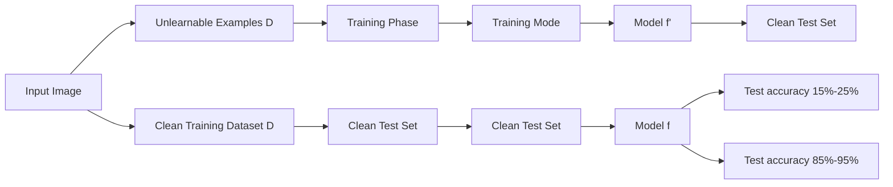
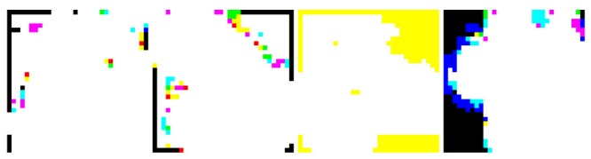
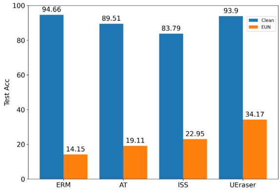
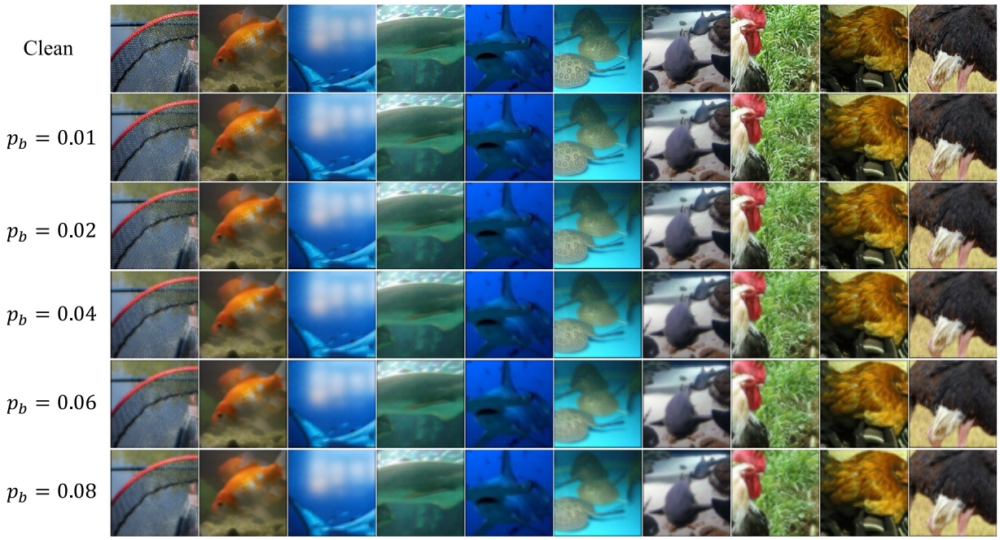

# EUN: Enhanced unlearnable examples generation approach for privacy protection✩

**Xiaotian Chen a,b, Yang Xu a,b,**∗**, Sicong Zhang a,b, Jiale Yan c, Weida Xu a,b, Xinlong He a,b**

**a School of Cyber Science and Technology, Guizhou Normal University, Guiyang 550001, China**
**b Guizhou Key Laboratory of NewGen Cyberspace Security, Guiyang 550001, China**
**c School of Cyber Science and Engineering, Wuhan University, Wuhan 430000, China**

## A R T I C L E I N F O

**Communicated by Massimiliano Mancini**

**Keywords:**

**Deep learning**

**Computer vision**

**Image classification**

**Unlearnable examples**

**Data poisoning**

**Privacy protection**

## A B S T R A C T

**In the era of artificial intelligence, the importance of protecting user privacy has become increasingly prominent. Unlearnable examples prevent deep learning models from learning semantic features in images by adding perturbations or noise that are imperceptible to the human eye. Existing perturbation generation methods are not robust to defense methods or are only robust to one defense method. To address this problem, we propose an enhanced perturbation generation method for unlearnable examples. This method generates the perturbation by performing a class-wise convolution on the image and changing a pixel in the local position of the image. This method is robust to multiple defense methods. In addition, by adjusting the order of global position convolution and local position pixel change of the image, variants of the method were generated and analyzed. We have tested our method on a variety of datasets with a variety of models, and compared with 6 perturbation generation methods. The results demonstrate that the clean test accuracy of the enhanced perturbation generation method for unlearnable examples is still less than 35% when facing defense methods such as image shortcut squeezing, adversarial training, and adversarial augmentation. It outperforms existing perturbation generation methods in many aspects, and is 20% lower than CUDA and OPS, two excellent perturbation generation methods, under several parameter settings.**

## 1. Introduction

**With the rapid development of artificial intelligence technology, the privacy protection (Huang et al., 2021a; Dong et al., 2023; Yu et al., 2023; Zhang et al., 2024) of user data faces huge challenges. The training of deep neural networks (DNN) relies on large-scale datasets, which makes the model owner crawl data from social networks for data collection (Lin et al., 2014; Sariyildiz et al., 2020; Desai and Johnson, 2021). A lot of data is publicly available online, therefore use of this data is often unauthorized. Currently, there are online websites (such as www.facelib.org) that have established face recognition systems. This website establishes an open face database for public figures and uses face search technology to provide online rapid identity recognition. In addition, Hill (2022) pointed out that a private company used more than 3 billion facial images collected from the Internet to train a commercial face recognition system without the consent of the users. Such a huge amount of data can significantly improve the performance** **of DNN, but it raises serious concerns about privacy and data security among users.**

**To prevent the unauthorized use of the released image data, related studies suggest poisoning data with imperceptible noise such that the performances of models trained on the modified data be significantly reduced (Huang et al., 2021b; Fowl et al., 2021; Yuan and Wu, 2021). Imagine that if the facial images collected by the unauthorized person from the Internet are added with imperceptible noise, then when the unauthorized person trains the model, it will inevitably affect the accuracy of the model. For users, this noise actually protects their data security. Huang et al. (2021b) call such images with imperceptible noise or perturbation as unlearnable examples. According to Huang et al. (2021b), although perturbations on unlearnable examples are imperceptible to the human eye, they can trick the models believing that there is nothing to learn from these examples.**

**In addition to the error-minimizing (EM) noise proposed by Huang et al. (2021b) to generate unlearnable examples, similar methods have** **been proposed, including TAP (Fowl et al., 2021), NTGA (Yuan and Wu, 2021), REM (Fu et al., 2022), OPS (Wu et al., 2023), CUDA (Sadasivan et al., 2023), etc. Although they are generated in different ways and have different perturbation effects, they can all enable the model to learn the correspondence between perturbations and labels. After adding perturbations to the images in the training dataset, it is difficult for the model to learn the true semantic features in the image, resulting in low classification accuracy on a clean test set.**

<small>✩ This work was supported in part by the Central Government Guides Local Science and Technology Development Special Funds, China under Grant [2018]4008, in part by the Science and Technology Platform Project of Guizhou Province, China under grant ZSYS[2025]011, and in part by the Science and Technology Planned Project of Guizhou Province, China under grant [2023]YB449.</small>

<small>∗ Corresponding author at: School of Cyber Science and Technology, Guizhou Normal University, Guiyang 550001, China.</small>

<small>E-mail address: [xy@gznu.edu.cn](mailto:xy@gznu.edu.cn) (Y. Xu).</small>

**Correspondingly, several defense methods against unlearnable examples have been proposed, such as adversarial training (AT) (Tao et al., 2021), image shortcut squeezing (ISS) (Liu et al., 2023), and adversarial augmentations (UEraser is used instead below) (Qin et al., 2023). After adding perturbations to the images in the training dataset, the use of defense methods during model training may restore the classification accuracy of the model on the clean test set. For example, after adding perturbations generated by EM to the images in the training dataset, the model adopts defense method AT during training, and then the classification accuracy of the model on the clean test set is restored to nearly 90%. Thus, the perturbations generated by EM fail when encountering the defense method AT.**

**As shown in Fig. 1, the unlearnable examples generated by EM perform well in normal training, but fail when the model owner uses AT during training. Related research lacks a unlearnable example generation method that exhibits high robustness against various defense methods. In order to find such method that is highly robust to multiple defense methods, this paper proposes an enhanced perturbation generation method for unlearnable examples (EUN). EUN outperforms existing perturbation generation methods in many aspects and is robust to the three defense methods of AT, ISS, and UEraser.**

**The main contributions of this paper include:**

**• We propose an enhanced perturbation generation method for unlearnable examples (EUN), which generates perturbations by performing class-wise convolution on the image and changing a pixel at a local position in the image.**
**• By adjusting the order of global convolution and local pixel change in the image, the variants of EUN, EUN-B and EUN-C are obtained and analyzed.**
**• We evaluated different models on a variety of datasets and used three defense methods. The experimental results showed that the perturbations generated by EUN are more robust to defense methods than existing perturbation generation methods.**

The structure of this article is organized as follows. In Section $^ { 2 , }$ **we review related work on unlearnable examples, pointing out the limitations of existing approaches. Section 3 introduces our proposed method, detailing the theoretical foundation and practical implementation, including the dual strategy of class-wise convolution and local pixel modification. Section 4 presents comprehensive experiments and ablation studies that demonstrate the robustness and effectiveness of EUN compared to state-of-the-art methods. Finally, Section 5 concludes the paper and discusses potential future research directions.**

## 2. Related work

**In this section, we first delve into related unlearnable example generation methods and defense methods against unlearnable examples. Subsequently, we provide an overview of adversarial attack and data poisoning. Lastly, we highlight shortcut learning related to the mechanism of action of unlearnable examples.**

## 2.1. Unlearnable example

**Huang et al. (2021b) first proposed unlearnable examples, which are generated by a type of error-minimizing (EM) noise that makes the training examples unlearnable by deep neural networks. This noise** **is limited to a range that is imperceptible to human eyes. The authors formalize the noise generation problem as a bi-level optimization problem and generate two forms of error-minimizing noise by solving the bi-level optimization problem: sample-wise and class-wise. Fowl et al. (2021) found that adversarial examples originally used to attack pre-trained models are more effective than recent methods designed specifically for data poisoning. They suggested using adversarial examples as a data poisoning tool and proposed adversarial poisoning (TAP). The model trained on adversarial poisoned training data often fail to correctly classify the original clean training examples. Yuan and Wu (2021) proposed the neural tangent generalization attack (NTGA), which slightly modifies the training data in order to spoil the training process such that the trained network lacks generalizability. NTGAs are based on the recent development of Neural Tangent Kernels (NTKs), which allow a closed form approximation of the evolution of a class of wide DNNs during training by gradient descent. Unlearnable examples are vulnerable to adversarial training. To solve this problem, Fu et al. (2022) introduced robust error-minimization noise (REM). The noise is generated by a min-min–max optimization algorithm to minimize the adversarial training loss to protect the data against adversarial learners. Examples crafted by adding robust error-minimizing noise are called robust unlearnable examples. Wu et al. (2023) revealed the sensitivity of deep neural networks to single-pixel perturbations from the perspective of shortcut learning, and proposed One-Pixel Shortcut (OPS) to achieve data unlearnability. OPS modifies a single pixel at a fixed position in the same class of image. This modification is extremely efficient and has a significant effect on reducing the generalization ability of the model. OPS is robust to adversarial training, but due to its sparsity, it is sensitive to local data augmentations such as Cutout. Sadasivan et al. (2023) propose CUDA, a model-free and convolution-based method for generating unlearnable datasets that aim to prevent unauthorized model training on private data. Unlike prior approaches that inject additive perturbations, CUDA applies class-wise convolutions using randomly generated filters derived from a private key, encouraging models to learn shortcuts between filters and labels rather than meaningful features. The authors provide both theoretical and empirical evidence demonstrating that CUDA significantly degrades model generalization, even under advanced defense settings such as adversarial training (AT) and various data augmentations.**

flowchart

This flowchart illustrates a data processing pipeline for image classification, showing the progression from clean images through EM (Empty Vector Machine) and Unlearnable processing stages to final AT (Attack Training) and final fc (Feature Combination) outputs.

Fig. 1. A simple example of unlearnable examples generated by EM.

**Tao et al. (2021) found that adversarial training (AT) can serve as a principled defense against delusive attacks (i.e., unlearnable examples). The test accuracy reduced by delusive attacks can be largely recovered by adversarial training. In addition, it is found that adversarial training can resist delusive perturbations by preventing the learner from overly relying on non-robust features in a natural setting. Liu et al. (2023) show through extensive experiments that various PAP methods (i.e., unlearnable examples generation methods) are vulnerable to** **image shortcut Squeezing (ISS) based on simple compression. ISS also (slightly) outperforms adversarial training and has higher generalizability to unseen perturbation norms and also higher efficiency. Qin et al. (2023) introduce the UEraser method, which outperforms current defenses against different types of unlearnable example attacks through a combination of effective data augmentation policies and loss-maximizing adversarial augmentations.**

**However, existing methods for generating unlearnable examples exhibit limitations in robustness against diverse defense mechanisms. Early methods such as EM, TAP, and NTGA are generally ineffective against any of the three defense methods—Adversarial Training (AT), Image Shortcut Squeezing (ISS), and UEraser. While more recent approaches like REM, OPS, and CUDA have begun to address robustness to AT, their analysis and validation are restricted primarily to that single defense method. Notably, they omit systematic investigation into their effectiveness against other defense methods such as ISS and UEraser. Our experimental evaluations (Section 4) further confirm these gaps. Specifically, REM fails to maintain unlearnability when models are trained with ISS or UEraser, while both OPS and CUDA demonstrate only limited robustness under certain defensive settings. In contrast, our proposed EUN integrates class-wise convolution and local pixel modification to create dual perturbations that exploit distinct shortcut learning mechanisms. The class-wise convolution embeds persistent and class-dependent filters into the image space. These filters are resistant to ISS and UEraser due to their global influence across the image and their design independence from typical perturbation frequency patterns. Local single-pixel changes reduce the impact of adversarial training by reducing the training loss. By synergizing these components, EUN achieves robustness against multiple defense strategies (AT, ISS, UEraser) simultaneously, addressing a critical gap in prior works that lack cross-defense resilience. This dual perturbations design ensures that even if one component is mitigated, the other retains unlearnability, thereby significantly improving upon existing methods.**

## 2.2. Adversarial attack

**Adversarial attacks (Zhang et al., 2020; Nezami et al., 2021; Xiang et al., 2023; Li et al., 2024) can fool DNNs into misclassifying examples during testing by adding tiny perturbations to the original examples. Szegedy et al. (2014) first discovered that deep neural network models are vulnerable to adversarial examples. Goodfellow et al. (2014) proposed a gradient-based single-step attack method: the fast gradient sign method (FGSM). The FGSM method adds perturbations in the opposite direction of the normal example gradient in one iteration under a given upper norm constraint** 𝜀 **to maximize the training loss error of the target model, causing the model to misclassify. Kurakin et al. (2018) optimized the principle of the FGSM method and proposed the basic iterative method (BIM), which is essentially an iterative FGSM algorithm. Later, Madry et al. (2018) proposed the projected gradient descent (PGD) method, which uses uniform random noise initialization and increases the number of attack iterations. After a large number of experimental verifications, the PGD attack is widely regarded as the most powerful first-order attack. The existence of adversarial examples shows that DNN does not always learn key semantic features and sometimes relies on some non-robust features. Unlike adversarial examples (Su et al., 2019) that deceive DNNs during the testing phase, unlearnable examples prevent DNNs from learning their semantic features during the training phase, thereby protecting user data privacy.**

## 2.3. Data poisoning

**In data poisoning (Liu et al., 2020a; He et al., 2024), the attacker uses the generated poisoned data to pollute the normal dataset, thereby reducing the performance of the model trained on the polluted dataset. Although data poisoning attacks can potentially prevent data from** **being used arbitrarily, these methods have very limited effectiveness in attacking DNNs and are difficult to implement in real-world scenarios. Backdoor attacks (Liu et al., 2020b; Nguyen and Tran, 2020) are a special type of data poisoning, in which triggers are embedded into clean data during training phase. The model trained on this data will misclassify images with triggers during testing. However, backdoor attacks do not affect the performance of the model on clean data. Unlearnable examples use data poisoning to protect privacy. Perturbations that are imperceptible to the human eye are added to the image data before model training, prompting the model to learn the correspondence between perturbations and labels instead of learning semantic features in the image, thereby protecting the data from being used for unauthorized model training.**

## 2.4. Shortcut learning

**Studies on DNNs have shown that, under the condition of correct classification, DNNs tend to learn simpler features rather than the semantic features of the object itself. For example, the same object in different environments will receive different predictions, which means that DNNs depend on features that do not belong to the object (Beery et al., 2018). Geirhos et al. (2020) studied this phenomenon in different areas of deep learning and explained why shortcuts exist and how to understand them. The existence of natural adversarial examples (Hendrycks et al., 2021) also shows that DNNs do not fully learn the true semantic features during training. Instead, they may learn to use the background or texture of the image for prediction. In general, if enough data is obtained, the connection between different features will be strengthened, so that those shortcuts may not be sufficient for classification tasks, that is, the model will have to use more complex combined features to minimize the risk. However, when there are certain specific biases in the collected data (such as similar backgrounds), shortcut learning will not be effectively alleviated. Due to the existence of shortcut learning, unlearnable examples can guide the model to learn the correspondence between perturbations and labels and ignore the true semantic features, resulting in a low classification accuracy of the model for clean images.**

**Motivated by these observations on shortcut learning, our method strategically designs perturbations to exploit both global convolutional patterns and localized pixel changes. This dual mechanism ensures that even if one perturbation type is mitigated, the other retains unlearnability, as we elaborate in the following section.**

## 3. Methodology

**In this section, we present our enhanced perturbation generation method. We begin by explaining the preliminary knowledge of our method. Subsequently, we introduce the algorithm of our method and provide an intuition-based analysis of our method. Finally, we analyze two variants of our method.**

## 3.1. Preliminaries

**Inspired by CUDA and OPS, we perform class-wise convolution at the global position of the image and change a pixel at the local position of the image to obtain the enhanced perturbation generation method for unlearnable examples. Class-wise convolution means that the same convolution filter is used for convolution of the same class of images in the training dataset, and different convolution filters are used for images of different classes.**

**Fig. 2 illustrates the pipeline of EUN to prevent images from being learned by the model. The process begins with a clean training dataset** 𝐷**. The EUN method is used to generate a unlearnable dataset** 𝐷̃ **for the clean training dataset** 𝐷**. Specifically, a class-wise convolution is performed at the global position of the image and a single pixel is modified at the local position. For comparison, the clean training dataset** 𝐷 **and** **the unlearnable dataset** 𝐷̃ **are trained separately. ERM stands for empirical risk minimization and is a standard approach for training deep neural networks, where the goal is to minimize the average loss over the training dataset. AT, ISS, and UEraser are defense methods against unlearnable examples. AT stands for Adversarial Training, which is a widely adopted defense mechanism against adversarial attacks and can also be used to defend against unlearnable examples. In AT, training examples are augmented with adversarial perturbations—small, worstcase modifications designed to maximize the training loss. ISS refers to defense methods that exploit image compression or filtering techniques (e.g., grayscale conversion, JPEG compression, or bit-depth reduction) to diminish the influence of easily learned ‘‘shortcut’’ features. UEraser is a defense strategy that employs a combination of effective data augmentation policies and loss-maximizing adversarial augmentations to ‘‘erase’’ or mitigate the effect of perturbations designed to poison the training process. Regardless of the training mode, the model trained on the unlearnable dataset** $\tilde { D }$ **has a low classification accuracy (15%–25%) for the clean test set, while the model trained on the clean training dataset** 𝐷 **has a high clean test accuracy (85%–95%). In actual scenarios, when users post images to social networks, they can decide whether to add perturbations to the images and choose the method to generate perturbations. After the model owner collects image data from the Internet, he can choose the training mode during training. In most cases, ERM will be selected. However, if the model owner suspects that there are unlearnable examples in the training dataset, he will consider using defense methods.**

flowchart

Fig. 2. The workflow of EUN to protect data.

Algorithm 1 Enhanced Perturbation Generation Method For Unlearnable Examples (EUN)

Require: Clean training dataset $D^n = \{ (x_t, y_t) \}_{t=1}^n$, blur parameter $p_b$
Ensure: Unlearnable examples $\tilde{D}^n = \{ (\tilde{x}_t, y_t) \}_{t=1}^n$
for each class $i$ in $N$ do
    Eq.3 and Eq.4 $\to$ $\sigma_i$ and $\xi_i$
        /* Solve equation (3) and equation (4) to obtain $\delta_i$ and $\xi_i$ */
    Eq.2 $\to$ $\delta_i$
        /* Solve equation (2) to obtain $\delta_i$ */
end for
for each class $i$ in $N$ do
    $s_i = A_v = T(d; a_v, 1, a_v)$
    for each image $x$ in $D_i$ do
        $x' = x * s_i$
        /* Perform class-wise convolution on each image */
    $\tilde{x} = x' + \delta_i$
end for
end for

## 3.2. Enhanced perturbation generation method

**Let** $\left\{ \left( x _ { t } , y _ { t } \right) \right\} _ { t = 1 } ^ { n } \sim D ^ { n }$ **be a clean training dataset, where** $x _ { t } \in \mathbb { R } ^ { d }$ **are the examples,** 𝑦𝑡 $\in Y$ **are the corresponding labels, and class** $i \in [ 1 , N ]$ **The perturbed image is given by formula (1).**

$$
\tilde {x} = x * s _ {i} + \delta_ {i} \tag {1}
$$

**where** $s _ { i }   \in   \mathbb { R } ^ { k \times k }$ **are the convolution filters, EUN uses the generated convolution filters to blur the images of each class. In each filter, one random parameter among the** $k ^ { 2 }$ **parameters is set to 1, and the rest of the filter parameters are randomly initialized from the uniform distribution** $U \left( 0 , p _ { b } \right)$ **, where** $p _ { b }$ **is the blur parameter. The blur parameter controls the level of blurring that occurs when the image** $\stackrel { - } { x } \in [ 0 , 1 ] ^ { H \times W \times C }$ **is convolved with the filter** $s _ { i } ,   H ,   W ,$ **and** 𝐶 **are the height, width, and number of channels of the image, respectively. The convolution of** 𝑥 **with the filter** $s _ { i }$ **can be viewed as a matrix operation** 𝐴𝑥**. Here,** $A \in \mathbb { R } ^ { d \times d }$ **is the tridiagonal Toeplitz matrix, denoted by** $T   =   ( d ; a , 1 , a ) . \delta$ **is the single pixel point to be changed, obtained by formula (2).**

$$
\delta = \left[ \xi_ {y 1} \sigma_ {y} - x _ {1} \cdot \sigma_ {y}, \xi_ {y 2} \sigma_ {y} - x _ {2} \cdot \sigma_ {y}, \dots , \xi_ {y C} \sigma_ {y} - x _ {C} \cdot \sigma_ {y} \right] \tag {2}
$$

**where** $\sigma _ { i } \; \in \; \mathbb { R } ^ { H \times W }$ **stands for the perturbed position mask,** $\xi _ { i } \; \in \; \mathbb { R } ^ { C }$ represents the perturbed target color, $\boldsymbol { x } _ { j }   \in   \mathbb { R } ^ { H \times W }$ **is the** 𝑗**th channel** of $x ,$ and $\xi _ { i j } \in \mathbb { R }$ **denotes the** 𝑗**th channel of** $\xi _ { i } .$ **Solve formula (3) and formula (4) to obtain** $\sigma _ { i }$ **and** $\xi _ { i }$ **. The specific algorithm is shown in Algorithm 1.**

$$
\arg \max _ {\sigma_ {i}, \xi_ {i}} \mathbb {E} _ {(x, y) \in D _ {i}} \left[ G _ {i} \left(x, \sigma_ {i}, \xi_ {i}\right) \right] \tag {3}
$$

$$
G _ {i} = \frac {\mathbb {E} _ {(x , y) \in D _ {i}} \left(\sum_ {j = 1} ^ {C} \left| \left\| x _ {j} \cdot \sigma_ {i} \right\| _ {F} - \xi_ {i j} \right|\right)}{\operatorname{Var} _ {(x , y) \in D _ {i}} \left(\sum_ {j = 1} ^ {C} \left| \left\| x _ {j} \cdot \sigma_ {i} \right\| _ {F} - \xi_ {i j} \right|\right)} \tag {4}
$$

**where** E **and** Var **represent the expectation and variance respectively, the purpose of formula (3) is to search for the position and value of the pixel that can cause the most significant change in the entire category. After limiting the feasible area to a finite discrete search space, the boundary value of each color channel is searched at each point of the image. In order to ensure that the pixel is subject to stable perturbations, the variance of the differences between them should be small, and** $G _ { i }$ **is the objective function for class** 𝑖.

**In Section 2.4, the study of deep neural networks confirmed that under certain conditions, DNNs tend to learn less complex non-semantic features in images. Therefore, DNNs tend to ignore the true semantic features in images if there are other easy-to-learn shortcuts that are sufficient to distinguish examples from different categories. Such shortcuts exist naturally (Hendrycks et al., 2021; Barbu et al., 2019). For example, cows may mostly appear on grass, misleading DNNs to predict cows through large areas of green, because color is easier to learn than those semantic features and is sufficient to correctly classify images** **of cows during training. Additionally, shortcuts can also be crafted manually. And changing single pixel is one of the shortcuts we crafted manually. Although the changed single pixel is tiny, the difference between it and adjacent pixels is large enough to attract DNNs. At this time, DNN will learn the correspondence between shortcuts and labels during training, resulting in low accuracy when testing clean examples.**

Fig. 3. Comparison of clean images, perturbations, and unlearnable examples generated by EUN.

**Convolutional filter is another one of the shortcuts we crafted manually. The unlearnability of unlearnable examples generated by EUN comes precisely from the convolutional filters and changed single pixels. Adversarial training will increase training loss. Higher training loss may contain more knowledge to learn. A larger adversarial perturbation radius** $\rho _ { a }$ **under the** $L _ { 2 }$ **norm will reduce the impact of filters or single pixels on the model, but when both exist at the same time, the impact of adversarial training is much smaller, and the model still tends to learn the correspondence between perturbations (i.e. shortcuts) and labels. Grayscale and JPEG in ISS can eliminate the impact of perturbations of low spatial frequency and high spatial frequency respectively. Changing a pixel belongs to the extreme case of high spatial frequency, but the unlearnability brought by filters is not determined by the spatial frequency, therefore ISS cannot eliminate the impact of filters on the model. UEraser uses a strategy similar to adversarial training (i.e., maximizing loss) to eliminate unlearnability, but adopts a different approach from adversarial training (combining effective data augmentation polices with adversarial augmentation), effectively retaining the original semantics of the image and eliminating the impact of single pixels on the model. However, data augmentation and adversarial augmentation have little effect on the filters, and the model still learns the correspondence between filters and labels. Therefore, the unlearnable examples generated by EUN are robust to all three defense methods.**

## 3.3. Variants of EUN

**The process of EUN generating perturbations is to perform classwise convolution on the clean training dataset** $D ^ { n }$ **to obtain** $D ^ { \prime n }$ **, and** 𝛿 **is also calculated and generated based on the clean training dataset** $D ^ { n } ,$ and then 𝛿 is superimposed on $D ^ { \prime n }$ to finally obtain ${ \tilde { D } } ^ { n } .$ We randomly selected an image from each class in the CIFAR-10 training dataset and 10 classes in the ImageNet-100 training dataset, and visualized **the clean images, perturbations generated by EUN, and unlearnable examples as shown in Fig. 3. The image size in the ImageNet-100 dataset is** $2 2 4 \times 2 2 4$ **, therefore the changed single pixel points in the unlearnable examples generated by EUN are highly hidden and can only be found by observing carefully after magnification many times.**

**EUN-B, a variant of EUN, first changes a single pixel in the clean training dataset** $D ^ { n }$ to obtain $D _ { o } ^ { n } ,$ and then convolves $D _ { o } ^ { n } ,$ **, that is,** ${ \tilde { x } } =$ $\left( x + \delta _ { i } \right)   *   s _ { i } .$ The perturbations generated by the EUN-B method lack stealthiness when images are visualized, resulting in serious distortion of unlearnable examples created by this method. We speculate that the changed pixels affect the convolution filter $s _ { i } .$ EUN-C, a variant of EUN, first convolves the image to obtain $D _ { n ^ { \prime } } ^ { \prime }$ and then uses $D _ { n } ^ { \prime }$ to calculate the single pixel 𝛿 to be changed. When visualizing the perturbations generated by EUN-C, we find that the changed single pixel only appears at the edge of the image. The phenomenon of singlepixel perturbations appearing predominantly at image edges in EUN-C can be attributed to the interplay between convolution-induced feature distribution and subsequent optimization constraints. In $\mathrm{EUN-C},$ classwise convolution is applied first, which redistributes image features globally. When solving equations (3) and (4) to determine the optimal **pixel modification on the convolved images, the optimization process prioritizes regions with minimized feature variance. Edge regions in convolved images often exhibit lower local variance than central semantic regions (e.g., object boundaries and textured surfaces), making them more stable candidate regions for maximizing the objective func**tion $G _ { i }$ in $\operatorname { E q . }$ **(4). The effect of the perturbations generated by EUN-C will be reduced after data preprocessing (such as random cropping) of the unlearnable examples before training. We show samples of images generated by the variants of EUN on CIFAR-10 in Fig. 4. EUN is used for testing in the experimental part below, and EUN is also used when comparing with other perturbation generation methods.**

natural_image

Abstract pixelated graphic with yellow, blue, and black shapes on white background (no text or symbols)

(a) EUN-B

natural_image

Four-panel image showing a horse, a van, a car, and a horse in a green outdoor setting (no text or symbols visible)

(b) EUN-C

Fig. 4. Samples of images generated by the variants of EUN on CIFAR-10.

Table 1 Detailed information of the datasets.

| Dataset | Number of labels | Input size | Train images | Test images |
| --- | --- | --- | --- | --- |
| CIFAR-10 | 10 | 32 × 32 | 50 000 | 10 000 |
| CIFAR-100 | 100 | 32 × 32 | 50 000 | 10 000 |
| ImageNet-100 | 100 | 224 × 224 | 130 000 | 5000 |
| CelebA-100 | 100 | 224 × 224 | 2500 | 538 |

Table 2 Clean test accuracy of various models trained on CIFAR-10 under ERM.

| Model | Clean | EUN |
| --- | --- | --- |
| ResNet-18 | 94.66 | 14.15 |
| ResNet-50 | 94.41 | 12.36 |
| VGG-16 | 92.68 | 10.61 |
| Wide ResNet-34-10 | 95.50 | 12.30 |
| DenseNet-121 | 87.70 | 19.31 |
| CVT-7-4 | 87.25 | 16.69 |
| CCT-7-3 × 1 | 89.91 | 13.62 |

Table 3 Clean test accuracy of ResNet-18 trained on various datasets under ERM.

| Dataset | Clean | EUN |
| --- | --- | --- |
| CIFAR-10 | 94.66 | 14.15 |
| CIFAR-100 | 76.27 | 3.02 |
| ImageNet-100 | 80.66 | 6.72 |
| CelebA-100 | 41.26 | 7.43 |

## 4. Experiments and results

**In this section, we first introduce the experimental setup in detail. After that, to validate the effectiveness of EUN, we conduct experiments across three axes: (1) robustness against different defenses (AT, ISS, UEraser), (2) transferability across models and datasets, and (3) ablation studies on key hyperparameters. These experiments collectively address the limitations of prior methods highlighted in Section 2.**

## 4.1. Experimental settings

**Datasets. We use three image classification datasets: CIFAR-10, CIFAR-100 (Krizhevsky, 2009), and ImageNet-100 (a subset of the first 100 classes of the ImageNet dataset) (Russakovsky et al., 2015). In addition, we also selected face images of 100 people from the face dataset CelebA to create CelebA-100. Detailed information about them is given in Table 1. All datasets use data augmentation techniques** **such as random flipping, cropping, and resizing (Shorten and Khoshgoftaar, 2019). For the training datasets of CIFAR-10 and CIFAR-100, we perform random flipping and cropping. For the training dataset of ImageNet-100, we randomly crop the images into different sizes and then resize them to** $2 2 4 \times 2 2 4 .$ **. For the test set of ImageNet-100, we resize the images to 256** × **256 and then crop them from the center to** $2 2 4 \times 2 2 4 .$ For CelebA-100, we resize the images to $2 2 4 \times 2 2 4$

**Models. We use ResNet-18 (He et al., 2016), ResNet-50, VGG-16 (Simonyan and Zisserman, 2015), Wide ResNet-34-10 (Zagoruyko and Komodakis, 2016), DenseNet-121 (Huang et al., 2017), compact vision transformer (CVT-7-4), and compact convolutional transformer (CCT-7-3** × **1) (Hassani et al., 2021). When comparing with other perturbation generation methods, the experimental data is measured using the ResNet-18 model.**

**Experimental Environment. In the experiment, PyTorch is used as the basic framework. The GPU used to train the model on the CIFAR-10 and CIFAR-100 datasets is NVIDIA GeForce GTX 1080 Ti, and the GPU used to train the model on the ImageNet-100 and CelebA-100 datasets is NVIDIA GeForce RTX 4090.**

**Hyper-parameters. For CIFAR-10 and CIFAR-100 datasets, we use filters with kernel size** 𝑘 = 3 **and blur parameter** $p _ { b } = 0 . 3$ **. For ImageNet-100 and CelebA-100 datasets, we use filters with kernel size** $k \; = \; 9$ and blur parameter $p _ { b } = 0 . 0 6 .$ **. For CVT and CCT, we used the AdamW** optimizer with the learning rate set to 5e-4, weight decay set to $3 e - 2 ,$ **and 200 epochs. For other models under ERM or AT, the epoch is set to 100, the initial learning rate is 0.1, and the learning rate decays to 0.01 at epoch 40 and 0.001 at epoch 80. The optimizer uses stochastic gradient descent (SGD) with a momentum factor of 0.9 and a weight decay factor of 0.0005. For AT, a 10-step projected gradient descent (PGD) is used. For ISS, the optimizer uses SGD with a momentum of 0.9, a learning rate of 0.025, and cosine weight decay. And we use JPEG with a quality factor of 10 and BDR with a bit depth of 2. For UEraser, the optimizer uses SGD with a momentum of 0.9 and a weight decay of 5e-4, and the epoch is set to 200. Regarding the hyperparameters of UEraser, we use its default settings in the experiments.**

**Evaluation Metrics. In order to evaluate the effect of the perturbation generation method in the experiment, we used the clean test accuracy (Test Acc), which is the classification accuracy of the model on the clean test set. The lower the clean test accuracy, the better the effect of the perturbation generation method.**

## 4.2. Effectiveness of EUN

**Under four different training modes, we use the clean CIFAR-10 training dataset and the unlearnable examples generated by EUN on CIFAR-10 to train Resnet-18. The clean test accuracy is shown in Fig. 5. Adversarial training (AT) use** $L _ { \infty } \left( \rho _ { a } = 4 / 2 5 5 \right)$ **, ISS use Gray+JPEG in the paper, and UEraser use the standard UEraser in the paper.**

**For the convenience of comparison, we make a bar chart of the clean test accuracy after the model converges in Fig. 5, as shown in Fig. 6. From the figure, we can see that no matter which training mode the model owner uses, the test accuracy of the model trained on the clean training dataset is as low as 83.79%, indicating that the model has learned the semantic features of most images from the training dataset, while the test accuracy of the model trained on the unlearnable examples generated by EUN is 34.17% at best, indicating that the real semantic features of most images have not been learned by the model.**

**Afterwards, we used different datasets and different models to obtain clean test accuracy under ERM as shown in Table 2, Table 3 and Table 4. From the data in the table, we can see that no matter which model is used, the clean test accuracy of EUN is below 20%, indicating that using different models has almost no effect on EUN, i.e., EUN has high transferability to the model. The test accuracy obtained using three different datasets is at a very low level, indicating that EUN has generalization to different datasets.**

line

| Epoch | Clean+ERM (Test Acc) | EUN+ERM (Test Acc) |
| --- | --- | --- |
| 0 | ~30 | ~18 |
| 10 | ~80 | ~15 |
| 20 | ~85 | ~15 |
| 30 | ~85 | ~15 |
| 40 | ~93 | ~15 |
| 50 | ~93 | ~15 |
| 60 | ~93 | ~15 |
| 70 | ~93 | ~15 |
| 80 | ~93 | ~15 |
| 90 | ~93 | ~15 |
| 100 | ~93 | ~15 |

(a) ERM

line

| Epoch | Clean+AT (Test Acc) | EUN+AT (Test Acc) |
| --- | --- | --- |
| 0 | ~36 | ~32 |
| 5 | ~53 | ~10 |
| 10 | ~70 | ~18 |
| 20 | ~78 | ~17 |
| 30 | ~83 | ~18 |
| 40 | ~89 | ~18 |
| 50 | ~89 | ~19 |
| 60 | ~89 | ~19 |
| 70 | ~89 | ~19 |
| 80 | ~89 | ~20 |
| 90 | ~89 | ~20 |
| 100 | ~89 | ~20 |

(b) AT

line

| Epoch | Clean+ISS (Test Acc) | EUN+ISS (Test Acc) |
| --- | --- | --- |
| 0 | ~30 | ~12 |
| 5 | ~65 | ~18 |
| 10 | ~68 | ~22 |
| 15 | ~70 | ~20 |
| 20 | ~70 | ~24 |
| 25 | ~72 | ~20 |
| 30 | ~74 | ~20 |
| 35 | ~74 | ~20 |
| 40 | ~75 | ~21 |
| 45 | ~76 | ~22 |
| 50 | ~77 | ~20 |
| 55 | ~78 | ~22 |
| 60 | ~79 | ~24 |
| 65 | ~80 | ~22 |
| 70 | ~80 | ~23 |
| 75 | ~81 | ~24 |
| 80 | ~82 | ~23 |
| 85 | ~83 | ~24 |
| 90 | ~83 | ~24 |
| 95 | ~83 | ~23 |
| 100 | ~83 | ~23 |

(c) ISS

line

| Epoch | Clean+UEraser (Test Acc) | EUN+UEraser (Test Acc) |
| --- | --- | --- |
| 0 | ~30 | ~30 |
| 25 | ~85 | ~32 |
| 50 | ~88 | ~35 |
| 75 | ~88 | ~35 |
| 100 | ~93 | ~35 |
| 125 | ~94 | ~35 |
| 150 | ~94 | ~35 |
| 175 | ~94 | ~35 |
| 200 | ~94 | ~35 |

(d) UEraser

Fig. 5. Clean test accuracy of ResNet-18 trained on clean images and unlearnable examples generated by EUN under different training modes.

bar

| Category | Clean | EUN |
| --- | --- | --- |
| ERM | 94.66 | 14.15 |
| AT | 89.51 | 19.11 |
| ISS | 83.79 | 22.95 |
| UEraser | 93.9 | 34.17 |

Fig. 6. Comparison of test accuracy of ResNet-18 trained on clean CIFAR-10 and unlearnable CIFAR-10.

Table 4 Clean test accuracy of various models trained on CelebA-100 under ERM.

| Model | Clean | EUN |
| --- | --- | --- |
| ResNet-18 | 41.26 | 7.43 |
| ResNet-50 | 69.33 | 3.16 |
| VGG-16 | 60.22 | 9.67 |
| Wide ResNet-34-10 | 54.65 | 2.04 |
| DenseNet-121 | 66.36 | 4.83 |

## 4.3. The effects of various methods under AT

**The clean test accuracy of ResNet-18 on different datasets under ERM and AT is shown in Table 5, where adversarial training use** $L _ { \infty } \left( \rho _ { a } = 4 / 2 5 5 \right)$ **. Under ERM, the best perturbation generation method is EM, followed by EUN. However, if the owner of the model uses the defense method AT during training, the perturbations generated by EM will fail because the test accuracy is very close to the value in the ‘‘Clean’’ column. Based on the data, it can be concluded that perturbation generation methods such as EM, TAP, and NTGA are not robust to the defense method AT.**

**Under the AT training mode, we selected the three best performing perturbation generation methods (OPS, CUDA, and EUN) for a more detailed comparison, as shown in Table 6. Although OPS is better than CUDA and EUN when using AT** $L _ { \infty } \left( \rho _ { a } = 8 / 2 5 5 \right)$ **and AT** $L _ { \infty } \left( \rho _ { a } = 1 6 / 2 5 5 \right)$ **on the CIFAR-10 dataset, EUN is the best under other parameters. Even when using AT** $L _ { 2 } \left( \rho _ { a } = 0 . 5 0 \right)$ **and AT** $L _ { 2 } \left( \rho _ { a } = 0 . 7 5 \right)$ **our method EUN can be more than 20% lower than the other two.**

## 4.4. The effects of various methods under ISS

**Under the ISS training mode, different perturbations are added to the CIFAR-10 dataset, and the clean test accuracy of the trained ResNet-18 is shown in Table 7. ISS contains three strategies (Gray, JPEG, and BDR), where Gray represents grayscale compression, Gray+JPEG represents the use of grayscale compression and JPEG compression during training, and BDR represents bit depth reduction.**

**From the data in the table, it can be seen that JPEG and Gray+JPEG can restore the test accuracy of EM, TAP, REM and OPS to about**

Table 5 Clean test accuracy of ResNet-18 trained on various datasets.

<table><tr><td rowspan="2">Dataset</td><td rowspan="2">Training mode</td><td rowspan="2">Clean</td><td colspan="7">Perturbation generation methods</td></tr><tr><td>EM</td><td>TAP</td><td>NTGA</td><td>REM</td><td>OPS</td><td>CUDA</td><td>EUN</td></tr><tr><td rowspan="2">CIFAR-10</td><td>ERM</td><td>94.66</td><td>13.20</td><td>22.51</td><td>16.27</td><td>27.09</td><td>26.16</td><td>18.48</td><td>14.15</td></tr><tr><td>AT</td><td>89.51</td><td>88.62</td><td>88.02</td><td>88.96</td><td>48.16</td><td>21.06</td><td>44.40</td><td>19.11</td></tr><tr><td rowspan="2">CIFAR-100</td><td>ERM</td><td>76.27</td><td>1.60</td><td>13.75</td><td>3.22</td><td>10.14</td><td>12.38</td><td>12.69</td><td>3.02</td></tr><tr><td>AT</td><td>64.50</td><td>63.43</td><td>62.39</td><td>62.44</td><td>27.10</td><td>11.19</td><td>34.34</td><td>7.42</td></tr><tr><td rowspan="2">ImageNet-100</td><td>ERM</td><td>80.66</td><td>1.26</td><td>9.10</td><td>8.42</td><td>13.74</td><td>33.88</td><td>8.96</td><td>6.72</td></tr><tr><td>AT</td><td>66.62</td><td>63.40</td><td>63.56</td><td>63.06</td><td>41.66</td><td>27.16</td><td>38.68</td><td>12.10</td></tr></table>

Table 6 Clean test accuracy of ResNet-18 trained on three types of unlearnable datasets.

<table><tr><td>Dataset</td><td>Clean</td><td>Training mode</td><td>OPS</td><td>CUDA</td><td>EUN</td></tr><tr><td rowspan="7">CIFAR-10</td><td rowspan="7">94.66</td><td>ERM</td><td>26.16</td><td>18.48</td><td>14.15</td></tr><tr><td>AT  $L_{\infty}$  ( $\rho_{a} = 4/255$ )</td><td>21.06</td><td>44.40</td><td>19.11</td></tr><tr><td>AT  $L_{\infty}$  ( $\rho_{a} = 8/255$ )</td><td>14.50</td><td>32.85</td><td>15.51</td></tr><tr><td>AT  $L_{\infty}$  ( $\rho_{a} = 16/255$ )</td><td>11.87</td><td>19.32</td><td>12.44</td></tr><tr><td>AT  $L_{2}$  ( $\rho_{a} = 0.25$ )</td><td>45.74</td><td>39.05</td><td>24.19</td></tr><tr><td>AT  $L_{2}$  ( $\rho_{a} = 0.50$ )</td><td>49.32</td><td>51.19</td><td>29.26</td></tr><tr><td>AT  $L_{2}$  ( $\rho_{a} = 0.75$ )</td><td>53.02</td><td>51.14</td><td>29.01</td></tr><tr><td rowspan="4">CIFAR-100</td><td rowspan="4">76.27</td><td>ERM</td><td>12.38</td><td>12.69</td><td>3.02</td></tr><tr><td>AT  $L_{\infty}$  ( $\rho_{a} = 4/255$ )</td><td>11.19</td><td>34.34</td><td>7.42</td></tr><tr><td>AT  $L_{\infty}$  ( $\rho_{a} = 8/255$ )</td><td>10.14</td><td>30.00</td><td>7.03</td></tr><tr><td>AT  $L_{2}$  ( $\rho_{a} = 0.75$ )</td><td>36.04</td><td>36.90</td><td>21.73</td></tr><tr><td rowspan="4">ImageNet-100</td><td rowspan="4">80.66</td><td>ERM</td><td>33.88</td><td>8.96</td><td>6.72</td></tr><tr><td>AT  $L_{\infty}$  ( $\rho_{a} = 4/255$ )</td><td>27.16</td><td>38.68</td><td>12.10</td></tr><tr><td>AT  $L_{\infty}$  ( $\rho_{a} = 8/255$ )</td><td>17.12</td><td>40.08</td><td>5.54</td></tr><tr><td>AT  $L_{2}$  ( $\rho_{a} = 0.75$ )</td><td>65.44</td><td>20.58</td><td>14.52</td></tr></table>

Table 7 Clean test accuracy of ResNet-18 trained on various CIFAR-10 unlearnable datasets under ISS.

<table><tr><td rowspan="2"></td><td rowspan="2">Clean</td><td colspan="7">Perturbation generation methods</td></tr><tr><td>EM</td><td>TAP</td><td>NTGA</td><td>REM</td><td>OPS</td><td>CUDA</td><td>EUN</td></tr><tr><td>BDR</td><td>88.65</td><td>36.16</td><td>45.99</td><td>62.50</td><td>40.77</td><td>53.76</td><td>22.29</td><td>9.89</td></tr><tr><td>Gray</td><td>92.41</td><td>93.01</td><td>9.11</td><td>74.32</td><td>92.84</td><td>42.44</td><td>21.13</td><td>10.90</td></tr><tr><td>JPEG</td><td>85.38</td><td>81.50</td><td>83.87</td><td>69.49</td><td>82.28</td><td>82.53</td><td>23.46</td><td>23.17</td></tr><tr><td>Gray+JPEG</td><td>83.79</td><td>83.06</td><td>81.94</td><td>69.86</td><td>83.00</td><td>79.10</td><td>23.19</td><td>22.95</td></tr></table>

Table 8 Clean test accuracy of ResNet-18 trained on various CIFAR-10 unlearnable datasets under UEraser.

<table><tr><td rowspan="2"></td><td rowspan="2">Clean</td><td colspan="7">Perturbation generation methods</td></tr><tr><td>EM</td><td>TAP</td><td>NTGA</td><td>REM</td><td>OPS</td><td>CUDA</td><td>EUN</td></tr><tr><td>UEraser-lite</td><td>93.32</td><td>90.78</td><td>83.29</td><td>78.29</td><td>85.49</td><td>68.5</td><td>40.03</td><td>32.37</td></tr><tr><td>UEraser</td><td>93.90</td><td>93.38</td><td>84.17</td><td>84.41</td><td>91.02</td><td>73.22</td><td>39.47</td><td>34.17</td></tr><tr><td>UEraser-Max</td><td>93.98</td><td>95.24</td><td>82.47</td><td>87.94</td><td>92.54</td><td>81.84</td><td>40.85</td><td>35.07</td></tr></table>

**80%,** $\mathbf { i . e . } ,$ **JPEG and Gray+JPEG can eliminate the influence of the perturbations generated by EM, TAP, REM and OPS. EM, TAP, REM and OPS are not robust to JPEG and Gray+JPEG. Under the Gray strategy, the value of EUN is close to that of TAP, and EUN performs best in other cases. The maximum value of EUN in the four cases is 23.17%, indicating that EUN is robust to all strategies in ISS.**

## 4.5. The effects of various methods under UEraser

**Under the UEraser training mode, different perturbations are added to the CIFAR-10 dataset, and the clean test accuracy of the trained ResNet-18 is shown in Table 8. In the UEraser, the authors proposed three strategies: UEraser-lite, UEraser(standard), and UEraser-Max. Compared with UEraser-lite and UEraser, UEraser-Max can restore the clean test accuracy of the model to a higher level, but the training time is also the longest.**

**From the data in the table, we can see that UEraser-lite can restore the test accuracy of EM, TAP, and REM to more than 83%. The values of NTGA and OPS also reach more than 80% under the UEraser-Max strategy, indicating that EM, TAP, NTGA, REM, and OPS lack robustness to UEraser. In addition, although the value of CUDA is around 40%, our method EUN can still be more than 5% lower than it. In summary, the perturbations generated by EUN under the three strategies are robust and better than other methods.**

## 4.6. Ablation study

**In previous experiments, the blur parameter when EUN was used to generate unlearnable examples for the training sets in CIFAR-10 and CIFAR-100 was 0.3, while that for ImageNet-100 was 0.06. Now, we have tested the EUN by changing the values of the blur parameters. We put the data obtained by using different blur parameters** $p _ { b }$ **in Table 9. Except for some individual data, the clean test accuracy decreases with the increase of blur parameters, i.e., the larger the blur parameter, the better the effect of EUN. However, the blur parameter cannot take a large value, because the larger the blur parameter, the worse the image quality will be. In Fig. 7, we compare the images generated by different blur parameters. It can be seen from the figure that the image becomes more blurred as the value of** $p _ { b }$ **increases.**

**In previous tests, EUN only changed a single pixel. Now we expand the number of changed pixels from 1 to 5. We put the test results in Table 10. From the data in the table, we can see that the clean test accuracy does not always decrease with the increase in the number of pixels changed. This shows that increasing the number of pixels changed does not effectively improve the effect of EUN. On the contrary, the more pixels that are changed, the more likely the image is to be suspected. Therefore, for the concealment of the perturbation, we believe that this method is optimal when only a single pixel is changed.**

## 5. Conclusion and future work

**This paper proposes an enhanced perturbation generation method for unlearnable examples (EUN), which generates perturbations by performing class-wise convolution on clean images and changing a pixel at a local position in the image. When learning unlearnable examples, deep learning models tend to learn the correspondence between perturbations and labels, thereby ignoring the true semantic features. The classification accuracy of the trained model on the clean test set will be very low. Unlearnable examples generated by EUN can effectively protect users’ image data from being learned by unauthorized models.**

**In this paper, by adjusting the order of global convolution and local pixel change in the image, EUN variants EUN-B and EUN-C are obtained. We analyzed EUN-B and EUN-C in our study. In addition, we evaluated EUN, proved the effectiveness of EUN using different models on various datasets, and tested EUN using various training methods. The experimental results show that EUN is robust to defense methods AT, ISS, and UEraser, and outperforms existing perturbation generation methods in most training settings.**

**This paper and related research mainly focus on the image classification scenario, and a few recent studies have extended unlearnable** **examples to other fields, such as speaker recognition (Li et al., 2023) and multimodal learning (Liu et al., 2024). It is feasible to apply unlearnable examples to other tasks, and our future work is to study how to apply our method to a wider range of scenarios.**

Table 9 Clean test accuracy of ResNet-18 using different blur parameters under ERM.

<table><tr><td rowspan="2">Dataset</td><td rowspan="2">Clean</td><td colspan="10">blur parameter of EUN</td></tr><tr><td>0.01</td><td>0.02</td><td>0.04</td><td>0.06</td><td>0.08</td><td>0.1</td><td>0.2</td><td>0.3</td><td>0.4</td><td>0.5</td></tr><tr><td>CIFAR-10</td><td>94.66</td><td>-</td><td>-</td><td>-</td><td>-</td><td>-</td><td>25.65</td><td>12.05</td><td>14.15</td><td>13.95</td><td>13.85</td></tr><tr><td>CIFAR-100</td><td>76.27</td><td>-</td><td>-</td><td>-</td><td>-</td><td>-</td><td>8.59</td><td>5.53</td><td>3.02</td><td>2.29</td><td>2.26</td></tr><tr><td>ImageNet-100</td><td>80.66</td><td>10.29</td><td>9.26</td><td>7.56</td><td>6.72</td><td>5.64</td><td>-</td><td>-</td><td>-</td><td>-</td><td>-</td></tr></table>

Fig. 7. Comparison of ImageNet images generated with different blur parameters.

Table 10 Clean test accuracy of ResNet-18 under ERM when the number of pixels changed is different.

<table><tr><td rowspan="2">Dataset</td><td rowspan="2">Clean</td><td colspan="5">The number of pixels changed</td></tr><tr><td>1</td><td>2</td><td>3</td><td>4</td><td>5</td></tr><tr><td>CIFAR-10</td><td>94.66</td><td>14.15</td><td>11.25</td><td>14.45</td><td>14.07</td><td>12.10</td></tr><tr><td>CIFAR-100</td><td>76.27</td><td>3.02</td><td>2.93</td><td>2.78</td><td>2.75</td><td>3.30</td></tr><tr><td>ImageNet-100</td><td>80.66</td><td>6.72</td><td>6.01</td><td>6.13</td><td>5.98</td><td>6.24</td></tr></table>

## CRediT authorship contribution statement

**Xiaotian Chen: Writing – original draft, Methodology, Conceptualization. Yang Xu: Writing – review & editing, Supervision. Sicong Zhang: Writing – review & editing, Data curation. Jiale Yan: Writing – review & editing, Software. Weida Xu: Writing – review & editing, Software. Xinlong He: Writing – review & editing.**

## Declaration of competing interest

**The authors declare that they have no known competing financial interests or personal relationships that could have appeared to influence the work reported in this paper.**

## Data availability

**Data will be made available on request.**

## References

- [Barbu, A., Mayo, D., Alverio, J., Luo, W., Wang, C., Gutfreund, D., Tenenbaum, J., Katz, B., 2019. Objectnet: A large-scale bias-controlled dataset for pushing the limits of object recognition models. Adv. Neural Inf. Process. Syst. 32.](http://refhub.elsevier.com/S1077-3142%2825%2900111-0/sb1)
- [Beery, S., Van Horn, G., Perona, P., 2018. Recognition in terra incognita. In: Proceedings of the European Conference on Computer Vision. ECCV, pp. 456–473.](http://refhub.elsevier.com/S1077-3142%2825%2900111-0/sb2)
- [Desai, K., Johnson, J., 2021. Virtex: Learning visual representations from textual annotations. In: Proceedings of the IEEE/CVF Conference on Computer Vision and Pattern Recognition. pp. 11162–11173.](http://refhub.elsevier.com/S1077-3142%2825%2900111-0/sb3)
- [Dong, C., Weng, J., Li, M., Liu, J.N., Liu, Z., Cheng, Y., Yu, S., 2023. Privacy-preserving and byzantine-robust federated learning. IEEE Trans. Dependable Secur. Comput. 21 (2), 889–904.](http://refhub.elsevier.com/S1077-3142%2825%2900111-0/sb4)
- [Fowl, L., Goldblum, M., Chiang, P.y., Geiping, J., Czaja, W., Goldstein, T., 2021. Adversarial examples make strong poisons. Adv. Neural Inf. Process. Syst. 34, 30339–30351.](http://refhub.elsevier.com/S1077-3142%2825%2900111-0/sb5)
- [Fu, S., He, F., Liu, Y., Shen, L., Tao, D., 2022. Robust unlearnable examples: Protecting data against adversarial learning. In: International Conference on Learning Representations.](http://refhub.elsevier.com/S1077-3142%2825%2900111-0/sb6)
- [Geirhos, R., Jacobsen, J.H., Michaelis, C., Zemel, R., Brendel, W., Bethge, M., Wichmann, F.A., 2020. Shortcut learning in deep neural networks. Nat. Mach. Intell. 2 (11), 665–673.](http://refhub.elsevier.com/S1077-3142%2825%2900111-0/sb7)
- Goodfellow, I.J., Shlens, J., Szegedy, C., 2014. Explaining and harnessing adversarial examples. arXiv preprint [arXiv:1412.6572](http://arxiv.org/abs/1412.6572).
- Hassani, A., Walton, S., Shah, N., Abuduweili, A., Li, J., Shi, H., 2021. Escaping the big data paradigm with compact transformers. arXiv preprint [arXiv:2104.05704](http://arxiv.org/abs/2104.05704).
- [He, X., Xu, Y., Zhang, S., Xu, W., Yan, J., 2024. Enhance membership inference attacks in federated learning. Comput. Secur. 136, 103535.](http://refhub.elsevier.com/S1077-3142%2825%2900111-0/sb10)
- [He, K., Zhang, X., Ren, S., Sun, J., 2016. Deep residual learning for image recognition. In: Proceedings of the IEEE Conference on Computer Vision and Pattern Recognition. pp. 770–778.](http://refhub.elsevier.com/S1077-3142%2825%2900111-0/sb11)
- [Hendrycks, D., Zhao, K., Basart, S., Steinhardt, J., Song, D., 2021. Natural adversarial examples. In: Proceedings of the IEEE/CVF Conference on Computer Vision and Pattern Recognition. pp. 15262–15271.](http://refhub.elsevier.com/S1077-3142%2825%2900111-0/sb12)
- [Hill, K., 2022. The secretive company that might end privacy as we know it. In: Ethics of Data and Analytics. Auerbach Publications, pp. 170–177.](http://refhub.elsevier.com/S1077-3142%2825%2900111-0/sb13)
- [Huang, G., Liu, Z., Van Der Maaten, L., Weinberger, K.Q., 2017. Densely connected convolutional networks. In: Proceedings of the IEEE Conference on Computer Vision and Pattern Recognition. pp. 4700–4708.](http://refhub.elsevier.com/S1077-3142%2825%2900111-0/sb14)
- [Huang, H., Luo, W., Zeng, G., Weng, J., Zhang, Y., Yang, A., 2021a. DAMIA: Leveraging domain adaptation as a defense against membership inference attacks. IEEE Trans. Dependable Secur. Comput. 19 (5), 3183–3199.](http://refhub.elsevier.com/S1077-3142%2825%2900111-0/sb15)
- [Huang, H., Ma, X., Erfani, S.M., Bailey, J., Wang, Y., 2021b. Unlearnable examples: Making personal data unexploitable. In: ICLR.](http://refhub.elsevier.com/S1077-3142%2825%2900111-0/sb16)
- [Krizhevsky, A., 2009. Learning Multiple Layers of Features from Tiny Images Master’s thesis. University of Tront.](http://refhub.elsevier.com/S1077-3142%2825%2900111-0/sb17)
- [Kurakin, A., Goodfellow, I.J., Bengio, S., 2018. Adversarial examples in the physical world. In: Artificial Intelligence Safety and Security. Chapman and Hall/CRC, pp. 99–112.](http://refhub.elsevier.com/S1077-3142%2825%2900111-0/sb18)
- [Li, J., Ye, D., Tang, L., Chen, C., Hu, S., 2023. Voice guard: Protecting voice privacy with strong and imperceptible adversarial perturbation in the time domain. In: IJCAI. pp. 4812–4820.](http://refhub.elsevier.com/S1077-3142%2825%2900111-0/sb19)
- [Li, Y., Zhang, C., Qi, H., Lyu, S., 2024. AdaNI: Adaptive Noise Injection to improve adversarial robustness. Comput. Vis. Image Underst. 238, 103855.](http://refhub.elsevier.com/S1077-3142%2825%2900111-0/sb20)
- [Lin, T.Y., Maire, M., Belongie, S., Hays, J., Perona, P., Ramanan, D., Dollár, P., Zitnick, C.L., 2014. Microsoft coco: Common objects in context. In: Computer Vision–ECCV 2014: 13th European Conference, Zurich, Switzerland, September 6-12, 2014, Proceedings, Part V 13. Springer, pp. 740–755.](http://refhub.elsevier.com/S1077-3142%2825%2900111-0/sb21)
- [Liu, X., Jia, X., Xun, Y., Liang, S., Cao, X., 2024. Multimodal unlearnable examples: Protecting data against multimodal contrastive learning. In: Proceedings of the 32nd ACM International Conference on Multimedia. pp. 8024–8033.](http://refhub.elsevier.com/S1077-3142%2825%2900111-0/sb22)
- [Liu, S., Lu, S., Chen, X., Feng, Y., Xu, K., Al-Dujaili, A., Hong, M., O’Reilly, U.M., 2020a. Min-max optimization without gradients: Convergence and applications to black-box evasion and poisoning attacks. In: International Conference on Machine Learning. PMLR, pp. 6282–6293.](http://refhub.elsevier.com/S1077-3142%2825%2900111-0/sb23)
- [Liu, Y., Ma, X., Bailey, J., Lu, F., 2020b. Reflection backdoor: A natural backdoor attack on deep neural networks. In: Computer Vision–ECCV 2020: 16th European Conference, Glasgow, UK, August 23–28, 2020, Proceedings, Part X 16. Springer, pp. 182–199.](http://refhub.elsevier.com/S1077-3142%2825%2900111-0/sb24)
- [Liu, Z., Zhao, Z., Larson, M., 2023. Image shortcut squeezing: Countering perturbative availability poisons with compression. In: International Conference on Machine Learning. PMLR, pp. 22473–22487.](http://refhub.elsevier.com/S1077-3142%2825%2900111-0/sb25)
- [Madry, A., Makelov, A., Schmidt, L., Tsipras, D., Vladu, A., 2018. Towards deep learning models resistant to adversarial attacks. In: International Conference on Learning Representations.](http://refhub.elsevier.com/S1077-3142%2825%2900111-0/sb26)
- [Nezami, O.M., Chaturvedi, A., Dras, M., Garain, U., 2021. Pick-object-attack: Typespecific adversarial attack for object detection. Comput. Vis. Image Underst. 211, 103257.](http://refhub.elsevier.com/S1077-3142%2825%2900111-0/sb27)
- [Nguyen, T.A., Tran, A., 2020. Input-aware dynamic backdoor attack. Adv. Neural Inf. Process. Syst. 33, 3454–3464.](http://refhub.elsevier.com/S1077-3142%2825%2900111-0/sb28)
- Qin, T., Gao, X., Zhao, J., Ye, K., Xu, C.Z., 2023. Learning the unlearnable: Adversarial augmentations suppress unlearnable example attacks. In: 4th Workshop on Adversarial Robustness in the Real World (AROW), ICCV 2023. URL: [https://iccv23-arow.github.io/pdf/arow-0025.pdf](https://iccv23-arow.github.io/pdf/arow-0025.pdf).
- [Russakovsky, O., Deng, J., Su, H., Krause, J., Satheesh, S., Ma, S., Huang, Z., Karpathy, A., Khosla, A., Bernstein, M., et al., 2015. Imagenet large scale visual recognition challenge. Int. J. Comput. Vis. 115, 211–252.](http://refhub.elsevier.com/S1077-3142%2825%2900111-0/sb30)
- [Sadasivan, V.S., Soltanolkotabi, M., Feizi, S., 2023. Cuda: Convolution-based unlearnable datasets. In: Proceedings of the IEEE/CVF Conference on Computer Vision and Pattern Recognition. pp. 3862–3871.](http://refhub.elsevier.com/S1077-3142%2825%2900111-0/sb31)
- [Sariyildiz, M.B., Perez, J., Larlus, D., 2020. Learning visual representations with caption annotations. In: Computer Vision–ECCV 2020: 16th European Conference, Glasgow, UK, August 23–28, 2020, Proceedings, Part VIII 16. Springer, pp. 153–170.](http://refhub.elsevier.com/S1077-3142%2825%2900111-0/sb32)
- [Shorten, C., Khoshgoftaar, T.M., 2019. A survey on image data augmentation for deep learning. J. Big Data 6 (1), 1–48.](http://refhub.elsevier.com/S1077-3142%2825%2900111-0/sb33)
- [Simonyan, K., Zisserman, A., 2015. Very deep convolutional networks for large-scale image recognition. In: 3rd International Conference on Learning Representations. ICLR 2015, Computational and Biological Learning Society.](http://refhub.elsevier.com/S1077-3142%2825%2900111-0/sb34)
- [Su, J., Vargas, D.V., Sakurai, K., 2019. One pixel attack for fooling deep neural networks. IEEE Trans. Evol. Comput. 23 (5), 828–841.](http://refhub.elsevier.com/S1077-3142%2825%2900111-0/sb35)
- [Szegedy, C., Zaremba, W., Sutskever, I., Bruna, J., Erhan, D., Goodfellow, I., Fergus, R., 2014. Intriguing properties of neural networks. In: 2nd International Conference on Learning Representations. ICLR 2014.](http://refhub.elsevier.com/S1077-3142%2825%2900111-0/sb36)
- [Tao, L., Feng, L., Yi, J., Huang, S.J., Chen, S., 2021. Better safe than sorry: Preventing delusive adversaries with adversarial training. Adv. Neural Inf. Process. Syst. 34, 16209–16225.](http://refhub.elsevier.com/S1077-3142%2825%2900111-0/sb37)
- [Wu, S., Chen, S., Xie, C., Huang, X., 2023. One-pixel shortcut: On the learning preference of deep neural networks. In: The Eleventh International Conference on Learning Representations.](http://refhub.elsevier.com/S1077-3142%2825%2900111-0/sb38)
- [Xiang, W., Su, H., Liu, C., Guo, Y., Zheng, S., 2023. Improving the robustness of adversarial attacks using an affine-invariant gradient estimator. Comput. Vis. Image Underst. 229, 103647.](http://refhub.elsevier.com/S1077-3142%2825%2900111-0/sb39)
- [Yu, P., Tang, J., Xia, Z., Li, Z., Weng, J., 2023. A privacy-preserving JPEG image retrieval scheme using the local Markov feature and bag-of-words model in cloud computing. IEEE Trans. Cloud Comput. 11 (3), 2885–2896.](http://refhub.elsevier.com/S1077-3142%2825%2900111-0/sb40)
- [Yuan, C.H., Wu, S.H., 2021. Neural tangent generalization attacks. In: International Conference on Machine Learning. PMLR, pp. 12230–12240.](http://refhub.elsevier.com/S1077-3142%2825%2900111-0/sb41)
- [Zagoruyko, S., Komodakis, N., 2016. Wide residual networks. In: British Machine Vision Conference 2016. British Machine Vision Association.](http://refhub.elsevier.com/S1077-3142%2825%2900111-0/sb42)
- [Zhang, Y., Ji, J., Wen, W., Zhu, Y., Xia, Z., Weng, J., 2024. Understanding visual privacy protection: A generalized framework with an instance on facial privacy. IEEE Trans. Inf. Forensics Secur..](http://refhub.elsevier.com/S1077-3142%2825%2900111-0/sb43)
- [Zhang, B., Tondi, B., Barni, M., 2020. Adversarial examples for replay attacks against CNN-based face recognition with anti-spoofing capability. Comput. Vis. Image Underst. 197, 102988.](http://refhub.elsevier.com/S1077-3142%2825%2900111-0/sb44)