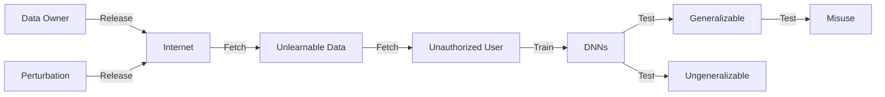
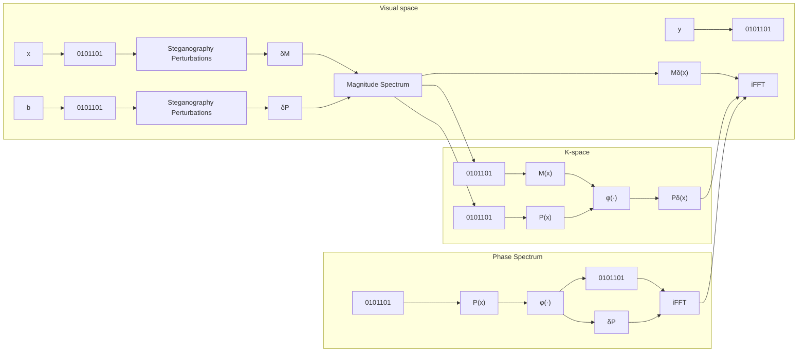

# K-Space Bispectrum Steganography for Robust Unlearnable Data

[Jiahao Li](https://orcid.org/0000-0001-6011-688X)

www.lijiahao@live.cn

Institute of Computing Technology,

Chinese Academy of Sciences

Pengcheng Laboratory

University of Chinese Academy of

Sciences

Beijing, China

[Yiqiang Chen](https://orcid.org/0000-0002-8407-0780)∗

yqchen@ict.ac.cn

Institute of Computing Technology,

Chinese Academy of Sciences

University of Chinese Academy of

Sciences

Beijing, China

[Yunbing Xing](https://orcid.org/0009-0006-4419-9025)

xingyunbing@ict.ac.cn

Institute of Computing Technology,

Chinese Academy of Sciences

Beijing, China

[Yang Gu](https://orcid.org/0000-0001-8572-2907)

guyang@ict.ac.cn

Institute of Computing Technology,

Chinese Academy of Sciences

University of Chinese Academy of

Sciences

Beijing, China

[Xiangyuan Lan](https://orcid.org/0000-0001-8564-0346)†

lanxy@pcl.ac.cn

Pengcheng Laboratory

Pazhou Laboratory (Huangpu)

Shenzhen, China

## Abstract

The widespread availability of publicly accessible data on the internet accelerates the progress of deep learning but also raises concerns about unauthorized data usage for training neural networks. Early safeguard methods introduce small, carefully crafted perturbations via surrogate model into data to generate unlearnable data, aiming to prevent models from learning meaningful patterns. However, these methods lack robustness against adversarial training. Later, some works introduce adversarial examples to solve this problem but at the cost of increased overhead of the surrogate model. Recently, Convolution-based unlearnable data (CUDA), a surrogatefree method, has been proposed to address this issue by manually designed class-wise convolution kernels. Despite its success, CUDA suffers from high-frequency detail loss, perturbation hash collisions, and vulnerability to frequency filtering attacks. In this paper, we propose **KBS** (K-Space Bispectrum Steganography), which embeds class-specific information into the magnitude and phase components of the Fourier domain while preserving visual fidelity under reconstruction constraints. By directly performing steganography in the frequency domain, KBS preserves high-frequency details and avoids hash collisions with compact binary codes, enabling scalability to large-class datasets. Furthermore, KBS resists frequency filtering attacks by embedding perturbations in a way that remains imperceptible in the pixel space. Experimental results on public benchmarks demonstrate that KBS outperforms state-of-the-art methods.

∗Corresponding author.

†Corresponding author.

[This work is licensed under a Creative Commons Attribution-NonCommercial-ShareAlike 4.0 International License.](https://creativecommons.org/licenses/by-nc-sa/4.0)

MM ’25, Dublin, Ireland

© 2025 Copyright held by the owner/author(s).

ACM ISBN 979-8-4007-2035-2/2025/10

[https://doi.org/10.1145/3746027.3755349](https://doi.org/10.1145/3746027.3755349)

## CCS Concepts

• **Security and privacy** → **Privacy protections**; **Usability in security and privacy**; • **Computing methodologies** → **Machine learning**; **Artificial intelligence**.

## Keywords

Unlearnability, Steganography, Stealthiness, Anomaly, Fourier

## ACM Reference Format:

Jiahao Li, Yiqiang Chen, Yunbing Xing, Yang Gu, and Xiangyuan Lan. 2025. K-Space Bispectrum Steganography for Robust Unlearnable Data. In Proceedings of the 33rd ACM International Conference on Multimedia (MM ’25), October 27–31, 2025, Dublin, Ireland. ACM, New York, NY, USA, 10 pages. [https://doi.org/10.1145/3746027.3755349](https://doi.org/10.1145/3746027.3755349)

## 1 Introduction

The rapid advancement of deep learning is driven by the availability of large-scale, publicly accessible datasets on the internet. These datasets provide the foundation for training high-performing models in diverse applications such as computer vision [41], natural language processing [40], and speech recognition [42]. However, the widespread use of publicly shared data has also raised critical concerns about unauthorized data usage [3, 20, 36, 52]. For instance, data owners often face the risk of their datasets being utilized without consent to train commercial machine learning models, which could lead to ethical violations [38, 44], intellectual property theft [18, 29], and sensitive data misuse [24, 37]. These concerns highlight the urgent need for methods to safeguard data against unauthorized usage while maintaining its utility for legitimate purposes, such as publication, sharing, or human inspection.

To tackle this challenge, researchers have proposed unlearnable data (ULD) as shown in Figure 1, a novel concept that aims to prevent deep neural networks (DNNs) from learning meaningful patterns from data [14, 28, 30, 35, 53, 54]. These approaches typically achieve this by introducing imperceptible perturbations into a surrogate model, ensuring that models trained on such data generalize poorly to unseen samples. Early methods [15, 22, 55] generate ULD relying on adversarial perturbations, which are designed to disrupt the training process. However, while these approaches effectively degrade model performance under naive training settings, they are vulnerable to adversarial training [13] and some data augmentations [4, 10, 12, 46, 56, 58], both of which mitigate the impact of the perturbations. To overcome the shortcomings of early methods, recent works REM [42] proposes robust ULD, which incorporates the adversarial training of the surrogate model as part of the optimization. Although this method is effective, the time complexity is high because the adversarial training is introduced into surrogate model to simulate the adversarial training process.

flowchart

Figure 1: Overview of unlearnable data workflow.

To further enhance the robustness and save time, CUDA [45] fully discards surrogate model, which leverages manually designed class-wise convolutional kernels to embed blur patterns tailored to specific classes. While this represents a significant step forward, CUDA exhibits several limitations: (1) Loss of high-frequency details: The convolutional process introduces border effects [1] and blurring that degrade the visual fidelity of perturbed images, particularly at high frequencies, making the perturbations visually perceptible in some cases. (2) Limited scalability: CUDA relies on fixed-size convolutional kernels, which constrain the number of unique perturbations that can be generated. This limitation leads to hash collisions, especially in datasets with a large number of classes, such as CIFAR-100 or ImageNet-100, where perturbations pattern for different classes may overlap. (3) Vulnerability to frequency attacks: Recent studies [26] demonstrate that CUDA is susceptible to sharpening and frequency filtering techniques, which can weaken or eliminate CUDA perturbations, rendering the unlearnability ineffective. Although the above shortcomings, CUDA shows that the surrogate-free method is feasible and efficient.

In this paper, we propose **KBS** (K-Space Bispectrum Steganography), a novel surrogate-free method that embeds class-specific steganography information into the frequency domain to generate robust unlearnable data. Unlike explicit perturbation in CUDA, which operates in the spatial domain, KBS performs steganography directly in the Fourier domain by modifying the magnitude and phase components under reconstruction constraints and generates implicit perturbation. To evaluate the effectiveness of KBS, we conduct extensive experiments on public benchmarks. The main contributions of this paper are as follows:

• **Steganography-based Surrogate-Free Method**: We propose a steganography-based, surrogate-free unlearnable method, which utilizes steganography in the Fourier space, ensuring transferability cross architecture.

• **Preservation of high-frequency details**: Compared to convolution-based method, KBS eliminates border effects, ensuring that the perturbed images retain their visual fidelity and are indistinguishable from the original data.
• **Robustness against data augmentations**: KBS embeds perturbations in a manner that remains imperceptible in pixel space, making them resilient to common augmentations and adaptive frequency attacks.

## 2 Related Work

The concept of unlearnable data (ULD) [28] aims to prevent machine learning models from learning useful patterns from data by introducing perturbations that degrade model generalization. This section reviews the key methods in this field, focusing on traditional approaches, robust ULD, and other relevant frequency domain manipulation techniques.

## 2.1 Traditional Unlearnable Data

Traditional approaches to generating unlearnable data often involve adding imperceptible perturbations to the data, such that models trained on the perturbed data fail to generalize. EM [22] introduces the concept of error-minimizing noise, which adds imperceptible perturbations to data. This approach aims to degrade model performance by ensuring that the training process fails to generalize meaningful patterns. The method is particularly effective in protecting personal data from unauthorized usage. TAP [15] demonstrates that adversarial examples, traditionally used for attacking pretrained models, can also serve as effective data poisoning tools. By combining adversarial examples with their original labels, the training process significantly deteriorates the model’s performance on clean test samples, highlighting the potential of adversarial attacks in safeguarding sensitive data. NTGA [55] introduces label-preserving perturbations to training data to impair the generalization of deep neural networks. Operating in a clean-label, black-box setting, NTGA uses neural tangent kernels [6, 23] to approximate training dynamics and predict how small input changes impact learning. NTGA effectively prevents models from extracting meaningful patterns, creating unlearnable data.

However, while these traditional methods show effectiveness in generating unlearnable data, they lack robustness against adversarial training [2], a process that improves a model’s ability to handle adversarial examples by including them in the training data. AT sig nificantly reduces the effectiveness of traditional unlearnable data. This limitation leads to the development of more robust approaches that better withstand adversarial training.

## 2.2 Robust Unlearnable Data

In response to the limitations of traditional methods, recent research focuses on generating unlearnable data that are robust to adversarial training. These methods aim to create perturbations that remain effective even under model adversarial training. REM [16] introduces a method to generate robust unlearnable examples by adding a specific type of robust error-minimizing noise to the data. This noise includes the adversarial training loss, effectively suppressing the informative content of the data and rendering it unlearnable by models, even when adversarial training is employed. The approach ensures that the added perturbations are imperceptible to human observers while significantly degrading the model’s performance on the protected data. However, a potential limitation of this method lies in its computational intensity, as generating robust error-minimizing noise requires iterative optimization processes, which can be resource-intensive and time-consuming [43]. CUDA proposes the convolution-based unlearnable data technique [45], which employs class-wise convolutions with randomly generated filters to modify the dataset. This process encourages the neural network to learn the relationship between the applied filters and the labels, rather than the intrinsic features of the clean data. The method is model-free and does not require knowledge of the target model’s architecture, making it versatile and easy to implement. Experiments demonstrate that models trained on CUDA-processed datasets exhibit significantly reduced performance on clean test data, even when subjected to adversarial training.

However, despite its success, CUDA has several notable limitations: (1) Loss of high-frequency details. The convolutional operations introduce border effects [1, 47], leading to the loss of highfrequency details and visible artifacts in the perturbed images. (2) Limited scalability. The fixed size of the convolution kernels restricts the number of unique perturbations that can be generated, causing hash collisions in large-class datasets where multiple classes may share the same perturbation. (3) Ineffectiveness against frequency attack. Recent RSKFF [26] finds that the combination of image sharpening and frequency filtering techniques can partially restore the learnability of CUDA-protected datasets, indicating that CUDA is not effective against specific data enhancement countermeasures.

## 2.3 Steganography

Steganography is the practice of concealing information within non-obvious carriers, such as images, audio, or video, to ensure secure and imperceptible communication [5]. Unlike cryptography [8], which focuses on encrypting the content of a message to make it unreadable, steganography aims to hide the existence of the message itself, making detection more challenging [25]. Applications of steganography include secure communications [50], watermarking [9], and anti-tampering systems [17]. To the best of our knowledge, this paper is the first to apply class-specific image steganography in the Fourier domain bispectrum for the generation of unlearnable data. Unlike traditional steganographic methods that embed arbitrary data, the KBS method leverages the Fourier spectrum’s magnitude and phase components to encode class-specific information imperceptibly under reconstruction constraints. This approach ensures robustness while preserving high-frequency details.

## 3 Problem Statement

Given a dataset $D = \{ ( x _ { i } , y _ { i } ) \} _ { i = 1 } ^ { N }$ , where $x _ { i } \in D \subset \mathbb { R } ^ { d }$ denotes the 𝑖-th data sample and $y _ { i } \in \{ 1 , 2 , . . . , C \}$ represents its corresponding label, the goal of unlearnable dataset generation is to create a perturbed dataset $D ^ { \prime }   =   \{ ( x _ { i } ^ { \prime } , y _ { i } ) \} _ { i = 1 } ^ { N }$ such that the surrogate model $f _ { \theta }$ trained on $D ^ { \prime }$ fail to learn meaningful patterns and generalize effectively to clean test data, while $x _ { i } ^ { \prime }$ remains visually similar to $x _ { i } ,$ where 𝑁 is the number of data samples and 𝑑 is the data dimension. Mathematically, $x _ { i } ^ { \prime } = x _ { i } + \delta _ { i }$ , with $\delta _ { i }$ being an imperceptible perturbation constrained by $\| \delta _ { i } \| _ { p } \leq \epsilon$ for a small $\epsilon > 0$

Traditional method EM [22], generates $\delta _ { i }$ by minimizing the loss function $\mathcal { L } ( f _ { \theta } ( x _ { i } + \delta _ { i } ) , y _ { i } )$ , effectively suppressing the informative content of 𝑥𝑖. However, REM [16] shows that such perturbations are vulnerable to adversarial training, which incorporates adversarial examples into the training process to enhance robustness of $D ^ { \prime } ;$

$$
\delta_ {i} = \arg \min _ {\| \delta_ {i} \| _ {p} \leq \epsilon} \max _ {\| \eta_ {i} \| _ {p} \leq \rho} \mathcal {L} \left(f _ {\theta} \left(x _ {i} + \delta_ {i} + \eta_ {i}\right), y _ {i}\right), \tag {1}
$$

where $\eta _ { i }$ represents an adversarial perturbation bounded by $\rho .$ This formulation ensures that the perturbed dataset $D ^ { \prime }$ remains unlearnable even under adversarial training regimes. Formally, the problem is defined as finding a perturbation $\delta _ { i }$ for each $x _ { i }$ such that the accuracy $\mathbb { E } _ { ( x , y ) \sim \mathcal { D } _ { t e s t } } \left[ \mathcal { L } ( f _ { \theta } ( x ) , y ) \right]$ on the clean test data $\mathcal { D } _ { t e s t }$ remains high for any model $f _ { \theta }$ trained on $D ^ { \prime }$ , indicating poor generalization.

## 4 Methodology

In this section, we introduce the K-Space Bispectrum Steganography (KBS) approach for generating robust unlearnable data as shown in Figure 2. Unlike traditional spatial-domain explicit perturbation, KBS embeds class-specific information directly into the Fourier domain using bispectrum-based steganography, resulting in an implicit perturbation on raw data indirectly. The method in volves an end-to-end pipeline that optimizes the trade-off between robustness and imperceptibility.

## 4.1 Overview of the KBS Framework

The KBS framework adopts a surrogate-free minimization optimization min $\mathcal { L } ( x _ { i } + \delta _ { i } , y _ { i } )$ as follows: (1) Steganography Perturbation Generation: Each class $c \in \{ 1 , 2 , \ldots , C \}$ is assigned a unique binary code $b \in \{ 0 , 1 \} ^ { k }$ , where $k = \lceil \log _ { 2 } C \rceil$ . (2) Bispectrum Perturbation Injection: The binary code 𝑏 is utilized to generate perturbations $\delta _ { M }$ and $\delta _ { P }$ , which perturb the magnitude and phase components of the image’s Fourier spectrum. (3) Image Reconstruction: The perturbed magnitude and phase components are recombined and converted back into the spatial domain using inverse Fourier transform (iFFT). (4) Steganography Code Extraction: The embedded binary codes are extracted from the perturbed components and images. (5) Joint Optimization: Reconstruction and steganography losses are trained end-to-end to ensure imperceptibility and robustness of steganography perturbation.

## 4.2 Steganography Perturbation Generation

For a dataset $D   =   \{ x _ { i } , y _ { i } \} _ { i = 1 } ^ { N }$ with 𝐶 classes, steganography perturbations are generated by unique binary steganography codes $b \in \{ 0 , 1 \} ^ { k }$ , which is converted from class labels $y \in \{ 1 , 2 , \ldots , C \}$ Here, $k = \lceil \log _ { 2 } C \rceil$ is the code length. Methods like CUDA [22] rely on perturbations generated by location-specific designed convolution kernels face inherent limitations: when 𝐶 exceeds the kernel capacity, hash collisions occur, leading to multiple classes sharing identical perturbations. For example, a 9 × 9 convolution kernel can only produce 81 unique perturbation patterns, forcing the remaining classes to reuse existing ones. This degrades the performance of unlearnable data due to reduced class-specificity of perturbations.

flowchart

Figure 2: Overview of the KBS framework.

In contrast, KBS binary encoding ensures compactness and scalability. After obtaining 𝑏 for image 𝑥, perturbation generator $\zeta ( \cdot )$ and $\xi ( \cdot )$ take the binary code 𝑏 as input and produce class-specific magnitude spectrum perturbation $\delta _ { M } = \zeta ( b )$ and phase spectrum perturbation $\delta _ { P } = \xi ( b )$ , respectively. $\delta _ { M }$ and $\delta _ { P }$ are then injected into the frequency domain of 𝑥.

## 4.3 Bispectrum Perturbation Injection

After generating the steganography perturbations $\delta _ { M }$ and $\delta _ { P } ,$ the KBS framework inject them into K-space bispectrum. This process adjusts the magnitude and phase components of the image’s Fourier transform ${ \mathcal { F } } ( x )$ , ensuring imperceptibility while encoding steganography information. First, the Fourier transform of input image 𝑥 is computed using the Fast Fourier Transform (FFT):

$$
\mathcal {F} (x) = \operatorname{FFT} (x) = M (x) \cdot e ^ {j P (x)}, \tag {2}
$$

where $M ( x ) = | { \mathcal { F } } ( x ) |$ and $P ( x ) = \angle { \mathcal { F } } ( x )$ represent the magnitude and phase components, respectively. These components collectively encode the spatial information of the image. The class-specific steganography perturbations $\delta _ { M }$ and $\delta _ { P }$ are then concatenated to prepare for injection:

$$
M ^ {\prime} (x) = M (x) \oplus \delta_ {M}, \quad P ^ {\prime} (x) = P (x) \oplus \delta_ {P}, \tag {3}
$$

where ⊕ represents concatenation along channel dimension. Then $M ^ { \prime } ( x )$ and $P ^ { \prime } ( x )$ are passed through independent autoencoders $g ( \cdot )$ and $\phi ( \cdot )$ to reconstruct 𝑀(𝑥) and 𝑃 (𝑥):

$$
M _ {\delta} (x) = g (M ^ {\prime} (x)), \quad P _ {\delta} (x) = \phi (P ^ {\prime} (x)), \tag {4}
$$

The autoencoders restore dimensionality and guarantee imperceptibility of perturbation injection.

## 4.4 Image Reconstruction

The image reconstruction process aims to ensure that the perturbed image $x ^ { \prime }$ remains visually imperceptible while preserving the embedded steganography information. The steganographic magnitude and phase components are recombined into the perturbed Fourier representation by:

$$
\mathcal {F} _ {\delta} (x) = M _ {\delta} (x) \cdot e ^ {j P _ {\delta} (x)}. \tag {5}
$$

The perturbed image $x ^ { \prime }$ in the spatial domain is then obtained by inverse Fourier transform:

$$
x ^ {\prime} = \mathrm{iFFT} (\mathcal {F} _ {\delta} (x)). \tag {6}
$$

Here, iFFT(·) converts the frequency domain representation back into the spatial domain. Since KBS modifies both the magnitude and phase components of the Fourier transform, the reconstruction constraints are applied not only in the spatial domain but also in the Fourier domain. To ensure that $x ^ { \prime }$ remains visually similar to the original $x ,$ we apply a reconstruction loss in the spatial domain:

$$
\mathcal {L} _ {\text {spatial}} = \mathbb {E} _ {x \sim D} \left[ \| x ^ {\prime} - x \| _ {1} \right], \tag {7}
$$

where $\| \cdot \| _ { 1 }$ denotes the $L _ { 1 }$ -norm, which emphasizes pixel-wise similarity. In addition to spatial domain constraints, KBS enforces consistency between the original and perturbed bispectrum components in the Fourier domain. Specifically, we introduce separate reconstruction losses for the magnitude and phase components:

$$
\mathcal {L} _ {\text {magnitude}} = \mathbb {E} _ {x \sim D} \left[ \left\| M _ {\delta} (x) - M (x) \right\| _ {1} \right] \tag {8}
$$

$$
\mathcal {L} _ {\text {phase}} = \mathbb {E} _ {x \sim D} \left[ \left\| P _ {\delta} (x) - P (x) \right\| _ {1} \right], \tag {9}
$$

where $M ( x )$ and $P ( x )$ are the original magnitude and phase components, and $M _ { \delta } ( x ) , P _ { \delta } ( x )$ are their steganography injected counterparts. Note that the Fourier representation has not only polar coordinates form but also complex plane form. To provide a holistic constraint on the Fourier representation and capture interactions between the magnitude and phase components, we introduce the Fourier consistency loss $\mathcal { L } _ { \mathrm { f r e q } } ,$ which directly compares the complex-valued Fourier transforms of the original ${ \mathcal { F } } ( x )$ and the inverse Fourier transforms of the recombined magnitude and phase:

$$
\mathcal {L} _ {\text {freq}} = \mathbb {E} _ {x \sim D} \left[ \| \Re \left[ \mathcal {F} _ {\delta} (x) - \mathcal {F} (x) \right] \| _ {1} + \| \Im \left[ \mathcal {F} _ {\delta} (x) - \mathcal {F} (x) \right] \| _ {1} \right], \tag {10}
$$

where $\Re [ \cdot ]$ and $\Im [ \cdot ]$ represent real and imaginary part. $\Re [ \mathcal { F } ( x ) ] =$ 𝑀(𝑥) cos 𝑃 (𝑥) and $\Im \left[ \mathcal { F } ( x ) \right] = M ( x ) \sin P ( x )$ is the cosine and sine component in the complex space. The same goes for the $\Re [ \mathcal { F } _ { \delta } ( x ) ]$ and $\mathfrak { I } [ \mathcal { F } _ { \delta } ( x ) ]$ . The holistic constrain prevents inconsistencies that could arise if only the magnitude or phase were individually constrained, as the interplay between the magnitude and the sine/cosine component is crucial for accurate frequency domain representation. The total reconstruction loss combines the spatial and Fourier domain losses to jointly enforce consistency in both domains:

$$
\mathcal {L} _ {\text {recon}} = \left(\mathcal {L} _ {\text {spatial}} + \mathcal {L} _ {\text {magnitude}} + \mathcal {L} _ {\text {phase}} + \mathcal {L} _ {\text {freq}}\right) / 4, \tag {11}
$$

## 4.5 Steganography Code Extraction

To ensure that the binary steganography code 𝑏 is correctly embedded and reliably extracted from the perturbed image $x ^ { \prime } ,$ the KBS framework introduces neural extractors designed to directly pre-dict the code from the perturbed input. This task is formulated as a bit-wise binary classification problem. Extraction is performed not only in the spatial domain, but also in the Fourier domain, specifically on the perturbed magnitude and phase components, all of which encode recoverable class information. Given the perturbed representations $x ^ { \prime } , M _ { \delta } ( x )$ , and $P _ { \delta } ( x )$ , the extractors $\Psi _ { \alpha } ,   \Psi _ { \beta }$ , and $\Psi _ { Y }$ output predicted binary code vectors:

$$
\hat {b} ^ {(x)} = \Psi_ {\alpha} (x ^ {\prime}), \quad \hat {b} ^ {(M)} = \Psi_ {\beta} (M _ {\delta} (x)), \quad \hat {b} ^ {(P)} = \Psi_ {\gamma} (P _ {\delta} (x)). \tag {12}
$$

To ensure accurate extraction, we adopt the binary cross-entropy (BCE) loss, which measures the discrepancy between the predicted probabilities and the ground-truth binary code 𝑏. The steganography loss is defined as:

$$
\mathcal {L} _ {\text {stego}} = \frac {1}{3 N} \sum_ {i = 1} ^ {N} \sum_ {\pi \in \{x, M, P \}} \mathcal {L} _ {\mathrm{BCE}} \left(\hat {b} _ {i} ^ {(\pi)}, b _ {i}\right), \tag {13}
$$

$$
\mathcal {L} _ {\mathrm{BCE}} (\hat {b} _ {i} ^ {(\pi)}, b _ {i}) = - \frac {1}{k} \sum_ {j = 1} ^ {k} \left[ b _ {i j} \log \hat {b} _ {i j} ^ {(\pi)} + (1 - b _ {i j}) \log (1 - \hat {b} _ {i j} ^ {(\pi)}) \right], \tag {14}
$$

where $b _ { i j } \in \{ 0 , 1 \}$ is the ground-truth value of the 𝑗-th bit in $b _ { i } ,$ and $\hat { b } _ { i j } ^ { ( \pi ) } \in [ 0 , 1 ]$ denotes the predicted probability that the 𝑗-th bit is 1 in the domain $\pi \in \{ x , M , P \}$ . This formulation facilitates robust and domain-invariant recovery of the steganographic code. Here, the code length is $k = \lceil \log _ { 2 } C \rceil$

## 4.6 Joint Optimization

The KBS framework employs joint optimization to ensure that the perturbed images $\{ x _ { i } ^ { \prime } \} _ { i = 1 } ^ { N ^ { ' } }$ are visually indistinguishable from the original images $\{ x _ { i } \} _ { i = 1 } ^ { N }$ while embedding robust class-specific steganography codes. The total loss function is defined as:

$$
\mathcal {L} = \mathcal {L} _ {\text {recon}} + \lambda \mathcal {L} _ {\text {stego}}, \tag {15}
$$

where 𝜆 is coefficient. The full-process pseudocode of the KBS framework to generate unlearnable data with robustness and imperceptibility is shown in Algorithm 1.

Algorithm 1 K-Space Bispectrum Steganography (KBS)

Input: Dataset $\{x_i, y_i\}_{i=1}^N$, classes $C$, code length $k = \lceil \log_2 C \rceil$,
coefficient $\lambda$, training epoch $T$, learning rate $\eta$
Output: Unlearnable dataset $\{x_i', y_i\}_{i=1}^N$
Initialize KBS model parameters $\theta$ and counter $t$
repeat
    for $i = 1$ to $N$ do
        $M(x_i), P(x_i) \leftarrow \mathcal{F}(x_i)$ // Fourier decomposition
        $b_i \leftarrow y_i$ // Convert label to binary codes
        $\delta_M^i, \delta_P^i \leftarrow b_i$ // Generate perturbation
        $M_\delta(x_i) \xleftarrow{\delta_M^i} M(x_i)$ //Perturbation Injection
        $P_\delta(x_i) \xleftarrow{\delta_P^i} P(x_i)$ //Perturbation Injection
        $\mathcal{F}_\delta(x_i) \leftarrow M_\delta(x_i) \cdot e^{jP_\delta(x_i)}$ // Recombination
        $x_i' \leftarrow \text{iFFT}(\mathcal{F}_\delta(x_i))$ // Inverse Fourier transform
    end for
    Compute loss: $\mathcal{L} = \mathcal{L}_{\text{recon}} + \lambda \mathcal{L}_{\text{stego}}$
    Update model: $\theta \leftarrow \theta - \eta \nabla_\theta \mathcal{L}$
    Counter update: $t \leftarrow t + 1$
until $t = T$

## 5 Experiments

This section describes the experimental setup, datasets, evaluation metrics, and results to validate the KBS framework. The experiments aim to demonstrate the effectiveness of the KBS method in enhancing data security and robustness while maintaining visual quality and task performance.

## 5.1 Experimental Setup

We utilize three public benchmark datasets to evaluate the KBS framework: CIFAR-10, CIFAR-100 [27], and ImageNet-100 [11], which are widely adopted in prior works [16, 22, 45], enabling a fair and meaningful comparison with state-of-the-art methods. We evaluate the KBS framework using ResNet-18 [19], VGG-16 [49], Wide ResNet-34-10 [57], and DenseNet-121 [21] to ensure transferability across different architectures. We compare the KBS framework with TAP [15], NTGA [55],EM [22], REM [16], SEM [32], PUE [51], GUE [31], CUDA [45], the state-of-the-art unlearnability methods. The accuracy on the clean test set serves as the evaluation metric, where lower accuracy reflects stronger unlearnability. All methods are tested under identical settings to ensure fair and consistent comparisons. The detailed architectures of the autoencoder, steganography perturbation generator, and steganography code extractor networks in KBS are provided in Supplementary Material. All experiments are conducted on RTX 3090 GPU. We use the PyTorch [39] for implementation. The data augmentation techniques [48] like random flipping, cropping, and resizing are used for all dataset. The binary code length 𝑘 is set to $\lceil \log _ { 2 } C \rceil$ for all datasets. The KBS is trained with the default setting AdamW [34] optimizer using a learning rate of 0.001, a weight decay of 1e- $- 5 , \mathrm { ~ a ~ }$ batch size of 512, and a total of 100 epochs. The value of 𝜆 is set to 1.0. REM’s perturbation radii are set to $\rho _ { u } = 8 / 2 5 5 ,$ , as recommended in its original work [16], so does the SEM [32], PUE [51], and GUE [31]. CUDA uses filters of size $k = 3$ and blur parameter $p _ { b } = 0 . 3$ for both CIFAR-10 and CIFAR-100 and size $k = 9$ with $p _ { b } \: = \: 0 . 0 6$ for ImageNet-100 as recommended [45]. Unless otherwise indicated, AT uses ℓ∞ nrom with $\rho _ { a } = 4 / 2 5 5$ following previous works [15, 16, 22, 31, 32, 45, 51, 55].

## 5.2 Results and Analysis

**Unlearnability across Datasets.** We evaluate the unlearnability performance of KBS across different datasets and compare it against state-of-the-art methods. Table 1 presents the test accuracy of ResNet-18 trained on three benchmark datasets under both Empirical Risk Minimization (ERM) and Adversarial Training (AT) settings. Under the ERM setting, KBS achieves competitive clean test accuracy across all datasets, demonstrating its ability to embed effective perturbations that prevent the model from learning meaningful patterns. For instance, on CIFAR-10, KBS achieves 13.53% accuracy, outperforming CUDA and approaching EM. Under AT, KBS achieves superior results, with a notable reduction in clean accuracy to 20.97% on CIFAR-10 and 26.04% on ImageNet-100, significantly outperforming all other baselines. These results demonstrate that KBS effectively disrupts the model’s semantic learning even in AT settings. How to maintain unlearnability while sacrificing image information as little as possible is a challenge. Figure 3 visualizes a comparison of ULD between the method CUDA and KBS.

Table 1: Test accuracy (%) of ResNet-18 trained on various unlearnable datasets.

<table><tr><td rowspan="2">Dataset</td><td rowspan="2">Training Method</td><td rowspan="2">Clean</td><td colspan="7">Surrogate-based</td><td colspan="2">Surrogate-Free</td></tr><tr><td>TAP</td><td>NTGA</td><td>EM</td><td>REM</td><td>SEM</td><td>PUE</td><td>GUE</td><td>CUDA</td><td>KBS</td></tr><tr><td rowspan="2">CIFAR-10</td><td>ERM</td><td>94.66</td><td>22.51</td><td>16.27</td><td>13.20</td><td>27.09</td><td>13.00</td><td>17.39</td><td>13.25</td><td>18.48</td><td>13.53</td></tr><tr><td>AT</td><td>89.51</td><td>88.02</td><td>88.96</td><td>88.62</td><td>48.16</td><td>31.92</td><td>84.54</td><td>52.79</td><td>44.40</td><td>20.97</td></tr><tr><td rowspan="2">CIFAR-100</td><td>ERM</td><td>76.27</td><td>13.75</td><td>3.22</td><td>1.60</td><td>10.14</td><td>1.95</td><td>3.40</td><td>8.35</td><td>12.69</td><td>1.82</td></tr><tr><td>AT</td><td>64.50</td><td>62.39</td><td>62.44</td><td>63.43</td><td>27.10</td><td>20.25</td><td>62.71</td><td>43.02</td><td>34.34</td><td>18.04</td></tr><tr><td rowspan="2">ImageNet-100</td><td>ERM</td><td>80.66</td><td>9.10</td><td>8.42</td><td>1.26</td><td>13.74</td><td>4.10</td><td>3.87</td><td>11.54</td><td>8.96</td><td>3.46</td></tr><tr><td>AT</td><td>66.62</td><td>63.56</td><td>63.06</td><td>63.40</td><td>41.66</td><td>37.82</td><td>65.33</td><td>38.90</td><td>38.68</td><td>26.04</td></tr></table>

**Unlearnability across Architectures.** To assess the generalizability of KBS, we evaluate its performance on CIFAR-10 using various neural network architectures, including ResNet-18, VGG-16, Wide ResNet-34-10, and DenseNet-121. As shown in Table 2, KBS maintains consistent the lowest clean test accuracy across diverse architectures. For example, on VGG-16, KBS reduces accuracy to 17.03%, a significant improvement over CUDA (42.98%) and REM (65.23%). This indicates that KBS’s perturbations are architectureagnostic and robust against diverse model designs.

Table 2: Test accuracy (%) of unlearnable CIFAR-10 data trained on various architectures.

<table><tr><td rowspan="2">Model</td><td rowspan="2">Clean</td><td colspan="7">Surrogate-based</td><td colspan="2">Surrogate-Free</td></tr><tr><td>TAP</td><td>NTGA</td><td>EM</td><td>REM</td><td>SEM</td><td>PUE</td><td>GUE</td><td>CUDA</td><td>KBS</td></tr><tr><td>ResNet-18</td><td>89.51</td><td>88.02</td><td>88.96</td><td>88.62</td><td>48.16</td><td>31.92</td><td>84.54</td><td>52.79</td><td>44.40</td><td>20.97</td></tr><tr><td>VGG-16</td><td>87.51</td><td>86.27</td><td>86.65</td><td>86.48</td><td>65.23</td><td>44.37</td><td>86.43</td><td>68.83</td><td>42.98</td><td>17.03</td></tr><tr><td>WRN-34-10</td><td>91.21</td><td>90.23</td><td>89.95</td><td>90.05</td><td>48.39</td><td>31.42</td><td>90.85</td><td>51.36</td><td>53.02</td><td>43.80</td></tr><tr><td>DenseNet-121</td><td>83.27</td><td>81.72</td><td>80.73</td><td>82.44</td><td>81.48</td><td>77.85</td><td>81.57</td><td>82.71</td><td>45.95</td><td>39.02</td></tr></table>

**Unlearnability across Protection Percentages.** This experiment investigates how varying the percentage of protected training data affects model unlearnability. As shown in Table 3, KBS consistently achieves the lowest clean test accuracy across all protection levels under both AT and ERM settings. Notably, when 100% of the training data is protected, KBS reduces the clean accuracy to 20.97% under AT and 15.94% under ERM, outperforming CUDA and all other baselines. Furthermore, even with partial protection (e.g., 80%), KBS remains highly effective, achieving 82.74% under AT, compared to CUDA’s 84.34%.

Table 3: Test accuracy (%) of ResNet-18 on CIFAR-10 with different data protecion percentages. The last two row shows the results with ERM setting.

<table><tr><td rowspan="3">Unlearnability Method</td><td colspan="10">Data Protection Percentage</td></tr><tr><td rowspan="2">0%</td><td colspan="2">20%</td><td colspan="2">40%</td><td colspan="2">60%</td><td colspan="2">80%</td><td rowspan="2">100%</td></tr><tr><td>Mixed</td><td>Clean</td><td>Mixed</td><td>Clean</td><td>Mixed</td><td>Clean</td><td>Mixed</td><td>Clean</td></tr><tr><td>TAP</td><td></td><td>89.01</td><td></td><td>88.66</td><td></td><td>88.40</td><td></td><td>88.04</td><td></td><td>88.02</td></tr><tr><td>NTGA</td><td></td><td>89.56</td><td></td><td>89.35</td><td></td><td>89.22</td><td></td><td>89.17</td><td></td><td>88.96</td></tr><tr><td>EM</td><td></td><td>89.60</td><td></td><td>89.40</td><td></td><td>89.49</td><td></td><td>89.10</td><td></td><td>88.62</td></tr><tr><td>REM</td><td></td><td>89.60</td><td></td><td>89.34</td><td></td><td>89.61</td><td></td><td>88.09</td><td></td><td>48.16</td></tr><tr><td>SEM</td><td>89.51</td><td>89.82</td><td>88.17</td><td>89.65</td><td>86.76</td><td>88.66</td><td>85.07</td><td>85.19</td><td>79.41</td><td>31.29</td></tr><tr><td>PUE</td><td></td><td>88.49</td><td></td><td>89.42</td><td></td><td>88.43</td><td></td><td>86.51</td><td></td><td>85.54</td></tr><tr><td>GUE</td><td></td><td>89.75</td><td></td><td>89.71</td><td></td><td>88.57</td><td></td><td>87.26</td><td></td><td>52.79</td></tr><tr><td>CUDA</td><td></td><td>88.54</td><td></td><td>87.24</td><td></td><td>86.03</td><td></td><td>84.34</td><td></td><td>44.40</td></tr><tr><td>KBS</td><td></td><td>88.41</td><td></td><td>85.70</td><td></td><td>83.93</td><td></td><td>82.74</td><td></td><td>20.97</td></tr><tr><td>CUDA+ERM</td><td>94.66</td><td>93.28</td><td>93.75</td><td>91.34</td><td>92.56</td><td>89.91</td><td>89.77</td><td>85.61</td><td>84.30</td><td>18.48</td></tr><tr><td>KBS+ERM</td><td></td><td>92.64</td><td></td><td>90.62</td><td></td><td>87.25</td><td></td><td>74.52</td><td></td><td>15.94</td></tr></table>

Table 4: Test accuracy (%) of ResNet-18 with CUDA and KBS under various training settings.

<table><tr><td>Dataset</td><td>Clean</td><td>Training method</td><td>CUDA</td><td>KBS</td></tr><tr><td rowspan="7">CIFAR-10</td><td rowspan="7">94.66</td><td>ERM</td><td>18.48</td><td>13.53</td></tr><tr><td>AT  $\ell_{\infty}$  ( $\rho_{a} = 4/255$ )</td><td>44.40</td><td>20.97</td></tr><tr><td>AT  $\ell_{\infty}$  ( $\rho_{a} = 8/255$ )</td><td>32.85</td><td>25.51</td></tr><tr><td>AT  $\ell_{\infty}$  ( $\rho_{a} = 16/255$ )</td><td>19.32</td><td>27.46</td></tr><tr><td>AT  $\ell_{2}$  ( $\rho_{a} = 0.25$ )</td><td>39.05</td><td>14.35</td></tr><tr><td>AT  $\ell_{2}$  ( $\rho_{a} = 0.50$ )</td><td>51.19</td><td>23.89</td></tr><tr><td>AT  $\ell_{2}$  ( $\rho_{a} = 0.75$ )</td><td>51.14</td><td>27.79</td></tr><tr><td rowspan="4">CIFAR-100</td><td rowspan="4">76.27</td><td>ERM</td><td>12.69</td><td>1.82</td></tr><tr><td>AT  $\ell_{\infty}$  ( $\rho_{a} = 4/255$ )</td><td>34.34</td><td>18.04</td></tr><tr><td>AT  $\ell_{\infty}$  ( $\rho_{a} = 8/255$ )</td><td>30.00</td><td>16.32</td></tr><tr><td>AT  $\ell_{2}$  ( $\rho_{a} = 0.75$ )</td><td>36.90</td><td>7.03</td></tr><tr><td rowspan="4">ImageNet-100</td><td rowspan="4">80.66</td><td>ERM</td><td>8.96</td><td>3.46</td></tr><tr><td>AT  $\ell_{\infty}$  ( $\rho_{a} = 4/255$ )</td><td>38.68</td><td>26.04</td></tr><tr><td>AT  $\ell_{\infty}$  ( $\rho_{a} = 8/255$ )</td><td>40.08</td><td>32.17</td></tr><tr><td>AT  $\ell_{2}$  ( $\rho_{a} = 0.75$ )</td><td>20.58</td><td>15.82</td></tr></table>

**Robustness to Training Settings.** We evaluate the robustness of KBS against varying training configurations, including ERM and AT with different norms and budgets. As shown in Table 4, KBS consistently achieves lower clean test accuracy compared to CUDA across all training settings, demonstrating its superior resilience. For instance, under CIFAR-100 with AT $\ell _ { \infty } \; ( \rho _ { a } = 4 / 2 5 5 )$ , KBS achieves 18.04% accuracy compared to CUDA’s 34.34%. Even with higher attack budgets 16/255, KBS remains effective, achieving 16.32%, outperforming CUDA’s 30.00%.

**Robustness to Data Augmentations.** We evaluate the robustness of KBS against various data augmentation techniques on CI-FAR10, including Mixup [58], Cutout [12], Cutmix [56], Autoaugment [10], Orthogonal Regularization [4], Grayscale [46], JPEG [33], and Randomized Smoothing [7]. KBS remains effective under all tested transformations. Specifically, KBS remains highly robust under Autoaugment (10.58%), Orthogonal Regularization (11.03%), and Mixup (15.57%), indicating its ability to resist both complex geometric transformations and structural modifications. Similarly, Cutout, Cutmix, JPEG, and Randomized Smoothing result in accuracies of 16.66%, 16.17%, 16.82%, and 16.19%, respectively, further demonstrating the robustness of KBS. Even under grayscale conversion, which removes chromatic information, KBS achieves 35.24% accuracy, highlighting its effectiveness beyond color-dependent features. These results confirm the steganographic perturbations are inherently resilient to diverse augmentation strategies, further solidifying its practical applicability in robust data protection.

text_image

(a) Perturbed Image
(b) Fourier Domain
(c) Image Perturbation

Figure 3: Comparison between CUDA and KBS methods. (a) Perturbed Image: The row from top to bottom shows the raw images, CUDA-processed images, and KBS-processed images. (b) Fourier Domain: The Fourier domain of image is visualized using a RGB-combined mode for better illustration. (c) Image Perturbation: The perturbation is obtained from the residual between the processed image and the raw image and is normalized to the range of [0,1] for better visibility. It can be observed that the CUDA method introduces edge artifacts due to convolution, resulting in dark borders around the images. Additionally, the Fourier spectrum shows that CUDA sacrifices high-frequency details to achieve unlearnability. In contrast, the KBS method preserves high-frequency details without introducing edge artifacts, making the images more natural while maintaining unlearnability.

Table 5: Compared to common augmentations like AT, recent frequency attack applied to CUDA data can train a ResNet-18 to higher test accuracy on CIFAR-10, CIFAR-100, and ImageNet-100 but fails when it comes to KBS.

<table><tr><td></td><td>Dataset</td><td>Clean</td><td>ULD</td><td>AT</td><td>RSKFF</td></tr><tr><td rowspan="3">CUDA</td><td>CIFAR-10</td><td>94.66</td><td>18.48</td><td>44.40</td><td>78.53</td></tr><tr><td>CIFAR-100</td><td>76.27</td><td>12.69</td><td>34.34</td><td>53.33</td></tr><tr><td>ImageNet-100</td><td>80.66</td><td>8.96</td><td>38.68</td><td>43.08</td></tr><tr><td rowspan="3">KBS</td><td>CIFAR-10</td><td>94.66</td><td>13.53</td><td>20.97</td><td>42.53</td></tr><tr><td>CIFAR-100</td><td>76.27</td><td>1.82</td><td>18.04</td><td>11.13</td></tr><tr><td>ImageNet-100</td><td>80.66</td><td>3.46</td><td>26.04</td><td>25.48</td></tr></table>

**Robustness to Frequency Attacks.** Recent studies [26] introduce the RSKFF attack, which successfully exploits CUDA’s spectral weaknesses by leveraging the combination of image sharpening and frequency filtering as shown in Table 5. The RSKFF attack successfully bypass CUDA’s protections, achieving a 78.53% accuracy on CIFAR-10, a 60.05% recovery from CUDA’s claimed unlearnability. In contrast, KBS maintains strong protection, limiting classification accuracy to 42.53% under the same attack. Compared to class-wise convolution in CUDA that can be gradually reversed via frequency-based filtering, the bispectral encoding of KBS introduces steganography perturbation into nonlinear phase-magnitude coupling, making it harder for RSKFF to separate and learn the original features. This result highlights the robustness of KBS against advanced adaptive attacks.

Table 6: Test accuracy (%) ablation study results of ResNet-18 with different steganography configurations in k-space.

<table><tr><td colspan="3">Ablation</td><td colspan="3">Dataset</td></tr><tr><td> $\Psi_{\alpha}$ </td><td> $\Psi_{\beta}$ </td><td> $\Psi_{\gamma}$ </td><td>CIFAR-10</td><td>CIFAR-100</td><td>ImageNet-100</td></tr><tr><td>✗</td><td>✓</td><td>✓</td><td>78.72</td><td>56.33</td><td>58.82</td></tr><tr><td>✓</td><td>✗</td><td>✓</td><td>26.93</td><td>23.90</td><td>30.95</td></tr><tr><td>✓</td><td>✓</td><td>✗</td><td>27.89</td><td>24.75</td><td>31.68</td></tr><tr><td>✓</td><td>✗</td><td>✗</td><td>32.93</td><td>28.94</td><td>35.41</td></tr><tr><td>✗</td><td>✓</td><td>✗</td><td>79.19</td><td>57.81</td><td>59.64</td></tr><tr><td>✗</td><td>✗</td><td>✓</td><td>78.83</td><td>58.66</td><td>60.03</td></tr><tr><td>✓</td><td>✓</td><td>✓</td><td>20.97</td><td>18.03</td><td>26.04</td></tr></table>

**Ablation Study.** To assess the role of each spectral component and the importance of joint-domain steganography in the KBS framework, we conduct an ablation study by selectively enabling the extractors $\Psi _ { \alpha } ,   \Psi _ { \beta } ,$ and $\Psi _ { \gamma } ,$ which operate on the spatial image, the magnitude spectrum, and the phase spectrum, respectively. Table 6 reports the test accuracy of ResNet-18 under AT using datasets perturbed by different extractor combinations. Lower accuracy indicates stronger unlearnability. We make two key observations. First, spatial-domain steganography $( \Psi _ { \alpha } )$ is essential for degrading model learning. Disabling the spatial-domain extractor $\Psi _ { \alpha }$ significantly weakens the protection. For instance, when only the frequency-domain extractors $\Psi _ { \beta }$ (magnitude) and $\Psi _ { \gamma }$ (phase) are active, the CIFAR-10 test accuracy remains as high as 78.72%, close to that of clean data training. This pattern is consistent across CIFAR-100 and ImageNet-100 as well. This result demonstrates that embedding steganographic signals solely in the frequency domain is insufficient. The spatial-domain steganography guides frequency perturbations to generate semantically disruptive but visually imperceptible distortions, which are critical for effective unlearnability. Second, jointly leveraging both magnitude $( \Psi _ { \beta } )$ and phase $\left( \Psi _ { \gamma } \right)$ perturbations in the frequency domain yields stronger protection than using either alone. With spatial steganography enabled, we further explore the impact of using only magnitude $( \Psi _ { \beta } )$ or only phase $( \Psi _ { \gamma } )$ information for frequency-domain perturbations. Both settings improve protection compared to disabling frequencydomain extractors altogether, achieving moderate reductions in test accuracy (e.g., 26.93% and 27.89% on CIFAR-10, respectively). Notably, phase-only perturbations slightly outperform magnitudeonly ones on CIFAR-100 and ImageNet-100, consistent with prior findings that phase information better preserves semantic structure. However, the full combination of all three extractors $( \Psi _ { \alpha } ,   \Psi _ { \beta } ,$ and $\Psi _ { \gamma } )$ achieves the strongest protection across all datasets (e.g., 20.97% on CIFAR-10). This confirms that magnitude and phase components provide complementary class-dependent signals that, when jointly embedded, form richer and more robust steganographic codes.

Overall, this ablation study validates two central design principles of KBS: (1) spatial steganography is indispensable for guiding frequency perturbations to disrupt semantics effectively, and (2) the joint use of magnitude and phase information in the frequency domain achieves superior unlearnability by encoding more entangled and comprehensive class-specific signals.

Table 7: Sensitivity of KBS to different values of 𝜆 on CIFAR-10 under AT $( \ell _ { \infty } , \rho = 4 / 2 5 5 )$ . Lower test accuracy implies stronger unlearnability.

| λ | 0.01 | 0.1 | 0.3 | 1.0 | 3.0 | 10.0 |
| --- | --- | --- | --- | --- | --- | --- |
| Accuracy (%) | 42.87 | 28.52 | 24.09 | 20.97 | 18.34 | 11.73 |

**Sensitivity Study.** To evaluate the influence of the trade-off hyperparameter 𝜆 in the KBS framework, we conduct a sensitivity analysis on CIFAR-10 under AT. The hyperparameter 𝜆 balances the reconstruction loss $\mathcal { L } _ { \mathrm { r e c o n } }$ and the steganographic loss $\mathcal { L } _ { \mathsf { s t e g o } }$ in Equation $1 5 ,$ controlling the trade-off between imperceptibility and class-conditional encoding. We vary $\lambda \in \{ 0 . 0 1 , 0 . 1 , 0 . 3 , 1 . 0 , 3 . 0 , 1 0 . 0 \}$ and report the test accuracy of a ResNet-18 model trained under AT with $\ell _ { \infty } .$ -bounded perturbations $\left( \rho _ { a } = 4 / 2 5 5 \right)$ . Lower accuracy indicates stronger unlearnability. Results are shown in Table 7.

As 𝜆 increases, the model prioritizes steganographic encoding over reconstruction, leading to stronger semantic confusion under AT and lower test accuracy, from 42.87% at $\lambda \; = \; 0.01$ to 11.73% at $\lambda   =   1 0 . 0 .$ However, overly large 𝜆 values compromise visual fidelity, as illustrated in Figure 4. The perturbed images show visible artifacts, indicating that excessive emphasis on steganography can harm imperceptibility. In summary, while larger 𝜆 values strengthen unlearnability by enhancing frequency-domain encoding, they must be carefully selected to avoid compromising the stealthiness of the perturbations. A moderate value such as $\lambda = 1 . 0$ may provide the best trade-off, depending on the application’s tolerance for visual distortion.

natural_image

Grid of 20 abstract images including aircraft, horses, animals, and landscape scenes (no text or symbols)

Figure 4: Visual impact of $\lambda = 10.0$ on reconstructed images. Top to bottom: raw images, normalized perturbations, and perturbed images. Visual fidelity degrades, revealing the trade-off between unlearnability and imperceptibility.

**Computational Cost Analysis.** The computational cost is shown in Table 8. Notably, CUDA achieves the lowest. However, there is No Free Lunch (NFL) in machine learning. This speed comes at a price, where CUDA sacrifices both unlearnability robustness and image quality, making it vulnerable to recent countermeasures such as RSKFF attacks. In contrast, KBS achieves a much better trade-off between robustness, imperceptibility, and unlearnability performance. While CUDA remains a fast baseline, KBS presents a more practical solution for real-world dataset protection, where robustness and stealthiness are equally critical.

Table 8: Time taken for unlearnable data generation across various datasets using different unlearnability techniques.

| Dataset | EM | TAP | NTGA | REM | SEM | PUE | GUE | CUDA | KBS |
| --- | --- | --- | --- | --- | --- | --- | --- | --- | --- |
| CIFAR-10 | 0.40 h | 0.50 h | 5.20 h | 22.6 h | 6.35 h | 2.16 h | 3.75 h | 10.8 s | 0.25 h |
| CIFAR-100 | 0.40 h | 0.50 h | 5.20 h | 22.6 h | 6.35 h | 2.16 h | 3.75 h | 15.5 s | 0.25 h |
| ImageNet-100 | 3.90 h | 5.20 h | 14.6 h | 51.2 h | 18.4 h | 7.80 h | 10.2 h | 0.15 h | 2.65 h |

## 6 Conclusion

In this paper, we proposed K-Space Bispectrum Steganography (KBS), a novel surrogate-free approach for generating robust unlearnable data by embedding class-specific steganographic perturbations in the frequency domain. Unlike spatial domain methods, KBS modifies both magnitude and phase components to achieve imperceptibility and robustness to augmentation and adversarial attacks. By steganography-based perturbation, KBS enables high-frequency details preservation, overcoming the limitations of convolutionbased approaches. Comprehensive experiments across multiple datasets and neural network architectures demonstrate that KBS consistently outperforms existing unlearnable data methods in terms of robustness, transferability, and unlearnability. Looking forward, the future research directions include extending the KBS framework to other data modalities beyond images, such as audio signals, where perturbations can be embedded using 1D Fourier analysis, and video data, which can benefit from 3D Fourier-based representations. Additionally, we aim to explore KBS’s potential in privacy-preserving machine learning.

## Acknowledgments

This work is supported by the Innovation Funding of ICT, CAS (Grant No. E461020), the Project of Pengcheng Laboratory (Grant No. PCL2023A08), the National Natural Science Foundation of China (Grant No. 62402252).

## References

[1] Antonio Alguacil, Wagner Gonçalves Pinto, Michael Bauerheim, Marc C Jacob, and Stéphane Moreau. 2021. Effects of boundary conditions in fully convolutional networks for learning spatio-temporal dynamics. In Joint European Conference on Machine Learning and Knowledge Discovery in Databases. Springer, 102–117.
[2] Anish Athalye, Nicholas Carlini, and David Wagner. 2018. Obfuscated gradients give a false sense of security: Circumventing defenses to adversarial examples. In International conference on machine learning. PMLR, 274–283.
[3] Abeba Birhane and Vinay Uday Prabhu. 2021. Large image datasets: A pyrrhic win for computer vision?. In 2021 IEEE Winter Conference on Applications of Computer Vision (WACV). IEEE, 1536–1546.
[4] Andrew Brock, Theodore Lim, James Millar Ritchie, and Nicholas J Weston. 2017. Neural Photo Editing With Introspective Adversarial Networks. In 5th International Conference on Learning Representations 2017.
[5] Abbas Cheddad, Joan Condell, Kevin Curran, and Paul Mc Kevitt. 2010. Digital image steganography: Survey and analysis of current methods. Signal processing 90, 3 (2010), 727–752.
[6] Lenaic Chizat, Edouard Oyallon, and Francis Bach. 2019. On lazy training in differentiable programming. Advances in neural information processing systems 32 (2019).
[7] Jeremy Cohen, Elan Rosenfeld, and Zico Kolter. 2019. Certified adversarial robustness via randomized smoothing. In international conference on machine learning. PMLR, 1310–1320.
[8] J-S Coron. 2006. What is cryptography? IEEE S&P 4, 1 (2006), 70–73.
[9] Ingemar Cox, Matthew Miller, Jeffrey Bloom, Jessica Fridrich, and Ton Kalker. 2007. Digital watermarking and steganography. Morgan kaufmann.
[10] Ekin D Cubuk, Barret Zoph, Dandelion Mane, Vijay Vasudevan, and Quoc V Le. 2018. Autoaugment: Learning augmentation policies from data. arXiv preprint arXiv:1805.09501 (2018).
[11] Jia Deng, Wei Dong, Richard Socher, Li-Jia Li, Kai Li, and Li Fei-Fei. 2009. Imagenet: A large-scale hierarchical image database. In 2009 IEEE conference on computer vision and pattern recognition. Ieee, 248–255.
[12] Terrance DeVries. 2017. Improved Regularization of Convolutional Neural Networks with Cutout. arXiv preprint arXiv:1708.04552 (2017).
[13] Logan Engstrom, Andrew Ilyas, and Anish Athalye. 2018. Evaluating and understanding the robustness of adversarial logit pairing. arXiv preprint arXiv:1807.10272 (2018).
[14] Liam Fowl, Ping-yeh Chiang, Micah Goldblum, Jonas Geiping, Arpit Bansal, Wojtek Czaja, and Tom Goldstein. 2021. Preventing unauthorized use of proprietary data: Poisoning for secure dataset release. arXiv preprint arXiv:2103.02683 (2021).
[15] Liam Fowl, Micah Goldblum, Ping-yeh Chiang, Jonas Geiping, Wojciech Czaja, and Tom Goldstein. 2021. Adversarial examples make strong poisons. Advances in Neural Information Processing Systems 34 (2021), 30339–30351.
[16] Shaopeng Fu, Fengxiang He, Yang Liu, Li Shen, and Dacheng Tao. 2022. Robust unlearnable examples: Protecting data against adversarial learning. arXiv preprint arXiv:2203.14533 (2022).
[17] Filippo Gandino, Bartolomeo Montrucchio, and Maurizio Rebaudengo. 2010. Tampering in RFID: A survey on risks and defenses. Mobile Networks and Applications 15 (2010), 502–516.
[18] Trystan S Goetze. 2024. AI Art is Theft: Labour, Extraction, and Exploitation: Or, On the Dangers of Stochastic Pollocks. In Proceedings of the 2024 ACM Conference on Fairness, Accountability, and Transparency. 186–196.
[19] Kaiming He, Xiangyu Zhang, Shaoqing Ren, and Jian Sun. 2016. Deep residual learning for image recognition. In Proceedings of the IEEE conference on computer vision and pattern recognition. 770–778.
[20] Kashmir Hill. 2022. The secretive company that might end privacy as we know it. In Ethics of Data and Analytics. Auerbach Publications, 170–177.
[21] Gao Huang, Zhuang Liu, Laurens Van Der Maaten, and Kilian Q Weinberger. 2017. Densely connected convolutional networks. In Proceedings of the IEEE conference on computer vision and pattern recognition. 4700–4708.
[22] Hanxun Huang, Xingjun Ma, Sarah Monazam Erfani, James Bailey, and Yisen Wang. 2021. Unlearnable examples: Making personal data unexploitable. arXiv preprint arXiv:2101.04898 (2021).
[23] Arthur Jacot, Franck Gabriel, and Clément Hongler. 2018. Neural tangent kernel: Convergence and generalization in neural networks. Advances in neural information processing systems 31 (2018).
[24] Seyyed Ahmad Javadi, Chris Norval, Richard Cloete, and Jatinder Singh. 2021. Monitoring AI services for misuse. In Proceedings of the 2021 AAAI/ACM Conference on AI, Ethics, and Society. 597–607.
[25] Neil F Johnson and Sushil Jajodia. 1998. Exploring steganography: Seeing the unseen. Computer 31, 2 (1998), 26–34.
[26] Dohyun Kim and Pedro Sandoval-Segura. 2024. Learning from Convolution-based Unlearnable Datastes. arXiv preprint arXiv:2411.01742 (2024).
[27] Alex Krizhevsky, Geoffrey Hinton, et al. 2009. Learning multiple layers of features from tiny images. (2009).
[28] Jiahao Li, Yiqiang Chen, Yunbing Xing, Yang Gu, and Xiangyuan Lan. 2025. A Survey on Unlearnable Data. arXiv preprint arXiv:2503.23536 (2025).
[29] Daryl Lim. 2018. AI & IP: innovation & creativity in an age of accelerated change. Akron L. Rev. 52 (2018), 813.
[30] Xun Lin, Yi Yu, Song Xia, Jue Jiang, Haoran Wang, Zitong Yu, Yizhong Liu, Ying Fu, Shuai Wang, Wenzhong Tang, et al. 2024. Safeguarding Medical Image Segmentation Datasets against Unauthorized Training via Contour-and Texture-Aware Perturbations. arXiv preprint arXiv:2403.14250 (2024).
[31] Shuang Liu, Yihan Wang, and Xiao-Shan Gao. 2024. Game-theoretic unlearnable example generator. In Proceedings of the AAAI Conference on Artificial Intelligence, Vol. 38. 21349–21358.
[32] Yixin Liu, Kaidi Xu, Xun Chen, and Lichao Sun. 2024. Stable Unlearnable Example: Enhancing the Robustness of Unlearnable Examples via Stable Error-Minimizing Noise. Proceedings of the AAAI Conference on Artificial Intelligence 38, 4 (Mar. 2024), 3783–3791. [https://doi.org/10.1609/aaai.v38i4.28169](https://doi.org/10.1609/aaai.v38i4.28169)
[33] Zhuoran Liu, Zhengyu Zhao, and Martha Larson. 2023. Image shortcut squeezing: Countering perturbative availability poisons with compression. In International conference on machine learning. PMLR, 22473–22487.
[34] I Loshchilov. 2017. Decoupled weight decay regularization. arXiv preprint arXiv:1711.05101 (2017).
[35] Ruohan Meng, Chenyu Yi, Yi Yu, Siyuan Yang, Bingquan Shen, and Alex C Kot. 2024. Semantic deep hiding for robust unlearnable examples. IEEE Transactions on Information Forensics and Security (2024).
[36] Milad Nasr, Reza Shokri, and Amir Houmansadr. 2019. Comprehensive privacy analysis of deep learning: Passive and active white-box inference attacks against centralized and federated learning. In 2019 IEEE symposium on security and privacy (SP). IEEE, 739–753.
[37] Samuel Okechukwu Omeje, Buike Oparaugo, and Mary Onyedikachi Chukwuka. 2024. Artificial Intelligence on Social Media: Use, Misuse, And Impacts. Emergence of Social Media: Shaping the Digital Discourse of the Next Generation (2024), 38.
[38] Reza Arkan Partadiredja, Carlos Entrena Serrano, and Davor Ljubenkov. 2020. AI or human: the socio-ethical implications of AI-generated media content. In 2020 13th CMI Conference on Cybersecurity and Privacy (CMI)-Digital Transformation-Potentials and Challenges (51275). IEEE, 1–6.
[39] Adam Paszke, Sam Gross, Francisco Massa, Adam Lerer, James Bradbury, Gregory Chanan, Trevor Killeen, Zeming Lin, Natalia Gimelshein, Luca Antiga, et al. 2019. Pytorch: An imperative style, high-performance deep learning library. Advances in neural information processing systems 32 (2019).
[40] Alec Radford. 2018. Improving language understanding by generative pre-training. (2018).
[41] Alec Radford, Jong Wook Kim, Chris Hallacy, Aditya Ramesh, Gabriel Goh, Sandhini Agarwal, Girish Sastry, Amanda Askell, Pamela Mishkin, Jack Clark, et al. 2021. Learning transferable visual models from natural language supervision. In International conference on machine learning. PMLR, 8748–8763.
[42] Alec Radford, Jong Wook Kim, Tao Xu, Greg Brockman, Christine McLeavey, and Ilya Sutskever. 2023. Robust speech recognition via large-scale weak supervision. In International conference on machine learning. PMLR, 28492–28518.
[43] Leslie Rice, Eric Wong, and Zico Kolter. 2020. Overfitting in adversarially robust deep learning. In International conference on machine learning. PMLR, 8093–8104.
[44] Stefania Romenti, Elanor Colleoni, Grazia Murtarelli, and Camilla Moroni. 2025. Artificial Intelligence Ethical Violations and Corporate Response Strategies. In Responsibility in Strategic Communication: Truth or Trap? Emerald Publishing Limited, 147–164.
[45] Vinu Sankar Sadasivan, Mahdi Soltanolkotabi, and Soheil Feizi. 2023. Cuda: Convolution-based unlearnable datasets. In Proceedings of the IEEE/CVF Conference on Computer Vision and Pattern Recognition. 3862–3871.
[46] Chandran Saravanan. 2010. Color image to grayscale image conversion. In 2010 second international conference on computer engineering and applications, Vol. 2. IEEE, 196–199.
[47] Stefan Schubert, Peer Neubert, Johannes Pöschmann, and Peter Protzel. 2019. Circular convolutional neural networks for panoramic images and laser data. In 2019 IEEE intelligent vehicles symposium (IV). IEEE, 653–660.
[48] Connor Shorten and Taghi M Khoshgoftaar. 2019. A survey on image data augmentation for deep learning. Journal of big data 6, 1 (2019), 1–48.
[49] Karen Simonyan. 2014. Very deep convolutional networks for large-scale image recognition. arXiv preprint arXiv:1409.1556 (2014).
[50] Mustafa Sabah Taha, Mohd Shafry Mohd Rahim, Sameer Abdulsattar Lafta, Mohammed Mahdi Hashim, and Hassanain Mahdi Alzuabidi. 2019. Combination of steganography and cryptography: A short survey. In IOP conference series: materials science and engineering, Vol. 518. IOP Publishing, 052003.
[51] Derui Wang, Minhui Xue, Bo Li, Seyit Camtepe, and Liming Zhu. 2024. Provably unlearnable data examples. arXiv preprint arXiv:2405.03316 (2024).
[52] Zhenting Wang, Chen Chen, Lingjuan Lyu, Dimitris N Metaxas, and Shiqing Ma. 2023. Diagnosis: Detecting unauthorized data usages in text-to-image diffusion models. In The Twelfth International Conference on Learning Representations.
[53] Qiangqiang Wu, Yi Yu, Chenqi Kong, Ziquan Liu, Jia Wan, Haoliang Li, Alex C. Kot, and Antoni B. Chan. 2025. Temporal Unlearnable Examples: Preventing Personal Video Data from Unauthorized Exploitation by Object Tracking. In Proceedings of the IEEE/CVF International Conference on Computer Vision (ICCV).
[54] Yi Yu, Song Xia, Siyuan Yang, Chenqi Kong, Wenhan Yang, Shijian Lu, Yap-Peng Tan, and Alex Kot. 2025. MTL-UE: Learning to Learn Nothing for Multi-Task Learning. In International Conference on Machine Learning. PMLR.
[55] Chia-Hung Yuan and Shan-Hung Wu. 2021. Neural tangent generalization attacks. In International Conference on Machine Learning. PMLR, 12230–12240.
[56] Sangdoo Yun, Dongyoon Han, Seong Joon Oh, Sanghyuk Chun, Junsuk Choe, and Youngjoon Yoo. 2019. Cutmix: Regularization strategy to train strong classifiers with localizable features. In Proceedings of the IEEE/CVF international conference on computer vision. 6023–6032.
[57] Sergey Zagoruyko. 2016. Wide residual networks. arXiv preprint arXiv:1605.07146 (2016).
[58] Hongyi Zhang, Moustapha Cisse, Yann N Dauphin, and David Lopez-Paz. 2018. mixup: Beyond Empirical Risk Minimization. In International Conference on Learning Representations.