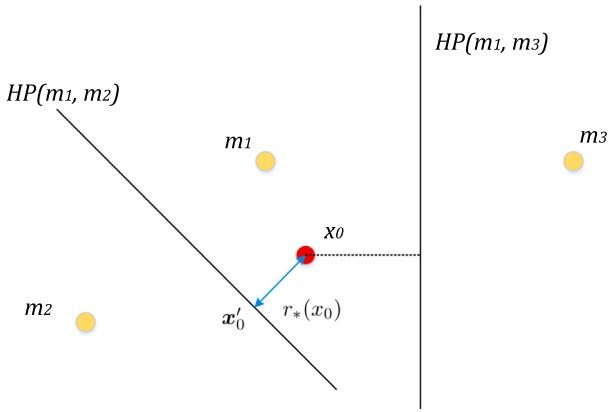
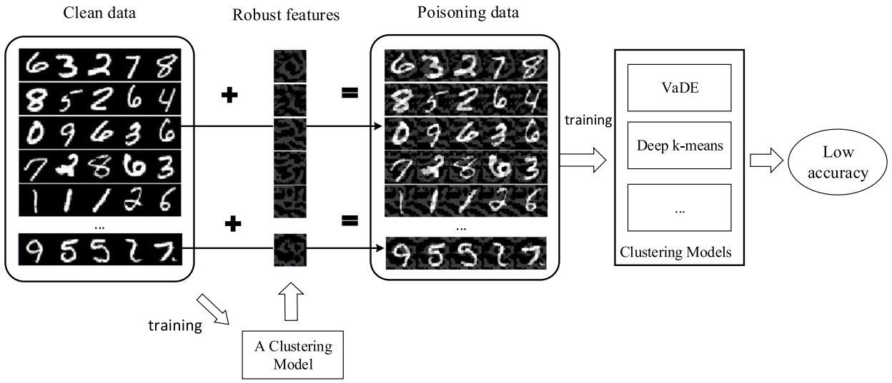
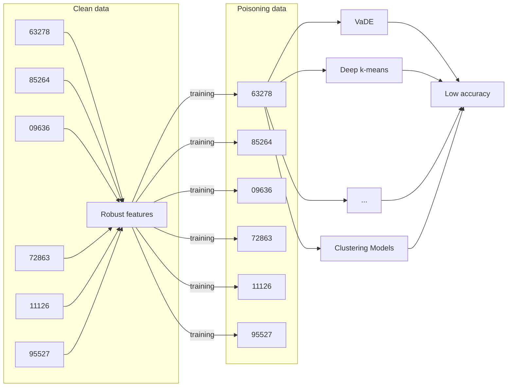
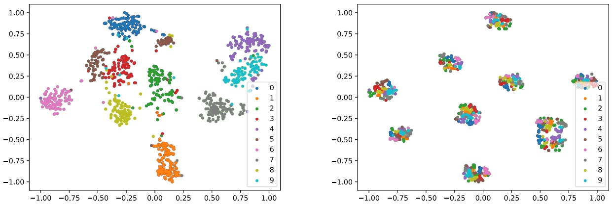

# Novel poisoning attacks for clustering methods via robust feature generation✩

**Chen Zhang a,b, Zhuo Tang b,**∗

**a College of Computer Science and Technology, China University of Petroleum, Qingdao, China**
**b College of Computer Science and Electronic Engineering, Hunan University, Changsha, China**

## A R T I C L E I N F O

**Communicated by K. Liu**

## Keywords:

**Adversarial attacks**

**Data poisoning attacks**

**Clustering models**

**Unlearnable examples**

## A B S T R A C T

**Researchers have shown that deep learning models are susceptible to adversarial examples, however, most existing works focus on supervised learning. Recently, research has shown that unsupervised learning, such as clustering, tends to be vulnerable due to adversarial attacks and poisoning attacks. This work mainly explores adversarial attacks against clustering models in two situations: attacks at decision time and data poisoning attacks. We present the possibility of adversarial attacks on the clustering model and offer clean-label poisoning attacks to clustering models by adding small perturbations on all training data. Concretely, firstly we present that the adversarial examples at decision time for the k-means model and Gaussian mixture model (GMM) can be crafted by moving the raw input to the decision boundary, which is also appropriate for the data poisoning attack. Secondly, we craft poisoning data by adding robust features to the benign inputs. The poisoning attack could make personal data unlearnable for clustering models, which preserves an individual’s privacy. Quantitative experimental results show that the success rate of proposed adversarial attacks for clustering models is close to 100%, and our data poisoning attack could make the clustering model like a random guess, which proves the effectiveness of our approaches. Adversarial attacks in clustering, containing decision time and data poisoning attacks, should receive more attention.**

## 1. Introduction

**As is well-realized, deep neural networks (DNNs) are sensitive to adversarial examples similar to the raw inputs and can fool the networks on image classification tasks. The difference between an adversarial example and its benign input is often barely visible from the human perspective. Seminal research in [1,2], as well as many recent studies [3–5] have illustrated that adversarial examples are diverse and can be generated by various methods easily. Adversarial examples are added by minor disturbances, which cause the outputs of DNNs from the correct to the incorrect categories. Significantly, a perturbed input and its corresponding original input belong to the same category under human supervision. Although there are some defense methods against adversarial examples [6–8], the attacker can always design more potent attack methods to break through the defense. Thus, the security of deep learning models has become a hot topic.**

**However, most previous studies have concentrated on utilizing adversarial examples in classification tasks, where DNNs assign categories to input images. Clustering, another essential task of machine learning, has made significant breakthroughs because the vigorous advance of deep learning should pay more attention to security. Deep clustering models, such as [9–11], learn to assign samples that are high-dimensional in general in the dataset to the same class. These deep neural network models for clustering work with the following steps: utilizing DNNs for representation learning and utilizing these representations as input to a specific clustering approach.**

**To alleviate the time-consuming in large data sets, data stream clustering has more advantages to use where new data points are added at each iteration and cluster centers are refined accordingly. Then these models are likely to be attacked when meeting new data points. On the other hand, even static data clustering is less likely to be attacked compared to data stream clustering, data poisoning has a greater** **threat on all static data and data stream clustering models. Many data collection scenarios are conducted in an unsupervised manner. For example, malware samples are typically collected from the internet using honeypots or other specialized services. Accordingly, poisoned data, which are carefully-crafted samples, might be injected into the collected data to subvert the clustering process and prevent the system from gaining useful knowledge. This means the clustering models used to analyze such data are exposed to possible attacks.**

<small>✩ The work is supported by the National Key Research and Development Program of China (2021ZD40303), the National Natural Science Foundation of China (Grant Nos. 62225205, 92055213), Natural Science Foundation of Hunan Province of China (2021JJ10023), Shenzhen Basic Research Project (Natural Science Foundation), China (JCYJ20210324140002006), Shandong Provincial Natural Science Foundation (Youth Project ZR2023QF153), China University of Petroleum (East China) Independent Innovation Research Program Project (22CX06065A).</small>

<small>∗ Corresponding author.</small>

<small>E-mail addresses: [zhangchen2@hnu.edu.cn](mailto:zhangchen2@hnu.edu.cn) (C. Zhang), [ztang@hnu.edu.cn](mailto:ztang@hnu.edu.cn) (Z. Tang).</small>

**Preliminary adversarial research work has been done recently for conventional clustering tasks [12–17]. In previous attempts, Chhabra et al. proposed a suspicion-free adversarial attack on clustering models [13]. The attack perturbs a single example adjacent to the decision boundary, which drives the incorrect clustering of several raw inputs that the authors called spill-over adversarial examples. However, this attack is only applicable to simple binary linear separable clustering models. Another adversarial learning for clustering is a robust deep clustering method [17]. The authors defined adversarial examples in the embedding space for the clustering layers to fool the clustering results, similar to a classifier. Then they provided a practical defense approach to increase the robustness of the clustering models. However, their performance on adversarial samples is slightly lower than that on clean samples. Chhabra et al. investigated adversarial attacks and robustness for deep clustering models [14]. They proposed a black-box adversarial attack against deep clustering models at test time based on a simple GAN. However, they only conducted experiments on contrastive learning based clustering models because their attack requires the knowledge of the softmax scores. The authors also proposed a fairness attack and defense framework for clustering models [12]. Their attack can reduce the fairness utility of fair clustering models and their defense model is robust to the aforementioned attack.**

**The data stream clustering is susceptible to attack when meeting new data points. Similarly, we can use the trained clustering model as a classification model where inferred which category the new data belongs to, whether updating the cluster centers or not. We first probe into using adversarial examples to attack clustering models at decision time. In this situation, there are two primary necessities for this kind of work: representing a believable scene where the attackers intend to attack deep clustering models and framing and illustrating an attack that succeeds against deep clustering models. These necessities are addressed both in our work.**

**For instance, one of the primary applications of clustering is the group classification of target users. The clustering algorithm divides the target user group into several subdivided groups with distinct characteristics, which is very helpful in recommendation engines [18]. Refined and personalized services can be adopted for these sub-groups in business operations, ultimately improving operational efficiency and commercial effects. When a large amount of data is clustered, it is usually inferred which category the new data belongs to, rather than re-clustering with the whole data containing the original and new data.**

**These properties of recommendation after clustering inspires various attacks that effective adversaries could work against deep clustering models. Any attack that confuses the inference can craft natural security vulnerabilities in applications built to utilize a clustering model, just like adversarial attacks for classification problems. Specifically, an attacker could create adversarial examples to confuse the user portrait, leading to lousy service for the users, even malicious recommend counterfeit and shoddy products for profit or other vicious purposes to users. Therefore, it is necessary to study the adversarial attack of clustering models at the decision time.**

**On the other hand, only a few studies have systematically investigated data poisoning attacks against deep learning clustering models. In the classification task, several attacks work well on traditional machine learning models, such as SVMs [19] and regression models [20], while data poisoning attacks against deep neural networks are still under research [21,22]. For clustering, Biggio et al. proposed methods that add a collection of data points to the initial dataset to maximally distort** **an original cluster assignment in the context of clustering [23], and taking a specific set of data points to induce an incorrect cluster for this data point without affecting the cluster allocation of any other data points [24]. Cina et al. present a black-box adversarial attack for poisoning clustering, inspired by the Abstract Genetic Algorithm (AGA) [15]. Their attack can let the clustering result of the poisoning dataset be far from the clustering result of the clean set. However, the algorithm is very time consuming.**

**Xu et al. designed an adversarial space-mapping attack to confuse subspace clustering [16]. The attack maps an example into an incorrect class by moving it to the closest point on the linear subspace of the target class. The method has the power to generate the poisoning set where the samples could be wrongly clustered. However, they only conducted experiments on subspace clustering models, but not on the deep clustering models.**

**In this work, we concentrate on data poisoning attacks that handle training samples to prompt the poor performance of clustering results. Previous work focuses on reducing the performance by restricting the number of poisoning samples [21,22]. However, recent episodes have concentrated on secure data release that the attackers have entrance in total training data utilized by the victim [25–27]. The authors concentrated on secure data release that Feng et al. called their poisoned inputs as training time adversarial data [25] while Huang et al. named that as unlearnable examples [27].**

**In practice, controlling the whole training set is a realistic hypothesis. For example, if a company provides some internal data to another organization when needing data modeling services. However, to protect privacy, the company does not want these models based on the data to be effective for their test data; this could be achieved by utilizing the above-mentioned poisoning data before being released. We implement our poisoning attacks in this setting where the attackers could modify the whole training data.**

**An attack can also be a defense. Then our attack can also be utilized for personal privacy protection. Consider individual face images, one of the most significant real-world scenarios. Numbers of face photos are straightforward to acquire from social networking sites. The attackers can train face clustering or verification systems on these face images to violate personal privacy. Then the attackers can recognize someone’s identity through a face image shot by a camera somewhere. Thus, the users expect that the clustering models trained on the public face images cannot recognize their face photos taken on a camera. We dedicate our work to overcome this concern. We could ‘‘poison’’ the training face images for the poor performance of clustering models on training or even test data while keeping the quality of original images.**

**Based on the above situation, we explore adversarial examples for clustering models at decision time and data poisoning attacks. Concretely, our main contributions are as follows:**

**• We propose an algorithm for crafting adversarial examples against the K-means model and Gaussian mixture model (GMM) [28] at decision time. This is also effective in terms of data poisoning attacks.**
**• We propose a data poisoning attack against deep clustering models, such as deep k-means [9] and VaDE [11]. The disturbance of input images can be generated by optimizing against the differences in latent embedding. Poisoned data with the same robust features can easily be grouped into one category.**
**• We also quantitatively analyze our adversarial attacks’ success rate for clustering models and clustering performance reduction on poisoning data. Experimental results prove the effectiveness of our approaches.**

**Hence, adversarial attacks in clustering, containing decision time and data poisoning attacks, should receive more attention. We organize our paper as follows. The background of clustering algorithms, adversarial examples, and data poisoning attacks are given in Section 2. Our methods are discussed in Section 3, which mainly presents approaches** **for attacking k-means, GMM, and deep clustering models at decision time and data poisoning. We perform experiments to confirm the effectiveness of our presented methods in Section 4. The conclusion is given in Section 5.**

## 2. Backgrounds

**In this section, we state backgrounds on clustering, adversarial examples, and data poisoning attacks.**

## 2.1. Traditional clustering models

## 2.1.1. K-means

**Clustering assigns similar samples in the sample set to the same category and dissimilar to different classes. Suppose that the input** space is Euclidean: $X \subseteq \mathbf { R } ^ { n }$ **, and the output space is category collection:** $Z = 1 , 2 , \ldots , k$ **. Given a set of data** $\pmb { x } _ { i } \in \pmb { X } , i = 1 , 2 , \dots , N ,$ **the goal of clustering is to divide** 𝑁 **data samples into** 𝑘 **categories.**

**K-means is the most popular clustering algorithm [29].** 𝑘 **classes** $G _ { 1 } , G _ { 2 } , \ldots , G _ { k }$ **form the partition of data sample set** {𝒙}**, where** $G _ { i } \cap G _ { j } =$ $\varnothing , \bigcup _ { i = 1 } ^ { k } = \{ { \pmb x } \}$ **. Let** 𝐶 **denote division, and one division corresponds to one clustering result. The strategy of k-means is to choose the optimal partition** 𝐶 **by minimizing the cost function:**

$$
C ^ {*} = \arg \min _ {C} \sum_ {l = 1} ^ {k} \sum_ {C (i) = l} \| \boldsymbol {x} _ {i} - \bar {\boldsymbol {x}} _ {l} \| ^ {2}, \tag {1}
$$

where $\bar { \pmb { x } } _ { l } = ( \bar { \pmb { x } } _ { 1 l } , \bar { \pmb { x } } _ { 2 l } , \dots , \bar { \pmb { x } } _ { n l } )$ **is the center of** 𝑙**th class,** $C ( i ) = l$ **denotes that the** 𝑖**th sample belongs to the** 𝑙**th class. The number of samples belonging to the category** 𝑙 is $\begin{array} { r } { N _ { l } = \sum _ { i = 1 } ^ { N }   I \big ( C ( i ) = l \big ) } \end{array}$ **, where** $I { \bigl ( } C ( i ) = l { \bigr ) }$ **is the indicator function with a value of** 0 **or** 1.

**K-means works well and fasts while the data samples are evenly distributed around their centers, and the dimension of the data samples is low. However, high dimensional data are not applicable by k-means due to the data manifold and low efficiency. In practice, to get better results, dimension reduction techniques, such as PCA [30], or NMF [31], are used as preprocessing to reduce the dimension of raw data samples before k-means.**

## 2.1.2. GMM

**Gaussian mixture models are probabilistic models that regard all the samples crafted from a finite number of Gaussian distributions with unknown parameters. For a Gaussian mixture model with** 𝑘 **components** $C _ { k } ,$ **the probability distribution could be written as:**

$$
p (\boldsymbol {x}) = \sum_ {i = 1} ^ {K} \phi_ {i} \mathcal {N} (\boldsymbol {x} | \boldsymbol {\mu} _ {i}, \boldsymbol {\Sigma} _ {i}), \tag {2}
$$

**where** $\phi _ { i }$ **denotes the mixture component weights for component** $C _ { i } ,$ **with the constraint that** $\begin{array} { r } { \sum _ { i = 1 } ^ { K } \phi _ { i } = 1 ; } \end{array}$ and the component $C _ { i }$ **is a normal** distribution with a mean of $\mu _ { i }$ and covariance matrix of $\pmb { \Sigma } _ { i } ;$

$$
\begin{array}{l} \mathcal {N} (\boldsymbol {x} | \boldsymbol {\mu} _ {i}, \boldsymbol {\Sigma} _ {i}) \\ = \frac {1}{\sqrt {(2 \pi) ^ {n} \left| \boldsymbol {\Sigma} _ {i} \right|}} \exp \left(- \frac {1}{2} \left(\boldsymbol {x} - \boldsymbol {\mu} _ {i}\right) ^ {T} \boldsymbol {\Sigma} _ {i} ^ {- 1} \left(\boldsymbol {x} - \boldsymbol {\mu} _ {i}\right)\right). \tag {3} \\ \end{array}
$$

**In the k-means algorithm, we first assign each sample to a specific class according to the Euclidean distance of** $\| \pmb { x } _ { i } \; - \; \bar { \pmb { x } } _ { l } \| ^ { 2 }$ **. Then we** update the class center $\bar{x}_{l}$ <strong>to</strong> **the average value assigned to the class of samples. However, in a GMM, we first determine the probability of each sample belonging to each class. Then, we update the class center to the weighted average of all samples. Therefore, a GMM could also be considered as ‘‘soft k-means’’.**

**To alleviate the time-consuming in large data sets and to choose good starting points in a deterministic way from different parts of the search space, researchers lean toward use of the incremental approaches. The existing incremental clustering algorithms can be divided into two parts. One type is called single pass incremental clustering** **algorithms where new data points are added at each iteration and cluster centers are refined accordingly. Another type is called sequential clustering algorithms where clusters are built incrementally adding one cluster center at a time.**

**In single pass incremental algorithms, such as single pass incremental k-means and k-medians [32], new data points are presented in the form of item sequences and can only be checked in a few passes. In each iteration of these algorithms, clusters are updated based on newly arrived data points.**

**In the second type, the dataset is considered static, and clustering is incrementally computed. These algorithms, such as sequential incremental k-means and k-medians [33], start from a cluster of the entire dataset, gradually calculate the clusters, and gradually add a cluster center in each iteration.**

## 2.2. Deep clustering models

## 2.2.1. VaDE

**Jiang et al. proposed Variational Deep Embedding (VaDE), a clustering method that is based on the framework of Variational Auto-Encoder (VAE) with Gaussian mixture prior on latent embedding [11]. More specifically, according to the assumption that an observed sample is generated by:**

$$
p (\boldsymbol {x}, \boldsymbol {z}, c) = p (\boldsymbol {x} | \boldsymbol {z}) p (\boldsymbol {z} | c) p (c),
$$

**the loss of VaDE can be written as:**

$$
\mathcal {L} = \mathbb {E} _ {q (\boldsymbol {z}, c | \boldsymbol {x})} [ - \log p (\boldsymbol {x} | \boldsymbol {z}) ] + \mathrm{KL} (q (\boldsymbol {z}, c | \boldsymbol {x}) | | p (\boldsymbol {z}, c)). \tag {4}
$$

**The first term of loss is the reconstruction loss, which guarantees VaDE to capture the dataset’s core information well. The second term is the clustering loss, where** KL(⋅) **denotes the Kullback–Leibler (KL) divergence. The clustering loss is to minimize the KL divergence between the Gaussian mixture prior** $p ( z , c )$ **and the variational posterior** $q ( \boldsymbol { z } , c | \boldsymbol { x } ) ,$ **, which coordinates the latent representation 𝒛 to locate in a mixture-of-Gaussian manifold.**

## 2.2.2. Deep K-means

**Deep k-means model jointly learns clustering and representations together [9]. Learning embedding that is devoted to the training data and adapted to the clustering approach can advance the performance and efficiency. The loss function of deep k-Means is:**

$$
\begin{array}{l} \mathcal {L} = \sum_ {\boldsymbol {x}} \| \boldsymbol {x} - \operatorname{AE} (\boldsymbol {x}) \| ^ {2} \\ + \lambda \sum_ {k} \text {closeness} \left(\boldsymbol {h} _ {\theta} (x), \boldsymbol {r} _ {k}\right) \times \left\| \boldsymbol {h} _ {\theta} (x) - \boldsymbol {r} _ {k} \right\| _ {2} ^ {2}, \\ \end{array}
$$

**where** $\mathbf { A E } ( \cdot )$ denotes the auto-encoder model, $h _ { \theta } ( x )$ **denotes the latent** representation, $r _ { k }$ is the clustering center for class $k ,$ **and** closeness(⋅) is the indicator function that if $r _ { i }$ it the closest vector to $h _ { \theta } ( x )$ **, the value of this function is** 1**, else is** 0**. Besides, the authors found that deep k-means approach with auto-encoder pre-training could improve the performance of clustering.**

## 2.3. Attacks against machine learning models

## 2.3.1. Adversarial examples

**Attacks on machine learning models could be categorized in many forms. A simple way to classify is to consider the time dimension when the attack occurs. Following this consideration, attacks can be divided into evasion attacks (commonly known as attacks at decision time) and poisoning attacks (widely known as attacks at training time) [34].**

**Evasion attacks, often known as adversarial examples, which were first proposed by Szegedy et al. [2] are broadly found in deep neural networks. An adversarial example is an input that deliberately adds subtle undetectable perturbation to the original sample, which can cause the well-trained model to give an erroneous output with high confidence.**

**For the mathematical definition, our goal is finding a minimum disturbance term 𝜹 which is added to the raw input 𝒙 to craft an** adversarial example ${ \pmb x } ^ { * } ,$ **. Generally, the approach of finding adversarial examples can be changed into an optimization problem:**

$$
\left\{ \begin{array}{l} \boldsymbol {\delta} = \min \left\| \boldsymbol {x} - \boldsymbol {x} ^ {*} \right\| _ {p} \\ \text {s.t.} \quad f \left(\boldsymbol {x} ^ {*}\right) \neq f (\boldsymbol {x}), \boldsymbol {x} ^ {*} \in [ 0, 1 ], \end{array} \right. \tag {6}
$$

**where** $f ( \cdot )$ **is a classification result of DNN model,** $\left\| \cdot \right\| _ { p }$ is the $\ell _ { p }$ **norm** of a vector, and the value range of $x ^ { * }$ **is** [0, 1] **when the input data 𝒙 is an image. The box constraint simply imposes a natural restriction that attacks generate a valid image (with pixels normalized to be between 0 and 1). Nowadays, various researches have explored the approaches to craft adversarial examples at decision time [1,3–5].**

## 2.3.2. Data poisoning attacks

**Basic Data Poisoning Attacks influence the deep neural networks during the training time, which corrupts the training data point or pollutes adversarial examples into the training set to produce a deep learning model incompatible with the original data distribution [22, 25]. Generically, according to [35], for mathematical definition, the data poisoning could be changed into an optimization problem:**

$$
\left\{ \begin{array}{l} \min _ {\mathcal {D}} R _ {A} (\mathcal {D}, \mathcal {S}) \\ \text {s.t.} \quad c \left(\mathcal {D} _ {0}, \mathcal {D}\right) \leq \epsilon , \end{array} \right. \tag {7}
$$

**where the poison dataset is** $\mathcal { D } ,$ **which is transformed from the pristine training dataset** $\mathcal { D } _ { 0 } ;   R _ { A } ( \mathcal { D } , S )$ **is a generic attacker risk function, which is often going to rely on the learning parameters** 𝑤 **got by training the model on the poisoned data,** 𝑆 **is a target set of instances, which the attackers want the poison model to output given by specific inputs;** 𝑐(⋅) **is a measure of modification cost; and** 𝜖 **is the modification cost budget threshold.**

**Commonly, the poisoning attack on clustering is considerably challenging computationally because clustering itself is a highly non-trivial optimization problem. Biggio’s idea is to add a single data point at a time in a way that bridges a pair of nearby clusters [23]. However, this is also very costly and cannot be applied to deep learning models.**

**Unlearnable Examples. In the classification task, Feng et al. pre-sented an effective algorithm to generate training time adversarial data, which could be seen as poisoned data [25]. They utilized an auto-encoder to craft the disturbance of the samples matched with a differentiable neural network performing as a victim classifier. They formalized the problem as an optimization problem:**

$$
\begin{array}{l} \max \sum_ {(\boldsymbol {x}, y) \in \mathcal {D}} \left[ \mathcal {L} \left(f _ {\theta^ {*} (r)} (\boldsymbol {x}), y\right) \right] \\ \text {s.t.} \left\{ \begin{array}{l} \theta^ {*} (\xi) = \arg \min _ {\theta} \sum_ {(\boldsymbol {x}, y) \in D} \left[ \mathcal {L} \left(f _ {\theta} (\boldsymbol {x} + r), y\right) \right], \\ \| r \| _ {p} \leq \epsilon , \\ \boldsymbol {x} + r \in [ 0, 1 ], \end{array} \right. \tag {8} \\ \end{array}
$$

**where** $\mathcal { L } ( \cdot , \cdot )$ **is the cross-entropy loss function for training DNNs, and** 𝑟 **is the perturbation whose** 𝑝**-norm is less than or equal to a constant** 𝜖 **added to an input 𝒙.**

**Another research, Fowl et al. crafted perturbations by manipulating the gradient of a network [26]. They transformed Eq. (8) into minimizing the following objective:**

$$
\mathcal {A} (\epsilon , \theta) = 1 - \frac {\left\langle \nabla_ {\theta} \mathcal {L} ^ {\prime} (\mathcal {D} ; \theta) , \nabla_ {\theta} \mathcal {L} (\mathcal {D} + r ; \theta) \right\rangle}{\left\| \nabla_ {\theta} \mathcal {L} ^ {\prime} (\mathcal {D} ; \theta) \right\| _ {2} \cdot \left\| \nabla_ {\theta} \mathcal {L} (\mathcal {D} + r ; \theta) \right\| _ {2}}, \tag {9}
$$

**where** $\mathcal { L } ^ { \prime } ( F ( \pmb { x } _ { i } ; \theta ) , y _ { i } )$ **is the ‘‘reverse’’ cross-entropy loss [36] which prevents the model** 𝐹 of classifying an input $x _ { i }$ **with label** $y _ { i }$ .

**The two approaches above are typical poisoning attacks that modify the entire training set against deep classification models. We modified the above two algorithms to adapt to the deep clustering models, as the baseline of data poisoning attack in this paper.**

text_image

HP(m1, m2)
m1
x0
r*(x0)
m2
x'0
HP(m1, m3)
m3

Fig. 1. Adversarial examples for a K-means model.

## 3. Our proposed attack

**Given a clustering model** 𝐶 **with k centers** {} **and new raw samples** $x ,$ **crafting clustering adversarial examples at decision time could be transferred as the following optimization:**

$$
\begin{array}{l} \arg \min _ {\boldsymbol {x} ^ {\prime}} \ell_ {p} (\boldsymbol {x}, \boldsymbol {x} ^ {\prime}) \\ \text {s.t.} \arg \min _ {c _ {1} \in \{\mathcal {C} \}} L \left(\boldsymbol {x}, c _ {1}\right) \neq \arg \min _ {c _ {2} \in \{\mathcal {C} \}} L \left(\boldsymbol {x} ^ {\prime}, c _ {2}\right), \tag {10} \\ \end{array}
$$

**where** $\ell _ { p } ( \cdot , \cdot )$ is a selected distance measure between adversarial sam**ples and raw inputs (e.g., the** $\ell _ { 0 }$ **or** $\ell _ { 2 }$ **norms),** 𝐿(⋅) **is the distance between two points in Hilbert space, and** $c _ { 1 }$ **and** $c _ { 2 }$ **are the clustering centers in** {}.

**For poisoning attacks on clustering, we define the following optimization problem:**

$$
\left\{ \begin{array}{l} \min \operatorname{ACC} \left(C _ {\mathcal {D}}\right) \\ \text {s.t.} \quad c \left(\mathcal {D} _ {0}, \mathcal {D}\right) \leq \epsilon , \end{array} \right. \tag {11}
$$

**where** $C _ { D }$ **is the clustering model trained by dataset** $\mathcal { D } ,$ **a**nd ACC(⋅) is a **measure of unsupervised clustering accuracy, which could be defined as:**

$$
\mathrm{ACC} (C _ {D}) = \max _ {m \in \mathcal {M}} \frac {\sum_ {i = 1} ^ {N} 1 \{l _ {i} = m (c _ {i}) \}}{N}, \tag {12}
$$

**where** 𝑁 **is the total number of data points,** $l _ { i }$ **is the truth label,** $c _ { i }$ **is the clustering result got by the clustering model,**  **is the set of all possible one-to-one mappings between cluster results and labels, and** 1{⋅} **is the indicator function.**

## 3.1. Adversarial attacks against K-means and GMM

**K-means model and GMM are two of the most popular utilized clustering algorithms, which cluster points into a predefined number of classes. We first propose our adversarial attack algorithm for K-means and GMM. Because GMM could be treated as ‘‘soft k-means’’, we utilize k-means as an example to illustrate our algorithm for simplicity. In other words, for a k-means model, we assume that after training** 𝑘 clustering centers $\pmb { m } = ( \pmb { m } _ { 1 } , \dots , \pmb { m } _ { l } . \cdots , \pmb { m } _ { k } )$ **have been gotten, where**

$$
\boldsymbol {m} _ {i} = [ \mu_ {i 1}, \mu_ {i 2}, \dots , \mu_ {i n} ] ^ {T}, i = 1, 2, \dots , k,
$$

𝑛 **is the dimension of clustering data. Then, for every two categories** whose centers are $m _ { i }$ and $m _ { j }$ **, there is a hyperplane** $H P ( \pmb { m } _ { i } , \pmb { m } _ { j } )$ sepa**rating them:**

$$
H P \left(\boldsymbol {m} _ {i}, \boldsymbol {m} _ {j}\right): \sum_ {l = 1} ^ {n} \left(x _ {l} - \frac {\mu_ {i l} + \mu_ {j l}}{2}\right) \left(\mu_ {i l} - \mu_ {j l}\right) = 0 \tag {13}
$$

$$
i, j = 1, 2, \dots , k, i \neq j.
$$

**Let:**

$$
\boldsymbol {w} = \left[ \mu_ {i 1} - \mu_ {j 1}, \mu_ {i 2} - \mu_ {j 2}, \dots , \mu_ {i n} - \mu_ {j n} \right] ^ {T},
$$

$$
b = - \frac {1}{2} \sum_ {l = 1} ^ {n} \left(\mu_ {i l} + \mu_ {j l}\right) \left(\mu_ {i l} - \mu_ {j l}\right), \tag {14}
$$

**Eq. (13) can be rewritten as:**

$$
H P \left(\boldsymbol {m} _ {i}, \boldsymbol {m} _ {j}\right): \boldsymbol {w} ^ {T} \boldsymbol {x} + b = 0. \tag {15}
$$

**In the case where the hyperplane is affine, we could simply consider** the robustness of model at point $x _ { 0 } .$ **Define** $L ( { \pmb x } , H P )$ **is the distance of point 𝒙 to hyperplane** 𝐻𝑃 :

$$
L (\boldsymbol {x}, H P) = \frac {1}{\| \boldsymbol {w} \|} \left| \boldsymbol {w} ^ {T} \boldsymbol {x} + b \right|, \tag {16}
$$

**where** $L ( { \pmb x } , { \pmb y } )$ **is the distance of two points 𝒙 and 𝒚:**

$$
L (\boldsymbol {x}, \boldsymbol {y}) = \sqrt {\sum_ {i = 1} ^ {n} \left(x _ {i} - y _ {i}\right) ^ {2}}. \tag {17}
$$

**As shown in Fig. 1, for the attack at decision time, the minimum disturbance to alter the cluster’s decision corresponds to the orthogonal projection of** $x _ { 0 }$ **onto the nearest hyperplane, which is related to the right clustering center. The closed-form formula gives it:**

$$
\boldsymbol {r} _ {*} (\boldsymbol {x} _ {0}) := \arg \min \| \boldsymbol {r} \| _ {2}
$$

$$
\begin{array}{l} \text {subject to} \left(\underset {\boldsymbol {m} _ {i}} {\arg \min} L \left(\boldsymbol {x} _ {0} + \boldsymbol {r}, \boldsymbol {m} _ {i}\right)\right) \neq \boldsymbol {m} _ {y} \tag {18} \\ = \min _ {h p \in H P (\boldsymbol {m} _ {y}, \boldsymbol {m} _ {i}), i \neq y} L \left(\boldsymbol {x} _ {0}, h p\right), \\ \end{array}
$$

where $m _ { y }$ is the correct category center of point $x _ { 0 } .$ **Then the adversarial point can be derived by:**

$$
\begin{array}{c} x _ {0 (i)} ^ {\prime} = \frac {\left(\boldsymbol {w} ^ {T} \boldsymbol {w} - w _ {i} ^ {2}\right) x _ {0 (i)} - w _ {i} \left(\boldsymbol {w} ^ {T} \boldsymbol {x} _ {0} - w _ {i} x _ {0 (i)} + b\right)}{\boldsymbol {w} ^ {T} \boldsymbol {w}} \\ i = 1, 2, \dots , n, \end{array} \tag {19}
$$

**where the optimal** $H P$ **is** $\pmb { w } ^ { T } \pmb { x } + b = 0 ,$ 𝑤𝑖 **is the** 𝑖th element of $w ,$ $x _ { 0 ( i ) }$ and $x _ { 0 ( i ) } ^ { \prime }$ **are the** 𝑖th elements of $x _ { 0 }$ and adversarial example $\pmb { x } _ { 0 } ^ { \prime }$ **respective. Our attack at decision time for k-means model is summarized in Algorithm 1. It only needs to make simple changes to be applicable to attack GMM. When calculating the distance from one point to the cluster center, it should be divided by the variance to ensure normalization.**

## Algorithm 1 Adversarial examples for K-means model.

1: Input: Point $x _ { 0 } ,$ **K-means model** 𝐶.
2: Output: Adversarial example point $x _ { 0 } ^ { \prime } .$
3: Get the correct category center $m _ { y }$ of point $x _ { 0 }$ by equation: $m _ { y } =$ arg min $\mathbf { \boldsymbol { \mathrm { l } } } _ { \pmb { m } _ { i } \in \pmb { m } }   L ( \pmb { x } _ { 0 } , \pmb { m } _ { i } ) .$
**4: Get the optimal** 𝐻𝑃 **by Eq. (18),**
**5: For** $i = 1 , 2 , \cdots , n$
**6: Calculate** $x _ { 0 ( i ) } ^ { \prime }$ **by Eq. (19),**
**7: End For**
8: Return $\mathbf { x } _ { 0 } ^ { \prime } .$

**The adversarial examples obtained by Algorithm 1 will be distributed on the boundary hyperplane. Thus, we can first train a K-means model on the clean data for the data poisoning attack, then get poisoning data by Algorithm 1 on the training set. Training a new clustering model (k-means or GMM) on these poisoning data randomly distributed on the original boundary hyperplane will be confused.**

## 3.2. Poisoning attacks for deep clustering

**Contrary to the k-means model, the adversarial examples generated by moving data points to the boundary do not apply to deep clustering models. There is no guarantee that space will be the same** **after dimensionality reduction on poisoned and clean images in the first step of deep clustering. Thus, we craft poisoning data from the perspective of robust features. As shown in Fig. 2, the procedure of our data poisoning attack is visually illustrated. In detail, the procedure could be formulated as follows:**

**• Step 1: Train a deep clustering model on clean training data.**
**• Step 2: Generate robust features for each clustering category. These features added to other inputs are still dominant when clustering.**
**• Step 3: Each clean image adds a kind of robust feature randomly.**
**• Step 4: Train deep clustering models with poisoned data.**

**Following is the detailed description of step 2, the essential step in the process. A current explanation for deep learning is that DNNs are feature extractors [37]. From this view, Ilyas et al. illustrated that the occurrence of adversarial samples is due to non-robust features in the training data [38]. Zhang et al. proposed that universal perturbations having robust features can fool DNNs by analyzing the mutual influence of images and disturbances [39]. Inspired by this work, we try to generate a series of robust features added to clean data that, when the poisoning clustering is done, poisoned data with the same robust features will be grouped. ‘‘Robust’’ here means the degree of contribution of its feature for clustering results when summating two features feeding to a deep clustering model. Indeed, these robust features should be pretty invisible that poisoning data and its raw image all belong to the same category from a human’s perspective. Meanwhile, unlike general data poisoning attacks that only allow a few training samples to be changed, we poison the whole training dataset.**

**As mentioned in Section 2, when the training of deep clustering models has been done, they can be treated as classifiers. Thus, we could craft robust features of a given class on the well-trained clustering models. We consider a deep clustering model that could be denoted as** $f ( x )   =   y ,$ **which receives a point** $x   \in   \mathbb { R } ^ { n }$ **and gives an output label** 𝑦 **after being trained. A dataset** 𝐷 **contains** $N _ { D }$ **data points** {𝒙} **and their corresponding class label** {𝑌 } **got by the clustering model. The robust features 𝒓 generation for a given target label could be defined as the following problem:**

$$
\begin{array}{l} \begin{array}{l} f (\boldsymbol {x} + \boldsymbol {r}) = t, \\ f _ {\text {equation}} = \text {Re} \text {and} \text {equation} \end{array} \tag {20} \\ \text {for} \boldsymbol {x} \in D, \quad \| \boldsymbol {r} \| _ {p} \leq \epsilon , \\ \end{array}
$$

**where 𝒓 denotes the robust features or perturbation whose** 𝑝 **norm is constrained by** 𝜖 **to be imperceptible from a human perspective,** 𝑡 **is the target label we wish** 𝑓(𝒙 + 𝒓) **to output, and** 𝑦 **is the clustering label for image 𝒙. This ensures that no matter what category the original image is, the perturbations would be strong enough to determine the clustering results. That is, the poisoned data with the same robust features will be clustered as a category.**

**To perform the requested objective Eq. (20), we instead solve the following problem:**

$$
\begin{array}{l} \mathcal {L} _ {t} = \max \Big (L \big (\boldsymbol {h} _ {\theta} (\boldsymbol {x} + \boldsymbol {r}), C _ {t} \big) - \\ \left. \min _ {c \neq t} L \left(\boldsymbol {h} _ {\theta} (\boldsymbol {x} + \boldsymbol {r}), C _ {c}\right), - \kappa\right) \tag {21} \\ \text {s.t.} \quad \| \boldsymbol {r} \| _ {p} \leq \epsilon , \\ \end{array}
$$

where $h _ { \theta } ( \cdot )$ **denotes the latent representation,** 𝐿(⋅) is the distance be**tween two points in Hilbert space,** 𝐶 **is the clustering center for class** 𝑖, 𝜅 **encourages the confidence, and 𝒙 are examples from the original training data.**

**Notice that for VaDE model, there is a fully connected network for implementing** 𝑝(𝑦|𝒛)**. Thus, in this model’s inference, without calculating the distance between the latent embedding and the cluster center to determine which class an input belongs to, the model just like a** **classifier to output the label directly. The Eq. (21) could be written as:**

flowchart

Fig. 2. Data poisoning attack for deep clustering models.

Algorithm 2 Robust features generation.

Input: Dataset $D$, a well-trained deep clustering model $f$ on dataset $D$, objective function $\mathcal{L}_t$, the maximum number of iterations $I$, perturbation magnitude $\epsilon$, features strength ratio threshold $\delta$, batch size $b$.
Output: Robust features $\boldsymbol{r}$ for target label $t$.
Initialize $\boldsymbol{r} \leftarrow \boldsymbol{0}$,
Initialize $iteration = 1$, $\text{sth}(\boldsymbol{r}) = 0$.
while $i \leq I$ and $\text{sth}(r) \leq \delta$ do
    Sample randomly: $\boldsymbol{x}_B \subset D$: $|\boldsymbol{x}_B| = b$
    Calculate gradient $g_\boldsymbol{r} = \mathbb{E}_{\boldsymbol{x} \in \boldsymbol{x}_B} \left[ \nabla_\boldsymbol{r} \mathcal{L}_t \right]$
    Update $\boldsymbol{r} \leftarrow \text{Optimize}(g_\boldsymbol{r})$
    Project norm $\boldsymbol{r} \leftarrow \frac{\boldsymbol{r}}{||\boldsymbol{r}||_p} \epsilon$
    Calculate $\text{sth}(\boldsymbol{r}) = \frac{1}{N_D} \sum_{\boldsymbol{x} \in D} 1 \{ f(\boldsymbol{x} + \boldsymbol{r}) = t \}$
    Increase count $iteration \leftarrow iteration + 1$
Return $\boldsymbol{r}$.

$$
\mathcal {L} _ {t} = \max \left(\max _ {c \neq t} Z _ {c} (\boldsymbol {x} + \boldsymbol {r}) - Z _ {t} (\boldsymbol {x} + \boldsymbol {r}), - \kappa\right) \tag {22}
$$

𝑠.𝑡. $\| \boldsymbol { r } \| _ { p } \leq \epsilon ,$

**where** $Z _ { c }$ **indicates the entry of output vector, and the subscript means the** 𝑐**th entry of the logits.**

**The simple but effective algorithm for generating robust features is summarized in Algorithm 2. We adopt the Adam method [40] and batch training to minimize the loss function. Because the robust features are universal, we randomly sample some inputs instead of training the total data to improve the algorithm’s efficiency. Considering that some clean samples may be more robust than our perturbations, the robust features would fail these data. We set a feature ‘‘strength ratio’’ threshold** 𝛿 **that the algorithm will be terminated when our dominant images’ strength ratio for the target label is beyond it. This is also helpful for improving algorithm efficiency. Therefore, we stop the algorithm whenever**

$$
\operatorname{sth} (\boldsymbol {r}) = \frac {1}{N _ {\mathrm{D}}} \sum_ {x \in D} 1 \{f (\boldsymbol {x} + \boldsymbol {r}) = t \} \geq \delta . \tag {23}
$$

**Once we have achieved robust features for each class, poisoning data could be gotten in a simple way that for each clean image, there is a random kind of robust feature to be added. In this way, the images** **have the same robust features, which could easily be clustered as one class no matter what their original categories.**

## 4. Experiments

**This section evaluates our approaches for the k-means model and deep clustering models by describing the datasets, methodology, evaluation, and the corresponding experimental results.**

## 4.1. Dataset

**The following datasets are utilized in our experiments.**

**Iris plants: The iris dataset is a classic and straightforward multi-class dataset that contains 150 points, can be divided into three categories, Setosa, Versicolour, and Virginica. Every class has 50 points and each point has four attributes.**

**MNIST: The MNIST database is a dataset of handwritten digits. It has 60,000 training samples and 10,000 test samples. Each image is represented by** 28 × 28 **pixels whose grayscale value is 0–255.**

**Fashion-MNIST [41]: Fashion-MNIST is an image data-set that replaces the MNIST. The size, format, and training/test set partition of the Fashion-MNIST are the same as the original MNIST. It includes positive images of 70,000 (60,000/10,000 for training/test) different products from** 10 **categories.**

**TIMIT [42]: TIMIT contains broadband recordings of 630 speakers of eight major dialects of American English, each reading ten phonetically rich sentences. The TIMIT corpus includes time-aligned orthographic, phonetic and word transcriptions as well as a 16-bit, 16 kHz speech waveform file for each utterance.**

**CIFAR-2: CIFAR-10 [43] is a dataset utilized to recognize universal objects. It contains 10 categories of RGB color images. The image’s size is 32** × **32, and the dataset has a total of 50,000 training and 10,000 test images. We choose to work with CIFAR-2, a binary classification dataset containing ‘‘airplane’’ and ‘‘car’’ images from CIFAR-10.**

## 4.2. Attacks against K-means and GMM

**For Iris, as shown in Table 1, the unsupervised clustering accuracy of clean data is 89.3% and 96.7%, the Normalized Mutual Information (NMI) is 0.775 and 0.898, for k-means and GMM, respectively. However, the clustering accuracy of poisoned data is 47.3% and 52.9% with NMI dropping to 0.363 and 0.395, for k-means and GMM, respectively. The adversarial examples obtained by our method will be distributed on the boundary hyperplane. Thus, training a clustering model on the poisoned data will be confusing. As shown in Fig. 3, from the t-SNE** **visualization [44] for the k-means model on clean Iris data, it can be seen that three classes have clear boundaries. However, although the model is training good for the poisoning data, it can be seen that there are three apparent categories; every category is confusing.**

Table 1 The main results of k-means and GMM models. Performance is evaluated in terms of accuracy (ACC) and NMI. For test data, we evaluate the test accuracy on clean data and adversarial examples (AE).

<table><tr><td rowspan="2" colspan="2">Dataset</td><td colspan="2">Clean</td><td colspan="2">Data poisoning</td><td colspan="2">Test</td></tr><tr><td>ACC</td><td>NMI</td><td>ACC</td><td>NMI</td><td>Clean</td><td>AE</td></tr><tr><td rowspan="2">Iris</td><td>K-means</td><td>89.3%</td><td>0.775</td><td>47.3%</td><td>0.363</td><td>-</td><td>-</td></tr><tr><td>GMM</td><td>96.7%</td><td>0.898</td><td>52.9%</td><td>0.395</td><td>-</td><td>-</td></tr><tr><td rowspan="2">MNIST</td><td>K-means</td><td>52.8%</td><td>0.501</td><td>22.5%</td><td>0.291</td><td>51.1%</td><td>0.0%</td></tr><tr><td>GMM</td><td>53.7%</td><td>0.525</td><td>24.0%</td><td>0.303</td><td>53.2%</td><td>0.1%</td></tr><tr><td>TIMIT</td><td>GMM-UBM</td><td>63.6%</td><td>0.598</td><td>1.2%</td><td>0.171</td><td>60.4%</td><td>0.0%</td></tr></table>

Table 2 Training and test accuracy when the clustering models are trained on the original clean training data and poisoning data, respectively on MNIST, Fashion-MNIST and CIFAR-2.

<table><tr><td rowspan="4">Clean Data</td><td rowspan="2"></td><td colspan="2">MNIST</td><td colspan="2">Fashion-MNIST</td><td colspan="2">CIFAR-2</td></tr><tr><td>VaDE</td><td>Deep k-means</td><td>VaDE</td><td>Deep k-means</td><td>VaDE</td><td>Deep k-means</td></tr><tr><td>Training</td><td>92.38%</td><td>86.52%</td><td>57.80%</td><td>54.2%</td><td>80.25%</td><td>81.61%</td></tr><tr><td>Test</td><td>89.61%</td><td>83.85%</td><td>53.44%</td><td>50.16%</td><td>79.74%</td><td>81.08%</td></tr><tr><td rowspan="2">Poisoning Data</td><td>Training</td><td>11.25%</td><td>14.98%</td><td>14.36%</td><td>18.62%</td><td>51.01%</td><td>50.8%</td></tr><tr><td>Test</td><td>17.51%</td><td>22.70%</td><td>19.33%</td><td>28.96%</td><td>52.8%</td><td>51.56%</td></tr></table>

Table 3 Comparison on MNIST with digits pair 3&2.

| Attack | $\|\|\epsilon\|\|_2$ | # Miss-Clust |
| --- | --- | --- |
| Spill-over [13] | 872.8 | 2 |
| Cina's ($\delta = \infty$) [15] | 757.1 | 14 |
| Ours ($\delta = \infty$, $T = 1$) | 860.8 | 2 |
| Ours ($\delta = \infty$, $T = 10$) | 874.2 | 32 |
| Ours ($\delta = \infty$, $T = 20$) | 870.3 | 126 |

Table 4 Training accuracy when the incremental clustering methods, single pass incremental k-means (SPI-K-means), single pass incremental k-medians (SPI-K-medians), sequential incremental k-means (SI-K-means), and sequential incremental k-means k-medians (SI-K-medians), are trained on the original clean training data and poisoning data on MNIST.

|  | Clean | Data poisoning | Adversarial examples |
| --- | --- | --- | --- |
| SPI-K-means | 51.6% | 20.8% | 0.0% |
| SPI-K-medians | 49.7% | 19.5% | 0.4% |
| SI-K-means | 53.6% | 25.4% | 0.0% |
| SI-K-medians | 52.0% | 22.7% | 1.6% |

Fig. 3. The T-SNE [44] visualization for K-means models on clean Iris data (left) and poisoning data (right).

**For MNIST, random samples and their corresponding adversarial examples as shown in Fig. 4, it can be observed that the perturbations are small to perceptible. We have evaluated the test accuracy on clean images and adversarial examples for test data, treating the clustering model as a classifier. As shown in Table 1, the test accuracy on clean data is 51.1% and 53.2% while drops to 0 and 0.1% on adversarial examples, for k-means and GMM, respectively. The poisoned images** **generated by our method are adversarial examples of training data. The unsupervised clustering accuracy of clean MNIST is 52.8% and 53.7%, with the Normalized Mutual Information (NMI) being 0.501 and 0.525, for k-means and GMM, respectively. However, the clustering accuracy of poisoned data is 22.5% and 24.0% with NMI dropping to 0.291 and 0.303, for k-means and GMM, respectively. These experimental results show clear evidence of the effectiveness of our proposed attack against the k-means model and GMM.**

**We also compare our attack against k-means and classical methods with [13,15]. To have a comparison, we perform [13,15] attacks on the same setting with our algorithm, comparing the performance on the digit pairs** 3&2 **of MNIST. Our method was run with the** $\delta   =   \infty .$ **The results are shown in Table 3 along with more details on the experiments. It can be seen that the perturbation of our attack is larger than Cina’s, and similar to Spill-over. When the number of poisoned samples is 1** $( T   =   1 ) ,$ **, our attack has no advantage. However, as the number of poisoned samples increases, the effectiveness of our attack will significantly improve. Furthermore, our attack goal is to reduce the clustering performance and perform better in multi-class clustering.**

**To further test the capacity of our methods, we take our attacks for four incremental algorithms, single pass incremental k-means (SPI-K-means), single pass incremental k-medians (SPI-K-medians), sequential incremental k-means (SI-K-means), and sequential incremental kmedians (SI-K-medians). As shown in Table 4, the clustering accuracy on clean data is 51.6%, 49.7%, 53.6%, and 52.0% for SPI-K-means, SPI-K-medians, SI-K-means, and SI-K-medians. However, the accuracy drops to 20.8%, 19.5%, 25.4%, and 22.7% when training on poisoning data for the corresponding incremental clustering algorithms. And the test accuracy drops to 0.0%, 0.4%, 0.0%, and 1.6% on adversarial examples for the corresponding incremental clustering algorithms. These experimental results show clear evidence of the effectiveness of our proposed attack against the incremental clustering algorithms.**

**The GMM-UBM [45] model is tested on TIMIT for speaker diarization task. We have evaluated the test accuracy on sound features and adversarial examples for test data, treating the clustering model as a classifier. As shown in Table 1, the test accuracy on clean data is 60.4% while dropping to 0.0% on adversarial examples for GMM-UBM. The poisoned images generated by our method are adversarial examples of training data. The unsupervised clustering accuracy of clean TIMIT is 63.6% with the Normalized Mutual Information (NMI) is 0.598 for GMM-UBM. However, the clustering accuracy of poisoned data is 1.2% with NMI dropping to 0.171 for GMM-UBM. These experimental results show clear evidence of the effectiveness of our proposed attack against the GMM.**

text_image

504/921314
3536172869
409/124327
3869056076
1879398593
3074980941
4460456100
1716302117
9026783904
6746807831
504/9228314
3536172869
409/124327
3869056076
1879398593
3074980941
4460456100
1716302117
9026783904
6746807831

Fig. 4. Clean images poisoning data for k-means on MNIST.

Table 5 Clustering performance when the clustering models after the defense strategy (marked by (\*) on top) are trained on the original clean training data and poisoning data, respectively on MNIST and Fashion-MNIST. Performance is measured in terms of accuracy (ACC). For test data, we evaluate the test accuracy on clean images and adversarial examples (AE).

<table><tr><td rowspan="2"></td><td colspan="2">MNIST</td><td colspan="2">Fashion-MNIST</td></tr><tr><td>VaDE*</td><td>Deep k-means*</td><td>VaDE*</td><td>Deep k-means*</td></tr><tr><td>Clean Data</td><td>94.30%</td><td>88.74%</td><td>61.32%</td><td>57.14%</td></tr><tr><td>Poisoning Data</td><td>11.25%</td><td>14.98%</td><td>14.36%</td><td>18.62%</td></tr></table>

Table 6 The performance analysis of the evaluated attack methods in terms of computational time that required to craft an adversarial sample. All results averaged over 10 runs.

<table><tr><td>Datasets</td><td colspan="2">Iris</td><td colspan="2">MNIST</td></tr><tr><td>Models</td><td>K-means</td><td>GMM</td><td>K-means</td><td>GMM</td></tr><tr><td>Time (s)</td><td>0.62</td><td>0.76</td><td>1.25</td><td>1.50</td></tr></table>

## 4.3. Attacks against deep clustering models

**We use a LeNet architecture as an encoder for dimension reduction and a reverse LeNet as a decoder for reconstruction in clustering models. The perturbation constraint** 𝜖 **to be 0.3, 0.1 and 0.05 with** 𝑝 = ∞ **for poisoning attack on MNIST, Fashion-MNIST, and CIFAR-2, respectively. We have trained a VaDE for crafting poisoned data first. The attack results are summarized in Table 2. When trained on poisoning data, the clustering accuracy remarkably drops to only 11.25%, 14.98%, 14.36%, 18.62%, 51.01%, and 50.8%, a little better than random guessing. This is because the images with the same robust features are vulnerable to being clustered as the same class. As shown in Fig. 5, from the t-SNE visualization [44] for the VaDE model on clean MNIST data (randomly selected 1000 data points), it can be seen that ten classes have clear boundaries and only quantitative data points are misclassified. However, although the model is training good for the poisoning data, it can be seen that there are ten apparent categories; every category is confusing. These results illustrate clear evidence of the effectiveness of our proposed attacks. The adversarial examples and poisoned images are shown in Figs. 7 and 6 respectively. The magnitude of perturbation is restricted to 0.3 and 0.1 on MNIST and Fashion-MNIST. This ensures the stealthiness of the poisoned images.**

## 4.4. Computational performance analysis

**To demonstrate the efficiency of our proposed algorithm, we also analyze the performance of the attack methods in terms of computational time. As shown in Table 6, the computational time of crafting an adversarial example for k-means and GMM models on the Iris dataset is 0.62 and 0.76 s respectively. The computational time of crafting an adversarial example for VaDE and Deep k-means models on the Fashion-MNIST dataset is 31.2 and 35.6 s respectively. Furthermore, we evaluate the computational time of generating poisoning data on**

Table 7 The clustering accuracy and NMI of comparison of different data poisoning methods against VaDE on MNIST and Fashion-MNIST. All approaches are manipulated with 𝜖 bound 0.3 and 0.1 under 𝑝 = ∞ for MNIST and Fashion-MNIST, respectively.

<table><tr><td>Method</td><td colspan="2">MNIST</td><td colspan="2">Fashion-MNIST</td></tr><tr><td></td><td>ACC</td><td>NMI</td><td>ACC</td><td>NMI</td></tr><tr><td>None</td><td>92.38%</td><td>0.867</td><td>57.80%</td><td>0.630</td></tr><tr><td>Random noise</td><td>90.75%</td><td>0.844</td><td>52.55%</td><td>0.510</td></tr><tr><td>DeepConfuse</td><td>66.26%</td><td>0.729</td><td>37.21%</td><td>0.472</td></tr><tr><td>Alignment</td><td>58.93%</td><td>0.460</td><td>34.44%</td><td>0.372</td></tr><tr><td>Ours</td><td>11.25%</td><td>0.014</td><td>14.36%</td><td>0.089</td></tr></table>

Table 8 Comparison with the attacks in [13,15,16] on MNIST Dataset with digits pair 1&2.

| Attack | ACC |
| --- | --- |
| Clean | 98.6% |
| Spill-over [13] | 98.6% |
| Cina's [15] | 85.8% |
| $A^{2}SC$ [16] | 80.4% |
| Ours | 50.3% |

**MNIST and Fashion-MNIST. When we have a trained deep clustering model on clean training data, the computational time of generating robust features for each clustering category is 5 and 8 min evenly on MNIST and Fashion-MNIST datasets, respectively. Thus, the total computational time of crafting poisoning data on MNIST and Fashion-MNIST datasets is less than 2 h. These results illustrate clear evidence of the computational efficiency of our proposed attacks. We run all methods by using Python on a workstation with a single NVIDIA GTX 3090 GPU, a 3.2-GHZ Intel Core i9-12900KF CPU, and 64 GB of RAM.**

## 4.5. Baseline results for data poisoning attack against deep clustering models

**Previous work on clean-label poisoning attacks is mainly on the classification task. Thus, we need to modify the approaches to adapt to the deep clustering models. For DeepConfuse method [25] and Alignment method [26], we first train a deep clustering model. Then we take the clustering models as classifiers to provide labels for training data. Then we can implement their method on training data with pseudo labels. We also compare our approach to fixed, random additive noise to verify the influence of generated versus non-crafted perturbations on clustering accuracy.**

**As shown in Table 7, we compare different data poisoning attacks against VaDE on MNIST and Fashion-MNIST. We set the perturbation constraint** 𝜖 **to be 0.3 and 0.1 under** 𝑝 = ∞ **norm for MNIST and Fashion-MNIST, respectively. When trained on poisoning data, Deep-Confuse and Alignment methods which are perfectly adequate for the classification task, are much worse than our method. This is because the poisoned data crafted by these two algorithms deviated from the clean data in the same class while not separated from themselves in the same category.**

**We also compared our data poisoning attack on deep clustering models with [13,15,16]. To have a fair comparison, we perform [13,15, 16] and our attacks on the same setting as [16] do, reducing the clustering performance of the poisoning data as much as possible. Detailed results are presented in Table 8. We can conclude that spill-over attack could not attack deep clustering models. For the poisoning attack and A2SC, the best ACC is 85.8% and 80.4% for MNIST with digits pair 3&2, respectively. While** 𝐴2𝑆𝐶 **can attack subspace clustering methods, it cannot attack deep clustering methods. When trained on our poisoning data, the clustering accuracy remarkably drops to only 50.3%, a little better than random guessing. These experimental results show clear evidence of the effectiveness of our proposed attack.**

Fig. 5. The T-SNE [44] visualization for K-means models on clean MNIST data (left) and poisoning data (right). We randomly selected 1000 data points for each visualization experiment.

(a) MNIST

(b) Fashion-MNIST

Fig. 6. Initial training images and their corresponding robust features and poisoning images on MNIST (a) and Fashion-MNIST (b). Each row of samples will be grouped into one category.

## 4.6. Defense

**In [17], the authors provided a practical defense approach to improve the robustness of the clustering models. In this section, we test the effectiveness of this defense against our attack.**

**For data poisoning attacks, because our poisoned data are with robust features, the perturbation in the embedding space could not affect the deep clustering to learn the robust feature. The experimental results, shown in Table 5, verify that the defense is ineffective against our poisoning attack.**

## 5. Conclusion

**This work is mainly on adversarial attacks for clustering models. We have shown a believable scene where attackers intend to attack deep clustering models at decision time. Based on this, we adopt adversarial examples to attack clustering models. For data poisoning, we implement our attack from a robust feature perspective. Experimental results show clear evidence of the effectiveness of our proposed attacks. The adversarial examples at decision time for the k-means model can be crafted by moving the raw input to the decision boundary, which is also applied to data poisoning attacks. Our poisoning attack could** **make personal data unlearnable for clustering models, which preserves an individual’s privacy. Our study also supports the assumption that adversarial samples are a universal phenomenon for DNNs, provided our successful application of adversarial attacks to standard deep clustering models. Thus, security in deep learning should be considered from all aspects.**

natural_image

Illustration of various clothing items including T-shirts, jeans, dresses, and sneakers (no text or symbols)

Fig. 7. Initial training images and their corresponding adversarial examples on Fashion-MNIST.

**The present study is only investigating white-box attacks for clustering models. In the future, we intend to extend our approaches to black-box attacks. Meanwhile, data poisoning attacks for deep learning models have still not yet been comprehensively solved. More research is required to develop a deeper understanding of the mechanism.**

## CRediT authorship contribution statement

**Chen Zhang: Writing – review & editing, Writing – original draft, Software, Project administration, Methodology, Investigation, Formal analysis, Conceptualization. Zhuo Tang: Validation, Supervision, Project administration, Funding acquisition.**

## Declaration of competing interest

**The authors declare that they have no known competing financial interests or personal relationships that could have appeared to influence the work reported in this paper.**

## Data availability

**Data will be made available on request.**

## References

[1] I.J. Goodfellow, J. Shlens, C. Szegedy, Explaining and harnessing adversarial examples, 2014, arXiv preprint [arXiv:1412.6572](http://arxiv.org/abs/1412.6572).
[2] C. Szegedy, W. Zaremba, I. Sutskever, J. Bruna, D. Erhan, I. Goodfellow, R. Fergus, Intriguing properties of neural networks, 2013, arXiv preprint [arXiv: 1312.6199](http://arxiv.org/abs/1312.6199).
[3] [J. Chen, M.I. Jordan, M.J. Wainwright, Hopskipjumpattack: A query-efficient decision-based attack, in: 2020 IEEE Symposium on Security and Privacy, SP, IEEE, 2020, pp. 1277–1294.](http://refhub.elsevier.com/S0925-2312%2824%2900696-9/sb3)
[4] [Y. Dong, H. Su, B. Wu, Z. Li, W. Liu, T. Zhang, J. Zhu, Efficient decision-based black-box adversarial attacks on face recognition, in: Proceedings of the IEEE Conference on Computer Vision and Pattern Recognition, 2019, pp. 7714–7722.](http://refhub.elsevier.com/S0925-2312%2824%2900696-9/sb4)
[5] [D. Hendrycks, K. Zhao, S. Basart, J. Steinhardt, D. Song, Natural adversarial examples, in: Proceedings of the IEEE/CVF Conference on Computer Vision and Pattern Recognition, 2021, pp. 15262–15271.](http://refhub.elsevier.com/S0925-2312%2824%2900696-9/sb5)
[6] [W. Jiang, Z. He, J. Zhan, W. Pan, Attack-aware detection and defense to resist adversarial examples, IEEE Trans. Comput.-Aided Des. Integr. Circuits Syst. (2020).](http://refhub.elsevier.com/S0925-2312%2824%2900696-9/sb6)
[7] J. Lu, T. Issaranon, D. Forsyth, SafetyNet: Detecting and rejecting adversarial examples robustly, 2017, [arXiv:1704.00103](http://arxiv.org/abs/1704.00103).
[8] E. Wong, L. Rice, J.Z. Kolter, Fast is better than free: Revisiting adversarial training, 2020, arXiv preprint [arXiv:2001.03994](http://arxiv.org/abs/2001.03994).
[9] [M.M. Fard, T. Thonet, E. Gaussier, Deep k-means: Jointly clustering with k-means and learning representations, Pattern Recognit. Lett. (2020).](http://refhub.elsevier.com/S0925-2312%2824%2900696-9/sb9)
[10] [X. Guo, L. Gao, X. Liu, J. Yin, Improved deep embedded clustering with local structure preservation, in: IJCAI, 2017, pp. 1753–1759.](http://refhub.elsevier.com/S0925-2312%2824%2900696-9/sb10)
[11] Z. Jiang, Y. Zheng, H. Tan, B. Tang, H. Zhou, Variational deep embedding: An unsupervised and generative approach to clustering, 2016, arXiv preprint [arXiv:1611.05148](http://arxiv.org/abs/1611.05148).
[12] [A. Chhabra, P. Li, P. Mohapatra, H. Liu, Robust fair clustering: A novel fairness attack and defense framework, in: The Eleventh International Conference on Learning Representations, 2022.](http://refhub.elsevier.com/S0925-2312%2824%2900696-9/sb12)
[13] [A. Chhabra, A. Roy, P. Mohapatra, Suspicion-free adversarial attacks on clustering algorithms, in: Proceedings of the AAAI Conference on Artificial Intelligence, Vol. 34, (04) 2020, pp. 3625–3632.](http://refhub.elsevier.com/S0925-2312%2824%2900696-9/sb13)
[14] [A. Chhabra, A. Sekhari, P. Mohapatra, On the robustness of deep clustering models: Adversarial attacks and defenses, Adv. Neural Inf. Process. Syst. 35 (2022) 20566–20579.](http://refhub.elsevier.com/S0925-2312%2824%2900696-9/sb14)
[15] [A.E. Cinà, A. Torcinovich, M. Pelillo, A black-box adversarial attack for poisoning clustering, Pattern Recognit. 122 (2022) 108306.](http://refhub.elsevier.com/S0925-2312%2824%2900696-9/sb15)
[16] [Y. Xu, X. Wei, P. Dai, X. Cao, A2SC: Adversarial attacks on subspace clustering, ACM Trans. Multimedia Comput. Commun. Appl. 19 (6) (2023) 1–23.](http://refhub.elsevier.com/S0925-2312%2824%2900696-9/sb16)
[17] [X. Yang, C. Deng, K. Wei, J. Yan, W. Liu, Adversarial learning for robust deep clustering, Adv. Neural Inf. Process. Syst. 33 (2020).](http://refhub.elsevier.com/S0925-2312%2824%2900696-9/sb17)
[18] A. Collins, L. Tierney, J. Beel, Per-instance algorithm selection for recommender systems via instance clustering, 2020, [arXiv:2012.15151](http://arxiv.org/abs/2012.15151).
[19] B. Biggio, B. Nelson, P. Laskov, Poisoning attacks against support vector machines, 2012, arXiv preprint [arXiv:1206.6389](http://arxiv.org/abs/1206.6389).
[20] [M. Jagielski, A. Oprea, B. Biggio, C. Liu, C. Nita-Rotaru, B. Li, Manipulating machine learning: Poisoning attacks and countermeasures for regression learning, in: 2018 IEEE Symposium on Security and Privacy, SP, IEEE, 2018, pp. 19–35.](http://refhub.elsevier.com/S0925-2312%2824%2900696-9/sb20)
[21] W.R. Huang, J. Geiping, L. Fowl, G. Taylor, T. Goldstein, MetaPoison: Practical general-purpose clean-label data poisoning, 2020, arXiv preprint [arXiv:2004. 00225](http://arxiv.org/abs/2004.00225).
[22] [L. Muñoz-González, B. Biggio, A. Demontis, A. Paudice, V. Wongrassamee, E.C. Lupu, F. Roli, Towards poisoning of deep learning algorithms with backgradient optimization, in: Proceedings of the 10th ACM Workshop on Artificial Intelligence and Security, 2017, pp. 27–38.](http://refhub.elsevier.com/S0925-2312%2824%2900696-9/sb22)
[23] [B. Battista, B.S. Rota, P. Ignazio, M. Mura, E.Z. Mequanint, M. Pelillo, F. Roli, Poisoning complete-linkage hierarchical clustering, Struct. Syntactic Stat. Pattern Recognit. (2014) 42–52.](http://refhub.elsevier.com/S0925-2312%2824%2900696-9/sb23)
[24] [B. Biggio, G. Fumera, F. Roli, Security evaluation of pattern classifiers under attack, IEEE Trans. Knowl. Data Eng. 26 (4) (2013) 984–996.](http://refhub.elsevier.com/S0925-2312%2824%2900696-9/sb24)
[25] [J. Feng, Q.-Z. Cai, Z.-H. Zhou, Learning to confuse: Generating training time adversarial data with auto-encoder, in: Advances in Neural Information Processing Systems, 2019, pp. 11994–12004.](http://refhub.elsevier.com/S0925-2312%2824%2900696-9/sb25)
[26] L. Fowl, P.-y. Chiang, M. Goldblum, J. Geiping, A. Bansal, W. Czaja, T. Goldstein, Preventing unauthorized use of proprietary data: Poisoning for secure dataset release, 2021, arXiv preprint [arXiv:2103.02683](http://arxiv.org/abs/2103.02683).
[27] [H. Huang, X. Ma, S.M. Erfani, J. Bailey, Y. Wang, Unlearnable examples: Making personal data unexploitable, in: International Conference on Learning Representations, 2020.](http://refhub.elsevier.com/S0925-2312%2824%2900696-9/sb27)
[28] [D.A. Reynolds, Gaussian mixture models, Encycl. Biometr. 741 (2009) 659–663.](http://refhub.elsevier.com/S0925-2312%2824%2900696-9/sb28)
[29] [G. Hamerly, C. Elkan, Learning the k in k-means, in: Advances in Neural Information Processing Systems, Vol. 16, MIT Press, 2004, pp. 281–288.](http://refhub.elsevier.com/S0925-2312%2824%2900696-9/sb29)
[30] [W. Xu, X. Liu, Y. Gong, Document clustering based on non-negative matrix factorization, in: Proceedings of the 26th Annual International ACM SIGIR Conference on Research and Development in Informaion Retrieval, 2003, pp. 267–273.](http://refhub.elsevier.com/S0925-2312%2824%2900696-9/sb30)
[31] [D. Cai, X. He, J. Han, Locally consistent concept factorization for document clustering, IEEE Trans. Knowl. Data Eng. 23 (6) (2010) 902–913.](http://refhub.elsevier.com/S0925-2312%2824%2900696-9/sb31)
[32] [S. Guha, A. Meyerson, N. Mishra, R. Motwani, L. O’Callaghan, Clustering data streams: Theory and practice, IEEE Trans. Knowl. Data Eng. 15 (3) (2003) 515–528.](http://refhub.elsevier.com/S0925-2312%2824%2900696-9/sb32)
[33] [A. Likas, N. Vlassis, J.J. Verbeek, The global k-means clustering algorithm, Pattern Recognit. 36 (2) (2003) 451–461.](http://refhub.elsevier.com/S0925-2312%2824%2900696-9/sb33)
[34] G.R. Machado, E. Silva, R.R. Goldschmidt, Adversarial machine learning in image classification: A survey towards the defender’s perspective, 2020, arXiv preprint [arXiv:2009.03728](http://arxiv.org/abs/2009.03728).
[35] [Y. Vorobeychik, M. Kantarcioglu, R. Brachman, P. Stone, F. Rossi, Adversarial Machine Learning, vol. 12, Springer, 2018.](http://refhub.elsevier.com/S0925-2312%2824%2900696-9/sb35)
[36] [W.R. Huang, Z.A.S. Emam, M. Goldblum, L.H. Fowl, J.K. Terry, F. Huang, T. Goldstein, Understanding generalization through visualizations, in: ‘‘I Can’t Believe It’s Not Better!’’ NeurIPS 2020 Workshop, 2020.](http://refhub.elsevier.com/S0925-2312%2824%2900696-9/sb36)
[37] [K. He, X. Zhang, S. Ren, J. Sun, Identity mappings in deep residual networks, in: European Conference on Computer Vision, Springer, 2016, pp. 630–645.](http://refhub.elsevier.com/S0925-2312%2824%2900696-9/sb37)
[38] [A. Ilyas, S. Santurkar, D. Tsipras, L. Engstrom, B. Tran, A. Madry, Adversarial examples are not bugs, they are features, in: Advances in Neural Information Processing Systems, 2019, pp. 125–136.](http://refhub.elsevier.com/S0925-2312%2824%2900696-9/sb38)
[39] [C. Zhang, P. Benz, T. Imtiaz, I.S. Kweon, Understanding adversarial examples from the mutual influence of images and perturbations, in: Proceedings of the IEEE/CVF Conference on Computer Vision and Pattern Recognition, 2020, pp. 14521–14530.](http://refhub.elsevier.com/S0925-2312%2824%2900696-9/sb39)
[40] D.P. Kingma, J. Ba, Adam: A method for stochastic optimization, 2014, arXiv preprint [arXiv:1412.6980](http://arxiv.org/abs/1412.6980).
[41] H. Xiao, K. Rasul, R. Vollgraf, Fashion-mnist: a novel image dataset for benchmarking machine learning algorithms, 2017, arXiv preprint [arXiv:1708. 07747](http://arxiv.org/abs/1708.07747).
[42] [J.S. Garofolo, Timit acoustic phonetic continuous speech corpus, 1993, Linguistic Data Consortium, 1993.](http://refhub.elsevier.com/S0925-2312%2824%2900696-9/sb42)
[43] [A. Krizhevsky, G. Hinton, et al., Learning multiple layers of features from tiny images, 2009.](http://refhub.elsevier.com/S0925-2312%2824%2900696-9/sb43)
[44] [L.V.D. Maaten, H. Geoffrey, Visualizing data using t-SNE, J. Mach. Learn. Res. 9 (2605) (2008) 2579–2605.](http://refhub.elsevier.com/S0925-2312%2824%2900696-9/sb44)
[45] [D.A. Reynolds, R.C. Rose, Robust text-independent speaker identification using Gaussian mixture speaker models, IEEE Trans. Speech Audio Process. 3 (1) (1995) 72–83.](http://refhub.elsevier.com/S0925-2312%2824%2900696-9/sb45)

**Chen Zhang received the Ph.D. in computer science from Hunan University, China, in 2022. He is currently a lecturer of the College of Computer Science and Technology, China University of Petroleum (East China). His research interests include artificial intelligence security, especially adversarial example attacks and defenses and data poisoning attacks and defenses.**

**Zhuo Tang received the Ph.D. in computer science from Huazhong University of Science and Technology, China, in 2008. He is currently a professor and dean of the College of Computer Science and Electronic Engineering at Hunan University. He is also the chief engineer of the National Supercomputing Center in Changsha. His majors are distributed computing system, cloud computing, and parallel processing for big data, including distributed machine learning, security model, parallel algorithms, and resources scheduling and management in these areas. He has published almost 130 journal articles and book chapters. He is a member of IEEE/ACM and CCF.**