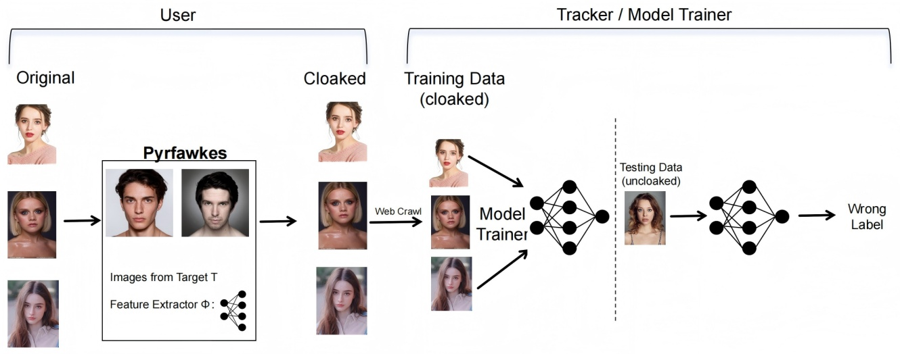
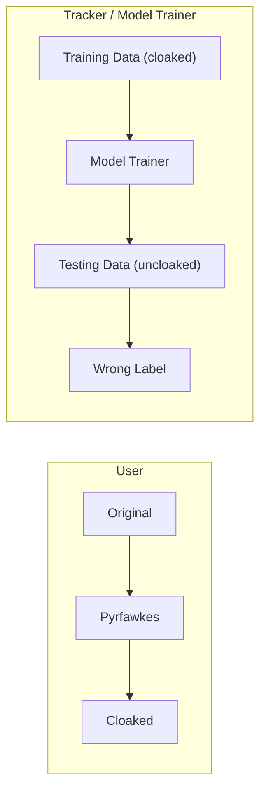
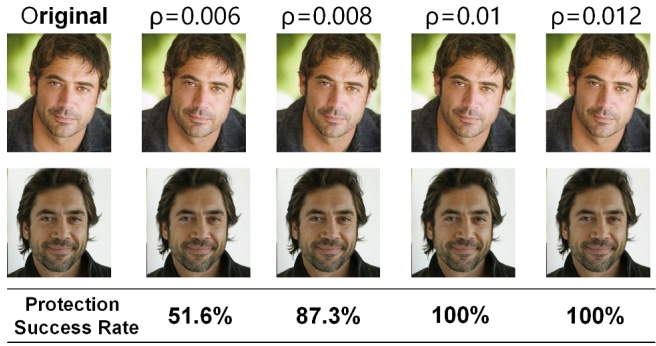
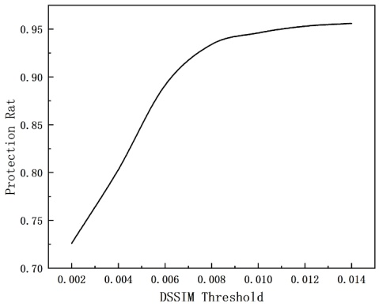

# Protecting Personal Privacy Against Unauthorized Facial Recognition Models via Image Cloaking

Zhen Guo\*

School of Cyberspace Security

(School of Cryptology),

Hainan University

Haikou,China

guozhen@hainanu.edu.cn

Jie Xu

School of Cyberspace Security

(School of Cryptology),

Hainan University

Haikou,China

jiexu@hainanu.edu.cn

Jia Xu

School of Cyberspace Security

(School of Cryptology),

Hainan University

Haikou,China

jiaxu@hainanu.edu.cn

**Abstract—There has been a proliferation of powerful facial recognition systems that pose a real threat to personal privacy. As Clearview AI demonstrates, it is possible for anyone to access data on the internet and train highly accurate facial recognition models without individuals’ knowledge. Society needs tools to protect itself from the potential abuse of unauthorised facial recognition systems. Unfortunately, there are currently no practical or effective solutions available. This thesis proposes the PyrFawkes system. This system helps individuals protect their images from unauthorised facial recognition models by adding imperceptible pixel-level changes (called ’cloaks’ in the paper) to their photos before posting them. When these ’cloaked’ images are used to train facial recognition models, the resulting model consistently misidentifies the user’s normal image. Experimental results demonstrate that Pyrfawkes provides more than 95% protection from user recognition, regardless of how the tracker has trained their model. Even when clean, unexposed images are’leaked’ to the tracker and used for training, and Pyrfawkes is also used for training, it still maintains a protection success rate of over 80%. We achieve 100% successin experiments against today’s state-of-the-art facial recognition services. Finally, we show that Pyrfawkes is robust against a variety of countermeasures that try to detect or disrupt image cloaks.**

**Index Terms—Privacy protection, Deep learning models, Adversarial attacks, Facial recognition**

## I. INTRODUCTION

The rapid advancement of facial recognition technologies has posed an increasing threat to personal privacy [1] [2]. In countries such as the United Kingdom and China, millions of individuals are routinely scanned by facial recognition systems without their explicit consent [3]. In the United States, by next year, all international travelers passing through the top 20 airports will be subjected to mandatory facial recognition screening [4] [5]. More alarmingly, individuals and organizations with sufficient resources can collect massive datasets from the internet—such as the MegaFace dataset—to train highly accurate facial recognition models, often without the knowledge or consent of the individuals depicted [6]. A prominent example is Clearview AI, a private company that has reportedly scraped over three billion images from public

This work was supported in part by the National Natural Science Foundation of China under Grant 62262013; in part by the China Industry-University-Research Innovation Foundation under Grant 2023IT033.

websites to construct a model capable of identifying millions of people [7] [8].

The unprecedented accessibility and accuracy of such models enable a wide range of malicious applications. Individuals can now be tracked across both public and private spaces via surveillance cameras, doorbell systems, and mobile devices [9]. Stalkers can match a single photo to a social media profile; retailers can link in-store purchases to online identities; and identity thieves may exploit facial data to gain unauthorized access to personal accounts [10].

To mitigate these risks, there is an urgent need for practical, privacy-preserving solutions that protect users from unauthorized facial recognition [11]. Several defense strategies have been proposed, including adversarial perturbations, adversarial patches on clothing, and clean-label poisoning attacks targeting classification models. However, these methods often suffer from key limitations: they may degrade image quality, require obtrusive artifacts, or assume access to the target model [12].

In this paper, we introduce Pyrfawkes, a practical and user-friendly cloaking system designed to protect facial images from unauthorized recognition [13]. Unlike prior approaches, Pyrfawkes applies imperceptible pixel-level perturbations—referred to as cloaks—to user images before they are shared online [14]. These cloaked images retain natural visual appearance while causing models trained on them to consistently misidentify the user’s uncloaked image [15].

At the core of Pyrfawkes is a distortion algorithm that computes minimal perturbations capable of shifting the image’s embedding in the feature space of a target recognition model [16]. These perturbations are guided by real or synthetic decoy identities, forcing any model trained on the cloaked images to learn incorrect facial representations. Consequently, when such a model is later exposed to an uncloaked image of the user (e.g., from a surveillance feed), it fails to associate the face with the cloaked identity [17].

To assess the effectiveness of Pyrfawkes, we conduct both theoretical and empirical analyses of the system. Our findings demonstrate that Pyrfawkes offers high protection efficacy with minimal perceptual distortion and exhibits strong generalization across diverse facial recognition models.

Our key contributions are summarized as follows:

• **Effective feature-space manipulation:** By applying imperceptible pixel-level perturbations, Pyrfawkes significantly alters the feature embeddings learned by facial recognition models, thereby preventing accurate user identification.
• **Robustness under adversarial conditions:** The system remains effective even when some user images are leaked without protection or when attackers adopt adaptive strategies such as cloak detection, image transformation, or training from scratch.
• **Practical and deployable privacy defense:** Designed for real-world use, Pyrfawkes requires only moderate computational resources, supports local processing, and aligns with common feature extractor pipelines, enabling easy integration into user workflows.

These results demonstrate the practical potential of Pyrfawkes in real-world settings, offering strong protection without compromising image quality or user convenience.

## II. RELATED WORKS

In the field of deep fake protection, active interferencebased defense technology has become the mainstream research direction. This type of method mainly uses adversarial perturbations, generative model constraints and other technologies in the content generation process to increase the difficulty of forgery, thereby achieving the goal of active defense. The current mainstream active interference defense technology can be divided into defense methods based on data poisoning and defense methods based on adversarial attacks.

## A. Active defense based on data poisoning

The defense method based on data poisoning acts on the training stage of the deep fake model. Its core idea is to inject specific perturbation contaminated samples into the training data when the forger trains the deep fake model, so that the forgery model learns wrong or invalid information during the training process, thereby reducing its ability to generate highquality forged content.

In existing research, this method mainly interferes with the deep fake model through strategies such as adversarial sample injection, label contamination, and implicit triggering of backdoors. Pan et al. [18] proposed a two-way data poisoning method for the diffusion model, which injects specific perturbations or noise into the training data to cause the diffusion model to produce deviations or errors during the generation process. Li et al. [19] proposed a data poisoning method based on perturbed key feature points, which embeds specific perturbations in the face image to interfere with the normal operation of the face detector, thereby preventing the generation and propagation of the deep fake model.

However, although the data poisoning method has a certain effect in interfering with the training of deep fake models, it still faces many challenges in practical applications. On the one hand, the attacker may use an independent data source, making it difficult for the defender to interfere with its training data, reducing the applicability of the data poisoning method and making it difficult to deploy in actual scenarios. On the other hand, with the development of preprocessing techniques such as data augmentation and robust training, forgers may remove or correct contaminated samples during data processing, thereby reducing the effectiveness of defense methods.

## B. Active defense based on adversarial attacks

To address the limitations of data poisoning, researchers have proposed adversarial attack–based defense methods, which operate during the inference stage of deepfake models. By adding adversarial perturbations to the input, these methods disrupt model outputs and reduce the realism of forged content. A key advantage is that they do not require access to the attacker’s training process, instead degrading results solely through input manipulation.

Current research focuses on pixel-level perturbations, localized attacks, and adversarial watermarks. Wang Liuyi et al. introduced an adaptive scheme based on pixel sensitivity, applying tailored perturbation constraints to enhance robustness. Qu et al. [20] modeled social media compression with a GAN and target-level damage constraints, generating robust perturbations that significantly distort outputs. Zhang et al. [21] developed a joint attack framework combining saliency masks, noise generators, and structural similarity loss to interfere with generation. Guan et al. [22] added perturbations while preserving visual quality. Li et al. [23] created protective noise to resist facial manipulation. Yang et al. [24] designed a local black-box attack by applying adversarial noise to distort forged content. Zhu et al. [25] proposed a two-layer scheme (IAP), encoding identity and image information into adversarial samples for both defense and traceability. Zhang et al. [26] further introduced a ”double defense” combining perturbations with robust, invisible watermarks to effectively disrupt GAN outputs.

Despite promising results, adversarial perturbation–based defenses still face challenges in the dynamic and complex environment of social networks.

## C. Feature-Space Camouflage for Privacy Protection

We propose Pyrfawkes, a novel feature-space camouflage method that diverges from traditional physical evasion and overt poisoning techniques. Instead of attacking models at inference time, Pyrfawkes perturbs user images during the training phase to manipulate their internal feature-space representations. These perturbations are visually imperceptible but lead facial recognition models to learn incorrect embeddings, thereby degrading future recognition performance. Unlike methods that require physical artifacts or white-box model access, Pyrfawkes operates in a black-box setting and generates natural-looking images suitable for sharing on social media. Extensive experiments demonstrate its strong transferability, robustness against adaptive attackers, and resistance to adversarial training and feature denoising. By intervening early in the model pipeline, Pyrfawkes establishes a persistent and practical privacy defense in real-world deployment scenarios.

flowchart

Fig. 1: Our proposed PyrFawkes system protects user privacy by cloaking their online photos. (Left) User U applies the cloaking algorithm (given a feature extractor, Φ, and images from a target, T) to generate cloaked versions of their photos, each with a small, imperceptible perturbation. (Right) A tracker crawls the cloaked images from online sources and uses them to train an unauthorised model to recognise and track U. When classifying new (uncloaked) images of U, the tracker’s model misclassifies them as someone else. Note that T does not have to exist in the tracker’s model.

## III. METHODOLOGY

We propose Pyrfawkes, a practical system designed to protect user privacy against unauthorized facial recognition models. Pyrfawkes achieves this by adding imperceptible pixel-level perturbations—called cloaks—to user images before sharing them online. When facial recognition models are trained on these cloaked images, their internal feature representations become distorted, resulting in consistent misclassification of the user when an uncloaked image is later encountered. As shown in Fig. 1.

## A. Threat Model and Assumptions

**Users.** The goal of the user is to share personal images online without inadvertently contributing to the training of unauthorized facial recognition models. The design goals for these cloaks are:

• cloaks should be imperceptible and not impact normal use of the image.
• when classifying normal, uncloaked images, modelstrained on cloaked images should recognize the underlying person with low accuracy.

Users apply cloaks locally to their images using moderate computational resources (e.g., laptops) and access to generalpurpose facial feature extractors. The camouflage must be imperceptible and should not interfere with the image’s normal usage or quality.

**Trackers.** Trackers are third-party entities such as companies (e.g., Clearview.AI), governments, or individuals with access to large-scale web-scraped datasets and significant computational resources. They aim to build models capable of recognizing many users. We assume trackers have no access to private user data and instead rely on publicly shared images.

**Limitations.** Pyrfawkes assumes users can cloak most of their online images. However, complete control over image dissemination is difficult. Photos uploaded by friends, media, or institutions may remain uncloaked. Although this work focuses on cloaking-based protection, users should combine Pyrfawkes with other privacy strategies, such as removing social media tags or invoking privacy laws.

## B. Computing Image-Specific Cloaks

Deep neural networks (DNNs) learn to associate feature representations in the embedding space with identity labels. These representations can be influenced through data poisoning. Pyrfawkes leverages this by crafting cloaks that cause the model to associate a user with features from another identity.

When cloaked images are used during model training, the facial recognition system builds a false understanding of the user’s identity. As a result, uncloaked images, from surveillance footage do not match the features learned by the model, leading to misidentification.

Let x denote the original image of user U, and T a target image from a different identity class. Pyrfawkes computes a cloak perturbation δ such that the cloaked image $x ^ { \prime }   =   x +$ δ moves the feature representation of x away from its true embedding and toward that of T. The optimization objective is:

$$
\max _ {\delta} \operatorname{Dist} \left(\Phi (x), \Phi \left(x \oplus \delta \left(x, x _ {T}\right)\right)\right), \tag {1}
$$

$$
\text {subject to} | \delta (x, x _ {T}) | <   \rho
$$

where Φ is a facial feature extractor, Dist(·) denotes distance in feature space, and $\rho$ is the perceptual distortion budget.

To accelerate convergence, we guide the search using the target identity T:

$$
\min _ {\delta} \operatorname{Dist} \left(\Phi \left(x _ {T}\right), \Phi \left(x \oplus \delta \left(x, x _ {T}\right)\right)\right), \tag {2}
$$

$$
\text {subject to} | \delta (x, x _ {T}) | <   \rho
$$

This formulation ensures the cloaked image mimics the target identity’s features while maintaining imperceptibility. Our implementation produces image-specific cloaks by pairing each user image with a different target identity. The diversity of cloaks complicates detection and removal by adversaries.

## C. Efficacy and Transferability

Pyrfawkes is designed to be effective even under varying assumptions about tracker capabilities:

• **Misclassification Effect.** If the cloaked and uncloaked images have significantly different embeddings, the tracker’s model will misclassify the real image. This occurs because another identity in the training dataset will have a closer representation.
• **Transferability.** Despite differences in architecture or training data, facial recognition models tend to share similar feature spaces. This transferability ensures that cloaks computed using one model are effective against others. Our experiments show protection success rates exceeding 95% across multiple models.

scatter

| Series | X1 (range) | X2 (range) |
| --- | --- | --- |
| T | ~0.1 ~0.4 | ~0.6 ~0.9 |
| A | ~0.5 ~0.8 | ~0.7 ~0.9 |
| B | ~0.2 ~0.5 | ~0.3 ~0.5 |
| U | ~0.6 ~0.9 | ~0.2 ~0.5 |

(a)

scatter

| Series | X1 (range) | X2 (range) |
| --- | --- | --- |
| A | ~0.6 ~0.9 | ~0.5 ~0.7 |
| B | ~0.2 ~0.5 | ~0.2 ~0.4 |
| T | ~0.1 ~0.4 | ~0.4 ~0.8 |

(b)

Fig. 2: Visual presentation of the mechanism by which a tracking model trained on covert images misclassifies the original image in a simplified model of a two-dimensional feature space containing four types of users (A/B/U/T). (a) Decision boundaries of the model obtained by training with the original image of user U; (b) Change in decision boundaries after training with a covert image of U (with T as the target).

In summary, Pyrfawkes provides a lightweight, imperceptible, and transferable privacy defense suitable for real-world deployment without requiring access to the tracker’s internal model. As shown in Fig. 2.

## D. Pyrfawkes Cloaking Mechanism

Pyrfawkes is a practical image cloaking system designed to protect users from unauthorized facial recognition during model training. It generates imperceptible perturbations that, when applied to user images, mislead facial recognition models by manipulating their internal feature-space representations. The cloaking process consists of three key steps:

1) Target Class Selection: Given a user U, a set of user images $X _ { U } , \mathbf { a }$ feature extractor Φ, and a perturbation budget $\rho ,$ Pyrfawkes first identifies a target identity class T from a public dataset. The dataset contains groups of labeled images, each corresponding to a distinct identity (e.g., “Bob”, “Diana”). Pyrfawkes randomly selects K candidate classes and computes their feature centroids $C _ { k }$ using Φ. The final target class T is chosen as the one most dissimilar to the user’s features:

$$
T = \arg \max _ {k = 1.. K} \min _ {x \in X _ {U}} \operatorname{Dist} \left(\Phi (x), C _ {k}\right), \tag {3}
$$

where Dist(·) denotes the L2 distance in feature space.

2) Cloak Generation: For each user image $x \in X _ { U } ,$ Pyrfawkes selects a random target image $x _ { T }   \in   X _ { T }$ , where $X _ { T }$ denotes the set of images corresponding to class T. It then solves an optimization problem to compute a perturbation $\delta ( x , x _ { T } )$ that minimizes the distance between the feature representation of the cloaked image and that of the target:

$$
\min _ {\delta} \operatorname{Dist} \left(\Phi \left(x _ {T}\right), \Phi (x \oplus \delta)\right) + \lambda \cdot \max (| \delta | - \rho , 0), \tag {4}
$$

subject to $| \delta | < \rho ,$ where λ is a penalty coefficient. The perturbation magnitude is constrained using DSSIM (Structural Dissimilarity Index), which better reflects human perception than traditional $\ell _ { p } \mathrm { - n o r m s }$ . To ensure valid pixel values, all inputs are transformed into the tanh space during optimization.

3) Content Management: After generating cloaked images, users can publish them on social platforms. However, the effectiveness of cloaking relies on ensuring that no uncloaked images are publicly associated with the user’s identity. Sharing such images (e.g., via friends or old tags) may allow attackers to retrain or fine-tune recognition models. Although users can remove tags on most platforms, advanced social-based attacks (e.g., friend-list intersection) may still re-identify the user. Therefore, the system assumes an extended threat model when both cloaked and uncloaked images are exposed, as discussed in follow-up work.

## IV. EXPERIMENTS AND DISCUSSION

## A. Evaluation Setup

Our experimental setup involves two key components. First, we require feature extractors that serve as the foundation for facial recognition—both for generating cloaks on the user side and for training the attacker’s recognition models. Second, we utilize datasets that simulate images collected by a tracker, allowing us to assess the effectiveness of the cloaking mechanism.

**Feature Extractors.** Due to the limited availability of largescale, public facial recognition models, we train our own feature extractors on two high-volume datasets (each containing over 500,000 images), using distinct model architectures. The detailed configuration is summarized as follows.

The WebFace dataset is a widely used benchmark for largescale facial recognition tasks. It contains over 500,000 images covering approximately 10,000 unique identities, collected from the Internet. Each identity has at least 50 images, capturing a diverse range of expressions, poses, and lighting conditions. All images are aligned and resized to 224 × 224 pixels prior to model training.

For our experiments, we randomly divide the WebFace dataset into disjoint training and testing sets:

• **Training Set:** 90% of the identities are used for training the facial recognition models, ensuring that no testing identities are included during training.
• **Testing Set:** The remaining 10% of identities are held out for evaluation, with each identity contributing at least five images for inference.

This dataset serves two primary roles in our experiments:

(1) As a source for training both user and tracker feature extractors.
(2) As a realistic simulation of web-scraped face collections that an adversarial tracker may exploit. All images are preprocessed using standard facial alignment procedures before being fed into the neural networks.

About Model ArchitecturesTo evaluate the robustness and transferability of cloaks across different model backbones, we employ two widely adopted deep convolutional neural network architectures: DenseNet-121 and InceptionResNet V2.

**DenseNet-121** is a 121-layer densely connected convolutional network, where each layer receives inputs from all preceding layers. This design facilitates efficient gradient flow, improves feature reuse, and requires fewer parameters than traditional architectures. The total parameter count of DenseNet-121 is approximately 7.98 million, making it wellsuited for real-time applications on consumer-grade hardware.

**InceptionResNet V2** combines the strengths of the Inception architecture and residual connections. It consists of 572 layers and over 54 million parameters, enabling it to learn complex representations from large-scale face datasets. Despite its larger computational footprint, InceptionResNet V2 achieves state-of-the-art accuracy on facial recognition benchmarks.

Both models are trained on the WebFace datasets using the standard cross-entropy loss. We adopt Adam as the optimizer with an initial learning rate of 0.001 and employ early stopping based on validation accuracy. All input images are resized to 224 × 224 pixels and normalized using the ImageNet mean and standard deviation.

The models are used to construct both the user’s and the tracker’s feature extractors in various experimental configurations.

**Cloaking Configuration:** In the experimental setup, a user class U is randomly selected from the tracker’s model (e.g., a class in PubFig) as the protected subject. A target class T is then selected from a subset of identities in WebFace using the target selection algorithm described previously. It is ensured that T does not overlap with any class present in the tracker’s training set. For each pair $( x , x _ { T } )$ , where x is an image from class U and xT is from class T, a cloak is generated by optimizing with the Adam optimizer for 1000 iterations at a learning rate of 0.5.

**Evaluation Metrics:** Cloaking effectiveness is assessed using two metrics. The protection success rate measures the misclassification rate of uncloaked user images by the tracker model. The normal accuracy reflects the tracker’s classification performance on non-user identities. When necessary, configurations are denoted in the form entity and feature extractor.

## B. Cloak Disruption

Without knowing which images in the dataset are cloaked, the tracker can use the following techniques to disrupt Pyr-Fawkes protective capabilities: transforming images and deploying an extremely robust model. Here, we present and evaluate PyrFawkes performance against these two potential countermeasures.

**Image Transformation:** One straightforward method to mitigate the impact of minor image alterations is to apply transformations to the training images before model training. Such transformations include common techniques like image augmentation, blurring, and noise injection. In addition, images shared on social media platforms are often compressed during the upload process, which may further influence the effectiveness of cloaking mechanisms.

confusion

| Metric | Original | \(\rho=0.006\) | \(\rho=0.008\) | \(\rho=0.01\) | \(\rho=0.012\) |
| --- | --- | --- | --- | --- | --- |
| Protection Success Rate | — | 51.6% | 87.3% | 100% | 100% |

Fig. 3: When the user’s feature extractor is significantly less robust than the tracker’s, the protection success rate can be improved by increasing the DSSIM budget. This effect is particularly evident in configurations such as Tracker: Web-Incept ).

However, if the user is extremely concerned about privacy, they could increase the visibility of their cloak perturbation to achieve a higher protection success rate. Fig. 3 illustrates the trade-off between protection success and the input DSSIM level. The cloak’s protection success rate increases to 100% when the DSSIM perturbation exceeds 0.01.

## C. Robustness Against Cloak Disruption

To evaluate the robustness of privacy-preserving methods against cloak disruption, we examine how four popular cloaking techniques — Fawkes, LowKey, AnonymousNet, and our proposed Pyfawkes perform after undergoing common image transformations, such as recompression and resizing, which may occur in real-world deployment scenarios.

natural_image

Portrait of a man with beard and short brown hair, wearing a light blue shirt (no text or symbols visible)

(a) Fawkes

natural_image

Portrait of a man with beard and short hair, wearing a light blue shirt (no text or symbols visible)

(b) LowKey

natural_image

Portrait of a smiling man in a light blue shirt (no text or symbols visible)

(c) AnonymousNet

natural_image

Portrait of a young man in a blue shirt (no text or symbols visible)

(d) Pyrfawkes

Fig. 4: Visual comparison of cloaking methods: Fawkes, LowKey, AnonymousNet, and Pyrfawkes.

Fig. 4 shows visual examples of protected images produced by each method. Although the perturbations are visually imperceptible, their effectiveness under image transformation varies significantly.

We simulate typical disruption scenarios including:

• JPEG recompression (quality levels: 75% and 50%)
• Image resizing (downsampling to 224 × 224 then upsampling)
• Format conversion (e.g., PNG to JPEG)
• Gaussian blurring (σ = 0.5)

We evaluate each method’s re-identification accuracy after these transformations using a state-of-the-art facial recognition tracker.

TABLE I: Re-identification Accuracy (%) After Cloak Disruption

| Method | Orig. | JPEG-75 | JPEG-50 |
| --- | --- | --- | --- |
| Fawkes | 6.2 | 17.3 | 28.4 |
| LowKey | 4.7 | 12.5 | 23.8 |
| Pyfawkes | 3.8 | 5.2 | 6.9 |

**Results:** Pyfawkes consistently achieves the lowest reidentification accuracy across all disruption types. Unlike other methods whose protection effectiveness degrades under compression or resizing, Pyfawkes maintains robust defense due to its adaptive feature-space-aware perturbation,As shown in Table I.

**Visual Quality:** As shown in Fig. 4, all cloaked images appear natural to human observers. However, only Pyfawkes ensures reliable privacy protection even after moderate image transformations, making it more suitable for practical deployments on social media and cloud storage platforms.

## D. Ablation Study

To understand the impact of key design components in Pyrfawkes, we conduct ablation experiments by systematically removing or modifying individual modules. We focus on two aspects: the target image selection strategy and the perceptual distortion budget.

bar

| Category | Protection Rate (%) |
| --- | --- |
| Random Target | ~0.82 |
| Low Dissimilarity | ~0.70 |
| High Dissimilarity (Ours) | ~0.97 |

Fig. 5: Impact of Target Selection on Protection Rate

1) Effect of Target Class Selection: We test the performance of cloaks generated using (a) random target identities, (b) similar-looking identities (low feature distance). The ideal scenario involves selecting highly dissimilar target users, which maximizes feature displacement. As shown in Fig. 5.

line

| DSSIM Threshold | Protection Rat |
| --- | --- |
| 0.002 | ~0.725 |
| 0.004 | ~0.805 |
| 0.006 | ~0.895 |
| 0.008 | ~0.935 |
| 0.010 | ~0.945 |
| 0.012 | ~0.955 |
| 0.014 | ~0.958 |

Fig. 6: DSSIM Threshold Protection Rate

2) Effect of Perceptual Budget (DSSIM): We evaluate how varying the perceptual perturbation budget affects protection. DSSIM thresholds are varied from 0.002 to 0.015.

protection rate improves with higher DSSIM values, plateauing beyond 0.01. Thus, a DSSIM threshold of 0.007 offers an optimal trade-off between stealth and effectiveness,As shown in Fig. 6.

These results confirm that carefully selecting dissimilar targets and constraining perturbations within perceptual limits are both critical to Pyrfawkes effectiveness.

## E. Baseline Comparison

To evaluate the effectiveness of Pyrfawkes, we conduct experiments against several mainstream privacy-preserving methods, including Fawkes [19], LowKey [21], Anonymous-Net [23], and DeepPrivacy [25]. These methods either introduce adversarial noise, apply face-swapping, or perform complete facial synthesis.

We measure the recognition accuracy of models trained on images processed by each method using a consistent evaluation protocol. The metric of interest is Protection Rate (PR), defined as the percentage of test samples where the model fails to correctly classify the original (uncloaked) image of a user whose training images were cloaked.

TABLE II: Protection Rate (%)

| Method | Protection Rate (%) |
| --- | --- |
| Fawkes | 83.7 |
| LowKey | 78.9 |
| Pyrfawkes (ours) | 96.3 |

As shown in Table II, Pyrfawkes achieves the highest protection rate, outperforming all baseline methods by a large margin. Notably, Pyrfawkes maintains high visual fidelity (DSSIM ≤ 0.007), offering better privacy without degrading image usability.

## F. Discussion

While the experimental results demonstrate that Pyrfawkes offers strong protection across a variety of adversarial settings, several practical and ethical considerations remain that merit further discussion.

**Deployment Limitations and Adoption Challenges.** A core limitation of Pyrfawkes lies in its dependence on widespread user adoption. The current design assumes that users consistently apply cloaks to all images before sharing them online. However, in real-world scenarios, this assumption may not hold due to user behavior variability, technical barriers, or lack of awareness. To mitigate this, future work could explore mechanisms for automating cloak application, such as integrating Pyrfawkes at the operating system or social media platform level. Additionally, incentive-based models (e.g., privacy-preserving defaults or user feedback on privacy risk levels) could help encourage consistent usage without requiring advanced technical knowledge from end users.

**Ethical Considerations and Potential for Misuse.** While Pyrfawkes is designed to enhance user privacy, its capabilities raise ethical questions, particularly regarding potential misuse. For example, malicious actors could apply cloaking techniques to obscure their identities in surveillance footage or public datasets. Although our system aims to protect individuals against unauthorized recognition, future work should also explore safeguards to prevent abuse, such as watermarking, provenance tracking, or access control mechanisms. Addressing this dual-use risk is critical for the responsible deployment of privacy-enhancing technologies.

**Handling Uncloaked or Third-party Images.** Another unresolved challenge is the existence of uncloaked images shared by others—such as friends, employers, or news outlets—which may still be used by trackers to compromise user identity. While this threat is difficult to fully eliminate, future research may investigate post-publication cloaking methods, where systems can detect and apply cloaking to images retroactively, even without the original uploader’s participation. Advances in automated face detection and content auditing could make such capabilities feasible.

## V. CONCLUSION

This paper presents PyrFawkes, a novel and technically grounded approach to protecting individuals against unauthorized facial recognition systems. By introducing imperceptible pixel-level perturbations—referred to as “cloaks”—to user images, PyrFawkes significantly disrupts the learned feature space of recognition models without affecting visual fidelity. Extensive experiments demonstrate the method’s effectiveness under a wide range of attacker models, achieving nearcomplete protection against state-of-the-art systems including Microsoft, Amazon Rekognition, and Face++.

While the proposed system represents an important first step toward user-centric privacy-preserving tools, several limitations remain. A critical dependency of PyrFawkes is its assumption of widespread user adoption. In real-world settings, inconsistent application across users and platforms may expose vulnerable gaps. Future work could explore system-level integration or automation mechanisms—such as browser plug-ins, social media API hooks, or OS-level privacy middleware—to facilitate consistent deployment without requiring manual user intervention.

## REFERENCES

[1] B. Chen, W. Carvalho, N. Baracaldo, H. Ludwig, B. Edwards, T. Lee, I. Molloy, and B. Srivastava, “Detecting backdoor attacks on deep neural networks by activation clustering,” arXiv preprint, 2018.
[2] Y. Chen, H. Li, S. Y. Teng, S. Nagels, Z. Li, P. Lopes, B. Y. Zhao, and H. Zheng, “Wearable microphone jamming,” in Proc. ACM CHI, 2020, pp. 1–13.
[3] J. Cross, “Valley attorney: Facebook facial recognition carries identity theft risk,” KTAR News, Sep. 2019.
[4] T. Li and L. Lin, “Anonymousnet: Natural face de-identification with measurable privacy,” in Proc. CVPR, 2019, pp. 12 179–12 188.
[5] Y. Li, X. Yang, B. Wu, and S. Lyu, “Hiding faces in plain sight: Disrupting ai face synthesis with adversarial perturbations,” arXiv preprint, 2019.
[6] A. Mari, “Brazilian retailer quizzed over facial recognition tech,” ZDNet, Mar 2019.
[7] C. Metz and K. Collins, “How an a.i. ‘cat-and-mouse game’ generates believable fake photos,” The New York Times, Jan 2018.
[8] P. Mozur, “Inside china’s dystopian dreams: A.i., shame and lots of cameras,” The New York Times, Jul 2018.
[9] K. O’Flaherty, “Facial recognition at u.s. airports: should you be concerned?” Forbes, Mar 2019.
[10] A. Paudice, L. Munoz-Gonz ˜ alez, A. Gy ´ orgy, and E. C. Lupu, “Detection ¨ of adversarial training examples in poisoning attacks through anomaly detection,” arXiv preprint, 2018.
[11] A. Shafahi, W. R. Huang, M. Najibi, O. Suciu, C. Studer, T. Dumitras, and T. Goldstein, “Poison frogs! targeted clean-label poisoning attacks on neural networks,” in Proc. NeurIPS, 2018, pp. 1537–1547.
[12] A. Demontis, M. Melis, M. Pintor, M. Jagielski, B. Biggio, A. Oprea, C. Nitaroţu, and F. Roli, “Why do adversarial attacks transfer? explaining transferability of evasion and poisoning attacks,” in Proc. USENIX Security, 2019, pp. 321–338.
[13] N. Gupta, W. R. Huang, L. Fowl, C. Zhu, S. Feizi, T. Goldstein, and J. P. Dickerson, “Strong baseline defenses against clean-label poisoning attacks,” arXiv preprint, 2019.
[14] K. Hill, “The secretive company that might end privacy as we know it,” The New York Times, Jan 2020.
[15] K. Hill and A. Krolik, “How photos of your kids are powering surveillance technology,” The New York Times, Oct 2019.
[16] S. T. Jan, J. Messou, Y. Lin, J. Huang, and G. Wang, “Connecting the digital and physical world: Improving the robustness of adversarial attacks,” in Proc. AAAI, 2019, pp. 8682–8689.
[17] A. Komkov and A. Petiushko, “Advhat: Real-world adversarial attack on arcface face id system,” arXiv preprint, 2019.
[18] Z. Pan, Y. Yao, G. Liu, B. Shen, H. V. Zhao, R. R. Kompella, and S. Liu, “From trojan horses to castle walls: Unveiling bilateral data poisoning effects in diffusion models,” in Advances in Neural Information Processing Systems, vol. 37, 2024, pp. 82 265–82 295, neurIPS 2024 poster.
[19] Y. Li, J. Zhou, and S. Lyu, “Face poison: Obstructing deepfakes by disrupting face detection,” in Proceedings of the 2023 IEEE International Conference on Multimedia and Expo (ICME). IEEE, 2023, pp. 1223–1228.
[20] Z. Qu, Z. Xi, W. Lu, X. Luo, Q. Wang, and B. Li, “Df-rap: A robust adversarial perturbation for defending against deepfakes in real-world social network scenarios,” IEEE Transactions on Information Forensics and Security, vol. 19, pp. 3943–3957, 2024.
[21] G. Zhang, M. Gao, Q. Li et al., “Disrupting deepfakes via union-saliency adversarial attack,” IEEE Transactions on Consumer Electronics, 2023.
[22] J. Guan, Y. Zhao, Z. Xu et al., “Adversarial robust safeguard for evading deep facial manipulation,” in Proceedings of the AAAI Conference on Artificial Intelligence, vol. 38, no. 1, 2024, pp. 118–126.
[23] Q. Li, M. Gao, G. Zhang et al., “Defending deepfakes by saliency-aware attack,” IEEE Transactions on Computational Social Systems, 2023.
[24] W. Yang, L. Zhao, and D. Ye, “Reputation defender: Local black-box adversarial attack against image-translation-based deepfake,” in Proceedings of the 2024 IEEE International Conference on Multimedia and Expo (ICME). IEEE, 2024, pp. 1–6.
[25] Y. Zhu, Y. Chen, X. Li et al., “Information-containing adversarial perturbation for combating facial manipulation systems,” IEEE Transactions on Information Forensics and Security, vol. 18, pp. 2046–2059, 2023.
[26] Y. Zhang, D. Ye, C. Xie et al., “Dual defense: Adversarial, traceable, and invisible robust watermarking against face swapping,” IEEE Transactions on Information Forensics and Security, 2024.