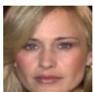
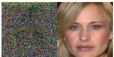
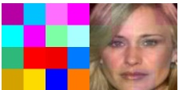
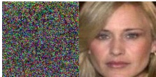
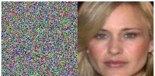
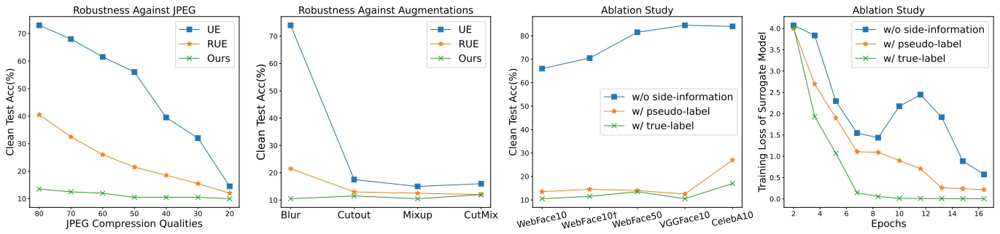

# Segue: Side-information Guided Generative Unlearnable Examples for Facial Privacy Protection in Real World

Zhiling Zhang1, Jie Zhang2†, Kui Zhang1, Wenbo Zhou1†, Weiming Zhang1, Nenghai Yu1 1University of Science and Technology of China 2Nanyang Technological University

{zhilingzhang@mail., zk19@mail., welbeckz@, zhangwm@, ynh@}ustc.edu.cn jie zhang@ntu.edu.sg

## Abstract

The widespread use of face recognition technology has given rise to privacy concerns, as many individuals are worried about the collection and utilization of their facial data. To address these concerns, researchers are actively exploring the concept of “unlearnable examples”, by adding imperceptible perturbation to data in the model training stage, which aims to prevent the model from learning discriminate features of the target face. However, current methods are inefficient and cannot guarantee transferability and robustness at the same time, causing impracticality in the real world. To remedy it, we propose a novel method called **Segue**: Side-information guided generative unlearnable examples. Specifically, we leverage a oncetrained multiple-used model to generate the desired perturbation rather than the time-consuming gradient-based method. To improve transferability, we introduce side information such as true labels and pseudo labels, which are inherently consistent across different scenarios. For robustness enhancement, a distortion layer is integrated into the training pipeline. Extensive experiments demonstrate that the proposed **Segue** is much faster than previous methods (1000×) and achieves transferable effectiveness across different datasets and model architectures. Furthermore, it can resist JPEG compression, adversarial training, and some standard data augmentations.

## 1. Introduction

Due to the rise of social media platforms like Twitter and Facebook, there has been a noticeable increase in the amount of facial data shared publicly, for fun or commercial purposes. Every coin has two sides. It becomes convenient for the unauthorized collection of individual facial data, which is a violation of public privacy [10, 16]. In addition, such facial data can be used to train various face analysis models such as face recognition models [13, 15, 17, 26], which poses a threat to security-critical applications like authentication system [25, 27]. Therefore, it is crucial to safeguard individual faces from unauthorized exploration.

Figure 1. Illustration on leveraging the unlearnable examples for facial privacy protection.

Recent works focus on utilizing unlearnable examples [5, 12, 18] to prevent attackers from training recognition models. As shown in Fig. 1, the defender adds some perturbations to the pristine image before releasing it, wherein the perturbed image is dubbed an unlearnable example. The attacker can only use the released unlearnable examples of Alice to train a facial recognition (FR) model, which fails in the inference stage (i.e., recognizing Alice as Bob). The explanation for such a technique is that Neural networks are more inclined to learn shortcuts as discriminate features on classification tasks [6], and the perturbation can be seen as a kind of shortcut. In a nutshell, we can leverage the unlearnable example for facial privacy protection.

To generate unlearnable facial examples that can be applied in the real world, there are **five** requirements: 1) <u>Effectiveness</u>: the generated unlearnable examples shall make the FR model cannot recognize the corresponding clean examples, with accuracy closing to random guessing. 2) <u>Imperceptibility</u>: the unlearnable examples shall be indistinguishable from the pristine clean examples, namely, the appended perturbations shall be imperceptible. 3) <u>Transferability</u>: the generated unlearnable example should be versatile enough to handle diverse scenarios, such as different facial datasets [1, 15, 26] and different model architectures [9, 11, 22] used by the attacker, even in a black-box scenario. 4) <u>Robustness</u>: since these facial images will be shared on social platforms, we need to account for the distortions caused by the transmission (e.g., JPEG compression and blurring). Moreover, the attacker may deliberately use adversarial training [7] to undermine the effectiveness of unlearnable perturbations. 5) <u>Efficiency</u>: the generation speed is crucial for practical use, e.g., online processing requires fast generation. However, as shown in Table 1, existing methods of unlearnable examples [5, 12, 18] can not satisfy all the above demands, making them inapplicable for facial privacy protection in practice.

| Methods | Effectiveness | Imperceptibility | Transferability | Robustness | Efficiency |
| --- | --- | --- | --- | --- | --- |
| UE [12] | ● | ● | ○ | ○ | ○ |
| LSP [28] | ○ | ○ | ○ | ○ | ● |
| RUE [5] | ● | ● | ○ | ● | ○ |
| TUE [18] | ○ | ● | ○ | ○ | ○ |
| Ours | ● | ● | ● | ● | ● |

Table 1. We compare the proposed method with previous methods of unlearnable examples based on five requirements. We use #, H#, or to indicate whether the method has no, partial, or full ability for each requirement.

To remedy the limitations of current methods, we propose **Segue**, a side-information guided generative unlearnable examples method. Specifically, we adopt an autoencoder model to generate perturbations, which is more efficient than iterative gradient optimization used by previous approaches. The trained generator can generate perturbations for various scenarios without retraining, namely, can be once-trained multiple-used. Besides, we leverage side information to guide the generation process and improve transferability. The side information can be adapted to different protection scenarios based on prior knowledge. For instance, we use true labels of the to-be-protected category as side information if we can access it. Otherwise, we leverage K-means clustering [19] on an unlabeled large facial dataset to get pseudo labels as side information. The side information helps to distinguish the target face from other faces, which is consistent regardless of the attacker’s training datasets and model architectures adopted. To enhance robustness against the transmission process, we further append a distortion layer to our training pipeline, wherein the distortion layer simulates possible channel losses and potential attacks in reality, such as JPEG compression, blurring, and adversarial training.

We conduct extensive experiments to show that **Segue** can successfully meet the five requirements mentioned above. Specifically, our method induces a larger performance degradation of the attacker’s model on clean examples, e.g., only 11.50% accuracy on VGGFace10 while the best result for the other methods is 20.50%. Furthermore, we compare the transferability across 5 different model architectures and 5 different facial datasets, the proposed method achieves a superior performance in most cases. For robustness, **Segue** performs better compared with the robust unlearnable example (RUE) [5] against adversarial training and other pre-processings. In terms of efficiency, **Segue** and non-trainable shortcuts (LSP) [28] are much faster than other methods (1000×). Finally, some ablation studies are also conducted to verify our design.

To summarize, the main contributions of our method are described as follows:

• We conclude five requirements for unlearnable facial examples for facial privacy protection in the real world: effectiveness, imperceptibility, transferability, robustness, and efficiency. Besides, we survey current methods and find that they cannot meet all these requirements.
• We propose **Segue**, which uses a once-trained multipleused generative model to efficiently generate unlearnable examples. Side information and a distortion layer are also introduced to improve transferability and robustness.
• Extensive experiments demonstrate that our approach surpasses current methods, especially in terms of transferability, robustness, and efficiency.

## 2. Related Work

## 2.1. Facial Privacy Protection

Facial privacy protection aims to prevent unauthorized disclosure or use of individuals’ facial data, such as by face recognition technology [13, 17], which can identify individuals without their consent. Existing protection methods against face recognition can be classified into two categories based on the stage of protection: the testing-stage protection and the training-stage protection. Testing-stage protection methods [2, 20, 24] apply adversarial perturbations to images in the inference stage, making the model misclassify the perturbed images. However, these methods cannot stop the unauthorized usage of private data and cannot protect clean test images. On the other hand, training-stage protection methods [4, 12, 28] add perturbations to the training images, which aim to degrade the model’s performance on clean test images. In this paper, we focus on the latter protection strategy, which involves unlearnable examples [5, 12, 18] to interfere with the unauthorized training.

## 2.2. Unlearnable Examples

Adversarial examples [7, 21] are generated by a min-max optimization. Following this idea, Huang et al. [12] propose to use a min-min optimization strategy to generate unlearnable examples (UE). However, this strategy is not robust to adversarial training and needs the gradient information of the target model, which is not accessible in a blackbox setting. To address the robustness issue, Fu et al. [5] propose the robust unlearnable example (RUE), which integrates the adversarial training into the original generation process of perturbations by a min-min-max optimization strategy. However, this strategy is computationally expensive. Yu et al. [28] use several patches to synthesize linearly separable perturbations (LSP) without training, which is a strict black-box scenario. In [18], they propose transferable unlearnable examples (TUE) which focus on transferability rather than efficiency and robustness. They reduce the intra-class distance and increase the inter-class distance of perturbations to make them easily separable by even a linear classifier when they are added to any dataset. However, as shown in Table 1, none of the current methods can satisfy all the five requirements for real-world applications simultaneously. Nevertheless, we take them as the baseline methods for subsequent comparison.

## 3. Preliminary

## 3.1. Formalized Description

## 3.1.1 Face Recognition

Face recognition is a type of image classification with DNNs. Suppose we have a clean dataset $\mathcal { D } = \{ ( x _ { i } , y _ { i } ) \} _ { i = 1 } ^ { n }$ which can be divided into a training set $\mathcal { D } _ { t r a i n }$ and a testing set $\mathcal { D } _ { t e s t }$ . For face recognition tasks, we usually train a neural network $f$ to fit the distribution of $\mathcal { D } _ { t r a i n }$ . The optimization can be described as follows:

$$
\arg \min _ {f} \mathbb {E} _ {(x, y) \sim \mathcal {D} _ {t r a i n}} \left[ \mathcal {L} (f (x), y) \right], \tag {1}
$$

where $\mathcal { L }$ can be the Cross-Entropy loss. After training, $f$ can be used to predict the label y of sample x in $\mathcal { D } _ { t e s t }$ since $\mathcal { D } _ { t e s t }$ has the same distribution as $\mathcal { D } _ { t r a i n }$

## 3.1.2 Unlearnable Examples

Huang et al. [12] propose a bi-level objective to generate perturbations to prevent the FR model from learning anything from the training data. They use the following objective:

$$
\arg \min _ {f} \mathbb {E} _ {(x, y) \sim \mathcal {D} _ {t r a i n}} \left[ \min _ {\delta} \mathcal {L} (f (x + \delta), y) \right], \tag {2}
$$

where the modified image $x + \delta$ is called as the unlearnable example and the set of all such images is the unlearnable dataset. $f$ acts as a surrogate model for the target model. The perturbation δ is bounded by $\| G ( x ) \| _ { p } \leq \epsilon$ to guarantee that it is imperceptible to human eyes. They update δ and f with an alternating training strategy. In each epoch, f is trained on the perturbed data for a few steps to reduce the loss. Then δ is optimized to further lower the loss. The optimization stops when the loss on the perturbed data reaches a threshold, which means that there is no gradient for the target model to update its parameters.

## 3.2. Threat Model

## 3.2.1 The Capability and Objective of the Attacker

Following current methods, we assume that the attacker wants to train a face recognition model as in Eq. (1) but only has access to the unlearnable dataset. As a result, the attacker trains the FR model with the unlearnable dataset instead of $\mathcal { D } _ { t r a i n }$ . To boost the model performance, the attacker may apply data augmentation techniques, such as Cutout, Mixup, and CutMix. Besides, the attacker may also use adversarial training, which can eliminate the non-robust features $( i . e .$ , the appended perturbation as shortcut features) from the input and make the model learn only the robust features.

## 3.2.2 The Capability and Objective of the Defender

We consider a black-box scenario, where the defender has no knowledge of the target model, including parameters and architectures, used by the attacker. Instead, we use a surrogate model $f$ as an approximation. We can use the dataset labels as side information if we have them. However, the dataset labels are not necessary. We only need to know the number of identities K in the dataset, which is used to cluster the image features and obtain the pseudo labels. We describe this process in more detail in the next section.

Our goal is to protect the user’s facial privacy. To do this, we optimize δ following Eq. (2) and add δ to $\mathcal { D } _ { t r a i n }$ to prevent the attacker from learning useful information from it. As a result, the FR model trained with $\delta   +   \mathcal { D } _ { t r a i n }$ fails to recognize the images in $\mathcal { D } _ { t e s t }$ since the distributions have changed between them.

## 3.3. Linear Separability

Linear separability means the samples can be easily separated by simple linear models. Yu et al. [28] show that the perturbations of the training-stage availability attacks [4, 12] are all linearly separable. It is easier for models to learn the linear separability noise while ignoring the image information.

Figure 2. The overall framework of Segue. The generator consists of an encoder and a decoder. The image and side information are fused in the deep feature space. The side information could be the true label in supervised scenarios or the pseudo label in unsupervised scenarios. The distortion layer contains various processing to enhance the robustness of δ. We train the generator and the surrogate model alternately.

We can achieve strong linear separability by adding class-wise perturbation to the samples. For example, we can add $\delta _ { i }$ to all samples from the class i. Huang et al. [12] also points out that random class-wise perturbations can prevent the model from learning useful information. Random perturbation does not contain any information about the dataset or model and can be applied to any dataset or model, which implies linear separability ensures the transferability of perturbation. Therefore, we could increase the linear separability by enhancing the transferability of perturbation.

## 4. Method

## 4.1. Overview

This section is organized as follows. First, we demonstrate what is side information and how to leverage it. Additionally, we describe our design of the once-trained multipleused generator and the distortion layer. Finally, a two-stage training strategy is introduced.

## 4.2. The Design of Side Information

As mentioned above, we should increase the linear separability of perturbation to enhance its transferability. A simple and direct way is to use the dataset’s true labels. Besides, we also address unlabeled facial data in the wild. We call them supervised and unsupervised scenarios, respectively.

Algorithm 1: Two-stage Training Strategy

Input: image $x$, side information $\hat{y}$, dataset $D$,
perturbation boundary $\epsilon$, distortion layer $T$,
generator $G$, surrogate model $f$,
optimization steps $maxiter$, learning rate
$\alpha_f$ and $\alpha_G$, epoch $E$
Output: generator $G$
for epoch $\leftarrow 1$ to $E$ do
    if epoch$\%5 = 1$ then
        for $i \leftarrow 1$ to $maxiter$ do
            $(x_i, y_i) \sim \mathcal{D}$
            $\delta_i \leftarrow Clip(G(x_i), -\epsilon, \epsilon)$
            $x'_i \leftarrow x_i + \delta_i$
            $\theta_{f,i+1} \leftarrow \theta_{f,i} - \alpha_f \nabla_{\theta_{f,i}} \mathcal{L}_f(f(x'_i), \hat{y}_i)$
    else
        for $i \leftarrow 1$ to $maxiter$ do
            $(x_i, y_i) \sim \mathcal{D}$
            $\delta \leftarrow Clip(G(x_i), -\epsilon, \epsilon)$
            $x'_i \leftarrow x_i + \delta_i$
            $\theta_{G,i+1} \leftarrow \theta_{G,i} - \alpha_G \nabla_{\theta_{G,i}} \mathcal{L}_G(f(x'_i), \hat{y}_i)$

## 4.2.1 Supervised Scenario

In the supervised scenario, we use the dataset labels as side information. Inspired by [8], we concatenate the label embedding with the image embedding along the channel in the high-level feature space to guide the generation process (see Fig. 2). Then, we use an extra convolution layer to reduce the channel dimension $C + C ^ { \prime }$ back to C. Specifically, we use a 16-bit binary vector to encode the label embedding. For instance, the label embedding is 0. . . 0101 (13 zeros before 101) when y is 5. With a 16-bit label embedding, we can support up to $2 ^ { 1 6 }$ identities in the dataset. Thus, we can handle most facial datasets [1, 15, 26]. Moreover, the label embedding length is flexible. We can adjust it to any length depending on the number of classes in the dataset.

## 4.2.2 Unsupervised Scenario

To address the challenge of obtaining labels in this scenario, we propose using pseudo labels generated by an unsupervised approach [31]. First, we use an extractor trained on a large-scale facial dataset CelebA [15] to extract facial features. Then we apply the K-means clustering method [19] to cluster the facial features into K groups and assign pseudo labels to them. Once we get the pseudo labels, we can concatenate them with image features as the supervised scenario. This frees us from manual labeling of the images and all we need to know is the number of classes K in the dataset. Moreover, our method is robust to the accuracy of the k-means clustering method. As long as it is more than 80%, there will be no impact on the transferability of perturbations across different datasets and models.

## 4.3. Once-trained Multiple-used Generator

As shown in Fig. 2, the generator G encodes the input image into the image embedding and decodes it into a perturbation δ. We use convolutional layers with kernel size (3×3), batch normalization, and ReLU activation for both the encoder and the decoder. The image embedding is fused with the guide embedding in the high-level feature space to guide the generation of δ. Unlike previous methods [12, 18] that optimize the perturbation directly, we optimize a generator that produces perturbations according to inputs. This design allows us to generate perturbations for different datasets with different numbers of classes using one generator. For example, we can generate perturbation for WebFace50 (a dataset with 50 identities) with the generator trained on WebFace10 (a dataset with 10 identities). In contrast, most existing methods need to retrain the perturbations for different datasets. In other words, this design is more efficient.

## 4.4. Distortion Layer

To enhance the robustness of unlearnable perturbations against possible distortions in transmission, we use a distortion layer during training. RUE [5] adopts a min-min-max framework which introduces adversarial training to increase the perturbation generation difficulty. Actually, adversarial training can be seen as a form of data augmentation. Thus, we use a distortion layer to augment the data with common transformations including adversarial training, Gaussian blurring, random flip, etc. (see Fig. 2). The distortion layer perturbs the data in the high-dimensional space, forcing the generator G to find a more robust perturbation, which makes all points near the perturbation become unlearnable in the high-dimensional space.

| Sub-dataset | # IDs | Source dataset | $\mathcal{D}_{train}$ | $\mathcal{D}_{test}$ |
| --- | --- | --- | --- | --- |
| WebFace10 | 10 | WebFace | 1300 | 200 |
| WebFace10 † | 10 | WebFace | 1300 | 200 |
| WebFace50 | 50 | WebFace | 6500 | 1300 |
| VGGFace10 | 10 | VGGFace2 | 1300 | 200 |
| CelebA10 | 10 | CelebA | 200 | 100 |

Table 2. The details of datasets.

## 4.5. Two-stage Training Strategy

As shown in Alg. 1, we alternately train the surrogate model f and the generator G, where ResNet18 is adopted as the default surrogate model f. In the first stage, we train $f$ for maxiter (iterations over the entire dataset) constrained by $\mathcal { L } _ { f } ,$ which encourages the perturbed image $x + G ( x )$ to be classified correctly (as ŷ) by f:

$$
\mathcal {L} _ {f} = C E (f (x + G (x)), \hat {y}), \tag {3}
$$

where $\hat { y }$ denotes the side information, including true-label and pseudo-label, and CE denotes Cross-Entropy loss. In the second stage, we update G for four epochs. The loss function for G consists of two terms, namely, $\mathcal { L } _ { G 1 }$ tries to reduce the loss of $f$ on unlearnable examples, while $\mathcal { L } _ { G 2 }$ aims to constrain the magnitude of the perturbation:

$$
\mathcal {L} _ {G} = \alpha \cdot \mathcal {L} _ {G 1} + \beta \cdot \mathcal {L} _ {G 2}, \tag {4}
$$

$$
\mathcal {L} _ {G 1} = C E (f (x + G (x)), \hat {y}), \tag {5}
$$

$$
\mathcal {L} _ {G 2} = \mathbb {E} _ {x} (\| G (x) \| _ {2}), \tag {6}
$$

where α and $\beta$ control the relative importance of each objective. We stop the whole training after 20 epochs or when the loss of $f$ on the unlearnable dataset is below 0.001.

## 5. Experiments

We evaluate the proposed method **Segue** on various aspects, including effectiveness, imperceptibility, transferability, robustness, and efficiency. We compare **Segue** with current methods and show its advantages. We also conduct ablation studies to validate our design choices.

## 5.1. Experimental Settings

## 5.1.1 Datasets

We use three face image datasets: WebFace [26], VG-GFace2 [1], and CelebA [15]. For ease of implementation on each dataset, we randomly select some categories to construct the final sub-datasets and resize all images to 224×224. More details can be found in Table 2.

clean

UE

RUE

TUE

Ours

Figure 3. Visualization of different unlearnable examples and the corresponding residual compared with the clean image.

## 5.1.2 Metric

We adopt clean test accuracy, $i . e .$ , the performance of the attacker’s model on clean datasets, where the model is trained on unlearnable datasets. The lower the test accuracy, the more effective unlearnable examples are. If the accuracy is close to $\frac { 1 0 0 \% } { \# I D s }$ , the model learns nothing from the unlearnable dataset, just like random guessing.

## 5.1.3 The Baselines

We compare our method with three gradient-based methods: UE [12], RUE [5], and TUE [18]. Besides, the modelagnostic method LSP [28] is also considered for comparison. We follow their official code to reproduce them.

## 5.1.4 Implementation Details

We limit the perturbation to $\| \delta \| _ { \infty } \leq \epsilon = 8 / 2 5 5$ , which is imperceptible to humans. We use Adam optimizer with an initial learning rate of 0.0005 for both the surrogate model $\alpha _ { f }$ and the generator $\alpha _ { G }$ . We set α and $\beta$ in Eq. (4) to 1 and 0.001, respectively. We highlight the best results in **bold**. Unless specified, we use ResNet18 and WebFace10 by default, which can be seen as a white-box setting. To evaluate transferability across different models and datasets, we conduct control experiments.

We update the surrogate model f for one epoch and then update the generator $G$ for five epochs and repeat. maxiter represents the number of all samples divided by the batch size. The distortion layer consists of adversarial training, Gaussian blur, random horizontal flip, random vertical flip, and sharpness adjusting. For adversarial training, we set the $\rho _ { d }   =   1 / 2 5 5$ as default and adjust it from $\rho _ { d }   =   0 / 2 5 5$ to $\rho _ { d } = 4 / 2 5 5$ in the experiment of robustness against adversarial training. For Gaussian blur, we set kernel size to (3,3) and sigma to 0.2. For sharpness adjusting, we set the sharpness factor to 2. For random horizontal flip and random vertical flip, we set the probability of the image being flipped to 0.1. We resize the images to 32×32 on CIFAR10[14] and 224×224 on other sub-datasets.

## 5.2. Effectiveness

Table 3 shows that our method achieves the best results among three facial datasets, which successfully reduces the accuracy closing to $\frac { 1 0 0 \% } { \# I D s }$ . We test different sizes of patches for LSP and show the best result with the size equal to

| Methods | WebFace10 | WebFace50 | VGGFace10 |
| --- | --- | --- | --- |
| CLEAN | 75.00 | 80.60 | 83.00 |
| UE [12] | 12.50 | 3.50 | 20.50 |
| LSP [28] | 31.50 | 9.30 | 57.50 |
| RUE [5] | 11.50 | 7.40 | 30.00 |
| TUE [18] | 33.50 | 11.20 | 82.00 |
| Ours | 10.50 | 2.50 | 11.50 |

Table 3. Comparison of effectiveness (clean test acc % ↓) among different methods. Experiments are conducted with ResNet18 on three different facial datasets.

| Methods | CIFAR10 | ImageNet10 |
| --- | --- | --- |
| CLEAN | 91.67 | 71.00 |
| UE [12] | 19.93 | 30.00 |
| LSP (patchsize=8) [28] | 17.07 | 64.00 |
| LSP (patchsize=56) [28] | \\ | 28.50 |
| RUE [5] | 15.18 | 24.50 |
| TUE [18] | 11.25 | 60.50 |
| Ours | 10.12 | 14.00 |

Table 4. Comparison on CIFAR10 and ImageNet10.

56×56. We explain why the results vary across datasets as follows: WebFace50 has more categories, so the difficulty of learning for the classifier goes up and the accuracy is lower. VGGFace10 has higher image quality, so the classifier learns the face features more easily and the accuracy is higher. As shown in Table 4, **Segue** also achieves superior performance on non-facial datasets such as CIFAR10 and ImageNet10.

## 5.3. Imperceptibility

In Table 7, we use three metrics to measure image quality: PSNR, SSIM, and LPIPS. Fig. 3 also provides some visual examples, where perturbations are magnified to 30×. UE, TUE, and RUE optimize the perturbations from random noises. LSP [28] composes the perturbation with several patches, but they are visible to the human eye. We use an encoder-decoder structure generator to create perturbations that preserve distinct facial features. Therefore, our perturbations are more diverse and relevant to each sample than other methods. Overall, we achieve comparable imperceptibility compared with other methods.

| Methods | ResNet18 | ResNet50 | MobileNet-V1 | Inception-V3 | EfficientNet-b1 |
| --- | --- | --- | --- | --- | --- |
| UE [12] | 14.50 | 14.50 | 15.50 | 73.00 | 28.00 |
| LSP [28] | 31.50 | 32.50 | 18.50 | 56.00 | 52.50 |
| RUE [5] | 19.00 | 27.50 | 17.00 | 77.00 | 27.00 |
| TUE [18] | 33.50 | 70.00 | 15.50 | 69.00 | 67.50 |
| Ours | 10.50 | 12.50 | 11.00 | 10.50 | 12.00 |

Table 5. Transferability for different models (clean test acc % ↓). Defenders use ResNet18 and attackers use five models.

| Methods | WebFace10 | WebFace10† | WebFace50 | VGGFace10 | CelebA10 |
| --- | --- | --- | --- | --- | --- |
| UE [12] | 12.50 | 14.50 | \\ | 21.50 | 44.00 |
| LSP [28] | 31.50 | 35.00 | 9.30 | 57.50 | 74.00 |
| RUE [5] | 17.00 | 26.50 | \\ | 78.50 | 78.50 |
| TUE [18] | 33.50 | 52.00 | \\ | 53.00 | 59.00 |
| Ours | 10.50 | 11.50 | 13.50 | 13.00 | 17.00 |

Table 6. Transferability across different datasets (clean test acc $\% \downarrow$ . Perturbations are trained on WebFace10 and then added to the other different datasets. WebFace10† owns 10 non-overlapped categories with WebFace10.

| Methods | PSNR(↑) | SSIM(↑) | LPIPS(↓) |
| --- | --- | --- | --- |
| UE [12] | 32.37 | 0.754 | 0.205 |
| LSP [28] | 31.53 | 0.968 | 0.049 |
| RUE [5] | 32.45 | 0.763 | 0.188 |
| TUE [18] | 30.18 | 0.651 | 0.310 |
| Ours | 30.54 | 0.673 | 0.159 |

Table 7. Comparison of imperceptibility on WebFace10.

## 5.4. Transferability

## 5.4.1 Different Models

All methods generate unlearnable examples based on the surrogate model ResNet18, and the attacker can adopt different model architectures for training. As show in Table 5, we test on five architectures: ResNet18, ResNet50 [9], MobileNet-V1 [11], Inception-V3 [22], and EfficientNetb1 [23], and our method performs well in all cases. For deeper networks like Inception-V3, other methods fail for privacy protection. We explain that different convolutional kernel sizes of Inception-V3 may filter their perturbations and capture rich image features.

## 5.4.2 Different Datasets

Similarly, in Table 6, we generate perturbations based on WebFace10 and conduct evaluations on different datasets. CelebA10 has fewer samples in each class, which requires higher linear separability of the perturbations, but our method still lowers the accuracy to 17%. TUE and UE cannot transfer the perturbations to WebFace50, because they must fix the shape of the perturbation before optimizing.

Therefore, they can only transfer to smaller datasets, which limits their applicability.

## 5.5. Robustness

## 5.5.1 Adversarial Training

Adversarial training can effectively remove the non-robust noise from the input [7]. The attacker employs adversarial training with $\rho _ { a }$ to remove the perturbations from the images, while we use $\rho _ { d }$ in the distortion layer to improve the robustness of perturbations. When $\rho _ { a }$ and $\rho _ { d }$ are 0, it means that neither the attacker nor the defender uses adversarial training. Table 8 shows that our method can still achieve good effectiveness with 16.5% clean data accuracy, even if the attacker uses adversarial training with $\rho _ { a } = 4 / 2 5 5$

## 5.5.2 JPEG Compression

JPEG compresses images by dividing them into 8×8 pixel blocks, transforming them into frequency components, and discarding some of the less important ones. A higher compression ratio requires more robust perturbations. RUE uses $\rho _ { d } = 4 / 2 5 5$ as the adversarial perturbation radius. Fig. 4 (1) shows that our method can maintain effectiveness against all quality settings, while other methods fail against lowquality settings.

## 5.5.3 Data Augmentation

We implement different augmentations as follows: we use a kernel size of 5 and a standard deviation of 1.0 for Gaussian blurring. For Cutout [3], we use 2 patches with a length of 112, which is half of the image size 224. For Mixup [30], we randomly select a pair of images to mix up and λ takes values from the beta distribution in the range of [0,1]. For CutMix [29], we apply Mixup on the Cutout region with the same setting in Cutout. Fig. 4 (2) shows that our method is robust against all these data augmentations.

<table><tr><td>Adv. Train.</td><td>Clean</td><td>UE</td><td colspan="5">RUE</td><td colspan="5">Ours</td></tr><tr><td> $\rho_a$ </td><td></td><td></td><td> $\rho_d=0$ </td><td>1/255</td><td>2/255</td><td>3/255</td><td>4/255</td><td> $\rho_d=0$ </td><td>1/255</td><td>2/255</td><td>3/255</td><td>4/255</td></tr><tr><td>0</td><td>75.00</td><td>12.50</td><td>11.50</td><td>13.50</td><td>13.00</td><td>12.50</td><td>14.50</td><td>10.50</td><td>12.50</td><td>12.50</td><td>12.50</td><td>13.50</td></tr><tr><td>1/255</td><td>68.00</td><td>18.00</td><td>17.50</td><td>17.00</td><td>15.50</td><td>18.00</td><td>17.50</td><td>13.50</td><td>13.50</td><td>11.50</td><td>11.00</td><td>12.50</td></tr><tr><td>2/255</td><td>65.00</td><td>69.00</td><td>26.00</td><td>24.50</td><td>19.50</td><td>23.50</td><td>22.50</td><td>15.50</td><td>14.50</td><td>15.00</td><td>13.50</td><td>12.50</td></tr><tr><td>3/255</td><td>63.50</td><td>74.50</td><td>69.50</td><td>68.50</td><td>61.50</td><td>53.50</td><td>58.00</td><td>29.00</td><td>27.00</td><td>16.00</td><td>16.50</td><td>14.50</td></tr><tr><td>4/255</td><td>65.50</td><td>69.50</td><td>71.00</td><td>66.50</td><td>62.00</td><td>63.50</td><td>63.00</td><td>34.00</td><td>35.50</td><td>21.00</td><td>19.50</td><td>16.50</td></tr></table>

Table 8. Robustness against adversarial training (clean test acc $\% \downarrow$ . The perturbation budget used in adversarial training by the attacker is $\rho _ { a }$ , while the perturbation budget used by the defender is $\rho _ { d } .$

Figure 4. From left to right: (1) Robustness against JPEG compression. A lower quality indicates a higher compression ratio. (2) Robustness against different data augmentations. (3) The influence of side information on transferability. (4) The influence of side information on the training loss of the surrogate model. For all results, the lower the numerical value, the better.

| Methods | Time (s) |
| --- | --- |
| UE [12] | $\sim 2.1$k |
| LSP [28] | 4.5 |
| RUE [5] | $\sim 6.7$k |
| TUE [18] | $\sim 7.4$k |
| Ours | 2.2 |

Table 9. Comparison of efficiency on WebFace10.

## 5.6. Efficiency

We use a server with a single A6000 GPU and an Intel Xeon Gold 6130 CPU. Our methods only need one-step inference with a trained generator. LSP generates perturbations without training. UE runs 100 SGD updates for the outer problem and 20 SGD updates for each target example in the inner problem, as in Eq. (2). TUE trains the model parameters for 50 SGD updates and optimizes the perturbations for one SGD update by PGD-20 after every 1/4 update. As shown in Table 9, our method can generate unlearnable examples for the entire WebFace10 dataset much faster than other methods that rely on gradient optimization, achieving a speedup

of over 1000×.

## 5.7. Ablation Study

Fig. 4 (3) shows that side information improves the transferability of perturbations, and the true label is much better than the pseudo-label. Besides, we also analyze the influence of side information on training convergence. As in Fig. 4 (4), without side information, the generator’s optimization function is hard to converge and the surrogate model’s training loss fluctuates. We explain that side information acts as a prior to narrow the generator’s search space, which speeds up the training convergence and provides more precise guidance.

## 6. Conclusion

In this paper, we present a novel method **Segue** for facial privacy protection with unlearnable examples, which satisfies five requirements: effectiveness, imperceptibility, transferability, robustness, and efficiency. The proposed method uses generative models with side information to create unlearnable examples that are hard to recognize by face recognition models. We have shown that our method can transfer well across different datasets and models, and can resist various attacks and distortions. Moreover, our method can generate unlearnable examples much faster than most existing methods, achieving up to 1000× speedup. We believe our work can provide a new perspective and a practical solution for facial privacy protection in the real world.

## References

[1] Qiong Cao, Li Shen, Weidi Xie, Omkar M. Parkhi, and Andrew Zisserman. Vggface2: A dataset for recognising faces across pose and age. 2018 13th IEEE International Conference on Automatic Face & Gesture Recognition (FG 2018), pages 67–74, 2017. 2, 5
[2] Valeriia Cherepanova, Micah Goldblum, Harrison Foley, Shiyuan Duan, John P Dickerson, Gavin Taylor, and Tom Goldstein. Lowkey: Leveraging adversarial attacks to protect social media users from facial recognition. In International Conference on Learning Representations, 2020. 2
[3] Terrance DeVries and Graham W Taylor. Improved regularization of convolutional neural networks with cutout. arXiv preprint arXiv:1708.04552, 2017. 7
[4] Ji Feng, Qi-Zhi Cai, and Zhi-Hua Zhou. Learning to confuse: Generating training time adversarial data with auto-encoder. In Neural Information Processing Systems, 2019. 3, 4
[5] Shaopeng Fu, Fengxiang He, Yang Liu, Li Shen, and Dacheng Tao. Robust unlearnable examples: Protecting data against adversarial learning. In International Conference on Learning Representations, 2022. 1, 2, 3, 5, 6, 7, 8
[6] Robert Geirhos, Jorn-Henrik Jacobsen, Claudio Michaelis, ¨ Richard S. Zemel, Wieland Brendel, Matthias Bethge, and Felix Wichmann. Shortcut learning in deep neural networks. Nature Machine Intelligence, 2020. 1
[7] Ian J. Goodfellow, Jonathon Shlens, and Christian Szegedy. Explaining and harnessing adversarial examples. CoRR, abs/1412.6572, 2014. 2, 3, 7
[8] Jiangfan Han, Xiaoyi Dong, Ruimao Zhang, Dongdong Chen, Weiming Zhang, Nenghai Yu, Ping Luo, and Xiaogang Wang. Once a man: Towards multi-target attack via learning multi-target adversarial network once. 2019 IEEE/CVF International Conference on Computer Vision (ICCV), pages 5157–5166, 2019. 4
[9] Kaiming He, X. Zhang, Shaoqing Ren, and Jian Sun. Deep residual learning for image recognition. IEEE Conference on Computer Vision and Pattern Recognition (CVPR), pages 770–778, 2015. 2, 7
[10] Kashmir Hill. The secretive company that might end privacy as we know it. In Ethics of Data and Analytics, pages 170–177. Auerbach Publications, 2022. 1
[11] Andrew G Howard, Menglong Zhu, Bo Chen, Dmitry Kalenichenko, Weijun Wang, Tobias Weyand, Marco Andreetto, and Hartwig Adam. Mobilenets: Efficient convolutional neural networks for mobile vision applications. arXiv preprint arXiv:1704.04861, 2017. 2, 7
[12] Hanxun Huang, Xingjun Ma, Sarah Monazam Erfani, James Bailey, and Yisen Wang. Unlearnable examples: Making personal data unexploitable. In ICLR, 2021. 1, 2, 3, 4, 5, 6, 7, 8
[13] Huaizu Jiang and Erik G. Learned-Miller. Face detection with the faster r-cnn. 2017 12th IEEE International Conference on Automatic Face & Gesture Recognition (FG 2017), pages 650–657, 2016. 1, 2
[14] Alex Krizhevsky. Learning multiple layers of features from tiny images. In Technical report, University of Toronto, 2009. 6
[15] Ziwei Liu, Ping Luo, Xiaogang Wang, and Xiaoou Tang. Deep learning face attributes in the wild. In Proceedings of the IEEE international conference on computer vision, pages 3730–3738, 2015. 1, 2, 5
[16] Vinay Uday Prabhu and Abeba Birhane. Large image datasets: A pyrrhic win for computer vision? 2021 IEEE Winter Conference on Applications of Computer Vision (WACV), pages 1536–1546, 2020. 1
[17] Rajeev Ranjan, Swami Sankaranarayanan, Carlos Domingo Castillo, and Rama Chellappa. An all-in-one convolutional neural network for face analysis. 2017 12th IEEE International Conference on Automatic Face & Gesture Recognition (FG 2017), pages 17–24, 2016. 1, 2
[18] Jie Ren, Han Xu, Yuxuan Wan, Xingjun Ma, Lichao Sun, and Jiliang Tang. Transferable unlearnable examples. In The Eleventh International Conference on Learning Representations, 2023. 1, 2, 3, 5, 6, 7, 8
[19] Shokri Z. Selim and M. A. Ismail. K-means-type algorithms: A generalized convergence theorem and characterization of local optimality. IEEE Transactions on Pattern Analysis and Machine Intelligence, PAMI-6:81–87, 1984. 2, 5
[20] Shawn Shan, Emily Wenger, Jiayun Zhang, Huiying Li, Haitao Zheng, and Ben Y. Zhao. Fawkes: Protecting privacy against unauthorized deep learning models. In USENIX Security Symposium, 2020. 2
[21] Christian Szegedy, Wojciech Zaremba, Ilya Sutskever, Joan Bruna, D. Erhan, Ian J. Goodfellow, and Rob Fergus. Intriguing properties of neural networks. CoRR, abs/1312.6199, 2013. 3
[22] Christian Szegedy, Vincent Vanhoucke, Sergey Ioffe, Jonathon Shlens, and Zbigniew Wojna. Rethinking the inception architecture for computer vision. IEEE Conference on Computer Vision and Pattern Recognition (CVPR), pages 2818–2826, 2015. 2, 7
[23] Mingxing Tan and Quoc Le. Efficientnet: Rethinking model scaling for convolutional neural networks. In International conference on machine learning, pages 6105–6114. PMLR, 2019. 7
[24] Xiao Yang, Yinpeng Dong, Tianyu Pang, Jun Zhu, and Hang Su. Towards privacy protection by generating adversarial identity masks. In Proceedings of the IEEE/CVF International Conference on Computer Vision, pages 3897–3907, 2021. 2
[25] Xiao Yang, Chang Liu, Longlong Xu, Yikai Wang, Yinpeng Dong, Ning Chen, Hang Su, and Jun Zhu. Towards effective adversarial textured 3d meshes on physical face recognition. In Proceedings of the IEEE/CVF Conference on Computer Vision and Pattern Recognition, pages 4119–4128, 2023. 1
[26] Dong Yi, Zhen Lei, Shengcai Liao, and Stan Z Li. Learning face representation from scratch. arXiv preprint arXiv:1411.7923, 2014. 1, 2, 5
[27] Bangjie Yin, Wenxuan Wang, Taiping Yao, Junfeng Guo, Zelun Kong, Shouhong Ding, Jilin Li, and Cong Liu. Advmakeup: A new imperceptible and transferable attack on face
recognition. In International Joint Conference on Artificial Intelligence, 2021. 1
[28] Da Yu, Huishuai Zhang, Wei Chen, Jian Yin, and Tie-Yan Liu. Availability attacks create shortcuts. Proceedings of the 28th ACM SIGKDD Conference on Knowledge Discovery and Data Mining, 2021. 2, 3, 6, 7, 8
[29] Sangdoo Yun, Dongyoon Han, Seong Joon Oh, Sanghyuk Chun, Junsuk Choe, and Young Joon Yoo. Cutmix: Regularization strategy to train strong classifiers with localizable features. 2019 IEEE/CVF International Conference on Computer Vision (ICCV), pages 6022–6031, 2019. 8
[30] Hongyi Zhang, Moustapha Cisse, Yann N Dauphin, and David Lopez-Paz. mixup: Beyond empirical risk minimization. arXiv preprint arXiv:1710.09412, 2017. 7
[31] Jiaming Zhang, Xingjun Ma, Qi Yi, Jitao Sang, Yu gang Jiang, Yaowei Wang, and Changsheng Xu. Unlearnable clusters: Towards label-agnostic unlearnable examples. In Proceedings of the IEEE/CVF Conference on Computer Vision and Pattern Recognition, 2023. 5