# Stable Unlearnable Example: Enhancing the Robustness of Unlearnable Examples via Stable Error-Minimizing Noise

**Yixin Liu** 1**, Kaidi Xu** 2**, Xun Chen** 3**, Lichao Sun**1,

1 Lehigh University, Bethlehem, Pennsylvania, USA

2 Drexel University, Philadelphia, Pennsylvania, USA

2 Samsung Research America, Mountain View, California, USA

{yila22, lis221}@lehigh.edu, kx46@drexel.edu, Xun.chen@samsung.com

## Abstract

The open sourcing of large amounts of image data promotes the development of deep learning techniques. Along with this comes the privacy risk of these image datasets being exploited by unauthorized third parties to train deep learning models for commercial or illegal purposes. To avoid the abuse of data, a poisoning-based technique, “unlearnable example”, has been proposed to significantly degrade the generalization performance of models by adding imperceptible noise to the data. To further enhance its robustness against adversarial training, existing works leverage iterative adversarial training on both the defensive noise and the surrogate model. However, it still remains unknown whether the robustness of unlearnable examples primarily comes from the effect of enhancement in the surrogate model or the defensive noise. Observing that simply removing the adversarial noise on the training process of the defensive noise can improve the performance of robust unlearnable examples, we identify that solely the surrogate model’s robustness contributes to the performance. Furthermore, we found a negative correlation exists between the robustness of defensive noise and the protection performance, indicating defensive noise’s instability issue. Motivated by this, to further boost the robust unlearnable example, we introduce Stable Error-Minimizing noise (SEM), which trains the defensive noise against random perturbation instead of the time-consuming adversarial perturbation to improve the stability of defensive noise. Through comprehensive experiments, we demonstrate that SEM achieves a new state-of-the-art performance on CIFAR-10, CIFAR-100, and ImageNet Subset regarding both effectiveness and efficiency. The code is available at <u>https://github.com/liuyixin-louis/Stable-Unlearnable-Example</u>

## Introduction

The proliferation of open-source and large-scale datasets on the Internet has significantly advanced deep learning techniques across various fields, including computer vision (He et al. 2016; Dosovitskiy et al. 2020; Cao et al. 2023), natural language processing (Devlin et al. 2019; Vaswani et al. 2017; Zhou et al. 2023), and graph data analysis (Wang et al. 2018; Kipf and Welling 2016; Sun et al. 2022a). However, this emergence also poses significant privacy threats, as these datasets can be exploited by unauthorized third parties to train deep neural networks (DNNs) for commercial or even illegal purposes. For instance, Hill and Krolik (2019) reported that a tech company amassed extensive facial data without consent to develop commercial face recognition models.

bar

| Category | Clean (Test Acc %) | REM (Generation Time h) | SEM (Generation Time h) |
| --- | --- | --- | --- |
| Testing Accuracy | 89.51 | 48.16 | 31.92 |
| Generation Time | — | 22 | 6 |

Figure 1: The performance comparison on CIFAR-10 between the current SoTA method, the robust error-minimizing noise (REM) (Fu et al. 2022), and our proposed stable errorminimizing noise (SEM). Our SEM outperforms the REM in terms of both effectiveness and generation efficiency.

To tackle this problem, recent works have introduced Unlearnable Examples (Fowl et al. 2021b; Huang et al. 2020; Fowl et al. 2021a), which aims to make the training data “unlearnable” for deep learning models by adding a type of invisible noise. This added noise misleads the learning model into adopting meaningless shortcut patterns from the data rather than extracting informative knowledge (Yu et al. 2022). However, such conferred unlearnability is vulnerable to adversarial training (Huang et al. 2020). In response, the concept of robust error-minimizing noise (REM) was proposed in (Fu et al. 2022) to enhance the efficacy of errorminimizing noise under adversarial training, thereby shielding data from adversarial learners by minimizing adversarial training loss. Specifically, a min-min-max optimization strategy is employed to train the robust error-minimizing noise generator, which in turn produces robust error-minimizing noise. To enhance stability against data transformation, REM leverages the Expectation of Transformation (EOT) (Athalye et al. 2018) during the generator training. The resulting noise demonstrates superior performance in advanced training that involves both adversarial training and data transformation.

<small>Copyright © 2024, Association for the Advancement of Artificial Intelligence (www.aaai.org). All rights reserved.</small>

However, a primary drawback of REM, is its high computational cost. Specifically, on the CIFAR-10 dataset, it would take nearly a full day to generate the unlearnable examples, which is very inefficient. Consequently, enhancing the efficiency of REM is vital, especially when scaling up to larger real-world datasets like ImageNet (Russakovsky et al. 2015). To improve the efficiency of robust unlearnable example generation algorithms, in this paper, we take a closer look at the time-consuming adversarial training process in both the surrogate model and the defensive noise. As empirically demonstrated in Tab. 1, we can see that the performance of the robust unlearnable example mainly comes from the effect of adversarial training on the surrogate model rather than the defensive noise part. Surprisingly, the presence of adversarial perturbation in the defensive noise crafting will even lead to performance degradation, indicating that we need a better optimization method in this part.

To elucidate this intriguing phenomenon and enhance the robustness of unlearnable examples, we begin by defining the robustness of both the surrogate model and defensive noise. Subsequently, our correlation analysis reveals that the robustness of the surrogate model is the primary contributing factor. Conversely, we observe a negative correlation between the robustness of defensive noise and data protection performance. We hypothesize that the defensive noise overfits to monotonous adversarial perturbations, leading to its instability. To address this issue, we introduce a novel noise type, stable error-minimizing noise (SEM). Our SEM is trained against random perturbations, rather than the more time-consuming adversarial perturbations, to enhance stability. We summarize our contributions as follows:

• We establish that the robustness of unlearnable examples is largely attributable to the surrogate model’s robustness, rather than that of the defensive noise. Furthermore, we find that adversarially enhancing defensive noise can actually degrade its protective performance.
• To mitigate such an instability issue, we introduce stable error-minimizing noise (SEM), which trains the defensive noise against random perturbations instead of the more time-consuming adversarial ones, to improve the stability of the defensive noise.
• Extensive experiments empirically demonstrate that SEM achieves a SoTA performance on CIFAR-10, CIFAR-100, and ImageNet Subset regarding both effectiveness and efficiency. Notably, SEM achieves a 3.91× speedup and an approximately 17% increase in testing accuracy for protection performance on CIFAR-10 under adversarial training with $\epsilon = 4 / 2 5 5$

## Preliminaries

**Setup.** We consider a classification task with input-label pairs from a K-class dataset $\mathcal { T } = \left( x _ { i } , y _ { i } \right) _ { i = 1 } ^ { n } \subseteq \mathcal { X } \mathbin { \widetilde { \times } } \mathcal { Y }$ , where $\mathcal { T }$ is constructed by drawing from an underlying distribution ${ \mathcal { D } } ( x , y )$ in an $i . i . d .$ manner, and $x \in \mathbb { R } ^ { d }$ represents the features of a sample. Let $f _ { \theta }   :   \mathbb { R } ^ { d }   \to   \Delta$ be a neural network model that outputs a probability simplex, e.g., via a softmax layer. In most learning algorithms, we employ empirical risk minimization (ERM), which aims to train the model $f _ { \theta }$ by minimizing a loss function ${ \mathcal { L } } ( f ( x ) , y )$ on the clean training set. This is achieved by solving the following optimization:

Table 1: Comparison between variants of REM and SEM on CIFAR-10 dataset. The $\checkmark$ indicates the corresponding method is used in the training process. $\delta ^ { r }$ indicates the defensive noise that is trained against random perturbation.

<table><tr><td rowspan="2">Method</td><td colspan="2">Adv. Train</td><td rowspan="2"> $\delta^{r}$ </td><td rowspan="2">Time</td><td rowspan="2">Test Acc. (%) ↓</td></tr><tr><td> $\theta$ </td><td> $\delta^{u}$ </td></tr><tr><td>REM</td><td>✓</td><td>✓</td><td></td><td>22h</td><td>46.72</td></tr><tr><td>REM- $\delta^{u}$ </td><td></td><td>✓</td><td></td><td>15h</td><td>88.28</td></tr><tr><td>REM- $\theta$ </td><td>✓</td><td></td><td></td><td>6h</td><td>37.90</td></tr><tr><td>SEM</td><td>✓</td><td></td><td>✓</td><td>6h</td><td>30.26</td></tr></table>

$$
\min _ {\theta} \frac {1}{n} \sum_ {i = 1} ^ {n} \mathcal {L} \left(f _ {\theta} \left(x _ {i}\right), y _ {i}\right). \tag {1}
$$

**Adversarial Training.** Adversarial training aims to enhance the robustness of models against adversarially perturbed examples (Madry et al. 2018). Specifically, adversarial robustness necessitates that $f _ { \theta }$ performs well not only on D but also on the worst-case perturbed distribution close to $\mathcal { D } ,$ within a given adversarial perturbation budget. In this paper, we focus on the adversarial robustness of $\ell _ { \infty }$ -norm: $i . e . ,$ for a small $\epsilon > 0 ,$ we aim to train a classifier $f _ { \theta }$ that correctly classifies $( x + \delta , y )$ for any $\| \delta \| _ { \infty } \leq { \rho _ { a } } ^ { 1 }$ , where $( x , y ) \sim { \mathcal { D } } .$ Typically, adversarial training methods formalize the training of $f _ { \theta }$ as a min-max optimization with respect to θ and $\delta , i . e .$

$$
\min _ {\theta} \frac {1}{n} \sum_ {i = 1} ^ {n} \max _ {\| \delta_ {i} \| \leq \rho_ {a}} \mathcal {L} \left(f _ {\theta} \left(x _ {i} + \delta_ {i}\right), y _ {i}\right). \tag {2}
$$

**Unlearnable Example.** Unlearnable examples (Huang et al. 2020) leverage clean-label data poisoning techniques to trick deep learning models into learning minimal useful knowledge from the data, thus achieving the data protection goal. By adding imperceptible defensive noise to the data, this technique introduces misleading shortcut patterns to the training process, thereby preventing the models from acquiring any informative knowledge. Models trained on these perturbed datasets exhibit poor generalization ability. Formally, this task can be formalized into the following bi-level optimization:

$$
\begin{array}{l} \max _ {\left\| \delta_ {i} ^ {u} \right\| \leq \rho_ {a}} \underset {(x, y) \sim \mathcal {D}} {\mathbb {E}} \left[ \mathcal {L} \left(f _ {\theta^ {*}} (x), y\right) \right], \\ \text {s.t.} \theta^ {*} = \arg \min _ {\theta} \sum_ {\left(x _ {i}, y _ {i}\right) \in \mathcal {T}} \left[ \mathcal {L} \left(f _ {\theta} \left(x _ {i} + \delta_ {i} ^ {u}\right), y _ {i}\right) \right]. \tag {3} \\ \end{array}
$$

Here, we aim to maximize the empirical risk of trained models by applying the generated defensive perturbation $\mathcal { P } ^ { u }   =   \{ \check { \delta _ { i } ^ { u } } \} _ { i = 1 } ^ { \check { n } ^ { \mathbf { T } } }$ into the original training set T . Owing to the complexity of directly solving the bi-level optimization problem outlined in Eq. 3, several approximate methods have been proposed. These approaches include rule-based (Yu et al. 2022), heuristic-based (Huang et al. 2020), and optimizationbased methods (Feng, Cai, and Zhou 2019), all of which achieve satisfactory performance in solving Eq. 3.

<small>1∥·∥ in subsequent sections omits the subscript "∞" for brevity.</small>

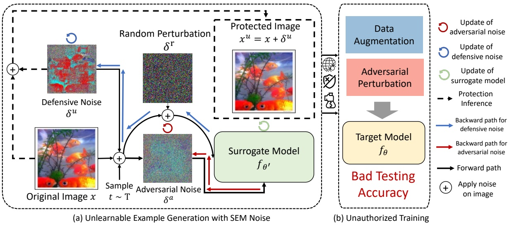

flowchart

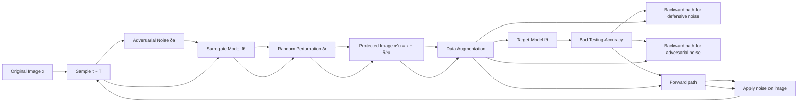

Figure 2: The overall framework of our approach. Our approach consists of two phases: noise training and generator training. During the noise training phase, we train the defensive noise, denoted as $\delta ^ { u }$ , to counter random perturbations. In the subsequent generator training phase, the original images, represented as $x ,$ are transformed to $x _ { \mathrm { i n p u t } } = t ( x + \delta ^ { u } ) + \delta ^ { a }$ before being input into the network. Here, t represents a transformation derived from distribution $T ,$ and $\dot { \delta } ^ { a }$ represents the adversarial perturbation produced using PGD. The noise generator, $f _ { \theta } ^ { \prime } ,$ updates the network parameters, $\theta ,$ by minimizing adversarial loss. By applying our defensive noise, models trained on the protected data learn minimal information and exhibit poor performance on clean data.

**Robust Unlearnable Example.** However, recent studies (Fu et al. 2022; Huang et al. 2020; Tao et al. 2021) have demonstrated that the effectiveness of unlearnable examples can be compromised by employing adversarial training. To further address this issue, the following robust unlearnable example generation problem is proposed, which can be illustrated as a two-player game consisting of a defender U and an unauthorized user A. The defender $U$ aims to protect data privacy by adding perturbation $\mathcal { P } ^ { u }$ to the data, thereby decreasing the test accuracy of the trained model, while the unauthorized user A attempts to use adversarial training and data transformation to negate the added perturbation and “recover” the original test accuracy. Based on (Fu et al. 2022), we assume that the defender U has complete access to the data they intend to protect and cannot interfere with the user’s training process after the protected images are released. Additionally, we assume, as per (Fu et al. 2022), that the radius of defensive noise $\rho _ { u }$ exceeds that of the adversarial training radius $\rho _ { a }$ , ensuring the problem’s feasibility. Given a distribution $T$ over transformations $t : { \mathcal { X } } \to { \mathcal { X } }$ , we have

$$
\begin{array}{c} \mathcal {P} ^ {u} = \underset {\forall i, \left| \delta_ {i} ^ {u} \right| \mid \leq \rho_ {u}} {\arg \max} \underset {(x, y) \sim \mathcal {D}} {\mathbb {E}} \left[ \mathcal {L} \left(f _ {\theta^ {*}} (x), y\right) \right], \\ \text {s.t.} \theta^ {*} = \underset {\theta} {\arg \min} \sum_ {\left(x _ {i}, y _ {i}\right) \in \mathcal {T}} \underset {t \sim T \mid \left| \delta_ {i} ^ {a} \right| \mid \leq \rho_ {a}} {\mathbb {E}} \max \mathcal {L} \left(f _ {\theta} \left(x _ {i} ^ {\prime}\right), y _ {i}\right), \end{array} \tag {4}
$$

where $x _ { i } ^ { \prime }   =   t ( x _ { i }   +   \delta _ { i } ^ { u } )   +   \delta _ { i } ^ { a }$ represents the transformed data, with $\delta _ { i } ^ { a }$ being the adversarial perturbation crafted using Projected Gradient Descent (PGD) and $\delta _ { i } ^ { u }$ denoting the defensive noise. After applying $\mathcal { P } ^ { u }$ , the protected dataset $\mathcal { T } ^ { u } = ( x _ { i } + \delta i ^ { u } , y _ { i } ) _ { i = 1 } ^ { n }$ is obtained.

## Methodology

## Iterative Training of Generator and Defensive Noise

To address the problem presented in Eq. 4, REM introduces a robust noise-surrogate iterative optimization method, where a surrogate noise generator model, denoted as θ, and the defensive noise, $\delta ^ { u }$ , are optimized alternately. From the model’s perspective, the surrogate model θ is trained on iteratively perturbed poisoned data, created by adding defensive and adversarial noise to the original training data, namely, $x _ { \mathsf { p e r t u r b } } ^ { u } = t ( x + \delta ^ { u } ) + \delta ^ { a }$ . The surrogate model is trained to minimize the loss below to enhance its adversarial robustness:

$$
\theta^ {\prime} \leftarrow \theta - \eta^ {\theta} \nabla_ {\theta} \mathcal {L} \left(f _ {\theta} \left(t \left(x + \delta^ {u}\right) + \delta^ {a}\right), y\right). \tag {5}
$$

where $\eta ^ { ( \cdot ) }$ represents the learning rate, t is a transformation sampled from $T .$ , and $\delta _ { a }$ is the adversarial perturbation crafted using PGD, designed to maximize the loss. Conversely, the defensive noise $\overline { { \delta } } ^ { u }$ is trained to counteract the worst-case adversarial perturbation using PGD based on $\theta .$ The main idea is that robust defensive noise should maintain effectiveness even under adversarial perturbations. Specifically, the defensive noise is updated by minimizing the loss,

$$
\delta^ {u} \leftarrow \delta^ {u} - \eta^ {u} \nabla_ {\delta^ {u}} \mathcal {L} \left(f _ {\theta} \left(t \left(x + \delta^ {u}\right) + \delta^ {a}\right), y\right). \tag {6}
$$

During the optimization of the surrogate model θ, the defensive noise $\delta ^ { u }$ is fixed. Conversely, when optimizing the defensive noise $\delta ^ { u }$ , the surrogate model θ remains fixed. We repeat these steps iteratively until the maximum training step is reached. The final defensive noise is generated by,

$$
\delta^ {u} = \underset {\| \delta^ {u} \| \leq \rho_ {u}} {\arg \min} \mathbb {E} _ {t \sim T} \max _ {\| \delta^ {a} \| \leq \rho_ {a}} \mathcal {L} \left(f _ {\theta} \left(t \left(x + \delta^ {u}\right) + \delta^ {a}\right), y\right). \tag {7}
$$

Algorithm 1: Noise Generator Training for SEM approach

Require: Training data set T, Training steps M, defense PGD parameters  $\rho_{u}$ ,  $\alpha_{u}$  and  $K_{u}$ , attack PGD parameters  $\rho_{a}$ ,  $\alpha_{a}$  and  $K_{a}$ , transformation distribution T, the sampling number J for gradient approximation

Ensure: Robust noise generator $f _ { \theta } ^ { \prime } .$

for $i$ in $1, \cdots, M$ do
    Sample minibatch $(x, y) \sim \mathcal{T}$, randomly initialize $\delta^u$.
    for $k$ in $1, \cdots, K_u$ do
        for $j$ in $1, \cdots, J$ do
            Sample noise and transformation $\delta_j^r \sim \mathcal{P}$, $t_j \sim T$.
        end for
        $g_k \leftarrow \frac{1}{J} \sum_{j=1}^J \frac{\partial}{\partial \delta^u} \ell(f_\theta'(t_j(x + \delta^u) + \delta_j^r), y)$
        $\delta^u \leftarrow \prod_{\|\delta\| \leq \rho_u} (\delta^u - \alpha_u \cdot \text{sign}(g_k))$
    end for
    Sample a transformation function $t \sim T$.
    $\delta^a \leftarrow \text{PGD}(t(x + \delta^u), y, f_\theta', \rho_a, \alpha_a, K_a)$
    Update source model $f_\theta'$ based on minibatch $(t(x + \delta^u) + \delta^a, y)$
end for

## Improving the Stability of Defensive Noise

The adversarial perturbation, denoted as $\delta ^ { a }$ , is incorporated in the optimization processes of both the surrogate model θ and the defensive noise $\delta ^ { u }$ (refer to Eq. 5 and Eq. 6). However, as indicated by the results in Tab. 1, it appears that solely the adversarial perturbation $\delta ^ { a }$ in the surrogate model $\theta ^ { \flat } \mathbf { s }$ optimization contributes to the performance enhancement. Surprisingly, the adversarial perturbation in the optimization of defensive noise $\delta ^ { u }$ (see Eq. 6) results in performance degradation. To elucidate these intriguing findings, we proceed with a correlation analysis as described below. We initially define the protection performance by $F = 1 - \mathtt { A c c }$ , where Acc represents the testing accuracy of the trained model. Then, we propose the following definition to quantify the robustness of both the surrogate model and the defensive noise.

**Definition 1** (Robustness of surrogate model). Given a fixed surrogate model, denoted as θ, we define its robustness as the model’s resistance to adversarial perturbations, where the perturbation $\delta ^ { u }$ is updateable,

$$
\mathcal {R} _ {\theta} = - \max _ {\| \delta^ {a} \| \leq \rho_ {a}} \min _ {\| \delta^ {u} \| \leq \rho_ {u}} \mathcal {L} \left(f _ {\theta} \left(t \left(x + \delta^ {u}\right) + \delta^ {a}\right), y\right). \tag {8}
$$

**Definition 2** (Robustness of defensive noise). For a given fixed defensive noise, $\delta ^ { u }$ , we define its robustness as the noise’s resistance to adversarial perturbations, where the model parameter θ is updateable,

$$
\mathcal {R} _ {\delta^ {u}} = - \max _ {\| \delta^ {a} \| \leq \rho_ {a}} \min _ {\theta} \mathcal {L} \left(f _ {\theta} \left(t \left(x + \delta^ {u}\right) + \delta^ {a}\right), y\right). \tag {9}
$$

To explore the correlation between the two formulated robustness terms, $\mathcal { R } ,$ and the protection performance, $F ,$ we followed the standard defensive noise training procedure as outlined in (Fu et al. 2022) and stored the surrogate model, $\theta _ { t } ,$ and defensive noise, $\delta _ { t } ^ { u }$ , at various training steps denoted by t. Subsequently, for the obtained model or noise, we fixed one while randomly initializing the other, then solved Eq. 8 and Eq. 9 through an iterative training process. From Fig. 3, we

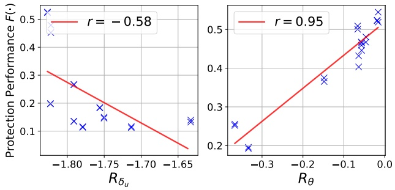

Figure 3: Exploration of the contribution of the robustness of defensive noise, denoted as $\mathcal { R } _ { \theta } ,$ and the surrogate model, represented by $\mathcal { R } _ { \delta ^ { u } }$ , to the protection performance F. The Pearson correlation coefficients (r) quantify the strength of these relationships. Tests were conducted on the CIFAR-10 dataset with settings $\rho _ { a } = 4 / 2 5 5$ and $\rho _ { u } = 8 / 2 5 5$

found that the $\mathcal { R } _ { \theta }$ demonstrates a strong positive correlation with the protection performance while $\mathcal { R } _ { \delta _ { u } }$ displays a moderate negative correlation with the protection performance.

This suggests that the protection performance of defensive noise is primarily and positively influenced by the robustness of the surrogate model, $\mathcal { R } _ { \theta }$ . Conversely, enhancing the robustness of defensive noise may paradoxically impair its protection performance. We hypothesize that the instability of defensive noise $\delta ^ { u }$ , trained following Eq. 6, stems from the monotonic nature of the worst-case perturbation $\delta ^ { a }$ . To enhance its stability, we propose an alternative training objective for defensive noise,

$$
\delta^ {u} \leftarrow \delta^ {u} - \eta^ {u} \nabla_ {\delta^ {u}} \mathcal {L} \left(f _ {\theta} \left(t \left(x + \delta^ {u}\right) + \delta^ {r}\right), y\right), \tag {10}
$$

where $\delta ^ { r }$ represents a random perturbation sampled from the uniform distribution $\mathcal { U } ( - \rho _ { r } , \rho _ { r } )$ . The radius of the random perturbation, $\rho _ { r } ,$ is set to match that of the adversarial perturbation, $\rho _ { a }$ . Substituting $\delta ^ { a }$ in Eq. 6 with $\delta ^ { r }$ enables the crafted defensive noise to experience more diverse perturbations during training. We term the obtained defensive noise as stable error-minimizing noise (SEM). The overall framework and procedure are depicted in Fig. 2 and Alg. 1.

## Experiments

## Experimental Setup

**Dataset.** We conducted extensive experiments on three widely recognized vision benchmark datasets, including CIFAR-10, CIFAR-100 (Krizhevsky et al. 2009), and a subset of the ImageNet dataset (Russakovsky et al. 2015), which comprises the first 100 classes from the original ImageNet.

Table 2: Test accuracy (%) of models trained on data protected by different defensive noises under adversarial training with various perturbation radii. The defensive perturbation radius $\rho _ { u }$ is globally set at 8/255, while the adversarial perturbation radius $\rho _ { a }$ of REM varies. The lower the test accuracy, the better the effectiveness of the protection.

<table><tr><td>Datasets→</td><td colspan="5">CIFAR-10</td><td colspan="5">CIFAR-100</td><td colspan="5">ImageNet Subset</td></tr><tr><td>Methods↓</td><td>ρa=0</td><td>1/255</td><td>2/255</td><td>3/255</td><td>4/255</td><td>0</td><td>1/255</td><td>2/255</td><td>3/255</td><td>4/255</td><td>0</td><td>1/255</td><td>2/255</td><td>3/255</td><td>4/255</td></tr><tr><td>Clean Data</td><td>94.66</td><td>93.74</td><td>92.37</td><td>90.90</td><td>89.51</td><td>76.27</td><td>71.90</td><td>68.91</td><td>66.45</td><td>64.50</td><td>80.66</td><td>76.20</td><td>72.52</td><td>69.68</td><td>66.62</td></tr><tr><td>EM</td><td>13.20</td><td>22.08</td><td>71.43</td><td>87.71</td><td>88.62</td><td>1.60</td><td>71.47</td><td>68.49</td><td>65.66</td><td>63.43</td><td>1.26</td><td>74.88</td><td>71.74</td><td>66.90</td><td>63.40</td></tr><tr><td>TAP</td><td>22.51</td><td>92.16</td><td>90.53</td><td>89.55</td><td>88.02</td><td>13.75</td><td>70.03</td><td>66.91</td><td>64.30</td><td>62.39</td><td>9.10</td><td>75.14</td><td>70.56</td><td>67.64</td><td>63.56</td></tr><tr><td>NTGA</td><td>16.27</td><td>41.53</td><td>85.13</td><td>89.41</td><td>88.96</td><td>3.22</td><td>65.74</td><td>66.53</td><td>64.80</td><td>62.44</td><td>8.42</td><td>63.28</td><td>66.96</td><td>65.98</td><td>63.06</td></tr><tr><td>SC</td><td>11.63</td><td>91.71</td><td>90.42</td><td>86.84</td><td>87.26</td><td>1.51</td><td>70.62</td><td>67.95</td><td>65.81</td><td>63.30</td><td>11.0</td><td>75.06</td><td>71.26</td><td>67.14</td><td>62.58</td></tr><tr><td>REM</td><td>15.18</td><td>14.28</td><td>25.41</td><td>30.85</td><td>48.16</td><td>1.89</td><td>4.47</td><td>7.03</td><td>17.55</td><td>27.10</td><td>13.74</td><td>21.58</td><td>29.40</td><td>35.76</td><td>41.66</td></tr><tr><td>SEM</td><td>13.0</td><td>12.16</td><td>11.49</td><td>20.91</td><td>31.92</td><td>1.95</td><td>3.26</td><td>4.35</td><td>9.07</td><td>20.25</td><td>4.1</td><td>10.34</td><td>13.76</td><td>23.58</td><td>37.82</td></tr></table>

(a) CIFAR-10

(b) ImageNet Subset

Figure 4: Visualization of various noise and crafted examples for CIFAR-10 and ImageNet Subset datasets. The noise includes EM (Error-Minimizing noise), TAP (Targeted Adversarial Poisoning noise), NTGA (Neural Tangent Generalization Attack noise), SC (Shortcut noise), REM (Robust Error-Minimizing noise), and SEM (our proposed Stable Error-Minimizing noise).

In line with (Fu et al. 2022), we utilized random cropping and horizontal flipping for data augmentations.

**Model Architecture and Adversarial Training.** We evaluate the proposed method and the baselines across various vision tasks using five popular network architectures: VGG-16 (Simonyan and Zisserman 2015), ResNet18/50 (He et al. 2016), DenseNet121 (Huang et al. 2017), and Wide ResNet-34-10 (Zagoruyko and Komodakis 2016). ResNet-18 is selected as the default target model in our experiments. By default, the defensive noise radius $\rho _ { u }$ is set at 8/255, and the adversarial training radius $\rho _ { a }$ is set at 4/255 for each dataset. Besides, the setting for the adversarial training radius follows the guidelines of REM (Fu et al. 2022), ensuring $\rho _ { a } \leq \rho _ { u }$

**Baselines.** We compare our stable error-minimizing noise (**SEM**) with existing SoTA methods, including targeted adversarial poisoning noise (**TAP**) (Fowl et al. 2021a), errorminimizing noise (**EM**) (Huang et al. 2021), robust errorminimizing noise (**REM**) (Fu et al. 2022), synthesized shortcut noise (**SC**) (Yu et al. 2022), and neural tangent generalization attack noise (**NTGA**) (Yuan and Wu 2021).

## Performance Analysis

**Different Radii of Adversarial Training.** Our initial evaluation focuses on the protection performance of various unlearnable examples under different adversarial training radii. The defensive perturbation radius is set to $\rho _ { u } = 8 / 2 5 5$ , with ResNet-18 serving as both the source and target models. As shown in Tab. 1, SC performs best under standard training settings $( \rho _ { a } = 0 )$ . However, with an increase in the adversarial training perturbation radius, the test accuracy of SC also rises significantly. Likewise, the other two baselines, EM and TAP, experience a significant increase in test accuracy with intensified adversarial training. In contrast, REM and SEM, designed for better robustness against adversarial perturbations, do not significantly increase test accuracy even with larger radii. When compared to REM, the results indicate that our SEM consistently outperforms this baseline in all adversarial training settings $\textstyle { \overset { \rightharpoonup } { ( \rho _ { a } } } \in [ { \frac { 1 } { 2 5 5 } } , { \frac { 4 } { 2 5 5 } } ] )$ , demonstrating the superior effectiveness of our proposed method in generating robust unlearnable examples.

Table 3: Test accuracy (%) of different types of models on CIFAR-10 and CIFAR-100 datasets. The adversarial training perturbation radius is set as 4/255. The defensive perturbation radius $\rho _ { u }$ of every type of defensive noise is set as $8 / 2 5 5$

<table><tr><td>Dataset</td><td>Model</td><td>Clean</td><td>EM</td><td>TAP</td><td>NTGA</td><td>REM</td><td>SEM</td></tr><tr><td rowspan="5">CIFAR-10</td><td>VGG-16</td><td>87.51</td><td>86.48</td><td>86.27</td><td>86.65</td><td>65.23</td><td>44.37</td></tr><tr><td>RN-18</td><td>89.51</td><td>88.62</td><td>88.02</td><td>88.96</td><td>48.16</td><td>31.92</td></tr><tr><td>RN-50</td><td>89.79</td><td>89.28</td><td>88.45</td><td>88.79</td><td>40.65</td><td>28.89</td></tr><tr><td>DN-121</td><td>83.27</td><td>82.44</td><td>81.72</td><td>80.73</td><td>81.48</td><td>77.85</td></tr><tr><td>WRN-34-10</td><td>91.21</td><td>90.05</td><td>90.23</td><td>89.95</td><td>48.39</td><td>31.42</td></tr><tr><td rowspan="5">CIFAR-100</td><td>VGG-16</td><td>57.14</td><td>56.94</td><td>55.24</td><td>55.81</td><td>48.85</td><td>57.11</td></tr><tr><td>RN-18</td><td>63.43</td><td>64.17</td><td>62.39</td><td>62.44</td><td>27.10</td><td>20.25</td></tr><tr><td>RN-50</td><td>66.93</td><td>66.43</td><td>64.44</td><td>64.91</td><td>26.03</td><td>20.99</td></tr><tr><td>DN-121</td><td>53.73</td><td>53.52</td><td>52.93</td><td>52.40</td><td>54.48</td><td>55.36</td></tr><tr><td>WRN-34-10</td><td>68.64</td><td>68.27</td><td>65.80</td><td>67.41</td><td>25.04</td><td>18.90</td></tr></table>

Table 4: Test accuracy (%) of different types of models trained on CIFAR-10 and CIFAR-100 that are processed by different low-pass filters. The defensive perturbation radius $\rho _ { u }$ of every defensive noise is set as $1 6 / 2 5 5$

<table><tr><td>Dataset</td><td>Filter</td><td>Clean</td><td>EM</td><td>TAP</td><td>NTGA</td><td>REM</td><td>SEM</td></tr><tr><td rowspan="3">CIFAR-10</td><td>Mean</td><td>84.25</td><td>34.87</td><td>82.53</td><td>40.26</td><td>28.60</td><td>23.93</td></tr><tr><td>Median</td><td>87.04</td><td>31.86</td><td>85.10</td><td>30.87</td><td>27.36</td><td>22.00</td></tr><tr><td>Gaussian</td><td>86.78</td><td>29.71</td><td>85.44</td><td>41.85</td><td>28.70</td><td>21.77</td></tr><tr><td rowspan="3">CIFAR-100</td><td>Mean</td><td>52.42</td><td>53.07</td><td>51.30</td><td>26.49</td><td>13.89</td><td>8.81</td></tr><tr><td>Median</td><td>57.69</td><td>56.35</td><td>55.22</td><td>18.14</td><td>14.08</td><td>9.02</td></tr><tr><td>Gaussian</td><td>56.64</td><td>56.49</td><td>55.19</td><td>29.05</td><td>13.74</td><td>8.10</td></tr></table>

**Different Architectures.** To investigate the transferability of different noises across neural network architectures, we chose ResNet-18 as the source model. We then examined the impact of its generated noise on various target models, including VGG-16, ResNet-50, DenseNet-121, and Wide ResNet-34-10. All transferability experiments were conducted using CIFAR-10 and CIFAR-100 datasets, as shown in Tab. 3. The results show that unlearnable examples generated by the SEM method are generally more effective across architecture settings than REM, indicating higher transferability.

## Sensitivity Analysis

**Resistance to Low-Pass Filtering.** We next analyze how various defensive noises withstand low-pass filtering. This approach is motivated by the possibility that filtering the image could eliminate the added defensive noise. As per (Fu et al. 2022), we employed three low-pass filters: Mean, Median, and Gaussian (Young and Van Vliet 1995), each with a $3 \times 3$ window size. We set the adversarial training perturbation radius to $2 / 2 5 5$ . The results in Tab. 4 show that the test accuracy of the models trained on the protected data increases after applying low-pass filters, implying that such filtering partially degrades the added defensive noise. Nevertheless, SEM outperforms under both scenarios, with and without applying low-pass filtering in adversarial training.

**Resistance to Early Stopping and Partial Poisoning.** One might wonder how the early stopping technique influences the protection performance of our unlearnable examples. To address this, we conducted experiments on CIFAR-10 and CIFAR-100, varying the early-stopping patience steps. We designated 10% of the unlearnable examples for the validation set, with early-stopping patience $S _ { e s }$ set to range from 3k to 20k steps. For examining partial poisoning, we varied the proportion of clean images in the validation set from 10% to 70%. Results are detailed in Tab. 5. Observations from full poisoning (clean ratio equal to 0%) show that setting $S _ { e s }$ to 1500 increases test accuracy by $4 \% ,$ implying minimal impact of early stopping on unlearnable examples. However, this effect is not substantial and necessitates searching the early-stopping patience hyper-parameter for mitigation. Increasing the clean ratio in the validation set further restores test accuracy to 57.48%, yet it remains below the original level of 89.51%. These results underscore the resistance of our unlearnable examples to early stopping.

**Effect of Training Step** M **and Sampling Size** J. We evaluated the impact of the training step M and sampling size J during noise generation, considering M values from 500 to 5000 and J ranging from 1 to 6. Results, as illustrated in

Table 5: Effect of early stop with different patience steps $S _ { e s }$

<table><tr><td>Before</td><td>Clean Ratio (%)</td><td> $S_{es} = 3000$ </td><td>25000</td><td>10000</td><td>20000</td></tr><tr><td rowspan="5">31.92</td><td>0</td><td>35.80</td><td>29.34</td><td>31.30</td><td>30.87</td></tr><tr><td>10</td><td>31.89</td><td>47.22</td><td>32.02</td><td>32.02</td></tr><tr><td>30</td><td>31.89</td><td>32.02</td><td>31.67</td><td>32.02</td></tr><tr><td>50</td><td>57.48</td><td>47.22</td><td>57.48</td><td>57.48</td></tr><tr><td>70</td><td>57.48</td><td>47.22</td><td>57.48</td><td>31.89</td></tr></table>

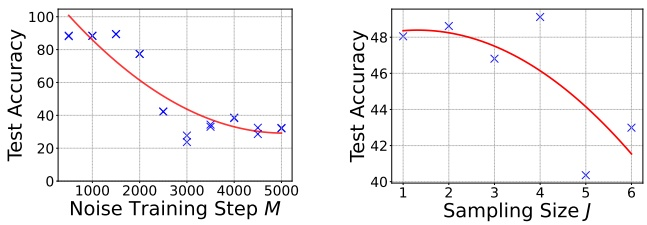

Figure 5: Effect of noise training steps and sampling step size on the testing accuracy of the trained model.

Fig. 5, indicate that an increase in training steps enhances performance. This improvement could be attributed to the noise generator learning more robust noise patterns over extended training steps. Regarding sampling size J, an increase in J was found to reduce the testing accuracy by nearly 8%, underscoring its significance in data protection.

**Effect of Random Perturbation Radius.** The radius of random perturbation represents a crucial hyper-parameter in our approach. To explore its correlation with protection performance, we conducted experiments on CIFAR-10 and CIFAR-100 using various radii of random perturbation and adversarial training. Results are detailed in Tab. 6. The results indicate that the best data protection performance is generally achieved when the random perturbation radius $\rho _ { r }$ is set equal to the adversarial training radius $\rho _ { a } ,$ across varying adversarial training radii. Nevertheless, when these two radii are mismatched, the protection performance drops slightly, indicating the importance of knowledge about adversarial training radius for protection effectiveness.

## Ablation Study

We conducted an ablation study to understand the impact of various components in our method, specifically focusing on the adversarial noise used to update the noise generator and the random noise used to update the defensive noise. Results, as shown in Tab. 7, reveal that the adversarial noise $\delta ^ { a }$ , used in updating the noise generator $\theta ,$ is a critical factor for protection performance. Its removal results in an approximate 60% decrease in accuracy. Additionally, the elimination of random perturbation in updating the defensive noise leads to a reduction in protection performance by approximately 8%. Furthermore, using purely adversarial noise to update the defensive noise results in deteriorated protection performance, highlighting the adverse effects of adversarial perturbations.

Table 6: Effect of different radii of random perturbation.

| Adv. Train. $\rho_{a}$ | $\rho_{r} = 0$ | 1/255 | 2/255 | 3/255 | 4/255 |
| --- | --- | --- | --- | --- | --- |
| 0 | 15.87 | 11.41 | 10.42 | 16.83 | 10.52 |
| 1/255 | 16.59 | 12.11 | 15.80 | 17.92 | 12.16 |
| 2/255 | 64.24 | 13.44 | 11.49 | 19.13 | 21.68 |
| 3/255 | 89.18 | 28.6 | 21.88 | 20.91 | 23.43 |
| 4/255 | 89.30 | 67.52 | 35.63 | 62.09 | 31.92 |

Table 7: Ablation study of the proposed method.

| $\frac{\delta^{u*}}{\delta^{r}}$ | $\frac{\delta^{a}}{\delta^{r}}$ | $\frac{\theta^{*}}{\delta^{a}}$ | Test Acc. (%) | Acc. Increase (%) |
| --- | --- | --- | --- | --- |
| ✓ |  | ✓ | 30.03 | - |
|  |  | ✓ | 37.91 | +7.88 |
|  | ✓ | ✓ | 46.72 | +16.69 |
| ✓ |  |  | 89.22 | +59.19 |
|  |  |  | 89.15 | +59.13 |

Table 8: Evaluation on a real-world face recognition dataset.

| Methods | $\rho_{a} = 0$ | 1/255 | 2/255 | 3/255 | 4/255 |
| --- | --- | --- | --- | --- | --- |
| Clean Data | 68.89 | 63.33 | 61.11 | 53.33 | 50.56 |
| EM | 8.89 | 18.06 | 18.61 | 16.39 | 19.72 |
| TAP | 9.72 | 20.74 | 26.48 | 32.22 | 36.39 |
| SC | 66.11 | 66.67 | 64.72 | 57.5 | 59.44 |
| REM | 10.89 | 7.89 | 11.67 | 12.22 | 11.48 |
| SEM | 10.56 | 7.04 | 9.44 | 10.28 | 11.11 |

## Case study: Face Recognition

To evaluate our proposed method’s effectiveness on realworld face recognition, we conducted experiments using the Facescrub dataset (Ng and Winkler 2014). Specifically, we randomly selected ten classes, with each class comprising 120 images. We allocated 15% of the data as the testing set, resulting in 1020 images for training and 180 for testing. Results presented in Tab. 8 indicate that robust methods, namely REM and SEM, outperform other non-robust methods in terms of data protection under adversarial training. In particular, the test accuracy of models trained on SEM-protected data fell to around 9%, across various adversarial training radii, marking a significant drop in accuracy by approximately 40% to 50%. Additionally, we observed from Fig. 6 that robust methods result in more vividly protected images. For instance, SC creates mosaic-like images, while EM and TAP substantially reduce luminance, impairing facial recognition. Conversely, REM and SEM perturbations concentrate on edges, maintaining visual similarity.

## Related Works

**Data Poisoning.** Data poisoning attacks aim to manipulate the performance of a machine learning model on clean examples by modifying the training examples. Recent research has shown the vulnerability of both DNNs (Muñoz-González et al. 2017) and classical machine learning methods, such as SVM (Biggio, Nelson, and Laskov 2012), to poisoning attacks (Shafahi et al. 2018). Recent advancements use gradient matching and meta-learning techniques to address the noise crafting problem (Geiping et al. 2020). Backdoor attacks are kinds of data poisoning that try to inject falsely labeled training samples with a concealed trigger (Gu, Dolan-Gavitt, and Garg 2017). Unlearnable examples, regarded as a clean-label and triggerless backdoor approach (Gan et al. 2022; Souri et al. 2022; Zeng et al. 2023; Xian et al. 2023; Li et al. 2022; Liu, Yang, and Mirzasoleiman 2022), perturb features to impair the model’s generalization ability.

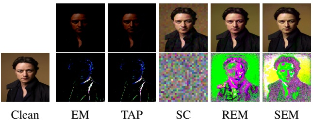

text_image

Clean
EM
TAP
SC
REM
SEM

Figure 6: Visualization of different types of defensive noise and crafted unlearnable examples on the Facescrub subset.

**Unlearnable Example.** Huang et al. (2020) introduced errorminimizing noise to create “unlearnable examples”, causing deep learning models to learn irrelevant features and generalize ineffectively. Unlearnable examples have been adapted for data protection in various domains and applications (Liu et al. 2023c,d,b,a; Sun et al. 2022b; Zhang et al. 2023; Li et al. 2023; He, Zha, and Katabi 2022; Zhao and Lao 2022; Salman et al. 2023; Guo et al. 2023). Despite its effectiveness, such conferred unlearnability is found fragile to adversarial training (Madry et al. 2018) and data transformations (Athalye et al. 2018). Recent studies (Tao et al. 2021) show that applying adversarial training with a suitable radius can counteract the added noise, thereby restoring model performance and making the data “learnable” again. Addressing this, Fu et al. (2022) proposed a min-min-max optimization approach to create more robust unlearnable examples by learning a noise generator and developing robust errorminimizing noise. However, this method faces challenges with inefficiency and suboptimal protection performance, mainly due to the instability of defensive noise. To overcome these limitations, our approach offers a more efficient and effective method for training enhanced defensive noise.

## Conclusion

In this work, we introduced Stable Error-Minimizing (SEM), a novel method for generating unlearnable examples that achieve better protection performance and generation efficiency under adversarial training. Our research uncovers an intriguing phenomenon: the effectiveness of unlearnable examples in protecting data is predominantly derived from the robustness of the surrogate model. Motivated by this, SEM employs a surrogate model to create robust error-minimizing noise, effectively countering random perturbations. Extensive experimental evaluations confirm that SEM outperforms previous SoTA in terms of both effectiveness and efficiency.

## Acknowledgements

This work was jointly conducted at Samsung Research America and Lehigh University, with partial support from the National Science Foundation under Grant CRII-2246067 and CCF-2319242. We thank Jeff Heflin and Maryann DiEdwardo for their valuable early-stage feedback on the manuscript; Shaopeng Fu for his insights regarding the REM codebase; Weiran Huang for engaging discussions and unique perspectives. We also thank our AAAI reviewers and metareviewers for their constructive suggestions.

## References

- Athalye, A.; Engstrom, L.; Ilyas, A.; and Kwok, K. 2018. Synthesizing robust adversarial examples. In International conference on machine learning, 284–293. PMLR.
- Biggio, B.; Nelson, B.; and Laskov, P. 2012. Poisoning attacks against support vector machines. In ICML.
- Cao, Y.; Li, S.; Liu, Y.; Yan, Z.; Dai, Y.; Yu, P. S.; and Sun, L. 2023. A comprehensive survey of ai-generated content (aigc): A history of generative ai from gan to chatgpt. arXiv preprint arXiv:2303.04226.
- Devlin, J.; Chang, M.-W.; Lee, K.; and Toutanova, K. 2019. Bert: Pre-training of deep bidirectional transformers for language understanding.
- Dosovitskiy, A.; Beyer, L.; Kolesnikov, A.; Weissenborn, D.; Zhai, X.; Unterthiner, T.; Dehghani, M.; Minderer, M.; Heigold, G.; Gelly, S.; et al. 2020. An Image is Worth 16x16 Words: Transformers for Image Recognition at Scale. In International Conference on Learning Representations.
- Feng, J.; Cai, Q.-Z.; and Zhou, Z.-H. 2019. Learning to confuse: generating training time adversarial data with autoencoder. In NeurIPS.
- Fowl, L.; Chiang, P.-y.; Goldblum, M.; Geiping, J.; Bansal, A.; Czaja, W.; and Goldstein, T. 2021a. Preventing unauthorized use of proprietary data: Poisoning for secure dataset release. arXiv preprint arXiv:2103.02683.
- Fowl, L.; Goldblum, M.; Chiang, P.-y.; Geiping, J.; Czaja, W.; and Goldstein, T. 2021b. Adversarial Examples Make Strong Poisons. In NeurIPS.
- Fu, S.; He, F.; Liu, Y.; Shen, L.; and Tao, D. 2022. Robust Unlearnable Examples: Protecting Data Privacy Against Adversarial Learning. In International Conference on Learning Representations.
- Gan, L.; Li, J.; Zhang, T.; Li, X.; Meng, Y.; Wu, F.; Yang, Y.; Guo, S.; and Fan, C. 2022. Triggerless Backdoor Attack for NLP Tasks with Clean Labels. In Proceedings of the 2022 Conference of the North American Chapter of the Association for Computational Linguistics: Human Language Technologies, 2942–2952.
- Geiping, J.; Fowl, L. H.; Huang, W. R.; Czaja, W.; Taylor, G.; Moeller, M.; and Goldstein, T. 2020. Witches’ Brew: Industrial Scale Data Poisoning via Gradient Matching. In International Conference on Learning Representations.
- Gu, T.; Dolan-Gavitt, B.; and Garg, S. 2017. Badnets: Identifying vulnerabilities in the machine learning model supply chain. arXiv preprint arXiv:1708.06733.
- Guo, J.; Li, Y.; Wang, L.; Xia, S.-T.; Huang, H.; Liu, C.; and Li, B. 2023. Domain Watermark: Effective and Harmless Dataset Copyright Protection is Closed at Hand. In Thirty-seventh Conference on Neural Information Processing Systems.
- He, H.; Zha, K.; and Katabi, D. 2022. Indiscriminate Poisoning Attacks on Unsupervised Contrastive Learning. In The Eleventh International Conference on Learning Representations.
- He, K.; Zhang, X.; Ren, S.; and Sun, J. 2016. Deep residual learning for image recognition. In CVPR.
- Hill, K.; and Krolik, A. 2019. How photos of your kids are powering surveillance technology. The New York Times.
- Huang, G.; Liu, Z.; Van Der Maaten, L.; and Weinberger, K. Q. 2017. Densely connected convolutional networks. In CVPR.
- Huang, H.; Ma, X.; Erfani, S. M.; Bailey, J.; and Wang, Y. 2020. Unlearnable Examples: Making Personal Data Unexploitable. In International Conference on Learning Representations.
- Huang, H.; Wang, Y.; Erfani, S. M.; Gu, Q.; Bailey, J.; and Ma, X. 2021. Exploring Architectural Ingredients of Adversarially Robust Deep Neural Networks. In NeurIPS.
- Kipf, T. N.; and Welling, M. 2016. Semi-supervised classification with graph convolutional networks. arXiv preprint arXiv:1609.02907.
- Krizhevsky, A.; et al. 2009. Learning multiple layers of features from tiny images.
- Li, Y.; Bai, Y.; Jiang, Y.; Yang, Y.; Xia, S.-T.; and Li, B. 2022. Untargeted backdoor watermark: Towards harmless and stealthy dataset copyright protection. Advances in Neural Information Processing Systems, 35: 13238–13250.
- Li, Z.; Yu, N.; Salem, A.; Backes, M.; Fritz, M.; and Zhang, Y. 2023. {UnGANable}: Defending Against {GAN-based} Face Manipulation. In 32nd USENIX Security Symposium (USENIX Security 23), 7213–7230.
- Liu, T. Y.; Yang, Y.; and Mirzasoleiman, B. 2022. Friendly noise against adversarial noise: a powerful defense against data poisoning attack. Advances in Neural Information Processing Systems, 35: 11947–11959.
- Liu, Y.; Fan, C.; Chen, X.; Zhou, P.; and Sun, L. 2023a. GraphCloak: Safeguarding Task-specific Knowledge within Graph-structured Data from Unauthorized Exploitation. arXiv preprint arXiv:2310.07100.
- Liu, Y.; Fan, C.; Dai, Y.; Chen, X.; Zhou, P.; and Sun, L. 2023b. Toward Robust Imperceptible Perturbation against Unauthorized Text-to-image Diffusion-based Synthesis. arXiv preprint arXiv:2311.13127.
- Liu, Y.; Fan, C.; Zhou, P.; and Sun, L. 2023c. Unlearnable Graph: Protecting Graphs from Unauthorized Exploitation. arXiv preprint arXiv:2303.02568.
- Liu, Y.; Ye, H.; Zhang, K.; and Sun, L. 2023d. Securing Biomedical Images from Unauthorized Training with Anti-Learning Perturbation. arXiv preprint arXiv:2303.02559.
- Madry, A.; Makelov, A.; Schmidt, L.; Tsipras, D.; and Vladu, A. 2018. Towards Deep Learning Models Resistant to Adversarial Attacks. In ICLR.
- Muñoz-González, L.; Biggio, B.; Demontis, A.; Paudice, A.; Wongrassamee, V.; Lupu, E. C.; and Roli, F. 2017. Towards poisoning of deep learning algorithms with back-gradient optimization. In ACM Workshop on Artificial Intelligence and Security.
- Ng, H.-W.; and Winkler, S. 2014. A data-driven approach to cleaning large face datasets. In 2014 IEEE International Conference on Image Processing (ICIP), 343–347.
- Russakovsky, O.; Deng, J.; Su, H.; Krause, J.; Satheesh, S.; Ma, S.; Huang, Z.; Karpathy, A.; Khosla, A.; Bernstein, M.; et al. 2015. Imagenet large scale visual recognition challenge. International journal of computer vision, 115(3): 211–252.
- Salman, H.; Khaddaj, A.; Leclerc, G.; Ilyas, A.; and Madry, A. 2023. Raising the cost of malicious ai-powered image editing. arXiv preprint arXiv:2302.06588.
- Shafahi, A.; Huang, W. R.; Najibi, M.; Suciu, O.; Studer, C.; Dumitras, T.; and Goldstein, T. 2018. Poison frogs! targeted clean-label poisoning attacks on neural networks. In NeurIPS.
- Simonyan, K.; and Zisserman, A. 2015. Very deep convolutional networks for large-scale image recognition. In ICLR.
- Souri, H.; Fowl, L.; Chellappa, R.; Goldblum, M.; and Goldstein, T. 2022. Sleeper agent: Scalable hidden trigger backdoors for neural networks trained from scratch. Advances in Neural Information Processing Systems, 35: 19165–19178.
- Sun, L.; Dou, Y.; Yang, C.; Zhang, K.; Wang, J.; Philip, S. Y.; He, L.; and Li, B. 2022a. Adversarial attack and defense on graph data: A survey. IEEE Transactions on Knowledge and Data Engineering.
- Sun, Z.; Du, X.; Song, F.; Ni, M.; and Li, L. 2022b. Coprotector: Protect open-source code against unauthorized training usage with data poisoning. In Proceedings of the ACM Web Conference 2022, 652–660.
- Tao, L.; Feng, L.; Yi, J.; Huang, S.-J.; and Chen, S. 2021. Better safe than sorry: Preventing delusive adversaries with adversarial training. Advances in Neural Information Processing Systems, 34: 16209–16225.
- Vaswani, A.; Shazeer, N.; Parmar, N.; Uszkoreit, J.; Jones, L.; Gomez, A. N.; Kaiser, Ł.; and Polosukhin, I. 2017. Attention is all you need. Advances in neural information processing systems, 30.
- Wang, X.; Girshick, R.; Gupta, A.; and He, K. 2018. Non-local neural networks. In Proceedings of the IEEE conference on computer vision and pattern recognition, 7794–7803.
- Xian, X.; Wang, G.; Srinivasa, J.; Kundu, A.; Bi, X.; Hong, M.; and Ding, J. 2023. Understanding Backdoor Attacks through the Adaptability Hypothesis. In Proc. International Conference on Machine Learning.
- Young, I. T.; and Van Vliet, L. J. 1995. Recursive implementation of the Gaussian filter. Signal processing, 44(2): 139–151.
- Yu, D.; Zhang, H.; Chen, W.; Yin, J.; and Liu, T.-Y. 2022. Availability Attacks Create Shortcuts. arXiv:2111.00898.
- Yuan, C.-H.; and Wu, S.-H. 2021. Neural Tangent Generalization Attacks. In ICML.
- Zagoruyko, S.; and Komodakis, N. 2016. Wide Residual Networks. In Procedings of the British Machine Vision Conference 2016. British Machine Vision Association.
- Zeng, Y.; Pan, M.; Just, H. A.; Lyu, L.; Qiu, M.; and Jia, R. 2023. Narcissus: A practical clean-label backdoor attack with limited information. In Proceedings of the 2023 ACM SIGSAC Conference on Computer and Communications Security, 771–785.
- Zhang, J.; Ma, X.; Yi, Q.; Sang, J.; Jiang, Y.-G.; Wang, Y.; and Xu, C. 2023. Unlearnable clusters: Towards label-agnostic unlearnable examples. In Proceedings of the IEEE/CVF Conference on Computer Vision and Pattern Recognition, 3984–3993.
- Zhao, B.; and Lao, Y. 2022. CLPA: Clean-label poisoning availability attacks using generative adversarial nets. In Proceedings of the AAAI Conference on Artificial Intelligence, volume 36, 9162–9170.
- Zhou, C.; Li, Q.; Li, C.; Yu, J.; Liu, Y.; Wang, G.; Zhang, K.; Ji, C.; Yan, Q.; He, L.; et al. 2023. A comprehensive survey on pretrained foundation models: A history from bert to chatgpt. arXiv preprint arXiv:2302.09419.

**Justification of Assumption** $\rho _ { u } \geq \rho _ { a }$

**Theorem 3.** Given a classifier $f : \mathcal { X } \to \mathcal { Y } ,$ protection radius $\rho _ { u } ,$ adversarial training radius $\rho _ { a } ,$ clean dataset $\mathcal { T } ^ { c } = \{ x _ { i } , y _ { i } \} _ { i = 1 \cdots N } ,$ protected dataset $\mathcal { T } ^ { u } = \{ ( x _ { i } +$ $\left. \begin{array} { l l } { \left. \delta _ { i } ^ { u } , y _ { i } \right) \right| \left\| \hat { \delta } ^ { u } { } _ { i } \right\| _ { p } \leq } & { \rho _ { u } \} _ { i = 1 \cdots N } } \\ \end{array}$ . When $\rho _ { a } \: \geq \: \rho _ { u } ,$ , conducting adversarial training on the protected dataset $\mathcal { T } ^ { u }$ is equivalent to minimizing the upper bound of training loss on the original clean dataset $\mathcal { T } ^ { c }$ , which will ensure that it can recover the test accuracy on the original clean dataset and make data protection infeasible.

Proof. Denote the natural loss on dataset $\mathcal { T }$ for classifier $f$ as $\begin{array} { r c l } { \mathcal { R } _ { \mathrm { n a t } } \left( f , \mathcal { T } \right) } & { = } & { \mathbb { E } _ { \left( x , y \right) \sim \mathcal { T } } \left[ \ell \left( f \left( x \right) , y \right) \right] } \\ \end{array}$ and the adversarial training loss on dataset $\mathcal { T }$ for classifier $f$ with adversarial radius $r _ { - } = \epsilon$ as $\mathcal { R } _ { \mathrm { a d v } } \left( f , \mathcal { T } , \epsilon \right) ~ =$ $\begin{array} { l } { \mathbb { E } _ { \left( x , y \right) \sim \mathcal { T } } \left[ \operatorname* { m a x } _ { \left\| \delta \right\| _ { p } \leq \epsilon } \ell \left( f \left( x + \delta \right) , y \right) \right] } \\ \end{array}$ . Conducting adversarial training on the protected dataset $\mathcal { T } ^ { u }$ with adversarial radius $\rho _ { a }$ has the following objective

$$
\begin{array}{l} \mathcal {R} _ {\mathrm{adv}} \left(f, \mathcal {T} ^ {u}, \rho_ {a}\right) = \mathbb {E} _ {(x, y) \sim \mathcal {T} ^ {u}} \max _ {| | \delta^ {a} | | _ {p} \leq \rho_ {a}} \ell \left(f \left(x + \delta^ {a}\right), y\right) \\ = \mathbb {E} _ {(x, y) \sim \mathcal {T} ^ {c}} \max _ {\| \delta^ {a} \| _ {p} \leq \rho_ {a}} \ell \left(f \left(x + \delta^ {u} + \delta^ {a}\right), y\right) \\ \geq \mathbb {E} _ {(x, y) \sim \mathcal {T} ^ {c}} \left[ \ell \left(f \left(x + \delta^ {u} - \delta^ {u}\right), y\right) \right] \\ = \mathbb {E} _ {(x, y) \sim \mathcal {T} ^ {c}} \left[ \ell \left(f (x), y\right) \right] \\ = \mathcal {R} _ {\mathrm{nat}} \left(f, \mathcal {T} ^ {c}\right) \\ \end{array}
$$

The first inequality holds since $\begin{array} { r } { \left\| \delta ^ { u } \right\| _ { p } \leq \rho _ { u } \leq \rho _ { a } } \end{array}$ , thus for each sum term inside the expectation we have,

$$
\begin{array}{l} \max _ {\| \delta^ {a} \| _ {p} \leq \rho_ {a}} \ell \left(f \left(x + \delta^ {u} + \delta^ {a}\right), y\right) \geq \ell \left(f \left(x + \delta^ {u} - \delta^ {u}\right), y\right) \\ = \ell (f (x), y) \\ \end{array}
$$

## Baselines Implementation

**Error-minimizing noise (Huang et al. 2020).** We train the error-minimizing noise generator by solving Eq. 11. The error-minimizing noise is then generated with the trained noise generator. The ResNet-18 model is used as the source model $\bar { f } ^ { \prime }$ . The PGD method is employed for solving the inner minimization problem in Eq. (11), where the settings of PGD are presented in Tab. 9.

$$
\min _ {\theta} \frac {1}{n} \sum_ {i = 1} ^ {n} \min _ {\| \delta_ {i} \| \leq \rho_ {u}} \ell \left(f _ {\theta} ^ {\prime} \left(x _ {i} + \delta_ {i}\right), y _ {i}\right) \tag {11}
$$

**Targeted adversarial poisoning noise (Fowl et al. 2021b).** This type of noise is generated via conducting a targeted adversarial attack on the model trained on clean data, in which the generated adversarial perturbation is used as the adversarial poisoning noise. Specifically, given a fixed model $f _ { 0 }$ and a sample $( x , y )$ , the targeted adversarial attack will generate noise by solving the problem argma $\mathtt { x } _ { \| \delta _ { u } \| \leq \rho _ { u } } \ell ( f _ { 0 } ( x +$ $\delta _ { u } ) , g ( y ) )$ , where $g$ is a permutation function on the label space Y. We set $\bar{g(y)} = \bar{(y + 1)}\%|Y|$ . The hyper-parameters for the PGD are given in Tab. 9.

**Neural tangent generalization attack noise (Yuan and Wu 2021).** This type of protective noise aims to weaken the generalization ability of the model trained on the modified data. To do this, an ensemble of neural networks is modeled based on a neural tangent kernel (NTK), and the NTGA noise is generated upon the ensemble model. As a result, the NTGA noise enjoys remarkable transferability. We use the official code of $\mathbf { \dot { N } } \mathbf { \dot { T } } \mathbf { G } \mathbf { A } ^ { \mathrm { ~ 2 ~ } }$ to generate this type of noise. Specifically, we employ the FNN model in Yuan and Wu (2021) as the ensemble model. For CIFAR-10 and CIFAR-100, the block size for approximating NTK is set as 4, 000. For the ImageNet subset, the block size is set as 100. The hyper-parameters for the PGD are given in Tab. 9. Please refer (Yuan and Wu 2021) accordingly for other settings.

**Robust Error-minimizing Noise (Fu et al. 2022).** REM is a robust error-minimizing noise method that aims to improve further the robustness of unlearnable examples against adversarial training and data transformation. The surrogate model is trained by solving the min-min-max optimization in Eq. 12, and the noise is obtained via Eq. 7,

$$
\min _ {\theta} \frac {1}{n} \sum_ {i = 1} ^ {n} \min _ {\left\| \delta_ {i} ^ {u} \right\| \leq \rho_ {u}} \mathbb {E} _ {t \sim T} \max _ {\left\| \delta_ {i} ^ {a} \right\| \leq \rho_ {a}} \ell \left(f _ {\theta} ^ {\prime} \left(t \left(x _ {i} + \delta_ {i} ^ {u}\right) + \delta_ {i} ^ {a}\right), y _ {i}\right) \tag {12}
$$

**Linearly-separable Synthesized Shortcut Noise (Yu et al. 2022).** This type of noise aims to introduce some linearly separable high-frequent patterns by adding class-wise handcrafted repeated noisy patches. Specifically, this method synthesizes some simple data points for an N-class classification problem, where three stages are included: class-wise initial points generation, duplicating for local correlation, and the final magnitude rescaling. For the noise frame size, we set it as 8 by default; for the norm size, we set it as 8/255 by default. For other settings, please refer to the original paper accordingly for other details.

Algorithm 2: Calculation of surrogate model’s robustness $\mathcal { R } _ { \theta }$

**Require:** Trained defensive noise $\delta ^ { u }$ , Training data set $\mathcal { T } ,$ Training steps $M ,$ attack PGD parameters $\rho _ { a } ,   \alpha _ { a }$ and $K _ { a } ,$ transformation distribution $\bar { T }$

**Ensure:** The robustness of surrogate model $\mathcal { R } _ { \theta }$

$\mathcal{R}_{\theta} \leftarrow 0$
for $i$ in $1, \cdots, M$ do
    Sample a minibatch $(x, y) \sim \mathcal{T}$,
    Sample a transformation function $t \sim T$.
    $\delta^{a} \leftarrow \text{PGD}(t(x + \delta^{u}), y, f_{\theta}^{\prime}, \rho_{a}, \alpha_{a}, K_{a})$
    Update source model $f_{\theta}^{\prime}$ based on minibatch $(t(x + \delta^{u}) + \delta^{a}, y)$
    $\mathcal{R}_{\theta} \leftarrow \mathcal{R}_{\theta} + \ell(f_{\theta}^{\prime}(t(x + \delta^{u}) + \delta^{a}), y)$
end for

<small>2The official code of NTGA is available at https://github.com/lionelmessi6410/ntga.</small>

Algorithm 3: Calculation of defensive noise’s robustness $\mathcal { R } _ { \delta ^ { u } }$

Require: Trained surrogate model  $\theta$ , Training data set T, Training steps M, defense PGD parameters  $\rho_{u}$ ,  $\alpha_{u}$  and  $K_{u}$ , attack PGD parameters  $\rho_{a}$ ,  $\alpha_{a}$  and  $K_{a}$ , transformation distribution T, the sampling number J for gradient approximation

Ensure: The robustness of defensive noise $\mathcal { R } _ { \delta ^ { u } }$

$\mathcal{R}_{\delta^{u}} \leftarrow 0$
for $i$ in $1, \cdots, M$ do
    Sample a minibatch $(x, y) \sim \mathcal{T}$
    Randomly initialize $\delta^{u}$.
    for $k$ in $1, \cdots, K_{u}$ do
        for $j$ in $1, \cdots, J$ do
            $\delta_{j}^{a} \leftarrow \text{PGD}(t_{j}(x + \delta^{u}), y, f_{\theta}^{\prime}, \rho_{a}, \alpha_{a}, K_{a})$
            Sample a transformation function $t_{j} \sim T$.
        end for
        $g_{k} \leftarrow \frac{1}{J} \sum_{j=1}^{J} \frac{\partial}{\partial \delta^{u}} \ell(f_{\theta}^{\prime}(t_{j}(x + \delta^{u}) + \delta_{j}^{a}), y)$
        $\delta^{u} \leftarrow \prod_{\|\delta\| \leq \rho_{u}} (\delta^{u} - \alpha_{u} \cdot \text{sign}(g_{k}))$
    end for
    Sample a transformation function $t \sim T$.
    $\delta^{a} \leftarrow \text{PGD}(t(x + \delta^{u}), y, f_{\theta}^{\prime}, \rho_{a}, \alpha_{a}, K_{a})$
    $\mathcal{R}_{\delta^{u}} \leftarrow \mathcal{R}_{\delta^{u}} + \ell(f_{\theta}^{\prime}(t(x + \delta^{u}) + \delta^{a}), y)$
end for

## Implementation Details

## Hardware and Software Details

The experiments were conducted on an Ubuntu 20.04.6 LTS (focal) environment with 503GB RAM. And the experiments on CIFAR-10 and CIFAR-100 are conducted on 1 GPU (NVIDIA® RTX® A5000 24GB) and 32 CPU cores (Intel® Xeon® Silver 4314 CPU @ 2.40GHz). For the ImageNet, experiments are conducted on 2 GPU (NVIDIA® RTX® A5000 24GB) and with the same CPU configuration. Python 3.10.12 and Pytorch 2.0.1 are used for all the implementations.

## Method Details

**Noise Regeneration.** Following existing practices, after training a noise generator following Alg. 1, we leverage the generator to conduct a final round for generating defensive noise via Alg. 4. We found that this trick can somewhat boost protection performance compared to leveraging defensive noise generated in the previous round or a weighted sum version.

**Data Augmentation.** Following (Fu et al. 2022), we use different data augmentations for different datasets during training. For CIFAR-10 and CIFAR-100, we perform the following data augmentations: random flipping, the padding on each size with 4 pixels, random cropping the image to 32×32, and then rescaling per pixel to [−0.5, 0.5] for each image. For the ImageNet subset, data augmentation is conducted via RandomResizedCrop operation with 224 × 224, random flipping, and then rescaling image with range [−0.5, 0.5].

**Adversarial Training.** We focus on $L _ { \infty }$ -bounded noise $\left\| \rho _ { a } \right\| _ { \infty } \; \leq \; \rho _ { a }$ in adversarial training. Note that defensive noise radius $\rho _ { u }$ is set to 8/255, and adversarial training radius $\rho _ { a }$ is set to 4/255 for each dataset by default. And for the adversarial training radius setting rule, we follow the setting of REM (Fu et al. 2022) with $\rho _ { a } \leq \rho _ { u } .$ The detailed parameter setting is presented in 9, where $\alpha _ { d } , \alpha _ { a }$ denote the step size of PGD for defensive and adversarial noise generation K· denotes the corresponding PGD step number.

Algorithm 4: Densive Noise Generation of SEM approach

Require: Noise generator  $f_{\theta}^{\prime}$ , Training data set T, defense PGD parameters  $\rho_{u}$ ,  $\alpha_{u}$ , attack PGD parameters  $\rho_{a}$ ,  $\alpha_{a}$ , transformation distribution T, the sampling number J for gradient approximation

Ensure: Robust unlearnable example $\mathcal { T } ^ { \prime } = \{ ( x _ { i } ^ { \prime } , y _ { i } ) \} _ { i = 1 } ^ { n }$ 1 for $( x _ { i } , y _ { i } )$ in $\mathcal { T }$ do

Randomly initialize $\delta_i^u$.
for $k$ in $1, \cdots, K_u$ do
    for $j$ in $1, \cdots, J$ do
        Random sample noise $\delta_j^r \sim \mathcal{P}$.
        Sample a transformation function $t_j \sim T$.
    end for
    $g_k \leftarrow \frac{1}{J} \sum_{j=1}^{J} \frac{\partial}{\partial \delta^u} \ell(f_\theta'(t_j(x + \delta^u) + \delta_j^r), y)$
    $\delta_i^u \leftarrow \prod_{\|\delta_i^u\| \leq \rho_u} (\delta_i^u - \alpha_u \cdot \text{sign}(g_k))$
end for
$x_i' \leftarrow x_i + \delta_i^u$
end for

Table 9: The settings of PGD for the noise generations of different methods. $\rho _ { u }$ denotes the defensive perturbation radius of different types of noise, while $\rho _ { a }$ denotes the adversarial perturbation radius of the REM and SEM.

<table><tr><td>Datasets</td><td>Noise Type</td><td> $\alpha_d$ </td><td> $K_d$ </td><td> $\alpha_a$ </td><td> $K_a$ </td></tr><tr><td>CIFAR-10</td><td>EM</td><td> $\rho_u/5$ </td><td>10</td><td>-</td><td>-</td></tr><tr><td>CIFAR-100</td><td>TAP</td><td> $\rho_u/125$ </td><td>250</td><td>-</td><td>-</td></tr><tr><td>Facescrub</td><td>REM &amp; SEM(Ours)</td><td> $\rho_u/5$ </td><td>10</td><td> $\rho_a/5$ </td><td>10</td></tr><tr><td rowspan="3">ImageNet Subset</td><td>EM</td><td> $\rho_u/5$ </td><td>7</td><td>-</td><td>-</td></tr><tr><td>TAP</td><td> $\rho_u/50$ </td><td>100</td><td>-</td><td>-</td></tr><tr><td>REM &amp; SEM(Ours)</td><td> $\rho_u/4$ </td><td>7</td><td> $\rho_a/5$ </td><td>10</td></tr></table>

**Metrics.** We use the test accuracy in the evaluation phase to measure the data protection ability of the defensive noise. A low test accuracy suggests that the model is fooled by defensive noise to have poor generalization ability. Thus it learned little information from the protected data, which implies better data protection effectiveness of the noise. We use the generation time of the defensive noise to evaluate efficiency. To exclude random error, all results are repeated three times with different random seeds $s \in \{ 0 , 6 1 7 8 , \bar { 4 2 } \}$

Table 10: Correlation of the protection performance and two robustness terms under three different metrics.

|  | Pearson | Spearman | Kendall |
| --- | --- | --- | --- |
| $\mathcal{R}_{\theta}$ | 0.9551 | 0.8422 | 0.6921 |
| $\mathcal{R}_{\delta_{u}}$ | -0.5851 | -0.7003 | -0.5407 |

## More Results

We visualize more defensive noise and the corresponding unlearnable images in Fig. 8, Fig. 9, Fig. 10 and Fig. 11. For the main table that compares different methods under various adversarial training radii, we present an extended version of Tab 2 with standard deviation in Tab. 12 and Tab. 13.

**Effectiveness under partial poisoning.** Under a more challenging realistic learning setting where only a portion of data can be protected by the defensive noise, we also study the effect of different poisoning ratios on the test accuracy of models trained on the poisoned dataset. From Tab. 11, we can see that our method outperforms other baselines when the poisoning rate is equal to or higher than $8 0 \% ,$ and the test accuracy of models trained on the poisoned dataset decreases as the poisoning ratio increases. However, under lower poisoning rate settings, where the model might learn from clean examples, all the existing noise types fail to degrade the model performance significantly. This result indicates a common limitation of existing unlearnable methods, calling for further studies investigating this challenging setting.

**Robustness terms** $\mathcal { R } _ { \theta }$ **and** $\mathcal { R } _ { \delta ^ { u } }$ . To solve Eq. 8 and Eq. 9, we conduct iterative training following Alg. 2 and Alg. 3 with trained model or defensive noise. Moreover, we present three metrics (Pearson, Spearman, and Kendall) in Tab. 10 to quantify the correlation between two robustness terms and the protection performance. These metrics, each unique in its way, provide diverse perspectives on the correlations, be it linear relationships or rank-based associations. The results show that $\mathcal { R } _ { \theta }$ exhibits a strong positive correlation with the protection performance across all three metrics. This suggests that as $\bar { \mathcal { R } _ { \theta } }$ increases, the protection performance also increases. $\mathcal { R } _ { \delta _ { u } }$ , on the other hand, shows a moderate negative correlation with the protection performance across all three metrics.

**Effect of** $\ell _ { \infty }$ **attacking algorithms** We provide additional results on REM with different $\ell _ { \infty }$ -norm adversarial attack algorithms, including FGSM, TPGD, and APGD (from torchattacks). As shown in Tab. 14, results suggest that they are still inferior to SEM, indicating the limitation root in the REM optimization.

Table 14: REM with different $\ell _ { \infty }$ attacking algorithms.

| Methods | SEM | REM+PGD | REM+FGSM | REM+TPGD | REM+APGD |
| --- | --- | --- | --- | --- | --- |
| Test Acc. (↓) | 29.53 | 48.16 | 40.95 | 33.19 | 80.87 |

**Generation time.** We present the defensive noise generation time cost using REM and SEM. The results in Tab. 15 suggest that SEM is ∼ 4 times faster than the REM approach.

Table 15: Time costs comparison for generating defensive noise between REM and SEM.

| Dataset | REM | SEM(Ours) | Reduce (↓) | Speedup (×) |
| --- | --- | --- | --- | --- |
| CIFAR-10/100 | 22.6h | 5.78h | -16.82h | 3.91 |
| ImageNet Subset | 5.2h | 1.33h | -3.87h | 3.90 |

## Understanding SEM Noise via UMAP 2D Projection

In this section, we uncover more insights into the effectiveness of the stable error-minimizing noise with the UMAP 2D Projection method. Our term of “stability” of noise mainly refers to their resistance against more diverse perturbation during the evaluation phase. Based on our empirical observation, the adversarial perturbations in the REM optimization turn out to be monotonous and not aligned with the more diverse perturbations during evaluation. This phenomenon might be caused by the mismatched training dynamic since, during the noise training phase, the defensive noise can be updated while it is fixed during evaluation. We term our method “stable” error-minimizing since we leverage more diverse random perturbation to train defensive noise based on our insights that the actual perturbation during the evaluation phase is more aligned with random perturbation. Based on Eq. 9, we further define stability as follows:

**Definition 4** (Delusiveness of noise). Given defensive noise $\delta ^ { \mathbf { u } }$ we define its delusiveness $\mathcal { R } _ { D } ( \delta ^ { \mathbf { u } } )$ as the testing loss of the model $f _ { \theta ^ { * } }$ that trained with data transformations:

$$
D \left(\delta^ {\mathbf {u}}\right) = \underset {(x, y) \sim \mathcal {D}} {\mathbb {E}} \left[ \mathcal {L} \left(f _ {\theta^ {*}} (x), y\right) \right], \tag {13}
$$

$$
\text {s.t.} \theta^ {*} = \arg \min _ {\theta} \sum_ {\left(x _ {i}, y _ {i}\right) \in \mathcal {T}} \underset {t \sim T} {\mathbb {E}} \mathcal {L} \left(f _ {\theta} \left(t \left(x _ {i} + \delta_ {i} ^ {u}\right)\right), y _ {i}\right). \tag {14}
$$

**Definition 5** (Stability of noise). Given $\delta ^ { \mathbf { u } }$ and adversarial perturbation $\delta ^ { \mathbf { a } }$ with radius $\rho _ { a } ,$ its stability $\mathcal { S } ( \delta ^ { \mathbf { u } } , \rho _ { a } )$ is opposite to its worst-case delusiveness under perturbation:

$$
\mathcal {S} \left(\delta^ {\mathbf {u}}, \rho_ {a}\right) = \min _ {\left| \left| \delta_ {i} ^ {a} \right| \right| _ {p} \leq \rho_ {a}} \mathcal {R} _ {D} \left(\delta^ {\mathbf {u}} + \delta^ {\mathbf {a}}\right). \tag {15}
$$

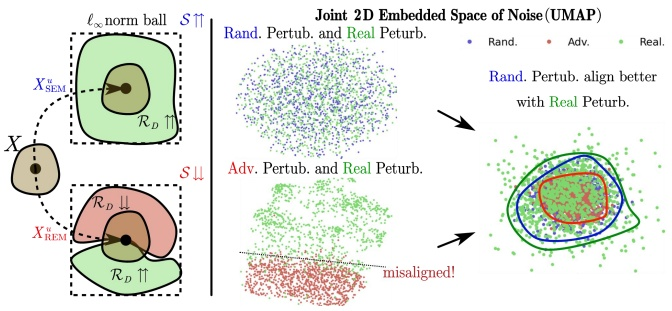

flowchart

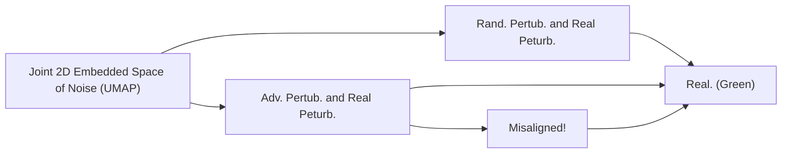

Figure 7: Understanding of the superiority of SEM compared to REM with UMAP visualization of noise.

To validate our statements, we conduct UMAP visualization of the random perturbation and adversarial perturbation in the REM training and actual evaluation phase. As shown in Fig. 7, adversarial perturbations in REM turn out to be monotonous, and thus, the induced defensive noise is not “stable” when the actual perturbation falls outside the specific region. In contrast, the random perturbation in SEM is more aligned with the real perturbation during evaluation.

Table 11: Test accuracy (%) on CIFAR-10 with different protection percentages. We set the defensive perturbation radius $\rho _ { w }$ as 8/255. For REM and SEM, we set $\rho _ { a }$ and $\rho _ { a }$ as 4/255.

<table><tr><td rowspan="3">Adv. Train. $\rho_a$ </td><td rowspan="3">Noise Type</td><td colspan="10">Data Protection Percentage</td></tr><tr><td rowspan="2">0%</td><td colspan="2">20%</td><td colspan="2">40%</td><td colspan="2">60%</td><td colspan="2">80%</td><td rowspan="2">100%</td></tr><tr><td>Mixed</td><td>Clean</td><td>Mixed</td><td>Clean</td><td>Mixed</td><td>Clean</td><td>Mixed</td><td>Clean</td></tr><tr><td rowspan="6">2/255</td><td>EM</td><td rowspan="6">92.37</td><td>92.26</td><td></td><td>91.94</td><td></td><td>91.81</td><td></td><td>91.14</td><td></td><td>71.43</td></tr><tr><td>TAP</td><td>92.17</td><td></td><td>91.62</td><td></td><td>91.32</td><td></td><td>91.48</td><td></td><td>90.53</td></tr><tr><td>NTGA</td><td>92.41</td><td>91.30</td><td>92.19</td><td>90.31</td><td>92.23</td><td>88.65</td><td>91.74</td><td>83.37</td><td>85.13</td></tr><tr><td>SC</td><td>92.3</td><td></td><td>91.98</td><td></td><td>90.17</td><td></td><td>87.58</td><td></td><td>47.66</td></tr><tr><td>REM</td><td>92.36</td><td></td><td>90.22</td><td></td><td>88.45</td><td></td><td>84.82</td><td></td><td>30.69</td></tr><tr><td>SEM</td><td>91.94</td><td></td><td>90.89</td><td></td><td>88.90</td><td></td><td>82.98</td><td></td><td>11.32</td></tr><tr><td rowspan="6">4/255</td><td>EM</td><td rowspan="6">89.51</td><td>89.60</td><td></td><td>89.40</td><td></td><td>89.49</td><td></td><td>89.10</td><td></td><td>88.62</td></tr><tr><td>TAP</td><td>89.01</td><td></td><td>88.66</td><td></td><td>88.40</td><td></td><td>88.04</td><td></td><td>88.02</td></tr><tr><td>NTGA</td><td>89.56</td><td>88.17</td><td>89.35</td><td>86.76</td><td>89.22</td><td>85.07</td><td>89.17</td><td>79.41</td><td>88.96</td></tr><tr><td>SC</td><td>89.4</td><td></td><td>89.14</td><td></td><td>89.23</td><td></td><td>89.02</td><td></td><td>84.43</td></tr><tr><td>REM</td><td>89.60</td><td></td><td>89.34</td><td></td><td>89.61</td><td></td><td>88.09</td><td></td><td>48.16</td></tr><tr><td>SEM</td><td>89.82</td><td></td><td>89.65</td><td></td><td>88.66</td><td></td><td>85.19</td><td></td><td>31.29</td></tr></table>

Table 12: Test accuracy (%) of models trained on data protected by different defensive noises via adversarial training with different perturbation radii. The defensive perturbation radius $\rho _ { u }$ is set as 8/255 for every type of noise, while the adversarial perturbation radius $\rho _ { a }$ of REM noise and SEM noise take various values.

<table><tr><td rowspan="2">Dataset</td><td rowspan="2">Adv. Train. $\rho_{a}$ </td><td rowspan="2">Clean</td><td rowspan="2">EM</td><td rowspan="2">TAP</td><td rowspan="2">NTGA</td><td colspan="5">REM</td><td colspan="5">SEM</td></tr><tr><td> $\rho_{a}=0$ </td><td>1/255</td><td>2/255</td><td>3/255</td><td>4/255</td><td> $\rho_{a}=0$ </td><td>1/255</td><td>2/255</td><td>3/255</td><td>4/255</td></tr><tr><td rowspan="5">CIFAR-10</td><td>0</td><td>94.66</td><td>13.20</td><td>22.51</td><td>16.27</td><td>15.18</td><td>13.05</td><td>20.60</td><td>20.67</td><td>27.09</td><td>15.87 ± 0.50</td><td>11.41 ± 0.31</td><td>10.42 ± 0.36</td><td>16.83 ± 1.76</td><td>10.52 ± 1.41</td></tr><tr><td>1/255</td><td>93.74</td><td>22.08</td><td>92.16</td><td>41.53</td><td>27.20</td><td>14.28</td><td>22.60</td><td>25.11</td><td>28.21</td><td>16.59 ± 0.14</td><td>12.11 ± 0.07</td><td>15.80 ± 0.21</td><td>17.92 ± 0.49</td><td>12.16 ± 1.30</td></tr><tr><td>2/255</td><td>92.37</td><td>71.43</td><td>90.53</td><td>85.13</td><td>75.42</td><td>29.78</td><td>25.41</td><td>27.29</td><td>30.69</td><td>64.24 ± 1.45</td><td>13.44 ± 0.21</td><td>11.49 ± 0.10</td><td>19.13 ± 1.11</td><td>21.68 ± 1.32</td></tr><tr><td>3/255</td><td>90.90</td><td>87.71</td><td>89.55</td><td>89.41</td><td>88.08</td><td>73.08</td><td>46.18</td><td>30.85</td><td>35.80</td><td>89.18 ± 0.19</td><td>28.6 ± 1.06</td><td>21.88 ± 0.62</td><td>20.91 ± 0.54</td><td>23.43 ± 1.44</td></tr><tr><td>4/255</td><td>89.51</td><td>88.62</td><td>88.02</td><td>88.96</td><td>89.15</td><td>86.34</td><td>75.14</td><td>47.51</td><td>48.16</td><td>89.30 ± 0.08</td><td>67.52 ± 1.62</td><td>35.63 ± 3.30</td><td>62.09 ± 0.93</td><td>31.92 ± 1.53</td></tr><tr><td rowspan="5">CIFAR-100</td><td>0</td><td>76.27</td><td>1.60</td><td>13.75</td><td>3.22</td><td>1.89</td><td>3.72</td><td>3.03</td><td>8.31</td><td>10.14</td><td>1.69 ± 0.03</td><td>1.95 ± 0.09</td><td>3.71 ± 0.19</td><td>3.57 ± 0.29</td><td>7.27 ± 0.44</td></tr><tr><td>1/255</td><td>71.90</td><td>71.47</td><td>70.03</td><td>65.74</td><td>9.45</td><td>4.47</td><td>5.68</td><td>9.86</td><td>11.99</td><td>9.68 ± 0.52</td><td>2.51 ± 0.13</td><td>4.17 ± 0.03</td><td>5.31 ± 0.32</td><td>10.07 ± 0.21</td></tr><tr><td>2/255</td><td>68.91</td><td>68.49</td><td>66.91</td><td>66.53</td><td>52.46</td><td>13.36</td><td>7.03</td><td>11.32</td><td>14.15</td><td>48.25 ± 0.51</td><td>10.45 ± 0.37</td><td>4.92 ± 0.16</td><td>6.06 ± 0.19</td><td>10.95 ± 0.36</td></tr><tr><td>3/255</td><td>66.45</td><td>65.66</td><td>64.30</td><td>64.80</td><td>66.27</td><td>44.93</td><td>27.29</td><td>17.55</td><td>17.74</td><td>63.53 ± 0.21</td><td>42.20 ± 0.35</td><td>23.85 ± 0.14</td><td>7.74 ± 0.17</td><td>12.04 ± 0.35</td></tr><tr><td>4/255</td><td>64.50</td><td>63.43</td><td>62.39</td><td>62.44</td><td>64.17</td><td>61.70</td><td>61.88</td><td>41.43</td><td>27.10</td><td>64.35 ± 0.18</td><td>58.57 ± 0.43</td><td>53.68 ± 0.92</td><td>28.61 ± 0.43</td><td>19.77 ± 0.62</td></tr></table>

Table 13: Test accuracy (%) of models trained on data that are protected by different defensive noises via adversarial training with different perturbation radii. The defensive perturbation radius $\rho _ { u }$ is set as 16/255 for every type of noise, while the adversarial perturbation radius $\rho _ { a }$ of REM noise and SEM noise take various values.

<table><tr><td rowspan="2">Dataset</td><td rowspan="2">Adv. Train. $\rho_{a}$ </td><td rowspan="2">Clean</td><td rowspan="2">EM</td><td rowspan="2">TAP</td><td rowspan="2">NTGA</td><td colspan="5">REM</td><td colspan="5">SEM</td></tr><tr><td> $\rho_{a}=0$ </td><td>2/255</td><td>4/255</td><td>6/255</td><td>8/255</td><td> $\rho_{a}=0$ </td><td>2/255</td><td>4/255</td><td>6/255</td><td>8/255</td></tr><tr><td rowspan="5">CIFAR-10</td><td>0</td><td>94.66</td><td>16.84</td><td>11.29</td><td>10.91</td><td>13.69</td><td>13.15</td><td>19.51</td><td>24.54</td><td>24.08</td><td>15.12 ± 0.32</td><td>14.49 ± 0.13</td><td>12.64 ± 1.66</td><td>13.52 ± 2.58</td><td>17.96 ± 1.99</td></tr><tr><td>2/255</td><td>92.37</td><td>22.46</td><td>78.01</td><td>19.96</td><td>21.17</td><td>17.73</td><td>20.46</td><td>21.89</td><td>26.30</td><td>24.58 ± 0.43</td><td>15.80 ± 0.14</td><td>13.82 ± 0.61</td><td>17.81 ± 1.48</td><td>19.59 ± 1.63</td></tr><tr><td>4/255</td><td>89.51</td><td>41.95</td><td>87.60</td><td>32.80</td><td>45.87</td><td>31.18</td><td>23.52</td><td>26.11</td><td>28.31</td><td>63.91 ± 1.04</td><td>18.25 ± 0.32</td><td>15.45 ± 0.35</td><td>17.36 ± 0.63</td><td>21.15 ± 4.53</td></tr><tr><td>6/255</td><td>86.90</td><td>52.13</td><td>85.44</td><td>60.64</td><td>66.82</td><td>58.37</td><td>40.25</td><td>30.93</td><td>31.50</td><td>80.07 ± 0.28</td><td>31.88 ± 0.91</td><td>18.14 ± 0.43</td><td>22.59 ± 1.18</td><td>22.47 ± 2.43</td></tr><tr><td>8/255</td><td>84.79</td><td>64.71</td><td>82.56</td><td>74.50</td><td>77.08</td><td>72.87</td><td>63.49</td><td>46.92</td><td>36.37</td><td>83.12 ± 0.43</td><td>58.10 ± 0.99</td><td>40.58 ± 1.03</td><td>33.24 ± 1.38</td><td>31.57 ± 1.61</td></tr><tr><td rowspan="5">CIFAR-100</td><td>0</td><td>76.27</td><td>1.44</td><td>4.84</td><td>1.54</td><td>2.14</td><td>4.16</td><td>4.27</td><td>5.86</td><td>11.16</td><td>1.22 ± 0.04</td><td>1.30 ± 0.06</td><td>1.94 ± 0.29</td><td>3.45 ± 0.94</td><td>5.12 ± 0.42</td></tr><tr><td>2/255</td><td>68.91</td><td>5.21</td><td>64.59</td><td>5.21</td><td>6.68</td><td>5.04</td><td>4.83</td><td>7.86</td><td>13.42</td><td>3.71 ± 0.16</td><td>1.70 ± 0.08</td><td>1.59 ± 0.05</td><td>6.69 ± 0.38</td><td>9.17 ± 0.22</td></tr><tr><td>4/255</td><td>64.50</td><td>35.65</td><td>61.48</td><td>18.43</td><td>28.27</td><td>9.80</td><td>6.87</td><td>9.06</td><td>14.46</td><td>26.87 ± 0.39</td><td>4.83 ± 0.16</td><td>1.81 ± 0.21</td><td>7.48 ± 0.08</td><td>10.29 ± 0.25</td></tr><tr><td>6/255</td><td>60.86</td><td>56.73</td><td>57.66</td><td>46.30</td><td>47.08</td><td>35.25</td><td>30.16</td><td>14.41</td><td>17.67</td><td>46.88 ± 0.27</td><td>25.14 ± 0.44</td><td>6.91 ± 0.22</td><td>8.12 ± 0.36</td><td>12.22 ± 0.28</td></tr><tr><td>8/255</td><td>58.27</td><td>56.66</td><td>55.30</td><td>50.81</td><td>54.23</td><td>49.82</td><td>54.55</td><td>33.86</td><td>23.29</td><td>53.01 ± 0.54</td><td>41.34 ± 0.43</td><td>26.04 ± 0.34</td><td>25.46 ± 0.23</td><td>14.24 ± 0.16</td></tr></table>

Figure 8: More Visualization results on CIFAR-10. Examples of data are protected by error-minimizing noise (EM), targeted adversarial poisoning noise (TAP), shortcut noise (SC), robust error-minimizing noise (REM), and stable errorminimizing noise (SEM). Note that $\rho _ { u }$ is set as 8/255, and the adversarial perturbation radius $\rho _ { a }$ is set as 4/255.

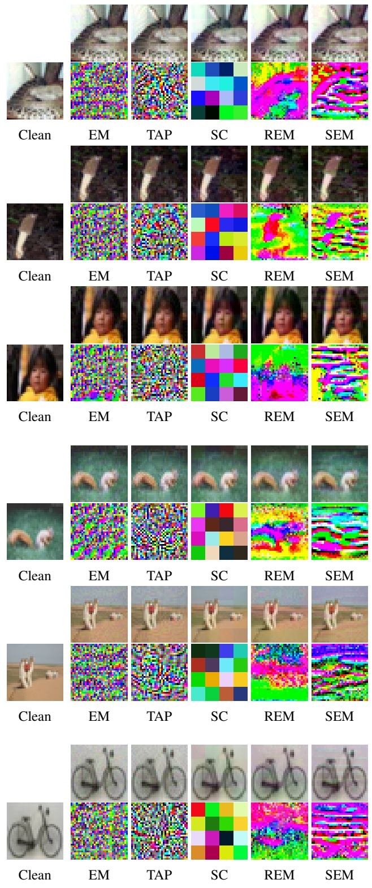

Figure 9: More Visualization results on CIFAR-100. Examples of data are protected by error-minimizing noise (EM), targeted adversarial poisoning noise (TAP), shortcut noise $( \mathrm { S C } ) ,$ robust error-minimizing noise (REM), and stable errorminimizing noise (SEM). Note that $\rho _ { u }$ is set as 8/255 and the adversarial perturbation radius $\rho _ { a }$ is set as $4 / 2 \dot { 5 } \bar { 5 }$

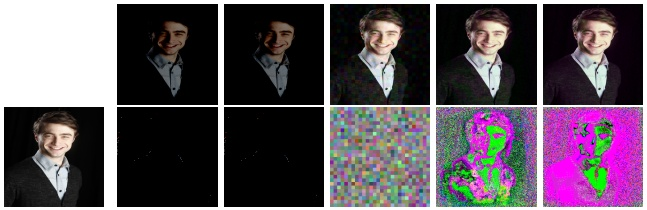

natural_image

Sequence of six portrait photos showing a smiling man in formal attire, with a pixelated green and magenta abstract overlay (no text or symbols)

Clean

EM

TAP

SC

REM

SEM

Clean

EM

TAP

SC

REM

SEM

Clean

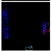

EM

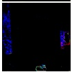

TAP

SC

REM

SEM

Figure 10: More Visualization results on ImageNet Subset. Examples of data are protected by error-minimizing noise (EM), targeted adversarial poisoning noise (TAP), shortcut noise (SC), robust error-minimizing noise (REM), and stable error-minimizing noise (SEM). Note that $\rho _ { w }$ is set as 8/255, and the adversarial perturbation radius $\rho _ { a }$ is set as 4/255.

Clean

EM

TAP

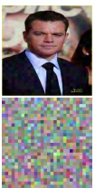

REM

SEM

Clean

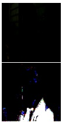

EM

TAP

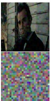

SC

REM

SEM

Clean

EM

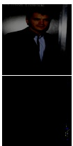

TAP

SC

REM

SEM

Figure 11: More Visualization results on the Facescrub dataset. Examples of data are protected by error-minimizing noise (EM), targeted adversarial poisoning noise (TAP), shortcut noise (SC), robust error-minimizing noise (REM), and stable error-minimizing noise (SEM). Note that $\rho _ { u }$ is set as 8/255, and the adversarial perturbation radius $\rho _ { a }$ is set as 4/255.