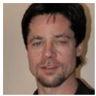
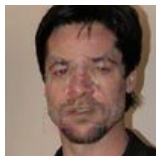
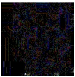
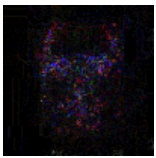
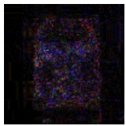
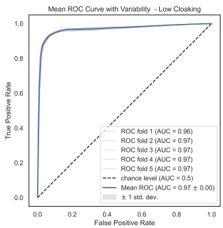
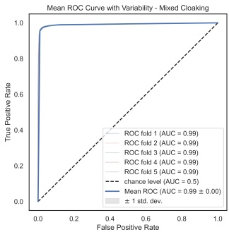

# Unmasking the Threat: Detecting Cloaking Attacks in Facial Recognition

Xavier Merino

Computer Engineering and Sciences

Florida Institute of Technology

Melbourne, FL, USA

xmerino2012@fit.edu

Pei Zhou

Computer Engineering and Sciences

Florida Institute of Technology

Melbourne, FL, USA

pzhou2022@my.fit.edu

Michael King

Computer Engineering and Sciences

Florida Institute of Technology

Melbourne, FL, USA

michaelking@fit.edu

**Abstract—Individuals who are concerned about their privacy may choose to safeguard their online photographs by adding imperceptible pixel-level disturbances. This technique, known as “cloaking” is a form of clean-label poisoning attack. Manipulated data is fed to a facial recognition model for training while maintaining the original labels, potentially misleading the model, and slowly poisoning the model’s understanding of a person’s facial features. Consequently, the performance of the model is diminished for certain identities. By retraining a model to be robust against these disturbances, it is possible to avoid these attacks. However, the expenses associated with retraining or replacing a model may be prohibitive, especially since there is no assurance that the model will be robust against future attacks. Instead, we offer a method for identifying cloaked pictures and excluding them from training pipelines. Our method uses img2vec with a ResNet-18 model that has been pretrained for rapid convergence. Our approach achieved an accuracy of 97% across a wide variety of perturbation budgets, and it is also possible to reuse elements of an existing model to decrease the need to construct yet another model.**

**Index Terms—face recognition, image cloaking, data poisoning**

## I. INTRODUCTION

The rise of online photo sharing has led to an increasing number of people’s images being scraped from the web for various purposes, including the development and training of facial recognition algorithms. These algorithms, powered by deep learning methods, have the ability to accurately identify individuals based on their facial characteristics, irrespective of image quality, pose, illumination, or expression. However, the ease of web scraping has raised concerns [1], particularly as companies like Clearview.ai have amassed over 30 billion images without explicit consent [2], fueling public worries about the usage and privacy implications of their personal photos.

On the other hand, facial recognition algorithms offer significant value in numerous operational scenarios. They aid in identifying individuals in surveillance footage, contributing to crime prevention and investigations. These algorithms also enhance access control, prevent identity theft, and improve the accuracy and efficiency of procedures in areas like passport control [3] and online banking [4] [5]. Furthermore, facial recognition technology provides conveniences like automatic photo tagging [6] and personalization benefits, including tailored experiences, product suggestions [7], and targeted advertising [8]. However, the potential for tracking individuals without their consent raises privacy concerns [9], and instances of false positive identifications have resulted in wrongful arrests and legal complications, as exemplified by the Nijeer Parks case [10] [11].

In response to the widespread use and associated risks of facial recognition, there is a growing demand for protection against the technology, even at the expense of some conveniences it offers. This demand has driven the development of techniques aimed at reducing an algorithm’s ability to identify individuals. One such technique is cloaking, which involves introducing imperceptible distortions to photographs at the pixel level, making it harder for machine learning models to recognize faces [12] [13].

Cloaking is categorized as a type of data poisoning attack that manipulates deep learning models to induce inaccurate predictions [14]. The manipulation can result in costly errors and result in model retraining, posing a significant threat to enterprises using deep learning models. Fortunately, the adoption of cloaking technologies remains limited, with Fawkes [13], one of the prominent algorithms, being downloaded approximately 840,000 times. This suggests that facial recognition algorithms, often trained on massive datasets comprising millions or billions of photos, are unlikely to be significantly affected by the inclusion of a small number of poisoned or cloaked images. As a result, the overall performance of the algorithm may only experience marginal impact, affecting only a few specific identities. This presents organizations with a dilemma: whether to modify their core models to address these few cloaked identities or accept a decline in performance.

The cost of retraining models can vary depending on factors such as model complexity, training data volume, and required computational resources [15]. Consequently, organizations often choose to tolerate model degradation until it becomes absolutely necessary to update the model entirely. However, even if the model robustness is improved, it only ensures the neutralization of attacks originating from known cloaking algorithms and does not protect against future attacks [16].

To address this challenge, we propose an alternative technique that allows organizations to detect and manage poisoning attacks, thereby extending the lifespan of their facial recognition models. Our contribution lies in the development of an algorithm specifically designed to identify poisoned data, with a focus on targeting the perturbations generated by Fawkes, a cloaking algorithm known for its resilience against anomaly detection methods [13]. Drawing inspiration from the field of photo forensics, our algorithm tackles the challenge of identifying visually imperceptible perturbations. By effectively screening for Fawkes-generated perturbations, our algorithm acts as a potential safeguard, thwarting poisoning attempts on facial recognition models.

This work is structured in sections. Section 2 provides a brief overview of the Fawkes algorithm [13], other countermeasures against data poisoning attacks discussed in the literature, and the dataset used in our work. Section 3 outlines the approach used to screen for Fawkes-generated perturbations. Section 4 presents our results, validates the effectiveness of our approach in detecting cloaked images, and discusses current limitations. Section 5 presents concluding remarks. Section 6 explores future research directions that leverage data poisoning recognition to reduce training costs.

## II. BACKGROUND AND RELATED WORKS

## A. Fawkes Algorithm

Fawkes is a system intended to protect a user’s privacy from being intruded upon by web scraping technologies that collect the user’s pictures without consent to train facial recognition models. Shan et al. [13] explain that Fawkes misleads the commercial models by adding pixel-level perturbations (cloaking) to images before they are uploaded. They state that Fawkes was meant to work against a variety of pre-trained models that are commonly used in facial recognition tasks. Among those, they claim, are the popular cloud-based offerings by Microsoft (i.e., Azure Face) and Amazon (i.e., Rekognition), as well as the popular Chinese counterpart, Face++. The intention is to prevent future countermeasures from being developed by the model trainers, although this objective has proven elusive as several have already been proposed in the literature.

Fawkes generates cloaked images by (1) randomly picking target images from a publicly available image dataset, (2) locating and calculating the feature vector of the center of the face, and (3) selecting the feature vectors that exhibit the most dissimilarity from the original image. It then (4) computes the cloak based on the randomly picked target image and attempts to (5) minimize the distance between the cloak and the target image with the constraint on the perturbation budget. The perturbation budget is a parameter that can be tweaked to increase the privacy-preserving power of the algorithm, albeit at the expense of visual disturbances in the images. To evaluate the visual quality of the cloaked images, Fawkes utilizes the “Structural Dissimilarity Index Measure” (DSSIM). This metric quantifies the perceptual difference between two images by considering their structural information. By default, the algorithm attempts to produce significant alterations with disturbances that are imperceptible to the naked eye by guaranteeing a DSSIM ≤ 0.007, striking a delicate balance between preserving privacy and maintaining visual quality.

Janssen and Carton [17] examined the disturbances introduced by the preset levels of the Fawkes tool and noticed that, even though an attempt has been made to retain the facial structure, the high preset provided by the Fawkes source distribution results in added artifacts to the image that may cause users to abandon the effort due to generating unappealing images (e.g., bluish spots that might make a person look sick, indentations and craters in people’s faces, etc.) [17].

## B. Countermeasures for Data Poisoning

The Fawkes algorithm is considered a “clean-label attack,” a type of data poisoning attack where the attacker has no control over the labeling of the training data but can inject seemingly harmless poisoned data to cause inaccurate predictions by the model. This form of poisoning attack is distinct because it allows the user to poison datasets by posting photos online, which are then scraped and processed by a model. Since the poison is visually imperceptible, it can be “correctly” labeled by experienced annotators and influence the model’s predictions. This type of attack may go unnoticed as it doesn’t significantly impact the model’s overall performance but instead targets specific classes by shifting decision boundaries.

Chen et al. [18] suggest a countermeasure called ORIOLE, which generates multi-cloaked images based on leaked original images from a user database. By using publicly available algorithms like Fawkes, the model trainer can experiment with multiple perturbation budgets and train the model to learn features from these cloaked images. This enables the model to classify future cloaked input accurately, even with minor variations, as long as the cloaked testing images fall within the same feature space as the identity’s multi-cloaked images.

Another countermeasure involves waiting for the emergence of new technologies that can learn facial features without being affected by the disturbances introduced by cloaking algorithms [16]. This strategy is effective because the number of cloaked images is typically minimal compared to the model’s training set. Radiya-Dixit et al. propose switching to newer pre-trained models that Fawkes was not designed to fool [16]. However, this approach would require constant model swapping, which could be expensive [15] every time a new cloaking algorithm is developed.

Deep learning approaches, such as those explored by Rota et al. [19], aim to detect tampered images by extracting patterns from image patches. They divide the images into patches and produce masks to identify where alterations have occurred, although this approach may not be completely accurate and only provides a general vicinity of the changes.

Peri et al. [20] propose a different approach using k-Nearest-Neighbors (k-NN) to detect data poisoning. They suggest finding a point and its nearest neighbors and marking the center point as suspicious if its label does not match the mode of the neighbors. This process involves determining the optimal k value, which varies based on the data and model. However, selecting the correct k value is crucial to avoid excluding clean data.

Chen et al. [21] argue that most countermeasures, including the k-NN solution proposed by Peri et al. [20], are attack-specific. They propose a generic solution called De-Pois [21], which utilizes the characteristics of conditional generative adversarial networks (cGAN) and Wasserstein GAN with Gradient Penalty (WGAN-GP) to defend against data poisoning attacks. De-Pois can either exclude poisoned data from training or mitigate the impact of poisoned data on the model’s performance. The approach involves generating synthetic data using cGAN, learning the prediction distribution using WGAN-GP, and employing the discriminator as the decision boundary to recognize poisoned data based on a small set of clean data. Another generic countermeasure proposed by Hong et al. [22] uses private stochastic gradient descent (DP-SGD) to discriminate between poisoned and clean data.

Outside the realm of deep learning methods, Kukharev et al. [23] propose using solely anthropomorphic points to distinguish an identity.

## C. Dataset

We use the PubFig83 [24] dataset, which contains 100 pictures for 83 individuals, yielding a total of 8300 pre-cropped facial pictures. It is derived from the work of Kumar et al. [25] to recognize the presence or absence of describable features of visual appearance (e.g., smile, mustache, bushy eyebrows, etc.). The collection consists primarily of celebrity photographs and has been processed to remove near-duplicate images. It is widely used due to its consistent image resolution.

Pinto et al. [24] used the dataset to study unconstrained face recognition on Facebook. Inspired by the news of Clearview.ai’s collection of billions of images from the web [26], the Fawkes’ authors made use of PubFig83 to test the performance of their algorithm on public personas. As a result, PubFig83 has become one of the most popular datasets in privacy-preserving research. Chen et al. [18] made use of PubFig83 as the user dataset to compare their results with the original Fawkes research. Similarly, Radiya-Dixit et al. [16] replicated their results using the dataset to demonstrate that adaptive defenses may break Fawkes on PubFig83. In line with these studies, we also employ the PubFig83 dataset due to Fawkes reporting a 99% cloaking success rate on this dataset, as well as its sufficient number of identities (i.e., more than 30 classes), which allegedly provides immunity against anomaly detection techniques.

For the 8300 images in the dataset, we use the Fawkes algorithm to cloak images. The binary distribution takes an image as input and generates a visually indistinguishable image with added disturbances. The source code distribution, on the other hand, provides more flexibility in terms of the cloaking level (e.g., low, medium, and high cloaking). We create cloaked versions of each image for each level. As the cloaking level increases, Fawkes adds more disturbances to the image, with each level becoming more apparent to the naked eye. See Fig. 1a–1d for an example. Our dataset of images consists, therefore, of 8300 original images and 8300 cloaked images for each level, for a total of 33200 images.

## III. METHODOLOGY

We aim to minimize a model’s exposure to cloaked images during the training and re-training phases. Cloaked images introduce distortions that can gradually alter the model’s understanding of a person’s facial features, leading to false matches and reduced accuracy. By detecting and identifying cloaked images before they enter the training pipeline, we can prevent model poisoning and ensure reliable identification. Furthermore, since we can identify the cloaked images, we can filter and process them using robust algorithms without the need to retrain the core model. This approach saves computational resources, reduces costs, and extends the lifespan of an organization’s investments. Based on these considerations, we propose the development of fusion models that can complement the weaknesses of the core model.

To tackle the challenge of identifying poisoned images, we employ a forensic filter on the probe image. In this approach, we utilize Error Level Analysis (ELA) as described in [27]. ELA is a technique used to detect modifications in digital photographs by analyzing the compression levels of the image. The premise is that when an image is altered, its compression levels may exhibit recognizable patterns. ELA can identify manipulations used to conceal evidence, generate fake images, or apply filters and other image manipulation techniques compromising the image’s integrity. To perform ELA, the image is compressed at various levels, and the resulting images are compared to the original. Discrepancies between the original and compressed images are evaluated to identify regions where compression values significantly deviate from the mean. These regions indicate potential manipulation or enhancement of the image. An example of ELA applied to both uncloaked and cloaked images can be seen in Fig. 2a–2d.

Subsequently, the ELA version of the probe image undergoes feature extraction. We leverage embedders to obtain a multidimensional representation of an image, irrespective of its size. As these representations typically have a high number of dimensions, we employ dimensionality reduction techniques to (1) improve data visualization and (2) reduce the training time required for the classifier to identify disturbances. By reducing the dimensions, we aim to capture sufficient variation that enables classification. We use img2vec [28] as the feature extractor for each image, apply Principal Component Analysis (PCA) for dimensionality reduction, and select Support Vector Machines (SVM) as the classification algorithm.

(a) Original

(b) Low Cloaking

(c) Mid Cloaking

(d) High Cloaking

Fig. 1. Cloaking Levels Applied To Image

(a) Original

(b) Low Cloaking

(c) Mid Cloaking

(d) High Cloaking

Fig. 2. ELA Applied To Image

## IV. DISCUSSION AND RESULTS

Img2vec is an algorithm inspired by word2vec [29] that aims to represent image data in a format suitable for machine learning algorithms, where related images have similar representations. In our study, we transform the images in the dataset into their ELA equivalents and utilize img2vec to learn the disruptions caused by the Fawkes algorithm. We employ the ResNet-18 architecture [30] in the implementation of img2vec, as it offers faster convergence compared to deeper architectures. The ResNet-18 architecture generates feature vectors with a default dimensionality of 512. However, to reduce processing time and the dimensionality of the features, we apply PCA.The reduced vectors are then used to train an SVM classification algorithm responsible for determining whether a picture has been cloaked. Fig. 3 illustrates a scatterplot of the compressed vector representations of the ELA images.

To obtain a more accurate evaluation of our classification model, we perform stratified k-fold cross-validation on various subsets of the data. This technique helps us mitigate the impact of random fluctuations in the data resulting in a more reliable indication of the model’s performance compared to a single train-test split. Stratified k-fold cross-validation ensures that each fold contains an equal number of samples from each class, preserving the class distribution in the training and testing sets. Specifically, we employ 5- fold cross-validation to thoroughly analyze the performance of our model. This means that the model is trained on 80% of the data and tested on the remaining 20% for each fold. After training and testing the model on all 5 folds, the performance metrics are averaged to determine the overall performance of the model.

Our aim is to detect cloaked photos by identifying the perturbations introduced by the Fawkes algorithm at pre-defined perturbation levels (i.e., low, medium, and high). As mentioned in Section 2, our dataset comprises both the original PubFig83 photos and the corresponding cloaked images. Therefore, three cloaked images were generated for each image in the dataset, representing the different predetermined cloak levels. For clarity and comprehensive reporting, we present our results separately for each cloak level. Additionally, we include an overall report that combines the results from all the aforementioned levels, as it better represents the random scenarios encountered in realworld situations.

scatter

| Series | PCA(i) (range) | PCA j (range) |
| --- | --- | --- |
| Original | -8~8 | -5~12 |
| Cloaked | -8~8 | -5~12 |

Fig. 3. Feature Vectors as Extracted by Img2Vec

## A. Low Cloaking Level

Images cloaked at the low level exhibit minimal distortion among all levels. The cross-validation results are presented in Table I. Despite the imperceptible disturbances, the model achieved a high average accuracy of 93% across the 5 folds. This indicates that the model accurately classified the subtle disruptions caused by the Fawkes algorithm. Precision, recall, and F1 score were also calculated, showing strong performance across all classes with an average precision of 94.5%, recall of 91.3%, and F1 score of 92.9%. The low standard deviation for each performance metric suggests consistent and reliable performance across different subsets of the data. The ROC plot in Fig. 4a visually represents the model’s diagnostic ability as the threshold varies.

## B. Mid Cloaking Level

Images cloaked at the mid level exhibit noticeable visual distortions on the individual’s face. Given the apparent disruptions, it is expected that some users may choose to avoid using this cloaking level. Other studies have reported that the disturbances become more prominent in high-resolution images. The cross-validation results are presented in Table II. The model performed exceptionally well in identifying cloaked images at this level, achieving a high accuracy of 99.2%. Similarly, precision, recall, and F1 score demonstrated remarkable performance with averages of 99.5%, 99%, and 99.2% respectively. The model displayed stability and consistent performance across all classes. Refer to the ROC plot in Fig. 4b.

## C. High Cloaking Level

Images cloaked at the high level exhibit visually significant distortions on the individual’s face. It has been noted that this level may give the impression of a person looking sick, with visible creases, wrinkles, and changes in skin pigmentation [17]. The cross-validation results are shown in Table III. Given the distinguishable nature of mid-level cloaks, a similar level of performance was expected at the high level. As anticipated, the model achieved accuracy of 99.6% on the test set across all folds. Precision, recall, and F1 score also demonstrated the model’s ability to correctly classify samples within a specific class, with averages of 99.6% for all metrics. The low standard deviation across all metrics further reinforces the reliability of the model. Refer to the ROC plot in Fig. 4c.

## D. Mixed Cloaking Level

This level incorporates cloaked images from all levels to simulate what a web-scraping algorithm might encounter when searching for photographs. Since users can contribute images from any cloaking level, this scenario better represents reality. The outcomes of the cross-validation are displayed in Table IV. In this mixed scenario, the model performed well, achieving an accuracy of 97.4%. Additionally, the model exhibited strong precision (99%), recall (97.6%), and F1 score (98.2%), showcasing its ability to properly classify samples regardless of the degree of cloaking. The variability in this mixed scenario is higher due to the additional disturbances introduced as the cloaking level increases. However, the low standard deviation for all performance metrics indicates consistent performance of the algorithm. Refer to the ROC plot in Fig. 4d.

## E. Limitations

The current performance of the model can be further improved by addressing some limitations. One limitation arises from the fact that the Fawkes algorithm concentrates its disturbances solely on the face region, creating distinct boundaries within the images. However, when using Error Level Analysis (ELA), which considers the entire image, additional artifacts introduced by modifications like magazine covers, montages, or color corrections in the face’s periphery can increase the risk of misclassification. Moreover, in high resolution images where the face occupies a small portion of the overall picture, the presence of detailed environmental information may lead to misclassification.

To overcome these limitations, a potential solution is to generate ELA specifically for the facial region. By isolating

roc

| Series | AUC |
| --- | --- |
| ROC fold 1 | 0.96 |
| ROC fold 2 | 0.97 |
| ROC fold 3 | 0.97 |
| ROC fold 4 | 0.97 |
| ROC fold 5 | 0.97 |
| Mean ROC | \(0.97 \pm 0.00\) |

(a) Low Cloaking Level

roc

| Series | AUC |
| --- | --- |
| ROC fold 1 | 1.00 |
| ROC fold 2 | 1.00 |
| ROC fold 3 | 1.00 |
| ROC fold 4 | 1.00 |
| ROC fold 5 | 1.00 |
| Mean ROC | \(0.99 \pm 0.00\) |

(b) Mid Cloaking Level

roc

| Series | AUC |
| --- | --- |
| ROC fold 1 | 1.00 |
| ROC fold 2 | 1.00 |
| ROC fold 3 | 1.00 |
| ROC fold 4 | 1.00 |
| ROC fold 5 | 1.00 |
| chance level | 0.5 |

(c) High Cloaking Level

roc

| Series | AUC |
| --- | --- |
| ROC fold 1 | 0.99 |
| ROC fold 2 | 0.99 |
| ROC fold 3 | 0.99 |
| ROC fold 4 | 0.99 |
| ROC fold 5 | 0.99 |
| chance level | 0.5 |
| Mean ROC | \(0.99 \pm 0.00\) |

(d) Mixed Cloaking Level

Fig. 4. Mean ROC Curve with Variability

TABLE I LOW CLOAKING CROSS VALIDATION RESULTS

| Fold | Accuracy | Precision | Recall | F1 | ROC AUC |
| --- | --- | --- | --- | --- | --- |
| 1 | 0.9256 | 0.9538 | 0.8945 | 0.9232 | 0.9644 |
| 2 | 0.9333 | 0.9501 | 0.9147 | 0.9321 | 0.9676 |
| 3 | 0.9348 | 0.9375 | 0.9317 | 0.9346 | 0.9683 |
| 4 | 0.9234 | 0.9460 | 0.8981 | 0.9214 | 0.9652 |
| 5 | 0.9348 | 0.9417 | 0.9270 | 0.9343 | 0.9723 |
| Mean | 0.9304 | 0.9458 | 0.9132 | 0.9291 | 0.9676 |
| Std. Dev | 0.0049 | 0.0058 | 0.0149 | 0.0056 | 0.0028 |

TABLE II MID CLOAKING CROSS VALIDATION RESULTS

| Fold | Accuracy | Precision | Recall | F1 | ROC AUC |
| --- | --- | --- | --- | --- | --- |
| 1 | 0.9926 | 0.9960 | 0.9892 | 0.9926 | 0.9974 |
| 2 | 0.9910 | 0.9942 | 0.9877 | 0.9909 | 0.9978 |
| 3 | 0.9928 | 0.9946 | 0.9910 | 0.9928 | 0.9972 |
| 4 | 0.9924 | 0.9938 | 0.9910 | 0.9924 | 0.9985 |
| 5 | 0.9935 | 0.9964 | 0.9906 | 0.9935 | 0.9981 |
| Mean | 0.9924 | 0.9950 | 0.9899 | 0.9924 | 0.9978 |
| Std. Dev | 0.0008 | 0.0010 | 0.0013 | 0.0008 | 0.0005 |

TABLE III HIGH CLOAKING CROSS VALIDATION RESULTS

| Fold | Accuracy | Precision | Recall | F1 | ROC AUC |
| --- | --- | --- | --- | --- | --- |
| 1 | 0.9967 | 0.9989 | 0.9946 | 0.9967 | 0.9996 |
| 2 | 0.9958 | 0.9953 | 0.9964 | 0.9958 | 0.9991 |
| 3 | 0.9964 | 0.9960 | 0.9967 | 0.9964 | 0.9996 |
| 4 | 0.9962 | 0.9953 | 0.9971 | 0.9962 | 0.9997 |
| 5 | 0.9946 | 0.9964 | 0.9928 | 0.9946 | 0.9988 |
| Mean | 0.9960 | 0.9964 | 0.9955 | 0.9960 | 0.9994 |
| Std. Dev | 0.0007 | 0.0013 | 0.0016 | 0.0007 | 0.0004 |

TABLE IV MIXED CLOAKING CROSS VALIDATION RESULTS

| Fold | Accuracy | Precision | Recall | F1 | ROC AUC |
| --- | --- | --- | --- | --- | --- |
| 1 | 0.9723 | 0.9909 | 0.9719 | 0.9813 | 0.9909 |
| 2 | 0.9743 | 0.9890 | 0.9766 | 0.9828 | 0.9916 |
| 3 | 0.9771 | 0.9879 | 0.9815 | 0.9847 | 0.9925 |
| 4 | 0.9717 | 0.9889 | 0.9733 | 0.9810 | 0.9916 |
| 5 | 0.9765 | 0.9902 | 0.9783 | 0.9842 | 0.9916 |
| Mean | 0.9744 | 0.9894 | 0.9763 | 0.9828 | 0.9916 |
| Std. Dev | 0.0022 | 0.0011 | 0.0034 | 0.0015 | 0.0005 |

and focusing solely on the face, while excluding the surrounding context, the algorithm can better detect the more intense and subtle pixel-level disturbances introduced by the Fawkes algorithm. This approach has the potential to create a more tailored algorithm with improved performance metrics.

## V. CONCLUSION

Fawkes, a widely used privacy-preserving algorithm, has gained significant popularity in protecting individuals’ identities. However, when it comes to influencing facial recognition algorithms trained on large datasets, the impact of distorted or malicious images is relatively minimal. The performance of these algorithms may only be affected for a few specific identities. Retraining the entire model to address the identification of a small number of people may not be a feasible or cost-effective solution, but it does not diminish the importance of addressing the issue. Organizations must make decisions regarding adapting their core models to handle cloaked identities or accepting a potential decline in performance. Even if a model’s robustness is improved, it only neutralizes current attacks and does not guarantee prevention of future attacks.

Given the costs associated with retraining models, companies may choose to tolerate model degradation until it becomes imperative to update them. In this study, we propose an alternative approach that enables organizations to detect and mitigate poisoning threats, thereby extending the lifespan of their facial recognition models. Our approach focuses on detecting cloaked images, specifically targeting the perturbations introduced by the Fawkes algorithm. Through our experiments, we demonstrate that screening for cloaked images is possible, offering a potential solution to prevent models from being slowly poisoned. Our image forensicsbased method achieved an average accuracy of 97% in detecting cloaked images with varying levels of perturbation disturbances.

## VI. FUTURE WORK

This work presents a technique that specifically addresses the Fawkes algorithm. However, there have been other studies aiming to generalize the identification of privacy-preserving disturbances. While our primary focus was on detecting cloaked images that could potentially poison a model and compromise its effectiveness, detection alone does not enable accurate identification of individuals. This work serves as an initial step towards developing a fusion model that combines already deployed models with customized models designed to handle users employing poisoning attacks. Such a model would extend the lifespan of existing deployed applications and eliminate the need for extensive data training of new models. Additionally, while we utilized img2vec as the feature extractor in this study, it is possible to leverage other networks through transfer learning to avoid the need for creating new networks from scratch.

## REFERENCES

[1] G. Benitez Torres and M. C. King, “Harvesting faces from social media photos for biometric analysis,” in 2020 IEEE International Symposium on Technology and Society (ISTAS), 2020, pp. 230–234.
[2] J. Schneider, “Clearview ai has scraped more than 30 billion photos from social media,” Mar 2023. [Online]. Available: https://petapixel.com/2023/03/29/clearview-ai-has-scraped-more-than-30-billion-photos-from-social-media/
[3] L. R. Carlos-Roca, I. H. Torres, and C. F. Tena, “Facial recognition application for border control,” in 2018 International Joint Conference on Neural Networks (IJCNN), Jul. 2018, pp. 1–7.
[4] S. D V, A. R, E. R. K, and A. S, “Enhnaced Security Feature of ATM’s Through Facial Recognition,” in 2021 5th International Conference on Intelligent Computing and Control Systems (ICICCS), May 2021, pp. 1252–1256.
[5] S. Manna, S. Ghildiyal, and K. Bhimani, “Face Recognition from Video using Deep Learning,” in 2020 5th International Conference on Communication and Electronics Systems (ICCES), Jun. 2020, pp. 1101–1106.
[6] J. Mehta, E. Ramnani, and S. Singh, “Face detection and tagging using deep learning,” in 2018 International Conference on Computer, Communication, and Signal Processing (ICCCSP). IEEE, 2018, pp. 1–6.
[7] G. Yolcu, I. Oztel, S. Kazan, C. Oz, and F. Bunyak, “Deep learningbased face analysis system for monitoring customer interest,” Journal of Ambient Intelligence and Humanized Computing, vol. 11, no. 1, pp. 237–248, Jan. 2020.
[8] J. F. Hair and M. Sarstedt, “Data, measurement, and causal inferences in machine learning: opportunities and challenges for marketing,” Journal of Marketing Theory and Practice, vol. 29, no. 1, pp. 65–77, Jan. 2021.
[9] X. Liu, L. Xie, Y. Wang, J. Zou, J. Xiong, Z. Ying, and A. V. Vasilakos, “Privacy and Security Issues in Deep Learning: A Survey,” IEEE Access, vol. 9, pp. 4566–4593, 2021.
[10] K. Hill, “Another Arrest, and Jail Time, Due to a Bad Facial Recognition Match,” The New York Times, Dec. 2020.
[11] T. Maxwell, “A man spent 10 days in jail based on a facial recognition error.”
[12] V. Cherepanova, M. Goldblum, H. Foley, S. Duan, J. Dickerson, G. Taylor, and T. Goldstein, “LowKey: Leveraging Adversarial Attacks to Protect Social Media Users from Facial Recognition,” Jan. 2021.
[13] S. Shan, E. Wenger, J. Zhang, H. Li, H. Zheng, and B. Y. Zhao, “Fawkes: Protecting Privacy against Unauthorized Deep Learning Models,” p. 17.
[14] A. Shafahi, W. R. Huang, M. Najibi, O. Suciu, C. Studer, T. Dumitras, and T. Goldstein, “Poison Frogs! Targeted Clean-Label Poisoning Attacks on Neural Networks,” in Advances in Neural Information Processing Systems, vol. 31. Curran Associates, Inc., 2018.
[15] V. J. H. Sawant, Anand Ashok, “The Growing Cost of Deep Learning for Source Code.”
[16] E. Radiya-Dixit, S. Hong, N. Carlini, and F. Tramer, “Data Poisoning \` Won’t Save You From Facial Recognition,” Mar. 2022.
[17] D. Janssen and S. Carton, “An exploration of the suitability of Fawkes for practical applications,” p. 12.
[18] L. Chen, H. Wang, B. Z. H. Zhao, M. Xue, and H. Qian, “Oriole: Thwarting Privacy Against Trustworthy Deep Learning Models,” in Information Security and Privacy, ser. Lecture Notes in Computer Science, J. Baek and S. Ruj, Eds. Cham: Springer International Publishing, 2021, pp. 550–568.
[19] P. Rota, E. Sangineto, V. Conotter, and C. Pramerdorfer, “Bad teacher or unruly student: Can deep learning say something in Image Forensics analysis?” in 2016 23rd International Conference on Pattern Recognition (ICPR), Dec. 2016, pp. 2503–2508.
[20] N. Peri, N. Gupta, W. R. Huang, L. Fowl, C. Zhu, S. Feizi, T. Goldstein, and J. P. Dickerson, “Deep k-NN Defense Against Clean-Label Data Poisoning Attacks,” in Computer Vision – ECCV 2020 Workshops, ser. Lecture Notes in Computer Science, A. Bartoli and A. Fusiello, Eds. Cham: Springer International Publishing, 2020, pp. 55–70.
[21] J. Chen, X. Zhang, R. Zhang, C. Wang, and L. Liu, “De-Pois: An Attack-Agnostic Defense against Data Poisoning Attacks,” IEEE Transactions on Information Forensics and Security, vol. 16, pp. 3412–3425, 2021.
[22] S. Hong, V. Chandrasekaran, Y. Kaya, T. Dumitraş, and N. Papernot, “On the Effectiveness of Mitigating Data Poisoning Attacks with Gradient Shaping,” Feb. 2020.
[23] G. Kukharev, K. Maulenov, and N. Shchegoleva, “CAN I PROTECT MY FACE IMAGE FROM RECOGNITION?” in 9th International Conference ”Distributed Computing and Grid Technologies in Science and Education”. Crossref, Dec. 2021, pp. 514–518.
[24] N. Pinto, Z. Stone, T. Zickler, and D. Cox, “Scaling up biologicallyinspired computer vision: A case study in unconstrained face recognition on facebook,” in CVPR 2011 WORKSHOPS. IEEE, 2011, pp. 35–42.
[25] N. Kumar, A. C. Berg, P. N. Belhumeur, and S. K. Nayar, “Attribute and simile classifiers for face verification,” in 2009 IEEE 12th International Conference on Computer Vision, Sep. 2009, pp. 365–372.
[26] “Facial recognition firm Clearview AI tells investors it’s seeking massive expansion beyond law enforcement,” Washington Post.
[27] N. Krawetz and H. F. Solutions, “A picture’s worth,” Hacker Factor Solutions, vol. 6, no. 2, p. 2, 2007.
[28] C. Safka, “Christiansafka/img2vec: Use pre-trained models in pytorch to extract vector embeddings for any image,” https://github.com/christiansafka/img2vec.
[29] T. Mikolov, I. Sutskever, K. Chen, G. S. Corrado, and J. Dean, “Distributed representations of words and phrases and their compositionality,” Advances in neural information processing systems, vol. 26, 2013.
[30] K. He, X. Zhang, S. Ren, and J. Sun, “Deep Residual Learning for Image Recognition,” 2016, pp. 770–778.