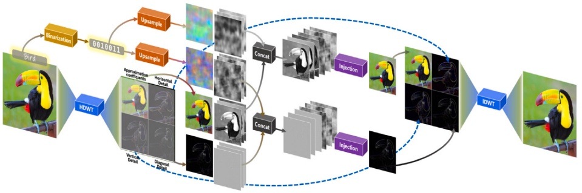

# Wavelet Domain Steganography for Robust Unlearnable Data✩

**Jiahao Li, Yiqiang Chen** ∗**, Yunbing Xing, Yang Gu**

**Beijing Key Laboratory for Multimodal Collaboration and Advanced Application, Institute of Computing Technology, Chinese Academy of Sciences, Beijing, 100190, China**

**University of Chinese Academy of Sciences, Beijing, 100190, China**

## A R T I C L E I N F O

**Keywords:**

**Steganography**

**Wavelet**

**Unlearnable**

**Robust**

## A B S T R A C T

**In recent years, unlearnable data have emerged as an effective way to prevent unauthorized exploitation of personal data by intentionally preventing model learning meaningful patterns during training, while ensuring that the processed data remain visually indistinguishable from the original. Previous approaches, such as error-minimizing noise methods, have yielded promising results in disrupting model learning but often lack robustness against adversarial training. More recently, convolution-based techniques have been introduced to address this limitation, enhancing resistance to adversarial training, but at the cost of sacrificing highfrequency image details. In this study, we propose a novel method called Wavelet Domain Steganography (WDS) that steganographically writes class-specific information in the wavelet transform domain. By leveraging the inherent multi-resolution and localized properties of wavelets, WDS allows for precise control over the steganographic information injected into different frequency subbands. The proposed method preserves highfrequency details and maintains visual fidelity while effectively inhibiting the learning of semantic information by deep neural networks. Experimental evaluations show that WDS exhibits robust unlearnability under common data augmentations and adversarial training scenarios, thereby achieving an improved balance between imperceptibility and unlearnability relative to prior methods.**

## 1. Introduction

**Deep neural networks (DNNs) have made tremendous progress in image classification [1], object detection [2], and many other computer vision tasks [3]. However, their generalization hinges heavily on the assumption that training data is both representative and learnable. This dependency exposes a fundamental vulnerability: if an adversary can inject carefully crafted noise into the training data, the model may fail to extract useful features, resulting in poor downstream performance. This threat has been recently formalized through the concept of unlearnable data (ULD), which are perturbed training samples designed to prevent effective learning [4–6].**

**Early approaches to crafting unlearnable data, such as errorminimizing [7], borrowed techniques from adversarial attacks [8] by treating a surrogate model as a differentiable function and applying loss optimization. However, unlike adversarial examples that aim to maximize loss on test inputs [9], they instead minimize the downstream loss on perturbed training samples-making them uninformative for representation learning. Although effective under standard training, early methods [7,10,11] are found to be fragile when models employ** **adversarial training [12]. The follow-up studies are inspired to enhance robustness through techniques like adversarial augmented surrogate optimization [13]. Yet, these techniques often suffer from optimization instability [14] and high computational cost [15].**

**To circumvent these limitations, recent research has shifted towards surrogate-free strategies. Notable efforts include single-pixel tampering [16] and convolution-based filtering [15]. While these methods improve robustness and efficiency, they often trade off visual imperceptibility—introducing either abrupt non-smooth pixel changes or blurring artifacts. This motivates us to think: Can we develop a surrogate-free ULD generation method that does not sacrifice too much imperceptibility and efficiency while maintaining robustness under adversarial training?**

**In this paper, we propose Wavelet-Domain Steganography (WDS), a novel framework for generating unlearnable data by embedding structured perturbations into specific subbands of the wavelet domain. Our method leverages the multi-resolution and localized frequency characteristics of wavelets, enabling precise control over perturbation placement. By steganographically modifying selected frequency** **bands, WDS disrupts feature learning while preserving natural image appearance.**

<small>✩ This article is part of a Special issue entitled: ‘PR\_Security and Trustworthiness’ published in Pattern Recognition.</small>

<small>∗ Corresponding author at: Beijing Key Laboratory for Multimodal Collaboration and Advanced Application, Institute of Computing Technology, Chinese Academy of Sciences; University of Chinese Academy of Sciences, Beijing, 100190, China.</small>

<small>E-mail addresses: [lijiahao@ict.ac.cn](mailto:lijiahao@ict.ac.cn) (J. Li), [yqchen@ict.ac.cn](mailto:yqchen@ict.ac.cn) (Y. Chen), [xingyunbing@ict.ac.cn](mailto:xingyunbing@ict.ac.cn) (Y. Xing), [guyang@ict.ac.cn](mailto:guyang@ict.ac.cn) (Y. Gu).</small>

**We conduct extensive experiments across CIFAR-10, CIFAR-100, and ImageNet-100 under diverse architectures and training schemes. Results show that WDS achieves high robustness against adversarial training and common data augmentations, with strong cross-model transferability. Furthermore, our analysis reveals that DNNs exhibit an implicit bias towards learning from certain frequency components—a vulnerability that WDS systematically exploits.**

**Our contributions are summarized as follows:**

**• We propose WDS, a surrogate-free ULD method for generating unlearnable examples using wavelet-domain steganography.**
**• We demonstrate that WDS achieves state-of-the-art robustness against adversarial training and data augmentations while taking efficiency and imperceptibility into account.**
**• We provide a frequency analysis of DNNs behavior, offering insights into why wavelet-domain perturbations are particularly effective in degrading learnability.**

## 2. Related work

## 2.1. Surrogate-based methods

**Early approaches to crafting unlearnable data (ULD) borrowed ideas from adversarial attack optimization [8,9], treating a surrogate model as a differentiable proxy and applying iterative loss minimization to reduce the informativeness of training samples [7,10,11]. While these surrogate-based methods are effective under standard training, they tend to break under adversarial training [12], prompting follow-up research to incorporate adversarial augmentation into the optimization loop [13]. However, these approaches introduce new challenges such as instability during training [14] and significant computational overhead [15].**

## 2.2. Surrogate-free methods

**To mitigate these limitations, recent efforts explore surrogate-free alternatives such as single-pixel tampering [16] and spatial convolutionbased filtering [15]. These techniques subtly leverage the shortcut learning phenomenon [17] of DNNs by designing class-specific perturbations that induce an easier-to-learn association between the noise patterns and the labels. While surrogate-free methods offer improved robustness and efficiency, they often compromise imperceptibility— introducing either abrupt dissonance with surrounding pixels [16,18] or high-frequency detail loss [15]. Related ideas have also been explored in frequency-domain watermarking and adversarial perturbation research. Frequency-domain watermarking methods embed auxiliary signals into transform coefficients to achieve ownership verification or information hiding, whereas adversarial perturbations manipulate input signals to alter model predictions at inference time. Although these approaches share the notion of modifying spectral components, their objectives fundamentally differ from unlearnable data generation. Watermarking aims to preserve task performance while encoding recoverable information, and adversarial perturbations target inference-time prediction errors. In contrast, WDS intentionally establishes classdependent shortcut signals in training data to impair representation learning and degrade downstream generalization. Notably, the success of convolution-based methods hints at an implicit frequency-domain effect, since convolutions correspond to indirect frequency manipulation [19]. This observation motivates us to explore a more explicit frequency-domain approach to surrogate-free ULD generation, leading to our proposal of wavelet-domain steganography (WDS). Unlike conventional frequency-domain watermarking, the embedded signal in WDS is not intended for ownership verification or message recovery, but for inducing robust class-dependent spurious correlations that persist under adversarial training and data augmentation.**

## 3. Preliminaries

**Let** $\mathcal { D }   =   \{ ( x _ { i } , y _ { i } ) \} _ { i = 1 } ^ { N }$ **denote the original dataset, where** $x _ { i }   \in   \mathcal { X }   \subset$ $\mathbb { R } ^ { d }$ **is an image and** $y _ { i } \in \mathcal { Y }$ **is its corresponding label. The goal of unlearnable dataset generation is to construct a perturbed dataset** $\mathcal { D } ^ { \prime }   =   \{ ( x _ { i } ^ { \prime } , y _ { i } ) \} _ { i = 1 } ^ { N }$ **, where each perturbed image is given by** $x _ { i } ^ { \prime }   =   x _ { i }$ + $\delta _ { i } ,$ subject to $\| \tilde { \delta } _ { i } \| _ { p } \leq \epsilon ,$ so that models trained on $D ^ { \prime }$ **fail to learn meaningful semantic representations while ensuring that** $x _ { i } ^ { \prime }$ **remains visually indistinguishable from** $x _ { i } .$ Finally, for a model $\xi _ { \theta } ( \cdot ) , \theta =$ arg mi $\mathbb { n } _ { \theta }   \mathbb { E } _ { ( x , y ) \sim D ^ { \prime } } [ \mathcal { L } ( \xi _ { \theta } ( x ) , y ) ]$ **, the ultimate aim is to ensure that training on the perturbed dataset** $D ^ { \prime }$ **leads to poor generalization on the test data.**

$$
\mathbb {E} _ {(x, y) \sim D} [ \mathcal {L} (\xi_ {\Theta} (x), y) ] \gg \mathbb {E} _ {(x, y) \sim D _ {\text {test}}} [ \mathcal {L} (\xi_ {\Theta} (x), y) ]. \tag {1}
$$

**In the context of error-minimizing noise (EM), the task is formulated as a min–min bi-level optimization problem. Specifically, the inner minimization seeks a perturbation** 𝛿 **that minimizes the classification loss**  **of the surrogate model** $f _ { \theta }$ **under the constraint** $\| \delta \| _ { p } \leq \epsilon ,$ **while the outer minimization updates the model parameters** 𝜃 **to further reduce the loss.**

$$
\min _ {\theta} \min _ {\| \delta \| <   \epsilon} \mathcal {L} \left(f _ {\theta} \left(x _ {i} + \delta\right), y _ {i}\right). \tag {2}
$$

**To enhance robustness to adversarial training, robust error-minimizing noise (REM) was proposed. REM augments the EM framework by incorporating adversarial perturbation** 𝜂 **generated via projected gradient descent (PGD) into the inner optimization, thereby reformulating the problem as a min–min–max optimization:**

$$
\min _ {\theta} \min _ {\| \delta \| <   \rho_ {u}} \max _ {\| \eta \| <   \rho_ {a}} \mathcal {L} \left(f _ {\theta} \left(x _ {i} + \delta + \eta\right), y _ {i}\right). \tag {3}
$$

**In surrogate-free methods like CUDA, the perturbation is generated via a human-designed deterministic function** $\varPhi _ { y _ { i } } ( \cdot )$ **parameterized by label-related convolution kernels.**

$$
\delta_ {i} = \Phi_ {y _ {i}} \left(x _ {i}\right) - x _ {i}. \tag {4}
$$

**The resulting perturbation is implicitly and indirectly designed to induce shortcut learning in deep neural networks by creating an easily learnable association between the kernel patterns and the labels.**

## 4. Methodology

**In this section, we introduce Wavelet Domain Steganography (WDS), a novel approach for generating unlearnable data by steganography class-specific perturbations into the wavelet transform domain. Unlike prior methods that operate in the spatial domains, WDS leverages the multi-resolution and localized properties of the wavelet transform to precisely control perturbation injection across different frequency subbands. As illustrated in Fig. 1, the WDS framework consists of six main components: (1) Bitwise Label Encoding and Upsampling, (2) Haar Discrete Wavelet Transform (HDWT), (3) Steganography Information Injection, (4) Inverse Discrete Wavelet Transform (IDWT), (5) Steganography Information Extraction, and (6) Joint End-to-End Optimization.**

## 4.1. Haar discrete wavelet transform

**Given an input image** $x \in \mathbb { R } ^ { H \times W \times C }$ **, where** $H , W ,$ **and** 𝐶 **denote the height, width, and number of channels, respectively, we first apply a one-level discrete wavelet transform (DWT) to decompose each channel into four frequency subbands: an approximation coefficient subband** $( c _ { A } )$ **and three detail coefficient subbands (horizontal detail** $c _ { H } ,$ **vertical** detail $c _ { V }$ **,** and diagonal detail $c _ { D } ) ,$ corresponding to horizontal, vertical, **and diagonal high-frequency components. Mathematically, the DWT decomposition can be expressed as:**

$$
(c _ {A}, c _ {H}, c _ {V}, c _ {D}) = \mathrm{DWT} (x, \psi), \tag {5}
$$

flowchart

This flowchart illustrates a Petri's image processing workflow, starting from bird image generation through binarization and upsampling, followed by data processing and concatenation, to final output via IDWT.

Fig. 1. Overview of the Wavelet Domain Steganography (WDS) method.

**where** $\psi$ is the selected wavelet basis function. Without loss of gen**erality, we use the commonly used Haar transform throughout this paper. Unlike Fourier-based transformations, which distribute information globally across the frequency spectrum, wavelet decomposition preserves spatial localization, allowing us to selectively embed perturbations in different subbands with minimal perceptual distortion.**

## 4.2. Bitwise label encoding and upsampling

**Given a dataset** $\mathcal { D } \: = \: \{ ( x _ { i } , y _ { i } ) \} _ { i = 1 } ^ { N }$ **with** $C$ **classes, we encode each label** $y \in \{ 1 , 2 , \ldots , C \}$ into a 𝑘**-bit binary vector, where** $k = \left[ \log _ { 2 } ( C ) \right]$ For example, if $C = 1 0 \left( e . g . \right.$ , CIFAR-10), then $k ~ = ~ 4$ . The binary vector $\mathbf { b } _ { y } \in \{ 0 , 1 \} ^ { k }$ **is then converted into a perturbation image of the same spatial dimension as the target wavelet subband. we introduce an upsampler** $\mathcal { V } ( \cdot )$ **that takes the vector** $\mathbf { b } _ { y }$ **and outputs a perturbation image:**

$$
\mathbf {B} _ {y} = \mathcal {V} \left(\mathbf {b} _ {y}\right) \in \mathbb {R} ^ {h \times w \times C}. \tag {6}
$$

**Here,** ℎ **and** 𝑤 **denote the height and width of the target wavelet subband** $( e . g . , \; c _ { A } \mathrm { \bf ~ o r } \; c _ { D } ) ,$ **so that** $\mathbf { B } _ { y }$ **matches the spatial dimension of the subband to be modified. Take the one-level DWT transformation as an example,** $\begin{array} { r } { h \; = \; \frac { H } { 2 } } \end{array}$ **and** $\begin{array} { r } { w \; = \; \frac { W } { 2 } } \end{array}$ **. Without loss of generality, the one-level transformation is used in this paper. In practice,** $\mathcal { V } ( \cdot )$ **can be implemented in various ways, such as repeating or interleaving each bit across different spatial regions or learning a small neural upsampler** that maps $\mathbf { b } _ { y }$ to $\mathbf { B } _ { y }$

## 4.3. Steganography information injection

**To embed class-specific information, we target two subbands:** $c _ { A }$ (approximation coefficients) and $c _ { D }$ **(diagonal detail). We do not inject** into $c _ { H } \quad \mathrm { { \bf { o r } } } \quad c _ { V }$ **for the following reasons: (1)** $c _ { H }$ and $c _ { V }$ mainly cap**ture the horizontal and vertical edge information, which determines the local details and sharpness of the image. Steganography in these subbands will directly affect the edge structure, resulting in image edge blurring, texture distortion, or unnatural noise, which can be easily observed by the human eye. (2) The high-frequency subband** $c _ { D }$ **mainly contains diagonal edge and texture information, but the overall energy is low, so a moderate amount of modification is usually not easy to detect. (3) Joint steganography of** $c _ { A }$ and $c _ { D }$ can affect the whole spec**trum of information more uniformly and improve the redundancy of unlearnable steganography information. Even if a subband is corrupted, part or all of the embedded information can still be recovered through another subband to ensure the robustness of the embedded information.** We concatenate each subband with the upsampled perturbation $\mathbf { B } _ { y }$ **along the channel dimension, then feed it into an autoencoder for injection.**

$$
\widetilde {c _ {A}} = \phi_ {c _ {A}} \left(\operatorname{Concat} \left(c _ {A}, \mathbf {B} _ {y}\right)\right), \quad \widetilde {c _ {D}} = \phi_ {c _ {D}} \left(\operatorname{Concat} \left(c _ {D}, \mathbf {B} _ {y}\right)\right). \tag {7}
$$

**Here** $\phi$ **d**enotes the injector implemented by the autoencoder detailed **in Appendix B. The injectors** $\phi _ { c _ { A } }$ and $\phi _ { c _ { D } }$ **are jointly trained with the extractors** $\zeta _ { c _ { A } } ,   \zeta _ { c _ { D } } ,$ and $\zeta _ { x ^ { \prime } }$ **in an end-to-end manner, rather than being** **pre-trained separately. The outputs** $\widetilde { c _ { A } }$ **and** $\widetilde { c _ { D } }$ **are the injected subbands, containing both the original subband structure and the steganography information. To ensure the imperceptibility of the injection, a reconstruction loss is introduced to constrain the deviation of the injected subbands from the original ones. Specifically, we define the reconstruction loss as**

$$
\mathcal {L} _ {\mathrm{c} _ {\mathrm{A}}} = \left\| \widetilde {c _ {A}} - c _ {A} \right\| _ {1}, \quad \mathcal {L} _ {\mathrm{c} _ {\mathrm{D}}} = \left\| \widetilde {c _ {D}} - c _ {D} \right\| _ {1}, \tag {8}
$$

**which penalizes discrepancies between the original and injected lowfrequency and diagonal subbands, maintaining the visual quality of the reconstructed image after the inverse discrete wavelet transform.**

## 4.4. Inverse discrete wavelet transform

**After the injection step, the perturbed subbands** $\widetilde { c _ { A } }$ **and** $\widetilde { c _ { D } }$ **are recombined with the** $c _ { H }$ **and** $c _ { V } \colon$

$$
x ^ {\prime} = \operatorname{IDWT} \left(\widetilde {c _ {A}}, c _ {H}, c _ {V}, \widetilde {c _ {D}}\right). \tag {9}
$$

**This yields the final perturbed image** $\boldsymbol { x } ^ { \prime } \in \mathbb { R } ^ { H \times W \times 3 }$ **, which remains visually similar to** 𝑥 **but embeds class-specific patterns that mislead deep neural networks. We denote the difference** $\delta = x ^ { \prime }   -   x$ **as the wavelet-domain perturbation. In order to ensure that the difference between the perturbed image and the original image is as small as possible, we introduce a reconstruction loss:**

$$
\mathcal {L} _ {x ^ {\prime}} = \| x ^ {\prime} - x \| _ {2} ^ {2}. \tag {10}
$$

**Then the final objective for the image consistency constraint is:**

$$
\mathcal {L} _ {\text {wavelet}} = \left(\mathcal {L} _ {x ^ {\prime}} + \mathcal {L} _ {\mathrm{c} _ {\mathrm{A}}} + \mathcal {L} _ {\mathrm{c} _ {\mathrm{D}}}\right) / 3. \tag {11}
$$

**This ensures that the injected image remains visually indistinguishable from the original.**

## 4.5. Steganography information extraction

**To ensure the steganographic information is successfully embedded, we introduce three binary extractors, each responsible for recovering the** 𝑘**-bit label code from a different subband and reconstructed image:**

$$
\widehat {\mathbf {b}} _ {c _ {A}} = \zeta_ {c _ {A}} \left(\widetilde {c _ {A}}\right), \quad \widehat {\mathbf {b}} _ {c _ {D}} = \zeta_ {c _ {D}} \left(\widetilde {c _ {D}}\right), \quad \widehat {\mathbf {b}} _ {x ^ {\prime}} = \zeta_ {x ^ {\prime}} \left(x ^ {\prime}\right). \tag {12}
$$

**Each extractor is trained as a multi-binary classifier that outputs the predicted bits** $\mathbf { \hat { b } } ^ { [ j ] }$ **. We compute a binary cross-entropy (BCE) loss for each extractor:**

$$
\mathcal {L} _ {c _ {A}} ^ {B C E} = - \sum_ {j = 1} ^ {k} \left[ b _ {y} ^ {[ j ]} \log \widehat {b} _ {c _ {A}} ^ {[ j ]} + (1 - b _ {y} ^ {[ j ]}) \log (1 - \widehat {b} _ {c _ {A}} ^ {[ j ]}) \right],
$$

$$
\mathcal {L} _ {c _ {D}} ^ {B C E} = - \sum_ {j = 1} ^ {k} \left[ b _ {y} ^ {[ j ]} \log \widehat {b} _ {c _ {D}} ^ {[ j ]} + \left(1 - b _ {y} ^ {[ j ]}\right) \log \left(1 - \widehat {b} _ {c _ {D}} ^ {[ j ]}\right) \right], \tag {13}
$$

$$
\mathcal {L} _ {x ^ {\prime}} ^ {B C E} = - \sum_ {j = 1} ^ {k} \left[ b _ {y} ^ {[ j ]} \log \widehat {b} _ {x ^ {\prime}} ^ {[ j ]} + (1 - b _ {y} ^ {[ j ]}) \log (1 - \widehat {b} _ {x ^ {\prime}} ^ {[ j ]}) \right].
$$

Algorithm 1 Wavelet Domain Steganography (WDS)

Require: Dataset $\mathcal{D}$ with images $\{x_i\}$ and labels $\{y_i\}$; wavelet transform HDWT, inverse transform IDWT; neural upsampler $\mathcal{U}$, autoencoders $\phi_{c_A}$, $\phi_{c_D}$; extractors $\zeta_{c_A}$, $\zeta_{c_D}$, $\zeta_{x'}$; hyperparameters $\lambda$.
Initialize all network parameters randomly.
for each training iteration do
    Sample mini-batch $\{(x_i, y_i)\}$ from $\mathcal{D}$
    Compute binary label codes $\mathbf{b}_{y_i}$ for each label $y_i$
    $(c_A, c_H, c_V, c_D) \leftarrow \text{HDWT}(x_i)$
    Upsample $\mathbf{b}_{y_i}$ to $\mathbf{B}_{y_i}$
    $\widetilde{c_A} \leftarrow \phi_{c_A}(\text{Concat}(c_A, \mathbf{B}_{y_i}))$
    $\widetilde{c_D} \leftarrow \phi_{c_D}(\text{Concat}(c_D, \mathbf{B}_{y_i}))$
    $x_i' \leftarrow \text{IDWT}(\widetilde{c_A}, c_H, c_V, \widetilde{c_D})$
    Compute reconstruction loss $\mathcal{L}_{c_A}, \mathcal{L}_{c_D}, \mathcal{L}_{x'}$
    Compute BCE loss $\mathcal{L}_{c_A}^{BCE}, \mathcal{L}_{c_D}^{BCE}, \mathcal{L}_{x'}^{BCE}$
    $\mathcal{L}_{stego} \leftarrow \mathcal{L}_{c_A}^{BCE} + \mathcal{L}_{c_D}^{BCE} + \mathcal{L}_{x'}^{BCE}$
    $\mathcal{L}_{wavelet} \leftarrow \mathcal{L}_{c_A} + \mathcal{L}_{c_D} + \mathcal{L}_{x'}$
    $\mathcal{L} \leftarrow \mathcal{L}_{stego} + \lambda \mathcal{L}_{wavelet}$
    Backpropagate $\mathcal{L}$ and update parameters of $\phi_{c_A}, \phi_{c_D}, \zeta_{c_A}, \zeta_{c_D}, \zeta_{x'}$
end for

**Then the final steganography loss is defined as follows.**

$$
\mathcal {L} _ {s t e g o} = (\mathcal {L} _ {x ^ {\prime}} ^ {B C E} + \mathcal {L} _ {\mathrm{c} _ {\mathrm{A}}} ^ {B C E} + \mathcal {L} _ {\mathrm{c} _ {\mathrm{D}}} ^ {B C E}) / 3. \tag {14}
$$

## 4.6. Joint end-to-end optimization

**The entire WDS framework is optimized in an end-to-end manner. Specifically, we define a reconstruction (imperceptibility) loss** $\mathcal { L } _ { w a v e l e t }$ **to ensure** $x ^ { \prime }$ **is close to** $x ,$ and a steganography loss $\mathcal { L } _ { s t e g o }$ **to enforce successful steganography information embedding. The overall objective is given by:**

$$
\mathcal {L} = \mathcal {L} _ {\text {stego}} + \lambda \mathcal {L} _ {\text {wavelet}} \tag {15}
$$

**where** 𝜆 **is a coefficient balancing unlearnability and imperceptibility. By leveraging the multi-resolution properties of wavelets and introducing class-specific steganographic perturbations, WDS provides a novel and effective paradigm for generating robust unlearnable data. Algorithm 1 summarizes the WDS procedure. The theoretical analysis of why WDS induces spurious correlations and achieves robust unlearnability is detailed in Appendix A.**

## 5. Experiments

## 5.1. Experimental setup

**Datasets. We conduct evaluations on three widely used benchmark datasets: CIFAR-10, CIFAR-100 [20], and ImageNet-100 [21]. These datasets have been extensively used in prior studies [7,13,15], ensuring meaningful and reproducible comparisons.**

**Architecture. To validate the effectiveness of WDS across different neural network architectures, we conduct experiments using ResNet-18 [22], VGG-16 [23], Wide ResNet-34-10 [24], and DenseNet-121 [25]. This ensures the applicability of WDS across diverse model structures.**

**Baselines. We compare WDS against state-of-the-art unlearnable data generation methods, including CUDA [15], REM [13], EM [7], TAP [11], NTGA [10], SEM [14], PUE [26], and GUE [27]. These methods represent different approaches to data unlearnability, allowing a comprehensive evaluation.**

**Evaluation. The main performance metric is the classification accuracy on the original test set, where lower accuracy indicates stronger** **unlearnability. All experiments are conducted under consistent training conditions to ensure fair comparisons between methods.**

**Implementation Details. The detailed architecture of the binary vector upsampling model, the steganographic information injector, and the steganographic information extractor is provided in Appendix B. All experiments are conducted using the PyTorch [28] framework on NVIDIA RTX 3090 GPU with 24 GB memory. To ensure fair comparisons, we apply standard data augmentation techniques [29], including random flipping, cropping, and resizing, across all datasets. For each dataset, the binary code length** 𝑘 **is determined as** ⌈log2 𝐶⌉**. The WDS framework is trained with the Adam [30] optimizer, using a learning rate of 0.001, a batch size of 500, and a total of 100 epochs. We set out** $\lambda   =   0 . 9$ **to balance reconstruction and steganography loss across datasets. Following previous work, REM employs perturbation radii of** $\rho _ { u }   =   8 / 2 5 5$ **and** $\rho _ { a }   =   4 / 2 5 5   \mathrm { ~ [ 1 3 ] ~ }$ **, while CUDA utilizes convolutional filters of size** $k   =   3$ **and** blur parameters $p _ { b }   =   0 . 3$ for CIFAR-10 and **CIFAR-100 and** $k ~ = ~ 9$ **with** $p _ { b } ~ = ~ 0 . 0 6$ **for ImageNet-100 [15]. To intuitively compare the visual fidelity and frequency-domain characteristics of our WDS method with the representative CUDA baseline, we show the visualization results of perturbed images, Fourier spectra, and perturbation noise in Fig. 2. Full experimental implementation details, including hardware specifications, complete training hyperparameters, and open-source references for all baseline methods, are detailed in Appendix C.**

## 5.2. Results and analysis

**Unlearnability Across Datasets. Table 1 demonstrates that WDS consistently achieves the lowest test accuracy across all datasets, indicating its superior unlearnability. Under empirical risk minimization (ERM) training, WDS significantly outperforms previous methods, reducing accuracy to 11.36% on CIFAR-10, 1.62% on CIFAR-100, and 2.47% on ImageNet-100. More importantly, WDS remains highly robust against adversarial training, where other methods such as EM and TAP suffer substantial accuracy recovery. Notably, on CIFAR-10, adversarial training raises EM’s accuracy from 13.20% to 88.62%, whereas WDS only increases from 11.36% to 15.27%. This highlights WDS’s effectiveness in maintaining unlearnability even under strong adaptive training strategies.**

**Cross-model Transferability. Table 2 evaluates the unlearnability of CIFAR-10 datasets across different network architectures. WDS consistently achieves the lowest test accuracy, demonstrating its robustness across model variations. While prior methods such as EM, TAP, and NTGA fail to prevent learning across all architectures, WDS significantly reduces accuracy, achieving 15.27% on ResNet-18, 14.27% on VGG-16, and 16.51% on DenseNet-121. Notably, even against Wide ResNet-34-10, which typically benefits from enhanced capacity, WDS maintains strong unlearnability with 18.35% accuracy. These results highlight WDS’s generalizability and effectiveness in degrading model performance regardless of architectural differences.**

**Unlearnability across Protection Percentages. Table 3 presents the test accuracy of ResNet-18 trained on CIFAR-10 under different data protection percentages. As the proportion of protected data increases, WDS consistently demonstrates stronger unlearnability, achieving the lowest accuracy across all protection levels. Notably, at 100% protection, WDS limits accuracy to 15.27% under adversarial training and 11.36% under ERM, significantly outperforming prior methods. Even with partial protection (e.g., 60%), WDS remains more effective than CUDA, reducing accuracy to 83.51% compared to CUDA’s 86.03%. These results show that WDS consistently achieves stronger unlearnability than prior methods across all protection percentages, confirming its effectiveness even under partial protection settings.**

**Robustness to training settings. Table 4 evaluates the robustness of WDS under various training settings. Across all datasets and adversarial training (AT), WDS consistently achieves lower accuracy compared to CUDA, demonstrating superior unlearnability. Notably, as** **the adversarial training budget** $\rho _ { a }$ **increases, CUDA exhibits a gradual decline in accuracy, while WDS remains highly resistant to model adaptation. For instance, on CIFAR-10 with** $\ell _ { \infty } \mathrm { ~ A T ~ } ( \rho _ { a } = 8 / 2 5 5 )$ **, WDS limits accuracy to 16.30%, significantly lower than CUDA’s 32.85%. Similarly, on ImageNet-100 with** $\ell _ { \infty } \mathrm { A T } ( \rho _ { a } = 4 / 2 5 5 )$ **, WDS achieves 19.86% compared to CUDA’s 38.68%. These results highlight the strong resilience of WDS against different training strategies, reinforcing its** **effectiveness in real-world scenarios where adversarial training is commonly employed.**

text_image

(a) Perturbed Image
(b) Fourier Domain
(c) Perturbation Noise

Fig. 2. Comparison between CUDA and WDS methods. (a) Comparison of perturbed images. The fixed-kernel global filtering scheme in CUDA suffers from the intrinsic convolution artifacts at the image boundaries, leading to regular dark bands and localized texture blurring around sample edges. In contrast, WDS-processed samples are visually indistinguishable from raw images, with no perceptible structural distortion or color deviation. (b) Frequency-domain analysis visualizes image Fourier spectra using an RGB-channel fusion mode. Results indicate that CUDA significantly suppresses high-frequency image components to induce shortcut learning, leading to dramatic energy attenuation in the high-frequency regions of the spectrum. Unlike CUDA, WDS injects class-specific perturbations exclusively into targeted wavelet subbands, fully preserving the original full-frequency energy distribution—particularly the high-frequency detail components corresponding to edges and textures. (c) Perturbation noise maps are derived from pixel-wise residuals between processed and raw images, normalized to the [0, 1] interval for visualization. The CUDA perturbation has a spatially non-uniform distribution, with the magnitude at the boundaries being significantly larger than in the central regions, which explains the edge artifacts observed. On the other hand, the perturbation of WDS is more evenly distributed over the whole image without large regional aggregation, which is the reason of its better visual imperceptibility. The WDS improves the trade-off between visual fidelity and robust unlearnability via frequency-selective perturbation as compared to CUDA’s paradigm.

Table 1 Test accuracy (%) of ResNet-18 trained on various unlearnable data. We use $\ell _ { \infty }$ AT with budget $\rho _ { a } = 4 / 2 5 5 .$

<table><tr><td rowspan="2">Dataset</td><td rowspan="2">Training Method</td><td rowspan="2">Clean</td><td colspan="9">Unlearnability method</td></tr><tr><td>EM</td><td>TAP</td><td>NTGA</td><td>REM</td><td>SEM</td><td>PUE</td><td>GUE</td><td>CUDA</td><td>Ours</td></tr><tr><td rowspan="2">CIFAR-10</td><td>ERM</td><td>94.66</td><td>13.20</td><td>22.51</td><td>16.27</td><td>27.09</td><td>13.00</td><td>17.39</td><td>13.25</td><td>18.48</td><td>11.36</td></tr><tr><td>AT</td><td>89.51</td><td>88.62</td><td>88.02</td><td>88.96</td><td>48.16</td><td>31.92</td><td>84.54</td><td>52.79</td><td>44.40</td><td>15.27</td></tr><tr><td rowspan="2">CIFAR-100</td><td>ERM</td><td>76.27</td><td>1.60</td><td>13.75</td><td>3.22</td><td>10.14</td><td>1.95</td><td>3.40</td><td>8.35</td><td>12.69</td><td>1.62</td></tr><tr><td>AT</td><td>64.50</td><td>63.43</td><td>62.39</td><td>62.44</td><td>27.10</td><td>20.25</td><td>62.71</td><td>43.02</td><td>34.34</td><td>6.73</td></tr><tr><td rowspan="2">ImageNet-100</td><td>ERM</td><td>80.66</td><td>1.26</td><td>9.10</td><td>8.42</td><td>13.74</td><td>4.10</td><td>3.87</td><td>11.54</td><td>8.96</td><td>2.47</td></tr><tr><td>AT</td><td>66.62</td><td>63.40</td><td>63.56</td><td>63.06</td><td>41.66</td><td>37.82</td><td>65.33</td><td>38.90</td><td>38.68</td><td>19.86</td></tr></table>

Table 2 Test accuracy (%) of CIFAR-10 unlearnable data trained on various network architectures with $\ell _ { \infty }$ AT $( \rho _ { a } = 4 / 2 5 5 )$

<table><tr><td rowspan="2">Model</td><td rowspan="2">Clean</td><td colspan="9">Unlearnability method</td></tr><tr><td>EM</td><td>TAP</td><td>NTGA</td><td>REM</td><td>SEM</td><td>PUE</td><td>GUE</td><td>CUDA</td><td>Ours</td></tr><tr><td>ResNet-18</td><td>89.51</td><td>88.62</td><td>88.02</td><td>88.96</td><td>48.16</td><td>31.92</td><td>84.54</td><td>52.79</td><td>44.40</td><td>15.27</td></tr><tr><td>VGG-16</td><td>87.51</td><td>86.48</td><td>86.27</td><td>86.65</td><td>65.23</td><td>44.37</td><td>86.43</td><td>68.83</td><td>42.98</td><td>14.27</td></tr><tr><td>Wide ResNet-34-10</td><td>91.21</td><td>90.05</td><td>90.23</td><td>89.95</td><td>48.39</td><td>31.42</td><td>90.85</td><td>51.36</td><td>53.02</td><td>18.35</td></tr><tr><td>DenseNet-121</td><td>83.27</td><td>82.44</td><td>81.72</td><td>80.73</td><td>81.48</td><td>77.85</td><td>81.57</td><td>82.71</td><td>45.95</td><td>16.51</td></tr></table>

Table 3 Test accuracy (%) of ResNet-18 on CIFAR-10 with different data protection percentages. The last two row shows the results with ERM setting. The rest of the rows show results for unlearnability methods trained in the $\ell _ { \infty }$ AT $( \rho _ { a } = 4 / 2 5 5 )$ setting.

<table><tr><td rowspan="3">Unlearnability method</td><td colspan="10">Data protection percentage</td></tr><tr><td rowspan="2">0%</td><td colspan="2">20%</td><td colspan="2">40%</td><td colspan="2">60%</td><td colspan="2">80%</td><td rowspan="2">100%</td></tr><tr><td>Mixed</td><td>Clean</td><td>Mixed</td><td>Clean</td><td>Mixed</td><td>Clean</td><td>Mixed</td><td>Clean</td></tr><tr><td>EM</td><td rowspan="9">89.51</td><td>89.60</td><td></td><td>89.40</td><td></td><td>89.49</td><td></td><td>89.10</td><td></td><td>88.62</td></tr><tr><td>TAP</td><td>89.01</td><td></td><td>88.66</td><td></td><td>88.40</td><td></td><td>88.04</td><td></td><td>88.02</td></tr><tr><td>NTGA</td><td>89.56</td><td rowspan="2">88.17</td><td>89.35</td><td rowspan="2">86.76</td><td>89.22</td><td rowspan="2">85.07</td><td>89.17</td><td rowspan="2">79.41</td><td>88.96</td></tr><tr><td>REM</td><td>89.60</td><td>89.34</td><td>89.61</td><td>88.09</td><td>48.16</td></tr><tr><td>SEM</td><td>89.82</td><td></td><td>89.65</td><td></td><td>88.66</td><td></td><td>85.19</td><td></td><td>31.29</td></tr><tr><td>PUE</td><td>88.49</td><td></td><td>89.42</td><td></td><td>88.43</td><td></td><td>86.51</td><td></td><td>85.54</td></tr><tr><td>GUE</td><td>89.75</td><td></td><td>89.71</td><td></td><td>88.57</td><td></td><td>87.26</td><td></td><td>52.79</td></tr><tr><td>CUDA</td><td>88.54</td><td></td><td>87.24</td><td></td><td>86.03</td><td></td><td>84.34</td><td></td><td>44.40</td></tr><tr><td>Ours</td><td>87.93</td><td></td><td>86.04</td><td></td><td>83.51</td><td></td><td>81.60</td><td></td><td>15.27</td></tr><tr><td>CUDA+ERM</td><td rowspan="2">94.66</td><td>93.28</td><td rowspan="2">93.75</td><td>91.34</td><td rowspan="2">92.56</td><td>89.91</td><td rowspan="2">89.77</td><td>85.61</td><td rowspan="2">84.30</td><td>18.48</td></tr><tr><td>Ours+ERM</td><td>91.07</td><td>89.25</td><td>82.98</td><td>71.33</td><td>11.36</td></tr></table>

**Robustness to Data Augmentations. We evaluate WDS under various augmentation strategies commonly used to improve generalization. Despite these transformations, WDS consistently maintains strong unlearnability. Mixup [31] and Cutout [32] yield the lowest test accuracy at 13.07% and 13.51%, while Cutmix [33] slightly increases it to 14.02%. More complex methods like Autoaugment [34]** **and Orthogonal Regularization [35] result in moderate increases to 15.79% and 15.40%, respectively. Appearance-level transformations such as Grayscale [36], Randomized Smoothing [37], and JPEG compression [38] lead to slightly higher accuracies of 17.03%, 16.24%, and 17.04%. These results confirm that WDS remains highly effective across diverse augmentation scenarios. Full implementation is detailed in Appendix B.**

Table 4 Test accuracy (%) of ResNet-18 with CUDA and WDS under various training settings.

<table><tr><td>Dataset</td><td>Clean</td><td>Training method</td><td>CUDA</td><td>Ours</td></tr><tr><td rowspan="7">CIFAR-10</td><td rowspan="7">94.66</td><td>ERM</td><td>18.48</td><td>11.36</td></tr><tr><td>AT  $\ell_{\infty}$  ( $\rho_{a} = 4/255$ )</td><td>44.40</td><td>15.27</td></tr><tr><td>AT  $\ell_{\infty}$  ( $\rho_{a} = 8/255$ )</td><td>32.85</td><td>16.30</td></tr><tr><td>AT  $\ell_{\infty}$  ( $\rho_{a} = 16/255$ )</td><td>19.32</td><td>18.14</td></tr><tr><td>AT L2 ( $\rho_{a} = 0.25$ )</td><td>39.05</td><td>16.16</td></tr><tr><td>AT L2 ( $\rho_{a} = 0.50$ )</td><td>51.19</td><td>20.75</td></tr><tr><td>AT L2 ( $\rho_{a} = 0.75$ )</td><td>51.14</td><td>24.17</td></tr><tr><td rowspan="4">CIFAR-100</td><td rowspan="4">76.27</td><td>ERM</td><td>12.69</td><td>1.62</td></tr><tr><td>AT  $\ell_{\infty}$  ( $\rho_{a} = 4/255$ )</td><td>34.34</td><td>6.73</td></tr><tr><td>AT  $\ell_{\infty}$  ( $\rho_{a} = 8/255$ )</td><td>30.00</td><td>11.93</td></tr><tr><td>AT L2 ( $\rho_{a} = 0.75$ )</td><td>36.90</td><td>8.21</td></tr><tr><td rowspan="4">ImageNet-100</td><td rowspan="4">80.66</td><td>ERM</td><td>8.96</td><td>2.47</td></tr><tr><td>AT  $\ell_{\infty}$  ( $\rho_{a} = 4/255$ )</td><td>38.68</td><td>19.86</td></tr><tr><td>AT  $\ell_{\infty}$  ( $\rho_{a} = 8/255$ )</td><td>40.08</td><td>26.53</td></tr><tr><td>AT L2 ( $\rho_{a} = 0.75$ )</td><td>20.58</td><td>12.77</td></tr></table>

Table 5 Resilience of the WDS framework to recent frequency attacks under adversarial training. While adversarial training recovers test accuracy on CUDA, it remains ineffective on WDS across multiple datasets.

<table><tr><td></td><td>Dataset</td><td>Clean</td><td>REM</td><td>AT</td><td>RSKFF</td></tr><tr><td rowspan="3">CUDA</td><td>CIFAR-10</td><td>94.66</td><td>18.48</td><td>44.40</td><td>78.53</td></tr><tr><td>CIFAR-100</td><td>76.27</td><td>12.69</td><td>34.34</td><td>53.33</td></tr><tr><td>ImageNet-100</td><td>80.66</td><td>8.96</td><td>38.68</td><td>43.08</td></tr><tr><td rowspan="3">Ours</td><td>CIFAR-10</td><td>94.66</td><td>11.36</td><td>15.27</td><td>28.73</td></tr><tr><td>CIFAR-100</td><td>76.27</td><td>1.62</td><td>6.73</td><td>8.92</td></tr><tr><td>ImageNet-100</td><td>80.66</td><td>2.47</td><td>19.86</td><td>20.93</td></tr></table>

Table 6 Test accuracy (%) of ResNet-18 trained on CIFAR-10 using isolated frequency components. Only one wavelet subband or the Fourier magnitude is preserved at a time. Results reveal the model’s frequency bias.

<table><tr><td rowspan="2"> $c_A$ </td><td colspan="3">Haar</td><td rowspan="2">Fourier FFT</td><td rowspan="2">Test Acc(%)</td></tr><tr><td> $c_H$ </td><td> $c_V$ </td><td> $c_D$ </td></tr><tr><td>✓</td><td>×</td><td>×</td><td>×</td><td>×</td><td>12.88</td></tr><tr><td>×</td><td>✓</td><td>×</td><td>×</td><td>×</td><td>16.61</td></tr><tr><td>×</td><td>×</td><td>✓</td><td>×</td><td>×</td><td>14.59</td></tr><tr><td>×</td><td>×</td><td>×</td><td>✓</td><td>×</td><td>10.09</td></tr><tr><td>×</td><td>×</td><td>×</td><td>×</td><td>✓</td><td>17.75</td></tr></table>

**Robustness to frequency attack. Table 5 evaluates the resistance of WDS against frequency-based cracking techniques such as RSKFF [39], which have been shown to recover model performance on CUDA-protected datasets. While RSKFF significantly improves the accuracy of ResNet-18 trained on CUDA-processed CIFAR-10 (from 44.40% to 78.53%), CIFAR-100 (from 34.34% to 53.33%), and ImageNet-100 (from 38.68% to 43.08%), it fails to effectively break WDS. Specifically, WDS maintains substantially lower accuracy under RSKFF, achieving only 28.73% on CIFAR-10, 8.92% on CIFAR-100, and 20.93% on ImageNet-100. These results confirm that WDS is significantly more resistant to frequency-based recovery methods than prior unlearnability techniques.**

**DNNs’ Frequency Bias Analysis. To understand which frequency components are most critical for disrupting representation learning, we conduct an ablation study by selectively preserving individual wavelet subbands or the Fourier domain on CIFAR-10 with ResNet-18. As shown in Table 6, performing steganography solely on the diagonal detail** **subband** $( c _ { D } )$ **yields the lowest test accuracy of 10.09%, indicating the** strongest unlearnability. In contrast, using the horizontal $( c _ { H } )$ or vertical $( c _ { V } )$ **subbands results in higher accuracies of 16.61% and 14.59%, respectively, suggesting less effective disruption. The low-frequency approximation subband** $( c _ { A } )$ **alone results in 12.88%, showing moderate unlearnability due to its coarse structural encoding. Interestingly, using the Fourier domain leads to 17.75% accuracy, further confirming that certain structured frequencies are helpful for unlearnability. These findings reveal that DNNs exhibit uneven sensitivity to frequency subbands, with the diagonal detail subband being more critical to disrupting learnability. WDS exploits this frequency bias by injecting perturbations into those subbands most essential to feature extraction, thus achieving stronger unlearnability while preserving visual quality.**

**Computational Cost Analysis. Table 7 compares the time required to generate unlearnable perturbations across different methods. While CUDA remains the fastest, its vulnerability to frequency attacks limits its practicality. In contrast, WDS achieves a strong balance between efficiency and robustness. WDS requires 0.35 h for CIFAR-10 and CIFAR-100, which is significantly faster than REM (22.6 h) and NTGA (5.2 h), while still offering superior resistance to adversarial and frequency-based attacks. On ImageNet-100, WDS takes 2.55 h, striking a reasonable trade-off between computational cost and security. These results demonstrate that WDS is computationally feasible for large-scale datasets while maintaining high robustness.**

## 6. Conclusion

**We propose Wavelet Domain Steganography (WDS), a surrogate-free framework for generating unlearnable data by embedding structured perturbations into wavelet subbands. Unlike prior single-pixel- and convolution-based approaches, WDS directly manipulates frequency components—injecting class-specific signals into low- and highfrequency bands—to strike a fine balance between imperceptibility and unlearnability. Extensive experiments demonstrate WDS’s superior performance across datasets, architectures, and adversarial training setups, with strong robustness against frequency-targeted attacks and data augmentations. Further frequency bias analysis reveals that WDS effectively targets the spectral regions deep networks rely on most for learning, offering a principled and interpretable perspective on model vulnerabilities. Our work highlights the potential of frequency-domain modeling for privacy-preserving learning and provides a principled framework for wavelet-based unlearnable data generation. Future work will focus on addressing the current limitations of WDS, including improving computational efficiency for large-scale applications, enhancing perturbation randomness against removal attacks, and extending the framework to cross-modal data protection. These efforts will further promote the real-world deployment of unlearnable data technology in privacy protection scenarios.**

## CRediT authorship contribution statement

**Jiahao Li: Writing – review & editing, Writing – original draft, Visualization, Methodology, Investigation, Data curation, Conceptualization. Yiqiang Chen: Supervision, Project administration. Yunbing Xing: Writing – review & editing, Software, Funding acquisition. Yang Gu: Writing – review & editing, Resources, Funding acquisition.**

## Declaration of competing interest

**The authors declare that they have no known competing financial interests or personal relationships that could have appeared to influence the work reported in this paper.**

## Acknowledgments

**This work is supported by the Science and Technology Innovation Program of Hunan Province (No. 2025ZYC007) and the Innovation Funding of ICT, CAS (No. E461020).**

Table 7 Time taken for generating unlearnable perturbation for various datasets using different unlearnability techniques.

| Dataset | EM | TAP | NTGA | REM | SEM | PUE | GUE | CUDA | Ours |
| --- | --- | --- | --- | --- | --- | --- | --- | --- | --- |
| CIFAR-10 | 0.4 h | 0.5 h | 5.2 h | 22.6 h | 6.35 h | 2.16 h | 3.75 h | 10.8 s | 0.35 h |
| CIFAR-100 | 0.4 h | 0.5 h | 5.2 h | 22.6 h | 6.35 h | 2.16 h | 3.75 h | 15.5 s | 0.35 h |
| ImageNet-100 | 3.9 h | 5.2 h | 14.6 h | 51.2 h | 18.4 h | 7.80 h | 10.2 h | 0.15 h | 2.55 h |

## Appendix A. Theoretical analysis

**This section provides a formal theoretical analysis explaining how the Wavelet Domain Steganography (WDS) framework induces a spurious correlation between class-specific perturbations and labels, ultimately leading to unlearnability in victim deep neural networks (DNNs).**

## A.1. Formal setup and notations

**Let** $\mathcal { X } \subset \mathbb { R } ^ { H \times W \times C }$ **be the space of original images, and** $\mathcal { Y } = \{ 1 , \ldots , K \}$ **be the set of** 𝐾 **distinct class labels. The true data generating process is governed by a joint probability distribution** $P ( X , Y )$ **over** ${ \mathcal { X } } \times { \mathcal { Y } } .$ **We define the Discrete Wavelet Transform (DWT) as an operator** $\mathcal { W } : \mathcal { X } \rightarrow$ $\mathcal { C } _ { A } \times \mathcal { C } _ { H } \times \mathcal { C } _ { V } \times \mathcal { C } _ { D } .$ For an image $x   \in   { \mathcal { X } } _ { i }$ **its DWT decomposition is** $( c _ { A } ( x ) , c _ { H } ( x ) , c _ { V } ( x ) , c _ { D } ( x ) ) ~ = ~ { \mathcal W } ( x ) ,$ where $c _ { A } ( x ) \; \in \; { \mathcal { C } } _ { A }$ **represents the approximation (low-frequency) coefficients,** $c _ { H } ( x ) \in { \mathcal { C } } _ { H }$ **represents the horizontal detail coefficients,** $c _ { V } ( x ) \; \in \; { \mathcal { C } } _ { V }$ <strong>represents</strong> **the vertical detail coefficients, and** $c _ { D } ( x ) \in C _ { D }$ represents the diagonal detail (high**frequency) coefficients. The inverse DWT is denoted by** $\mathcal { W } ^ { - 1 } : C _ { A } { \times } C _ { H } { \times }$ ${ \mathcal { C } } _ { V } { \times } { \mathcal { C } } _ { D } \to { \mathcal { X } } ,$ satisfying $\mathcal { W } ^ { - 1 } ( \mathcal { W } ( x ) ) = x$ **for all** $x \in { \mathcal { X } } .$ **For each class** 𝑦 ∈ ${ \mathcal { Y } } ,$ WDS employs a perturbation generation module $G _ { y } : \mathcal { Y } \to \mathcal { P } _ { A }   \times   \mathcal { P } _ { D } .$ This module outputs a class-specific perturbation pair $( \delta _ { A } ( y ) , \delta _ { D } ( y ) ) ,$ where $\delta _ { A } ( y ) \in \mathcal { P } _ { A } \subset C _ { A }$ and $\delta _ { D } ( y ) \in \mathcal { P } _ { D } \subset \mathcal { C } _ { D } . \mathrm { ~ A ~ }$ critical characteristic of WDS perturbations is that they are class-conditioned and sampleadaptive: the perturbation for sample $x _ { i }$ of class $y _ { i }$ is generated by fusing the class-specific template $B _ { y _ { i } }$ with the original wavelet coefficients $c _ { A } ( x _ { i } )$ and $c _ { D } ( x _ { i } )$ via autoencoders. For theoretical tractability, we make the simplifying assumption that the intra-class variance of WDS perturbations is negligible, i.e., $\mathbf { V a r } [ \delta _ { A } ( x _ { i } , y _ { i } ) | Y \; = \; y _ { i } ] \; \approx \; 0$ and $\mathrm { V a r } [ \delta _ { D } ( x _ { i } , y _ { i } ) | Y   =   y _ { i } ]   \approx   0$ . This assumption is justified by the strong reconstruction loss constraint in WDS, which limits the deviation of perturbations across samples of the same class. For the purpose of this theoretical analysis, we consider them as fixed, deterministic constants for each 𝑦. Given an original image $x _ { i }$ with its true label $y _ { i } ,$ the corresponding unlearnable example $x _ { i } ^ { \prime }$ is constructed by injecting classadaptive perturbations into the $c _ { A }$ **and** $c _ { D }$ **s**ubbands, while preserving the $c _ { H }$ and $c _ { V }$ **s**ubb**and**s unchanged:

$$
c _ {A} ^ {\prime} (x _ {i}, y _ {i}) = \phi_ {c _ {A}} \left(\operatorname{Concat} (c _ {A} (x _ {i}), B _ {y _ {i}})\right)
$$

$$
c _ {D} ^ {\prime} \left(x _ {i}, y _ {i}\right) = \phi_ {c _ {D}} \left(\operatorname{Concat} \left(c _ {D} \left(x _ {i}\right), B _ {y _ {i}}\right)\right)
$$

**The perturbed image** $x _ { i } ^ { \prime }$ **is then reconstructed via the inverse DWT:**

$$
x _ {i} ^ {\prime} = \mathcal {W} ^ {- 1} (c _ {A} ^ {\prime} (x _ {i}, y _ {i}), c _ {H} (x _ {i}), c _ {V} (x _ {i}), c _ {D} ^ {\prime} (x _ {i}, y _ {i}))
$$

**Under our simplifying assumption of negligible intra-class variance, this can be approximated as:**

$$
c _ {A} ^ {\prime} (x _ {i}, y _ {i}) \approx c _ {A} (x _ {i}) + \delta_ {A} (y _ {i}), \quad c _ {D} ^ {\prime} (x _ {i}, y _ {i}) \approx c _ {D} (x _ {i}) + \delta_ {D} (y _ {i}) \quad \forall x _ {i} \in \mathcal {X}, y _ {i} \in \mathcal {Y}
$$

**Let** $f _ { \theta }   :   \mathcal { X } \to \mathbb { R } ^ { K }$ **denote a deep neural network parameterized by** $\theta \in \theta ,$ **which outputs logits for each class. The predicted probability distribution over classes is** $\hat { P } ( Y = y | x ^ { \prime } ; \theta ) = \operatorname { s o f t m a x } ( f _ { \theta } ( x ^ { \prime } ) ) _ { y }$ **. The victim model is trained to minimize the empirical cross-entropy loss over** $D ^ { \prime } ;$

$$
\mathcal {L} (\theta ; D ^ {\prime}) = - \frac {1}{N} \sum_ {i = 1} ^ {N} \log \hat {P} (Y = y _ {i} | x _ {i} ^ {\prime}; \theta)
$$

**The training process aims to find the optimal parameters** $\begin{array} { r l } { \theta ^ { * } } & { { } = } \end{array}$ arg $\operatorname* { m i n } _ { \theta \in \Theta } \mathcal { L } ( \theta ; D ^ { \prime } )$

## A.2. Auxiliary variables

**To formally analyze the induction of spurious correlation, we introduce an auxiliary random variable** 𝑆 **representing the class-specific perturbation signal. Let** 𝑆 **be a discrete random variable whose values** $s _ { k }$ **correspond directly to the perturbation pair** $( \delta _ { A } ( y _ { k } ) , \delta _ { D } ( y _ { k } ) )$ associ**ated with class** $y _ { k }$ **. There is a deterministic mapping** $\mathcal { M } : \mathcal { Y } \rightarrow \mathcal { P } _ { A } \times \mathcal { P } _ { D }$ **such that** $S = { \mathcal { M } } ( Y ) .$ **. Consequently,** $S _ { A } = \delta _ { A } ( Y )$ **and** $S _ { D } = \delta _ { D } ( Y )$ **. The perturbed image** $X ^ { \prime }$ **can therefore be expressed as a function of the original image** 𝑋 **and the perturbation signal** 𝑆:

$$
X ^ {\prime} = \mathcal {W} ^ {- 1} (c _ {A} (X) + S _ {A}, c _ {H} (X), c _ {V} (X), c _ {D} (X) + S _ {D})
$$

**The joint probability distribution follows the graphical model:** $Y \rightarrow$ $S \; \rightarrow \; X ^ { \prime } \; \leftarrow \; X ,$ **, where** 𝑋 **and** 𝑌 **are correlated via the original data generating process** $P ( X , Y )$ . Under our modeling assumption, the per**turbation signal** 𝑆 **depends only on the class label** 𝑌 **and is independent** of 𝑋 **given** $Y ,$ which formally yields $I ( X ; S | Y ) = 0 .$

**The goal of training a deep neural network (DNN)** $f _ { \theta }$ **is to maximize the mutual information** $I ( \varPhi ( X ^ { \prime } ) ; Y )$ captured by the model’s intermedi**ate representation** 𝛷(𝑋′; 𝜃)**. By the Data Processing Inequality (DPI), the learned representation cannot contain more information about the labels than the input itself, meaning** $I ( \varPhi ( X ^ { \prime } ) ; Y ) \leq I ( X ^ { \prime } ; Y )$

**To analyze** $I ( X ^ { \prime } ; Y ) _ { ; }$ **we apply the chain rule of mutual information:** $I ( Y ; S , X ^ { \prime } )   =   I ( Y ; S ) + I ( Y ; X ^ { \prime } | S )$ **. Since** $S \; = \; { \mathcal { M } } ( Y )$ **is deterministic, we have** $H ( S | Y ) = 0 .$ **Furthermore, under the assumption that the class encoding used in WDS is injective** $( \mathbf { i } . \mathbf { e } . )$ **, each class corresponds to a unique template),** 𝑌 **can be perfectly recovered from** $S ,$ **meaning** $H ( Y | S ) = 0 .$ Consequently, $I ( Y ; S ) = H ( Y ) - H ( Y | S ) = H ( Y ) = H ( S ) .$ **This implies that** 𝑆 **contains complete information about the class label** $Y ,$ and the joint mutual information simplifies to $I ( Y ; S , X ^ { \prime } ) = H ( Y ) +$ $I ( Y ; X ^ { \prime } | S )$

**The critical takeaway is that the presence of** 𝑆 **within** 𝑋′ **provides a highly informative signal for predicting** 𝑌 **. Since** $I ( S ; Y ) = H ( Y )$ **under the injective coding assumption, the learning process may readily exploit perturbation-related features** $F _ { \mathrm { p e r t } } ( X ^ { \prime } )$ **that encode** $S ,$ **rather than semantic features** $F _ { \mathrm { o r i g } } ( X ^ { \prime } )$ **derived from the original image content** 𝑋**. This tendency forms the theoretical basis of the shortcut learning phenomenon analyzed in the following section.**

## A.3. Shortcut learning

**Deep learning models, by their nature, seek the most efficient path to minimize the loss function during training, often leading to the exploitation of shortcut features. For each training sample** $( x _ { i } ^ { \prime } , y _ { i } ) _ { : }$ **the input** $x _ { i } ^ { \prime }$ **carries two types of predictive signals for** $y _ { i } ;$

• True Semantic Signal $( X _ { o r i g } ) { : }$ Derived from the inherent vi**sual characteristics of** $x _ { i } ,$ **. This signal is typically complex, highdimensional, and exhibits high intra-class variance.**
• Spurious Perturbation Signal $( X _ { p e r t } ) !$ Derived from the deliber**ately injected** $\delta _ { A } ( y _ { i } )$ and $\delta _ { D } ( y _ { i } )$ **. Due to WDS design, this signal is nearly invariant for all samples belonging to the same class** $y _ { i } .$ Let $h _ { y _ { i } } = \mathcal { W } ^ { - 1 } ( \delta _ { A } ( y _ { i } ) , \mathbf { 0 } , \mathbf { 0 } , \delta _ { D } ( y _ { i } ) )$ be the pure perturbation image for class $y _ { i } ,$ where 𝟎 denotes zero matrices for the $c _ { H }$ and $c _ { V }$ subbands.

**The cross-entropy loss** $\mathcal { L } ( x ^ { \prime } , y ; \theta )$ **depends on the output of** $f _ { \theta } ( x ^ { \prime } )$ . The gradients $\nabla _ { \theta } \mathcal { L }$ guide the parameter updates. The key insight is that the perturbation signal $h _ { y }$ provides a significantly higher signal-to-noise ratio (SNR) and consistency across training samples of the same class compared to the true semantic features of 𝑥. Let $g _ { s } ( x ^ { \prime } ) = \nabla _ { \theta } \mathcal { L } ( x ^ { \prime } , y ; \theta )$ be the gradient of the loss for a given sample. The expectation of this gradient for a batch is $\mathbb { E } [ g _ { s } ( x ^ { \prime } ) ]$ . The contribution of $h _ { y }$ to the gradient $\nabla _ { \theta } \mathcal { L }$ is consistent and strong for all samples labeled 𝑦, because the perturbation pattern is nearly invariant across the class. In contrast, the contribution from the original image 𝑥 is diverse due to high intra-class variance in natural images, resulting in significantly higher gradient variance across mini-batches and a weaker optimization signal. This creates a strong learning bias towards the perturbation signal. For instance, if $f _ { \theta } ( x ^ { \prime } ) = W   \cdot   \varPhi ( x ^ { \prime } )   +   b$ (last layer), the gradient of the loss with respect to 𝑊 involves $\phi ( x ^ { \prime } ) .$ . The $\phi ( x ^ { \prime } )$ will reflect the input components. The component of $\phi ( x ^ { \prime } )$ corresponding to $h _ { y }$ will be consistent for all 𝑦-class samples. This leads to a strong, consistent update direction in SGD, rapidly aligning the model’s weights to detect $h _ { y } .$ During stochastic gradient descent (SGD), the parameter update rule is $\theta _ { t + 1 }   =   \theta _ { t } - \eta \nabla _ { \theta } \mathcal { L } ( x _ { t } ^ { \prime } , y _ { t } ; \theta _ { t } )$ . The consistent and robust gradient signal originating from the class-specific perturbations $( \delta _ { A } ( y ) , \delta _ { D } ( y ) )$ ensures that the model parameters 𝜃 are quickly optimized to recognize and rely on these distinct patterns. Let us conceptualize the DNN’s feature extractor $\phi ( x ^ { \prime } )$ as decomposing into two components: $F _ { o r i g } ( x ^ { \prime } )$ (features from original content) and $F _ { p e r t } ( x ^ { \prime } )$ (features from the injected perturbation)**. The** training objective implicitly pushes the model towards leveraging the most efficient features for predicting 𝑌 . Given that $F _ { p e r t } ( X ^ { \prime } )$ for a specific class $Y   =   y$ **e**xhibits extremely low intra-class variance $( \mathrm { V a r } [ F _ { p e r t } ( X ^ { \prime } ) | Y = y ] \approx 0 )$ and high interclass distinguishability, the model will inherently prioritize learning the mapping from $F _ { p e r t } ( X ^ { \prime } )$ **t**o 𝑌 **. Consequently, the optimal parameters** $\theta ^ { * }$ **found by training will satisfy:**

$$
\lim _ {N \to \infty} \mathbb {E} _ {(X, Y) \sim P} \left[ \mathcal {L} \left(f _ {\theta} ^ {*} \left(\mathcal {W} ^ {- 1} (c _ {A} (X) + \delta_ {A} (Y), c _ {H} (X), c _ {V} (X), c _ {D} (X) + \delta_ {D} (Y))\right), Y\right) \right] \approx 0
$$

**This implies that the learned model** $f _ { \theta ^ { * } }$ **becomes highly sensitive to the presence and specific form of** $\delta _ { A } ( y )$ **and** $\delta _ { D } ( y )$ **within** $x ^ { \prime } .$ **The learned probability distribution effectively approximates:**

$$
\hat {P} (Y = y | x ^ {\prime}; \theta^ {*}) \approx \hat {P} (Y = y | \mathcal {W} ^ {- 1} (\delta_ {A} (y), \mathbf {0}, \mathbf {0}, \delta_ {D} (y)))
$$

**The model learns to predict the label** 𝑌 **predominantly from the injected, class-specific perturbation** $S ,$ **rather than from the intrinsic semantic features of the original image** 𝑋.

## A.4. Unlearnability

**The establishment of this spurious correlation directly leads to the unlearnability effect when the model is evaluated on clean, unperturbed data. When the trained model** $f _ { \theta ^ { * } }$ **is evaluated on a clean test set** $D _ { c l e a n } = \{ ( x _ { k } , y _ { k } ) \} _ { k = 1 } ^ { M }$ **, where** $x _ { k }$ **represents an original, unperturbed image (i.e., it does not contain the injected** $\delta ( y _ { k } )$ **information). For a clean image** $x _ { k } ;$

$$
x _ {k} = \mathcal {W} ^ {- 1} (c _ {A} (x _ {k}), c _ {H} (x _ {k}), c _ {V} (x _ {k}), c _ {D} (x _ {k}))
$$

**Critically,** $x _ { k }$ **lacks the unique wavelet-domain signature** $\begin{array} { r l } { h _ { y _ { k } } } & { { } = } \end{array}$ $\mathcal { W } ^ { - 1 } ( \delta _ { A } ( y _ { k } ) , \mathbf { 0 } , \mathbf { 0 } , \delta _ { D } ( y _ { k } ) )$ **that the model** $f _ { \theta ^ { * } }$ **learned to primarily rely upon for classification.**

**Since** $f _ { \theta ^ { * } }$ has optimized its internal representations and classifica**tion layers to exploit the strong** $F _ { p e r t } ( X ^ { \prime } )$ **features (derived from** ${ \boldsymbol { S } } ) ,$ **its performance on inputs where** $F _ { p e r t } ( X ^ { \prime } )$ **is absent or significantly altered (as in clean images) will severely degrade. Specifically, the predicted probability for the true class** $y _ { k }$ for a clean image $x _ { k }$ **will be significantly lower than for a perturbed image** $x _ { k } ^ { \prime } ;$

$$
\hat {P} (Y = y _ {k} | x _ {k}; \theta^ {*}) \ll \hat {P} (Y = y _ {k} | x _ {k} ^ {\prime}; \theta^ {*})
$$

**This occurs because the features** $F _ { p e r t } ( x _ { k } )$ **e**xtracted from a clean image $x _ { k }$ will not match the learned patterns corresponding to the class**specific perturbation** 𝑆**. Consequently, the model’s classification output** for $x _ { k }$ **will be erroneous or exhibit low confidence for the true class** $y _ { k }$ This significant drop in performance on clean data precisely quantifies the unlearnability achieved by WDS. In conclusion, the WDS framework **orchestrates a sophisticated form of shortcut learning by injecting a statistically dominant, class-specific signal into the wavelet domain of training images. The inherent optimization bias of DNNs towards simpler, more robust correlations leads them to establish a spurious dependency on this injected signal, thereby impairing their ability to generalize from the true semantic content and rendering the data unlearnable for DNNs.**

## A.5. Theoretical bounds for spurious correlation

**To provide more concrete mathematical bounds on the phenomenon of spurious correlation and its impact on unlearnability, we introduce a simplified model for the victim DNN’s learning process. This analysis aims to illustrate the underlying principles with formal derivations under reasonable assumptions. We assume that the victim DNN’s feature extractor** $\phi \; : \; { \mathcal { X } } ^ { \prime } \; \to \; \mathbb { R } ^ { d } \; \left( \mathbf { e } . \mathbf { g } \right.$ **., the layer preceding the classifier) can implicitly or explicitly decompose the input** $x ^ { \prime }$ **into two components in its feature space:** $F _ { o r i g } ( x ) \; \in \; \mathbb { R } ^ { d _ { 1 } }$ **: Features derived predominantly from the original image content** 𝑥. $F _ { p e r t } ( s ) \in \mathbb { R } ^ { d _ { 2 } } ;$ **: Features derived** predominantly from the injected perturbation signal $s = ( \delta _ { A } ( y ) , \delta _ { D } ( y ) )$ Thus, for a perturbed image $x ^ { \prime } = \mathcal { W } ^ { - 1 } ( c _ { A } ( x ) { + } \delta _ { A } ( y ) , c _ { H } ( X ) , c _ { V } ( X ) , c _ { D } ( x ) { + }$ $\delta _ { D } ( y ) )$ , its representation in the feature space satisfies $\varPhi ( x ^ { \prime } ) = F _ { o r i g } ( x ) +$ $F _ { p e r t } ( s )   +   \epsilon ( x , s ) ,$ where $\epsilon ( x , s )$ is a negligible cross-term with ‖𝜖(𝑥, 𝑠)‖ ≪ min(‖ $F _ { o r i g } ( x ) \| , \| F _ { p e r t } ( s ) \| ) ,$ , allowing the approximation $\varPhi ( x ^ { \prime } ) \approx F _ { o r i g } ( x ) +$ $F _ { p e r t } ( s )$ . We assume $F _ { o r i g } ( x )$ **and** $F _ { p e r t } ( s )$ lie in orthogonal subspaces, and $d = d _ { 1 } + d _ { 2 }$

**For each class** $y _ { k } \in { \mathcal { Y } } _ { \mathbf { : } }$ **t**he perturbation feature $F _ { p e r t } ( s _ { k } )$ is distinct **and sufficiently separated from** $F _ { p e r t } ( s _ { j } )$ **for** $j \neq k .$ **Specifically, we assume there exists a margin** $\gamma > 0$ **such that for any** $k \neq j { : }$

$$
\| F _ {p e r t} (s _ {k}) - F _ {p e r t} (s _ {j}) \| \geq \gamma
$$

**Furthermore, we assume that within a class** $y _ { k } ,$ **, the variance of** $F _ { p e r t } ( s _ { k } )$ across different samples is negligible, i.e., Var $[ F _ { p e r t } ( s _ { k } ) | Y   =   y _ { k } ]   \approx   0 .$ This reflects the deterministic nature of $\delta ( y )$ . We assume the final layer of the DNN is a linear classifier $W \; \in \; \mathbb { R } ^ { K \times d }$ and bias $b \in \mathbb { R } ^ { K }$ . The logits are $f _ { \theta } ( x ^ { \prime } ) = W \varPhi ( x ^ { \prime } )   +   b .$ . The learning algorithm $( \mathbf { e . g . } )$ , SGD) preferentially learns the simplest, most consistent correlations. Given two sets of features, one with high SNR (from 𝑆) and one with lower SNR (from $X ) ,$ the algorithm will converge to a solution that primarily exploits the high-SNR features. Let $P _ { S } ( y )$ be the probability distribution over classes induced by the perturbation features alone**. The** features $F _ { p e r t } ( s _ { k } )$ **for each class** $y _ { k }$ **are distinct and consistent.**

**The DNN can learn a weight matrix** $W ^ { * }$ **that effectively acts as a perfect classifier for** $F _ { p e r t } ( s _ { k } )$ **. Specifically, partition the weight matrix as** $W   =   [ W _ { o r i g } | W _ { p e r t } ]$ **where** $W _ { o r i g } \; \in \; \mathbb { R } ^ { K \times d _ { 1 } }$ **and** $W _ { p e r t } \; \in \; \mathbb { R } ^ { K \times d _ { 2 } }$ **. We can find** $W _ { p e r t } ^ { * } \in \mathbb { R } ^ { K \times d _ { 2 } }$ **and** $\stackrel { \mathrm { ~ \scriptsize ~ \hat { ~ } ~ } } { b ^ { * } \in \mathbb { R } ^ { K } }$ **such that for every class** $y _ { k } ;$ $(W_{pert}^{*}F_{pert}(s_{k}^{**}) + b^{*})_{k} \gg (W_{pert}^{*}F_{pert}(s_{k}) + b^{*})_{j} \quad \forall j \neq k.$ . This implies that the cross-entropy loss for the perturbation features alone can be driven to near zero. The minimum achievable training loss for the perturbed data $\mathcal { L } ( \theta ^ { * } ; D ^ { \prime } )$ is bounded by the ability to classify the perturbation signal 𝑆:

$$
\mathcal {L} (\theta^ {*}; D ^ {\prime}) \leq \mathbb {E} _ {(x, y) \sim P (X, Y)} \left[ - \log \hat {P} (Y = y | F _ {p e r t} (s _ {y})) \right]
$$

**A linear classifier can achieve a training error arbitrarily close to zero on** $F _ { p e r t } ( s )$ **, assuming sufficient training data. Let** $\epsilon _ { t r a i n }$ **be the training error. We can bound** $\epsilon _ { t r a i n }$ **based on the separability of** $F _ { p e r t } ( s )$

**If the perturbation features are linearly separable with margin** $\gamma$ in the $F _ { \mathrm { p e r t } }$ **space, then there exists a linear classifier that perfectly separates the classes based solely on** $F _ { \mathrm { p e r t } } ( s )$ . Moreover, since the per**turbation signal is deterministic for each class, we have** Var $[ \bar { F } _ { \mathrm { p e r t } } ( s _ { k } ) ~ ]$

$Y = y _ { k } ] \approx 0$ . Therefore, the empirical training error can be driven arbi**trarily close to zero using perturbation features alone:** lim $\scriptstyle \mathrm { I } _ { N \to \infty }   \epsilon _ { \mathrm { t r a i n } }   =$ 0**. This demonstrates that the perturbation signal** 𝑆 **is sufficient for minimizing the training objective, without requiring the model to fully exploit semantic features from the original image content.**

**Now, consider the performance of the trained model** $f _ { \theta ^ { * } }$ **on clean, unperturbed data** $x _ { c l e a n ^ { * } }$ **For such an image, the perturbation signal** 𝑆 **is absent. The feature extracted by** $f _ { \theta ^ { * } }$ **for a clean image** $x _ { c l e a n }$ **will be** $\varPhi ( x _ { c l e a n } ) \approx F _ { o r i g } ( x _ { c l e a n } )$ **. There is no** $F _ { p e r t } ( s )$ **component. Since the model** $f _ { \theta ^ { * } }$ **has converged to a solution that primarily relies on** $F _ { p e r t } ( s ) ,$ **its ability to classify based solely on** $F _ { o r i g } ( x _ { c l e a n } )$ **will be severely impaired. Let** $W ^ { * } ~ = ~ [ W _ { o r i g } ^ { * } | W _ { p e r t } ^ { * } ]$ **be the learned weight matrix, where** $W _ { o r i g } ^ { * }$ operates on $F _ { o r i g }$ **and** $W _ { p e r t } ^ { * }$ **operates on** $F _ { p e r t } .$ **Due to shortcut learning, the optimization process will heavily penalize deviations from correctly classifying** $F _ { p e r t } ( s )$ **. The weights** $W _ { p e r t } ^ { * }$ **will be highly tuned to distinguish** $F _ { p e r t } ( s _ { k } )$ **for different** 𝑘**. Conversely, the weights** $W _ { o r i g } ^ { * }$ **might not be effectively learned for distinguishing** $F _ { o r i g } ( x ) ,$ **, or might even be actively suppressed if** $F _ { o r i g } ( x )$ **introduces noise relative to the strong** $F _ { p e r t } ( s )$ **signal.**

**Let** $P _ { c l e a n } ( y | x )$ **be the true conditional probability of** 𝑦 **given** 𝑥**. The model’s prediction on clean data is** $\begin{array} { r l r } { \hat { P } ( Y } & { { } = } & { y | x _ { c l e a n } ; \theta ^ { * } ) } \end{array}$ = **softmax**( $W ^ { * } F _ { o r i g } ( x _ { c l e a n } ) + b ^ { * } ) _ { y }$ **. The expected test error on clean data,** $\epsilon _ { t e s t } ,$ **will be high. We can bound the expected loss on clean data:**

$$
\mathbb {E} _ {(X, Y) \sim P (X, Y)} \left[ - \log \hat {P} (Y = y | X; \theta^ {*}) \right]
$$

**This loss will be significantly higher than the training loss.**

**Consider the case where the model has learned to ignore** $F _ { o r i g } ( x )$ **entirely, effectively setting** $W _ { o r i g } ^ { * } ~ \approx ~ 0 .$ **In this extreme scenario, the prediction on clean data would be:**

$$
\hat {P} (Y = y | x _ {c l e a n}; \theta^ {*}) = \operatorname{softmax} (b ^ {*}) _ {y}
$$

**Since** 𝑏∗**is optimized for the perturbed data, it might represent a uniform distribution or a bias towards the most frequent class in the training set, leading to classification accuracy close to random guessing** $( 1 / K )$ **or worse. The test error** $\epsilon _ { t e s t }$ **on clean data can be bounded below by a value significantly greater than zero, reflecting the failure to generalize from true semantic features. For a** 𝐾**-class classification problem, the random guessing accuracy is** 1∕𝐾**. If the model completely relies on the perturbation, its ideal accuracy on clean data will approach this random guessing level.**

$$
\epsilon_ {t e s t} \geq 1 - \frac {1}{K} - \delta_ {b i a s}
$$

**where** $\delta _ { b i a s }$ **accounts for any residual bias towards certain classes learned from** $b ^ { * }$ **or minor** $W _ { o r i g } ^ { * }$ components. This lower bound sig**nifies a substantial failure to classify. From an information-theoretic perspective, the model’s learned representation** $Z = \varPhi ( X ^ { \prime } )$ **aims to maximize** $I ( Z ; Y )$ **. The total information** $I ( X ^ { \prime } ; Y )$ **can be conceptually decomposed as:**

$$
I (X ^ {\prime}; Y) = I (X ^ {\prime}; Y | S) + I (S; Y)
$$

**where** $\begin{array} { r c l } { { I ( S ; Y ) } } & { { = } } & { { H ( Y ) } } \end{array}$ **(as** 𝑆 **perfectly determines** 𝑌 **). The term** $I ( X ^ { \prime } ; Y | S )$ **represents the information about** 𝑌 **contained in the original image** 𝑋**, given that the perturbation** 𝑆 **is known. This is the useful information for generalization. Due to the optimization bias, the learning process effectively minimizes the reliance on** $I ( X ^ { \prime } ; Y | S )$ **and maximizes the reliance on** 𝐼(𝑆; 𝑌 )**. Let** $Z ^ { * }$ **be the learned optimal representation. The model converges to** $Z ^ { * }$ **such that:**

$$
I (Z ^ {*}; Y) \approx I (S; Y) = H (Y)
$$

**while** $I ( Z ^ { * } ; X | S )$ (information about original image given perturba**tion) is not maximized, and potentially minimized if it interferes with the** 𝑆**-based classification. This implies that the conditional entropy** $H ( Y | Z ^ { * } )$ **is driven to be small, but** $H ( Y | Z ^ { * } , X _ { c l e a n } )$ **(where** $X _ { c l e a n }$ **is the clean image) will remain high, because** $Z ^ { * }$ **primarily encodes** 𝑆**, which** **is absent in** $X _ { c l e a n } ,$ The divergence between $P ( Y | X _ { c l e a n } )$ **and** $P ( Y | Z ^ { * } )$ **will be large, leading to high classification error.**

## Appendix B. Model details

**This section details the architectures of the key components in our system, including the binary vector upsampling model, the steganographic information injector, and the extractor. Each sub-module is carefully designed to balance representation capacity and computational efficiency, while maintaining modularity to facilitate potential substitutions or extensions. Table B.8 shows the architecture of the binary vector upsampling model, which reconstructs high-resolution images from low-dimensional binary vectors. The model first projects the binary vector into a spatial representation using a fully connected layer and reshape operation. This representation is then progressively upsampled through a series of bilinear interpolation and convolutional layers. The use of bilinear upsampling ensures smooth spatial transitions, while convolutional layers refine details. The encoder–decoder network outlined in Table B.9 serves as the steganographic information injector. It takes as input a concatenation of the original image and the reconstructed image, and embeds the target signal through hierarchical encoding and decoding paths. The architecture closely resembles a U-Net, leveraging skip connections between encoder and decoder layers to preserve spatial detail during feature transformation. The steganographic information extractor (Table B.10) mirrors the design of a convolutional encoder, converting a steganographically embedded image back into its underlying binary representation. A series of convolutional layers with stride 2 compress the spatial information into a compact feature tensor, which is subsequently flattened and projected into a binary code using a linear layer. This enables robust retrieval of embedded signals even after complex transformations. It is worth noting that each component in the pipeline is designed to be modular and interchangeable. For instance, the upsampling model could be replaced with more advanced generative decoders such as GAN-based architectures or diffusion models. Similarly, the information injector and extractor can be upgraded with vision transformers or self-attention mechanisms to further enhance encoding capacity or robustness.**

## Appendix C. Experiment implementation details

**The hardware used in main paper is NVIDIA GeForce RTX 3090 24 GB GPU and Intel Xeon Gold 6248R CPU @ 3.00 GHz. For CIFAR-10 and CIFAR-100, we apply random flipping, 4-pixel padding, and random cropping to 32x32 size. For ImageNet-100, random flipping and resizing to 224x224, followed by random cropping, are used. All images are rescaled to have pixel values in the range [0, 1]. All experiments are run five times with controlled random seeds. In the cross-architecture unlearnability experiments, we follow the previous [13] open-source work**<strong>1</strong>**to ensure consistency. For the robustness experiments to data augmentation, Mixup [31] uses an open-source implementation**<strong>2</strong> **with** $\alpha \; = \; 1 ,$ **, Cutout uses an open source implementation3 with** $\mathsf { n } _ { \mathrm { h o l e s } } \; = \; 1$ **and** length = 16**, Cutmix uses an open source implementation**<strong>4</strong> **with** $\alpha ~ = ~ 1 ,$ **,** Autoaugment [34] uses PyTorch [28] torchvision package, **JPEG [38] uses PyTorch [28] torchvision package with** quality = 90, **Randomized Smoothing [37] uses an open-source implementation**<strong>5</strong> **with a noise level of 0.5, Orthogonal Regularization [35] uses an open-source implementation6 with** $\mathbf { r e g } = 1 e ^ { - 6 }$

1 [https://github.com/fshp971/robust-unlearnable-examples/tree/main/models](https://github.com/fshp971/robust-unlearnable-examples/tree/main/models)
2 [https://github.com/facebookresearch/mixup-cifar10/blob/main/train.py](https://github.com/facebookresearch/mixup-cifar10/blob/main/train.py)
3 [https://github.com/uoguelph-mlrg/Cutout/blob/master/util/cutout.py](https://github.com/uoguelph-mlrg/Cutout/blob/master/util/cutout.py)
4 [https://github.com/hysts/pytorch\_cutmix/blob/master/cutmix.py](https://github.com/hysts/pytorch_cutmix/blob/master/cutmix.py)
5 [https://github.com/Hadisalman/smoothing-adversarial](https://github.com/Hadisalman/smoothing-adversarial)
6 [https://github.com/kevinzakka/pytorch-goodies](https://github.com/kevinzakka/pytorch-goodies)

Table B.8 Architecture of the binary vector upsampling model.

| Layer | Input shape | Operation | Kernel size | Stride | Output shape |
| --- | --- | --- | --- | --- | --- |
| FC1 | (k) | Linear → ReLU | - | - | (64 × H/8 × W/8) |
| Reshape | - | Reshape to (64, H/8, W/8) | - | - | (64, H/8, W/8) |
| Upsample1 | (64, H/8, W/8) | Bilinear Upsample | - | ×2 | (64, H/4, W/4) |
| Conv1 | (64, H/4, W/4) | Conv2D(128) + ReLU | 3 × 3 | 1 | (128, H/4, W/4) |
| Upsample2 | (128, H/4, W/4) | Bilinear Upsample | - | ×2 | (128, H/2, W/2) |
| Conv2 | (128, H/2, W/2) | Conv2D(64) + ReLU | 3 × 3 | 1 | (64, H/2, W/2) |
| Upsample3 | (64, H/2, W/2) | Bilinear Upsample | - | ×2 | (64, H, W) |
| Conv3 | (64, H, W) | Conv2D(C) | 3 × 3 | 1 | (C, H, W) |

Table B.9 Architecture of the steganography information injector.

| Layer | Input shape | Operation | Kernel size | Stride | Output shape |
| --- | --- | --- | --- | --- | --- |
| Enc1 | (3 + 3, H, W) | 2 × Conv2D(64) + BN + ReLU | 3 × 3 | 1 | (64, H, W) |
| Pool1 | (64, H, W) | MaxPool2D | 2 × 2 | 2 | (64, H/2, W/2) |
| Enc2 | (64, H/2, W/2) | 2 × Conv2D(128) + BN + ReLU | 3 × 3 | 1 | (128, H/2, W/2) |
| Pool2 | (128, H/2, W/2) | MaxPool2D | 2 × 2 | 2 | (128, H/4, W/4) |
| Enc3 | (128, H/4, W/4) | 2 × Conv2D(256) + BN + ReLU | 3 × 3 | 1 | (256, H/4, W/4) |
| Pool3 | (256, H/4, W/4) | MaxPool2D | 2 × 2 | 2 | (256, H/8, W/8) |
| Enc4 | (256, H/8, W/8) | 2 × Conv2D(512) + BN + ReLU | 3 × 3 | 1 | (512, H/8, W/8) |
| Up3 | (512, H/8, W/8) | ConvTranspose2D(512→256) | 2 × 2 | 2 | (256, H/4, W/4) |
| Dec3 | (256 + 256, H/4, W/4) | 2 × Conv2D(256) + BN + ReLU | 3 × 3 | 1 | (256, H/4, W/4) |
| Up2 | (256, H/4, W/4) | ConvTranspose2D(256→128) | 2 × 2 | 2 | (128, H/2, W/2) |
| Dec2 | (128 + 128, H/2, W/2) | 2 × Conv2D(128) + BN + ReLU | 3 × 3 | 1 | (128, H/2, W/2) |
| Up1 | (128, H/2, W/2) | ConvTranspose2D(128→64) | 2 × 2 | 2 | (64, H, W) |
| Dec1 | (64 + 64, H, W) | 2 × Conv2D(64) + BN + ReLU | 3 × 3 | 1 | (64, H, W) |
| Output | (64, H, W) | Conv2D(64→3) | 1 × 1 | 1 | (3, H, W) |

Table B.10 Architecture of the steganography information extractor.

| Layer | Input shape | Operation | Kernel size | Stride | Output shape |
| --- | --- | --- | --- | --- | --- |
| Conv1 | (3, H, W) | Conv2D(C → 64) + ReLU | 4 × 4 | 2 | (64, H/2, W/2) |
| Conv2 | (64, H/2, W/2) | Conv2D(64→128) + ReLU | 4 × 4 | 2 | (128, H/4, W/4) |
| Conv3 | (128, H/4, W/4) | Conv2D(128→256) + ReLU | 4 × 4 | 2 | (256, H/8, W/8) |
| Conv4 | (256, H/8, W/8) | Conv2D(256→512) + ReLU | 4 × 4 | 2 | (512, H/16, W/16) |
| Flatten | (512, H/16, W/16) | Flatten | - | - | (512 × H/16 × W/16) |
| FC | (512 · H/16 · W/16) | Linear → Bit Vector | - | - | (bit_length) |

Table D.11 Visual quality comparison of unlearnable examples generated by WDS and CUDA.

| Metric | WDS | CUDA |
| --- | --- | --- |
| SSIM ↑ | 0.9129 | 0.8893 |
| LPIPS ↓ | 0.0157 | 0.0254 |
| $\mathcal{F}_{\text{diff}}$ ↓ | 0.7974 | 1.0159 |

## Appendix D. Quantitative visual quality assessment

**We evaluate the visual fidelity of unlearnable examples generated by our WDS method and the CUDA baseline using three complementary metrics: structural similarity (SSIM), perceptual similarity (LPIPS), and frequency-domain difference.**

**SSIM [40] quantifies local structural similarity on a scale from 0 to 1, where higher values indicate closer alignment with the original. LPIPS [41] is a learned perceptual metric that correlates with human judgments; lower scores reflect higher perceptual similarity. To assess the frequency characteristics of the perturbations, we compute the mean absolute difference between the 2D Fourier transforms of clean and unlearnable images:**

$$
\mathcal {F} _ {\mathrm{diff}} = \frac {1}{H W} \sum_ {i = 1} ^ {H} \sum_ {j = 1} ^ {W} \left| \mathcal {F} (I _ {\mathrm{clean}}) _ {i j} - \mathcal {F} (I _ {\mathrm{unlearnable}}) _ {i j} \right|,
$$

**where**  **denotes the 2D Fourier transform, and** $H , W$ **are the image dimensions.**

**As shown in Table D.11, both methods preserve structural similarity with SSIM values near 0.9. However, WDS achieves lower LPIPS and frequency-domain differences, indicating better perceptual fidelity and more localized frequency perturbations. These results suggest that WDS provides improved visual quality while preserving unlearnability.**

## Data availability

**All data is provided with citations and is publicly available.**

## References

[1] [X. Zuo, Q. Liu, B. Qiao, Y. Wang, Y. Xie, Y. Cheng, X. Zhou, R. Wang, Multi-view subspace approach with superpixel meta-samples and relationalconsistency contrastive learning for unsupervised PolSAR image classification, Pattern Recognit. 179 (2026) 113789.](http://refhub.elsevier.com/S0031-3203%2826%2901387-7/sb1)
[2] [Y. Lv, G. Dong, X. Song, MicroDETR: DETR with frequency-spatial aware and cross-scale fusion for tiny object detection, Pattern Recognit. 179 (2026) 113747.](http://refhub.elsevier.com/S0031-3203%2826%2901387-7/sb2)
[3] [C. Xu, C.-T. Li, Y. Hu, C.P. Lim, D. Creighton, Deep learning techniques for video instance segmentation: A survey, Pattern Recognit. 167 (2025) 111763.](http://refhub.elsevier.com/S0031-3203%2826%2901387-7/sb3)
[4] [Z. Guo, Y. Qian, S. Zhao, J. Dong, Y. Li, O. Arandjelović, L. Fang, C.P. Lau, Artwork protection against unauthorized neural style transfer and aesthetic color distance metric, Pattern Recognit. 171 (2026) 112105.](http://refhub.elsevier.com/S0031-3203%2826%2901387-7/sb4)
[5] [Z. Guo, J. Dong, Y. Qian, K. Wang, W. Li, Z. Guo, Y. Wang, Y. Li, O. Arandjelović, L. Fang, Artwork protection against neural style transfer using locally adaptive adversarial color attack, in: ECAI 2024, IOS Press, 2024, pp. 1414–1421.](http://refhub.elsevier.com/S0031-3203%2826%2901387-7/sb5)
[6] [Y. Ge, R. Gu, Y. Liu, L. Zhao, B. Du, Q. Wang, When unlearnable examples cooperate with watermarking: A dual voice data protection against unauthorized exploitation, IEEE Trans. Dependable Secur. Comput. (2025).](http://refhub.elsevier.com/S0031-3203%2826%2901387-7/sb6)
[7] [H. Huang, X. Ma, S.M. Erfani, J. Bailey, Y. Wang, Unlearnable examples: Making personal data unexploitable, in: International Conference on Learning Representations, 2021.](http://refhub.elsevier.com/S0031-3203%2826%2901387-7/sb7)
[8] [S.H. Huang, N. Papernot, I.J. Goodfellow, Y. Duan, P. Abbeel, Adversarial attacks on neural network policies, in: 5th International Conference on Learning Representations, ICLR 2017, Toulon, France, April 24-26, 2017, Workshop Track Proceedings, OpenReview.net, 2017.](http://refhub.elsevier.com/S0031-3203%2826%2901387-7/sb8)
[9] [A. Madry, A. Makelov, L. Schmidt, D. Tsipras, A. Vladu, Towards deep learning models resistant to adversarial attacks, in: International Conference on Learning Representations, 2018.](http://refhub.elsevier.com/S0031-3203%2826%2901387-7/sb9)
[10] [C.-H. Yuan, S.-H. Wu, Neural tangent generalization attacks, in: International Conference on Machine Learning, PMLR, 2021, pp. 12230–12240.](http://refhub.elsevier.com/S0031-3203%2826%2901387-7/sb10)
[11] [L. Fowl, M. Goldblum, P.-y. Chiang, J. Geiping, W. Czaja, T. Goldstein, Adversarial examples make strong poisons, Adv. Neural Inf. Process. Syst. 34 (2021) 30339–30351.](http://refhub.elsevier.com/S0031-3203%2826%2901387-7/sb11)
[12] L. Engstrom, A. Ilyas, A. Athalye, Evaluating and understanding the robustness of adversarial logit pairing, 2018, arXiv preprint [arXiv:1807.10272](http://arxiv.org/abs/1807.10272).
[13] [S. Fu, F. He, Y. Liu, L. Shen, D. Tao, Robust unlearnable examples: Protecting data privacy against adversarial learning, in: International Conference on Learning Representations, 2022.](http://refhub.elsevier.com/S0031-3203%2826%2901387-7/sb13)
[14] [Y. Liu, K. Xu, X. Chen, L. Sun, Stable unlearnable example: Enhancing the robustness of unlearnable examples via stable error-minimizing noise, Proc. the AAAI Conf. Artif. Intell. 38 (4) (2024) 3783–3791.](http://refhub.elsevier.com/S0031-3203%2826%2901387-7/sb14)
[15] [V.S. Sadasivan, M. Soltanolkotabi, S. Feizi, Cuda: Convolution-based unlearnable datasets, in: Proceedings of the IEEE/CVF Conference on Computer Vision and Pattern Recognition, 2023, pp. 3862–3871.](http://refhub.elsevier.com/S0031-3203%2826%2901387-7/sb15)
[16] [S. Wu, S. Chen, C. Xie, X. Huang, One-pixel shortcut: On the learning preference of deep neural networks, in: The Eleventh International Conference on Learning Representations, 2023.](http://refhub.elsevier.com/S0031-3203%2826%2901387-7/sb16)
[17] [R. Geirhos, J.-H. Jacobsen, C. Michaelis, R. Zemel, W. Brendel, M. Bethge, F.A. Wichmann, Shortcut learning in deep neural networks, Nat. Mach. Intell. 2 (11) (2020) 665–673.](http://refhub.elsevier.com/S0031-3203%2826%2901387-7/sb17)
[18] [J. Su, D.V. Vargas, K. Sakurai, One pixel attack for fooling deep neural networks, IEEE Trans. Evol. Comput. 23 (5) (2019) 828–841.](http://refhub.elsevier.com/S0031-3203%2826%2901387-7/sb18)
[19] [C.A. Calder, N. Cressie, Some topics in convolution-based spatial modeling, in: Proceedings of the 56th Session of the International Statistics Institute, Lisbon Portugal, 2007, pp. 22–29.](http://refhub.elsevier.com/S0031-3203%2826%2901387-7/sb19)
[20] [A. Krizhevsky, G. Hinton, et al., Learning Multiple Layers of Features from Tiny Images, Toronto, ON, Canada, 2009.](http://refhub.elsevier.com/S0031-3203%2826%2901387-7/sb20)
[21] [J. Deng, W. Dong, R. Socher, L.-J. Li, K. Li, L. Fei-Fei, Imagenet: A large-scale hierarchical image database, in: 2009 IEEE Conference on Computer Vision and Pattern Recognition, Ieee, 2009, pp. 248–255.](http://refhub.elsevier.com/S0031-3203%2826%2901387-7/sb21)
[22] [K. He, X. Zhang, S. Ren, J. Sun, Deep residual learning for image recognition, in: Proceedings of the IEEE Conference on Computer Vision and Pattern Recognition, 2016, pp. 770–778.](http://refhub.elsevier.com/S0031-3203%2826%2901387-7/sb22)
[23] [K. Simonyan, A. Zisserman, Very deep convolutional networks for large-scale image recognition, in: Y. Bengio, Y. LeCun (Eds.), 3rd International Conference on Learning Representations, ICLR 2015, San Diego, CA, USA, May 7-9, 2015, Conference Track Proceedings, 2015.](http://refhub.elsevier.com/S0031-3203%2826%2901387-7/sb23)
[24] [S. Zagoruyko, N. Komodakis, Wide residual networks, in: E.R.H. Richard C. Wilson, W.A.P. Smith (Eds.), Proceedings of the British Machine Vision Conference, BMVC, BMVA Press, 2016, pp. 87.1–87.12.](http://refhub.elsevier.com/S0031-3203%2826%2901387-7/sb24)
[25] [G. Huang, Z. Liu, L. Van Der Maaten, K.Q. Weinberger, Densely connected convolutional networks, in: Proceedings of the IEEE Conference on Computer Vision and Pattern Recognition, 2017, pp. 4700–4708.](http://refhub.elsevier.com/S0031-3203%2826%2901387-7/sb25)
[26] [D. Wang, M. Xue, B. Li, S. Camtepe, L. Zhu, Provably unlearnable data examples, in: 32nd Annual Network and Distributed System Security Symposium, NDSS 2025, San Diego, California, USA, February 24-28, 2025, The Internet Society, 2025.](http://refhub.elsevier.com/S0031-3203%2826%2901387-7/sb26)
[27] [S. Liu, Y. Wang, X.-S. Gao, Game-theoretic unlearnable example generator, in: Proceedings of the AAAI Conference on Artificial Intelligence, vol. 38, (19) 2024, pp. 21349–21358.](http://refhub.elsevier.com/S0031-3203%2826%2901387-7/sb27)
[28] [A. Paszke, S. Gross, F. Massa, A. Lerer, J. Bradbury, G. Chanan, T. Killeen, Z. Lin, N. Gimelshein, L. Antiga, et al., Pytorch: An imperative style, high-performance deep learning library, Adv. Neural Inf. Process. Syst. 32 (2019).](http://refhub.elsevier.com/S0031-3203%2826%2901387-7/sb28)
[29] [C. Shorten, T.M. Khoshgoftaar, A survey on image data augmentation for deep learning, J. Big Data 6 (1) (2019) 1–48.](http://refhub.elsevier.com/S0031-3203%2826%2901387-7/sb29)
[30] [D. Kingma, J. Ba, Adam: A method for stochastic optimization, in: International Conference on Learning Representations, 2014.](http://refhub.elsevier.com/S0031-3203%2826%2901387-7/sb30)
[31] [H. Zhang, M. Cisse, Y.N. Dauphin, D. Lopez-Paz, mixup: Beyond empirical risk minimization, in: International Conference on Learning Representations, 2018.](http://refhub.elsevier.com/S0031-3203%2826%2901387-7/sb31)
[32] T. DeVries, Improved regularization of convolutional neural networks with cutout, 2017, arXiv preprint [arXiv:1708.04552](http://arxiv.org/abs/1708.04552).
[33] [S. Yun, D. Han, S.J. Oh, S. Chun, J. Choe, Y. Yoo, Cutmix: Regularization strategy to train strong classifiers with localizable features, in: Proceedings of the IEEE/CVF International Conference on Computer Vision, 2019, pp. 6023–6032.](http://refhub.elsevier.com/S0031-3203%2826%2901387-7/sb33)
[34] [E.D. Cubuk, B. Zoph, D. Mane, V. Vasudevan, Q.V. Le, AutoAugment: Learning augmentation strategies from data, in: Proceedings of the IEEE/CVF Conference on Computer Vision and Pattern Recognition, CVPR, 2019.](http://refhub.elsevier.com/S0031-3203%2826%2901387-7/sb34)
[35] [A. Brock, T. Lim, J.M. Ritchie, N.J. Weston, Neural photo editing with introspective adversarial networks, in: 5th International Conference on Learning Representations 2017, 2017.](http://refhub.elsevier.com/S0031-3203%2826%2901387-7/sb35)
[36] [C. Saravanan, Color image to grayscale image conversion, in: 2010 Second International Conference on Computer Engineering and Applications, vol. 2, IEEE, 2010, pp. 196–199.](http://refhub.elsevier.com/S0031-3203%2826%2901387-7/sb36)
[37] [J. Cohen, E. Rosenfeld, Z. Kolter, Certified adversarial robustness via randomized smoothing, in: International Conference on Machine Learning, PMLR, 2019, pp. 1310–1320.](http://refhub.elsevier.com/S0031-3203%2826%2901387-7/sb37)
[38] [Z. Liu, Z. Zhao, M. Larson, Image shortcut squeezing: Countering perturbative availability poisons with compression, in: International Conference on Machine Learning, PMLR, 2023, pp. 22473–22487.](http://refhub.elsevier.com/S0031-3203%2826%2901387-7/sb38)
[39] [D. Kim, P. Sandoval-Segura, Learning from convolution-based unlearnable datasets, in: The Third Workshop on New Frontiers in Adversarial Machine Learning, 2024.](http://refhub.elsevier.com/S0031-3203%2826%2901387-7/sb39)
[40] [Z. Wang, A.C. Bovik, H.R. Sheikh, E.P. Simoncelli, Image quality assessment: From error visibility to structural similarity, IEEE Trans. Image Process. 13 (4) (2004) 600–612.](http://refhub.elsevier.com/S0031-3203%2826%2901387-7/sb40)
[41] [R. Zhang, P. Isola, A.A. Efros, E. Shechtman, O. Wang, The unreasonable effectiveness of deep features as a perceptual metric, in: Proceedings of the IEEE Conference on Computer Vision and Pattern Recognition, CVPR, IEEE, 2018, pp. 586–595.](http://refhub.elsevier.com/S0031-3203%2826%2901387-7/sb41)

**Jiahao Li received the B.S. degree in computational mathematics from Shandong University in 2020 and the Ph.D. degree in computer science from the Institute of Computing Technology (ICT), Chinese Academy of Sciences (CAS). He is currently an assistant professor at the ICT, CAS. His current research focuses on machine learning, pattern recognition, anomaly detection, unlearnability, shortcut learning, and memory networks.**

**Yiqiang Chen received the B.S. and M.S. degrees in computer science from Xiangtan University, Xiangtan, China, in 1996 and 1999, respectively, and the Ph.D. degree in computer science from the Institute of Computing Technology (ICT), Chinese Academy of Sciences (CAS), Beijing, China, in 2003. In 2004, he was a visiting scholar researcher with the Department of Computer Science, Hong Kong University of Science and Technology, Hong Kong. He is currently a professor and the director of the Research Center for Ubiquitous Computing Systems at the ICT, CAS. His research interests include artificial intelligence, pervasive computing, and human–computer interaction.**

**Yunbing Xing received the M.S. degrees in computer science from Northwestern Polytechnical University, Xi’an, China, in 2008. He is currently a senior engineer at the Institute of Computing Technology, Chinese Academy of Sciences. His research interests include graphics rendering, sign language synthesis, and human–computer interaction.**

**Yang Gu received the B.S. in computer science from Beijing University of Posts and Telecommunications, China in 2010, and Ph.D. degree in computer science from the Institute of Computing Technology (ICT), Chinese Academy of Science (CAS), Beijing, China, in 2016. She is currently an associate professor in the Research Center for Ubiquitous Computing Systems at ICT, CAS. Her research interests include intelligent sensing and digital health.**