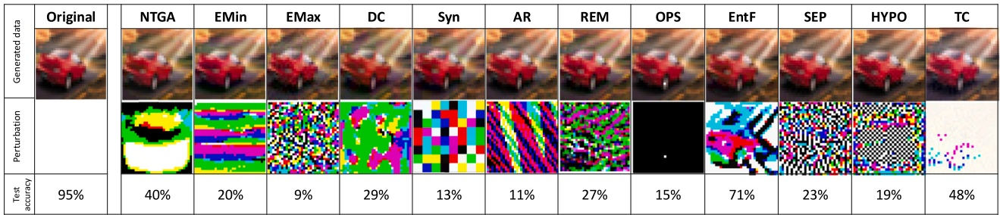
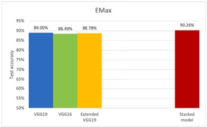
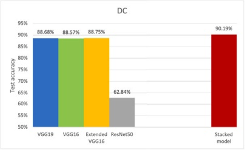
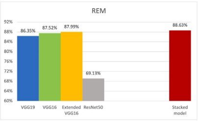
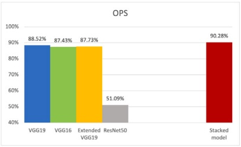
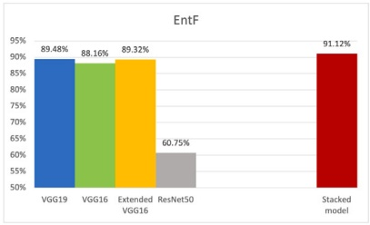
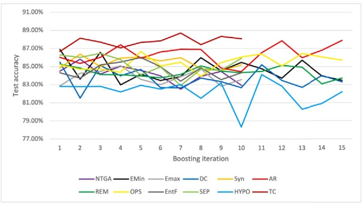
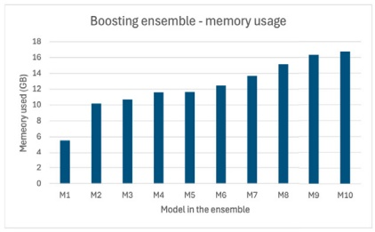
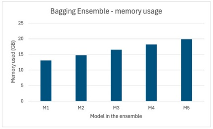

# Avance del ensemble learning contra unlearnable data

**Thushari Hapuarachchi , Kaiqi Xiong** ∗

**ICNS Lab and Cyber Florida, University of South Florida, Tampa, 33620, FL, USA**

## INFORMACIÓN DEL ARTÍCULO

**Comunicado por D. Macciò**

**Palabras clave:**

**Enfoques de protección de datos**

**Deep neural networks**

**Ensemble learning**

**Unlearnable data**

## R E S U M E N

**La adquisición no autorizada de datos de imágenes para el entrenamiento de modelos de redes neuronales profundas (DNN) plantea importantes preocupaciones de privacidad. Una solución potencial para abordar esta preocupación consiste en hacer que los datos sean unlearnable, interrumpiendo el proceso de entrenamiento de los modelos DNN. Dada la naturaleza impredecible de las técnicas de machine learning que pueden emplear usuarios no autorizados, los unlearnable data deben poseer la capacidad de proteger contra diversos enfoques avanzados de machine learning, incluido el ensemble learning. En esta investigación, proponemos marcos de trabajo para hacer avanzar los métodos convencionales de ensemble learning, incluidos stacking, boosting y bagging, a fin de derrotar doce enfoques existentes de protección de datos haciendo que sus unlearnable data generados se conviertan en datos aprendibles (learnable). Nuestros exhaustivos experimentos revelan que los ensembles de modelos resultantes de los marcos propuestos alcanzan una test accuracy promedio superior al 89% en conjuntos de datos CIFAR-10 unlearnable generados por los doce enfoques existentes. Estos hallazgos resultantes sugieren que la totalidad de los doce enfoques existentes fracasan en evitar el uso no autorizado de los datos, y existe una necesidad urgente de desarrollar nuevos enfoques de protección de datos para prevenir dicho uso indebido.**

## 1. Introducción

**Hoy en día, Internet, incluidas las plataformas de redes sociales como Facebook e Instagram, está repleto de datos personales disponibles libremente. El scraping ilegítimo de estos datos para el entrenamiento de modelos de Deep Neural Networks (DNN) se ha convertido en un problema grave. Se proponen enfoques de protección de datos, también conocidos como unlearnable data [1], para prevenir dicha utilización no autorizada de datos de imágenes para el entrenamiento de modelos DNN. Los unlearnable data deberían ser capaces de proteger los datos frente a su uso en cualquier método avanzado de machine learning. El ensemble learning es un enfoque avanzado y popular de machine learning que implica entrenar múltiples aprendices (learners) y combinar sus resultados para lograr un mejor rendimiento y mayores capacidades de generalización en comparación con sus aprendices individuales [2]. Debido a su alto rendimiento, los métodos de ensemble learning son aplicables independientemente del campo [3–6]. En este artículo, mejoramos e implementamos ensemble learning sobre unlearnable data incorporando al mismo tiempo transformaciones no lineales [7]. Estudios recientes revelan que la data augmentation simple, incluidas las transformaciones no lineales, puede desafiar eficazmente los unlearnable data generados por los enfoques de protección de datos [7–11]. Esta investigación hace avanzar el ensemble learning convencional, una de las técnicas de machine learning ampliamente utilizadas, para derrotar los unlearnable data.**

**Se asume que los unlearnable data interrumpen el entrenamiento de DNN, conduciendo a modelos con una capacidad de generalización deficiente. Por otro lado, los métodos de ensemble learning se utilizan para mejorar la capacidad de generalización de los modelos convencionales. Por lo tanto, estamos haciendo avanzar los métodos de ensemble learning para superar el desafío planteado por los unlearnable data.**

**El ensemble learning es un concepto crítico en machine learning porque combina múltiples modelos para mejorar el rendimiento global de un sistema. En lugar de depender de un solo modelo para realizar predicciones, los métodos de ensamble agregan las predicciones de múltiples modelos, lo que a menudo conduce a una mejor accuracy, robustez y generalización. En esta investigación, exploramos la capacidad del ensemble learning para conjuntos de datos unlearnable. Específicamente, nuestra pregunta de investigación es: ¿Cómo podemos aprovechar el ensemble learning para vulnerar (break) los unlearnable data? Sin embargo, aplicar ensemble learning siguiendo a Hapuarachchi et al. [7] no es trivial. Por el contrario, existen varios desafíos importantes. Algunos de estos desafíos incluyen: (1) mayor tiempo de entrenamiento y de prueba (testing), (2) overfitting del modelo, (3) dificultad en el ajuste de hiperparámetros (hyperparameter tuning), (4) dependencia de la calidad de los datos, (5) dificultades en la selección y combinación del ensamble, y (6) sesgo en la división de datos (data splitting bias) en el entrenamiento de los modelos. En este artículo, presentamos nuestros enfoques experimentales para abordar dichos desafíos.**

**Hasta donde sabemos, este es el primer estudio en explorar la viabilidad de aplicar métodos de ensemble learning a unlearnable data. Se han realizado numerosos estudios para demostrar la vulnerabilidad de los unlearnable data frente a la data augmentation y el adversarial training [12,13]. Nuestro estudio también incluye técnicas de data augmentation, específicamente transformaciones no lineales, como la escala de grises (grayscale), al tiempo que emplea métodos de ensemble learning. Elegimos técnicas de transformación no lineal porque, según se informa en Sandoval-Segura et al. [11], son más efectivas para mitigar los efectos de las perturbaciones unlearnable que las técnicas convencionales de transformación lineal. En este estudio, nos enfocamos en el ensemble learning convencional basado en DNNs en lugar de otras arquitecturas avanzadas como los Vision Transformers (ViTs) [14]. Una razón es que los unlearnable data están diseñados principalmente para perturbar el entrenamiento de las DNNs [1,15]. Nuestro objetivo es demostrar la viabilidad de aplicar ensemble learning utilizando arquitecturas que estos datos pretenden interrumpir. Otra razón es que el uso de ViTs presenta varias desventajas clave en comparación con el ensemble learning convencional, a pesar de su mayor rendimiento. Estas incluyen altos costos computacionales, tiempos de entrenamiento más prolongados y la dificultad de interpretar los transformers [16]. La aplicación de ViTs a unlearnable data puede incrementar aún más estos desafíos debido a la complejidad de los datos de entrenamiento. Por lo tanto, este estudio se enfoca en el ensemble learning convencional en lugar de métodos de aprendizaje avanzados como los ViTs.**

<small>∗ Autor de correspondencia.</small>

<small>Direcciones de correo electrónico: [saumya2@usf.edu](mailto:saumya2@usf.edu) (T. Hapuarachchi), [xiongk@usf.edu](mailto:xiongk@usf.edu) (K. Xiong).</small>

Fig. 1. La primera fila muestra los enfoques de protección de unlearnable data. Se presentan unlearnable examples y sus correspondientes perturbaciones. Las test accuracies en la última fila provienen de los artículos respectivos y representan la accuracy de un modelo entrenado en un conjunto de datos CIFAR-10 unlearnable generado por cada enfoque.

**Existen tres métodos principales de ensemble learning: stacking, boosting y bagging [2]. Hemos aplicado los tres métodos, respectivamente, a unlearnable data. Proponemos tres nuevos marcos de ensemble learning correspondientes a estos tres métodos convencionales de ensemble learning, donde aprovechamos las transformaciones no lineales para mejorar los métodos convencionales de ensemble learning para vulnerar los unlearnable data. Los marcos propuestos dan lugar a ensembles de modelos con capacidades de generalización mejoradas. Por ejemplo, en el marco de boosting propuesto, es esencial asignar mayores pesos a las unidades mal clasificadas del modelo anterior. Implementamos este paso generando imágenes adicionales mediante diversas técnicas de transformación no lineal.**

**En este estudio, derrotamos unlearnable data protegidos por los doce principales enfoques de protección de datos, incluyendo Neural Tangent Generalization Attacks (NTGA) [15], Error-Minimizing (EMin) [1], Error-Maximizing (EMax) [17], DeepConfuse (DC) [18], Synthetic (Syn) [19], Autoregressive (AR) [20], Robust Error-Minimizing (REM) [12], One-Pixel Shortcut (OPS) [21], Entangled-Features (EntF) [22], Self-Ensemble Protection (SEP) [23], Hypocritical (HYPO) [24] y TensorClog (TC) [25]. Específicamente, estos unlearnable data se generan agregando perturbaciones imperceptibles a los datos originales a través de los doce enfoques mencionados, los cuales se utilizan para resolver un problema de optimización binivel (bilevel optimization). La Fig. 1 muestra imágenes de muestra generadas por cada uno de los enfoques mencionados, junto con sus correspondientes perturbaciones. Las perturbaciones se obtienen restando la imagen unlearnable de la original. La última fila de la Fig. 1 presenta la test accuracy de un modelo entrenado en un conjunto de datos CIFAR-10 unlearnable protegido por cada enfoque, según se informa en los artículos respectivos. La test accuracy para un modelo DNN entrenado en un conjunto de datos CIFAR-10 limpio (clean) es de aproximadamente el 95% [17]. La presencia de unlearnability evidencia una disminución en la test accuracy, como se ilustra en la Fig. 1. En este estudio, nuestro objetivo es mejorar esas test accuracies desarrollando el nuevo marco de ensemble learning. A través de la realización de este estudio, hemos contribuido de las siguientes maneras.**

**• Hasta donde sabemos, nuestro estudio es pionero en la aplicación de métodos de ensemble learning a modelos DNN entrenados con unlearnable data. Mediante experimentos exhaustivos, ilustramos que los métodos de ensemble learning resultan efectivos para unlearnable data cuando van acompañados de avances metodológicos que incluyen data augmentation a través de transformaciones no lineales.**

**• Proponemos tres marcos dentro del ensemble learning, a saber, stacking, boosting y bagging, para abordar eficazmente los desafíos que plantean los unlearnable data. Los marcos propuestos incorporan varias ventajas en comparación con los métodos convencionales de ensemble learning. En el método boosting, optamos por amplificar la relevancia de los datos mal clasificados mediante el empleo de transformaciones no lineales, ya que demuestra ser una estrategia potente para superar la unlearnability. En el método stacking, aprovechamos modelos con diversas arquitecturas DNN, reconociendo que los unlearnable data pueden mostrar características de rendimiento variables según la arquitectura empleada. En el método bagging, seleccionamos estratégicamente subconjuntos superpuestos para expandir los datos de entrenamiento, mitigando eficazmente los posibles problemas de overfitting en modelos individuales inducidos por la unlearnability.**
**• A través de nuestros extensos experimentos, demostramos que los marcos de ensamble propuestos mejoran significativamente la test accuracy en comparación con los modelos baseline entrenados con unlearnable data. Estos experimentos se llevaron a cabo en conjuntos de datos CIFAR-10 unlearnable generados por los doce enfoques de protección de datos anteriores. Alcanzamos una test accuracy promedio superior al 89% para al menos uno de los tres ensambles entrenados en todos los conjuntos de datos unlearnable.**

**El resto del artículo está organizado de la siguiente manera. En la Sección 2, proporcionamos la información de contexto necesaria sobre unlearnable data y métodos de ensemble learning. La Sección 3 presenta los trabajos relacionados con el problema estudiado y la metodología propuesta. Además, presentamos nuestros marcos de ensemble learning propuestos en la Sección 4. Los resultados experimentales se presentan en la Sección 5. La Sección 6 incluye discusiones adicionales sobre los resultados experimentales. Finalmente, concluimos nuestro estudio con el trabajo futuro en la Sección 7.**

## 2. Antecedentes

**Unlearnable data: Los unlearnable data se generan utilizando ataques de disponibilidad (availability attacks), también conocidos como ataques de generalización (generalization attacks). Los generalization attacks tienen como objetivo generar perturbaciones imperceptibles,** 𝛿**, para todas las imágenes de un conjunto de entrenamiento resolviendo el siguiente problema de optimización [1,17]:**

$$
\underset {\| \delta \| _ {p} \leq \epsilon} {\arg \max} \left[ \mathcal {L} \left(f \left(X _ {v}; \theta^ {*}\right), Y _ {v}\right) \right] \tag {1}
$$

**sujeto a**

$$
\theta^ {*} \in \arg \min _ {\theta} \left[ \mathcal {L} \left(f \left(X _ {T} + \delta ; \theta\right), Y _ {T}\right) \right], \tag {2}
$$

**donde** $X _ { T }$ y $Y _ { T }$ **representan conjuntos de imágenes de entrada y etiquetas objetivo en el conjunto de entrenamiento, respectivamente. De manera similar,** $X _ { v }$ **y** $Y _ { v }$ denotan conjuntos de imágenes y **etiquetas objetivo en un conjunto de validación, respectivamente.** 𝛿 **es un conjunto de perturbaciones que se añade al conjunto de imágenes de entrada** $X _ { T }$ **. El modelo DNN** 𝑓 **con un conjunto de parámetros,** $\theta ,$ **tiene una loss function de** 𝐿**. La Ec. (2) encuentra el conjunto óptimo de parámetros,** $\theta ^ { * }$ **, que minimiza la pérdida de entrenamiento (training loss), lo que indica que** **el modelo está bien entrenado. La Ec. (1) busca perturbaciones** 𝛿 **que conduzcan a altas pérdidas de validación (validation losses), lo que dificulta que el modelo proporcione resultados precisos en datos desconocidos sin perturbaciones (datos limpios o clean data). Se anticipa que las perturbaciones sean menores que** $\epsilon _ { \flat }$ **asegurando que permanezcan imperceptibles. En este estudio, utilizamos conjuntos de datos unlearnable generados por los doce enfoques diferentes mencionados anteriormente.**

**Ensemble learning: En el ensemble learning, múltiples aprendices (learners) trabajan conjuntamente para resolver un único problema. El objetivo principal de un proceso de ensemble learning consiste primero en entrenar un conjunto de aprendices individuales y luego combinar sus salidas/resultados de entrenamiento mediante algún mecanismo [26, 27]. Es decir, los métodos de ensemble learning pueden formularse de la siguiente manera [28–30]:**

$$
\underset {G} {\arg \min} \left[ \mathcal {L} \left(G \left(f _ {1} \left(X _ {v}\right), f _ {2} \left(X _ {v}\right), \dots f _ {k} \left(X _ {v}\right)\right), Y _ {v}\right) \right], \tag {3}
$$

**donde** $G   \in   \mathcal { G }$ **representa un agregador (aggregator), el cual es un mecanismo para combinar conjuntamente los modelos** $f _ { 1 } , f _ { 2 } , \ldots , f _ { k }$ **.**  **denota el conjunto de todos los mecanismos que combinan los modelos** $f _ { 1 } , f _ { 2 } , \ldots , f _ { k } .$ . Aquí, $X _ { v }$ **y** $Y _ { v }$ **denotan los conjuntos de imágenes y etiquetas objetivo en el conjunto de validación, respectivamente.**  **representa la loss function. El objetivo del problema de optimización anterior es descubrir el agregador** 𝐺 **que dé lugar a una pérdida mínima.**

**Existen tres métodos fundamentales de ensemble learning: stacking, boosting y bagging [2]. (1). El método boosting utiliza los datos de entrada** $( X _ { T } )$ **para entrenar primero un clasificador débil (weak classifier). Luego, las predicciones del clasificador débil se comparan con las etiquetas verdaderas** $( Y _ { T } )$ **, y se seleccionan las muestras de entrenamiento mal clasificadas. A continuación, a las muestras mal clasificadas se les asignan pesos más altos que a otras muestras del conjunto de datos, de modo que el siguiente modelo preste más atención a estas muestras durante el entrenamiento [10,30]. (2). El método stacking utiliza diferentes algoritmos sobre el mismo conjunto de datos de entrenamiento. De este modo, se pueden entrenar diferentes algoritmos en paralelo y obtener las predicciones de cada modelo. Para combinar las predicciones obtenidas de cada modelo, se utiliza un meta-learner. Dado que aprende de las predicciones de diferentes algoritmos, el meta-learner suele ser simple. Por lo tanto, con frecuencia se utilizan clasificadores lineales, tales como la regresión logística, como meta-learners [2]. (3). El método bagging divide aleatoriamente el conjunto de datos en subconjuntos. Una vez generados varios subconjuntos, los base learners se entrenan de manera independiente. Se obtiene una estimación más precisa basada en el promedio o en la mayoría de estas predicciones, según la tarea, es decir, regresión o clasificación [2,30].**

**Los marcos de trabajo para los tres métodos de ensamble son autónomos y pueden implementarse de forma independiente, como se muestra en las siguientes subsecciones. Sin embargo, es aconsejable elegir un base model con un rendimiento superior para boosting y bagging. En nuestro estudio, primero experimentamos con varios modelos antes de decidir cuál utilizar para boosting y bagging en función de su rendimiento. En el futuro, el método stacking podría ayudar a determinar el modelo más apropiado para otros enfoques. No obstante, en esta investigación, ejecutamos los tres marcos de forma independiente.**

## 3. Trabajos relacionados

**Los unlearnable data se han convertido en un tema prominente en los últimos años [17, 31]. Cada año, se realizan varios estudios para desarrollar nuevos conjuntos de datos unlearnable, así como para explorar las vulnerabilidades de los métodos existentes [32–36]. Los ataques comunes contra unlearnable data incluyen el adversarial training [12,37] y la data augmentation utilizando tanto transformaciones lineales como no lineales [7,11,20]. En este estudio, aprovechamos las transformaciones no lineales propuestas en Hapuarachchi et al. [7] para obtener modelos robustos contra unlearnable data y emplearlos en la construcción de ensambles.**

**Los unlearnable data constituyen un campo de rápido crecimiento en el que se están introduciendo enfoques avanzados de generación de unlearnable data a un ritmo acelerado. Estos enfoques avanzados se centran en proteger los datos contra métodos de aprendizaje avanzados o pueden aplicarse a diferentes tipos de datos. El estudio de Liu et al. [38] generó conjuntos de datos unlearnable para proteger contra el aprendizaje contrastivo (contrastive learning) no autorizado, un mecanismo de aprendizaje no supervisado. Además, abordaron tanto la clasificación de imágenes como** **la de texto. Por otra parte, [39] propuso conjuntos de datos unlearnable para proteger contra modelos de segmentación de imágenes. En otra dirección, Wang et al. [40] crearon datos 3D unlearnable. Al ser el primer estudio en aplicar ensemble learning a unlearnable data, esta investigación se centra principalmente en derrotar unlearnable data generados para la clasificación supervisada de imágenes, lo que potencialmente podría extenderse a tales métodos avanzados en el futuro. Por otro lado, el machine unlearning [41] es el proceso de eliminar datos del conjunto de entrenamiento utilizado para construir el modelo DNN a petición del propietario de los datos para proteger su privacidad. En este caso, los datos originales deben eliminarse del conjunto de entrenamiento. Sin embargo, como se muestra en Chen et al. [41], el machine unlearning puede dejar rastros de los datos eliminados en el modelo, haciéndolo vulnerable a ataques de inferencia de membresía (membership inference attacks). Además, Huang et al. [42] encontraron que estos métodos de machine unlearning hacen que los modelos de machine learning en plataformas en la nube sean vulnerables a backdoor attacks. En contraste, los unlearnable data impiden que el modelo DNN aprenda de los datos, incluso si están incluidos en el conjunto de entrenamiento.**

**La data augmentation es un enfoque ampliamente utilizado para atacar la unlearnability. Liu et al. [8] demostraron que el efecto de los unlearnable data puede mitigarse simplemente convirtiendo la imagen a escala de grises (grayscale). Recientemente, se ha demostrado que técnicas avanzadas de data augmentation como CutMix [43] y Mixup [44] logran derrotar los data poisoning attacks [45], incluidos los unlearnable data [9,43]. Además, Dolatabadi et al. [46] propusieron un mecanismo para derrotar los enfoques de protección de datos denominado dAta aVailAbiliTy Attacks defuseR (AVATAR), el cual involucra un proceso de difusión inversa para eliminar el ruido (denoise) de los unlearnable data. Asimismo, Liu et al. [32] demostraron que las técnicas de compresión de imágenes, tales como JPEG, también pueden utilizarse para eliminar la unlearnability. Yu et al. [47] propusieron un enfoque para extraer imágenes originales a partir de unlearnable data utilizando autoencoders.**

**Se han realizado numerosos estudios para vulnerar los unlearnable data utilizando adversarial training. Tao et al. [48] investigaron la robustez en tiempo de prueba (test-time robustness) del adversarial training aplicado sobre unlearnable data. Fu et al. [12] demostraron que los unlearnable data elaborados con EMin [1], EMax [17] y NTGA [15] son vulnerables al adversarial training. REM [12] es una versión mejorada de EMin diseñada para desafiar el adversarial training generando perturbaciones unlearnable mientras se entrena con perturbaciones adversariales. Sin embargo, un estudio reciente de Liu et al. [34] mejoró aún más REM entrenando con perturbaciones aleatorias en lugar de perturbaciones adversariales. A diferencia de estos estudios, proponemos marcos de ensemble learning capaces de eludir el efecto de los unlearnable data. Demostramos que los unlearnable data siguen siendo utilizables en ensemble learning, proporcionando una ligera mejora con respecto a los métodos convencionales.**

**Recientemente, los investigadores quedaron intrigados por la revelación de que muchas de las perturbaciones unlearnable existentes, incluidas EMin, EMax y NTGA, son linealmente separables [19,49]. Ren et al. [50] utilizaron la separabilidad lineal de las perturbaciones unlearnable por clases (class-wise) para proteger datos contra el aprendizaje no supervisado. Zhu et al. [51] desarrollaron un método para detectar unlearnable examples basado en la separabilidad lineal. Sandoval-Segura et al. [11] propusieron el Orthogonal Projection Attack (OPA) capturando estas perturbaciones linealmente separables en los unlearnable data a través de un modelo de regresión logística. También demostraron que su método de ataque es computacionalmente más rentable que el adversarial training. Aunque el método es más efectivo para conjuntos de datos unlearnable perturbados mediante perturbaciones class-wise, se requieren mejoras adicionales para lograr un mejor rendimiento frente a perturbaciones por muestra (sample-wise). Como resultado, Hapuarachchi et al. [7] propusieron técnicas de transformación no lineal contra conjuntos de datos unlearnable. Se ha demostrado que estas transformaciones no lineales son más efectivas que OPA, ya que capturan mejor los efectos de perturbaciones no lineales, como AR [20]. Por consiguiente, en nuestra investigación, optamos por adoptar técnicas de transformación no lineal tales como erode, dilate y manipulación de píxeles (pixel manipulation), según lo propuesto por Hapuarachchi et al. [7].**

**En contraste con los estudios existentes, utilizamos estas técnicas de transformación no lineal para mejorar los métodos de ensemble learning existentes con el fin de aplicarlos a conjuntos de datos unlearnable. Hasta donde sabemos, este es el primer estudio que aprovecha los métodos de ensemble learning con conjuntos de datos unlearnable.**

## 4. Metodología

**Para derrotar los unlearnable data generados por los doce enfoques existentes de protección de datos, el primer paso consistió en formular el ensemble learning convencional como un problema de optimización de tres niveles y luego proponer nuevos marcos para hacer avanzar el ensemble learning existente.**

## 4.1. Ensemble learning contra unlearnable data

**A partir de la expresión matemática de los métodos de ensemble learning dada en la Ec. (3), esta investigación articuló aún más el objetivo de mejorar los métodos de ensemble learning contra unlearnable data de la siguiente manera:**

$$
\underset {G} {\arg \min} \left[ \mathcal {L} \left(G \left(f _ {1} ^ {*} \left(X _ {v}\right), f _ {2} ^ {*} \left(X _ {v}\right), \dots f _ {k} ^ {*} \left(X _ {v}\right)\right), Y _ {v}\right) \right] \tag {4}
$$

**sujeto a**

$$
A ^ {*}, f _ {i} ^ {*} \in \underset {A, f _ {i}} {\arg \min} \left[ \max _ {\| \delta \| _ {p} \leq \epsilon} \left[ \mathcal {L} \left(f _ {i} \left(X _ {v}; \theta^ {*}\right), Y _ {v}\right) \right] \right] \tag {5}
$$

**lo cual está además sujeto a**

$$
\theta^ {*} \in \underset {\theta} {\arg \min} \left[ \mathcal {L} \left(f _ {i} \left(A \left(X _ {T} + \delta\right); \theta\right), Y _ {T}\right) \right], \tag {6}
$$

**para cualquier** $A \subseteq { \mathcal { A } } ,$ **, donde**  **representa el conjunto de todas las técnicas de transformación no lineal aplicadas al conjunto de entrenamiento unlearnable para mitigar los efectos de las perturbaciones unlearnable. El término** $f _ { i }$ denota un modelo DNN con un conjunto de parámetros, 𝜃.

**Las Ecs. (4), (5) y (6) presentan un problema de optimización de tres niveles que consta de tres problemas de minimización y uno de maximización. Para resolverlo para** $G ,$ **la metodología propuesta utilizó el enfoque bottom-up comenzando desde su restricción de nivel más bajo, o restricción de segundo nivel, y luego ascendiéndola. Es decir, esta investigación intentó encontrar el espacio máximo de variables en el subproblema de optimización dado en la restricción de un problema de optimización antes de resolver el problema de optimización (original). A continuación se ofrece una explicación detallada.**

**Primero, en la Ec. (6),** $f _ { i }$ **y** 𝐴 **se fijaron. La Ec. (6) tuvo como objetivo identificar el conjunto óptimo de parámetros del modelo,** $\theta ^ { * }$ **, entrenando un modelo DNN dado,** $f _ { i } ,$ **en el conjunto de datos unlearnable aumentado utilizando una técnica de transformación no lineal dada en un subconjunto de** **. Segundo, al pasar a la restricción del siguiente nivel o restricción de primer nivel, la Ec. (5) encontró dos salidas: (a) La arquitectura de modelo óptima** $f _ { i } ^ { * }$ **. (b) El subconjunto óptimo de técnicas de transformación no lineal,** $A ^ { * } .$ **Estos se eligieron evaluando** $\theta ^ { * }$ **en el espacio máximo de variables generado por la Ec. (6), para un** $f _ { i }$ **y** 𝐴 dados en un conjunto de validación. La Ec. (5) encontró el $f _ { i }$ y 𝐴 **que proporcionaron la mínima pérdida de validación. Esto significó la máxima generalizabilidad. Para obtener los modelos DNN deseados** $f _ { 1 } ^ { * } , f _ { 2 } ^ { * } , \ldots f _ { k } ^ { * }$ para el ensamble, este proceso se repitió varias veces. Finalmente, la Ec. (4) se utilizó para encontrar el agregador $G \in { \mathcal { G } } ,$ donde $\mathcal { G }$ representaba el conjunto de todos los mecanismos que combinaban los modelos individuales $f _ { i } ^ { * }$ para lograr una mejor accuracy que los modelos individuales por sí solos. En resumen, el objetivo para resolver el problema de optimización de tres niveles fue encontrar $A ^ { * } , f _ { i } ^ { * }$ y 𝐺 bajo los tres métodos de ensemble learning descritos en la Sección 2.

**Resolver el problema de optimización de tres niveles anterior no fue una tarea directa. De hecho, fue una tarea desafiante ya que involucraba cuatro subproblemas de optimización complejos. Sea** 𝑁 **el número total de todas las transformaciones no lineales. Entonces, la dimensión de** $\mathcal { A }   =   2 ^ { N }$ **. Como se observa, la dimensión de**  **aumentaba exponencialmente con** 𝑁**. Esto implica que el problema de optimización de tres niveles anterior en las Ecs. (4)–(6) tenía un espacio de parámetros con una dimensión muy alta que crecía exponencialmente con** $N ,$ **por lo que resultaba extremadamente costoso en tiempo buscar una solución óptima de la optimización en el espacio de parámetros, lo cual no podía realizarse en tiempo polinomial. Por lo tanto, esta investigación propuso y desarrolló un enfoque heurístico para hacer factible dicha búsqueda, de modo que el enfoque pudiera emplearse en aplicaciones del mundo real. Es decir, la solución resultante fue subóptima en lugar de óptima.**

**Los siguientes párrafos presentan nuestro enfoque para encontrar cada uno de** $A ^ { * } , f _ { 1 } ^ { * } , f _ { 2 } ^ { * } \ldots f _ { k } ^ { * } ,$ **y** 𝐺.

**Para evitar la búsqueda de cada elemento en el espacio de parámetros de**  **que requería tiempo exponencial, se desarrolló un enfoque de expansión óptima (optimal-expanding approach) [7]. Este enfoque primero (1) eligió aquellas transformaciones no lineales comúnmente utilizadas en la literatura (por ejemplo, grayscale, erode, manipulación de píxeles) como**  **en lugar de todas las transformaciones no lineales e identificó qué transformación no lineal puede producir la mayor test accuracy de los modelos de entrenamiento; dicha transformación no lineal se utilizaría para formar un conjunto base. Nótese que cada elemento de**  **era una única transformación no lineal en lugar de un subconjunto de transformaciones no lineales en** , **es decir,** B C A y B **tenían una dimensión mucho menor que** A**. El siguiente paso fue (2) elegir el resto de las transformaciones no lineales en**  **una por una e identificar qué transformación no lineal podía lograr la mayor test accuracy de los modelos de entrenamiento, junto con el conjunto base. Si la mayor test accuracy era superior a la precisión más alta previa, entonces la nueva transformación no lineal se añadía al conjunto base. Es decir, este paso expandía el conjunto base. (3) El proceso anterior continuó hasta que se verificaron todos los elementos de**  **. El conjunto resultante fue nuestra solución para** $A ^ { * }$ **. Sea** 𝑛 **la dimensión de** **. Por lo tanto, el enfoque de expansión óptima anterior tenía una complejidad temporal de** $n { + } ( n { - } 1 ) { + } \cdots { + } 1 = O ( n ^ { 2 } )$ **, que se encuentra en tiempo polinomial cuadrático.**

**El Algoritmo 1 describe los pasos para encontrar** $A ^ { * }$ **. Al inicio del proceso,** 𝐴 **era un conjunto vacío, y** $V _ { 0 }$ **representaba la validation accuracy del modelo entrenado en el conjunto de datos unlearnable (**𝑈**). El Algoritmo 1 seleccionó primero aleatoriamente una técnica de transformación no lineal del conjunto** $B ,$ y la denominó $A _ { 1 } .$ En general, la transformación no lineal elegida en la 𝑖-ésima iteración se denota como $A _ { i }$ . Luego, la transformación se aplicó al conjunto de datos unlearnable, lo que se denota mediante la notación $A _ { i } ( U )$ . A continuación, se entrenó un modelo DNN sobre el conjunto de datos transformado, $A _ { i } ( U ) ,$ y se obtuvo la validation accuracy, $V _ { i }$. Si la validation accuracy mejoraba debido a la transformación, $A _ { i }$ se añadía al conjunto 𝐴. La siguiente iteración eligió $A _ { i + 1 }$ del conjunto ${ \mathcal { B } } \backslash \{ A _ { 1 } , \ldots , A _ { i } \} , { \mathrm {  ~ es~decir , ~ } }$ las transformaciones seleccionadas en las iteraciones anteriores se eliminan de  antes de elegir la siguiente transformación. Es decir, este algoritmo selecciona transformaciones sin reemplazo. Después de repetir este proceso durante un número específico de iteraciones 𝑛, es decir, la dimensión de $B ,$ **el conjunto resultante** 𝐴 **fue elegido como** $A ^ { * } .$

Algorithm 1: Selecting nonlinear transformation techniques

for $i = 1$ to $n$ do
    1. Randomly select $A_i$ from $\mathcal{B} \setminus \{A_1, \ldots, A_{i-1}\}$.
    2. Transform unlearnable dataset. $U \to A_i(U)$
    3. $A(U) \leftarrow A(U) \cup A_i(U)$
    4. Train a DNN model using $A(U)$ and obtain validation accuracy $(V_i)$.
    5. if $V_i &gt; V_{i-1}$ then
        $A \leftarrow A \cup A_i$
    end
end
return $A$

**Al seleccionar** $f _ { i } ^ { * } ,$ **esta investigación consideró diversas arquitecturas DNN preentrenadas en Keras,**<strong>1</strong>**tales como Residual Network (ResNet) y Visual Geometry Group (VGG). Estas se modificaron aún más agregando capas adicionales y capas de dropout, ajustando el número de neuronas, modificando el número de épocas (epochs) y ajustando otros hiperparámetros. Estos hiperparámetros se seleccionaron en función de la test accuracy final del ensamble obtenida a través de varios ensayos experimentales.**

**Para que pudiéramos resolver la optimización de tres niveles anterior, el siguiente paso clave consistió en elegir un agregador** 𝐺 **de un conjunto de todos los mecanismos agregadores**  **bajo cada método de ensemble learning. Este paso incorporó directamente los agregadores predeterminados utilizados en los métodos convencionales de ensemble learning, sin pasar por un procedimiento de optimización, porque sus propósitos y condiciones coincidían con nuestro marco. Por** **ejemplo, se utilizó un meta-learner como agregador para el método stacking porque se incluyeron diferentes arquitecturas de modelos en el ensamble de stacking. Las diferentes arquitecturas dieron lugar a diferencias significativas en el rendimiento de los modelos. Un meta-learner podía inferir qué modelos eran confiables y cuáles no, en lugar de un mecanismo de votación. En contraste, los métodos bagging y boosting utilizaron un mecanismo de votación como agregador. Estos métodos incorporaron la misma arquitectura de modelo para todos los modelos, pero utilizaron diferentes datos de entrada. Por lo tanto, en contraste con el método stacking, no se observaron diferencias significativas en el rendimiento de los modelos individuales. En consecuencia, en lugar de utilizar un meta-learner como agregador, los marcos propuestos de bagging y boosting emplearon un mecanismo de votación. Es importante señalar que estas elecciones de agregadores también fueron similares a las definidas en los métodos convencionales de ensemble learning, como se explicó en la Sección 2.**

<small>1 [https://keras.io/api/applications/](https://keras.io/api/applications/)</small>

Algorithm 2: Proposed Stacking Ensemble Framework

Data: Unlearnable training images (T), Pretrained models
    (M₁, M₂, ..., Mₖ), Number of iterations (k), Nonlinear
    transformation techniques (A), Clean test dataset, Target test
    accuracy (α)
Result: The stacking ensemble
Augment T and create T₁ (T₁ ← A(T)) ;
for i ← 1 to k do
    1. Train several pretrained models M₁, ..., Mᵢ on T₁;
    2. Make predictions on T using M₁, ..., Mᵢ;
    3. Train a logistic regression model L by considering predictions as
    feature variables (X) and true labels of T as target variables (Y);
    4. Generate test predictions and calculate test accuracy (d);
    if d &gt; α then
        STOP
    end
end
return {M₁, M₂, ..., Mₖ} ∪ L

## 4.2. Stacking ensemble contra unlearnable data

**Para diseñar el marco de avance del método convencional de stacking ensemble, el proceso siguió el concepto fundamental del stacking ensemble pero con algunas modificaciones como se muestra en la Fig. 2(a). El primer paso del marco de ensemble learning propuesto consistió en aumentar el conjunto de datos de entrenamiento unlearnable utilizando técnicas de transformación no lineal como el escalado a grises (grayscale). A continuación, se entrenaron varios modelos DNN con diferentes arquitecturas sobre el conjunto de entrenamiento aumentado, tales como VGG y ResNet [52]. El tercer paso realizó predicciones sobre el conjunto de entrenamiento unlearnable utilizando los modelos DNN entrenados en el paso previo. Las predicciones se obtuvieron en términos de probabilidades, no de clases objetivo. Luego, se ajustó un meta-learner, es decir, un modelo de regresión logística, considerando estas probabilidades predichas como variables independientes (X) y las etiquetas verdaderas como variable objetivo (Y). El marco eligió la regresión logística por ser el meta-learner más comúnmente utilizado en stacking. La salida del meta-learner fue la predicción final proporcionada por el ensamble.**

**En la fase de prueba (testing), el marco obtuvo predicciones para las imágenes de prueba utilizando cada modelo DNN del ensamble. Estas predicciones (en términos de probabilidades) se introdujeron luego en el meta-learner entrenado, es decir, el modelo de regresión logística. La predicción final de la imagen de prueba fue la salida del meta-learner. Como se muestra en el Algoritmo 2, los diferentes modelos DNN se agregaron al ensamble uno a uno hasta que el ensamble alcanzó la test accuracy deseada. Debido a la unlearnability, el rendimiento de los modelos individuales varió en gran medida según la arquitectura. Por lo tanto, el rendimiento individual del modelo también fue una preocupación al seleccionar el modelo para el ensamble.**

**En el stacking ensemble propuesto, la novedad radica principalmente en la aplicación de técnicas de transformación no lineal y en la utilización de diversas arquitecturas de DNNs. Estos pasos nos permiten abordar simultáneamente las vulnerabilidades de los** **unlearnable data frente a las transformaciones de datos y a las diferentes arquitecturas de modelos. Al mismo tiempo, estos pasos superan el desafío de equilibrar la diversidad entre los modelos individuales manteniendo la accuracy. Aunque tanto las transformaciones no lineales como las arquitecturas diversas se han explorado por separado en investigaciones anteriores sobre unlearnable data, este estudio las combina para lograr un rendimiento significativamente superior.**

(c) Bagging

Fig. 2. Marcos de ensemble learning propuestos para unlearnable data.

## 4.3. Boosting ensemble contra unlearnable data

**Esta sección presenta nuestro enfoque para hacer avanzar el método convencional de boosting ensemble. El método boosting ensemble creó secuencialmente una serie de modelos que se concentran en las muestras mal clasificadas por el modelo anterior al entrenar el modelo siguiente. A todas las muestras se les asignó el mismo peso al inicio del proceso. En cada iteración, se incrementaron los pesos de las muestras mal clasificadas, ya que el modelo subsecuente debe prestar más atención a las muestras mal clasificadas que a las demás [30].**

**El marco de boosting propuesto aprovechó transformaciones no lineales junto con el método convencional de boosting ensemble, como se ilustra gráficamente en la Fig. 2(b). El Algoritmo 3 expone explícitamente nuestro procedimiento de entrenamiento para obtener el boosting ensemble. El primer paso consistió en utilizar técnicas de transformación no lineal tales como grayscale y pixel** **manipulation para aumentar el conjunto de datos de entrenamiento unlearnable. Estas técnicas de transformación ayudaron a mitigar la unlearnability de los datos de entrenamiento. El siguiente paso entrenó un modelo DNN preentrenado, como VGG [52], utilizando los datos aumentados. El número de épocas de entrenamiento (training epochs) se decidió para asegurar que el modelo no sufriera de overfitting. Utilizando el modelo entrenado, se realizaron predicciones sobre el conjunto de entrenamiento unlearnable. Las muestras mal clasificadas se aumentaron nuevamente y se combinaron con el conjunto de entrenamiento. Como resultado, las muestras mal clasificadas se repitieron en el nuevo conjunto de entrenamiento con mayor frecuencia que las demás muestras, por lo que fueron amplificadas en el modelo siguiente. A continuación, el conjunto de entrenamiento aumentado se utilizó para entrenar otro modelo DNN. Luego, el nuevo modelo entrenado realizó nuevamente predicciones sobre el conjunto de datos unlearnable, y las muestras mal clasificadas se añadieron al conjunto de entrenamiento para entrenar el modelo siguiente. Este proceso de predicción-aumento se repitió durante un número** 𝑘 **de veces, dando como resultado un modelo de ensamble con** 𝑘 **modelos. La clase predicha de una imagen de prueba se obtuvo sobre la base de la votación de las predicciones dadas por la totalidad de los** 𝑘 **modelos. El marco determinó el número de iteraciones de boosting** 𝑘 **en función de la test accuracy final.**

Algorithm 3: Proposed Boosting Ensemble Framework

Data: Unlearnable training images (T), Pretrained model (M), Number of iterations (k), Nonlinear transformation techniques (A)
Result: The boosting ensemble
Augment T and create $S_1$ ($S_1 \leftarrow A(T)$);
for $i \leftarrow 1$ to $k$ do
    1. Train pretrained model $M$ using $S_i$ to obtain model $M_i$;
    2. Make predictions on $T$ using $M_i$;
    3. Select misclassified images ($D_i$) and make additional augmented images $A(D_i)$;
    4. Combine additional images with original training set ($S_{i+1} \leftarrow S_i + A(D_i)$);
end
return $\{M_1, M_2, \ldots, M_k\}$

**En el boosting ensemble, la principal contribución radicó en cómo se incrementaron los pesos de las imágenes mal clasificadas. Sin embargo, el simple hecho de aumentar el peso de una imagen no resultaba útil cuando las imágenes eran unlearnable. En tales casos, las imágenes se repitieron con diferentes transformaciones. Este enfoque ayudó a mitigar el overfitting causado por los unlearnable data así como el entrenamiento excesivo en ensemble learning. Para evitar hacer el proceso excesivamente complejo y prevenir un tiempo de ejecución elevado, se aplicaron las mismas transformaciones en cada iteración. Los hiperparámetros, como el número de épocas, también se ajustaron cuidadosamente para reducir el overfitting.**

## 4.4. Bagging ensemble contra unlearnable data

**El marco de bagging propuesto incorporó diversas modificaciones al método convencional de bagging ensemble para su uso exitoso contra unlearnable data. Primero, el marco dividió los datos de entrenamiento mediante muestreo aleatorio para generar** 𝑘 **subconjuntos diferentes. Se entrenó un modelo DNN en cada subconjunto, dando como resultado** 𝑘 **modelos. Los** 𝑘 **modelos se combinaron mediante votación por mayoría (majority voting) para obtener un clasificador fuerte [2]. La Fig. 2(c) ilustra gráficamente el marco propuesto al incorporar transformaciones no lineales en el método convencional de bagging.**

**El primer paso del marco consistió en dividir el conjunto de entrenamiento unlearnable en subconjuntos balanceados y no superpuestos. Sin embargo, el bagging ensemble entrenado en estos subconjuntos exhibió un rendimiento débil. Esto pudo atribuirse a la cantidad reducida de datos en cada subconjunto. Por lo tanto, el marco propuesto implementó divisiones superpuestas para incrementar los datos diferenciados en cada subconjunto. El porcentaje de superposición se incrementó gradualmente para determinar el porcentaje óptimo. El siguiente paso del marco fue aumentar cada subconjunto con diversas técnicas de transformación no lineal, incluyendo grayscale, pixel manipulation, erode y dilate. Luego, un modelo preentrenado, como VGG19,** **se entrenó en cada subconjunto aumentado. El marco propuesto optimizó la arquitectura del modelo en función de su rendimiento (validation accuracy) después del entrenamiento. El Algoritmo 4 muestra nuestro procedimiento para construir el bagging ensemble. La fase de prueba recopiló las predicciones de cada modelo entrenado y derivó la predicción final utilizando un enfoque de votación por mayoría.**

Algorithm 4: Proposed Bagging Ensemble Framework

Data: Unlearnable training images (T), Pretrained model (M), Number of subsets (k), Nonlinear transformation techniques (A), Overlap percentage (p)
Result: The bagging ensemble
Split the training set into k subsets $T_1, T_2, \ldots, T_k$ with an overlap percentage of p;
for $i \leftarrow 1$ to k do
    1. Augment $T_i$ subset $(T_i' \leftarrow A(T_i))$;
    2. Obtain model $M_i$ by training pretrained model M on $T_i'$ subset;
end
return $\{M_1, M_2, \ldots, M_k\}$

**La novedad en el bagging ensemble propuesto radica en la adición de subconjuntos superpuestos al tiempo que se mejoran las variaciones en los datos. En el método de bagging ensemble, el desafío consistía en que los modelos no contaban con imágenes de entrenamiento únicas de las cuales aprender. Para que pudiéramos abordar este sesgo en la división de datos, las imágenes existentes se modificaron mediante transformaciones no lineales y se implementaron subconjuntos superpuestos. Este enfoque abordó simultáneamente los desafíos que plantean los unlearnable data. Se utilizaron subconjuntos balanceados, asegurando que incluso la porción de datos superpuesta permaneciera balanceada.**

**Nuestros experimentos utilizaron específicamente seis técnicas de transformación no lineal: erode, dilate, grayscale y pixel manipulation con respecto a tres canales. Las transformaciones erode y dilate fueron operaciones morfológicas que emplean funciones kernel para procesar imágenes [53]. Estas operaciones permitieron capturar perturbaciones no lineales aplicando un elemento estructurante a una imagen. La transformación erode redujo los límites de las regiones brillantes, mientras que la transformación dilate las expande. Estas transformaciones pueden enfatizar o suprimir eficazmente ciertas características en una imagen, lo que las hace útiles para capturar cambios complejos y no lineales en la intensidad de los píxeles. Por otro lado, las transformaciones de pixel manipulation y grayscale se centraron en simplificar y reducir la complejidad de los canales de color de la imagen. Estas transformaciones convirtieron la imagen de color (RGB) a un único valor de intensidad, reduciendo de manera efectiva la información de los tres canales de color a uno solo. Al reemplazar los valores de los tres canales de color de cada píxel con un valor único, estas transformaciones disminuyeron el impacto de las perturbaciones por canal (channel-wise) [8]. Nuestros experimentos implementaron tres técnicas de transformación bajo pixel manipulation según qué valor de canal de color (R, G o B) se utiliza para el reemplazo [7].**

**Este párrafo explica cómo se abordaron los desafíos identificados en la Sección 1 utilizando los marcos descritos anteriormente. (1) Mayor tiempo de entrenamiento y de prueba: Los métodos de ensemble learning demandan un tiempo sustancial de entrenamiento y prueba debido a que involucran múltiples modelos. Para abordar este problema, se llevaron a cabo extensos experimentos para buscar un número de épocas que equilibrara la accuracy y el tiempo de entrenamiento. Nuestros resultados experimentales concluyeron que el número de training epochs se limitó a no más de 35. Es decir, esta investigación eligió una configuración diferente a la de Hapuarachchi et al. [7], donde se utilizaron 80 épocas en el entrenamiento de algunos modelos. (2) Overfitting del modelo: Como se señaló en Hapuarachchi et al. [7], el overfitting era inevitable al tratar con unlearnable data. Al limitar las training epochs, también se redujo la tendencia al overfitting en los modelos. (3) Dificultad en el ajuste de hiperparámetros (hyperparameter tuning): Este estudio ajustó y finalizó la elección de hiperparámetros, tales como arquitecturas de modelos, transformaciones no lineales y learning rates, a través de una gran cantidad de experimentos. Debido a la complejidad de la selección de hiperparámetros, los marcos propuestos intentaron encontrar un conjunto de hiperparámetros subóptimos. A través de muchos ensayos experimentales,** **se eligieron las mismas transformaciones no lineales en todos los modelos del ensemble learning y la arquitectura del modelo se fijó en VGG19 tanto en los ensembles de bagging como de stacking. (4) Dependencia de la calidad de los datos: Los marcos propuestos se diseñaron para garantizar que fueran independientes del conjunto de datos. Únicamente los hiperparámetros se adaptaron a los conjuntos de datos específicos. Esta investigación demostró esto aplicando nuestro marco a diversos conjuntos de datos, incluidos CIFAR-10, ImageNet, MNIST y CIFAR-100. (5) Dificultad en la selección y combinación del ensamble: Este ha sido el primer estudio que aplica ensemble learning a unlearnable data. Dado que el ensamble tenía diferentes tipos y existía una variedad de modelos, la elección de qué método de ensamble utilizar resultaba desafiante. Antes de explorar métodos avanzados de ensamble, este estudio optó por técnicas simples y tradicionales. (6) Sesgo en la división de datos (data splitting bias) en el entrenamiento de modelos: Este artículo aplicó la división de datos únicamente en el método de bagging ensemble. El marco de bagging ensemble mitigó el sesgo dividiendo los conjuntos de datos por clases (class-wise) e introduciendo divisiones superpuestas.**

## 5. Resultados experimentales

**Los marcos de ensemble learning propuestos se evalúan en conjuntos de datos CIFAR-10 unlearnable elaborados mediante los doce enfoques existentes mencionados anteriormente, los cuales incluyen NTGA [15], EMin [1], EMax [17], DC [18], Syn [19], AR [20], REM [12], OPS [21], EntF [22], SEP [23], HYPO [24] y TC [25].**

**En nuestros experimentos, los conjuntos de datos perturbados con NTGA se obtienen de Kaggle, según lo publicado por [15]. Los conjuntos de datos CIFAR-10 elaborados mediante EMin, EMax, DC y Syn se recopilan de [19]. Todos los demás conjuntos de datos se generaron utilizando el código publicado en sus respectivos repositorios de GitHub. Proporcionamos enlaces a dichos repositorios en los materiales suplementarios. Elegimos realizar nuestros experimentos utilizando el framework TensorFlow debido a su versatilidad y a la disponibilidad de modelos DNN preentrenados con diversas arquitecturas.**

**Incorporamos a este estudio las técnicas de transformación no lineal (**𝐴**) descritas en Hapuarachchi et al. [7] debido a su efectividad contra diversos conjuntos de datos unlearnable en comparación con otros métodos [11]. Por lo tanto, restringimos el conjunto de técnicas de transformación no lineal**  **a seis (**𝑁**) transformaciones no lineales de [7]. Estas son grayscale, tres técnicas de pixel manipulation con respecto a los valores de tres canales de color, erode y dilate [8,32,53]. Comenzamos nuestra búsqueda de** 𝐴∗ **con el conjunto de transformaciones no lineales** 𝐴**, seleccionado por [7] con respecto a cada conjunto de datos. Luego, modificamos aún más** 𝐴 **agregando o eliminando técnicas de transformación no lineal en**  **una por una, en función de la validation accuracy final del ensamble. Después de varias rondas de prueba y error, elegimos el** 𝐴 **que proporciona la mayor validation accuracy final como** 𝐴∗**. Implementamos estas transformaciones utilizando funciones de la biblioteca OpenCV. La conversión a escala de grises (grayscale) y la pixel manipulation se realizaron a través de funciones disponibles en OpenCV para modificar valores de píxeles.**<strong>2</strong> **Como ejemplo, reemplazamos todos los valores de canal con el valor del mismo canal de color, lo que resultó en una imagen gris con brillo mejorado en áreas que contienen píxeles con el canal de color seleccionado. La transformación erode se realizó con cv.erode para expandir las áreas más oscuras de la imagen, mientras que la transformación dilate, realizada con cv.dilate, expande las áreas más claras.**

## 5.1. El stacking ensemble

**En el marco de stacking propuesto, entrenamos diferentes arquitecturas de modelos sobre los datos unlearnable aumentados. Se seleccionaron modelos DNN preentrenados, concretamente VGG19, VGG16, ResNet50 y ResNet101 de Tensorflow Keras Applications.**<strong>3</strong> **También construimos modelos Extended-VGG19/16 agregando cuatro capas totalmente conectadas (fully connected layers) de 1024, 512, 128 y 64 neuronas, respectivamente, utilizando la función de activación ReLU.**

**Para todos los modelos, la última capa fue una fully connected layer con diez neuronas y una función de activación SoftMax, dado que hay diez clases de salida. Entrenamos los modelos hasta 35 épocas para evitar el overfitting. Las técnicas de transformación no lineal utilizadas en este caso incluyen pixel manipulation, grayscale, erode y dilate. Los materiales suplementarios proporcionan información detallada sobre las técnicas de transformación no lineal utilizadas para cada conjunto de datos. Como meta-learner, empleamos el aprendiz más comúnmente utilizado, la regresión logística, de la biblioteca Scikit-learn. Específicamente, utilizamos el solver liblinear para el modelo de regresión logística, con base en nuestros ensayos experimentales. La Tabla 1 resume el rendimiento de nuestros stacking ensembles propuestos entrenados en cada conjunto de datos unlearnable, incluidos los modelos DNN utilizados para cada ensamble. En la tabla, presentamos la test accuracy promedio tras repetir los experimentos cinco veces. La Columna 2 de la Tabla 1 muestra la test accuracy bajo una baseline. Para la baseline, elegimos un modelo ResNet50 preentrenado dado que la arquitectura ResNet es uno de los surrogate models más comúnmente utilizados para crear perturbaciones unlearnable [1, 12,17]. También aplicamos las mismas técnicas de transformación no lineal a la baseline que las utilizadas en el stacking ensemble para demostrar el impacto del ensamble. Los stacking ensembles propuestos alcanzaron más del 89% en los doce enfoques, lo que representa una mejora significativa con respecto a la baseline.**

**En estos experimentos, establecemos la target accuracy (**𝛼**) en el Algoritmo 1 en 90% u 89% si el algoritmo no lograba alcanzar el 90%. Por lo tanto, nuestro marco alcanzó consistentemente una accuracy del 90% u 89%. Sin embargo,** 𝛼 **debe ajustarse en función del conjunto de datos y del rendimiento esperado del ensamble. Por ejemplo,** 𝛼 **se fijó en 98% para el conjunto de datos MNIST debido a que el conjunto de datos MNIST es simple y se sabe que alcanza una alta test accuracy. En general,** 𝛼 **debe ser una target test accuracy realista que pueda lograrse mediante el entrenamiento en un conjunto de datos determinado.**

**La Fig. 3 muestra la test accuracy de cada modelo DNN en el stacking ensemble y la test accuracy del meta-learner. La Fig. 3(a) muestra el ensamble de modelos propuesto entrenado en el conjunto de datos CIFAR-10 unlearnable con perturbaciones NTGA. El stacking ensemble propuesto consta de modelos VGG19, VGG16 y Extended-VGG19, cada uno con test accuracies individuales de 87.89%, 87.56% y 88.53%, respectivamente. Después de combinar las predicciones utilizando el modelo de regresión logística, el modelo apilado mejorado alcanzó una test accuracy de 90.37%. Con base en las Figs. 3(b)–3(l), es perceptible que los modelos ResNet exhibieron una accuracy menor en comparación con los modelos VGG. Esta discrepancia puede surgir debido a que la mayoría de los enfoques unlearnable utilizaron la arquitectura ResNet como surrogate model al diseñar las perturbaciones [1,12,17]. Sin embargo, la incorporación de modelos ResNet puede mejorar potencialmente el rendimiento del modelo de regresión logística debido a que incrementa el número de variables de características, aumentando así la cantidad de información incorporada en el modelo.**

## 5.2. El boosting ensemble

**En nuestro marco propuesto de boosting ensemble, el primer paso consiste en aumentar el conjunto de entrenamiento unlearnable. En este caso, utilizamos configuraciones experimentales casi idénticas para todos los conjuntos de datos unlearnable. Las técnicas de transformación no lineal empleadas en este paso incluyeron erode, grayscale y pixel manipulation [8,53]. Mientras que aplicamos dos técnicas de transformación para los enfoques NTGA, EMax, AR, REM, OPS, HYPO y TC, expandiendo el tamaño de sus conjuntos de datos al doble del tamaño original, solo aplicamos la transformación de grayscale para los demás enfoques. Además, modificamos el rango de rotación, desplazamiento de ancho (width shift), desplazamiento de altura (height shift), intensidad de corte (shear intensity) y rango de zoom del conjunto de entrenamiento y validación utilizando la función ImageDataGenerator de Keras durante el entrenamiento. En cuanto al modelo, elegimos VGG19 preentrenado en ImageNet, seguido de una capa convolucional adicional con diez neuronas y una función de activación Softmax correspondiente a las diez clases objetivo. Para evitar el overfitting, limitamos el entrenamiento de los modelos hasta 30 épocas. Los materiales suplementarios proporcionan información sobre las configuraciones experimentales específicas para cada conjunto de datos.**

<small>2 [https://docs.opencv.org/4.x/d3/df2/tutorial\_py\_basic\_ops.html](https://docs.opencv.org/4.x/d3/df2/tutorial_py_basic_ops.html)</small>

<small>3 [https://keras.io/api/applications/](https://keras.io/api/applications/)</small>

Tabla 1 Se presentan las test accuracies de los stacking ensembles propuestos entrenados en conjuntos de datos CIFAR-10 unlearnable. La segunda columna especifica las arquitecturas de modelos DNN en el stacking ensemble propuesto. La baseline mostrada en la Columna 2 proporciona la test accuracy obtenida utilizando ResNet50 con las mismas transformaciones no lineales.

| Dataset unlearnable | Baseline (ResNet50) | Modelos en el ensamble | Test accuracy |
| --- | --- | --- | --- |
| NTGA [15] | 65.11% | VGG19/ VGG16/ ExtendedVGG19 | 90.17 ± 0.15% |
| EMin [1] | 73.88% | VGG19/ VGG16/ ExtendedVGG19/ ResNet101 | 90.15 ± 0.21% |
| EMax [17] | 66.18% | VGG19/ VGG16/ ExtendedVGG19 | 90.30 ± 0.25% |
| DC [18] | 62.84% | VGG19/ VGG16/ ExtendedVGG16/ ResNet50 | 90.17 ± 0.07% |
| Syn [19] | 59.52% | VGG19/ VGG16/ ExtendedVGG19 | 90.11 ± 0.34% |
| AR [20] | 71.37% | VGG19/ VGG16/ ExtendedVGG19/ ResNet101 | 90.00 ± 0.71% |
| REM [12] | 69.13% | VGG19/ VGG16/ ExtendedVGG16/ ResNet50 | 89.07 ± 0.55% |
| OPS [21] | 51.09% | VGG19/ VGG16/ ExtendedVGG19/ ResNet50 | 89.71 ± 0.35% |
| EntF [22] | 60.75% | VGG19/ VGG16/ ExtendedVGG16/ ResNet50 | 90.96 ± 0.13% |
| SEP [23] | 49.34% | VGG19/ VGG16/ ExtendedVGG16/ ResNet50 | 89.89 ± 0.17% |
| HYPO [24] | 67.99% | VGG19/ VGG16/ ExtendedVGG16/ ResNet50 | 91.37 ± 0.14% |
| TC [25] | 80.24% | VGG19/ VGG16/ ExtendedVGG16/ ResNet50 | 89.46 ± 0.26% |

bar

| Categoría | Test accuracy (%) |
| --- | --- |
| VGG19 | 87.89 |
| VGG16 | 87.56 |
| Extended VGG19 | 88.53 |
| Stacked model | 90.37 |

(a) NTGA

bar

| Categoría | Test accuracy (%) |
| --- | --- |
| VGG19 | 89.08 |
| VGG16 | 89.59 |
| Extended VGG19 | 88.02 |
| ResNet101 | 52.20 |
| Stacked model | 90.34 |

(b) EMin

bar

| Categoría | Test accuracy (%) |
| --- | --- |
| VGG19 | 89.00 |
| VGG16 | 88.49 |
| Extended VGG19 | 88.78 |
| Stacked model | 90.26 |

(c) EMax

bar

| Categoría | Test accuracy (%) |
| --- | --- |
| VGG19 | 88.68 |
| VGG16 | 88.57 |
| Extended VGG16 | 88.75 |
| ResNet50 | 62.84 |
| Stacked model | 90.19 |

(d) DC

bar

| Categoría | Test accuracy (%) |
| --- | --- |
| VGG19 | 87.70 |
| VGG16 | 88.06 |
| Extended VGG19 | 88.14 |
| 0 | — |
| Stacked model | 90.37 |

(e) Syn

bar

| Categoría | Test accuracy (%) |
| --- | --- |
| VGG19 | 89.81 |
| VGG16 | 89.94 |
| Extended VGG19 | 89.10 |
| ResNet101 | 51.03 |
| Stacked model | 90.27 |

(f) AR

bar

| Categoría | Valor (%) |
| --- | --- |
| VGG19 | 86.35 |
| VGG16 | 87.52 |
| Extended VGG16 | 87.99 |
| ResNet50 | 69.13 |
| Stacked model | 88.63 |

(g) REM

bar

| Categoría | Valor (%) |
| --- | --- |
| VGG19 | 88.52 |
| VGG16 | 87.43 |
| Extended VGG19 | 87.73 |
| ResNet50 | 51.09 |
| Stacked model | 90.28 |

(h) OPS

bar

| Categoría | Valor (%) |
| --- | --- |
| VGG19 | 89.48 |
| VGG16 | 88.16 |
| Extended VGG16 | 89.32 |
| ResNet50 | 60.75 |
| Stacked model | 91.12 |

(i) EntF

bar

| Categoría | Valor (%) |
| --- | --- |
| VGG19 | 88.04 |
| VGG16 | 86.29 |
| Extended VGG16 | 86.73 |
| ResNet50 | 49.34 |
| Stacked model | 90.08 |

(j) SEP

bar

| Categoría | Valor (%) |
| --- | --- |
| VGG19 | 88.47 |
| VGG16 | 89.14 |
| Extended VGG16 | 89.34 |
| ResNet50 | 67.99 |
| Stacked model | 91.51 |

(k) HYPO

bar

| Categoría | TC (%) |
| --- | --- |
| VGG19 | 88.02 |
| VGG16 | 89.36 |
| Extended VGG16 | 89.22 |
| ResNet50 | 80.24 |
| Stacked model | 89.91 |

(l) TC

Fig. 3. Test accuracy de cada modelo DNN en los stacked ensembles propuestos.

**Después de realizar predicciones sobre el conjunto de entrenamiento utilizando el modelo entrenado, aumentamos las imágenes mal clasificadas incorporando transformaciones no lineales. En este caso, utilizamos las mismas técnicas que en el primer paso, incluyendo dilate [53]. Los pesos asignados entre imágenes correctamente clasificadas y mal clasificadas se fijaron en 1:5 para los enfoques DC, EMin, Syn, EntF y SEP. Por lo tanto, las imágenes mal clasificadas aparecen cinco veces más a menudo que las demás en el conjunto de entrenamiento. Para los demás enfoques, excepto AR, los pesos entre imágenes correctamente clasificadas y mal clasificadas** **se establecieron en 2:5, dado que el conjunto de entrenamiento se expandió dos veces en el primer paso. Se aplicaron pixel manipulation y erode a las imágenes mal clasificadas de AR, lo que resultó en una proporción de pesos de 2:4 entre imágenes mal clasificadas y correctamente clasificadas.**

**Repetimos el proceso de predicción-aumento diez o quince veces según la test accuracy del ensamble. Elegimos quince iteraciones si la test accuracy final era inferior al 89% tras diez ensayos. La test accuracy final se determinó mediante votación entre los** **diez o quince modelos resultantes. La Fig. 4 muestra las test accuracies de cada modelo a lo largo de las iteraciones. No es evidente un patrón creciente o decreciente en las test accuracies a lo largo de las iteraciones. Por lo tanto, nos centramos en la test accuracy final del ensamble para determinar el número de iteraciones. Las test accuracies finales del clasificador de ensamble se muestran en la última columna de la Tabla 2. Repetimos cada experimento cinco veces y registramos la media y la desviación estándar para mayor consistencia. Al examinar las líneas en la Fig. 4, podemos ver que la mayoría de los modelos individuales tienen una test accuracy por debajo del 85%. Sin embargo, los ensembles de modelos finales demuestran una test accuracy promedio superior al 87% (Tabla 2), lo que indica la mejora lograda por el enfoque de ensamble.**

line

| Iteración de boosting | NTGA | EMin | Emax | DC | Syn | AR | REM | EntF | SEP | HYPO | TC |
| --- | --- | --- | --- | --- | --- | --- | --- | --- | --- | --- | --- |
| 1 | ~84.5% | ~86.8% | ~82.8% | ~84.5% | ~85.2% | ~86.8% | ~85.8% | ~85.8% | ~85.8% | ~82.8% | ~86.8% |
| 2 | ~83.8% | ~83.8% | ~84.8% | ~81.5% | ~86.2% | ~87.8% | ~85.8% | ~85.8% | ~86.2% | ~82.8% | ~85.8% |
| 3 | ~84.8% | ~86.2% | ~84.8% | ~84.8% | ~85.2% | ~87.5% | ~85.8% | ~85.2% | ~86.2% | ~82.8% | ~85.2% |
| 4 | ~85.2% | ~82.5% | ~84.8% | ~84.2% | ~85.2% | ~87.2% | ~85.2% | ~85.2% | ~84.2% | ~82.2% | ~87.2% |
| 5 | ~84.2% | ~84.2% | ~84.2% | ~84.2% | ~86.2% | ~87.5% | ~85.2% | ~84.2% | ~84.2% | ~82.8% | ~86.2% |
| 6 | ~83.8% | ~83.8% | ~83.8% | ~82.5% | ~85.2% | ~87.8% | ~85.2% | ~83.8% | ~84.2% | ~82.5% | ~86.8% |
| 7 | ~83.2% | ~82.5% | ~83.2% | ~82.5% | ~85.8% | ~88.5% | ~85.2% | ~83.2% | ~84.2% | ~82.5% | ~86.8% |
| 8 | ~84.8% | ~85.8% | ~84.8% | ~83.8% | ~84.8% | ~87.2% | ~84.8% | ~84.8% | ~84.8% | ~81.5% | ~86.8% |
| 9 | ~84.2% | ~84.2% | ~84.2% | ~83.2% | ~85.2% | ~88.2% | ~84.2% | ~84.2% | ~84.2% | ~83.2% | ~84.8% |
| 10 | ~83.8% | ~85.2% | ~83.8% | ~82.5% | ~86.2% | ~88.0% | ~84.2% | ~83.8% | ~84.2% | ~78.2% | ~84.8% |
| 11 | ~84.8% | ~84.8% | ~84.8% | ~84.8% | ~86.2% | ~86.8% | ~84.8% | ~84.8% | ~84.8% | ~84.2% | ~86.8% |
| 12 | ~84.2% | ~83.8% | ~84.2% | ~83.2% | ~85.2% | ~87.8% | ~84.8% | ~84.2% | ~85.2% | ~82.8% | ~86.8% |
| 13 | ~85.8% | ~85.8% | ~85.8% | ~82.5% | ~86.2% | ~86.2% | ~84.8% | ~85.8% | ~85.2% | ~80.2% | ~86.2% |
| 14 | ~84.2% | ~84.2% | ~84.2% | ~83.8% | ~86.2% | ~86.8% | ~83.8% | ~84.2% | ~83.2% | ~81.2% | ~86.8% |
| 15 | ~83.8% | ~83.8% | ~83.8% | ~83.8% | ~85.8% | ~87.8% | ~83.8% | ~83.8% | ~83.8% | ~82.2% | ~87.8% |

Fig. 4. Test accuracy de cada modelo a lo largo de las iteraciones de boosting.

Tabla 2 Se proporciona la test accuracy del boosting ensemble propuesto entrenado en cada conjunto de datos CIFAR-10 unlearnable. La segunda columna (𝑘) presenta cuántas veces se ha repetido el proceso de predicción-aumento, mientras que weights indica la frecuencia de las imágenes mal clasificadas en comparación con las demás en el conjunto de entrenamiento.

| Dataset unlearnable | Iteraciones (k) | Pesos (weights) | Test accuracy (%) |
| --- | --- | --- | --- |
| NTGA [15] | 10 | 2:5 | 89.23 ± 0.19 |
| EMin [1] | 15 | 1:5 | 89.80 ± 0.27 |
| EMax [17] | 10 | 2:5 | 89.04 ± 0.16 |
| DC [18] | 15 | 1:5 | 89.21 ± 0.52 |
| Syn [19] | 10 | 1:5 | 90.05 ± 0.19 |
| AR [20] | 15 | 2:4 | 89.28 ± 0.23 |
| REM [12] | 15 | 2:5 | 87.77 ± 0.19 |
| OPS [21] | 15 | 2:5 | 88.60 ± 0.25 |
| EntF [22] | 10 | 1:5 | 90.14 ± 0.20 |
| SEP [23] | 10 | 1:5 | 90.20 ± 0.20 |
| HYPO [24] | 15 | 2:5 | 87.86 ± 0.15 |
| TC [25] | 10 | 2:5 | 91.04 ± 0.22 |

## 5.3. El bagging ensemble

**El primer paso para construir un bagging ensemble consiste en dividir el conjunto de datos en subconjuntos. Dividimos el conjunto de entrenamiento unlearnable en cinco subconjuntos para demostrar la aplicabilidad del marco de bagging propuesto. El conjunto de datos CIFAR-10 unlearnable creado por NTGA consta de 40,000 imágenes de entrenamiento. Cuando el conjunto de datos se divide sin superposición, cada subconjunto contiene 8000 imágenes. En este caso, la test accuracy del ensamble construido es inferior al 85% para el conjunto de datos NTGA, como se muestra en la primera fila de la Tabla 3. Esto puede deberse al menor número de imágenes únicas en cada subconjunto. Por lo tanto, decidimos utilizar subconjuntos superpuestos, lo que da lugar a conjuntos de datos más grandes. Primero seleccionamos una porción balanceada por clases del conjunto de entrenamiento y la compartimos con los cinco subconjuntos. El porcentaje de superposición se define entonces como el tamaño de la porción compartida dividido por el tamaño total del conjunto de entrenamiento. Los datos de entrenamiento restantes se dividieron equitativamente entre los cinco subconjuntos, garantizando al mismo tiempo que cada subconjunto reciba un conjunto de datos balanceado por clases.**

**Las test accuracies basadas en diferentes porcentajes de superposición se presentan en la Tabla 3. El tamaño del conjunto de datos superpuesto se incrementa gradualmente a 5000, 10,000 y así sucesivamente. Seleccionamos aleatoriamente 5000** **imágenes, lo que representa el 13% del conjunto de datos total, y las incluimos en todos los subconjuntos. Las 35,000 imágenes restantes se dividieron aleatoriamente en cinco subconjuntos no superpuestos, para garantizar una distribución equitativa de los datos de cada clase en todos los subconjuntos. La última columna de la Tabla 3, etiquetada como 'Diferencia', muestra la mejora de la accuracy en función de los porcentajes de superposición de datos dados en la fila anterior. Cuando se comparten 5000 imágenes, la mejora de accuracy con respecto a la ausencia de superposición es de 0.0126. El umbral del 89% se alcanzó cuando se utilizó un 75% de superposición de datos. Sin embargo, se observó una mejora significativa cuando se utilizó un 63% de superposición. Por esta razón, elegimos el 75% y el 63% como los porcentajes de superposición de datos, respectivamente, para otros conjuntos de datos unlearnable.**

Tabla 3 Test accuracy del bagging ensemble propuesto utilizando diferentes porcentajes de superposición.

| Cantidad de superposición | Test accuracy | Diferencia |
| --- | --- | --- |
| 0 (0%) | 84.35% | - |
| 5000 (13%) | 85.61% | 0.0126 |
| 10000 (25%) | 87.05% | 0.0144 |
| 15000 (38%) | 86.96% | -0.0009 |
| 20000 (50%) | 87.66% | 0.007 |
| 25000 (63%) | 88.98% | 0.0132 |
| 30000 (75%) | 89.17% | 0.0019 |
| 35000 (88%) | 89.45% | 0.0028 |
| 40000 (100%) | 89.4% | -0.0005 |

Tabla 4 Test accuracy promedio de los bagging ensembles propuestos entrenados en conjuntos de datos CIFAR-10 unlearnable.

<table><tr><td rowspan="2">Dataset unlearnable</td><td colspan="2">Test accuracy</td></tr><tr><td>63% de superposición</td><td>75% de superposición</td></tr><tr><td>NTGA [15]</td><td>88.32 ± 0.48%</td><td>89.03 ± 0.18%</td></tr><tr><td>EMin [1]</td><td>90.38 ± 0.34%</td><td>90.84 ± 0.29%</td></tr><tr><td>EMax [17]</td><td>90.31 ± 0.25%</td><td>90.69 ± 0.18%</td></tr><tr><td>DC [18]</td><td>89.67 ± 0.39%</td><td>90.04 ± 0.36%</td></tr><tr><td>Syn [19]</td><td>91.13 ± 0.25%</td><td>91.51 ± 0.21%</td></tr><tr><td>AR [20]</td><td>91.49 ± 0.18%</td><td>91.6 ± 0.36%</td></tr><tr><td>REM [12]</td><td>88.4 ± 0.42%</td><td>89.15 ± 0.18%</td></tr><tr><td>OPS [21]</td><td>90.16 ± 0.27%</td><td>90.38 ± 0.16%</td></tr><tr><td>EntF [22]</td><td>89.62 ± 0.29%</td><td>90.12 ± 0.11%</td></tr><tr><td>SEP [23]</td><td>89.14 ± 0.18%</td><td>89.66 ± 0.30%</td></tr><tr><td>HYPO [24]</td><td>89.92 ± 0.2%</td><td>89.93 ± 0.22%</td></tr><tr><td>TC [25]</td><td>90.02 ± 0.05%</td><td>90.85 ± 0.06%</td></tr></table>

**Las configuraciones experimentales utilizadas en cada conjunto de datos unlearnable son casi idénticas, excepto que empleamos técnicas de transformación no lineal ligeramente diferentes para cada uno. Aumentamos cada subconjunto varias veces utilizando las mismas técnicas de transformación no lineal: pixel manipulation, erode, dilate y grayscale. La información detallada sobre las técnicas de transformación utilizadas para cada conjunto de datos se puede encontrar en los materiales suplementarios. Utilizamos el modelo VGG19 preentrenado en ImageNet ya que fue la mejor opción según nuestros experimentos. Complementamos el modelo preentrenado con una capa totalmente conectada (fully connected layer) adicional que contiene diez neuronas correspondientes a cada clase de salida, empleando la función de activación Softmax. Cada modelo se entrena durante 30 épocas de entrenamiento para controlar el overfitting y el tiempo de ejecución. La test accuracy promedio del bagging ensemble entrenado en cada conjunto de datos unlearnable se muestra en la Tabla 4. El promedio y la desviación estándar se calculan utilizando cinco ensayos. Todos los conjuntos de datos obtuvieron más del 89% de test accuracy promedio en el bagging ensemble propuesto con un 75% de superposición. Con base en estos resultados, se demuestra que el marco propuesto de bagging ensemble puede superar la unlearnability en estos doce enfoques.**

## 5.4. Comparación con métodos de ataque existentes

**Comparamos la mayor test accuracy alcanzada mediante el uso de los tres marcos propuestos con las obtenidas a partir de otros métodos de ataque existentes, incluidos CutMix [43], Mixup [44], adversarial training [13]** **y transformaciones no lineales [7]. Para realizar una comparación justa, utilizamos la arquitectura del modelo VGG19 en los cuatro métodos de ataque. En CutMix, seleccionamos aleatoriamente una región de la imagen y la reemplazamos con una región correspondiente de otra imagen, con las etiquetas mezcladas proporcionalmente al área del recorte. En Mixup, combinamos dos imágenes realizando una combinación lineal de sus valores de píxeles. Utilizamos valores aleatorios extraídos de una distribución Beta como ponderaciones para la combinación lineal. También combinamos conjuntamente las etiquetas de las dos imágenes utilizando la misma combinación lineal. Para el adversarial training, adoptamos la implementación de Fu et al. [12], donde utilizamos el ruido de Projected Gradient Descent (PGD) con un rango de perturbación de 4/255 y un tamaño de paso de 0.8/255. La Columna 6 de la Tabla 5 proporciona las test accuracies obtenidas al aplicar el enfoque de Hapuarachchi et al. [7]. Adicionalmente, en la columna 2, reportamos las test accuracies de modelos VGG19 entrenados en datos unlearnable sin el uso de ningún método de ataque.**

Tabla 5 La test accuracy de los datos unlearnable generados por 12 métodos existentes, donde se utilizó VGG19 como modelo base y la test accuracy de nuestro método se calculó con base en el promedio de la mayor test accuracy obtenida por los tres marcos de ensemble learning que propusimos.

| Dataset unlearnable | Sin ataque (%) | CutMix (%) | Mixup (%) | Adversarial training (%) | Transformaciones no lineales (%) | Nuestro método (%) |
| --- | --- | --- | --- | --- | --- | --- |
| NTGA | 36.57 | 40.97 | 40.08 | 83.41 | 87.75 | 90.17 |
| EMin | 24.34 | 21.98 | 35.43 | 72.86 | 81.46 | 90.84 |
| Emax | 82.35 | 81.88 | 81.09 | 84.77 | 91.82 | 90.69 |
| DC | 20.61 | 15.64 | 20.27 | 84.45 | 86.74 | 90.30 |
| Syn | 28.68 | 25.86 | 26.11 | 85.32 | 87.37 | 91.51 |
| AR | 49.38 | 32.25 | 66.97 | 79.94 | 86.63 | 91.60 |
| REM | 44.04 | 36.96 | 46.24 | 50.46 | 83.68 | 89.15 |
| OPS | 22.16 | 40.89 | 33.33 | 11.17 | 86.64 | 90.38 |
| EntF | 83.55 | 83.92 | 80.04 | 87.75 | 89.48 | 90.96 |
| SEP | 85.47 | 82.77 | 82.74 | 86.23 | 87.60 | 90.20 |
| HYPO | 35.36 | 40.18 | 38.53 | 64.84 | 88.73 | 91.37 |
| TC | 83.67 | 74.72 | 82.31 | 90.62 | 90.04 | 91.04 |

Tabla 6 Mejora en la test accuracy de nuestro método en comparación con el método de transformaciones no lineales y los otros tres métodos existentes.

| Dataset unlearnable | Sin ataque (%) | CutMix (%) | Mixup (%) | Adversarial training (%) | Transformaciones no lineales (%) |
| --- | --- | --- | --- | --- | --- |
| NTGA | +53.60 | +49.20 | +50.09 | +6.76 | +2.42 |
| EMin | +66.50 | +68.86 | +55.41 | +17.98 | +9.38 |
| Emax | +8.34 | +8.81 | +9.60 | +5.92 | -1.13 |
| DC | +69.69 | +74.66 | +70.03 | +5.85 | +3.56 |
| Syn | +62.83 | +65.65 | +65.40 | +6.19 | +4.14 |
| AR | +42.22 | +59.35 | +24.63 | +11.66 | +4.97 |
| REM | +45.11 | +52.19 | +42.91 | +38.69 | +5.47 |
| OPS | +68.22 | +49.49 | +57.05 | +79.21 | +3.74 |
| EntF | +7.41 | +7.04 | +10.92 | +8.66 | +3.21 |
| SEP | +4.73 | +7.43 | +7.46 | +3.97 | +2.60 |
| HYPO | +56.01 | +51.19 | +52.84 | +26.53 | +2.64 |
| TC | +7.37 | +16.32 | +8.73 | +0.42 | +0.94 |

**En la Tabla 5, proporcionamos evidencia empírica para mostrar cómo las transformaciones no lineales interrumpen la efectividad de las perturbaciones unlearnable tanto con perturbaciones lineales como no lineales. Las Columnas 2 y 5 muestran las test accuracies del modelo VGG19 entrenado sin y con transformaciones no lineales, respectivamente. Las transformaciones no lineales utilizadas en este caso son las mismas que las utilizadas en Hapuarachchi et al. [7]. Mientras que los efectos de las perturbaciones linealmente separables, tales como NTGA, EMin, EMax, DC, Syn y REM, se mitigan, dando lugar a una test accuracy muy alta, las perturbaciones no lineales como AR también son derrotadas por estas transformaciones.**

**La Tabla 6 presenta la mejora en la test accuracy de nuestro método en comparación con los otros cuatro métodos de ataque existentes. Nuestro método superó claramente a CutMix y Mixup. En comparación con el adversarial training, nuestro método demostró una mejora significativa (más del 10%) en la test accuracy para los conjuntos de datos EMin, AR, REM, OPS y HYPO,** **junto con una mejora marginal sobre los demás. Además, nuestro método logró una mejora marginal con respecto al enfoque de transformaciones no lineales [7], excepto para el conjunto de datos EMin. Dada la mejora marginal y la mayor complejidad del método propuesto en comparación con el enfoque de transformaciones no lineales [7], la efectividad de adoptar el método propuesto podría ser cuestionada. Sin embargo, los métodos de bagging y stacking pueden paralelizarse fácilmente para ahorrar tiempo y mejorar la eficiencia. Para potenciar el rendimiento de nuestro método, planeamos modificar los agregadores tradicionales, explorar arquitecturas de modelos más diversas y ajustar la transformación no lineal en función de la arquitectura del modelo en el futuro.**

## 5.5. Configuración experimental

**Los experimentos se llevaron a cabo utilizando las siguientes versiones de paquetes: Python 3.9.13, TensorFlow 2.4.1, NumPy 1.23.1, OpenCV-Python 4.6.0.66 y Pandas 2.2.3. Los conjuntos de datos se recopilaron o se generaron a partir de las fuentes enumeradas en la Tabla 1 de los materiales suplementarios. Todos los marcos de ensemble learning utilizaron modelos preentrenados en Keras, tales como ResNet y VGG. El optimizador se configuró en stochastic gradient descent (SGD) con un momentum de 0.9. Se utilizó la entropía cruzada categórica (categorical cross-entropy) como loss function, mientras que la accuracy —la proporción de predicciones correctas— sirvió como métrica de evaluación. Las tasas de aprendizaje (learning rates) y el número de épocas varían según los experimentos y se detallan en los materiales suplementarios. En los materiales suplementarios se proporcionan detalles adicionales sobre el ajuste de hiperparámetros y la configuración de las transformaciones no lineales. La configuración experimental para la baseline y los demás ataques de comparación se incluye en la Sección 5.4.**

**Determinar los hiperparámetros, como el número de épocas, fue crítico. En nuestros experimentos, el número de épocas se determinó cuidadosamente para reducir el overfitting y el tiempo de ejecución. Además, el tiempo de entrenamiento por modelo se restringió para garantizar la eficiencia. Para el número de épocas en los modelos, se considera un rango de 25 a 35 para limitar el tiempo de entrenamiento y controlar el tiempo de ejecución. Como se muestra en la Tabla G-I en los materiales suplementarios, la mejor accuracy se logró a las 30 épocas, lo que la convirtió en el valor elegido para el conjunto de datos NTGA. El otro hiperparámetro considerado es el learning rate. Con base en los experimentos, el learning rate se eligió dentro de un rango de 0.1 a 0.001. Comenzando desde 0.001, el learning rate se incrementó gradualmente, como se muestra en las Tablas E-III, F-III y G-IV en los materiales suplementarios, hasta identificar el valor que producía la mayor test accuracy. La búsqueda se detuvo una vez alcanzada la test accuracy deseada. De manera similar, al seleccionar hiperparámetros, se toman en consideración tanto la mejora en la test accuracy como el tiempo de ejecución. Al seleccionar las arquitecturas de modelos, nuestro espacio de búsqueda consistió en los modelos preentrenados listados en Keras Applications [54]. Inicialmente elegimos los modelos más comúnmente utilizados en la literatura, tales como las arquitecturas ResNet y VGG. Luego, agregamos incrementalmente diferentes arquitecturas de modelos de [54] hasta que el ensamble alcanzó la test accuracy deseada.**

**Adicionalmente, el número de iteraciones de boosting se eligió de manera sistemática. Limitamos nuestra búsqueda en el rango de 8 a 20 considerando el tiempo de ejecución. Por ejemplo, como se muestra en la Tabla F-I en los materiales suplementarios, cuando el número de iteraciones se incrementó de 10 a 15, y de 15 a 20, la accuracy mejoró solo ligeramente, y la ganancia fue muy limitada. Por otro lado, el tiempo de ejecución aumentó significativamente debido a que se agregaron cinco modelos adicionales al ensamble. Por lo tanto, para ahorrar tiempo de ejecución, se eligieron 10 iteraciones. Otros parámetros, como los pesos en el boosting ensemble, se seleccionaron de manera similar como se muestra en la Tabla F-II en los materiales suplementarios. Asimismo, el principal hiperparámetro en el bagging ensemble —el porcentaje de superposición— se determinó cuidadosamente en función de la test accuracy global, según se discutió en la Sección 5.**

**Utilizamos la GPU NVIDIA GeForce GTX 1070 Ti en el clúster de investigación de la USF [55] para realizar nuestros experimentos. Cada experimento se llevó a cabo utilizando una única GPU. El tiempo de entrenamiento de los métodos de ensemble learning propuestos depende principalmente del número de modelos en el** **ensamble y de cuántas veces se expande el conjunto de datos. De lo contrario, el tiempo de entrenamiento permanece constante en los doce conjuntos de datos. Para proporcionar una comprensión general del tiempo de entrenamiento de cada enfoque, presentamos los tiempos de entrenamiento y prueba para los experimentos relacionados con el conjunto de datos EMin en la Tabla 7. Para otros conjuntos de datos, el tiempo de entrenamiento varía ligeramente según el número de modelos en el ensamble y cuántas veces se expande el conjunto de datos. En general, el enfoque de boosting toma el mayor tiempo debido a la mayor cantidad de modelos en el ensamble. La Fig. 5 muestra el uso de memoria para cada modelo. El uso de memoria aumenta gradualmente con el número de modelos en cada ensamble, alcanzando el uso máximo de memoria aproximadamente 20 GB.**

bar

| Modelo en el ensamble | Memoria utilizada (GB) |
| --- | --- |
| M1 | ~12.5 |
| M2 | ~14.5 |
| M3 | ~16.0 |
| M4 | ~18.0 |

(a) Stacking

bar

| Modelo en el ensamble | Memoria utilizada (GB) |
| --- | --- |
| M1 | ~5.5 |
| M2 | ~10.1 |
| M3 | ~10.6 |
| M4 | ~11.6 |
| M5 | ~11.6 |
| M6 | ~12.4 |
| M7 | ~13.7 |
| M8 | ~15.1 |
| M9 | ~16.3 |
| M10 | ~16.7 |

(b) Boosting

bar

| Modelo en el ensamble | Memoria utilizada (GB) |
| --- | --- |
| M1 | ~13 |
| M2 | ~15 |
| M3 | ~16.5 |
| M4 | ~18 |
| M5 | ~20 |

(c) Bagging

Fig. 5. El uso de memoria en cada modelo de los ensambles.

Tabla 7 Tiempo de entrenamiento y prueba de los ensambles.

| Marco (Framework) | Tiempo de entrenamiento | Tiempo de prueba |
| --- | --- | --- |
| Stacking | 2 h y 15 min | 13 s |
| Boosting | 3 h y 57 min | 51 s |
| Bagging | 2 h y 42 min | 25 s |

## 6. Discusión

**Discutimos los desafíos, hallazgos y limitaciones de nuestro estudio, con algunos resultados experimentales adicionales y nuestros planes para el trabajo futuro. En esta investigación, demostramos que podemos mejorar con éxito los marcos existentes de ensemble learning para mitigar los efectos de las perturbaciones unlearnable. Utilizamos los marcos propuestos para mostrar que los unlearnable data son vulnerables a tales técnicas avanzadas de machine learning y requieren mayores mejoras. Por lo tanto, nuestro trabajo tiene la intención de evidenciar la debilidad de las perturbaciones unlearnable existentes, en lugar de proporcionar un enfoque para aprender a partir de unlearnable data.**

**En general, nuestros resultados muestran que los marcos de ensemble learning propuestos pueden implementarse de manera efectiva en unlearnable data superando los desafíos asociados a ellos. El primer desafío consiste en garantizar que los base models en los ensambles sean lo suficientemente diversos para aportar perspectivas únicas mientras mantienen la accuracy individual. El rendimiento de modelos diversos en unlearnable data varía significativamente debido a los efectos de las perturbaciones agregadas. Por lo tanto, seleccionar modelos diversos con un sólido rendimiento individual en unlearnable data plantea un serio trade-off en comparación con el ensemble learning tradicional en datos limpios (clean data). Como resultado, tuvimos que recurrir a arquitecturas de modelos similares, principalmente VGG, para asegurar un rendimiento razonable. El segundo desafío surgió de la dificultad de abordar el primero: el uso de modelos base altamente correlacionados reduce el beneficio del ensamble y produce solo mejoras marginales. Consideramos que ajustar la transformación no lineal en función de la arquitectura del modelo, aspecto que no consideramos en nuestro estudio, puede ser un buen enfoque para abordar este problema. Planeamos explorar esto en el futuro. El tercer desafío es el elevado costo computacional, ya que el ensemble learning requiere entrenar múltiples modelos y agregar sus predicciones. Al aplicarse a unlearnable data, este desafío se amplifica debido a la necesidad de más iteraciones para lograr la convergencia, especialmente cuando se utilizan técnicas extensas de** **data augmentation. Para gestionar el tiempo y el costo computacional, limitamos el número de épocas de entrenamiento por cada modelo. Superar estos desafíos requiere un diseño cuidadoso, experimentación y experiencia en el dominio para adaptar la metodología de ensamble a casos de uso específicos, todo lo cual hemos intentado realizar con la mayor eficacia posible en este estudio.**

Tabla 8 El efecto de la arquitectura del modelo para derrotar unlearnable data creados por ResNet18.

| Modelo | EMin | EMax | REM | EntF | SEP | TC |
| --- | --- | --- | --- | --- | --- | --- |
| VGG19 | 81.46% | 91.82% | 83.68% | 87.75% | 87.60% | 90.10% |
| ResNet50 | 74.52% | 82.02% | 75.91% | 78.38% | 83.67% | 84.29% |

**En el método stacking propuesto, utilizamos un modelo logístico con el solver liblinear como meta-learner. También observamos que el meta-learner no mejoró significativamente el rendimiento en comparación con los modelos individuales en los casos de EMax y EMin. Además, la arquitectura ResNet no tuvo un buen desempeño frente a la mayoría de los conjuntos de datos unlearnable. La mayoría de los estudios utilizan una arquitectura ResNet como modelo base al desarrollar perturbaciones unlearnable. Por consiguiente, las arquitecturas ResNet tienen más probabilidades de ser vulnerables a los conjuntos de datos unlearnable que otras arquitecturas. En nuestro estudio, se utiliza ResNet18 como modelo base para generar perturbaciones EMin, EMax, REM, EntF, SEP y TC, ya que es la arquitectura predeterminada en sus respectivos códigos. Nuestros resultados experimentales en la Fig. 3 implican que los modelos ResNet tienen menor accuracy en comparación con VGG. Sin embargo, en esos experimentos, algunos hiperparámetros, como el número de épocas y el learning rate, no son los mismos para cada uno de los modelos. Por lo tanto, no podemos concluir que la menor accuracy se deba a la diferencia en la arquitectura del modelo. De ahí que realizáramos experimentos adicionales para comparar explícitamente el impacto de las arquitecturas de los modelos, donde utilizamos VGG19 y ResNet50, respectivamente. En estos experimentos, mantuvimos todos los demás parámetros iguales excepto la arquitectura del modelo. Estos resultados experimentales se muestran en la Tabla 8. Como se observa, existe una reducción significativa en la accuracy para ResNet50 en comparación con VGG19. Sin embargo, no evaluamos otros conjuntos de datos ya que no utilizaron ResNet18 como modelo base. Por ejemplo, los conjuntos de datos DC y NTGA se generan utilizando una U-Net de 8 capas y una red convolucional de 3 capas, respectivamente. El conjunto de datos HYPO se genera utilizando VGG16, siguiendo las configuraciones predeterminadas en su código. Además, las perturbaciones Syn, AR y OPS son ataques libres de modelo (model-free attacks) [56] que no involucran surrogate models. Por lo tanto, se requiere un análisis adicional para evaluar la transferibilidad de otros conjuntos de datos, incluidos aquellos basados en model-free attacks. No obstante, las salidas del modelo ResNet nos ayudan a mejorar el rendimiento del meta-learner al agregar variables predictoras al modelo de regresión logística.**

**Para los ensambles de bagging y boosting, elegimos VGG como nuestro modelo base. Aunque experimentamos con diversos modelos base, incluyendo ResNet, finalmente seleccionamos VGG debido a su rendimiento superior. Esto fue validado aún más por los stacking ensembles, que demostraron mejores resultados con VGG en comparación con otros modelos. Cabe señalar que llevamos a cabo los tres marcos de forma independiente. En el futuro, planeamos combinar los tres marcos y crear un enfoque único que sea más robusto contra unlearnable data.**

Tabla 9 La test accuracy de los conjuntos de datos MNIST e ImageNet unlearnable generados por NTGA.

| Dataset unlearnable | Sin ataque (%) | Transformaciones no lineales (%) | Stacking (%) | Boosting (%) | Bagging (%) |
| --- | --- | --- | --- | --- | --- |
| MNIST | 22.83 | 98.87 | 98.82 | 99.02 | 99.13 |
| ImageNet | 74.47 | 91.43 | 91.43 | 94.28 | 92.85 |

**En el método bagging propuesto, sugerimos dividir el conjunto de datos con una gran superposición para lograr un mejor rendimiento. Este enfoque es diferente del método convencional de bagging, que tiene como objetivo reducir la varianza dentro del conjunto de datos dividiéndolo en subconjuntos diferenciados. En nuestros experimentos con conjuntos de datos CIFAR-10 unlearnable, observamos mejores resultados con conjuntos de datos más grandes, lo que nos llevó a elegir subconjuntos con gran superposición. Además, solo consideramos cinco subconjuntos en los experimentos del método bagging. Resulta interesante explorar el rendimiento del bagging ensemble propuesto cuando varía el número de subconjuntos.**

**En este estudio, solo utilizamos las versiones unlearnable del conjunto de datos CIFAR-10 porque es el conjunto de datos más comúnmente utilizado por los autores para generar unlearnable examples, lo que lo convierte en una opción predominante en los doce enfoques [1,12,15,17–25]. Además, las versiones unlearnable de conjuntos de datos como MNIST e ImageNet no se implementan de manera consistente en todos los enfoques. Para abordar esta brecha, planeamos expandir nuestros experimentos para los conjuntos de datos MNIST e ImageNet en el futuro. Los marcos presentados en este artículo permanecerán sin cambios, ya que no dependen de conjuntos de datos específicos. Por ejemplo, realizamos experimentos para vulnerar los conjuntos de datos unlearnable de MNIST e ImageNet de 2 clases generados por el enfoque NTGA, los cuales fueron presentados en Yuan et al. [15]. Para aplicar nuestro método a los conjuntos de datos MNIST e ImageNet, seguimos los mismos marcos que en la Sección 4 con diferentes hiperparámetros tales como arquitecturas de modelos, transformaciones no lineales, número de épocas y un batch size. La Tabla 9 muestra nuestros resultados experimentales. Las Tablas H, I, J en los materiales suplementarios proporcionan las configuraciones experimentales utilizadas para estos conjuntos de datos. El stacking ensemble no mejoró la accuracy con respecto al enfoque de transformaciones no lineales. Sin embargo, los ensembles de boosting y bagging lograron una test accuracy ligeramente superior a la del enfoque de transformaciones no lineales. El desafío al aplicar nuestro método a diferentes conjuntos de datos radica en determinar las arquitecturas de modelos, las transformaciones no lineales y otros hiperparámetros. Es evidente que los hiperparámetros dependen en gran medida del conjunto de datos, pero el marco general sigue siendo el mismo.**

**La evaluación experimental de este artículo se llevó a cabo principalmente en CIFAR-10 porque la mayoría de los estudios existentes relacionados con los doce enfoques de protección de datos se centran intensamente en CIFAR-10. Evaluamos además los marcos propuestos en conjuntos de datos CIFAR-100 unlearnable generados por los tres enfoques de protección de datos: EMin, Syn y OPS. Algunos enfoques, tales como NTGA y Deepconfuse, no proporcionan versiones unlearnable del conjunto de datos CIFAR-100. Se requiere experimentación adicional para generar versiones unlearnable de CIFAR-100 utilizando estos enfoques, lo cual es un desafío debido a las limitaciones de potencia computacional y almacenamiento. En su lugar, utilizamos estos tres enfoques para demostrar la capacidad de generalización de los marcos propuestos. Primero, entrenamos un único modelo VGG16 preentrenado en los conjuntos de datos CIFAR-100 limpios (clean) y unlearnable para evaluar el rendimiento de los conjuntos de datos. El modelo entrenado en CIFAR-100 limpio alcanzó una test accuracy del 61.38%, mientras que los modelos entrenados en los conjuntos de datos EMin, Syn y OPS dieron como resultado test accuracies del 26.36%, 28.67% y 45.91%, respectivamente. Luego aplicamos nuestros marcos de ensemble learning a los conjuntos de datos unlearnable. La Tabla 10 presenta los resultados del stacking ensemble implementado en los conjuntos de datos CIFAR-100 unlearnable. Logramos una test accuracy comparable a la del modelo entrenado en el conjunto de datos limpio. La Tabla 11 muestra los resultados obtenidos tras aplicar el marco de boosting ensemble. Elegimos VGG16 como arquitectura de modelo ya que logró las precisiones más altas en el stacking ensemble. La Tabla 12 proporciona las test accuracies obtenidas al aplicar el bagging ensemble. Observamos una reducción significativa en la accuracy** **en comparación con los ensambles de stacking y boosting. Esto puede deberse al hecho de que el conjunto de datos CIFAR-100 contiene un número limitado de imágenes (400) para cada clase. Cuando estas imágenes se dividen en cinco subconjuntos, cada subconjunto recibe solo un pequeño número de imágenes por clase. Por lo tanto, el bagging ensemble requiere mejoras adicionales para abordar este desafío, particularmente cuando el número de clases es alto y el número de imágenes por clase es reducido.**

**En nuestros marcos propuestos, introdujimos varios pasos innovadores para reducir el impacto de los conjuntos de datos unlearnable al aplicar ensemble learning sobre ellos. En el método boosting, incrementamos los pesos de las imágenes mal clasificadas repitiéndolas y aplicando transformaciones no lineales sobre ellas. En el método stacking, utilizamos diferentes arquitecturas de DNN para incorporar la diversidad de modelos base necesaria para el ensemble learning. En el método bagging, introdujimos subconjuntos superpuestos para reducir el sesgo en los datos y mitigar el overfitting causado por los unlearnable data. Otra contribución notable de este artículo es la mejora en el rendimiento en comparación con los estudios existentes. Nuestros experimentos demuestran que nuestro método supera a cuatro destacadas técnicas de ataque en once conjuntos de datos unlearnable.**

## 7. Conclusiones

**Los unlearnable data están diseñados para prevenir el uso de esos datos originales en el entrenamiento no autorizado de DNNs. Existe una variedad de enfoques propuestos para generar dichas imágenes unlearnable. El ensemble learning, reconocido como una de las técnicas más avanzadas de machine learning, ha sido ampliamente utilizado por los profesionales de DNN. Esta investigación exploró la vulnerabilidad de los doce conocidos conjuntos de datos unlearnable proponiendo tres marcos de ensemble learning. Hicimos avanzar los métodos convencionales de ensemble learning para abordar los desafíos asociados con los unlearnable data, particularmente su deficiente capacidad de generalización. Evaluamos los marcos propuestos utilizando conjuntos de datos CIFAR-10 unlearnable generados mediante doce enfoques diferentes. Los amplios resultados de nuestros experimentos enfatizan la necesidad urgente de investigar nuevos y robustos métodos de protección de datos capaces de abordar eficazmente los desafíos que presenta el machine learning avanzado. Se ha presentado una solicitud de patente relacionada con este trabajo.**

## Declaración de contribución de autoría CRediT

**Thushari Hapuarachchi: Redacción – borrador original, Metodología, Investigación, Análisis formal, Curación de datos, Conceptualización. Kaiqi Xiong: Redacción – revisión y edición, Supervisión, Metodología, Conceptualización.**

## Declaración de conflicto de intereses

**Los autores declaran que no tienen intereses financieros en competencia ni relaciones personales conocidas que pudieran haber parecido influir en el trabajo reportado en este artículo.**

## Agradecimientos

**Agradecemos a la National Science Foundation (NSF) por patrocinar parcialmente este trabajo bajo las subvenciones #1620868, #2228562 y #2236283. También agradecemos a Cyber Florida por una subvención inicial (seed grant). Las opiniones y conclusiones contenidas en este documento son de los autores y no deben interpretarse como representativas de las políticas oficiales, expresas o implícitas, de la NSF.**

## Apéndice A. Datos suplementarios

**El material suplementario relacionado con este artículo se puede encontrar en línea en** [**https://doi.org/10.1016/j.neucom.2025.130422**](https://doi.org/10.1016/j.neucom.2025.130422)**.**

Tabla 10 El stacking ensemble en conjuntos de datos CIFAR-100 unlearnable.

| Dataset | Sin ataque (VGG16) | Modelos en el ensamble | Transformaciones no lineales utilizadas | Test accuracy |
| --- | --- | --- | --- | --- |
| Clean | 61.38% | - | - | - |
| EMin [1] | 26.39% | VGG19/VGG16/ExtendedVGG19/ ResNet101 | Pixel manipulation (dos veces) y grayscale | 61.31% |
| Syn [19] | 28.67% | VGG19/VGG16/ExtendedVGG19/ ResNet101 | Pixel manipulation (dos veces) y grayscale | 61.60% |
| OPS [21] | 45.91% | VGG19/VGG16/ExtendedVGG19 | pixel manipulation, grayscale, dilate y erode | 61.21% |

Tabla 11 El boosting ensemble en conjuntos de datos CIFAR-100 unlearnable.

<table><tr><td rowspan="2">Dataset</td><td rowspan="2">Iteraciones</td><td rowspan="2">Pesos (Weights)</td><td colspan="2">Transformaciones no lineales utilizadas en</td><td rowspan="2">Test accuracy</td></tr><tr><td>dataset completo</td><td>datos mal clasificados</td></tr><tr><td>EMin [1]</td><td>10</td><td>1:5</td><td>grayscale</td><td>pixel manipulation (tres veces) y erode</td><td>60.81%</td></tr><tr><td>Syn [19]</td><td>10</td><td>1:5</td><td>grayscale</td><td>pixel manipulation (tres veces) y erode</td><td>62.58%</td></tr><tr><td>OPS [21]</td><td>10</td><td>2:5</td><td>erode</td><td>pixel manipulation (dos veces) y dilate</td><td>60.14%</td></tr></table>

Tabla 12 El bagging ensemble en conjuntos de datos CIFAR-100 unlearnable.

| Dataset | Transformaciones no lineales utilizadas | Test accuracy (75% superposición) |
| --- | --- | --- |
| EMin [1] | Pixel manipulation (tres veces) y grayscale | 56.31% |
| Syn [19] | Pixel manipulation (tres veces), grayscale y erode | 56.48% |
| OPS [21] | Pixel manipulation (dos veces), grayscale, erode y dilate | 60.76% |

## Disponibilidad de datos

**Los datos estarán disponibles previa solicitud.**

## Referencias

[1] [H. Huang, X. Ma, S.M. Erfani, J. Bailey, Y. Wang, Unlearnable examples: Making personal data unexploitable, in: 9th International Conference on Learning Representations, Austria, 2021.](http://refhub.elsevier.com/S0925-2312%2825%2901094-X/sb1)
[2] [D.M. Ibomoiye, Y. Sun, A survey of ensemble learning: Concepts, algorithms, applications, and prospects, IEEE Access 10 (2022) 99129–99149.](http://refhub.elsevier.com/S0925-2312%2825%2901094-X/sb2)
[3] [G. Wen, Z. Hou, H. Li, D. Li, L. Jiang, E. Xun, Ensemble of deep neural networks with probability-based fusion for facial expression recognition, Cogn. Comput. 9 (5) (2017) 597–610.](http://refhub.elsevier.com/S0925-2312%2825%2901094-X/sb3)
[4] Y. Abouelnaga, O.S. Ali, H. Rady, M. Moustafa, CIFAR-10: KNN-based ensemble of classifiers, 2016, CoRR, [arXiv:1611.04905](http://arxiv.org/abs/1611.04905).
[5] [Y. Xiao, J. Wu, Z. Lin, X. Zhao, A deep learning-based multi-model ensemble method for cancer prediction, Comput. Methods Programs Biomed. 153 (2018) 1–9.](http://refhub.elsevier.com/S0925-2312%2825%2901094-X/sb5)
[6] [S.S. Menon, K. Krishnamurthy, Multimodal ensemble deep learning to predict disruptive behavior disorders in children, Front. Neuroinformatics 15 (2021) 742807.](http://refhub.elsevier.com/S0925-2312%2825%2901094-X/sb6)
[7] T. Hapuarachchi, J. Lin, K. Xiong, M. Rahouti, G. Ost, Nonlinear transformations against unlearnable datasets, 2024, CoRR [abs/2406.02883](http://arxiv.org/abs/2406.02883).
[8] [Z. Liu, Z. Zhao, A. Kolmus, T. Berns, T. van Laarhoven, T. Heskes, M.A. Larson, Going grayscale: The road to understanding and improving unlearnable examples, 2021, CoRR.](http://refhub.elsevier.com/S0925-2312%2825%2901094-X/sb8)
[9] [E. Borgnia, V. Cherepanova, L. Fowl, A. Ghiasi, J. Geiping, M. Goldblum, T. Goldstein, A. Gupta, Strong data augmentation sanitizes poisoning and backdoor attacks without an accuracy tradeoff, in: International Conference on Acoustics, Speech and Signal Processing, Toronto, on, Canada, 2021, pp. 3855–3859.](http://refhub.elsevier.com/S0925-2312%2825%2901094-X/sb9)
[10] [N.C. Oza, K. Tumer, Classifier ensembles: Select real-world applications, Inf. Fusion 9 (1) (2008) 4–20.](http://refhub.elsevier.com/S0925-2312%2825%2901094-X/sb10)
[11] [P.S. Segura, V. Singla, J. Geiping, M. Goldblum, T. Goldstein, What can we learn from unlearnable datasets? in: Neural Information Processing Systems, New Orleans, la, USA, 2023, pp. 75372–75391.](http://refhub.elsevier.com/S0925-2312%2825%2901094-X/sb11)
[12] [S. Fu, F. He, Y. Liu, L. Shen, D. Tao, Robust unlearnable examples: Protecting data privacy against adversarial learning, in: The Tenth International Conference on Learning Representations, 2022.](http://refhub.elsevier.com/S0925-2312%2825%2901094-X/sb12)
[13] [A. Madry, A. Makelov, L. Schmidt, D. Tsipras, A. Vladu, Towards deep learning models resistant to adversarial attacks, in: 6th International Conference on Learning Representations, Vancouver, BC, Canada, 2018.](http://refhub.elsevier.com/S0925-2312%2825%2901094-X/sb13)
[14] A. Dosovitskiy, L. Beyer, A. Kolesnikov, D. Weissenborn, X. Zhai, T. Unterthiner, M. Dehghani, M. Minderer, G. Heigold, S. Gelly, et al., An image is worth 16x16 words: Transformers for image recognition at scale, 2020, CoRR, [arXiv: 2010.11929](http://arxiv.org/abs/2010.11929).
[15] [C. Yuan, S. Wu, Neural tangent generalization attacks, in: 38th International Conference on Machine Learning, vol. 139, 2021, pp. 12230–12240.](http://refhub.elsevier.com/S0925-2312%2825%2901094-X/sb15)
[16] [S. Jamil, M. Jalil Piran, O.-J. Kwon, A comprehensive survey of transformers for computer vision, Drones 7 (5) (2023) 287.](http://refhub.elsevier.com/S0925-2312%2825%2901094-X/sb16)
[17] [L. Fowl, M. Goldblum, P. Chiang, J. Geiping, W. Czaja, T. Goldstein, Adversarial examples make strong poisons, in: Neural Information Processing Systems, 2021, pp. 30339–30351.](http://refhub.elsevier.com/S0925-2312%2825%2901094-X/sb17)
[18] [J. Feng, Q. Cai, Z. Zhou, Learning to confuse: Generating training time adversarial data with auto-encoder, in: Neural Information Processing Systems, Vancouver, BC, Canada, 2019, pp. 11971–11981.](http://refhub.elsevier.com/S0925-2312%2825%2901094-X/sb18)
[19] [D. Yu, H. Zhang, W. Chen, J. Yin, T. Liu, Availability attacks create shortcuts, in: The 28th Conference on Knowledge Discovery and Data Mining, Washington, DC, USA, 2022, pp. 2367–2376.](http://refhub.elsevier.com/S0925-2312%2825%2901094-X/sb19)
[20] [P.S. Segura, V. Singla, J. Geiping, M. Goldblum, T. Goldstein, D. Jacobs, Autoregressive perturbations for data poisoning, in: Neural Information Processing Systems, New Orleans, la, USA, 2022, pp. 27374–27386.](http://refhub.elsevier.com/S0925-2312%2825%2901094-X/sb20)
[21] [S. Wu, S. Chen, C. Xie, X. Huang, One-pixel shortcut: On the learning preference of deep neural networks, in: The Eleventh International Conference on Learning Representations, Kigali, Rwanda, 2023.](http://refhub.elsevier.com/S0925-2312%2825%2901094-X/sb21)
[22] [R. Wen, Z. Zhao, Z. Liu, M. Backes, T. Wang, Y. Zhang, Is adversarial training really a silver bullet for mitigating data poisoning? in: The Eleventh International Conference on Learning Representations, Kigali, Rwanda, 2023.](http://refhub.elsevier.com/S0925-2312%2825%2901094-X/sb22)
[23] [S. Chen, G. Yuan, X. Cheng, Y. Gong, M. Qin, Y. Wang, X. Huang, Self-ensemble protection: Training checkpoints are good data protectors, in: The Eleventh International Conference on Learning Representations, Kigali, Rwanda, 2023.](http://refhub.elsevier.com/S0925-2312%2825%2901094-X/sb23)
[24] [L. Tao, L. Feng, J. Yi, S. Huang, S. Chen, Better safe than sorry: Preventing delusive adversaries with adversarial training, in: Neural Information Processing Systems, 2021, pp. 16209–16225.](http://refhub.elsevier.com/S0925-2312%2825%2901094-X/sb24)
[25] [J. Shen, X. Zhu, D. Ma, TensorClog: An imperceptible poisoning attack on deep neural network applications, IEEE Access 7 (2019) 41498–41506.](http://refhub.elsevier.com/S0925-2312%2825%2901094-X/sb25)
[26] [Z.-H. Zhou, Ensemble learning, in: Machine Learning, Springer, Singapore, 2021.](http://refhub.elsevier.com/S0925-2312%2825%2901094-X/sb26)
[27] [Z.-H. Zhou, Ensemble Methods: Foundations and Algorithms, CRC Press, 2012.](http://refhub.elsevier.com/S0925-2312%2825%2901094-X/sb27)
[28] [M. Perrone, L. Cooper, When networks disagree: Ensemble methods for hybrid neural networks, Neural Netw. Speech Image Process. (1993).](http://refhub.elsevier.com/S0925-2312%2825%2901094-X/sb28)
[29] M. Shahhosseini, G. Hu, H. Pham, Optimizing ensemble weights and hyperparameters of machine learning models for regression problems, 2019, CoRR, [arXiv:1908.05287](http://arxiv.org/abs/1908.05287).
[30] [O. Sagi, L. Rokach, Ensemble learning: A survey, WIREs Data Min. Knowl. Discov. 8 (4) (2018).](http://refhub.elsevier.com/S0925-2312%2825%2901094-X/sb30)
[31] [V.S. Sadasivan, M. Soltanolkotabi, S. Feizi, CUDA: convolution-based unlearnable datasets, in: Conference on Computer Vision and Pattern Recognition, Vancouver, BC, Canada, 2023, pp. 3862–3871.](http://refhub.elsevier.com/S0925-2312%2825%2901094-X/sb31)
[32] [Z. Liu, Z. Zhao, M.A. Larson, Image shortcut squeezing: Countering perturbative availability poisons with compression, in: International Conference on Machine Learning, Honolulu, Hawaii, vol. 202, 2023, pp. 22473–22487.](http://refhub.elsevier.com/S0925-2312%2825%2901094-X/sb32)
[33] [H. He, K. Zha, D. Katabi, Indiscriminate poisoning attacks on unsupervised contrastive learning, in: The Eleventh International Conference on Learning Representations, Kigali, Rwanda, OpenReview.net, 2023.](http://refhub.elsevier.com/S0925-2312%2825%2901094-X/sb33)
[34] [Y. Liu, K. Xu, X. Chen, L. Sun, Stable unlearnable example: Enhancing the robustness of unlearnable examples via stable error-minimizing noise, in: AAAI, 2024, pp. 3783–3791.](http://refhub.elsevier.com/S0925-2312%2825%2901094-X/sb34)
[35] [X. Liu, X. Jia, Y. Xun, S. Liang, X. Cao, Multimodal unlearnable examples: Protecting data against multimodal contrastive learning, 2024, CoRR.](http://refhub.elsevier.com/S0925-2312%2825%2901094-X/sb35)
[36] [S. Liu, Y. Wang, X. Gao, Game-theoretic unlearnable example generator, in: Thirty-Eighth Conference on Artificial Intelligence, Vancouver, Canada, 2024, pp. 21349–21358.](http://refhub.elsevier.com/S0925-2312%2825%2901094-X/sb36)
[37] [L. Dang, T. Hapuarachchi, K. Xiong, J. Lin, Improving machine learning robustness via adversarial training, in: 2023 32nd International Conference on Computer Communications and Networks (ICCCN), 2023, pp. 1–10.](http://refhub.elsevier.com/S0925-2312%2825%2901094-X/sb37)
[38] [X. Liu, X. Jia, Y. Xun, S. Liang, X. Cao, Multimodal unlearnable examples: Protecting data against multimodal contrastive learning, in: International Conference on Multimedia, 2024, pp. 8024–8033.](http://refhub.elsevier.com/S0925-2312%2825%2901094-X/sb38)
[39] [Y. Sun, H. Zhang, T. Zhang, X. Ma, Y. Jiang, Unseg: One universal unlearnable example generator is enough against all image segmentation, in: Neural Information Processing Systems, 2024.](http://refhub.elsevier.com/S0925-2312%2825%2901094-X/sb39)
[40] [X. Wang, M. Li, W. Liu, H. Zhang, S. Hu, Y. Zhang, Z. Zhou, H. Jin, Unlearnable 3D point clouds: Class-wise transformation is all you need, in: Neural Information Processing Systems, 2024, pp. 99404–99432.](http://refhub.elsevier.com/S0925-2312%2825%2901094-X/sb40)
[41] [M. Chen, Z. Zhang, T. Wang, M. Backes, M. Humbert, Y. Zhang, When machine unlearning jeopardizes privacy, in: ACM SIGSAC Conference on Computer and Communications Security, New York, NY, USA, 2021, pp. 896–911.](http://refhub.elsevier.com/S0925-2312%2825%2901094-X/sb41)
[42] [Z. Huang, Y. Mao, S. Zhong, UBA-Inf: Unlearning activated backdoor attack with Influence-Driven camouflage, in: 33rd USENIX Security Symposium, Philadelphia, PA, 2024, pp. 4211–4228.](http://refhub.elsevier.com/S0925-2312%2825%2901094-X/sb42)
[43] [S. Yun, D. Han, S. Chun, S.J. Oh, Y. Yoo, J. Choe, CutMix: Regularization strategy to train strong classifiers with localizable features, in: International Conference on Computer Vision, Seoul, Korea (South), 2019, pp. 6022–6031.](http://refhub.elsevier.com/S0925-2312%2825%2901094-X/sb43)
[44] [H. Zhang, M. Ciss, Y.N. Dauphin, D. Lopez-Paz, mixup: Beyond empirical risk minimization, in: International Conference on Learning Representations, 2018.](http://refhub.elsevier.com/S0925-2312%2825%2901094-X/sb44)
[45] [J. Lin, L. Dang, M. Rahouti, K. Xiong, Machine learning attack models, in: AI, Machine Learning and Deep Learning, CRC Press, 2023, pp. 3–33.](http://refhub.elsevier.com/S0925-2312%2825%2901094-X/sb45)
[46] [H.M. Dolatabadi, S.M. Erfani, C. Leckie, The devil’s advocate: Shattering the illusion of unexploitable data using diffusion models, in: Conference on Secure and Trustworthy Machine Learning, Toronto, on, Canada, IEEE, 2024, pp. 358–386.](http://refhub.elsevier.com/S0925-2312%2825%2901094-X/sb46)
[47] [Y. Yu, Y. Wang, S. Xia, W. Yang, S. Lu, Y. Tan, A.C. Kot, Purify unlearnable examples via rate-constrained variational autoencoders, in: Forty-First International Conference on Machine Learning, Vienna, Austria, 2024, pp. 57678–57702.](http://refhub.elsevier.com/S0925-2312%2825%2901094-X/sb47)
[48] [L. Tao, L. Feng, H. Wei, J. Yi, S. Huang, S. Chen, Can adversarial training be manipulated by non-robust features? in: Neural Information Processing Systems, New Orleans, la, USA, 2022, pp. 26504–26518.](http://refhub.elsevier.com/S0925-2312%2825%2901094-X/sb48)
[49] [V.S. Sadasivan, M. Soltanolkotabi, S. Feizi, FUN: Filter-based unlearnable datasets, 2023.](http://refhub.elsevier.com/S0925-2312%2825%2901094-X/sb49)
[50] [J. Ren, H. Xu, Y. Wan, X. Ma, L. Sun, J. Tang, Transferable unlearnable examples, in: The Eleventh International Conference on Learning Representations, Kigali, Rwanda, 2023.](http://refhub.elsevier.com/S0925-2312%2825%2901094-X/sb50)
[51] [Y. Zhu, L. Yu, X. Gao, Detection and defense of unlearnable examples, in: Thirty-Eighth Conference on Artificial Intelligence, Vancouver, Canada, 2024, pp. 17211–17219.](http://refhub.elsevier.com/S0925-2312%2825%2901094-X/sb51)
[52] [K. Simonyan, A. Zisserman, Very deep convolutional networks for large-scale image recognition, in: 3rd International Conference on Learning Representations, San Diego, CA, USA, 2015.](http://refhub.elsevier.com/S0925-2312%2825%2901094-X/sb52)
[53] [S.S. Chen, R.M. Haralick, Recursive erosion, dilation, opening, and closing transforms, IEEE Trans. Image Process. 4 (3) (1995) 335–345.](http://refhub.elsevier.com/S0925-2312%2825%2901094-X/sb53)
[54] Keras applications, 1999, [https://keras.io/api/applications/](https://keras.io/api/applications/).
[55] USF research computing, 2025, [https://wiki.rc.usf.edu/index.php/Main\_Page](https://wiki.rc.usf.edu/index.php/Main_Page).
[56] [B. Fang, B. Li, S. Wu, S. Ding, R. Yi, L. Ma, Re-thinking data availability attacks against deep neural networks, in: Conference on Computer Vision and Pattern Recognition, Seattle, WA, USA, IEEE, 2024, pp. 12215–12224.](http://refhub.elsevier.com/S0925-2312%2825%2901094-X/sb56)

natural_image

Retrato de una mujer sonriente con cabello largo y oscuro vistiendo una blusa con estampado floral (no se aprecian textos ni símbolos)

**Thushari Hapuarachchi** actualmente cursa sus estudios de doctorado (Ph.D.) en Estadística en la University of South Florida. Sus intereses de investigación se centran en el campo de machine learning/deep learning para ataques de ciberseguridad, tales como adversarial attacks y data poisoning attacks.

natural_image

Retrato de un hombre con anteojos y camisa azul claro (no se aprecian textos ni símbolos)

**Kaiqi Xiong** recibió el título de Doctor (Ph.D.) en Ciencias de la Computación de la North Carolina State University. Antes de regresar al mundo académico, trabajó en la industria de TI durante varios años. Actualmente es Profesor en el Intelligent Computer Networking and Security Laboratory (ICNS), University of South Florida, afiliado al Florida Center for Cybersecurity, al Departamento de Matemáticas y Estadística, y al Departamento de Ingeniería Eléctrica. Su investigación ha contado con el respaldo de la National Science Foundation (NSF), NSF/BBN, el Air Force Research Laboratory, Amazon AWS, el Florida Center for Cybersecurity y la Office of Naval Research. Sus intereses de investigación abarcan seguridad, redes, analítica de datos (particularmente ciberseguridad para machine learning y machine learning para ciberseguridad) y computación cuántica, con aplicaciones a diversos sistemas ciberfísicos, incluyendo computación en la nube, redes de sensores, el Internet de las Cosas (IoT), sistemas de respuesta ante emergencias y redes eléctricas. Recibió el Best Demo Award en la 22nd GENI Engineering Conference y en la U.S. Ignite Application Summit con su equipo en 2015. Asimismo, recibió el premio al mejor artículo (best paper award) en varias conferencias.
