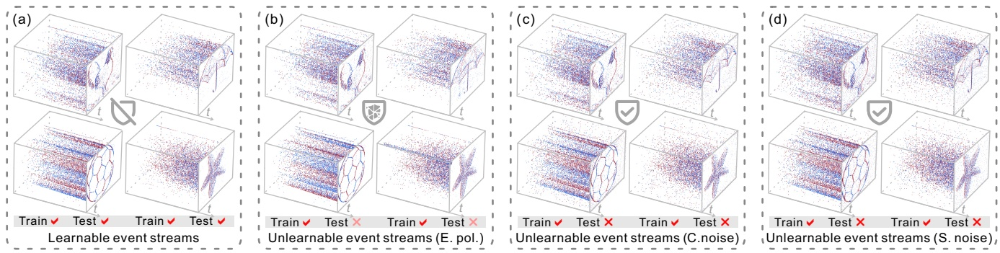
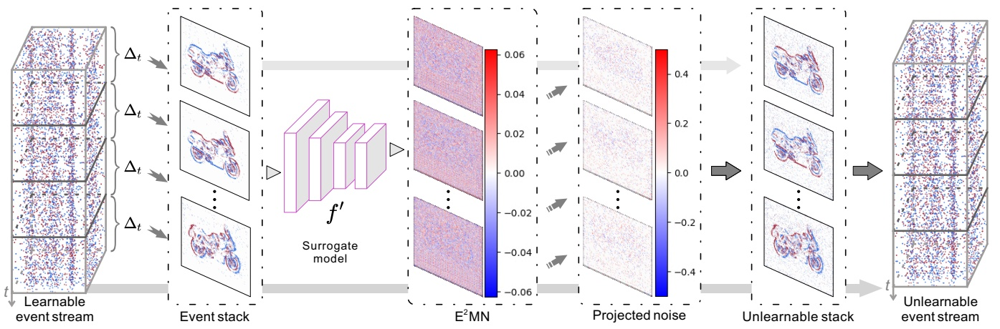
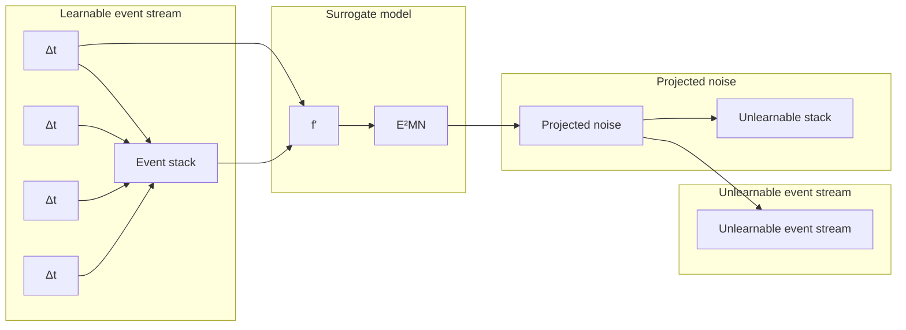
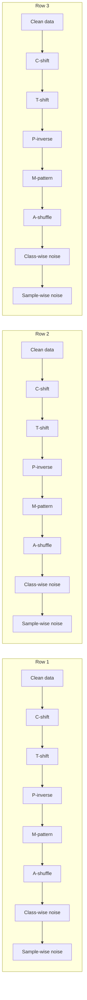
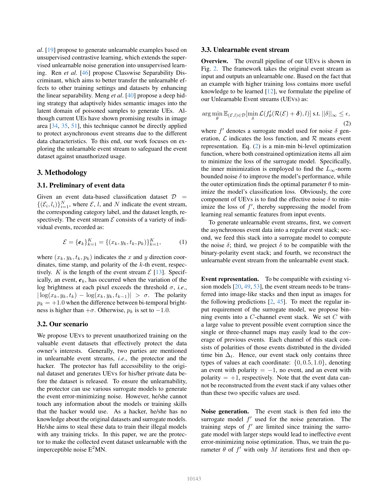
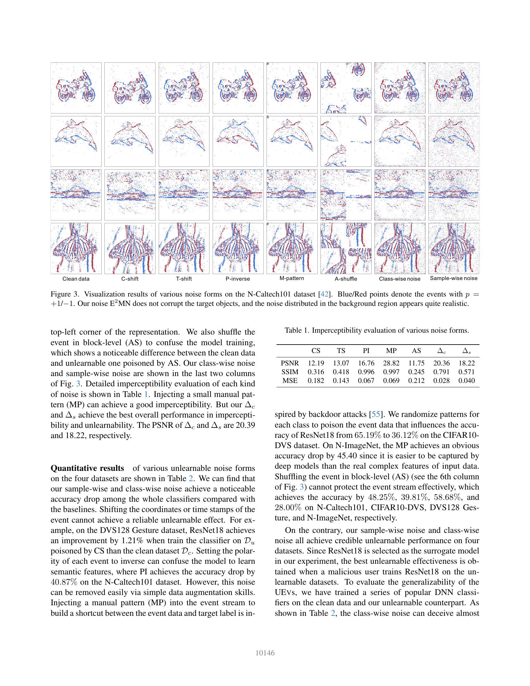

<!-- MinerU 4.0.9, tier advanced, VLM llama.cpp/Vulkan GPU; automatic extraction, tables require comparison with the PDF. -->

[PDF original](../../Asynchronous%20Event%20Error-Minimizing%20Noise%20for%20Safeguarding%20Event%20Dataset.pdf)

# Asynchronous Event Error-Minimizing Noise for Safeguarding Event Dataset

Ruofei Wang1 Peiqi Duan2,3 Boxin Shi2,3 Renjie Wan1∗

1Department of Computer Science, Hong Kong Baptist University

2State Key Laboratory of Multimedia Information Processing, School of Computer Science, Peking University
3National Engineering Research Center of Visual Technology, School of Computer Science, Peking University ruofei@life.hkbu.edu.hk, {duanqi0001, shiboxin}@pku.edu.cn, renjiewan@hkbu.edu.hk

Figura 1. Comparación entre los learnable event streams (es decir, datos limpios), los unlearnable event streams generados mediante event pollution (E. pol.) y nuestros UEVs, incluyendo class-wise noise (C. noise) y sample-wise noise (S. noise). En el caso (b), degradamos la calidad de estos event streams contaminando las coordenadas, marcas de tiempo (timestamps), polaridad y añadiendo nuevos eventos aleatorios (orden de lectura).

## Resumen

Con la creciente publicación de event datasets en línea, salvaguardar los event datasets frente al uso no autorizado se ha convertido en una seria preocupación para los propietarios de los datos. Se han propuesto los Unlearnable Examples para prevenir la explotación no autorizada de datasets de imágenes. Sin embargo, no está claro cómo crear unlearnable asynchronous event streams para prevenir el uso indebido de eventos. En este trabajo, proponemos el primer método de generación de unlearnable event streams para prevenir el entrenamiento no autorizado a partir de event datasets. Se propone una nueva forma de asynchronous event error-minimizing noise para perturbar los event streams, engañando al modelo no autorizado para que aprenda el ruido incrustado en lugar de las características realistas. Para ser compatible con los eventos dispersos (sparse events), se presenta una estrategia de proyección para dispersificar el ruido y generar nuestros unlearnable event streams (UEVs). Extensos experimentos demuestran que nuestro método protege eficazmente los datos de eventos frente a la explotación no autorizada, al tiempo que preserva su utilidad para el uso legítimo. Esperamos que nuestros UEVs contribuyan al avance del intercambio seguro y confiable de event datasets. El código está disponible en: https://github.com/rfww/uevs.

## 1. Introducción

Recientemente, la amplia disponibilidad de diversos event datasets [15, 27, 50, 54] ha acelerado significativamente el desarrollo de tareas de event vision en diversos dominios, incluyendo conducción autónoma [39], estimación de pose [24, 47], reconocimiento de lenguaje de señas [59], etc. Sin embargo, un hecho preocupante es que algunos datasets se recopilan para aplicaciones restringidas, sin permiso para un uso no autorizado [1, 50]. La falta de mecanismos de protección para los event datasets los deja susceptibles al uso indebido con fines no autorizados.

Para prevenir el uso no autorizado de datasets, se ha propuesto un concepto novedoso conocido como Unlearnable Examples (UEs) [22]. A diferencia de la contaminación de datos (data pollution), que degrada la calidad del dataset para evitar el uso indebido [58, 60], los UEs incorporan un ruido adversarial imperceptible en imágenes limpias para hacerlas inaprendibles (unlearnable) para los modelos de machine learning. Esta técnica perturba los datos de forma que interrumpe el proceso de aprendizaje de los modelos no autorizados, inutilizando eficazmente los datos para fines no autorizados. No obstante, para los usuarios autorizados, estos datos aún conservan la utilidad y apariencia originales. Por lo tanto, este enfoque no solo reduce el riesgo de uso indebido de los datos, sino que también preserva la fidelidad e integridad del dataset, planteando una vía eficaz para salvaguardar los datasets.

Aunque los UEs han logrado un gran éxito en la protección de datasets de imágenes [12, 46, 57], la forma de generar un asynchronous event dataset inaprendible y eficaz no está clara. Como se ilustra en la Fig. 1 (a), los datos de eventos comprenden una secuencia de eventos asíncronos $( i . e . , ( x , y , t , p ) )$ , donde $( x , y )$ representa las coordenadas x-y, t denota la marca de tiempo (timestamp) y p indica la polaridad. Esta característica especial genera un event stream que se asemeja a nubes de puntos espacio-temporales en lugar de a imágenes 2D convencionales [9]. Por consiguiente, resulta imposible emplear los métodos existentes de UEs para imágenes [22, 26, 57] con el fin de salvaguardar los asynchronous event datasets.

<small>∗Autor de correspondencia. Este trabajo fue llevado a cabo en Renjie Group.</small>

Debido a las características únicas de los datos de eventos, existen dos desafíos principales para lograr la funcionalidad inaprendible (unlearnable) de los datos de eventos. Primero, los datos de eventos se distinguen por su polaridad binaria: $p = \pm 1$ . Esto crea un patrón altamente discreto y distinto de las muestras de imágenes empleadas en los UEs previos. La incorporación directa de ruido basada en configuraciones previas puede disminuir la efectividad, ya que el ruido contiene valores fuera del patrón binario. Esto plantea un desafío significativo: generar un error-minimizing noise eficaz que se alinee con la naturaleza discreta de los datos de eventos. Segundo, las tareas actuales de event vision necesitan transformar los datos de eventos en un event stack para luego alimentarlo en los modelos DNN downstream. Sin embargo, estos stacks impiden que el ruido se inyecte directamente en el event stream. Por lo tanto, inyectar ruido eficazmente en el event stream presenta otro desafío significativo.

Con este propósito, proponemos el método Unlearnable Event stream (UEVs) con Event Error-Minimizing Noise $\mathrm { ( E ^ { 2 } M N ) }$ para salvaguardar los event datasets. **En primer lugar**, formulamos una función de optimización basada en eventos para generar E2MN. Específicamente, nuestro E2MN incluye dos formas: class-wise noise (Fig. 1 (c)) y sample-wise noise (Fig. 1 (d)), generándose el primero clase por clase y el segundo caso por caso. Ambas formas tienen como objetivo construir un atajo (shortcut) entre la muestra de entrada y las etiquetas objetivo para evitar que el modelo aprenda características semánticas reales. **En segundo lugar**, proponemos un mecanismo de proyección adaptativa para dispersificar el ruido generado, dando lugar a un ruido proyectado que puede ser compatible de manera fluida con los event stacks. De este modo, se reduce la probabilidad de que nuestro $\mathrm { E ^ { 2 } M N }$ sea detectado por usuarios maliciosos. **En tercer lugar**, proponemos una nueva estrategia de recuperación para reconstruir el event stream a partir de su correspondiente representación. Esta estrategia garantiza que $\mathrm { E ^ { 2 } M N }$ se transfiera eficazmente desde los unlearnable event stacks hacia los unlearnable event streams.

Nuestras principales contribuciones son las siguientes:

• Presentamos el primer método de Unlearnable Event stream (UEVs) con un event error-minimizing noise $( \mathrm { E } ^ { 2 } \mathrm { M N } )$ para prevenir el uso no autorizado de valiosos event datasets.
• Proponemos un mecanismo de proyección adaptativa para dispersificar el ruido $\mathrm { E ^ { 2 } M N }$ , permitiendo que el ruido sea compatible con el event stack original. Posteriormente, se introduce una estrategia de recuperación para reconstruir el unlearnable event stream a partir de su correspondiente event stack.

• Llevamos a cabo extensos experimentos para demostrar que nuestro $\mathrm { E ^ { 2 } M N }$ supera diversas operaciones de event pollution (Fig. 1 (b)) en términos de efectividad, imperceptibilidad y robustez.

## 2. Trabajos relacionados

## 2.1. Event vision

Event vision [8, 10, 37] ha ganado una creciente popularidad recientemente debido a las ventajas aportadas por los datos de eventos [25, 33], los cuales consisten en una serie de eventos asíncronos que registran la variación de brillo a nivel de píxel [13]. En comparación con las imágenes convencionales, los datos de eventos exhiben ventajas en términos de alto rango dinámico y resolución temporal, baja latencia temporal y bajo consumo de energía [14, 50]. La amplia y diversa disponibilidad de event datasets [1, 15, 27, 31, 42] ha sido crucial para la creciente atención hacia diversas tareas de event vision. Los investigadores pueden garantizar sin esfuerzo que sus datos de eventos sean compatibles con los modelos visuales profundos actuales utilizando métodos existentes de event representation [14, 23, 30], facilitando así eficazmente diversas exploraciones en el aprendizaje basado en eventos. Millerdurai et al. [41] proponen el uso de una event camera monocromática egocéntrica para la captura de movimiento humano 3D, lo que aborda el fallo de las cámaras RGB bajo baja iluminación y movimientos rápidos. Sun et al. [52] proponen un método de unsupervised domain adaptation para la segmentación semántica en datos de eventos, el cual motiva al segmentador a aprender información semántica a partir de imágenes etiquetadas hacia eventos no etiquetados. Asimismo, los estudios basados en eventos logran desempeños satisfactorios en estimación de pose [24], segmentación [5], deblurring [3, 28], denoising [9], flujo óptico [32], reconocimiento de objetos [61], seguimiento de objetos [56], monitoreo [18], etc.

A pesar del notable interés y del rendimiento prometedor del aprendizaje basado en eventos en diversos dominios, no han existido investigaciones orientadas a prevenir la explotación no autorizada de event datasets. La ausencia de esta exploración podría provocar el robo de valiosos event datasets con fines ilegales, representando una seria amenaza.

## 2.2. Unlearnable examples

Los Unlearnable Examples (UEs) se proponen para prevenir el entrenamiento no autorizado de Deep Neural Networks (DNNs) sobre datasets privados o protegidos [22, 48]. Por lo general, los UEs se generan mediante un esquema de optimización binivel min-min con un surrogate model [22]. El ruido generado se denomina Error-Minimizing Noise (EMN) debido a que reduce gradualmente las pérdidas en los datos de entrenamiento. Este ruido busca engañar al modelo objetivo haciéndole creer que es posible realizar predicciones correctas basándose únicamente en perturbaciones, lo que conduce a pasar por alto las características semánticas [22, 46]. Con el fin de mejorar la robustez de los UEs convencionales (vanilla UEs), Fu et al. [12] introducen ruido adversarial en el EMN frente al adversarial training. He et al. [19] proponen generar unlearnable examples basados en contrastive learning no supervisado, extendiendo la generación supervisada de ruido inaprendible al aprendizaje no supervisado. Ren et al. [46] proponen Classwise Separability Discriminant, cuyo objetivo es transferir mejor los efectos unlearnable a otras configuraciones de entrenamiento y datasets mediante la mejora de la separabilidad lineal. Meng et al. [40] proponen una estrategia de deep hiding que oculta de forma adaptativa imágenes semánticas en el dominio latente de muestras envenenadas para generar UEs. Aunque los UEs actuales han mostrado resultados prometedores en el área de imágenes [34, 35, 51], esta técnica no puede aplicarse directamente para proteger asynchronous event streams debido a las diferentes características de los datos. Con este fin, nuestro trabajo se enfoca en explorar los unlearnable event streams para salvaguardar los event datasets frente al uso no autorizado.

## 3. Metodología

## 3.1. Preliminares de los datos de eventos

Dado un dataset de clasificación basado en datos de eventos $egin{array} { r l } { \mathcal { D } } & { { } = } \end{array}$ $\{ ( \mathcal { E } _ { i } , l _ { i } ) \} _ { i = 1 } ^ { N } ,$ donde $\mathcal { E } , l ,$ y N indican el event stream, la correspondiente etiqueta de categoría y la longitud del dataset, respectivamente. El event stream $\mathcal { E }$ consta de una variedad de eventos individuales, registrados como:

$$
\mathcal {E} = \left\{oldsymbol {e} _ {k} 
ight\} _ {k = 1} ^ {K} = \left\{\left(x _ {k}, y _ {k}, t _ {k}, p _ {k}
ight) 
ight\} _ {k = 1} ^ {K}, 	ag {1}
$$

donde $( x _ { k } , y _ { k } , t _ { k } , p _ { k } )$ indica las coordenadas en dirección x e $y$ , la marca de tiempo (timestamp) y la polaridad del k-ésimo evento, respectivamente. $K$ es la longitud del event stream E [13]. Específicamente, un evento, $e _ { k } ,$ ocurre cuando la variación del logaritmo del brillo en cada píxel excede el umbral $\sigma ,   i . e .$ $| \operatorname { l o g } ( x _ { k } , y _ { k } , t _ { k } ) { - } \operatorname { l o g } ( x _ { k } , y _ { k } , t _ { k - 1 } ) | > \sigma$ . La polaridad $p _ { k } = + 1 . 0$ cuando la diferencia de brillo bitemporal es superior a $+ \sigma$ . En caso contrario, $p _ { k }$ se establece en −1.0.

## 3.2. Nuestro escenario

Proponemos UEVs para prevenir el entrenamiento no autorizado sobre valiosos event datasets, protegiendo eficazmente los intereses de los propietarios de los datos. Por lo general, intervienen dos partes en los unlearnable event streams, $i . e .$ , el protector y el atacante (hacker). El protector tiene acceso completo al dataset original y genera UEVs para sus datos privados antes de que el dataset sea publicado. Para garantizar la inaprendibilidad (unlearnability), el protector puede utilizar diversos surrogate models para generar el event error-minimizing noise. Sin embargo, no puede acceder a ninguna información sobre los modelos o las técnicas de entrenamiento que utilizaría el atacante. Por su parte, el atacante no posee conocimiento sobre los datasets originales ni sobre los surrogate models; su objetivo es sustraer estos datos para entrenar sus modelos ilícitos mediante cualquier técnica de entrenamiento. En este artículo, asumimos el rol del protector para hacer que el event dataset recopilado sea unlearnable mediante el ruido imperceptible $\mathrm { E ^ { 2 } M N . }$

## 3.3. Unlearnable event stream

**Descripción general.** El pipeline general de nuestros UEVs se muestra en la Fig. 2. El framework toma el event stream original como entrada y genera uno unlearnable como salida. Basándonos en el hecho de que un ejemplo con una mayor training loss contiene más conocimiento útil para ser aprendido [12], formulamos el pipeline de nuestros Unlearnable Event streams (UEVs) como:

$$
rg \min _ {	heta} \mathbb {E} _ {(\mathcal {E}, l) \in \mathcal {D}} \left[ \min _ {\delta} \mathcal {L} \left(f _ {	heta} ^ {\prime} (\mathcal {R} (\mathcal {E}) + oldsymbol {\delta}), l
ight) 
ight] 	ext {s.t.} | | \delta | | _ {\infty} \leq \epsilon , 	ag {2}
$$

donde $f ^ { \prime }$ denota un surrogate model utilizado para la generación del ruido $\delta$ , L indica la loss function y R representa la event representation. La Ec. (2) es una función de optimización binivel min-min, donde ambos términos de optimización restringida tienen como objetivo común minimizar la pérdida del surrogate model. Específicamente, la minimización interna se emplea para encontrar el ruido δ acotado por la norma $L _ { \infty }$ con el fin de mejorar el rendimiento del modelo, mientras que la optimización externa halla el parámetro óptimo θ para minimizar la pérdida de clasificación del modelo. Es evidente que el componente central de UEVs consiste en hallar el ruido eficaz δ para minimizar la pérdida de $f ^ { \prime } ,$ suprimiendo así el aprendizaje de características semánticas reales a partir de los eventos de entrada por parte del modelo.

Para generar unlearnable event streams, en primer lugar, convertimos los datos de eventos asíncronos en un event stack regular; en segundo lugar, introducimos este stack en un surrogate model para calcular el ruido $\delta ;$ en tercer lugar, proyectamos δ para que sea compatible con el event stack de polaridad binaria; y en cuarto lugar, reconstruimos el unlearnable event stream a partir del unlearnable event stack.

**Representación de eventos (Event representation).** Para ser compatible con los modelos visuales existentes [20, 49, 53], el event stream debe transformarse en stacks similares a imágenes para luego ingresarse como imágenes para las predicciones subsiguientes [2, 45]. Para satisfacer el requisito de entrada regular del surrogate model, proponemos agrupar los eventos en bins dentro de un event stack de C canales. Asignamos a C un valor elevado para evitar una posible corrupción de eventos, ya que los mapas de uno o tres canales pueden provocar fácilmente la sobreescritura de eventos previos. Cada canal de este stack consta de las polaridades de aquellos eventos distribuidos en el bin temporal dividido $\Delta _ { t }$ . Por lo tanto, nuestro event stack contiene únicamente tres tipos de valores en cada coordenada: {0, 0.5, 1.0}, que denotan un evento con polaridad = −1, ningún evento, y un evento con polaridad = +1, respectivamente. Nótese que los datos de eventos no pueden reconstruirse a partir del event stack si se utilizan valores distintos a estos dos valores específicos.

**Generación de ruido (Noise generation).** El event stack se alimenta a continuación en el surrogate model $f ^ { \prime }$ empleado para la generación de ruido. Los pasos de entrenamiento de $f ^ { \prime }$ están limitados, ya que entrenar el surrogate model con una mayor cantidad de pasos conduciría a una optimización ineficaz del event error-minimizing noise. Por consiguiente, entrenamos primero el parámetro $	heta$ de $f ^ { \prime }$ con solo M iteraciones y luego optimizamos $\delta$ en todo $\mathcal { D } _ { c }$ . Todo este proceso de optimización binivel (Ec. (2)) concluye una vez que la classification accuracy es superior a γ. En esencia, el event error-minimizing noise generado es una clase de característica fácil de aprender $( i . e .$ , el shortcut entre las muestras de entrada y las etiquetas objetivo) que guía al modelo entrenado sobre E MN para que ignore su semántica real. Nuestro event error-minimizing noise consta de dos tipos:

flowchart

Figura 2. Framework de nuestros UEVs. UEVs convierte un event stream en un event stack de C canales $( t = C 	imes \Delta _ { t } )$ y luego emplea un surrogate model $f ^ { \prime }$ para generar el event error-minimizing noise (E2MN). Posteriormente, el E2MN se proyecta en $\{ - 0 . 5 , 0 , 0 . 5 \}$ y se integra con el event stack objetivo para generar el unlearnable event stack. El unlearnable event stream final puede reconstruirse a partir del unlearnable event stack y del event stream original mediante la estrategia de recuperación propuesta.

• **Sample-wise noise.** El sample-wise noise $\Delta _ { s }$ se obtiene mediante el método de optimización de primer orden PGD [38] de la siguiente manera:

$$
\hat {oldsymbol {\mathcal {E}}} _ {s + 1} ^ {\prime} = \Pi_ {\epsilon} ig (\hat {oldsymbol {\mathcal {E}}} _ {s} ^ {\prime} - lpha \cdot \mathrm{sign} (
abla_ {\hat {oldsymbol {\mathcal {E}}}} \mathcal {L} (f ^ {\prime} (\hat {oldsymbol {\mathcal {E}}} _ {s} ^ {\prime}), l)) ig), 	ag {3}
$$

donde ${ \hat { \pmb { \mathscr { E } } } } \; = \; { \mathscr { R } } ( { \mathscr { E } } )$ indica el event stack, s denota el paso de perturbación actual, $
abla _ { \pmb { \hat { \mathcal { E } } } } \mathcal { L } ( f ( \pmb { \hat { \mathcal { E } } } _ { s } ^ { \prime } ) , l )$ es el gradiente de la pérdida con respecto a $\hat { \mathcal { E } } ,$ Πϵ es una función de proyección que recorta (clips) el event stack perturbado de regreso a la bola ϵ alrededor del event stack $\hat { arepsilon }$ cuando este la sobrepasa, y α es el step size. $\mathcal { L }$ es la loss function de entropía cruzada (cross entropy). El event error-minimizing noise generado se obtiene mediante: $\delta _ { i } = \hat { \mathcal { E } } _ { i } ^ { ' } - \hat { \mathcal { E } } _ { i }$ y se calcula caso por caso para obtener $\Delta _ { s } = \{ \pmb { \delta } _ { 1 } , \pmb { \delta } _ { 2 } , \cdots , \pmb { \delta } _ { N } \}$ . La salida $\hat { arepsilon } ^ { \prime }$ no es nuestro unlearnable event stack final, ya que no exhibe la característica de polaridad binaria, la cual resulta crucial para la reconstrucción de eventos inaprendibles. Necesitamos proyectar este ruido en un patrón disperso que sea compatible con el event stack original para generar nuestros unlearnable event streams.

• **Class-wise noise.** Dado que el sample-wise noise depende de cada evento de entrada, el consumo de memoria aumentaría drásticamente a medida que crece la escala del dataset. Por lo tanto, introducimos el class-wise noise: $\Delta _ { c } = \{ \delta _ { l _ { 1 } } , \delta _ { l _ { 2 } } \cdots , \delta _ { l _ { N } } \}$ , el cual aplica el mismo ruido a diferentes eventos dentro de la misma clase. Para $\Delta _ { c } ,$ inicializamos primero el ruido a nivel de clase y luego empleamos la Ec. (3) para optimizar el ruido $\delta _ { l }$ con todos los event streams muestreados de la clase l. El class-wise noise presenta ventajas sobre el sample-wise noise en términos de practicidad y eficiencia. Puede aplicarse fácilmente a event streams recién capturados y posee una escala de ruido menor. Al igual que el sample-wise noise, el class-wise noise no puede utilizarse directamente para generar unlearnable event streams, requiriendo también ser proyectado en una forma dispersa para la generación de UEVs.

**Proyección de ruido (Noise projection).** Como se demostró en la Sec. 3.1, el event stream consta únicamente de polaridades de −1 y +1, las cuales se normalizan a 0 y 1 en el event stack, respectivamente. Por consiguiente, necesitamos proyectar el event error-minimizing noise generado en un patrón disperso y compatible con eventos para facilitar la generación subsiguiente de unlearnable event streams. Aquí, proponemos proyectar el ruido generado en $\{ - 0 . 5 , 0 . 0 , + 0 . 5 \}$ de la siguiente forma:

$$
\mathbf {P} (\delta) = \left\{ egin{array}{l l} - 0. 5, & 	ext {if} \delta_ {i, j} < \mu - 	au 	imes \pi , \ 0. 0, & 	ext {if} \mu - 	au 	imes \pi \leq \delta_ {i, j} \leq \mu + 	au 	imes \pi , \ + 0. 5, & 	ext {if} \delta_ {i, j} > \mu + 	au 	imes \pi , \end{array} 
ight. 	ag {4}
$$

donde $\mu$ y π denotan la media y la mitad del límite (1/2 bound) del ruido $\delta ,$ y τ es un parámetro de ponderación.

τ ejerce una gran influencia en dos criterios de nuestros UEVs, $i . e .$ , la efectividad y la imperceptibilidad. Efectividad significa que el ruido proyectado aún conserva la funcionalidad unlearnable para los event streams. Imperceptibilidad denota que el ruido inyectado es imperceptible para los usuarios. Un mayor τ favorece una mejor imperceptibilidad, pero perjudica la efectividad. Para garantizar la efectividad del ruido proyectado, forzamos al surrogate model a discriminar entre las características unlearnable y las características limpias durante el entrenamiento del modelo. De este modo, el modelo puede generar un atajo (shortcut) sólido durante la optimización del ruido, impidiendo que el modelo aprenda características semánticas reales. Reformulamos la loss function de la optimización externa en la Ec. (2) como:

$$
\mathcal {L} ^ {*} = \lambda_ {1} \mathcal {L} + \lambda_ {2} \mathcal {L} _ {s}. 	ag {5}
$$

$\mathcal { L } _ { s }$ es la similarity loss cuyo objetivo es ampliar la diferencia entre las características limpias y las inaprendibles.

**Reconstrucción de eventos (Event reconstruction).** Tras obtener el event error-minimizing noise proyectado, incorporamos este ruido en $\hat { \mathcal { E } }$ para generar su contraparte unlearnable. Cabe destacar que lo que obtenemos aquí es únicamente el unlearnable event stack. Necesitamos reconstruir el unlearnable event stream a partir de este stack. Por tanto, se propone una estrategia de recuperación para restablecer la información temporal densa comprimida durante la conversión de los datos de eventos en event stacks. Para un evento dentro del unlearnable event stack $\hat { \mathcal { E } } ,$ **1)** si está registrado en el event stream original E, se busca la marca de tiempo t en $\mathcal { E }$ para asignarla directamente; **2)** si se trata de un evento recién generado, se inicializa una nueva marca de tiempo adaptativa basada en el $\Delta _ { t }$ seleccionado para asignarla. Con base en esta estrategia, los eventos unlearnable generados pueden transferirse desde los unlearnable event stacks hacia los event streams, como se muestra en la Fig. 1. El pipeline general de nuestros UEVs se ilustra en el Algoritmo 1. $\mathcal { R } ( \cdot )$ y $\mathcal { R } ^ { \prime } ( \cdot )$ denotan la event representation y la event reconstruction, respectivamente.

## 3.4. Detalles de implementación

Siguiendo a [22], empleamos ResNet18 [20] como el surrogate model. Se utiliza el optimizador SGD con un learning rate de $1 0 ^ { - 4 }$ y un momentum de 0.9. Se emplea un programador de tasa de aprendizaje exponencial (exponential learning rate scheduler) con un gamma de 0.9. El número de iteraciones M y el número de epochs se establecen en 10 y 30, respectivamente. El batch size es de 16. El valor de C en el event stack se fija en 16. En la generación de ruido, el número de pasos S, el parámetro ϵ y el step size α son 10, 0.5 y 0.8/255, respectivamente. La relación de ponderación τ es $3 / 4$ . La accuracy γ es 0.99. Entrenamos todos los modelos en una única GPU NVIDIA V100.

## 4. Experimentos

## 4.1. Configuración experimental

**Dataset.** En nuestros experimentos se utilizan cuatro datasets basados en eventos, incluidos N-Caltech101 [42], CIFAR10-DVS [31], DVS128 Gesture [1] y N-ImageNet [27]. Debido a los recursos de cómputo limitados, se muestrean las primeras 10 clases de N-ImageNet [27] para los experimentos. La información detallada se muestra en la Tabla 6 del Material Suplementario.

**Líneas base (Baselines).** Para evaluar la efectividad, implementamos diversas operaciones de event pollution (véase la Fig. 1 (b)) como nuestras líneas base, incluyendo desplazamiento de coordenadas (coordinate shifting, CS), desplazamiento de marcas de tiempo (time stamp shifting, TS), inversión de polaridad (polarity inversion, PI), inyección manual de patrones (manual pattern injection, MP) y reorganización de áreas (area shuffling, AS).

Algoritmo 1: UEVs Perturbation Algorithm.

Entrada: Surrogate model $f'_{	heta}(\cdot)$, clean dataset $\mathcal{D}_c$, optimization number $M$, accuracy $\gamma$.
Salida: Perturbación $\delta$, Unlearnable dataset $\mathcal{D}_u$.
$\delta \leftarrow randomization$;
Do
    for $i$ in range($M$) do
        $(\mathcal{E}, l) = Next(\mathcal{D}_c)$;
        $	heta \leftarrow 	heta - 
abla_{	heta}(\mathcal{L}^*(f'_{	heta}(\mathcal{R}(\mathcal{E}) + [\delta_i / \delta_{l_i}]), l))$
        $	riangleright$ Sample-wise o class-wise noise: $\delta_i / \delta_{l_i}$
    end
    for $(\mathcal{E}, l)$ in $\mathcal{D}_c$ do
        $\delta = \mathbb{P}(\mathcal{E}, l, f', \delta, 	heta)$;
        $	riangleright$ Perturbado mediante la Ec. (3)
        $Clip(\delta, -\epsilon, +\epsilon)$;
    end
    $acc = evaluation(\mathcal{D}_c, f', \delta, 	heta)$;
Until $acc$ mayor que $\gamma$;
for $(\mathcal{E}_j, l_j)$ in $\mathcal{D}_c$ do
    $\delta' = \mathbf{P}(\delta \leftarrow [\delta_j 	ext{ or } \delta_{l_j}])$; $	riangleright$ Ec. (4)
    $\mathcal{E}' = \mathcal{R}'ig(	ext{Clip}(\mathcal{R}(\mathcal{E}_j) + \delta', 0, 1)ig)$;
    $\mathcal{D}_u.append((\mathcal{E}'_j, l_j))$; $	riangleright$ Evento unlearnable
end

Para evaluar la generalizabilidad de UEVs, introducimos ResNet18 (RN18) [20], ResNet50 (RN50) [20], VGG16 (VG16) [49], DenseNet121 (DN121) [21], EfficientNet-B1 (EN-B1) [53], ViTB [7] y SwinB [36] como baselines en nuestro experimento.

**Métricas.** Siguiendo el método de UEs existente [22], utilizamos la test accuracy para evaluar la capacidad de protección de datos del método propuesto. Cuanto menor sea la test accuracy, mayor será la capacidad de protección. Para evaluar la imperceptibilidad del ruido generado, empleamos PSNR, SSIM y MSE para medir la percepción visual en el event stack [9].

## 4.2. Evaluación

**Comparación visual** de las diversas formas de ruido mencionadas anteriormente se muestra en la Fig. 3. Implementamos cinco tipos de operaciones de distorsión de eventos como baselines para evaluar nuestros UEVs. El desplazamiento de coordenadas (CS) únicamente introduce un desfase en las direcciones x e y sin añadir ningún ruido adicional, como se muestra en la 2.ª columna. Retrasamos las marcas de tiempo de cada evento en un bin temporal fijo para implementar TS, lo que demuestra la introducción de algunos eventos nuevos en las representaciones actuales. Invertir la polaridad de todos los eventos (PI) es otra forma de ruido que muestra una diferencia notable entre los datos limpios y su contraparte unlearnable en la 4.ª columna. MP se implementa inyectando event streams especiales de forma manual, lo que exhibe un patrón evidente en la esquina superior izquierda de la representación. Asimismo, reorganizamos los eventos a nivel de bloque (AS) para confundir el entrenamiento del modelo, lo cual muestra una diferencia notable entre los datos limpios y la versión inaprendible envenenada mediante AS. Nuestro class-wise noise y sample-wise noise se muestran en las dos últimas columnas de la Fig. 3. La evaluación detallada de la imperceptibilidad de cada tipo de ruido se presenta en la Tabla 1. La inyección de un patrón manual pequeño (MP) puede lograr una buena imperceptibilidad. Sin embargo, nuestros $\Delta _ { c }$ y $\Delta _ { s }$ logran el mejor desempeño global en imperceptibilidad e inaprendibilidad. El PSNR de $\Delta _ { c }$ y $\Delta _ { s }$ es de 20.39 y 18.22, respectivamente.

flowchart

Figura 3. Resultados de visualización de diversas formas de ruido en el dataset N-Caltech101 [42]. Los puntos azules/rojos denotan eventos con $p =$ +1/−1. Nuestro ruido E2MN no corrompe los objetos objetivo, y el ruido distribuido en la región de fondo parece bastante realista.

**Resultados cuantitativos** de diversas formas de ruido unlearnable en los cuatro datasets se presentan en la Tabla 2. Se puede observar que nuestro sample-wise y class-wise noise logran una disminución notable de accuracy en todos los clasificadores en comparación con las líneas base. Desplazar las coordenadas o las marcas de tiempo del evento no logra un efecto unlearnable confiable. Por ejemplo, en el dataset DVS128 Gesture, ResNet18 logra una mejora del 1.21% cuando se entrena el clasificador sobre $\mathcal { D } _ { u }$ envenenado mediante CS en comparación con el dataset limpio $\mathcal { D } _ { c }$ . Invertir la polaridad de cada evento puede confundir al modelo para que no aprenda características semánticas; en este caso, PI logra una caída de accuracy del 40.87% en el dataset N-Caltech101. Sin embargo, este ruido puede eliminarse fácilmente mediante técnicas simples de data augmentation. Inyectar un patrón manual (MP) en el event stream para construir un atajo (shortcut) entre los datos de eventos y la etiqueta objetivo se inspira en los backdoor attacks [55]. Aleatorizamos patrones para cada clase con el fin de envenenar los datos de eventos, lo cual reduce la accuracy de ResNet18 del 65.19% al 36.12% en el dataset CIFAR10-DVS. En N-ImageNet, MP logra una caída evidente de accuracy de 45.40 puntos, dado que los modelos profundos lo capturan con mayor facilidad que las características complejas reales de los datos de entrada. Reorganizar los eventos a nivel de bloque (AS) (véase la 6.ª columna de la Fig. 3) no logra proteger el event stream de manera eficaz, alcanzando una accuracy de 48.25%, 39.81%, 58.68% y 28.00% en N-Caltech101, CIFAR10-DVS, DVS128 Gesture y N-ImageNet, respectivamente.

Tabla 1. Evaluación de imperceptibilidad de diversas formas de ruido.

|  | CS | TS | PI | MP | AS | $\Delta_c$ | $\Delta_s$ |
| --- | --- | --- | --- | --- | --- | --- | --- | --- |
| PSNR | 12.19 | 13.07 | 16.76 | 28.82 | 11.75 | 20.36 | 18.22 |
| SSIM | 0.316 | 0.418 | 0.996 | 0.997 | 0.245 | 0.791 | 0.571 |
| MSE | 0.182 | 0.143 | 0.067 | 0.069 | 0.212 | 0.028 | 0.040 |

Por el contrario, nuestro sample-wise noise y class-wise noise logran un rendimiento inaprendible creíble en los cuatro datasets. Dado que ResNet18 se selecciona como el surrogate model en nuestro experimento, la mayor efectividad unlearnable se obtiene cuando un usuario malicioso entrena ResNet18 en los datasets unlearnable. Para evaluar la generalizabilidad de UEVs, hemos entrenado una serie de clasificadores DNN populares tanto en los datos limpios como en nuestra contraparte inaprendible. Como se muestra en la Tabla 2, el class-wise noise puede engañar a casi todos los clasificadores para que aprendan atajos en N-Caltech101, donde la accuracy de estos clasificadores es inferior al 5%, a excepción de EfficientNet-B1. Además, también logra una considerable caída de accuracy superior al 35% tanto en CIFAR10-DVS como en DVS128 Gesture. En cuanto al sample-wise noise, cada dato posee un ruido de bajo error diferente, el cual reduce la pérdida durante el proceso de optimización del modelo, haciendo que los datos de eventos sean inaprendibles. En la Tabla 2, el sample-wise noise $\Delta _ { s }$ logra la mayor caída de accuracy con 77.60%, 57.87% y 66.67% en los respectivos datasets.

Tabla 2. Testing accuracy (%) de varios clasificadores DNN entrenados en los conjuntos de entrenamiento limpios $( \mathcal { D } _ { c } )$ y en sus versiones unlearnable $( \mathcal { D } _ { u } )$ generadas mediante cinco tipos de event pollutions, sample-wise noise $( \Delta _ { s } )$ y class-wise noise $( \Delta _ { c } )$.

<table><tr><td rowspan="2">Noise Form</td><td rowspan="2">Model</td><td colspan="2">N-Caltech101</td><td colspan="2">CIFAR10-DVS</td><td colspan="2">DVS128 Gesture</td><td colspan="2">N-ImageNet</td></tr><tr><td> $\mathcal{D}_c$ </td><td> $\mathcal{D}_u$ </td><td> $\mathcal{D}_c$ </td><td> $\mathcal{D}_u$ </td><td> $\mathcal{D}_c$ </td><td> $\mathcal{D}_u$ </td><td> $\mathcal{D}_c$ </td><td> $\mathcal{D}_u$ </td></tr><tr><td>CS</td><td rowspan="5">Res18</td><td rowspan="5">78.32</td><td>50.43(-27.79)</td><td rowspan="5">65.19</td><td>46.80(-18.39)</td><td rowspan="5">74.14</td><td>75.35(+01.21)</td><td rowspan="5">56.60</td><td>42.60(-14.00)</td></tr><tr><td>TS</td><td>37.54(-40.87)</td><td>35.34(-29.85)</td><td>72.92(-01.22)</td><td>41.20(-15.40)</td></tr><tr><td>PI</td><td>40.78(-37.45)</td><td>22.72(-42.47)</td><td>31.94(-42.20)</td><td>41.80(-4.80)</td></tr><tr><td>MP</td><td>50.26(-28.06)</td><td>36.12(-29.07)</td><td>68.06(-06.08)</td><td>11.20(-45.40)</td></tr><tr><td>AS</td><td>48.25(-30.07)</td><td>39.81(-25.38)</td><td>58.68(-15.46)</td><td>28.00(-28.00)</td></tr><tr><td rowspan="7"> $\Delta_c$ </td><td>RN18</td><td>78.52</td><td>01.90(-76.62)</td><td>65.22</td><td>22.33(-42.89)</td><td>74.31</td><td>14.93(-59.38)</td><td>56.80</td><td>10.00(-46.80)</td></tr><tr><td>RN50</td><td>80.64</td><td>04.88(-75.76)</td><td>67.67</td><td>18.83(-48.84)</td><td>78.47</td><td>24.31(-54.16)</td><td>61.60</td><td>10.00(-51.60)</td></tr><tr><td>VG16</td><td>71.63</td><td>03.68(-67.95)</td><td>67.77</td><td>30.19(-37.58)</td><td>81.94</td><td>20.49(-61.45)</td><td>56.20</td><td>04.00(-52.20)</td></tr><tr><td>DN121</td><td>75.59</td><td>02.18(-73.31)</td><td>62.72</td><td>24.37(-38.35)</td><td>74.31</td><td>22.22(-52.09)</td><td>59.20</td><td>08.80(-50.40)</td></tr><tr><td>EN-B1</td><td>74.44</td><td>12.81(-61.63)</td><td>72.72</td><td>23.50(-49.22)</td><td>62.50</td><td>19.10(-43.40)</td><td>56.20</td><td>06.20(-50.00)</td></tr><tr><td> $ViT_B$ </td><td>44.69</td><td>01.55(-43.14)</td><td>45.44</td><td>09.51(-35.93)</td><td>66.67</td><td>26.74(-39.93)</td><td>41.00</td><td>10.00(-31.00)</td></tr><tr><td> $Swin_B$ </td><td>90.70</td><td>00.52(-90.18)</td><td>75.24</td><td>29.03(-46.21)</td><td>83.29</td><td>28.12(-55.17)</td><td>72.00</td><td>10.00(-62.00)</td></tr><tr><td rowspan="7"> $\Delta_s$ </td><td>RN18</td><td>78.12</td><td>00.52(-77.60)</td><td>65.15</td><td>15.51(-49.64)</td><td>73.96</td><td>14.54(-59.42)</td><td>56.40</td><td>10.20(-46.20)</td></tr><tr><td>RN50</td><td>80.30</td><td>06.09(-74.21)</td><td>67.86</td><td>12.62(-55.24)</td><td>79.17</td><td>20.03(-59.14)</td><td>61.20</td><td>16.80(-44.40)</td></tr><tr><td>VG16</td><td>72.03</td><td>14.13(-57.90)</td><td>67.18</td><td>27.86(-39.32)</td><td>81.94</td><td>26.39(-55.55)</td><td>55.40</td><td>14.80(-40.60)</td></tr><tr><td>DN121</td><td>75.30</td><td>11.49(-63.85)</td><td>64.27</td><td>15.73(-48.54)</td><td>74.31</td><td>20.83(-53.48)</td><td>59.20</td><td>11.40(-47.80)</td></tr><tr><td>EN-B1</td><td>73.81</td><td>17.98(-55.83)</td><td>72.82</td><td>14.95(-57.87)</td><td>64.93</td><td>16.32(-48.61)</td><td>55.60</td><td>11.40(-44.20)</td></tr><tr><td> $ViT_B$ </td><td>44.73</td><td>01.09(-43.64)</td><td>47.38</td><td>26.02(-21.36)</td><td>67.01</td><td>30.21(-36.80)</td><td>40.40</td><td>08.80(-31.60)</td></tr><tr><td> $Swin_B$ </td><td>90.70</td><td>21.14(-69.56)</td><td>75.44</td><td>27.18(-48.26)</td><td>83.68</td><td>17.01(-66.67)</td><td>71.20</td><td>09.00(-62.20)</td></tr></table>

## 4.3. Estudio de ablación

**Similarity loss.** Para garantizar que el event error-minimizing noise pueda seguir impidiendo el aprendizaje del modelo después de ser proyectado, introducimos la similarity loss para ampliar la distancia entre los stacks limpios y los inaprendibles durante el entrenamiento del surrogate model. Los resultados detallados se muestran en la Tabla 3. En comparación con **E1** en la Tabla 3, la efectividad de nuestro sample-wise noise (**E2**) disminuye cuando eliminamos la similarity loss. Minimizar la similitud entre los stacks limpios y los inaprendibles tiene como fin incrementar la diferencia entre el atajo (shortcut) y las características semánticas reales de las muestras de entrada bajo una clasificación correcta, evitando un posible aprendizaje de características. Como se muestra en la Fig. 4, esta supervisión por similitud es crucial para asegurar la inaprendibilidad de nuestros UEVs debido a la gran diferencia entre el ruido original y el ruido proyectado.

**Ruido mixto (Mixed noise).** En el experimento principal, realizamos exploraciones sobre el sample-wise noise y el class-wise noise por separado. Según los resultados detallados, podemos observar que los ruidos sample-wise y class-wise logran el mejor rendimiento en diferentes datasets entre varios clasificadores. Aquí, proponemos una contraparte mixta para evaluar la efectividad de nuestros UEVs, lo cual resulta beneficioso para una utilización personalizada y para prevenir la exposición del ruido. Dado que es difícil optimizar estos dos tipos de ruido de manera simultánea, combinamos los dos ruidos obtenidos como la contraparte mixta en lugar de entrenarla desde cero. Específicamente, diseñamos dos modalidades para generar el ruido mixto. Primero, seleccionamos aleatoriamente δ de $\Delta _ { c }$ y $\Delta _ { s }$ para envenenar la muestra de entrada, denotado como $\Delta _ { c } ee \Delta _ { u } .$ . Segundo, empleamos la suma elemento a elemento para generar los unlearnable examples, denominado $\Delta _ { c } + \Delta _ { u }$ .

Tabla 3. Resultados de los experimentos de ablación para UEVs (sample-wise noise) en el dataset N-Caltech101.

|  | RN18 | RN50 | VG16 | DN121 | EN-B1 | $ViT_B$ | $Swin_B$ |
| --- | --- | --- | --- | --- | --- | --- | --- | --- |
| E1 | 0.52 | 6.09 | 14.13 | 11.49 | 17.98 | 1.09 | 21.14 |
| E2 | 3.85 | 15.22 | 38.31 | 10.17 | 24.18 | 37.51 | 27.51 |
| E3 | 5.17 | 5.40 | 22.23 | 6.15 | 18.78 | 1.21 | 16.66 |
| E4 | 5.34 | 5.17 | 8.16 | 5.17 | 5.86 | 1.03 | 0.57 |
| E5 | 13.04 | 8.04 | 14.99 | 10.74 | 16.54 | 9.88 | 25.73 |
| E6 | 27.74 | 33.08 | 44.28 | 34.92 | 27.17 | 8.85 | 24.41 |

Como se muestra en la Tabla 3, **E3** y **E4** representan $\Delta _ { c } ee \Delta _ { v }$ y $\Delta _ { c } + \Delta _ { u }$ respectivamente, donde el event error-minimizing noise propuesto sigue siendo altamente efectivo. Aunque emplear $\Delta _ { c } + \Delta _ { u }$ puede lograr un mejor rendimiento inaprendible, la suma simple conduce a una baja discreción (stealthiness) del ruido. Seleccionar aleatoriamente el ruido a partir de $\Delta _ { c } \lor \Delta _ { u }$ proporciona otra solución viable para la protección del dataset, haciendo que nuestros

Figura 4. Resultados de visualización de la representación de datos limpios y de las representaciones unlearnable generadas mediante class-wise noise y sample-wise noise con y sin proyección, respectivamente. Los detalles se muestran ampliados en el recuadro verde.

UEVs sean más flexibles en el uso práctico.

**Robustez.** En el aprendizaje basado en eventos, el data augmentation siempre se adopta para mejorar el rendimiento del modelo. Por lo tanto, estudiar la robustez de nuestros unlearnable event streams frente a métodos de data augmentation es de gran importancia. Aquí, empleamos las técnicas comunes de desplazamiento aleatorio (random shift), recorte (crop), volteo (flip) y descarte de eventos (event drop) [17] como técnicas de data augmentation en nuestros experimentos. Como se muestra en la Tabla 3 **E5**, estas técnicas de aumentación reducen solo ligeramente la efectividad de nuestro event error-minimizing noise. Esta evaluación demuestra la alta practicidad de nuestros UEVs en diversos escenarios de entrenamiento.

**Diferentes adversarial attacks.** Como se muestra en la Ec. (3), nuestro E2MN se genera inspirado en el ataque PGD. Por lo tanto, explorar la capacidad de generalización de nuestro método frente a otros métodos de adversarial attacks (por ejemplo, FGSM [16]) resulta natural. Por ejemplo, reformulamos la Ec. (3) mediante FGSM como $egin{aligned} { \mathbf { \hat { \mathcal { E } } } ^ { \prime } = \mathbf { \hat { \mathcal { E } } } - lpha \cdot \operatorname { s i g n } ( 
abla _ { \mathbf { \hat { \mathcal { E } } } } \mathcal { L } ( f _ { 	heta } ^ { \prime } ( \mathbf { \hat { \mathcal { E } } } ) , l ) ) } \ \end{aligned}$ para inducir al modelo a centrarse en características fáciles de aprender. Aquí, fijamos α en 8/255 y utilizamos las mismas configuraciones que en la Ec. (3) para entrenar el surrogate model. En la Tabla 3, **E6** muestra el rendimiento inaprendible de nuestros UEVs mediante FGSM en el dataset N-Caltech101. En efecto, la capacidad inaprendible de nuestro método disminuye al usar FGSM. Sin embargo, UEVs todavía puede impedir que los modelos no autorizados logren predicciones confiables bajo la protección proporcionada por UEVs.

**Proyección de ruido (Noise projection).** Para asegurar que el ruido generado pueda ser compatible con los event streams, se ha propuesto la proyección de ruido para procesar el ruido generado. Aquí, llevamos a cabo el estudio de ablación para demostrar la necesidad de esta operación. Nótese que la polaridad de los eventos se normaliza en {0.0, 0.5, 1.0}, donde 0.0/1.0 denotan que la polaridad de un evento es -1/+1, y 0.5 significa que no hay evento. Como se muestra en la Fig. 4, existen numerosos ruidos en el fondo de los fotogramas de representación cuando se elimina la operación de proyección (ruido original). Por ende, resulta imposible reconstruir un unlearnable event stream a partir de representaciones no proyectadas. Proponemos la Ec. (4) para proyectar nuestro ruido en {-0.5, 0, +0.5}. En la Ec. (4), se introduce τ para equilibrar la efectividad y la discreción (stealthiness) del ruido inyectado en nuestros UEVs. Un τ mayor puede lograr una mayor discreción mientras perjudica la capacidad inaprendible del ruido. Minimizar τ puede lograr una buena efectividad, pero la discreción se vería deteriorada.

## 5. Conclusión

Este artículo propone el primer framework unlearnable para flujos de eventos asíncronos (UEVs), el cual brinda la posibilidad de proteger los datos de eventos para que no sean aprendidos por modelos no autorizados. Específicamente, se presenta una nueva forma de event error-minimizing noise (E2MN) para integrarse con los datos de eventos, evitando que el modelo aprenda sus características semánticas reales. Para garantizar que el ruido aprendido sea compatible con los datos de eventos dispersos, proponemos un mecanismo de proyección para proyectar el E2MN en una contraparte adaptada a eventos que facilita la generación de unlearnable event streams. Adicionalmente, se propone una estrategia de recuperación para reconstruir los unlearnable event streams a partir de sus correspondientes unlearnable stacks. Extensos estudios de ablación y experimentos de análisis realizados en cuatro datasets con siete modelos DNN populares demuestran la efectividad, imperceptibilidad y robustez de UEVs.

**Agradecimientos.** Renjie Group cuenta con el apoyo de la National Natural Science Foundation of China bajo la subvención n.º 62302415, la Guangdong Basic and Applied Basic Research Foundation bajo las subvenciones n.º 2022A1515110692 y 2024A1515012822, y el Blue Sky Research Fund de HKBU bajo la subvención n.º BSRF/21-22/16. Boxin Shi y Peiqi Duan cuentan con el apoyo de la National Natural Science Foundation of China (subvenciones n.º 62088102, 62402014), la Beijing Natural Science Foundation (subvención n.º L233024), y la Beijing Municipal Science & Technology Commission, Administrative Commission of Zhongguancun Science Park (subvención n.º Z241100003524012).

## Referencias

[1] Arnon Amir, Brian Taba, David Berg, Timothy Melano, Jeffrey McKinstry, Carmelo Di Nolfo, Tapan Nayak, Alexander Andreopoulos, Guillaume Garreau, Marcela Mendoza, et al. A low power, fully event-based gesture recognition system. In Proc. CVPR, pages 7243–7252, 2017. 1, 2, 5, 4
[2] Lorenzo Berlincioni, Luca Cultrera, Chiara Albisani, Lisa Cresti, Andrea Leonardo, Sara Picchioni, Federico Becattini, and Alberto Del Bimbo. Neuromorphic event-based facial expression recognition. In Proc. CVPR, 2023. 3
[3] Marco Cannici and Davide Scaramuzza. Mitigating motion blur in neural radiance fields with events and frames. In Proc. CVPR, pages 9286–9296, 2024. 2
[4] Nicholas Carlini and David Wagner. Towards evaluating the robustness of neural networks. In S&P, pages 39–57, 2017. 3
[5] Zhiwen Chen, Zhiyu Zhu, Yifan Zhang, Junhui Hou, Guangming Shi, and Jinjian Wu. Segment any event streams via weighted adaptation of pivotal tokens. In Proc. CVPR, pages 3890–3900, 2024. 2
[6] Yinpeng Dong, Fangzhou Liao, Tianyu Pang, Hang Su, Jun Zhu, Xiaolin Hu, and Jianguo Li. Boosting adversarial attacks with momentum. In Proc. CVPR, pages 9185–9193, 2018. 3
[7] Alexey Dosovitskiy, Lucas Beyer, Alexander Kolesnikov, Dirk Weissenborn, Xiaohua Zhai, Thomas Unterthiner, Mostafa Dehghani, Matthias Minderer, Georg Heigold, Sylvain Gelly, Jakob Uszkoreit, and Neil Houlsby. An image is worth 16x16 words: Transformers for image recognition at scale. In ICLR, 2021. 5
[8] Peiqi Duan, Zihao W Wang, Boxin Shi, Oliver Cossairt, Tiejun Huang, and Aggelos K Katsaggelos. Guided event filtering: Synergy between intensity images and neuromorphic events for high performance imaging. TPAMI, 44(11): 8261–8275, 2021. 2
[9] Peiqi Duan, Zihao W Wang, Xinyu Zhou, Yi Ma, and Boxin Shi. EventZoom: Learning to denoise and super resolve neuromorphic events. In Proc. CVPR, pages 12824–12833, 2021. 2, 5, 3
[10] Peiqi Duan, Boyu Li, Yixin Yang, Hanyue Lou, Minggui Teng, Xinyu Zhou, Yi Ma, and Boxin Shi. Eventaid: Benchmarking event-aided image/video enhancement algorithms with real-captured hybrid dataset. TPAMI, 2025. 2
[11] Li Fei-Fei, Rob Fergus, and Pietro Perona. Learning generative visual models from few training examples: An incremental bayesian approach tested on 101 object categories. In Proc. CVPRW, pages 178–178, 2004. 4
[12] Shaopeng Fu, Fengxiang He, Yang Liu, Li Shen, and Dacheng Tao. Robust unlearnable examples: Protecting data privacy against adversarial learning. In ICLR, 2022. 2, 3
[13] Guillermo Gallego, Tobi Delbruck, Garrick Orchard, Chiara Bartolozzi, Brian Taba, Andrea Censi, Stefan Leutenegger, Andrew J Davison, Jorg Conradt, Kostas Daniilidis, et al. Event-based vision: A survey. TPAMI, 44(1):154–180, 2020. 2, 3
[14] Daniel Gehrig, Antonio Loquercio, Konstantinos G Derpanis, and Davide Scaramuzza. End-to-end learning of representations for asynchronous event-based data. In Proc. ICCV, pages 5633–5643, 2019. 2
[15] Mathias Gehrig, Willem Aarents, Daniel Gehrig, and Davide Scaramuzza. Dsec: A stereo event camera dataset for driving scenarios. RAL, 6(3):4947–4954, 2021. 1, 2
[16] Ian J Goodfellow, Jonathon Shlens, and Christian Szegedy. Explaining and harnessing adversarial examples. In ICLR, 2015. 8, 3
[17] Fuqiang Gu, Weicong Sng, Xuke Hu, and Fangwen Yu. Eventdrop: Data augmentation for event-based learning. In Proc. IJCAI, 2021. 8, 3
[18] Friedhelm Hamann, Suman Ghosh, Ignacio Juarez Martinez, Tom Hart, Alex Kacelnik, and Guillermo Gallego. Lowpower continuous remote behavioral localization with event cameras. In Proc. CVPR, pages 18612–18621, 2024. 2
[19] Hao He, Kaiwen Zha, and Dina Katabi. Indiscriminate poisoning attacks on unsupervised contrastive learning. In ICLR, 2023. 3
[20] Kaiming He, Xiangyu Zhang, Shaoqing Ren, and Jian Sun. Deep residual learning for image recognition. In Proc. CVPR, pages 770–778, 2016. 3, 5
[21] Gao Huang, Zhuang Liu, Laurens Van Der Maaten, and Kilian Q Weinberger. Densely connected convolutional networks. In Proc. CVPR, pages 4700–4708, 2017. 5
[22] Hanxun Huang, Xingjun Ma, Sarah Monazam Erfani, James Bailey, and Yisen Wang. Unlearnable examples: Making personal data unexploitable. In ICLR, 2021. 1, 2, 5, 3
[23] Ze Huang, Li Sun, Cheng Zhao, Song Li, and Songzhi Su. Eventpoint: Self-supervised interest point detection and description for event-based camera. In Proc. WACV, pages 5396–5405, 2023. 2
[24] Jianping Jiang, Jiahe Li, Baowen Zhang, Xiaoming Deng, and Boxin Shi. Evhandpose: Event-based 3D hand pose estimation with sparse supervision. TPAMI, 2024. 1, 2
[25] Jianping Jiang, Xinyu Zhou, Bingxuan Wang, Xiaoming Deng, Chao Xu, and Boxin Shi. Complementing event streams and rgb frames for hand mesh reconstruction. In Proc. CVPR, pages 24944–24954, 2024. 2
[26] Wan Jiang, Yunfeng Diao, He Wang, Jianxin Sun, Meng Wang, and Richang Hong. Unlearnable examples give a false sense of security: Piercing through unexploitable data with learnable examples. In Pro. ACM MM, pages 8910–8921, 2023. 2
[27] Junho Kim, Jaehyeok Bae, Gangin Park, Dongsu Zhang, and Young Min Kim. N-imagenet: Towards robust, fine-grained object recognition with event cameras. In Proc. ICCV, pages 2146–2156, 2021. 1, 2, 5, 4
[28] Taewoo Kim, Hoonhee Cho, and Kuk-Jin Yoon. Frequencyaware event-based video deblurring for real-world motion blur. In Proc. CVPR, pages 24966–24976, 2024. 2
[29] Alex Krizhevsky, Geoffrey Hinton, et al. Learning multiple layers of features from tiny images. 2009. 4
[30] Xavier Lagorce, Garrick Orchard, Francesco Galluppi, Bertram E Shi, and Ryad B Benosman. Hots: a hierarchy of event-based time-surfaces for pattern recognition. TPAMI, 39(7):1346–1359, 2016. 2
[31] Hongmin Li, Hanchao Liu, Xiangyang Ji, Guoqi Li, and Luping Shi. Cifar10-dvs: an event-stream dataset for object classification. Front. Neurosci., 11:309, 2017. 2, 5, 4
[32] Haotian Liu, Guang Chen, Sanqing Qu, Yanping Zhang, Zhijun Li, Alois Knoll, and Changjun Jiang. Tma: Temporal motion aggregation for event-based optical flow. In Proc. ICCV, pages 9685–9694, 2023. 2
[33] Haoyue Liu, Shihan Peng, Lin Zhu, Yi Chang, Hanyu Zhou, and Luxin Yan. Seeing motion at nighttime with an event camera. In Proc. CVPR, pages 25648–25658, 2024. 2
[34] Xinwei Liu, Xiaojun Jia, Yuan Xun, Siyuan Liang, and Xiaochun Cao. Multimodal unlearnable examples: Protecting data against multimodal contrastive learning. In Proc. ACM MM, pages 8024–8033, 2024. 3
[35] Yixin Liu, Kaidi Xu, Xun Chen, and Lichao Sun. Stable unlearnable example: Enhancing the robustness of unlearnable examples via stable error-minimizing noise. In Proc. AAAI, pages 3783–3791, 2024. 3
[36] Ze Liu, Yutong Lin, Yue Cao, Han Hu, Yixuan Wei, Zheng Zhang, Stephen Lin, and Baining Guo. Swin transformer: Hierarchical vision transformer using shifted windows. In Proc. ICCV, pages 10012–10022, 2021. 5
[37] Qi Ma, Danda Pani Paudel, Ajad Chhatkuli, and Luc Van Gool. Deformable neural radiance fields using rgb and event cameras. In Proc. ICCV, pages 3590–3600, 2023. 2
[38] Aleksander Madry, Aleksandar Makelov, Ludwig Schmidt, Dimitris Tsipras, and Adrian Vladu. Towards deep learning models resistant to adversarial attacks. In ICLR, 2018. 4, 3
[39] Ana I Maqueda, Antonio Loquercio, Guillermo Gallego, Narciso García, and Davide Scaramuzza. Event-based vision meets deep learning on steering prediction for self-driving cars. In Proc. CVPR, pages 5419–5427, 2018. 1
[40] Ruohan Meng, Chenyu Yi, Yi Yu, Siyuan Yang, Bingquan Shen, and Alex C Kot. Semantic deep hiding for robust unlearnable examples. TIFS, 2024. 3
[41] Christen Millerdurai, Hiroyasu Akada, Jian Wang, Diogo Luvizon, Christian Theobalt, and Vladislav Golyanik. EventEgo3D: 3D human motion capture from egocentric event streams. In Proc. CVPR, pages 1186–1195, 2024. 2
[42] Garrick Orchard, Ajinkya Jayawant, Gregory K Cohen, and Nitish Thakor. Converting static image datasets to spiking neuromorphic datasets using saccades. Front. Neurosci., 9: 437, 2015. 2, 5, 6, 4
[43] Henri Rebecq, Timo Horstschaefer, and Davide Scaramuzza. Real-time visual-inertial odometry for event cameras using keyframe-based nonlinear optimization. In Proc. BMVC, pages 16–1, 2017. 3
[44] Henri Rebecq, Rene Ranftl, Vladlen Koltun, and Davide Scaramuzza. Events-to-video: Bringing modern computer vision to event cameras. In Proc. CVPR, pages 3857–3866, 2019. 4
[45] Henri Rebecq, Rene Ranftl, Vladlen Koltun, and Davide Scaramuzza. High speed and high dynamic range video with an event camera. TPAMI, 43(6):1964–1980, 2019. 3
[46] Jie Ren, Han Xu, Yuxuan Wan, Xingjun Ma, Lichao Sun, and Jiliang Tang. Transferable unlearnable examples. In ICLR, 2023. 2, 3
[47] Viktor Rudnev, Vladislav Golyanik, Jiayi Wang, Hans-Peter Seidel, Franziska Mueller, Mohamed Elgharib, and Christian Theobalt. Eventhands: Real-time neural 3D hand pose estimation from an event stream. In Proc. ICCV, pages 12385–12395, 2021. 1
[48] Shawn Shan, Emily Wenger, Jiayun Zhang, Huiying Li, Haitao Zheng, and Ben Y Zhao. Fawkes: Protecting privacy against unauthorized deep learning models. In USENIX Security, pages 1589–1604, 2020. 2
[49] K Simonyan and A Zisserman. Very deep convolutional net works for large-scale image recognition. In ICLR, 2015. 3, 5
[50] Amos Sironi, Manuele Brambilla, Nicolas Bourdis, Xavier Lagorce, and Ryad Benosman. HATS: Histograms of averaged time surfaces for robust event-based object classification. In Proc. CVPR, pages 1731–1740, 2018. 1, 2, 3
[51] Ye Sun, Hao Zhang, Tiehua Zhang, Xingjun Ma, and Yu-Gang Jiang. Unseg: One universal unlearnable example generator is enough against all image segmentation. In NeurIPS, 2024. 3
[52] Zhaoning Sun, Nico Messikommer, Daniel Gehrig, and Davide Scaramuzza. Ess: Learning event-based semantic segmentation from still images. In Proc. ECCV, pages 341–357, 2022. 2
[53] Mingxing Tan and Quoc Le. EfficientNet: Rethinking model scaling for convolutional neural networks. In ICML, 2019. 3, 5
[54] Ajay Vasudevan, Pablo Negri, Bernabe Linares-Barranco, and Teresa Serrano-Gotarredona. Introduction and analysis of an event-based sign language dataset. In FG 2020, pages 675–682, 2020. 1
[55] Ruofei Wang, Qing Guo, Haoliang Li, and Renjie Wan. Event trojan: Asynchronous event-based backdoor attacks. In Proc. ECCV, pages 315–332, 2024. 6, 3
[56] Xiao Wang, Shiao Wang, Chuanming Tang, Lin Zhu, Bo Jiang, Yonghong Tian, and Jin Tang. Event stream-based visual object tracking: A high-resolution benchmark dataset and a novel baseline. In Proc. CVPR, pages 19248–19257, 2024. 2
[57] Jingwen Ye and Xinchao Wang. Ungeneralizable examples. In Proc. CVPR, pages 11944–11953, 2024. 2
[58] Pei Zhang, Shuo Zhu, and Edmund Y Lam. Event encryption: Rethinking privacy exposure for neuromorphic imaging. NCE, 4(1):014002, 2024. 1
[59] Pengyu Zhang, Hao Yin, Zeren Wang, Wenyue Chen, Shengming Li, Dong Wang, Huchuan Lu, and Xu Jia. Evsign: Sign language recognition and translation with streaming events. In Proc. ECCV, pages 335–351, 2025. 1
[60] Xian Zhang, Yong Wang, Qing Yang, Yiran Shen, and Hongkai Wen. Ev-perturb: event-stream perturbation for privacy-preserving classification with dynamic vision sensors. MULTIMED TOOLS APPL, 83(6):16823–16847, 2024. 1
[61] Nikola Zubic, Daniel Gehrig, Mathias Gehrig, and Davide Scaramuzza. From chaos comes order: Ordering event representations for object recognition and detection. In Proc. ICCV, pages 12846–12856, 2023. 2

Páginas originales para cotejo

### Página 1

### Página 2

### Página 3

### Página 4

### Página 5

### Página 6

### Página 7

### Página 8

### Página 9

### Página 10

