# CUDA: Convolution-based Unlearnable Datasets

Vinu Sankar Sadasivan University of Maryland

vinu@umd.edu

Mahdi Soltanolkotabi University of Southern California

soltanol@usc.edu

Soheil Feizi University of Maryland

sfeizi@cs.umd.edu

## Resumen

El entrenamiento a gran escala de los modelos modernos de deep learning depende en gran medida de datos disponibles públicamente en la web. Este uso potencialmente no autorizado de datos en línea genera preocupaciones respecto a la privacidad de los datos. Trabajos recientes tienen como objetivo generar unlearnable data para modelos de deep learning agregando ruidos pequeños y especialmente diseñados para abordar este problema. Sin embargo, estos métodos son vulnerables al adversarial training (AT) y/o son computacionalmente costosos. En este trabajo, proponemos una novedosa técnica de generación de Convolution-based Unlearnable DAtaset (CUDA), libre de modelo (model-free). CUDA se genera mediante convoluciones controladas por clase con filtros generados aleatoriamente a través de una clave privada. CUDA induce a la red a aprender la relación entre los filtros y las etiquetas en lugar de características informativas para clasificar los datos limpios. Desarrollamos un análisis teórico que demuestra que CUDA puede envenenar exitosamente datos de mezclas gaussianas (Gaussian mixture) reduciendo el rendimiento en datos limpios del clasificador óptimo de Bayes. Asimismo, demostramos empíricamente la efectividad de CUDA con diversos datasets (CIFAR-10, CIFAR-100, ImageNet-100 y Tiny-ImageNet) y arquitecturas (ResNet-18, VGG-16, Wide ResNet-34-10, DenseNet-121, DeIT, EfficientNetV2-S y MobileNetV2). Nuestros experimentos demuestran que CUDA es robusto frente a diversas data augmentations y enfoques de entrenamiento tales como smoothing, AT con diferentes presupuestos (budgets), transfer learning y fine-tuning. Por ejemplo, al entrenar una ResNet-18 sobre ImageNet-100 CUDA se alcanzan únicamente accuracies de test limpio de 8.96%, 40.08% y 20.58% con empirical risk minimization (ERM), L∞ AT y L2 AT, respectivamente. Aquí, ERM sobre los datos de entrenamiento limpios alcanza un accuracy de test limpio de 80.66%. CUDA exhibe un efecto de unlearnability con ERM incluso cuando solo se perturba una fracción del dataset de entrenamiento. Además, demostramos que CUDA es robusto frente a defensas adaptativas diseñadas específicamente para vulnerarlo.

## 1. Introducción

Los marcos modernos de entrenamiento de deep learning dependen en gran medida de datasets a gran escala para alcanzar un alto accuracy.

Esto impulsa a los profesionales de deep learning a extraer (scrape) datos de la web para la recopilación de datos [8, 31, 39, 42]. Dado que gran parte de los datos se encuentra públicamente disponible en línea, en ocasiones esta extracción de datos no está autorizada. Por ejemplo, un artículo reciente [15] revela que una empresa privada entrenó un sistema comercial de reconocimiento facial utilizando más de tres mil millones de imágenes faciales recopiladas de internet sin el consentimiento de los usuarios. Aunque tales volúmenes masivos de datos pueden impulsar significativamente el rendimiento de los modelos de deep learning, plantean serias preocupaciones sobre la privacidad y la seguridad de los datos.

Para evitar el uso no autorizado de datos personales, una serie de publicaciones recientes [10, 17, 55] propone envenenar los datos con ruido aditivo. La idea consiste en hacer que los datasets sean unlearnable para los modelos de deep learning asegurando que aprendan la correspondencia entre los ruidos y las etiquetas. De este modo, no aprenden información útil considerable sobre los datos limpios, degradando significativamente su accuracy de test limpio. Sin embargo, en trabajos recientes [11, 17, 49], se ha demostrado que estos métodos de unlearnability son vulnerables a los marcos de adversarial training (AT) [34]. Motivados por este problema, Fu et al. [11] desarrollaron ruidos de Robust Error-Minimization (REM) para generar unlearnable data protegida contra AT. Si bien los autores demuestran la efectividad de REM en múltiples escenarios, demostramos que estos métodos aún no son robustos frente a diferentes data augmentations o configuraciones de entrenamiento (véase la Sección 3.2). Además, los marcos actuales de unlearnability [10, 11, 17, 55] son dependientes del modelo y requieren pasos de optimización costosos sobre modelos de deep learning para obtener los ruidos aditivos. Asimismo, necesitan entrenar los modelos de deep learning desde cero para obtener ruidos para cada nuevo dataset.

En este artículo, proponemos una novedosa técnica de generación de Convolution-based Unlearnable DAtaset (CUDA). Abordamos las limitaciones de las técnicas existentes de generación de unlearnable data en la Sección 3.2 y motivamos nuestra técnica CUDA en la Sección 3.3. Para generar CUDA, un atacante genera aleatoriamente diferentes filtros convolucionales para cada clase en el dataset utilizando una clave privada o valor de semilla (seed). Estos filtros se utilizan para realizar convoluciones controladas por clase sobre el dataset de entrenamiento limpio con el fin de obtener CUDA. Como describimos en las Secciones 3.3 y 5.2, la generación de CUDA realiza convoluciones controladas utilizando un blur parameter $p _ { b }$ para asegurar que se preserven las semánticas del dataset (véase la Figura 1). La generación de CUDA con un blur parameter $p _ { b }$ más bajo agrega ruidos menos perceptibles a las muestras limpias. Se incentiva a que una red entrenada por un defensor sobre CUDA aprenda la relación de atajo (shortcut) entre los filtros convolucionales por clase y las etiquetas en lugar de características útiles para clasificar los datos limpios. Dado que el valor de la semilla para generar los filtros es privado, no es posible para el defensor obtener los datos limpios a partir únicamente de CUDA. Adicionalmente, CUDA exhibe el efecto de unlearnability con ERM incluso cuando solo se perturba una fracción del dataset de entrenamiento (véase la Sección 5). Mientras que los trabajos existentes de unlearnability utilizan ruidos aditivos, la técnica de generación de CUDA goza de la ventaja de introducir ruidos multiplicativos en el dominio de Fourier debido al teorema de convolución (puesto que la convolución de señales equivale a la multiplicación elemento a elemento en el dominio de Fourier). Esto permite que la generación de CUDA agregue mayores cantidades de ruido en el espacio de la imagen, específicamente a lo largo de los bordes de las imágenes, y la hace resistente a AT con presupuestos de ruido aditivo pequeños. En la Figura 2, con la ayuda de gráficos t-SNE [51], también encontramos que los ruidos añadidos por la generación de CUDA no son linealmente separables, mientras que sí son linealmente separables en los trabajos existentes sobre unlearnability [54].

<small>Código disponible aquí: [https://github.com/vinusankars/Convolution-based-Unlearnability](https://github.com/vinusankars/Convolution-based-Unlearnability)</small>

Figura 1. Imágenes de CIFAR-10 CUDA de cada una de las 10 clases convolucionadas utilizando filtros convolucionales generados con el blur parameter pb. Como se aprecia en el gráfico, un valor más alto de $p _ { b }$ da como resultado una mejor unlearnability (menor accuracy de test limpio), pero un mayor difuminado (blurring). CIFAR-10 CUDA no se quiebra con ERM para los tres valores de $p _ { b }$. En la Sección 5.2, proponemos el Deconvolution-based Adversarial Training (DAT) que diseñamos específicamente para vulnerar CUDA. DAT aprende de forma adversarial filtros por clase para deconvolucionar las imágenes de CUDA. Sin embargo, CIFAR-10 CUDA con $p _ { b } \in \{ 0 . 3 , 0 . 5 \}$ no se quiebra con DAT. Por lo tanto, seleccionamos $p _ { b } = 0 . 3$ (menor difuminado) para CIFAR-10 CUDA, como se discute en la Sección 5.1. Más detalles sobre DAT en el material suplementario.

En la Sección 4, demostramos teóricamente que la generación de CUDA puede envenenar con éxito datos de mezclas gaussianas degradando el accuracy sobre datos limpios del clasificador óptimo de Bayes. Enunciamos nuestro resultado de manera informal a continuación, mientras que la versión formal se presenta en el Teorema 2.

**Teorema 1 (Informal)** Sea D un conjunto de datos de mezcla gaussiana con dos modos, sea $P _ { \mathcal { D } }$ el clasificador óptimo de Bayes entrenado sobre $\mathcal { D },$ y sea $\tau _ { \mathcal { D } } ( P _ { \mathcal { D } } )$ el accuracy del clasificador $P _ { \mathcal { D } }$ sobre $\mathcal { D }.$ Entonces, bajo ciertos supuestos, para todo conjunto de datos limpios D, existe un CUDA $\tilde { \mathcal { D } }$ tal que

$$
\tau_ {\mathcal {D}} (P _ {\tilde {\mathcal {D}}}) < \tau_ {\mathcal {D}} (P _ {\mathcal {D}}).
$$

Además, nuestros experimentos empíricos en la Sección 5 demuestran la efectividad de CUDA bajo diversos escenarios de entrenamiento tales como ERM con diversas augmentations y regularizaciones, AT con diferentes presupuestos (budgets), randomized smoothing [6, 22, 27], transfer learning y fine-tuning. Por ejemplo, entrenar una ResNet-18 sobre CIFAR-10 CUDA alcanza únicamente accuracies de test limpio de 18.48%, 44.4% y 51.14% con ERM, $L _ { \infty }$ AT y $L _ { 2 }$ AT, respectivamente (véase la Figura 2). En este caso, ERM sobre los datos de entrenamiento limpios alcanza un accuracy de test limpio de 94.66%. Asimismo, diseñamos defensas adaptativas para investigar si CUDA se vulnera con mecanismos de defensa aleatorios o adversariales. Encontramos que CUDA es robusto frente a las defensas adaptativas que diseñamos específicamente para vulnerarlo.

## 2. Trabajos Relacionados

Nuestra técnica de generación de CUDA está íntimamente relacionada con los ataques adversariales y de envenenamiento (poisoning attacks). Primero discutimos parte de esta literatura y luego explicamos su relación con la generación de CUDA.

**Ataques adversariales.** Los ejemplos adversariales son ejemplos especialmente diseñados que pueden engañar a los modelos de deep learning en el momento del test [4, 12, 23, 24, 47]. El adversario construye estos ejemplos agregando ruidos que maximizan el error a los datos limpios. Incluso datos levemente perturbados pueden servir como ejemplos adversariales. AT es un marco de entrenamiento propuesto para hacer que los modelos de deep learning sean robustos frente a ejemplos adversariales [19, 25, 34, 53, 59]. AT es un problema de optimización min-max en el que el modelo se entrena para minimizar la pérdida sobre ejemplos adversariales que presentan la pérdida máxima.

**Ataques de envenenamiento (Poisoning attacks).** En el envenenamiento de datos, un atacante tiene como objetivo perjudicar el rendimiento del modelo de deep learning perturbando los datos de entrenamiento [2, 20, 28, 32, 43, 52]. El backdoor attack es un tipo especial de poisoning attack donde se inyecta un patrón disparador (trigger) en los datos limpios durante el entrenamiento [5, 29, 33, 36]. El modelo entrenado con estos datos clasificaría erróneamente en tiempo de test una imagen que contenga dicho patrón disparador. Gu et al. [13] y Li et al. [30] utilizan cantidades perceptibles de ruido similares a CUDA para el envenenamiento de datos. Sin embargo, los backdoor attacks no afectan el rendimiento del modelo sobre datos limpios [1, 5, 43].

Figura 2. En la columna izquierda, se muestran los accuracies de test limpio de ResNet-18 sobre CIFAR-10 limpio y CIFAR-10 CUDA. Cuanto menor sea el accuracy de test, mayor es la efectividad de la unlearnability. Demostramos que CUDA es robusto frente a diversas configuraciones de entrenamiento tales como $\mathrm { E R M } , L _ { 2 } \mathrm { ~ A T } ,$ y $L _ { \infty } \; \mathrm { A T } .$ Las barras de error representan la desviación estándar del accuracy de test sobre 5 ensayos independientes. CUDA es robusto frente a la aleatoriedad en su proceso de generación de datos. En la columna derecha, se grafican los t-SNE de los ruidos generados por REM (arriba) y CUDA (abajo) para las primeras 3 clases de CIFAR-10.

La literatura reciente utiliza el envenenamiento de datos para proteger los datos contra su uso no autorizado para el entrenamiento de modelos. Yuan y Wu [55] utilizan neural tangent kernels [18] para generar clean-label attacks que pueden perjudicar la generalización de los modelos de deep learning. Huang et al. [17] demuestran que la adición de error-minimizing noise puede servir como una técnica de envenenamiento. Fowl et al. [10] demuestran que los ruidos que maximizan el error también pueden generar fuertes ataques de veneno. Sin embargo, todas estas técnicas de envenenamiento no ofrecen protección de datos bajo AT [49, 54]. Fu et al. [11] proponen una técnica de optimización min-min-max para generar datos envenenados que ofrecen mejores efectos de unlearnability con AT.

## 3. Dataset Unlearnable Basado en Convolución (CUDA)

En esta sección, en primer lugar, presentamos algunos conceptos preliminares sobre la unlearnability. Luego, analizamos las limitaciones de los métodos de unlearnability existentes. Finalmente, proponemos nuestra técnica de generación de CUDA.

## 3.1. Preliminares

Sea $\{ ( { \pmb x } _ { i } , y _ { i } ) \} _ { i = 1 } ^ { n } \; \sim \; \mathcal { D } ^ { n }$ el dataset de entrenamiento limpio donde D es la distribución de datos limpios, $\pmb { x } _ { i } \in \mathcal { X } \subset \mathbb { R } ^ { d }$ son las muestras y $y _ { i } \in \mathcal { Y }$ son las etiquetas correspondientes. Supongamos que una red está dada por $f _ { \theta } \; : \; { \mathcal { X } } \; \to \; { \mathcal { Y } }$ donde $\theta \in \Theta$ es el parámetro de la red y $\ell : \mathcal { Y } \times \mathcal { Y } \rightarrow \mathbb{R}$ es la loss function. ERM entrena una red mediante un problema de minimización de la forma: $\min_\theta \textstyle { \frac { 1 } { n } } \sum _ { i = 1 } ^ { n } \ell ( f _ { \theta } ( { \pmb x } _ { i } ) , y _ { i } )$. El AT estándar basado en $L _ { p }$ $(\text{para } p \in \mathbb { R } ^ { + })$ resuelve el siguiente problema min-max: $\min_{\theta} \textstyle \frac { 1 } { n } \sum _ { i = 1 } ^ { n } \operatorname* { m a x } _ { \| \pmb { \delta } _ { i } \| _ { p } \leq \rho _ { a } } \ell ( f _ { \theta } ( \pmb { x } _ { i } { + } \pmb { \delta } _ { i } ) , y _ { i } )$ donde $\rho _ { a }$ es el radio de perturbación adversarial.

Utilizaremos $\tau _ { \mathcal { D } } ( \theta )$, con $\theta$ el parámetro del modelo limpio, para denotar el accuracy de test limpio de un modelo entrenado sobre el dataset de entrenamiento limpio (es decir, el accuracy del modelo limpio). En la generación de unlearnable datasets, un atacante utiliza un algoritmo $\mathcal { A } : \mathcal { X } \to \mathcal { X }$ para generar un unlearnable dataset $\{ ( \tilde { \pmb { x } } _ { i } = \mathcal { A } ( \pmb { x } _ { i } ) , y _ { i } ) \} _ { i = 1 } ^ { n } \sim \tilde { \mathcal { D } } ^ { n }$ a partir de los datos de entrenamiento limpios. Aquí, el atacante asume acceso completo al dataset de entrenamiento limpio. Además, el atacante no puede modificar el unlearnable dataset una vez que se hace público. Un defensor entrena utilizando el unlearnable dataset para obtener una red $f _ { \tilde { \theta } }$. El objetivo del atacante es diseñar un unlearnable dataset de tal manera que el modelo del defensor entrenado sobre los datos unlearnable alcance un accuracy de test limpio (es decir, el accuracy del modelo unlearnable) sustancialmente peor que el accuracy del modelo limpio, es decir, $\tau _ { \mathcal { D } } ( \tilde { \theta } ) \ll \tau _ { \mathcal { D } } ( \theta )$.

## 3.2. Limitaciones de los trabajos existentes

Fu et al. [11] demuestran que los métodos previos de unlearnability, incluidos Error-Minimization (EM) [17], Targeted Adversarial Poisoning (TAP) [10] y Neural Tangent Generalization Attack (NTGA) [55], son vulnerables a AT. Por consiguiente, proponen un método de Robust Error-Minimization (REM) [11] que aprovecha un procedimiento de optimización min-min-max para generar ruidos unlearnable. REM primero entrena un generador de ruido $f _ { \theta } ^ { \prime }$ sobre los puntos de datos $\{ ( \pmb { x } _ { i } , y _ { i } ) \} _ { i = 1 } ^ { n }$ sobre una loss function $\ell$ de la siguiente manera:

Tabla 1. Tiempo requerido para generar ruidos unlearnable para diversos datasets utilizando diferentes técnicas de unlearnability.

| Dataset | EM | TAP | NTGA | REM | CUDA |
| --- | --- | --- | --- | --- | --- |
| CIFAR-10 | 0.4 hr | 0.5 hr | 5.2 hrs | 22.6 hrs | 10.8 s |
| CIFAR-100 | 0.4 hr | 0.5 hr | 5.2 hrs | 22.6 hrs | 15.5 s |
| ImageNet-100 | 3.9 hrs | 5.2 hrs | 14.6 hrs | 51.2 hrs | 0.15 hr |

$$
\begin{array}{l} \min _ {\theta} \frac {1}{n} \sum_ {i = 1} ^ {n} \min _ {\| \boldsymbol {\delta} _ {i} ^ {u} \| \leq \rho_ {u}} \mathbb {E} _ {t \sim T} \\ \max _ {\| \boldsymbol {\delta} _ {i} ^ {a} \| \leq \rho_ {a}} \ell \left(f _ {\theta} ^ {\prime} \left(t \left(\boldsymbol {x} _ {i} + \boldsymbol {\delta} _ {i} ^ {u}\right) + \boldsymbol {\delta} _ {i} ^ {a}\right), y\right). \tag {1} \\ \end{array}
$$

Aquí, T es una distribución sobre un conjunto de transformaciones $\{ t : \mathcal { X } \to \mathcal { X } \},$ $\rho _ { u }$ es el radio de perturbación defensiva, y $\rho _ { a }$ controla el nivel de protección de REM frente a AT. Tras entrenar el generador de ruido, un ejemplo unlearnable $( \tilde { \pmb{x} } , y )$ se genera mediante

$$
\begin{array}{l} \tilde {\boldsymbol {x}} = \boldsymbol {x} + \underset {\| \boldsymbol {\delta} ^ {u} \| \leq \rho_ {u}} {\arg \min} \mathbb {E} _ {t \sim T} \\ \max _ {\| \boldsymbol {\delta} ^ {a} \| \leq \rho_ {a}} \ell \left(f _ {\theta} ^ {\prime} \left(t \left(\boldsymbol {x} + \boldsymbol {\delta} ^ {u}\right) + \boldsymbol {\delta} ^ {a}\right), y\right) \tag {2} \\ \end{array}
$$

En primer lugar, nótese que REM es computacionalmente costoso dado que necesita generar ruidos de unlearnability mediante la resolución de la ecuación de optimización 2. Además, las técnicas existentes son dependientes del modelo y requieren un entrenamiento basado en gradientes con una red neuronal para generar unlearnable data. También requieren el entrenamiento de redes neuronales desde cero para cada dataset que se desee hacer unlearnable. La Tabla 1 muestra la cantidad de tiempo necesaria para generar diversos unlearnable datasets utilizando una GPU $\mathrm { N V I D I A ^ { \circledast } }$ Tesla V100 y 10 núcleos de CPU. La generación de CUDA es significativamente más rápida que los métodos existentes, ya que utiliza un enfoque libre de modelo (model-free, sin requerir entrenamiento). Además, REM es sensible a los hiperparámetros y a los presupuestos de normas de AT, dado que generan ruidos con presupuestos fijos de norma $L _ { \infty }$. Por ejemplo, una ResNet-18 entrenada sobre el dataset CIFAR-10 limpio alcanza un accuracy de datos de test limpio de 94.66%. $L _ { \infty }$ AT con radio de perturbación $\rho _ { a } = 4 / 2 5 5$ sobre datos CIFAR-10 con REM (generados con $\rho _ { u } = 8 / 2 5 5$ y $\rho _ { a } = 4 / 2 5 5$) alcanza únicamente un accuracy de test limpio de 48.16%. Sin embargo, $L _ { \infty } \mathrm { ~ A T ~ }$ con radio de perturbación $\rho _ { a } = 8 / 2 5 5$ y $L _ { 2 } \; \mathrm { A T }$ con radio de perturbación $\rho _ { a } = 0 . 7 5$ pueden alcanzar un accuracy de test limpio de 78.71% y 79.65%, respectivamente, sobre los mismos datos con REM. También encontramos que ERM con una ResNet-18 sobre imágenes CIFAR-10 con REM en escala de grises (grayscaled) puede alcanzar un alto accuracy de test de 70.76% sobre los datos de test de CIFAR-10 en escala de grises. Esto demuestra que REM depende del espacio de color para envenenar los datos limpios. Fu et al. [11] también muestran que el ruido REM generado usando ResNet-18 no es transferible a DenseNet-121.

## 3.3. Nuestro método: CUDA

Las principales limitaciones de los trabajos anteriores radican en que son vulnerables a AT y resultan computacionalmente costosos. Consideramos que la razón principal de la primera limitación es el uso de pequeños ruidos aditivos para la unlearnability. AT está diseñado para entrenar en presencia de tales ruidos aditivos. Aumentar el presupuesto de la cantidad de ruidos aditivos para la unlearnability podría destruir la semántica de las imágenes al perturbarlas. La segunda limitación proviene del hecho de que estos métodos dependen del modelo y requieren optimizaciones multinivel. Por ende, nos encontramos motivados a diseñar un método de unlearnability eficiente en cómputo que sea robusto a AT. La técnica CUDA puede realizar convoluciones para añadir mayores cantidades de ruidos a las imágenes limpias sin destruir su semántica. Esto puede ayudar a que CUDA sea robusto frente a AT. CUDA utiliza filtros de convolución generados aleatoriamente para difuminar (blurring) las imágenes de cada clase. Esto hace que un modelo entrenado sobre CUDA aprenda relaciones de atajo (shortcuts) entre los filtros y las etiquetas. Respaldamos empíricamente estas afirmaciones en la Sección 5.2. Adicionalmente, generar aleatoriamente los filtros hace que nuestra técnica sea libre de modelo (model-free). Dado que las claves para generar los filtros son privadas, no es posible revertir el efecto de difuminado en CUDA sin tener acceso a las imágenes limpias correspondientes. Por lo tanto, asumimos que quien publica los datos elimina las imágenes limpias después de perturbarlas. Además, la técnica CUDA constituye una novedosa clase de poisoning attack basado en ruido no aditivo que amerita ser estudiado.

CUDA utiliza filtros convolucionales $s _ { i } \in \mathbb { R } ^ { k \times k }$ para cada clase $i \in [ 1 , K ]$. Un parámetro aleatorio, de entre los $k ^ { 2 }$ parámetros de cada uno de los filtros, se fija con un valor de 1. El resto de los parámetros del filtro se inicializan aleatoriamente a partir de una distribución uniforme $\mathcal { U } ( 0 , p _ { b } )$ utilizando una semilla privada, donde $p _ { b }$ es el blur parameter. El blur parameter controla el nivel de difuminado que se produce cuando una imagen $\pmb { x } \in [ 0 , 1 ] ^ { d _ { 1 } \times d _ { 2 } \times d _ { 3 } }$ se convoluciona con un filtro $s _ { i }$. Aquí, $d _ { 1 }, d _ { 2 },$ y $d _ { 3 }$ son la altura, el ancho y el número de canales de la imagen, respectivamente. Por ejemplo, una imagen de CIFAR-10 tiene una dimensión de $3 2 \times 3 2 \times 3$. Cuanto mayor sea $p _ { b }$, mayor es el efecto de difuminado. Sea $\hat { \pmb { x } } = \pmb { x } * s _ { i }$ donde x pertenece a la clase i. El punto de datos CUDA para x viene dado por $\tilde { \pmb { x } } = \hat { \pmb { x } } / \mathrm { M A X } ( \hat { \pmb { x } } )$. El reescalado se realiza para garantizar que los píxeles de la imagen CUDA se encuentren entre 0 y 1. Observamos que el efecto de unlearnability se intensifica con valores mayores de $p _ { b }$ y k (véase el material suplementario para más detalles).

## 4. Teoría para CUDA

En esta sección, definimos una configuración de clasificación binaria similar a [19, 35] para analizar teóricamente CUDA. Sea D un dataset limpio modelado por un modelo de mezclas gaussianas isotrópico dado por $\mathcal { N } ( y \pmb { \mu } , I )$, donde $y \in \{ \pm 1 \}$ es la etiqueta de clase, $\pmb { \mu } \in \mathbb { R } ^ { d },$ e $I \in \mathbb { R } ^ { d \times d }$ es la matriz identidad. Postergamos las demostraciones de todos los lemas y del teorema al material suplementario. El límite de decisión óptimo de Bayes para clasificar este modelo de mezclas gaussianas es el siguiente.

heatmap

| a1 | a-1 | Value (approx) |
| --- | --- | --- |
| 0.0~0.1 | 0.0~0.1 | 40~100 |

heatmap

| a-1 (range) | a1 (range) | Value (range) |
| --- | --- | --- |
| 0.0~0.5 | 0.0~0.5 | 40~100 |

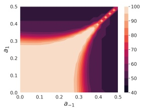

heatmap

| a1 | a-1 | Value |
| --- | --- | --- |
| 0.0~0.5 | 0.0~0.5 | 40~100 |

heatmap

| a-1 (range) | a1 (range) | Value (range) |
| --- | --- | --- |
| 0.0~0.5 | 0.0~0.5 | 40~100 |

(a) $\| \pmb { \mu } \| _ { 2 } = 1 . 0$

heatmap

| a-1 (range) | a1 (range) | Value (range) |
| --- | --- | --- |
| 0.0~0.5 | 0.0~0.5 | -40~100 |

(b) $\| \pmb { \mu } \| _ { 2 } = 2 . 5$

heatmap

| a-1 (range) | a1 (range) | Value (range) |
| --- | --- | --- |
| 0.0~0.5 | 0.0~0.5 | 40~100 |

(c) $\| \pmb { \mu } \| _ { 2 } = 5 . 0$

Figura 3. Graficamos las curvas de nivel (contour plots) para el accuracy de test limpio del clasificador Bayes de CUDA $\tilde { P }$ (denotado como $\tau _ { \mathcal { D } } ( \tilde { P } ))$ para distintos parámetros $a _ { y }$ donde $y \in \{ \pm 1 \}$ en las Figuras 3(a–c). El modelo de mezclas gaussianas $\mathcal { N } ( y \pmb { \mu } , I )$ denota los datos limpios. En la fila superior, utilizamos los Lemas $1 \; \& \; 4$ para generar empíricamente los gráficos. En la fila inferior, graficamos la cota superior teórica de $\tau _ { \mathcal { D } } ( \tilde { P } )$ que obtenemos utilizando el Teorema 2.

**Lema 1** El límite de decisión óptimo de Bayes para clasificar D viene dado por $P ( { \pmb x } ) \equiv { \pmb \mu } ^ { \top } { \pmb x } = 0.$ El accuracy del límite de decisión P sobre el dataset limpio $\mathcal { D } \; ( \text{es decir, } \tau _ { \mathcal { D } } ( P ) )$ es igual a $\phi ( \| \pmb { \mu } \| _ { 2 } )$. Aquí, $\phi ( \cdot )$ representa la CDF de la distribución normal estándar.

Ahora, para obtener $\tilde { \mathcal { D } } \; ( \text{es decir, CUDA} )$, realizamos convoluciones 1D por clase. Aquí consideramos una clase de filtros convolucionales 1D con tamaño de kernel 3 de la forma $\mathbf { \mathit { f } } _ { a } = [ a , 1 , a ]$ donde $a \in [ 0 , 0 . 5 ]$. La convolución de la señal $\pmb { x } \in \mathbb { R } ^ { d }$ con el filtro $f _ { a }$ usando un stride de 1 (denotada por $\pmb { x } * \pmb { f } _ { \pmb { a } } )$, puede tratarse como una operación matricial Ax. Aquí, $A \in \mathbb { R } ^ { d \times d }$ es una matriz de Toeplitz tridiagonal denotada por $T ( d ; a , 1 , a )$. Para la generación de CUDA, utilizamos matrices de convolución por clase $A _ { y } = T ( d ; a _ { y } , 1 , a _ { y } )$ para perturbar un punto de datos limpio $( { \pmb x } , y ) \sim { \mathcal D }$ a un punto de datos unlearnable $( A _ { y } { \pmb x } , y )$, donde $a _ { y } \in [ 0 , 0 . 5 ]$ para $y \in \{ \pm 1 \}$. Nótese que en CUDA, las etiquetas permanecen idénticas. A continuación, demostramos que dicho dataset perturbado (es decir, CUDA) puede representarse como un modelo de mezclas gaussianas.

**Lema 2** Un CUDA generado a partir de la distribución de datos limpios D y las $A _ { y }$ definidas anteriormente puede modelarse como un modelo de mezclas gaussianas con la distribución dada por $\tilde { \mathcal { D } } = \mathcal { N } ( y A _ { y } \pmb { \mu } , A _ { y } ^ { 2 } )$.

Para caracterizar el límite de decisión para CUDA, necesitamos emplear algunas propiedades de las matrices de Toeplitz de Noschese et al. [37] enunciadas en el siguiente Lema 3.

**Lema 3** Cualquier matriz de Toeplitz tridiagonal $A = T ( d ; a , 1 , a ) \in \mathbb { R } ^ { d \times d }$ con $a \in [ 0 , 0 . 5 ]$ se puede diagonalizar como $A = Q D Q$ donde $\textstyle Q _ { i , j } = \big ( \frac { 2 } { d + 1 } \big ) ^ { 1 / 2 } \operatorname { s i n } \big ( \frac { i j \pi } { d + 1 } \big )$

y D es una matriz diagonal con $D _ { i , i } = 1 + 2 a \cos \left( \frac { i \pi } { d + 1 } \right)$ para $1 \leq i , j \leq d.$

A continuación, utilizamos el Lema 3 para demostrar que el límite de decisión óptimo de Bayes para clasificar $\tilde { \mathcal { D } }$ es un plano cuadrático.

**Lema 4** Sean $A _ { - 1 } = T ( d ; a _ { - 1 } , 1 , a _ { - 1 } )$ y $A _ { 1 } = T ( d ; a _ { 1 } , 1 , a _ { 1 } )$. El límite de decisión óptimo de Bayes para clasificar $\tilde { \mathcal { D } }$ viene dado por $\tilde { P } ( \pmb { x } ) \equiv \pmb { x } ^ { \top } A \pmb { x } + \pmb { b } ^ { \top } \pmb { x } + c = 0,$ donde $A = A _ { - 1 } ^ { - 2 } - A _ { 1 } ^ { - 2 }, \; \pmb { b } = 2 ( A _ { - 1 } ^ { - 1 } + A _ { 1 } ^ { - 1 } ) \pmb { \mu },$ y $\textstyle c = 2 \sum _ { i = 1 } ^ { d } [ \operatorname { l n } ( 1 { + } 2 a _ { - 1 } \operatorname { c o s } ( \frac { i \pi } { d + 1 } ) ) { - } { \operatorname { l n } ( 1 { + } 2 a _ { 1 } \operatorname { c o s } ( \frac { i \pi } { d + 1 } ) ) } ]$.

Ahora enunciamos un lema relativo a la cola de formas cuadráticas gaussianas que desempeña un papel crucial en nuestro resultado principal.

**Lema 5** Sean $\| \cdot \|$ la norma de operador, $\| \cdot \| _ { 2 }$ la norma 2 vectorial, $z \sim \mathcal { N } ( \mathbf { 0 } , I )$ y $\boldsymbol { Z } = \boldsymbol { z } ^ { \top } A \boldsymbol { z } + \boldsymbol { z } ^ { \top } \boldsymbol { b } + c$ donde $A = Q \Lambda Q ^ { \top }$. Utilizando la cota de Chernoff, para cualquier $t \geq 0$ y $\gamma \in \mathbb { R },$

$$
\begin{array}{l} \mathbb {P} \{Z - \mathbb {E} Z \geq \gamma \} \leq \\ \frac {\exp \left\{\frac {- t}{4 \| \boldsymbol {b} \| _ {2} ^ {2} \| \Lambda \|} - t (\gamma + \mathrm{Tr} (\Lambda) + \| \boldsymbol {b} \| _ {2}) \right\}}{| I - 2 t \Lambda | ^ {\frac {1}{2}}}. \\ \end{array}
$$

El Lema 5 nos permite proporcionar una cota superior para el accuracy del límite de decisión unlearnable $\tilde { P }$ sobre el dataset limpio D, denotado como $\tau _ { \mathcal { D } } ( \tilde { P } )$, en el Teorema 2 a continuación.

**Teorema 2 (Resultado principal)** Sea $A = Q \Lambda Q = A _ { - 1 } ^ { - 2 } - A _ { 1 } ^ { - 2 }.$ Para cualquier constante no negativa $t _ { 1 }$ y $t _ { 2 },$ el accuracy del límite de decisión unlearnable $\tilde { P }$ sobre el dataset limpio $\mathcal{D}$ se puede acotar superiormente como

$$
\begin{array}{l} \tau_ {\mathcal {D}} (\tilde {P}) \leq \frac {\exp \left[ t _ {1} \left(\boldsymbol {b} ^ {\top} \boldsymbol {\mu} + \boldsymbol {\mu} ^ {\top} A \boldsymbol {\mu} + c - \frac {1}{4 \| 2 A \boldsymbol {\mu} + \boldsymbol {b} \| _ {2} \| \Lambda \|}\right) \right]}{2 | I - 2 t _ {1} \Lambda | ^ {\frac {1}{2}}} \\ + \frac {\exp \left[ t _ {2} \left(\boldsymbol {b} ^ {\top} \boldsymbol {\mu} - \boldsymbol {\mu} ^ {\top} A \boldsymbol {\mu} - c - \frac {1}{4 \| 2 A \boldsymbol {\mu} - \boldsymbol {b} \| _ {2} \| \Lambda \|}\right) \right]}{2 | I - 2 t _ {2} \Lambda | ^ {\frac {1}{2}}} \\ \mathrel {\mathop :} = p _ {1} + p _ {2}. \\ \end{array}
$$

Además, si $\pmb { \mu } ^ { \top } A \pmb { \mu } + \pmb { b } ^ { \top } \pmb { \mu } + c + \mathrm { T r } ( A ) + \lVert 2 A \pmb { \mu } + \pmb { b } \rVert < 0,$ tenemos $\tau _ { \mathcal { D } } ( \tilde { P } ) \leq { \textstyle \frac { 1 } { 2 } } ( p _ { 1 } { + } 1 ) < 1$. Asimismo, si $- \pmb { \mu } ^ { \top } A \pmb { \mu } + \pmb { b } ^ { \top } \pmb { \mu } - c - \mathrm { T r } ( A ) + \| 2 A { \pmb \mu } - { \pmb b } \| < 0,$ tenemos $\tau _ { \mathcal { D } } ( \tilde { P } ) \leq \textstyle \frac { 1 } { 2 } ( 1 + p _ { 2 } ) < 1$. Por otra parte, para cualquier $\boldsymbol { \mu } \neq \mathbf { 0 }$ y $a _ { - 1 } \in [ 0 , 0 . 5 ] , \; \exists a _ { 1 }$ tal que $\tau _ { \mathcal { D } } ( \tilde { P } ) < \tau _ { \mathcal { D } } ( P )$.

El envenenamiento es efectivo únicamente si el accuracy del modelo unlearnable $\tilde { P }$ es menor que el del modelo limpio $P$ sobre el dataset limpio $\mathcal { D },$ es decir, $\tau _ { \mathcal { D } } ( \tilde { P } ) < \tau _ { \mathcal { D } } ( P )$. Para satisfacer esta condición, necesitamos seleccionar cuidadosamente los $a _ { y }$. En el Teorema 2, establecemos formalmente esta condición1. El Teorema 2 demuestra que CUDA puede envenenar eficazmente cuando existen dos modos diferenciados en el modelo de datos de mezcla gaussiana limpia. Validamos nuestra afirmación teórica mediante análisis empírico también (véase la Figura 3). Los detalles de este análisis se proporcionan en el material suplementario. Encontramos que nuestra cota superior para el accuracy de test limpio de los clasificadores CUDA es consistente con nuestro análisis empírico. En nuestros experimentos, también observamos que el efecto de unlearnability es más fuerte con un blur parameter mayor. Este efecto resulta evidente a partir de la Figura 3, donde observamos que es probable obtener un $\tau _ { \mathcal { D } } ( \tilde { P } )$ menor con valores de $a _ { y }$ más altos. Estos resultados concuerdan con nuestros hallazgos experimentales en la Sección 5 con los datasets CIFAR-10, CIFAR-100 e ImageNet-100.

## 5. Experimentos

En esta sección, en primer lugar discutimos nuestra configuración experimental. Más detalles sobre la configuración se postergan al material suplementario. Luego, mostramos la robustez de la generación de CUDA con diversos datasets y arquitecturas. También ejecutamos varios experimentos para analizar la efectividad de CUDA bajo diferentes técnicas de entrenamiento (ERM, AT con presupuestos variables, randomized smoothing, transfer learning y fine-tuning) y técnicas de data augmentation (mixup [58], escala de grises [grayscaling], difuminado aleatorio [random blurring], cutout [9], cutmix [56], autoaugment [7] y regularización ortogonal [3]). Finalmente, también diseñamos defensas adaptativas para evaluar la robustez de CUDA. Podría pensarse que los filtros de CUDA pueden obtenerse entrenándolos de forma adversarial con los datos. Demostramos que CUDA es robusto frente a tales defensas adaptativas que diseñamos.

1Notamos que las condiciones µ>Aµ + b>µ + c + Tr(A) + k2Aµ + bk2 < 0 o −µ>Aµ + b>µ − c − Tr(A) + k2Aµ − bk2 < 0 siempre se pueden satisfacer eligiendo un µ suficientemente grande en la dirección de un autovector correspondiente a un autovalor negativo o positivo de A (nótese que A tiene autovalores tanto negativos como positivos).

Tabla 2. Test accuracy (%) de ResNet-18 entrenada sobre diversos unlearnable datasets. Utilizamos $L _ { \infty }$ AT con presupuesto $\rho _ { a } = 4 / 2 5 5$.

<table><tr><td rowspan="2">Dataset</td><td rowspan="2">Training method</td><td rowspan="2">Clean</td><td colspan="5">Unlearnability method</td></tr><tr><td>EM</td><td>TAP</td><td>NTGA</td><td>REM</td><td>CUDA</td></tr><tr><td rowspan="2">CIFAR-10</td><td>ERM</td><td>94.66</td><td>13.20</td><td>22.51</td><td>16.27</td><td>27.09</td><td>18.48</td></tr><tr><td>AT</td><td>89.51</td><td>88.62</td><td>88.02</td><td>88.96</td><td>48.16</td><td>44.40</td></tr><tr><td rowspan="2">CIFAR-100</td><td>ERM</td><td>76.27</td><td>1.60</td><td>13.75</td><td>3.22</td><td>10.14</td><td>12.69</td></tr><tr><td>AT</td><td>64.50</td><td>63.43</td><td>62.39</td><td>62.44</td><td>27.10</td><td>34.34</td></tr><tr><td rowspan="2">ImageNet-100</td><td>ERM</td><td>80.66</td><td>1.26</td><td>9.10</td><td>8.42</td><td>13.74</td><td>8.96</td></tr><tr><td>AT</td><td>66.62</td><td>63.40</td><td>63.56</td><td>63.06</td><td>41.66</td><td>38.68</td></tr></table>

## 5.1. Configuración experimental

**Datasets.** Utilizamos tres datasets de clasificación de imágenes: CIFAR-10, CIFAR-100 [21] e ImageNet-100 (un subconjunto de ImageNet compuesto por las primeras 100 clases) [40]. Empleamos técnicas de data augmentation tales como random flipping, cropping y resizing [44].

**Arquitecturas.** Empleamos ResNet-18 [14], VGG-16 [45], Wide ResNet-34-10 [57] y DenseNet-121 [16]. Entrenamos las redes con los hiperparámetros utilizados en Fu et al. [11]. Los trabajos anteriores emplean principalmente ResNet-18 para la mayoría de sus evaluaciones. Se proporcionan experimentos adicionales sobre Tiny-ImageNet [26], DeIT [50], EfficientNetV2-S [48] y MobileNetV2 [41] en el material suplementario.

**Generación de CUDA.** Utilizamos filtros de tamaño $k = 3$ y blur parameter $p _ { b } = 0.3$ para los datasets CIFAR-10 y CIFAR-100. ImageNet-100 es un dataset de imágenes de mayor dimensión de $224 \times 224 \times 3$ en comparación con los datasets CIFAR de dimensión $32 \times 32 \times 3$. Por lo tanto, utilizamos filtros más grandes de tamaño $k = 9$ con $p _ { b } = 0.06$ para ImageNet-100. Estos hiperparámetros se eligen de modo que las imágenes de CUDA no estén perceptiblemente muy perturbadas y brinden un buen efecto de unlearnability (véase el gráfico en la Figura 1). En el material suplementario, mostramos los resultados del entrenamiento sobre CUDA con diferentes hiperparámetros para la generación de datos.

**Líneas de base (Baselines).** Comparamos la técnica de generación de CUDA con cuatro métodos de unlearnability state-of-the-art: REM [11], EM [17], TAP [10] y NTGA [55]. Adoptamos los resultados reportados en [11], ya que utilizamos los mismos hiperparámetros para el entrenamiento. Para REM, seleccionamos los hiperparámetros $\rho _ { u } = 8 / 2 5 5$ y $\rho _ { a } = 4 / 2 5 5$, los valores de radio más altos en [11]. Para comparar los métodos unlearnable, observamos el accuracy de test limpio. Cuanto menor sea el accuracy de test, mejor será el método de unlearnability. Como se menciona en el material suplementario, utilizamos los repositorios de código oficiales publicados públicamente para reproducir las líneas de base utilizando sus hiperparámetros por defecto.

## 5.2. Efectividad de CUDA

**¿Por qué funciona CUDA?** Con el fin de medir en qué medida el difuminado (blurring) de la técnica CUDA afecta la calidad del dataset, comparamos el difuminado por clase (técnica CUDA) frente al difuminado universal (universal blurring), donde se utiliza un único filtro convolucional para difuminar todas las imágenes. Mantenemos fijos los parámetros de generación de filtros ($p _ { b } = 0.3$ y $k = 3$) tanto para el difuminado por clase de CUDA como para el difuminado universal. ResNet-18 entrenada con CIFAR-10 limpio, CIFAR-10 universalmente difuminado y CIFAR-10 CUDA alcanza accuracies de test limpio de 94.66%, 90.47% y 18.48%, respectivamente. Esto sugiere que nuestro difuminado controlado no oscurece la semántica del dataset. Por ende, la caída significativa en el accuracy de test limpio introducida por CUDA se debe con mayor probabilidad al uso de filtros por clase. Esto sugiere que un modelo entrenado sobre CUDA aprende la relación entre los filtros de convolución por clase y sus etiquetas correspondientes. Por lo tanto, durante el tiempo de test, cuando este efecto de convolución está ausente, el modelo entrenado con CUDA no logra realizar clasificaciones correctas. Además, el modelo entrenado sobre CUDA alcanza un accuracy del 99.91% en el testset de CIFAR-10 CUDA. Esto respalda firmemente nuestra afirmación de que el modelo CUDA aprende a clasificar imágenes basándose en los filtros convolucionales utilizados para difuminarlas. Adicionalmente, si permutamos los filtros por clase para difuminar el test set (es decir, difuminando imágenes de la clase 1 con filtros de la clase 2, imágenes de la clase 2 con filtros de la clase 3, y así sucesivamente), obtenemos un accuracy sumamente bajo del 2.53% en este test set. Se proporcionan más detalles en el material suplementario. Finalmente, destacamos que los datasets del mundo real también pueden contener imágenes borrosas debido a diversos factores como desenfoque por movimiento (motion blurring), condiciones climáticas, problemas con la cámara, etc. Por ende, detectar si una imagen borrosa está envenenada podría no ser siempre factible. Sin embargo, se podría argumentar que es posible detectar si un dataset completo está difuminado. Curiosamente, más adelante en esta sección demostramos que la técnica CUDA exhibe un efecto de unlearnability incluso cuando solo una fracción del dataset de entrenamiento está envenenada.

Tabla 3. Test accuracy (%) de arquitecturas de red entrenadas sobre diversos unlearnable datasets de CIFAR-10 con $L _ { \infty }$ AT $( \rho _ { a } = 4 / 2 5 5 )$.

<table><tr><td rowspan="2">Model</td><td rowspan="2">Clean</td><td colspan="5">Unlearnability method</td></tr><tr><td>EM</td><td>TAP</td><td>NTGA</td><td>REM</td><td>CUDA</td></tr><tr><td>ResNet-18</td><td>89.51</td><td>88.62</td><td>88.02</td><td>88.96</td><td>48.16</td><td>44.40</td></tr><tr><td>VGG-16</td><td>87.51</td><td>86.48</td><td>86.27</td><td>86.65</td><td>65.23</td><td>42.98</td></tr><tr><td>Wide ResNet-34-10</td><td>91.21</td><td>90.05</td><td>90.23</td><td>89.95</td><td>48.39</td><td>53.02</td></tr><tr><td>DenseNet-121</td><td>83.27</td><td>82.44</td><td>81.72</td><td>80.73</td><td>81.48</td><td>45.95</td></tr></table>

Tabla 4. Test accuracy (%) de ResNet-18 con CUDA bajo diversas configuraciones de entrenamiento.

<table><tr><td>Dataset</td><td>Clean</td><td>Training method</td><td>CUDA (ours)</td></tr><tr><td rowspan="7">CIFAR-10</td><td rowspan="7">94.66</td><td>ERM</td><td>18.48</td></tr><tr><td>AT  $L_{\infty}$  ( $\rho_{a} = 4/255$ )</td><td>44.40</td></tr><tr><td>AT  $L_{\infty}$  ( $\rho_{a} = 8/255$ )</td><td>32.85</td></tr><tr><td>AT  $L_{\infty}$  ( $\rho_{a} = 16/255$ )</td><td>19.32</td></tr><tr><td>AT  $L_{2}$  ( $\rho_{a} = 0.25$ )</td><td>39.05</td></tr><tr><td>AT  $L_{2}$  ( $\rho_{a} = 0.50$ )</td><td>51.19</td></tr><tr><td>AT  $L_{2}$  ( $\rho_{a} = 0.75$ )</td><td>51.14</td></tr><tr><td rowspan="4">CIFAR-100</td><td rowspan="4">76.27</td><td>ERM</td><td>12.69</td></tr><tr><td>AT  $L_{\infty}$  ( $\rho_{a} = 4/255$ )</td><td>34.34</td></tr><tr><td>AT  $L_{\infty}$  ( $\rho_{a} = 8/255$ )</td><td>30.00</td></tr><tr><td>AT  $L_{2}$  ( $\rho_{a} = 0.75$ )</td><td>36.90</td></tr><tr><td rowspan="4">ImageNet-100</td><td rowspan="4">80.66</td><td>ERM</td><td>8.96</td></tr><tr><td>AT  $L_{\infty}$  ( $\rho_{a} = 4/255$ )</td><td>38.68</td></tr><tr><td>AT  $L_{\infty}$  ( $\rho_{a} = 8/255$ )</td><td>40.08</td></tr><tr><td>AT  $L_{2}$  ( $\rho_{a} = 0.75$ )</td><td>20.58</td></tr></table>

**Diferentes datasets.** En primer lugar, comparamos la efectividad de CUDA con diferentes datasets utilizando ERM y $L _ { \infty }$ AT con $\rho _ { a } = 4 / 2 5 5$. Utilizamos ResNet-18 para los experimentos. Los resultados se muestran en la Tabla 2. Estos resultados demuestran que EM, TAP y NTGA no son robustos a AT. Sin embargo, tanto CUDA como REM resultan exitosos. Aquí, nuestro método CUDA supera a REM en los datasets CIFAR-10 e ImageNet-100. El ruido aditivo hábilmente diseñado en AT ayuda a lograr una mejor generalización que ERM sobre los unlearnable datasets. Este experimento demuestra, por lo tanto, que ERM y AT no son buenas opciones para entrenar con datasets CUDA y REM.

**Diferentes modelos.** A continuación, comparamos la efectividad de CUDA utilizando diversas arquitecturas de deep learning con $L _ { \infty } \mathrm { ~ A T ~ } ( \rho _ { a } = 4 / 2 5 5 )$. Utilizamos CIFAR-10 para los experimentos. Los resultados se muestran en la Tabla 3. Como se observa en la tabla, CUDA es efectivo con las cinco arquitecturas de red. Sin embargo, no se observa que REM sea transferible con DenseNet-121.

**Robustez frente a diferentes configuraciones de entrenamiento.** En la Sección 3.2, demostramos que REM es sensible a las configuraciones de entrenamiento. REM generado utilizando presupuestos de radio $L _ { \infty }$ de $\rho _ { u } = 8 / 2 5 5$ y $\rho _ { a } = 4 / 2 5 5$ para CIFAR-10 se vulnera con $L _ { \infty } \mathrm { ~ A T ~ } ( \rho _ { a } = 8 / 2 5 5 )$ y $L _ { 2 } \mathrm { ~ A T ~ } ( \rho _ { a } = 0.75 )$ para obtener un accuracy de test de 78.71% y 79.65%, respectivamente. Por lo tanto, ejecutamos experimentos para verificar la robustez de CUDA con diversos presupuestos de norma en AT. Los resultados se muestran en la Tabla 4. Como observamos en la tabla, CUDA es robusto frente a las configuraciones de ERM, $L _ { \infty }$ y $L _ { 2 }$ AT con presupuestos de entrenamiento variables. De manera impresionante, los accuracies de test más altos alcanzados al entrenar sobre CIFAR-10 CUDA, CIFAR-100 CUDA e ImageNet-100 CUDA son tan bajos como 51.19%, 36.90% y 40.08%, respectivamente. También encontramos que el uso de una ResNet-18 preentrenada con CIFAR-10 CUDA solo alcanza accuracies de test limpio de 42.42% y 48.22% al realizar fine-tuning de la red completa y de una capa final recién entrenada, respectivamente (los detalles se postergan al material suplementario).

**Diferentes porcentajes de protección.** En la Sección 3.1, asumimos que el atacante tiene acceso completo a los datos de entrenamiento limpios. Sin embargo, en entornos de la vida real, esto podría no ser siempre posible. Por lo tanto, entrenamos ResNet-18 sobre una mezcla de datasets de entrenamiento de CIFAR-10 CUDA y CIFAR-10 limpio para evaluar la efectividad del envenenamiento con porcentajes variables de protección de datos. El porcentaje de protección denota el porcentaje de los datos de entrenamiento que están envenenados.

Mostramos los resultados en la Tabla 5. En la tabla, la columna «Mixed» denota el accuracy de test limpio de un modelo entrenado utilizando una mezcla de datos limpios y envenenados. La columna «Clean» denota el accuracy de test limpio de un modelo entrenado únicamente utilizando el subconjunto limpio de los datos de entrenamiento. En la última fila de la Tabla 5, proporcionamos los resultados para CUDA entrenado con ERM bajo porcentajes variables de protección de datos. El resto de las filas presenta los resultados para el escenario de $L _ { \infty }$ AT $( \rho _ { a } = 4 / 2 5 5 )$. Por ejemplo, CUDA entrenado con ERM utilizando una partición de datos de entrenamiento limpia del 80% alcanza un accuracy de test de 93.75%. Agregar la partición de datos CUDA del 20% al dataset de entrenamiento reduce el accuracy de test del modelo a 93.28%. Los resultados de la última fila de la Tabla 5 demuestran que CUDA con porcentajes variables de protección de datos es efectivo con la configuración de ERM. No obstante, en el escenario de AT, las técnicas de unlearnability no son tan exitosas como con ERM frente a porcentajes variables de protección de datos. A pesar de ello, es interesante señalar que la técnica CUDA tiene un mejor desempeño que todas las demás técnicas de unlearnability con AT.

Tabla 5. Test accuracy (%) de ResNet-18 sobre CIFAR-10 con diferentes porcentajes de protección de datos. La última fila muestra los resultados para CUDA con la configuración de ERM. El resto de las filas muestra los resultados para los métodos de unlearnability entrenados en la configuración de $L _ { \infty }$ AT $( \rho _ { a } = 4 / 2 5 5 )$.

<table><tr><td rowspan="3">Unlearnability method</td><td colspan="10">Data Protection Percentage</td></tr><tr><td rowspan="2">0%</td><td colspan="2">20%</td><td colspan="2">40%</td><td colspan="2">60%</td><td colspan="2">80%</td><td rowspan="2">100%</td></tr><tr><td>Mixed</td><td>Clean</td><td>Mixed</td><td>Clean</td><td>Mixed</td><td>Clean</td><td>Mixed</td><td>Clean</td></tr><tr><td>EM</td><td rowspan="5">89.51</td><td>89.60</td><td></td><td>89.40</td><td></td><td>89.49</td><td></td><td>89.10</td><td></td><td>88.62</td></tr><tr><td>TAP</td><td>89.01</td><td rowspan="2">88.17</td><td>88.66</td><td rowspan="2">86.76</td><td>88.40</td><td rowspan="2">85.07</td><td>88.04</td><td rowspan="2">79.41</td><td>88.02</td></tr><tr><td>NTGA</td><td>89.56</td><td>89.35</td><td>89.22</td><td>89.17</td><td>88.96</td></tr><tr><td>REM</td><td>89.60</td><td></td><td>89.34</td><td></td><td>89.61</td><td></td><td>88.09</td><td></td><td>48.16</td></tr><tr><td>CUDA (ours)</td><td>88.54</td><td></td><td>87.24</td><td></td><td>86.03</td><td></td><td>84.34</td><td></td><td>44.40</td></tr><tr><td>CUDA + ERM</td><td>94.66</td><td>93.28</td><td>93.75</td><td>91.34</td><td>92.56</td><td>89.91</td><td>89.77</td><td>85.61</td><td>84.30</td><td>18.48</td></tr></table>

**Robustez frente a smoothing y data augmentations.** Cohen et al. [6] proponen el randomized smoothing, que es una defensa adversarial demostrable en norma $L _ { 2 }$. Dado que CUDA no utiliza ruido aditivo, CUDA es robusto frente al randomized smoothing. Una ResNet-18 suavizada (con un nivel de ruido de 0.5) con CIFAR-10 CUDA alcanza únicamente un accuracy de test limpio de 43.85%. En la Sección 3.2, vimos que REM se vulnera con la conversión a escala de grises. Mientras que el entrenamiento de ResNet-18 utilizando REM en escala de grises alcanza un accuracy de test del 70.76%, CUDA en escala de grises alcanza únicamente un 20.12% de accuracy de test sobre los datos limpios de CIFAR-10 en escala de grises. Esto demuestra que la técnica CUDA exhibe la propiedad deseable de no depender del espacio de color para su ataque. El entrenamiento de CIFAR-10 CUDA alcanza únicamente 25.53%, 25.80%, 26.93%, 34.09% y 50.72% de accuracy de test limpio con mixup, cutout, cutmix, autoaugment y regularización ortogonal, respectivamente (véase el material suplementario para más detalles).

**Defensas adaptativas para CUDA.** Aquí, primero investigamos el efecto de entrenar CIFAR-10 CUDA con data augmentations de difuminado aleatorio (random blurring augmentations) utilizando ResNet-18. Cada batch de los datos de entrenamiento de CUDA se convoluciona con filtros aleatorios de $3 \times 3$ de blur parameters $p _ { b } ^ { \prime }$ variables. Con valores de $p _ { b } ^ { \prime }$ de 0.1 y 0.3, el entrenamiento de CUDA alcanza un menor accuracy de test de 9.2% y 13.37%, respectivamente. Esto demuestra que el ruido agregado por la técnica CUDA es robusto frente a augmentations de convolución aleatoria.

Podría pensarse que la técnica CUDA puede vulnerarse aprendiendo los filtros privados a partir de los datos. Evaluamos esta idea entrenando filtros de deconvolución para verificar si podemos revertir el efecto de difuminado en CUDA con filtros entrenados de forma adversarial. Empleamos una novedosa técnica de Deconvolution-based Adversarial Training (DAT) similar a AT (consúltese el material suplementario para detalles). Mientras que el paso adversarial en AT aprende ruidos aditivos por muestra que maximizan el error, el paso adversarial en DAT aprende filtros de deconvolución por clase que maximizan el error. Entrenamos DAT con filtros de diferentes tamaños (3, 5 y 7) sobre CIFAR-10 CUDA utilizando ResNet-18. Los parámetros del filtro se restringen dentro de un rango finito para asegurar que las imágenes no se distorsionen con el paso adversarial, de manera similar a la proyección en el descenso de gradiente proyectado (projected gradient descent). Encontramos que CUDA es robusto frente a DAT. DAT utilizando filtros de tamaño 3, 5 y 7 con CUDA alcanza únicamente un accuracy de test de 39.05%, 46.21% y 38.48%, respectivamente. DAT no resulta exitoso contra CUDA dado que no podemos invertir las convoluciones sin el conocimiento de los filtros privados o de las imágenes limpias correspondientes a CUDA.

**Limitaciones y direcciones futuras.** El efecto de unlearnability de CUDA puede defenderse si se filtra alguna fracción de los datos limpios y sus correspondientes imágenes de CUDA. El defensor también debe ser capaz de detectar si todas las muestras del dataset están envenenadas. Sin embargo, nuestro trabajo asume una configuración donde los filtros permanecen privados. Por ejemplo, quien publica los datos podría simplemente publicar sus imágenes CUDA y eliminar permanentemente las imágenes limpias para evitar este escenario. Como se discutió en esta sección, tanto CUDA como otros trabajos previos no presentan un rendimiento óptimo con diferentes porcentajes de protección bajo AT. Mejorar esto constituye una dirección de investigación interesante. Creemos que extender la técnica CUDA a otros dominios, tales como datos tabulares y texto, también es una dirección futura prometedora. Asimismo, sería de gran interés desarrollar análisis teóricos de CUDA considerando configuraciones más complejas.

## Agradecimientos

Este proyecto fue financiado en parte por la subvención de Meta 23010098, NSF CAREER AWARD 1942230, HR001119S0026 (GARD), ONR YIP award N00014-22-1-2271, Army Grant No. W911NF2120076, una subvención de Capital One, NIST 60NANB20D134 y la subvención de la NSF CCF2212458.

## Referencias

[1] Mauro Barni, Kassem Kallas, and Benedetta Tondi. A new backdoor attack in cnns by training set corruption without label poisoning. In 2019 IEEE International Conference on Image Processing (ICIP), pages 101–105. IEEE, 2019. 3
[2] Battista Biggio, Blaine Nelson, and Pavel Laskov. Poisoning attacks against support vector machines. arXiv preprint arXiv:1206.6389, 2012. 2
[3] Andrew Brock, Theodore Lim, James M Ritchie, and Nick Weston. Neural photo editing with introspective adversarial networks. arXiv preprint arXiv:1609.07093, 2016. 6, 19
[4] Nicholas Carlini and David Wagner. Towards evaluating the robustness of neural networks. In 2017 ieee symposium on security and privacy (sp), pages 39–57. IEEE, 2017. 2
[5] Xinyun Chen, Chang Liu, Bo Li, Kimberly Lu, and Dawn Song. Targeted backdoor attacks on deep learning systems using data poisoning. arXiv preprint arXiv:1712.05526, 2017. 3
[6] Jeremy Cohen, Elan Rosenfeld, and Zico Kolter. Certified adversarial robustness via randomized smoothing. In Kamalika Chaudhuri and Ruslan Salakhutdinov, editors, Proceedings of the 36th International Conference on Machine Learning, volume 97 of Proceedings of Machine Learning Research, pages 1310–1320. PMLR, 09–15 Jun 2019. 2, 8, 14
[7] Ekin D Cubuk, Barret Zoph, Dandelion Mane, Vijay Vasudevan, and Quoc V Le. Autoaugment: Learning augmentation policies from data. arXiv preprint arXiv:1805.09501, 2018. 6, 19
[8] Karan Desai and Justin Johnson. Virtex: Learning visual representations from textual annotations. In Proceedings of the IEEE/CVF Conference on Computer Vision and Pattern Recognition, pages 11162–11173, 2021. 1
[9] Terrance DeVries and Graham W Taylor. Improved regularization of convolutional neural networks with cutout. arXiv preprint arXiv:1708.04552, 2017. 6, 19
[10] Liam Fowl, Micah Goldblum, Ping-yeh Chiang, Jonas Geiping, Wojtek Czaja, and Tom Goldstein. Adversarial examples make strong poisons. arXiv preprint arXiv:2106.10807, 2021. 1, 3, 6, 14
[11] Shaopeng Fu, Fengxiang He, Yang Liu, Li Shen, and Dacheng Tao. Robust unlearnable examples: Protecting data privacy against adversarial learning. In International Conference on Learning Representations, 2021. 1, 3, 4, 6, 14
[12] Ian J Goodfellow, Jonathon Shlens, and Christian Szegedy. Explaining and harnessing adversarial examples. arXiv preprint arXiv:1412.6572, 2014. 2
[13] Tianyu Gu, Brendan Dolan-Gavitt, and Siddharth Garg. Badnets: Identifying vulnerabilities in the machine learning model supply chain. arXiv preprint arXiv:1708.06733, 2017. 3
[14] Kaiming He, Xiangyu Zhang, Shaoqing Ren, and Jian Sun. Deep residual learning for image recognition. CoRR, abs/1512.03385, 2015. 6
[15] Kashmir Hill. The secretive company that might end privacy as we know it. In Ethics of Data and Analytics, pages 170–177. Auerbach Publications, 2020. 1
[16] Gao Huang, Zhuang Liu, and Kilian Q. Weinberger. Densely connected convolutional networks. CoRR, abs/1608.06993, 2016. 6
[17] Hanxun Huang, Xingjun Ma, Sarah Monazam Erfani, James Bailey, and Yisen Wang. Unlearnable examples: Making personal data unexploitable. arXiv preprint arXiv:2101.04898, 2021. 1, 3, 6, 14
[18] Arthur Jacot, Franck Gabriel, and Clement Hongler. Neu- ´ ral tangent kernel: Convergence and generalization in neural networks. Advances in neural information processing systems, 31, 2018. 3
[19] Adel Javanmard and Mahdi Soltanolkotabi. Precise statistical analysis of classification accuracies for adversarial training. ArXiv, abs/2010.11213, 2020. 2, 4
[20] Pang Wei Koh and Percy Liang. Understanding black-box predictions via influence functions. In International conference on machine learning, pages 1885–1894. PMLR, 2017. 2
[21] Alex Krizhevsky. Learning multiple layers of features from tiny images. Technical report, 2009. 6
[22] Aounon Kumar, Alexander Levine, Soheil Feizi, and Tom Goldstein. Certifying confidence via randomized smoothing. CoRR, abs/2009.08061, 2020. 2
[23] Alexey Kurakin, Ian J Goodfellow, and Samy Bengio. Adversarial examples in the physical world. In Artificial intelligence safety and security, pages 99–112. Chapman and Hall/CRC, 2018. 2
[24] Cassidy Laidlaw and Soheil Feizi. Functional adversarial attacks. In H. Wallach, H. Larochelle, A. Beygelzimer, F. d'Alche-Buc, E. Fox, and R. Garnett, editors, ´ Advances in Neural Information Processing Systems, volume 32. Curran Associates, Inc., 2019. 2
[25] Cassidy Laidlaw, Sahil Singla, and Soheil Feizi. Perceptual adversarial robustness: Defense against unseen threat models. CoRR, abs/2006.12655, 2020. 2
[26] Ya Le and Xuan Yang. Tiny imagenet visual recognition challenge. CS 231N, 7(7):3, 2015. 6, 15
[27] Alexander Levine and Soheil Feizi. Deep partition aggregation: Provable defense against general poisoning attacks. CoRR, abs/2006.14768, 2020. 2
[28] Alexander Levine and Soheil Feizi. Deep partition aggregation: Provable defense against general poisoning attacks. CoRR, abs/2006.14768, 2020. 2
[29] Yige Li, Xixiang Lyu, Nodens Koren, Lingjuan Lyu, Bo Li, and Xingjun Ma. Neural attention distillation: Erasing backdoor triggers from deep neural networks. arXiv preprint arXiv:2101.05930, 2021. 3
[30] Yiming Li, Tongqing Zhai, Baoyuan Wu, Yong Jiang, Zhifeng Li, and Shutao Xia. Rethinking the trigger of backdoor attack. arXiv preprint arXiv:2004.04692, 2020. 3
[31] Tsung-Yi Lin, Michael Maire, Serge Belongie, James Hays, Pietro Perona, Deva Ramanan, Piotr Dollar, and C Lawrence ´ Zitnick. Microsoft coco: Common objects in context. In European conference on computer vision, pages 740–755. Springer, 2014. 1
[32] Sijia Liu, Songtao Lu, Xiangyi Chen, Yao Feng, Kaidi Xu, Abdullah Al-Dujaili, Mingyi Hong, and Una-May O’Reilly. Min-max optimization without gradients: Convergence and applications to black-box evasion and poisoning attacks. In International Conference on Machine Learning, pages 6282–6293. PMLR, 2020. 2
[33] Yunfei Liu, Xingjun Ma, James Bailey, and Feng Lu. Reflection backdoor: A natural backdoor attack on deep neural networks. In European Conference on Computer Vision, pages 182–199. Springer, 2020. 3
[34] Aleksander Madry, Aleksandar Makelov, Ludwig Schmidt, Dimitris Tsipras, and Adrian Vladu. Towards deep learning models resistant to adversarial attacks. arXiv preprint arXiv:1706.06083, 2017. 1, 2, 14
[35] Yifei Min, Lin Chen, and Amin Karbasi. The curious case of adversarially robust models: More data can help, double descend, or hurt generalization. In Uncertainty in Artificial Intelligence, pages 129–139. PMLR, 2021. 4
[36] Tuan Anh Nguyen and Anh Tran. Input-aware dynamic backdoor attack. Advances in Neural Information Processing Systems, 33:3454–3464, 2020. 3
[37] Silvia Noschese, Lionello Pasquini, and Lothar Reichel. Tridiagonal toeplitz matrices: Properties and novel applications. 2006. 5
[38] Adam Paszke, Sam Gross, Francisco Massa, Adam Lerer, James Bradbury, Gregory Chanan, Trevor Killeen, Zeming Lin, Natalia Gimelshein, Luca Antiga, et al. Pytorch: An imperative style, high-performance deep learning library. Advances in neural information processing systems, 32, 2019. 18, 19
[39] Alec Radford, Jong Wook Kim, Chris Hallacy, Aditya Ramesh, Gabriel Goh, Sandhini Agarwal, Girish Sastry, Amanda Askell, Pamela Mishkin, Jack Clark, et al. Learning transferable visual models from natural language supervision. In International Conference on Machine Learning, pages 8748–8763. PMLR, 2021. 1
[40] Olga Russakovsky, Jia Deng, Hao Su, Jonathan Krause, Sanjeev Satheesh, Sean Ma, Zhiheng Huang, Andrej Karpathy, Aditya Khosla, Michael Bernstein, Alexander C. Berg, and Li Fei-Fei. ImageNet Large Scale Visual Recognition Challenge. International Journal of Computer Vision (IJCV), 115(3):211–252, 2015. 6
[41] M. Sandler, A. Howard, M. Zhu, A. Zhmoginov, and L.C. Chen. Mobilenetv2: Inverted residuals and linear bottlenecks. In CVPR, 2018. 6, 15, 16
[42] Mert Bulent Sariyildiz, Julien Perez, and Diane Larlus. Learning visual representations with caption annotations. In European Conference on Computer Vision, pages 153–170. Springer, 2020. 1
[43] Ali Shafahi, W Ronny Huang, Mahyar Najibi, Octavian Suciu, Christoph Studer, Tudor Dumitras, and Tom Goldstein. Poison frogs! targeted clean-label poisoning attacks on neural networks. Advances in neural information processing systems, 31, 2018. 2, 3
[44] Connor Shorten and Taghi Khoshgoftaar. A survey on image data augmentation for deep learning. Journal of Big Data, 6, 07 2019. 6
[45] Karen Simonyan and Andrew Zisserman. Very deep convolutional networks for large-scale image recognition. CoRR, abs/1409.1556, 2015. 6
[46] StubbornAtom. Distributions of quadratic form of a normal random variable. Cross Validated. URL:https://stats.stackexchange.com/q/478682 (version: 2020-07-23). 12
[47] Christian Szegedy, Wojciech Zaremba, Ilya Sutskever, Joan Bruna, Dumitru Erhan, Ian Goodfellow, and Rob Fergus. Intriguing properties of neural networks. arXiv preprint arXiv:1312.6199, 2013. 2
[48] M. Tan and Q. Le. Efficientnetv2: Smaller models and faster training. In ICML, 2021. 6, 15, 16
[49] Lue Tao, Lei Feng, Jinfeng Yi, Sheng-Jun Huang, and Songcan Chen. Better safe than sorry: Preventing delusive adversaries with adversarial training. Advances in Neural Information Processing Systems, 34, 2021. 1, 3
[50] H. Touvron, M. Cord, M. Douze, F. Massa, A. Sablayrolles, and H. Jegou. Training data-efficient image transformers & distillation through attention. In ICML, 2021. 6, 15, 16
[51] Laurens van der Maaten and Geoffrey Hinton. Visualizing data using t-sne. Journal of Machine Learning Research, 9(86):2579–2605, 2008. 2
[52] Wenxiao Wang, Alexander Levine, and Soheil Feizi. Improved certified defenses against data poisoning with (deterministic) finite aggregation. CoRR, abs/2202.02628, 2022. 2
[53] Yisen Wang, Xingjun Ma, James Bailey, Jinfeng Yi, Bowen Zhou, and Quanquan Gu. On the convergence and robustness of adversarial training. arXiv preprint arXiv:2112.08304, 2021. 2
[54] Da Yu, Huishuai Zhang, Wei Chen, Jian Yin, and Tie-Yan Liu. Availability attacks create shortcuts. In Proceedings of the 28th ACM SIGKDD Conference on Knowledge Discovery and Data Mining, KDD ’22, page 2367–2376, New York, NY, USA, 2022. Association for Computing Machinery. 2, 3
[55] Chia-Hung Yuan and Shan-Hung Wu. Neural tangent generalization attacks. In International Conference on Machine Learning, pages 12230–12240. PMLR, 2021. 1, 3, 6, 14
[56] Sangdoo Yun, Dongyoon Han, Seong Joon Oh, Sanghyuk Chun, Junsuk Choe, and Youngjoon Yoo. Cutmix: Regularization strategy to train strong classifiers with localizable features. In Proceedings of the IEEE/CVF international conference on computer vision, pages 6023–6032, 2019. 6, 19
[57] Sergey Zagoruyko and Nikos Komodakis. Wide residual networks. In Edwin R. Hancock Richard C. Wilson and William A. P. Smith, editors, Proceedings of the British Machine Vision Conference (BMVC), pages 87.1–87.12. BMVA Press, September 2016. 6
[58] Hongyi Zhang, Moustapha Cisse, Yann N. Dauphin, and ´ David Lopez-Paz. mixup: Beyond empirical risk minimization. CoRR, abs/1710.09412, 2017. 6, 14, 19
[59] Hongyang Zhang, Yaodong Yu, Jiantao Jiao, Eric Xing, Laurent El Ghaoui, and Michael Jordan. Theoretically principled trade-off between robustness and accuracy. In International conference on machine learning, pages 7472–7482. PMLR, 2019. 2

## A. Apéndice

## A.1. Demostración para el Lema 1

En el límite de decisión óptimo, las probabilidades de que cualquier punto $\pmb { x } \in \mathbb { R } ^ { d }$ pertenezca a la clase $y = - 1$ y a la clase $y = 1$ modeladas por $\mathcal { D }$ son iguales. Aquí, $\mathbf { \mu } \; = \; \mathbf { \mu _ { 1 } } \; = \; - \mathbf { \mu _ { - 1 } }$ e $I = \Sigma _ { - 1 } = \Sigma _ { 1 }$

$$
\begin{array}{l} \Longrightarrow \frac {\exp \left[ - \frac {1}{2} \left(\boldsymbol {x} - \boldsymbol {\mu} _ {- 1}\right) ^ {\top} \Sigma_ {- 1} ^ {- 1} \left(\boldsymbol {x} - \boldsymbol {\mu} _ {- 1}\right) \right]}{\sqrt {(2 \pi) ^ {d} \left| \Sigma_ {- 1} \right|}} = \\ \frac {\exp \left[ - \frac {1}{2} \left(\boldsymbol {x} - \boldsymbol {\mu_ {1}}\right) ^ {\top} \Sigma_ {1} ^ {- 1} \left(\boldsymbol {x} - \boldsymbol {\mu_ {1}}\right) \right]}{\sqrt {(2 \pi) ^ {d} \left| \Sigma_ {1} \right|}} \\ \Longrightarrow - \frac {1}{2} \log | I | - \frac {1}{2} (\boldsymbol {x} ^ {\top} \boldsymbol {x} - 2 \boldsymbol {x} ^ {\top} \boldsymbol {\mu} _ {- 1} + \boldsymbol {\mu} _ {- 1} ^ {\top} \boldsymbol {\mu} _ {- 1}) = \\ - \frac {1}{2} \log | I | - \frac {1}{2} (\boldsymbol {x} ^ {\top} \boldsymbol {x} - 2 \boldsymbol {x} ^ {\top} \boldsymbol {\mu_ {1}} + \boldsymbol {\mu_ {1} ^ {\top}} \boldsymbol {\mu_ {1}}) \\ \Longrightarrow \boldsymbol {x} ^ {\top} (\boldsymbol {\mu} _ {- 1} - \boldsymbol {\mu} _ {1}) - \frac {1}{2} (\boldsymbol {\mu} _ {- 1} ^ {\top} \boldsymbol {\mu} _ {- 1} - \boldsymbol {\mu} _ {1} ^ {\top} \boldsymbol {\mu} _ {1}) = 0 \\ \Longrightarrow - \boldsymbol {x} ^ {\top} \boldsymbol {\mu} = 0 \\ \Longrightarrow P (\boldsymbol {x}) \equiv \boldsymbol {x} ^ {\top} \boldsymbol {\mu} = 0. \\ \end{array}
$$

Ahora, se debe calcular el accuracy del modelo limpio P. Nótese que si $P ( { \pmb x } ) \; < \; 0$ la clasificación óptima de Bayes corresponde a la clase -1; de lo contrario, la clasificación corresponde a la clase 1. Sean $z \sim \mathcal { N } ( \mathbf { 0 } , I )$, $Z \sim \mathcal { N } ( 0 , 1 )$ y $s g n ( . )$ la función signo.

$$
\begin{array}{l} \tau_ {\mathcal {D}} (P) = \mathbb {E} _ {(\boldsymbol {x}, y) \sim \mathcal {D}} \left[ \mathbb {1} (y = s g n (P (\boldsymbol {x}))) \right] = \mathbb {P} [ y \boldsymbol {x} ^ {\top} \boldsymbol {\mu} > 0 ] \\ = \mathbb {P} [ y (y \boldsymbol {\mu} + \boldsymbol {z}) ^ {\top} \boldsymbol {\mu} > 0 ] \\ = \mathbb {P} [ (\boldsymbol {\mu} + \boldsymbol {z}) ^ {\top} \boldsymbol {\mu} > 0 ] \\ = \mathbb {P} [ \| \boldsymbol {\mu} \| _ {2} ^ {2} + \| \boldsymbol {\mu} \| _ {2} Z > 0 ] = \phi (\| \boldsymbol {\mu} \| _ {2}). \\ \end{array}
$$

## A.2. Demostración para el Lema 2

Sea $\mathcal { D } _ { 1 } = \mathcal { N } ( \pmb { \mu } , I )$. Para cada punto de datos $( { \pmb x } , y ) \sim { \mathcal D } _ { 1 },$ sea el dato perturbado $( A _ { 1 } { \pmb x } , y )$ modelado por una distribución $\tilde { D } _ { 1 }$. Demostramos que $\tilde { D } _ { 1 } = \mathcal { N } ( A _ { 1 } \pmb { \mu } , A _ { 1 } ^ { \top } A _ { 1 } )$.

$$
\mathbb {E} _ {(\boldsymbol {x}, y) \sim \mathcal {D} _ {1}} A _ {1} \boldsymbol {x} = A _ {1} \mathbb {E} _ {(\boldsymbol {x}, y) \sim \mathcal {D} _ {1}} \boldsymbol {x} = A _ {1} \boldsymbol {\mu}.
$$

$$
\begin{array}{l} \mathbb {E} _ {(\boldsymbol {x}, y) \sim \mathcal {D} _ {1}} \left(A _ {1} \boldsymbol {x} - A _ {1} \boldsymbol {\mu}\right) \left(A _ {1} \boldsymbol {x} - A _ {1} \boldsymbol {\mu}\right) ^ {\top} \\ = \mathbb {E} _ {(\boldsymbol {x}, y) \sim \mathcal {D} _ {1}} A _ {1} (\boldsymbol {x} - \boldsymbol {\mu}) \left[ A _ {1} (\boldsymbol {x} - \boldsymbol {\mu}) \right] ^ {\top} \\ = \mathbb {E} _ {(\boldsymbol {x}, y) \sim \mathcal {D} _ {1}} A _ {1} (\boldsymbol {x} - \boldsymbol {\mu}) (\boldsymbol {x} - \boldsymbol {\mu}) ^ {\top} A _ {1} ^ {\top} \\ = A _ {1} \mathbb {E} _ {(\boldsymbol {x}, y) \sim \mathcal {D} _ {1}} (\boldsymbol {x} - \boldsymbol {\mu}) (\boldsymbol {x} - \boldsymbol {\mu}) ^ {\top} A _ {1} ^ {\top} \\ = A _ {1} I A _ {1} ^ {\top} = A _ {1} A _ {1} ^ {\top}. \\ \end{array}
$$

Las matrices de Toeplitz tridiagonales $A _ { y } = T ( d ; a _ { y } , 1 , a _ { y } )$ son simétricas. Por ende, $\tilde { \mathcal { D } } = \mathcal { N } ( y A _ { y } \pmb { \mu } , A _ { y } ^ { 2 } )$  

## A.3. Observaciones sobre el Lema 3

Una matriz de Toeplitz tridiagonal $T ( d ; a _ { 1 } , a _ { 2 } , a _ { 3 } )$ se representa como

$$
\left[ \begin{array}{c c c c c c} a _ {2} & a _ {3} & 0 & 0 & \dots & 0 \\ a _ {1} & a _ {2} & a _ {3} & 0 & \dots & 0 \\ 0 & a _ {1} & a _ {2} & a _ {3} & \dots & 0 \\ \vdots & \vdots & \vdots & \vdots & \ddots & \vdots \\ 0 & \dots & \dots & 0 & a _ {1} & a _ {2} \end{array} \right] \in \mathbb {R} ^ {d \times d}
$$

La clase de matrices $A _ { y } \; = \; T ( d ; a _ { y } , 1 , a _ { y } )$ son simétricas y se pueden diagonalizar como $Q D Q ^ { \top }$. $Q = \textstyle \big ( \big ( \frac { 2 } { d + 1 } \big ) ^ { 1 / 2 } \operatorname { s i n } \big ( \frac { i j \pi } { d + 1 } \big ) \big ) _ { i , j }$ es simétrica y es la matriz de autovectores común a todas las matrices $A _ { y }$. Como se muestra en el Lema 3, Q y $D$ se pueden representar utilizando funciones trigonométricas. Asimismo, tenemos $A ( n ) : = A _ { 1 } ^ { n } \pm A _ { - 1 } ^ { n } = Q ( D _ { 1 } ^ { n } \pm D _ { - 1 } ^ { n } ) Q$ donde $A _ { 1 } = Q D _ { 1 } Q$ y $A _ { - 1 } = Q D _ { - 1 } Q$. Además, $\mathrm { T r } ( A ( n ) ) = \mathrm { T r } ( Q ( D _ { 1 } ^ { n } \pm D _ { - 1 } ^ { n } ) Q ) = \mathrm { T r } ( ( D _ { 1 } ^ { n } \pm D _ { - 1 } ^ { n } ) Q ^ { 2 } ) = \mathrm { T r } ( D _ { 1 } ^ { n } \pm D _ { - 1 } ^ { n } )$.

## A.4. Demostración para el Lema 4

En el límite de decisión óptimo, las probabilidades de que cualquier punto $\pmb { x } \in \mathbb { R } ^ { d }$ pertenezca a la clase $y = - 1$ y a la clase $y = 1$ modeladas por $\tilde { \mathcal { D } }$ son iguales. Aquí, $\mathbf { \mu } = \mathbf { \mu _ { 1 } } = - \mathbf { \mu _ { - 1 } }$ y las $A _ { y }$ son simétricas.

$$
\begin{array}{l} \frac {\exp \left[ - \frac {1}{2} \left(\boldsymbol {x} - A _ {- 1} \boldsymbol {\mu} _ {- 1}\right) ^ {\top} \left(A _ {- 1} I A _ {- 1} ^ {\top}\right) ^ {- 1} \left(\boldsymbol {x} - A _ {- 1} \boldsymbol {\mu} _ {- 1}\right) \right]}{\sqrt {(2 \pi) ^ {d} \left| A _ {- 1} I A _ {- 1} ^ {\top} \right|}} \\ = \frac {\exp [ - \frac {1}{2} (\boldsymbol {x} - A _ {1} \boldsymbol {\mu_ {1}}) ^ {\top} (A _ {1} I A _ {1} ^ {\top}) ^ {- 1} (\boldsymbol {x} - A _ {1} \boldsymbol {\mu_ {1}}) ]}{\sqrt {(2 \pi) ^ {d} | A _ {1} I A _ {1} ^ {\top} |}} \\ \Longrightarrow - \frac {1}{2} \ln \frac {\left| A _ {- 1} ^ {2} \right|}{\left| A _ {1} ^ {2} \right|} - \frac {1}{2} \left[ \boldsymbol {x} ^ {\top} \left(A _ {- 1} ^ {- 2} - A _ {1} ^ {- 2}\right) \boldsymbol {x} \right. \\ - 2 (\boldsymbol {\mu} _ {- 1} ^ {\top} A _ {- 1} ^ {- 1} - \boldsymbol {\mu} _ {1} ^ {\top} A _ {1} ^ {- 1}) \boldsymbol {x} \\ \left. + \left(\boldsymbol {\mu} _ {- 1} ^ {\top} \boldsymbol {\mu} _ {- 1} - \boldsymbol {\mu} _ {1} ^ {\top} \boldsymbol {\mu} _ {1}\right) \right] = 0 \\ \Longrightarrow \tilde {P} (\boldsymbol {x}) \equiv \boldsymbol {x} ^ {\top} (A _ {- 1} ^ {- 2} - A _ {1} ^ {- 2}) \boldsymbol {x} \\ - 2 (\boldsymbol {\mu} _ {- 1} ^ {\top} A _ {- 1} ^ {- 1} - \boldsymbol {\mu} _ {1} ^ {\top} A _ {1} ^ {- 1}) \boldsymbol {x} + (\| \boldsymbol {\mu} _ {- 1} \| _ {2} ^ {2} - \| \boldsymbol {\mu} _ {1} \| _ {2} ^ {2}) \\ + \sum_ {i = 1} ^ {d} \ln \left(\frac {1 + 2 a _ {- 1} \cos (\frac {i \pi}{d + 1})}{1 + 2 a _ {1} \cos (\frac {i \pi}{d + 1})}\right) ^ {2} = 0 \\ \Longrightarrow \tilde {P} (\boldsymbol {x}) \equiv \boldsymbol {x} ^ {\top} (A _ {- 1} ^ {- 2} - A _ {1} ^ {- 2}) \boldsymbol {x} \\ + 2 [ (A _ {- 1} ^ {- 1} + A _ {1} ^ {- 1}) \boldsymbol {\mu} ] ^ {\top} \boldsymbol {x} \\ + \sum_ {i = 1} ^ {d} \ln \left(\frac {1 + 2 a _ {- 1} \cos (\frac {i \pi}{d + 1})}{1 + 2 a _ {1} \cos (\frac {i \pi}{d + 1})}\right) ^ {2} = 0 \\ \Longrightarrow \tilde {P} (\boldsymbol {x}) \equiv \boldsymbol {x} ^ {\top} A \boldsymbol {x} + \boldsymbol {b} ^ {\top} \boldsymbol {x} + c = 0. \\ \end{array}
$$

Nótese que aquí si $\tilde { P } ( { \pmb x } )   <   0$, la clasificación óptima de Bayes corresponde a la clase -1; de lo contrario, la clasificación corresponde a la clase 1. Aquí, por notación abreviada denotamos $A = ( A _ { - 1 } ^ { - 2 } - A _ { 1 } ^ { - 2 } ), \; { \pmb b } =$

$$
2 (A _ {- 1} ^ {- 1} + A _ {1} ^ {- 1}) \pmb {\mu}, c = \sum_ {i = 1} ^ {d} \ln \left(\frac {1 + 2 a _ {- 1} \cos (\frac {i \pi}{d + 1})}{1 + 2 a _ {1} \cos (\frac {i \pi}{d + 1})}\right) ^ {2}.
$$

## A.5. Demostración para el Lema 5

Sea $Z = { \boldsymbol { z } } ^ { \top } A { \boldsymbol { z } } + { \boldsymbol { z } } ^ { \top } { \boldsymbol { b } } + c$ y $\boldsymbol { z } \sim \mathcal { N } ( \mathbf { 0 } , I ) \subset \mathbb { R } ^ { d }$ donde $A = Q \Lambda Q ^ { \top }$. Asimismo,

$$
\begin{array}{l} Z = \boldsymbol {z} ^ {\top} A \boldsymbol {z} + \boldsymbol {z} ^ {\top} \boldsymbol {b} + c \\ = \left(\boldsymbol {z} + \frac {1}{2} A ^ {- 1} \boldsymbol {b}\right) ^ {\top} A \left(\boldsymbol {z} + \frac {1}{2} A ^ {- 1} \boldsymbol {b}\right) + c - \frac {1}{4} \boldsymbol {b} ^ {\top} A ^ {- 1} \boldsymbol {b}. \\ \end{array}
$$

Para cualquier $t \geq 0$ y $\pmb { x } \sim \mathcal { N } ( \mathbf { 0 } , I )$, escribimos la función generadora de momentos para una variable aleatoria cuadrática $Y = x ^ { \top } A x$ como 2

$$
\begin{array}{l} \mathbb {E} [ \exp (t Y) ] = \frac {1}{(2 \pi) ^ {d / 2}} \int_ {\mathbb {R} ^ {d}} \exp \{t \boldsymbol {x} ^ {\top} A \boldsymbol {x} \} \\ \exp \left\{- \frac {1}{2} (\pmb {x} - \pmb {\mu}) ^ {\top} (\pmb {x} - \pmb {\mu}) \right\} d \pmb {x} \\ = \frac {\exp \{- \boldsymbol {\mu} ^ {\top} \boldsymbol {\mu} / 2 \}}{(2 \pi) ^ {d / 2}} \int_ {\mathbb {R} ^ {d}} \exp \Big \{- \frac {1}{2} \boldsymbol {x} ^ {\top} (I - 2 t A) \boldsymbol {x} + \boldsymbol {\mu} ^ {\top} \boldsymbol {x} \Big \} d \boldsymbol {x} \\ = \frac {\exp \{- \boldsymbol {\mu} ^ {\top} \boldsymbol {\mu} / 2 \}}{(2 \pi) ^ {d / 2}} \frac {(2 \pi) ^ {d / 2} \exp \left\{\frac {1}{2} \boldsymbol {\mu} ^ {\top} (I - 2 t A) ^ {- 1} \boldsymbol {\mu} \right\}}{| I - 2 t A | ^ {1 / 2}} \\ = \frac {\exp \left\{- \frac {1}{2} \boldsymbol {\mu} ^ {\top} [ I - (I - 2 t A) ^ {- 1} ] \boldsymbol {\mu} \right\}}{| I - 2 t A | ^ {1 / 2}}. \\ \Longrightarrow \mathbb {E} [ \exp (t Z) ] = \\ \frac {\exp \{- \frac {\boldsymbol {b} ^ {\top}}{8} A ^ {- 1} [ I - (I - 2 t A) ^ {- 1} ] A ^ {- 1} \boldsymbol {b} + t [ c - \frac {\boldsymbol {b} ^ {\top}}{4} A ^ {- 1} \boldsymbol {b} ] \}}{| I - 2 t A | ^ {\frac {1}{2}}}. \\ \end{array}
$$

Utilizando la cota de Chernoff y $\mathbb { E } z ^ { \top } A z = \operatorname { T r } ( A \mathbb { E } [ z z ^ { \top } ] ) = \operatorname { T r } ( A )$, para algún $\gamma$,

$$
\begin{array}{l} \mathbb {P} \{Z \geq \mathbb {E} [ Z ] + \gamma \} \leq \frac {\mathbb {E} [ \exp (t Z) ]}{\exp \{t [ \gamma + \mathbb {E} (Z) ] \}} = \\ \frac {\exp \{- \frac {\boldsymbol {b} ^ {\top}}{8} A ^ {- 1} [ I - (I - 2 t A) ^ {- 1} ] A ^ {- 1} \boldsymbol {b} + t [ c - \frac {\boldsymbol {b} ^ {\top}}{4} A ^ {- 1} \boldsymbol {b} ] \}}{\exp \{t ([ \gamma + \operatorname{Tr} (A) + \| b \| _ {2} + c ] \} | I - 2 t A | ^ {\frac {1}{2}}}. \\ \end{array}
$$

Tomemos $\pmb { u } = Q ^ { \top } \pmb { b }$. Asimismo, $- \Lambda ^ { - 1 } [ I \; - \; ( I \; - \; 2 t \Lambda ) ^ { - 1 } ] \Lambda ^ { - 1 } = 2 t \Lambda ^ { - 1 } ( I - 2 t \Lambda ) ^ { - 1 }$ dado que $\Lambda$ es una matriz diagonal. Utilizando la identidad matricial de Woodbury, obtenemos $( I - 2 t \Lambda ) ^ { - 1 } = I - ( I - \textstyle \frac { 1 } { 2 t } \Lambda ^ { - 1 } ) ^ { - 1 }$. Esto nos da

<small>2[46]</small>

$$
\begin{array}{l} \mathbb {P} \{Z \geq \mathbb {E} [ Z ] + \gamma \} \leq \\ \exp \{- \frac {1}{8} \boldsymbol {b} ^ {\top} A ^ {- 1} [ I - (I - 2 t A) ^ {- 1} ] A ^ {- 1} \boldsymbol {b} \\ \left. + t \left[ c - \frac {1}{4} \boldsymbol {b} ^ {\top} A ^ {- 1} \boldsymbol {b} \right] \right\} \exp \left\{- t \left[ \gamma + \operatorname{Tr} (A) + \| b \| _ {2} + c \right] \right\} \\ | I - 2 t A | ^ {\frac {- 1}{2}} \\ = \exp \left\{- \frac {1}{8} \boldsymbol {u} ^ {\top} \Lambda^ {- 1} \left[ I - (I - 2 t \Lambda) ^ {- 1} \right] \Lambda^ {- 1} \boldsymbol {u} \right. \\ \left. + t \left[ c - \frac {1}{4} \boldsymbol {u} ^ {\top} \Lambda^ {- 1} \boldsymbol {u} \right] \right\} \exp \left\{- t \left[ \gamma + \operatorname{Tr} (\Lambda) + \| b \| _ {2} + c \right] \right\} \\ | I - 2 t \Lambda | ^ {\frac {- 1}{2}} \\ = \exp \left\{\frac {t}{4} \boldsymbol {u} ^ {\top} \Lambda^ {- 1} (I - 2 t \Lambda) ^ {- 1} \boldsymbol {u} \right. \\ \left. + t \left[ c - \frac {1}{4} \boldsymbol {u} ^ {\top} \Lambda^ {- 1} \boldsymbol {u} \right] \right\} \exp \{- t [ \gamma + \operatorname{Tr} (\Lambda) + \| b \| _ {2} + c ] \} \\ | I - 2 t \Lambda | ^ {\frac {- 1}{2}} \\ = \exp \left\{\frac {t}{4} \boldsymbol {u} ^ {\top} \Lambda^ {- 1} \left[ I - \left(I - \frac {1}{2 t} \Lambda^ {- 1}\right) ^ {- 1} \right] \boldsymbol {u} \right. \\ \left. + t \left[ c - \frac {1}{4} \boldsymbol {u} ^ {\top} \Lambda^ {- 1} \boldsymbol {u} \right] \right\} \exp \{- t [ \gamma + \operatorname{Tr} (\Lambda) + \| b \| _ {2} + c ] \} \\ | I - 2 t \Lambda | ^ {\frac {- 1}{2}} \\ = \frac {\exp \left\{\frac {- t}{4} \boldsymbol {u} ^ {\top} \Lambda^ {- 1} \left(I - \frac {1}{2 t} \Lambda^ {- 1}\right) ^ {- 1} \boldsymbol {u} + t c \right\}}{\exp \left\{t \left[ \gamma + \operatorname{Tr} (\Lambda) + \| b \| _ {2} + c \right] \right\} \left| I - 2 t \Lambda \right| ^ {\frac {1}{2}}} \leq \\ \exp \{\frac {- t}{4 \| \boldsymbol {b} \| _ {2} ^ {2}} \lambda_ {\min} (\Lambda^ {- 1} (I - \frac {1}{2 t} \Lambda^ {- 1}) ^ {- 1}) \\ \left. - t \left(\gamma + \operatorname{Tr} (\Lambda) + \| b \| _ {2}\right) \right\} \left| I - 2 t \Lambda \right| ^ {\frac {- 1}{2}} \\ = \exp \{\frac {- t}{4 \| \boldsymbol {b} \| _ {2} ^ {2}} \frac {1}{\| \Lambda \| - 1 / (2 t)} - t (\gamma + \mathrm{Tr} (\Lambda) + \| b \| _ {2}) \} \\ \end{array}
$$

$$
| I - 2 t \Lambda | ^ {\frac {- 1}{2}} \leq \frac {\exp \left\{\frac {- t}{4 \| \boldsymbol {b} \| _ {2} ^ {2} \| \Lambda \|} - t (\gamma + \operatorname{Tr} (\Lambda) + \| b \| _ {2}) \right\}}{| I - 2 t \Lambda | ^ {\frac {1}{2}}}.
$$

## A.6. Demostración para el Teorema 2

Nótese que si $\tilde { P } ( { \pmb x } ) < 0$, el clasificador predice una etiqueta para la clase -1; de lo contrario, la etiqueta predicha sería 1. Aquí, $x = y \mu + z$ donde $z \sim \mathcal { N } ( \mathbf { 0 } , I )$ y $y \in \{ \pm 1 \}$ dado que $( { \pmb x } , y ) \sim \mathcal { D }.$

$$
\begin{array}{l} \tau_ {\mathcal {D}} (\tilde {P}) = \mathbb {E} \left\{\mathbb {1} \left(y \left(\boldsymbol {x} ^ {\top} A \boldsymbol {x} + \boldsymbol {b} ^ {\top} \boldsymbol {x} + c\right) > 0\right) \right\} \\ = \mathbb {P} \left\{y \left(\boldsymbol {\mu} ^ {\top} A \boldsymbol {\mu} + \boldsymbol {z} ^ {\top} A \boldsymbol {z} + 2 y \boldsymbol {\mu} ^ {\top} A \boldsymbol {z} + \right. \right. \\ \left. y \boldsymbol {b} ^ {\top} \boldsymbol {\mu} + \boldsymbol {b} ^ {\top} \boldsymbol {z} + c\right) > 0 \rbrace \\ = \mathbb {P} (y = 1) \mathbb {P} \{y (\boldsymbol {\mu} ^ {\top} A \boldsymbol {\mu} + \boldsymbol {z} ^ {\top} A \boldsymbol {z} \\ \left. + 2 y \boldsymbol {\mu} ^ {\top} A \boldsymbol {z} + y \boldsymbol {b} ^ {\top} \boldsymbol {\mu} + \boldsymbol {b} ^ {\top} \boldsymbol {z} + c\right) > 0 \mid y = 1 \} + \\ \mathbb {P} (y = - 1) \mathbb {P} \{y (\boldsymbol {\mu} ^ {\top} A \boldsymbol {\mu} + \boldsymbol {z} ^ {\top} A \boldsymbol {z} \\ \left. + 2 y \boldsymbol {\mu} ^ {\top} A \boldsymbol {z} + y \boldsymbol {b} ^ {\top} \boldsymbol {\mu} + \boldsymbol {b} ^ {\top} \boldsymbol {z} + c\right) > 0 \mid y = - 1 \} = \\ \frac {1}{2} \mathbb {P} \left\{\boldsymbol {z} ^ {\top} A \boldsymbol {z} + (\boldsymbol {b} + 2 A \boldsymbol {\mu}) ^ {\top} \boldsymbol {z} + \boldsymbol {\mu} ^ {\top} A \boldsymbol {\mu} + \boldsymbol {b} ^ {\top} \boldsymbol {\mu} + c > 0 \right\} + \\ \frac {1}{2} \mathbb {P} \{- \boldsymbol {z} ^ {\top} A \boldsymbol {z} - (\boldsymbol {b} - 2 A \boldsymbol {\mu}) ^ {\top} \boldsymbol {z} - \boldsymbol {\mu} ^ {\top} A \boldsymbol {\mu} + \boldsymbol {b} ^ {\top} \boldsymbol {\mu} - c > 0 \} \\ \mathrel {\mathop :} = p _ {1} + p _ {2} \\ \end{array}
$$

Podemos observar que

$$
\begin{array}{l} - \gamma_ {1} := \\ \mathbb {E} \left\{\boldsymbol {z} ^ {\top} A \boldsymbol {z} + (\boldsymbol {b} + 2 A \boldsymbol {\mu}) ^ {\top} \boldsymbol {z} + \boldsymbol {\mu} ^ {\top} A \boldsymbol {\mu} + \boldsymbol {b} ^ {\top} \boldsymbol {\mu} + c \right\} \\ = \operatorname{Tr} (\Lambda) + \| \boldsymbol {b} + 2 A \boldsymbol {\mu} \| _ {2} + \boldsymbol {\mu} ^ {\top} A \boldsymbol {\mu} + \boldsymbol {b} ^ {\top} \boldsymbol {\mu} + c, \text {y} \\ - \gamma_ {2} := \\ \mathbb {E} \left\{- \boldsymbol {z} ^ {\top} A \boldsymbol {z} - (\boldsymbol {b} - 2 A \boldsymbol {\mu}) ^ {\top} \boldsymbol {z} - \boldsymbol {\mu} ^ {\top} A \boldsymbol {\mu} + \boldsymbol {b} ^ {\top} \boldsymbol {\mu} - c \right\} \\ = - \operatorname{Tr} (\Lambda) + \| \boldsymbol {b} - 2 A \boldsymbol {\mu} \| _ {2} - \boldsymbol {\mu} ^ {\top} A \boldsymbol {\mu} + \boldsymbol {b} ^ {\top} \boldsymbol {\mu} - c. \\ \end{array}
$$

Utilizando el Lema 5, con $\gamma = \gamma _ { 1 } , t = t _ { 1 }$ para calcular $p _ { 1 }$ y $\gamma = \gamma _ { 2 } , t = t _ { 2 }$ para calcular $p _ { 2 }$, donde $t _ { 1 } , t _ { 2 }$ son ciertas constantes no negativas, obtenemos

$$
\begin{array}{l} p _ {1} = \frac {1}{2 \left| I - 2 t _ {1} \Lambda \right| ^ {1 / 2}} \exp \left[ t _ {1} \left(\boldsymbol {\mu} ^ {\top} A \boldsymbol {\mu} + \boldsymbol {b} ^ {\top} \boldsymbol {\mu} + c \right. \right. \\ \left. \left. - \frac {1}{4 \| 2 A \boldsymbol {\mu} + \boldsymbol {b} \| _ {2} \| \Lambda \|}\right) \right], \text {y} \\ p _ {2} = \frac {1}{2 \left| I - 2 t _ {2} \Lambda \right| ^ {1 / 2}} \exp \left[ t _ {2} \left(- \boldsymbol {\mu} ^ {\top} A \boldsymbol {\mu} + \boldsymbol {b} ^ {\top} \boldsymbol {\mu} - c \right. \right. \\ \left. \left. - \frac {1}{4 \| 2 A \boldsymbol {\mu} - \boldsymbol {b} \| _ {2} \| \Lambda \|}\right) \right]. \\ \end{array}
$$

Esto nos proporciona la cota superior para $\tau _ { \mathcal { D } } ( \tilde { P } )$. Sin embargo, para asegurarnos de que esta cota superior sea menor que 1, necesitamos establecer más condiciones. $p _ { 1 }$ y $p _ { 2 }$ se vuelven más pequeños a medida que $\gamma _ { 1 }$ y $\gamma _ { 2 }$ son números positivos más grandes. No obstante, $\gamma _ { 1 } + \gamma _ { 2 } = - ( \| 2 A \pmb { \mu } + \pmb { b } \| _ { 2 } + \| 2 A \pmb { \mu } - \pmb { b } \| _ { 2 } + 4 \pmb { \mu } ^ { \top } Q ^ { \top } ( D _ { 1 } ^ { - 1 } + D _ { - 1 } ^ { - 1 } ) Q \pmb { \mu } ) \leq 0$ dado que $( D _ { 1 } ^ { - 1 } + D _ { - 1 } ^ { - 1 } ) \succcurlyeq 0$. Por lo tanto, analizamos por separado los casos cuando $\gamma _ { 1 } > 0 \text{ o } \gamma _ { 2 } > 0.$

Si $\gamma _ { 1 } > 0,$ entonces $\tau _ { \mathcal { D } } ( \tilde { P } ) = \textstyle \frac { 1 } { 2 } ( p _ { 1 } + 1 ) < 1$. De lo contrario, si $\gamma _ { 2 } > 0,$ entonces $\tau _ { \mathcal { D } } ( \tilde { P } ) = \textstyle \frac { 1 } { 2 } ( p _ { 2 } + 1 ) < 1$. Sabemos que para $\mu \neq \mathbf { 0 },$ $\tau _ { \mathcal { D } } ( P ) = \phi ( \pmb { \mu } ) > \frac { 1 } { 2 }$. Además, para cualquier $a _ { - 1 } \in [ 0 , 0 . 5 ] , \exists a _ { 1 }$ tal que $\tau _ { \mathcal { D } } ( \tilde { P } ) < \tau _ { \mathcal { D } } ( P )$. Esto se puede satisfacer eligiendo $a _ { 1 }$ tal que $\gamma _ { 1 } \text{ o } \gamma _ { 2 }$ sea muy grande, es decir, $\frac { 1 } { 2 } < \tau _ { \mathcal { D } } ( \tilde { P } ) = \textstyle \frac { 1 } { 2 } [ 1 + \operatorname* { m i n } ( p _ { 1 } , p _ { 2 } ) ] < \tau _ { \mathcal { D } } ( P )$. Notamos que las condiciones $\begin{aligned}\boldsymbol{\gamma}_{1} = \boldsymbol{\mu}^{\top} \boldsymbol{A} \boldsymbol{\mu} + \hat{\boldsymbol{b}}^{\top} \boldsymbol{\mu} + c + \mathrm{Tr}(\boldsymbol{A}) + \| 2 \boldsymbol{A} \boldsymbol{\mu} + \boldsymbol{b} \|_{2} < 0\end{aligned}$ y $- \gamma _ { 2 } = - \pmb { \mu } ^ { \top } A \pmb { \mu } + \pmb { b } ^ { \top } \pmb { \mu } - c - \operatorname { T r } ( A ) + \| 2 A \pmb { \mu } - \pmb { b } \| _ { 2 } < 0$ siempre se pueden satisfacer eligiendo un $\mu$ suficientemente grande en la dirección de un autovector correspondiente a un autovalor negativo de A (nótese que A tiene autovalores negativos).  

## A.7. Detalles sobre la generación de la Figura 3

Utilizamos $\pmb { \mu } \; \in \; \mathbb { R } ^ { d } , \; d \; = \; 1 0 0$ para generar un dataset limpio con 1000 puntos de datos. Se dividen aleatoriamente en particiones de entrenamiento y test de igual tamaño. Todos los supuestos son consistentes con los detalles proporcionados en el cuerpo principal. Utilizamos un mesh-grid de $3 0 \times 3 0$ para trazar las curvas de nivel. Al trazar las cotas superiores teóricas, elegimos los mejores $t _ { 1 } , t _ { 2 }$ mediante búsqueda en cuadrícula (grid search) a partir de un espacio de búsqueda $[ 2 ^ { 1 } , 2 ^ { 0 } , 2 ^ { - 1 } , 2 ^ { - 2 } , 2 ^ { - 3 } , 2 ^ { - 4 } , 2 ^ { - 5 } ]$.

## A.8. Detalles experimentales

Esta subsección proporciona los detalles para los experimentos de la Sección 5.

**Hardware.** Utilizamos una GPU $\mathrm { N V I D I A ^ { \circledast } }$ RTX A4000 con 16GB de memoria y 16 núcleos de CPU $\mathrm { A M D ^ { \circledast } }$ EPYC 7302P.

**Data augmentations.** Para CIFAR-10 y CIFAR-100, utilizamos random flipping, padding de 4 píxeles y recortes aleatorios (random cropping) de tamaño $3 2 \times 3 2$. Para ImageNet-100, utilizamos random flipping y recortes aleatorios con redimensionamiento (resizing) a un tamaño de $2 2 4 \times 2 2 4$. Todas las imágenes se reescalan para que sus valores de píxel estén en el rango [0, 1].

**Líneas de base (Baselines).** Comparamos CUDA contra error-minimizing noise [17], targeted adversarial poisoning [10], neural tangent generalization attack [55] y robust error-minimizing noise [11]. Utilizamos los resultados experimentales reportados en [11] para nuestras comparaciones. Para REM elegimos $\rho _ { u } = 8 / 2 5 5$ y $\rho _ { a } = 4 / 2 5 5$, ya que REM funciona mejor cuando $\rho _ { u } = 2 \rho _ { a }$ [11]. Realizamos experimentos sobre REM no presentes en su trabajo utilizando su código disponible públicamente en GitHub 3 (Licencia MIT).

**Redes.** Por consistencia, utilizamos las mismas arquitecturas empleadas en [11]. Utilizamos su script de GitHub 4 para este propósito.

**Entrenamiento.** Entrenamos todas las redes durante 100 epochs. El learning rate inicial es 0.1. El learning rate decae a 0.01 en el epoch 40 y a 0.001 en el epoch 80. Utilizamos el optimizador stochastic gradient descent con un factor de momento de 0.9, un factor de weight decay de 0.0005 y un batch size de 128. Para el adversarial training, seguimos el procedimiento de [34]. Utilizamos 10 pasos de projected gradient descent con un tamaño de paso de $0 . 1 5 \rho _ { a }$.

**Análisis de CUDA.** Para los experimentos de conversión a escala de grises (grayscaling), utilizamos imágenes con sus valores de canal promedio como entrada a la red. El accuracy de test se calcula sobre los datasets de test en escala de grises. Para el suavizado (smoothing), utilizamos los códigos de GitHub 5 de [6] (Licencia MIT). Para mixup [58], utilizamos el valor por defecto de $\alpha = 1 . 0 .$

**Deconvolution-based adversarial training (DAT).** Experimentamos con varios tamaños de filtro de 3, 5 y 7 para los filtros de convolución traspuesta (transpose convolution). Para cada batch de datos, utilizamos 10 pasos de projected gradient descent con un learning rate de 0.1 para aprender filtros de convolución traspuesta para cada clase. Los pesos y sesgos (weights and biases) de los filtros de convolución traspuesta se restringen para que estén dentro de $[ - C , C ]$. Elegimos $C = 5$. Tras 10 pasos de optimización de maximización interna, la imagen resultante se reescala de modo que los valores de los píxeles se encuentren en [0, 1]. Véase la Figura 4 para el gráfico de accuracy de test limpio vs. epochs para DAT con tamaños de filtro de convolución traspuesta variables. Como se observa en la Figura 1, DAT puede vulnerar CIFAR-10 CUDA con un valor bajo de blur parameter de $p _ { b } = 0 . 1$ obteniendo un accuracy de test limpio de $\sim 78\%$. Sin embargo, con valores de $p _ { b }$ más altos, DAT no puede alcanzar más del 50% de accuracy de test limpio. DAT resuelve el siguiente problema de optimización:

$$
\arg \min _ {\theta} \frac {1}{n} \sum_ {k \in [ K ]} \max _ {\| s _ {k} \| _ {\infty} \leq C} \sum_ {i: y _ {i} = k} \ell \left(f _ {\theta} \left(\mathbf {x} _ {i} \star s _ {k}\right), k\right) \tag {3}
$$

donde $\star$ denota el operador de convolución traspuesta, $s _ { y _ { i } }$ denota el filtro de convolución traspuesta para la clase $y _ { i }$, y $\ell$ es la función de pérdida de entropía cruzada softmax (soft-max cross-entropy loss function).

**CUDA con augmentations.** Utilizamos mixup con el valor por defecto $\alpha = 1 . 0$ [58]. Véase la Figura 5 para la curva de entrenamiento. Para las augmentations de difuminado aleatorio (random blurring), utilizamos $p _ { b } ^ { \prime } = 0 . 1 , 0 . 3$ y $k = 3$. Con ambos parámetros, se comprueba que CUDA es efectivo. Véase la Figura 5 para la curva de entrenamiento con $p _ { b } ^ { \prime } = 0 . 3$.

## A.9. Más resultados experimentales

La Figura 6 muestra los datos de CIFAR-10 CUDA generados usando $k = 3$ y diferentes blur parameters $p _ { b }$. La Figura 7 muestra los datos de CIFAR-100 CUDA e ImageNet-100 CUDA generados usando $k = 3 , p _ { b } = 0 . 3$ y $k = 9 , p _ { b } = 0 . 0 6 ,$ respectivamente. La Figura 8 muestra el accuracy de test limpio de ResNet-18 con CIFAR-10 CUDA generado usando diferentes blur parameters. Como vemos en los gráficos, cuanto mayor es el blur parameter, mejor es la efectividad de CUDA. Sin embargo, elegimos $p _ { b } = 0 . 3$ para nuestros experimentos ya que las imágenes generadas usando este hiperparámetro se ven perceptiblemente más similares a las imágenes limpias (en comparación con $p _ { b } = 0 . 5 )$ mientras brindan un accuracy de test limpio muy bajo. Un valor menor de $p _ { b } = 0 . 1$ proporciona una mejor unlearnability. Sin embargo, CIFAR-10 CUDA generado con $p _ { b } = 0 . 1$ no es robusto frente a nuestro Deconvolution-based Adversarial Training, como se muestra en la Figura 1. La Figura 9 muestra el accuracy de test limpio de ResNet-18 con el dataset ImageNet-100 CUDA generado con diferentes tamaños de filtro. La Figura 10 muestra las curvas de adversarial training para ResNet-18 con diferentes datasets CUDA.

<small>3[https://github.com/fshp971/robust-unlearnableexamples](https://github.com/fshp971/robust-unlearnable-examples)</small>

<small>4[https://github.com/fshp971/robust-unlearnableexamples/tree/main/models](https://github.com/fshp971/robust-unlearnable-examples/tree/main/models)</small>

<small>5[https : / / github . com / Hadisalman / smoothing adversarial](https://github.com/Hadisalman/smoothing-adversarial)</small>

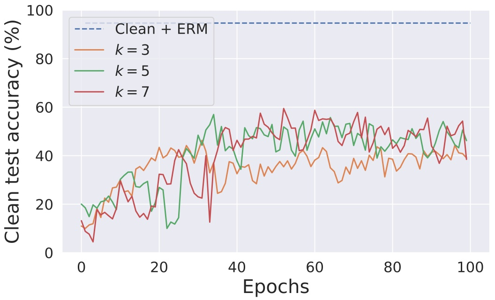

line

| Epochs | Clean + ERM (%) | k = 3 (%) | k = 5 (%) | k = 7 (%) |
| --- | --- | --- | --- | --- |
| 0 | ~95 | ~12 | ~20 | ~13 |
| 10 | ~95 | ~25 | ~28 | ~22 |
| 20 | ~95 | ~40 | ~20 | ~20 |
| 30 | ~95 | ~40 | ~40 | ~35 |
| 40 | ~95 | ~35 | ~45 | ~45 |
| 50 | ~95 | ~35 | ~50 | ~55 |
| 60 | ~95 | ~40 | ~50 | ~55 |
| 70 | ~95 | ~35 | ~50 | ~50 |
| 80 | ~95 | ~40 | ~45 | ~45 |
| 90 | ~95 | ~40 | ~45 | ~45 |
| 100 | ~95 | ~40 | ~45 | ~45 |

Figura 4. Imágenes de CIFAR-10 CUDA $( k = 3 , p _ { b } = 0 . 3 )$ entrenadas utilizando ResNet-18 con el marco Deconvolution-based Adversarial Training con tamaños de filtro de convolución traspuesta k variables.

line

| Epochs | Clean + ERM (%) | Random blurring p'b = 0.3 (%) | Mixup \(\alpha\) = 1.0 (%) |
| --- | --- | --- | --- |
| 0 | ~95 | ~28 | ~32 |
| 10 | ~95 | ~12 | ~20 |
| 20 | ~95 | ~12 | ~22 |
| 30 | ~95 | ~18 | ~20 |
| 40 | ~95 | ~12 | ~26 |
| 50 | ~95 | ~12 | ~24 |
| 60 | ~95 | ~14 | ~26 |
| 70 | ~95 | ~12 | ~22 |
| 80 | ~95 | ~12 | ~26 |
| 90 | ~95 | ~12 | ~26 |
| 100 | ~95 | ~14 | ~26 |

Figura 5. Imágenes de CIFAR-10 CUDA $( k = 3 , p _ { b } = 0 . 3 )$ entrenadas utilizando ResNet-18 con augmentations de mixup y difuminado aleatorio (random blurring).

Mostramos la efectividad de CUDA con Tiny-ImageNet [26], DeIT [50], EfficientNetV2 [48] y MobileNetV2 [41] a continuación.

natural_image

Cuadrícula de 20 imágenes en escala de grises que muestran varios animales y objetos, sin texto ni símbolos presentes

(a) pb = 0.1

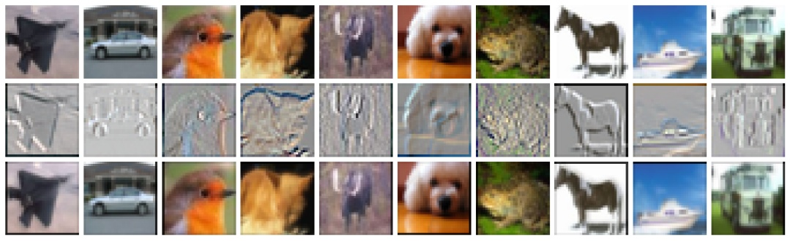

natural_image

Cuadrícula de 20 imágenes en escala de grises que muestran varios animales y objetos, sin texto ni símbolos presentes

(b) pb = 0.3

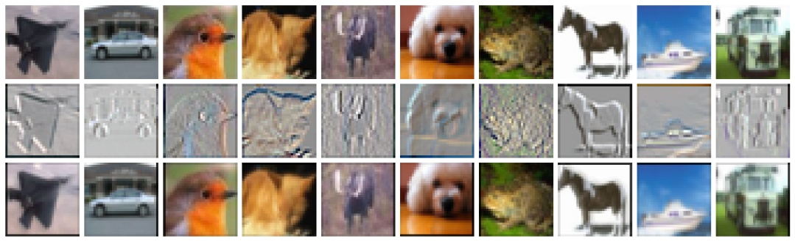

natural_image

Cuadrícula de 20 imágenes en escala de grises que muestran varios animales y objetos, sin texto ni símbolos presentes

(c) pb = 0.5

Figura 6. Imágenes de CIFAR-10 CUDA generadas utilizando diferentes blur parameters pb. La fila superior muestra las imágenes limpias, la fila inferior muestra la imagen CUDA correspondiente y la fila central muestra la diferencia normalizada entre la imagen limpia y la imagen CUDA.

| Model | ERM | $L_2$ AT ($\epsilon = 0.5$) |
| --- | --- | --- |
| DeIT [50] | 24.85 % | 38.90 % |
| EfficientNetV2-S [48] | 20.47 % | 42.19 % |
| MobileNetV2 [41] | 21.10 % | 32.00 % |

Tabla 6. Efectividad de CUDA sobre CIFAR-10.

## A.10. Efectos del difuminado

Aquí estudiamos los efectos del difuminado. Investigamos si el difuminado por clase es necesario para lograr la unlearnability. Para ello, utilizamos un filtro universal (generado utilizando los mismos hiperparámetros $p _ { b } = 0 . 3$ y k = 3) para difuminar todas las imágenes de entrenamiento en el dataset. Una ResNet-18 entrenada en este dataset alcanza un accuracy de test limpio de 90.47%. En esencia, el difuminado realizado solo degrada el accuracy de test limpio en $\sim 4\%$. Esto significa que el difuminado por clase (CUDA) es necesario para lograr el efecto de unlearnability

| Training method | Clean | CUDA |
| --- | --- | --- |
| ERM | 48.14 % | 5.98 % |
| $L_{2}$ AT ($\epsilon = 0.5$) | 42.72 % | 14.54 % |

Tabla 7. Efectividad de Tiny-ImageNet CUDA con ResNet-18. Utilizamos los mismos hiperparámetros que en nuestros experimentos con CIFAR.

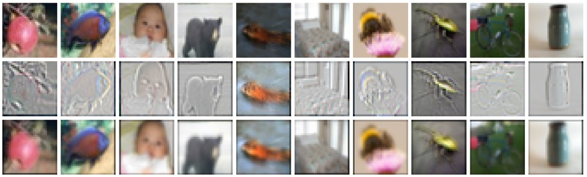

natural_image

Cuadrícula de 20 imágenes en escala de grises que muestran varios objetos, incluidos animales, objetos y objetos sin texto ni símbolos visibles

(a) CIFAR-100

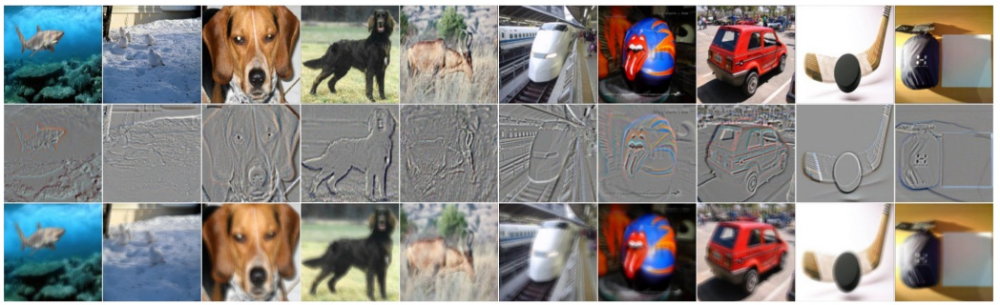

natural_image

Collage de 20 imágenes en escala de grises que muestran animales, vehículos y formas abstractas (sin texto ni símbolos)

(b) ImageNet-100

Figura 7. Imágenes de CIFAR-100 e ImageNet-100 CUDA generadas utilizando $k = 3 , p _ { b } = 0 . 3$ y $k = 9 , p _ { b } = 0 . 0 6 ,$ respectivamente. La fila superior muestra las imágenes limpias, la fila inferior muestra la imagen CUDA correspondiente y la fila central muestra la diferencia normalizada entre la imagen limpia y la imagen CUDA.

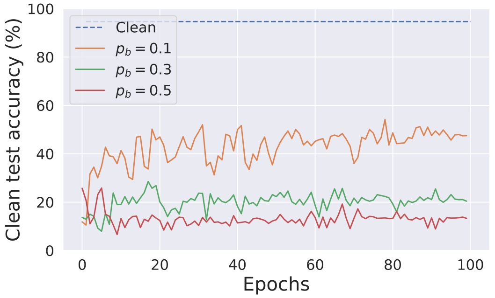

line

| Epochs | Clean (%) | pb = 0.1 (%) | pb = 0.3 (%) | pb = 0.5 (%) |
| --- | --- | --- | --- | --- |
| 0 | ~95 | ~12 | ~14 | ~26 |
| 20 | ~95 | ~45 | ~20 | ~12 |
| 40 | ~95 | ~40 | ~20 | ~12 |
| 60 | ~95 | ~45 | ~20 | ~12 |
| 80 | ~95 | ~45 | ~20 | ~12 |
| 100 | ~95 | ~48 | ~20 | ~14 |

Figura 8. ResNet-18 entrenada utilizando datos de CIFAR-10 CUDA generados con diferentes blur parameters pb.

line

| Epochs | Clean + ERM (%) | k=3, pb=0.3 (%) | k=5, pb=0.2 (%) | k=7, pb=0.1 (%) | k=9, pb=0.06 (%) |
| --- | --- | --- | --- | --- | --- |
| 0 | 81 | ~10 | ~10 | ~10 | ~10 |
| 20 | 81 | ~33 | ~28 | ~26 | ~23 |
| 40 | 81 | ~46 | ~40 | ~35 | ~32 |
| 60 | 81 | ~52 | ~47 | ~40 | ~36 |
| 80 | 81 | ~57 | ~51 | ~45 | ~40 |
| 100 | 81 | ~59 | ~51 | ~47 | ~41 |

Figura 9. ResNet-18 entrenada utilizando el dataset ImageNet-100 CUDA generado con diferentes tamaños de filtro k.

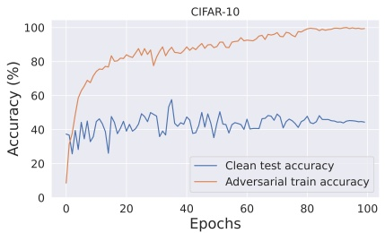

line

| Epochs | Clean test accuracy (%) | Adversarial train accuracy (%) |
| --- | --- | --- |
| 0 | ~38 | ~9 |
| 10 | ~45 | ~75 |
| 20 | ~40 | ~82 |
| 30 | ~48 | ~85 |
| 40 | ~45 | ~88 |
| 50 | ~42 | ~90 |
| 60 | ~42 | ~93 |
| 70 | ~48 | ~96 |
| 80 | ~45 | ~99 |
| 90 | ~45 | ~100 |
| 100 | ~45 | ~100 |

(a) CIFAR-10

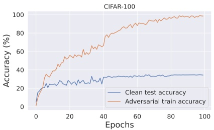

line

| Epochs | Clean test accuracy (%) | Adversarial train accuracy (%) |
| --- | --- | --- |
| 0 | ~5 | ~5 |
| 10 | ~25 | ~40 |
| 20 | ~25 | ~55 |
| 30 | ~28 | ~58 |
| 40 | ~30 | ~65 |
| 50 | ~33 | ~80 |
| 60 | ~33 | ~88 |
| 70 | ~34 | ~92 |
| 80 | ~34 | ~95 |
| 90 | ~35 | ~98 |
| 100 | ~35 | ~99 |

(b) CIFAR-100

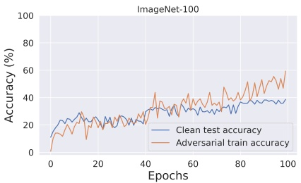

line

| Epochs | Clean test accuracy (%) | Adversarial train accuracy (%) |
| --- | --- | --- |
| 0 | ~12 | ~0 |
| 10 | ~25 | ~18 |
| 20 | ~25 | ~20 |
| 30 | ~25 | ~25 |
| 40 | ~25 | ~25 |
| 50 | ~32 | ~35 |
| 60 | ~32 | ~35 |
| 70 | ~32 | ~35 |
| 80 | ~35 | ~40 |
| 90 | ~38 | ~50 |
| 100 | ~38 | ~58 |

(c) ImageNet-100

Figura 10. Curvas de adversarial training para ResNet-18 con los datasets CIFAR-10, CIFAR-100 e ImageNet-100 CUDA.

(véase la Figura 11). Este experimento también demuestra que el difuminado que realizamos no inutiliza el dataset ni destruye su semántica. Para este experimento, utilizamos modelos con inicialización y semillas aleatorias fijas.

## A.11. ¿Por qué funciona CUDA?

En esta sección, realizamos experimentos que demuestran que un modelo entrenado en el dataset CUDA aprende la relación entre los filtros por clase y las etiquetas. Entrenamos ResNet-18 utilizando el dataset CIFAR-10 CUDA para los experimentos. Realizamos tres ensayos independientes para cada uno de los experimentos y reportamos las puntuaciones medias de rendimiento. Los modelos entrenados alcanzan un accuracy de test limpio medio de 21.34%. Ahora, utilizamos los filtros por clase para perturbar las imágenes en el conjunto de test basándonos en sus etiquetas correspondientes. Los modelos entrenados alcanzan un accuracy medio muy alto de 99.91% en este conjunto de test perturbado. Esto demuestra que los modelos entrenados aprendieron la relación entre los filtros y sus etiquetas correspondientes. A continuación, permutamos los filtros para perturbar el conjunto de test de tal manera que las imágenes del conjunto de test con etiqueta i se perturban con los filtros de la clase (i + 1)%10. Los modelos entrenados alcanzan un accuracy medio muy bajo de 2.53% en este conjunto de test perturbado. Esto es evidencia de que CUDA también puede utilizarse para backdoor attacks.

## A.12. Efecto del transfer learning

En esta sección, experimentamos el efecto de utilizar una ResNet-18 preentrenada con PyTorch [38]. La entrenamos en el dataset CIFAR-10 CUDA de dos formas diferentes. En primer lugar, realizamos un fine-tuning de toda la red en el dataset CUDA con un learning rate de 0.001 durante 15 epochs. Esto alcanza un accuracy de test limpio de 42.42%. Realizar el fine-tuning de la red con datos de entrenamiento limpios brinda un accuracy de test limpio de 94.19%. A continuación, congelamos todas las capas excepto la capa final para entrenar un clasificador lineal con los pesos preentrenados utilizando el dataset CIFAR-10 CUDA. Denominamos a esto «Freeze and learn». Utilizamos un optimizador SGD para entrenar la capa lineal durante 15 epochs con un learning rate inicial de 0.1. El learning rate decae en un factor de 10 después de cada 5 epochs. Esto alcanza un accuracy de test limpio de 48.22%. Los resultados se muestran en la Figura 12. Este experimento demuestra que la red preentrenada con entrenamiento sobre datos CUDA no ayuda a lograr una buena generalización en la distribución de datos limpios.

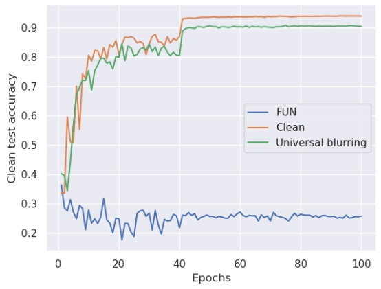

line

| Epochs | FUN | Clean | Universal blurring |
| --- | --- | --- | --- |
| 0 | ~0.36 | ~0.36 | ~0.40 |
| 10 | ~0.25 | ~0.75 | ~0.70 |
| 20 | ~0.22 | ~0.82 | ~0.78 |
| 30 | ~0.25 | ~0.85 | ~0.82 |
| 40 | ~0.25 | ~0.88 | ~0.82 |
| 50 | ~0.26 | ~0.93 | ~0.90 |
| 60 | ~0.26 | ~0.93 | ~0.90 |
| 70 | ~0.25 | ~0.93 | ~0.90 |
| 80 | ~0.26 | ~0.93 | ~0.90 |
| 90 | ~0.25 | ~0.93 | ~0.90 |
| 100 | ~0.26 | ~0.93 | ~0.90 |

(a) Test accuracy

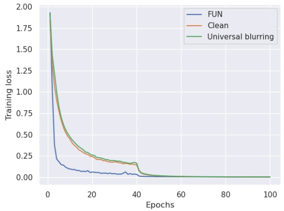

line

| Epochs | FUN (Training loss) | Clean (Training loss) | Universal blurring (Training loss) |
| --- | --- | --- | --- |
| 0 | ~1.95 | ~1.95 | ~1.95 |
| 5 | ~0.20 | ~0.60 | ~0.65 |
| 10 | ~0.12 | ~0.40 | ~0.45 |
| 15 | ~0.08 | ~0.30 | ~0.35 |
| 20 | ~0.07 | ~0.25 | ~0.28 |
| 25 | ~0.06 | ~0.20 | ~0.22 |
| 30 | ~0.05 | ~0.18 | ~0.20 |
| 35 | ~0.06 | ~0.17 | ~0.19 |
| 40 | ~0.04 | ~0.15 | ~0.16 |
| 45 | ~0.01 | ~0.05 | ~0.06 |
| 50 | ~0.01 | ~0.02 | ~0.03 |
| 60 | ~0.00 | ~0.01 | ~0.01 |
| 80 | ~0.00 | ~0.00 | ~0.00 |
| 100 | ~0.00 | ~0.00 | ~0.00 |

(b) Training loss

Figura 11. ResNet-18 entrenada utilizando datasets de CIFAR-10 limpio, CUDA y universalmente difuminado.

## A.13. Efecto de CUDA con técnicas de regularización

En esta sección, estudiamos el efecto de entrenar una ResNet-18 con el dataset CIFAR-10 CUDA utilizando diversas técnicas de regularización tales como mixup [58], cutout [9], cutmix [56], autoaugment [7] y regularización ortogonal [3]. Realizamos mixup, cutout, cutmix, autoaugment y regularización ortogonal para alcanzar 25.53%, 25.80%, 26.93%, 34.09% y 50.72%. Aunque estas regularizaciones ayudan a mejorar el entrenamiento ERM convencional, estas redes aún no logran una buena generalización en la distribución de datos limpios. Utilizamos cutout mediante códigos de GitHub 6 con length=16 y n holes=1, cutmix mediante códigos de GitHub 7 con $\alpha = 1$, autoaugment mediante PyTorch [38], mixup mediante códigos de GitHub 8 con $\alpha = 1$ y regularización ortogonal mediante códigos de GitHub 9 con reg=1e-6 (todas licencias MIT).

## A.14. Distribución de parámetros de la red

En esta sección, comparamos las distribuciones de los parámetros de la red de ResNet-18 entrenada en datasets de CIFAR-10 limpio y CUDA (véase la Figura 13). Ambas distribuciones son similares a distribuciones normales con una media de 0. Sin embargo, la distribución de parámetros del modelo limpio tiene una desviación estándar mayor que la distribución de parámetros del modelo basado en CUDA.

<small>6[https://github.com/uoguelph-mlrg/Cutout/blob/ master/util/cutout.py](https://github.com/uoguelph-mlrg/Cutout/blob/master/util/cutout.py)</small>

<small>7[https://github.com/hysts/pytorch\_cutmix/blob/ master/cutmix.py](https://github.com/hysts/pytorch_cutmix/blob/master/cutmix.py)</small>

<small>8[https : / / github . com / facebookresearch / mixup - cifar10/blob/main/train.py](https://github.com/facebookresearch/mixup-cifar10/blob/main/train.py)</small>

<small>9[https://github.com/kevinzakka/pytorch-goodies](https://github.com/kevinzakka/pytorch-goodies)</small>

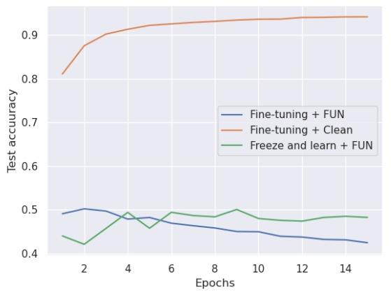

line

| Epochs | Fine-tuning + FUN | Fine-tuning + Clean | Freeze and learn + FUN |
| --- | --- | --- | --- |
| 1 | ~0.49 | ~0.81 | ~0.44 |
| 2 | ~0.50 | ~0.88 | ~0.42 |
| 3 | ~0.50 | ~0.90 | ~0.46 |
| 4 | ~0.48 | ~0.91 | ~0.50 |
| 5 | ~0.48 | ~0.92 | ~0.46 |
| 6 | ~0.47 | ~0.93 | ~0.49 |
| 7 | ~0.47 | ~0.93 | ~0.49 |
| 8 | ~0.46 | ~0.94 | ~0.48 |
| 9 | ~0.45 | ~0.94 | ~0.50 |
| 10 | ~0.45 | ~0.94 | ~0.48 |
| 11 | ~0.44 | ~0.94 | ~0.48 |
| 12 | ~0.44 | ~0.94 | ~0.48 |
| 13 | ~0.43 | ~0.94 | ~0.48 |
| 14 | ~0.43 | ~0.94 | ~0.49 |
| 15 | ~0.43 | ~0.94 | ~0.48 |

(a) Test accuracy

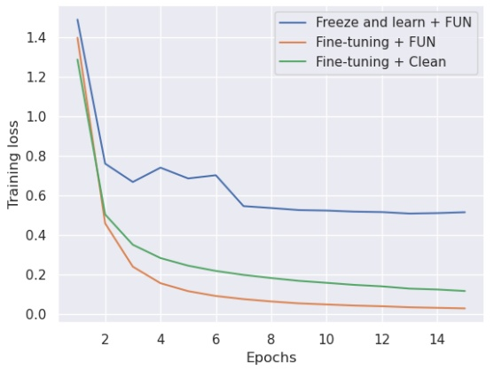

line

| Epochs | Freeze and learn + FUN | Fine-tuning + FUN | Fine-tuning + Clean |
| --- | --- | --- | --- |
| 1 | ~1.5 | ~1.4 | ~1.3 |
| 2 | ~0.77 | ~0.46 | ~0.52 |
| 3 | ~0.67 | ~0.24 | ~0.35 |
| 4 | ~0.74 | ~0.16 | ~0.29 |
| 5 | ~0.69 | ~0.12 | ~0.25 |
| 6 | ~0.70 | ~0.10 | ~0.22 |
| 7 | ~0.55 | ~0.08 | ~0.20 |
| 8 | ~0.54 | ~0.07 | ~0.19 |
| 9 | ~0.53 | ~0.06 | ~0.18 |
| 10 | ~0.53 | ~0.05 | ~0.17 |
| 11 | ~0.52 | ~0.05 | ~0.16 |
| 12 | ~0.52 | ~0.04 | ~0.15 |
| 13 | ~0.51 | ~0.04 | ~0.14 |
| 14 | ~0.51 | ~0.03 | ~0.13 |
| 15 | ~0.52 | ~0.03 | ~0.12 |

(b) Training loss

Figura 12. ResNet-18 preentrenada con fine-tuning y entrenamiento de la capa lineal utilizando los datasets de CIFAR-10 CUDA y limpio.

histogram

| Bin (Range) | FUN (Frequency) | Clean (Frequency) |
| --- | --- | --- |
| -0.03~-0.02 | ~0 | ~0 |
| -0.02~-0.01 | ~0 | ~0.05e6 |
| -0.01~0.00 | ~0.05e6 | ~0.4e6 |
| 0.00~0.01 | ~0.05e6 | ~0.4e6 |
| 0.01~0.02 | ~0 | ~0.05e6 |
| 0.02~0.03 | ~0 | ~0 |

Figura 13. Distribuciones de los parámetros de la red de ResNet-18 entrenada en datasets de CIFAR-10 limpio y CUDA.
