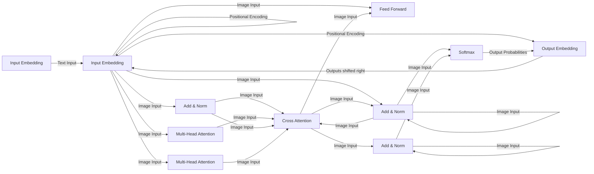
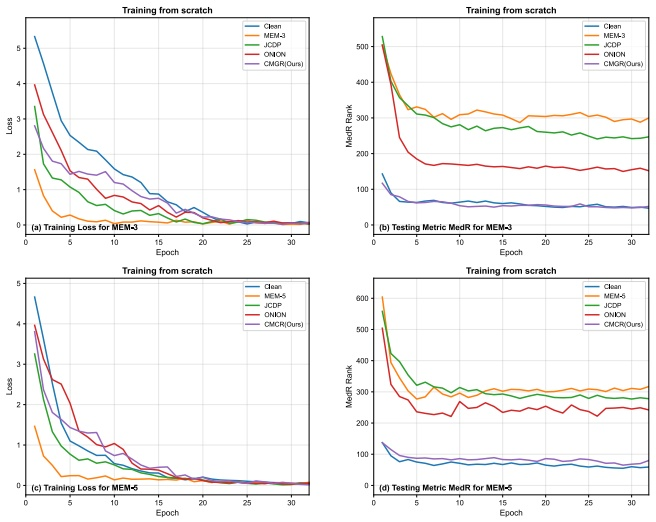

# Cross-Modal Collaborative Recovery: Rompiendo la Protección de Multimodal Unlearnable Examples

1.er Ruijia Li

Escuela de Ciencia e Ingeniería Cibernética

Universidad de Zhengzhou

Zhengzhou, China

ruijia\_li@gs.zzu.edu.cn

2.º Zijiao Zhang

Escuela de Ciencia e Ingeniería Cibernética

Universidad de Zhengzhou

Zhengzhou, China

zzj@zzu.edu.cn

3.er Ximin Huang

Centro de Gestión de Redes

Universidad de Zhengzhou

Zhengzhou, China

hxm@zzu.edu.cn

4.º Hongwei Hu

Centro de Gestión de Redes

Universidad de Zhengzhou

Zhengzhou, China

hhw@zzu.edu.cn

5.º Xining Gao

Escuela de Ciencia e Ingeniería Cibernética

Universidad de Zhengzhou

Zhengzhou, China

gxn@gs.zzu.edu.cn

**Resumen—Con el rápido desarrollo del multimodal machine learning, la seguridad de los datos se ha convertido en un cuello de botella crítico que restringe el avance de la inteligencia artificial multimodal. Los multimodal unlearnable examples, como paradigma emergente de protección de datos, previenen el entrenamiento no autorizado de modelos al perturbar la consistencia semántica cross-modal mediante adversarial perturbations e identificadores de trigger. Sin embargo, los mecanismos existentes de protección multimodal adolecen de deficiencias significativas de robustez y vulnerabilidades de seguridad. Este artículo lleva a cabo una evaluación sistemática de seguridad de los multimodal unlearnable examples y propone un framework de ataque denominado Cross-Modal Collaborative Recovery (CMCR). CMCR integra Joint Conditional Diffusion Purification para el denoising de imágenes, Adaptive Text Purification para la eliminación de triggers y Visual Cross-modal BART para la reconstrucción cross-modal. Los experimentos demuestran que CMCR restaura con éxito el rendimiento de recuperación image-text a niveles cercanos a los de los datos limpios (clean data) a través de diferentes arquitecturas de modelos, logrando una tasa de recuperación (recovery rate) promedio del 89,0%. Nuestros resultados revelan que los multimodal unlearnable examples actuales poseen vulnerabilidades de seguridad y una robustez insuficiente frente a ataques coordinados cross-modal.**

**Términos del índice—multimodal unlearnable examples, cross-modal attack, vision-language models, diffusion models, data privacy protection**

## I. Introducción

Con el rápido avance del aprendizaje multimodal (multimodal learning), los Vision-Language Models (VLMs) a gran escala como CLIP han demostrado un rendimiento excepcional en la recuperación de imágenes, la generación de contenido y la comprensión multimodal [1]. Estos modelos se entrenan mediante contrastive learning sobre pares masivos de image-text provenientes de Internet [2]. No obstante, esto plantea graves preocupaciones de privacidad, ya que la información personal puede incorporarse en los conjuntos de entrenamiento, exponiendo a los modelos a membership inference attacks [3], prompt injection attacks [4] y model inversion attacks [5].

Para abordar estos desafíos, los unlearnable examples han surgido como un mecanismo de defensa [6]. Al inyectar perturbaciones imperceptibles (adversarial perturbations), este enfoque interrumpe el aprendizaje del modelo mientras preserva la percepción humana. Los avances recientes extienden esto a escenarios multimodales, perturbando la consistencia semántica cross-modal mediante una optimización adversarial conjunta [7].

Sin embargo, los entornos multimodales introducen vulnerabilidades distintivas que las protecciones existentes no logran resolver. La redundancia de información cross-modal proporciona múltiples superficies de ataque, mientras que la alineación semántica permite ataques coordinados. Las investigaciones actuales se centran en el diseño de la protección sin considerar modelos de amenazas avanzados, evaluando únicamente ataques unimodales aislados. Esto pasa por alto fallos en cascada donde comprometer una modalidad permite atacar a otra. Por ejemplo, purificar el texto permite que la semántica recuperada guíe la purificación de la imagen, creando efectos sinérgicos que las defensas existentes no pueden contrarrestar.

Para revelar estas limitaciones y establecer las bases para una protección robusta, proponemos el framework Cross-Modal Collaborative Recovery (CMCR) siguiendo los principios de divulgación responsable. A diferencia de los enfoques unimodales independientes, CMCR explota las relaciones semánticas cross-modal donde la recuperación de una modalidad guía a la otra. Al integrar diffusion purification, eliminación de triggers y reconstrucción cross-modal, analizamos sistemáticamente las vulnerabilidades de los multimodal unlearnable examples.

**Consideraciones éticas**: Esta investigación sigue los principios de divulgación responsable en la investigación de seguridad. Al exponer las vulnerabilidades de protección, nuestro objetivo es motivar el desarrollo de defensas robustas, de manera similar a cómo la investigación en adversarial attacks impulsa la robustez de los modelos. Nuestros hallazgos sirven como un análisis de red-team para avanzar en la seguridad multimodal en lugar de facilitar una explotación no autorizada.

## Contribuciones:

• Diseñamos un esquema adaptativo de escisión de triggers a nivel de token que colabora con diffusion models para vencer los mecanismos de protección multimodal.

• Proponemos el framework CMCR, logrando una neutralización end-to-end de las protecciones basadas en multimodal unlearnable examples.

• Proponemos un esquema basado en BART guiado por visión que aprovecha la semántica cross-modal para una purificación coordinada.

## II. Trabajos Relacionados

## A. Unlearnable Examples

Los unlearnable examples evitan el entrenamiento no autorizado de modelos inyectando adversarial perturbations imperceptibles [8] que perturban la generalización del modelo. La investigación existente se centra primordialmente en la clasificación de imágenes unimodal. Los métodos de generación de perturbaciones incluyen enfoques libres de modelo (model-free) como LSP y CUDA [9], [10], que construyen patrones de ruido a nivel de píxel, y enfoques basados en modelos (model-based) como GUE, CSD, UCs y DH [11]–[14], que utilizan surrogate models. Error-Minimization (EM) [15] genera perturbaciones robustas al minimizar el error de entrenamiento, mientras que UDP y EUDP [16], [17] protegen los diffusion models ajustando las distribuciones de muestreo.

Multi-step Error Minimization (MEM) extendió por primera vez los unlearnable examples a los dominios multimodales, alterando la alineación semántica de los pares image-text en VLMs como CLIP [18]. En la actualidad, MEM representa el único método multimodal públicamente disponible con detalles de implementación, lo que lo convierte en un baseline representativo para evaluar estrategias de ataque cross-modal. Al optimizar conjuntamente el ruido adversarial en imágenes y los patrones de trigger en texto, MEM construye correlaciones espurias cross-modal que degradan el rendimiento de los modelos multimodales. Debido a la dispersión de características de alta dimensión y a la falta de señales explícitas de supervisión en el contrastive learning, los métodos unimodales tradicionales muestran una eficacia limitada en entornos multimodales [19].

## B. Ataques contra Unlearnable Examples

Los métodos de ataque existentes se dirigen principalmente a tareas unimodales. Joint-Conditional Diffusion Purification (JCDP) aprovecha los priors de la variedad de datos (data manifold) para reproyectar ejemplos protegidos en el espacio aprendible [20], introduciendo restricciones conjuntas de distancias a nivel de píxel y perceptuales durante el denoising para eliminar las perturbaciones preservando al mismo tiempo la semántica. El adversarial training y la data augmentation también han mostrado potencial para restaurar la entrenabilidad [21].

Sin embargo, extender estas técnicas a los dominios multimodales sigue sin explorarse. Los datos multimodales requieren estrategias de purificación coordinadas que aborden las correlaciones semánticas cross-modal, ya que la eliminación de triggers de texto difiere fundamentalmente del denoising de imágenes. Los métodos existentes no pueden aplicarse directamente a escenarios multimodales, aunque la capacidad de denoising de los diffusion models proporciona una base para atacar los mecanismos de protección multimodal.

## III. Metodología

## A. Definición Formal del Problema

Sea $\mathcal { D } \; = \; \{ ( I _ { i } , T _ { i } ) \} _ { i = 1 } ^ { N }$ un dataset multimodal limpio que contiene $N$ pares de image-text, donde $I _ { i } \in \mathbb { R } ^ { H \times W \times C }$ representa una muestra de imagen y $T _ { i }$ representa la descripción de texto correspondiente. El objetivo de los multimodal unlearnable examples es generar un dataset protegido $\mathcal { D } ^ { \prime } = \{ ( I _ { i } ^ { \prime } , T _ { i } ^ { \prime } ) \} _ { i = 1 } ^ { N }$ tal que los modelos entrenados sobre $\mathcal { D } ^ { \prime }$ presenten un rendimiento deficiente en la distribución limpia original.

Específicamente, la generación de multimodal unlearnable examples se define como:

$$
\mathcal {D} ^ {\prime} = \left\{\left(I _ {i} + \delta_ {i}, T _ {i} \oplus t _ {i}\right) \right\} _ {i = 1} ^ {N} \tag {1}
$$

donde $\delta _ { i }$ representa las perturbaciones imperceptibles de la imagen que satisfacen $\| \delta _ { i } \| _ { \infty }   \leq   \epsilon ,$ y $t _ { i }$ representa los triggers insertados en el texto original.

Nuestro objetivo de ataque es restaurar la aprendibilidad (learnability) del dataset multimodal protegido dado $\mathcal { D } ^ { \prime }$ mediante la generación de un dataset purificado $\mathcal { D } ^ { * }   =   \{ \left( I _ { i } ^ { * } , T _ { i } ^ { * } \right) \} _ { i = 1 } ^ { N }$ tal que los modelos entrenados sobre $\mathcal { D } ^ { * }$ puedan alcanzar un rendimiento cercano al de los clean data originales.

## B. Análisis de Vulnerabilidades de los Mecanismos de Protección Multimodal

El análisis de la protección existente de multimodal unlearnable examples revela tres vulnerabilidades clave. En primer lugar, los diffusion models poseen sólidas capacidades de identificación de ruido [24], lo que hace que las adversarial perturbations con características de alta frecuencia sean detectables y eliminables a pesar de la inyección por minimización de errores (error-minimization). En segundo lugar, los triggers de texto exhiben patrones identificables y regularidades posicionales; los métodos MEM actuales insertan triggers en posiciones fijas al inicio de la oración, lo que proporciona objetivos claros de eliminación, mientras que la inconsistencia semántica permite la detección cross-modal. En tercer lugar, los métodos existentes protegen las modalidades de forma independiente sin restricciones de consistencia cross-modal, lo que permite a los atacantes comprometer primero las modalidades más débiles y aprovechar la semántica recuperada para guiar los ataques sobre las demás, creando efectos sinérgicos que las defensas actuales no pueden contrarrestar. Estas vulnerabilidades indican que la protección multimodal requiere un diseño sinérgico cross-modal en lugar de una simple combinación de métodos unimodales.

## C. Framework Cross-Modal Collaborative Recovery (CMCR)

Se propone el framework Cross-Modal Collaborative Recovery (CMCR) para aprovechar la correspondencia semántica inherente en los datos multimodales, transformando la purificación unimodal en una recuperación colaborativa cross-modal. El proceso de recuperación se define como un problema de optimización conjunta:

$$
\{I ^ {*}, T ^ {*} \} = \arg \min _ {I ^ {*}, T ^ {*}} \mathcal {L} _ {\text {total}} \left(I ^ {*}, T ^ {*}\right) \tag {2}
$$

donde la loss function total se define como:

$$
\mathcal {L} _ {\text {total}} = \mathcal {L} _ {c} \left(I ^ {*}, T ^ {*}\right) + \lambda_ {1} \mathcal {L} _ {f} \left(I ^ {*}, I ^ {\prime}\right) + \lambda_ {2} \mathcal {L} _ {t} \left(T ^ {*}, T ^ {\prime}\right) \tag {3}
$$

denotando $\mathcal { L } _ { c } ( \cdot )$ la pérdida de consistencia semántica cross-modal, representando $\mathcal { L } _ { f } ( \cdot )$ la pérdida de fidelidad de la imagen e indicando $\mathcal { L } _ { t } ( \cdot )$ la pérdida de fluidez del texto.

CMCR consta de tres módulos: JCDP para la purificación de imágenes, ATP para la eliminación de triggers y VCA-BART para la reconstrucción cross-modal. JCDP purifica primero las imágenes, luego ATP intenta la eliminación del trigger; si no tiene éxito, se activa VCA-BART utilizando la guía de la imagen purificada (Figura 1).

flowchart

Este diagrama de flujo ilustra un flujo de trabajo de procesamiento de texto para los módulos de visual cross-modal BART, mostrando cómo las imágenes no aprendidas se procesan mediante purificación y alineación adaptativa de texto, y luego se procesan a través de codificadores visuales para identificar perros pequeños.

Fig. 1. Visión general del framework CMCR

## D. Módulo de Purificación Adaptativa de Texto (ATP)

Una estrategia de purificación adaptativa selecciona dinámicamente entre el truncamiento de tokens y la reconstrucción cross-modal en función de la efectividad de la eliminación. Dado que los métodos actuales insertan triggers al principio de las oraciones, la eliminación basada en la posición intenta el truncamiento secuencial de 1 a 5 tokens:

$$
T _ {\text {clean}} ^ {(k)} = \left[ t _ {k + 1}, t _ {k + 2}, \dots , t _ {n} \right], \quad k \in \{1, 2, 3, 4, 5 \} \tag {4}
$$

La estrategia óptima de purificación se selecciona evaluando la consistencia semántica image-text bajo diferentes longitudes de truncamiento:

$$
k ^ {*} = \arg \min _ {k} \mathcal {L} _ {\text {alignment}} \left(I ^ {*}, T _ {\text {clean}} ^ {(k)}\right) \tag {5}
$$

donde la pérdida de alineación semántica (semantic alignment loss) se define como:

$$
\mathcal {L} _ {\text {alignment}} = 1 - \frac {\exp \left(s _ {I , T} / \tau\right)}{\sum_ {j} \exp \left(s _ {I , T _ {j}} / \tau\right)} \tag {6}
$$

donde $s _ { I , T } = \operatorname { s i m } ( f _ { I } ( I ^ { * } ) , f _ { T } ( T _ { \mathrm { c l e a n } } ^ { ( k ) } ) )$ representa la puntuación de similitud entre las características de la imagen y del texto.

Se establece un umbral de rendimiento $\tau _ { \mathrm { t h r e s h } } = 0{,}75$ para la Recovery Rate. Cuando el recall de recuperación text-image tras la escisión de tokens alcanza $\geq 0{,}75$, el modelo puede aprender de manera efectiva, lo que indica triggers al inicio de la oración donde una escisión simple es suficiente. De lo contrario, los triggers están posicionados en otro lugar y se activa el mecanismo de reconstrucción cross-modal.

## E. Módulo Visual Cross-modal BART (VCA-BART)

Cuando el truncamiento simple de tokens no puede lograr los resultados esperados, activamos un mecanismo de reconstrucción profunda basado en la generación de texto condicionada visualmente. Este módulo aborda específicamente las estrategias de aleatorización de la posición del trigger que los defensores puedan adoptar.

Mejoramos estructuralmente el modelo preentrenado BART integrando mecanismos de cross-attention en cada capa del decodificador:

$$
\text {CrossAttention} (Q, K, V) = \text {softmax} \left(\frac {Q K ^ {T}}{\sqrt {d _ {k}}}\right) V \tag {7}
$$

la matriz query $Q$ se deriva de las representaciones ocultas de la secuencia de texto, y los pares key-value ($K$, $V$) se derivan de las características de la imagen purificada para guiar la recuperación del texto. La arquitectura se muestra en la Figura 2.

El modelo minimiza la pérdida de generación de texto condicional:

$$
\mathcal {L} _ {\text {generation}} = - \sum_ {i = 1} ^ {| T |} \log P \left(t _ {i} \mid t _ {<   i}, \mathrm{CNN} \left(I ^ {*}\right)\right) \tag {8}
$$

Durante la inferencia, VCA-BART se activa cuando el rendimiento cae por debajo del umbral:

$$
T ^ {*} = \left\{ \begin{array}{l l} T _ {\text {clean}} ^ {(k ^ {*})} & \text {if Medr} \geq \tau_ {\text {thresh}} \\ \text {VCA - BART} \left(T _ {i} \oplus t _ {i}, I ^ {*}\right) & \text {otherwise} \end{array} \right. \tag {9}
$$

Se priorizan los métodos simples por eficiencia, con VCA-BART compensando las limitaciones de ATP. A través de la guía semántica de la imagen, el módulo genera texto limpio semánticamente consistente con las imágenes purificadas a pesar de las posiciones aleatorizadas del trigger.

TABLA I Comparación de la efectividad con diferentes unlearnable examples en varios datasets.

<table><tr><td rowspan="3">Methods</td><td colspan="4">Flickr8k</td><td colspan="4">Flickr30k</td><td colspan="4">MSCOCO</td></tr><tr><td colspan="2">Image → Text</td><td colspan="2">Text → Image</td><td colspan="2">Image → Text</td><td colspan="2">Text → Image</td><td colspan="2">Image → Text</td><td colspan="2">Text → Image</td></tr><tr><td>Recall@10</td><td>Medr</td><td>Recall@10</td><td>Medr</td><td>Recall@10</td><td>Medr</td><td>Recall@10</td><td>Medr</td><td>Recall@10</td><td>Medr</td><td>Recall@10</td><td>Medr</td></tr><tr><td>Clean</td><td>27.4</td><td>42</td><td>26.1</td><td>38</td><td>48.3</td><td>13</td><td>44.8</td><td>18</td><td>63.2</td><td>6</td><td>57.9</td><td>7</td></tr><tr><td>MEM-3</td><td>4.3</td><td>312</td><td>3.6</td><td>265</td><td>3.9</td><td>409</td><td>2.3</td><td>316</td><td>1.8</td><td>1679</td><td>1.3</td><td>1293</td></tr><tr><td>JCDP [20]</td><td>4.7</td><td>291</td><td>3.5</td><td>259</td><td>4.5</td><td>386</td><td>3.2</td><td>297</td><td>1.9</td><td>1535</td><td>1.5</td><td>1106</td></tr><tr><td>ONION [25]</td><td>12.1</td><td>108</td><td>14.9</td><td>92</td><td>10.2</td><td>173</td><td>8.3</td><td>168</td><td>1.8</td><td>1301</td><td>1.6</td><td>904</td></tr><tr><td>CMCR (Ours)</td><td>27.5</td><td>43</td><td>26.6</td><td>40</td><td>40.5</td><td>49</td><td>37.1</td><td>55</td><td>45.4</td><td>358</td><td>40.7</td><td>293</td></tr></table>

flowchart

Fig. 2. Arquitectura del módulo Visual Cross-modal BART (VCA-BART) con mecanismo de Cross-Attention

## F. Módulo Joint Conditional Diffusion Purification (JCDP)

Se adopta el enfoque JCDP, aprovechando las potentes capacidades de denoising de los diffusion models preentrenados para reproyectar imágenes que contienen adversarial perturbations de regreso a la variedad de imágenes naturales (natural image manifold) a través de restricciones condicionales conjuntas.

Dada una imagen contaminada $I ^ { \prime }   =   I + \delta$ , primero realizamos un proceso de difusión hacia adelante (forward diffusion process) sobre ella, añadiendo gradualmente ruido gaussiano hasta que las perturbaciones queden completamente sepultadas:

$$
q (I _ {t} | I _ {0}) = \mathcal {N} (I _ {t}; \sqrt {\bar {\alpha} _ {t}} I _ {0}, (1 - \bar {\alpha} _ {t}) \mathbf {I}) \tag {10}
$$

donde $\begin{array} { r } { \bar { \alpha } _ { t } = \prod _ { s = 1 } ^ { t } \alpha _ { s } } \end{array}$ y $\alpha _ { t } = 1 - \beta _ { t }$ . Tras $T _ { p }$ pasos de difusión, las adversarial perturbations $\delta$ se diluyen suficientemente en el ruido:

$$
I _ {T _ {p}} ^ {\prime} = \sqrt {\bar {\alpha} _ {T _ {p}}} I ^ {\prime} + \sqrt {1 - \bar {\alpha} _ {T _ {p}}} \epsilon \tag {11}
$$

Durante el proceso de denoising inverso, introducimos restricciones condicionales conjuntas de distancia de píxel y distancia perceptual. La distribución condicional del proceso inverso se puede expresar como:

$$
p _ {\theta} (I _ {t - 1} ^ {*} | I _ {t} ^ {*}, I _ {t} ^ {\prime}, \Phi (I _ {t} ^ {\prime})) = \mathcal {N} (I _ {t - 1} ^ {*}; \mu_ {\theta} (I _ {t} ^ {*}, t) + \sigma_ {t} ^ {2} (\mathbf {d} _ {1} + \mathbf {d} _ {2}),
$$

$$
\sigma_ {t} ^ {2} \mathbf {I}) \tag {12}
$$

donde los términos condicionales conjuntos se definen como:

$$
\mathbf {d} _ {1} = - \lambda_ {1} \nabla_ {I _ {t} ^ {*}} \mathcal {D} _ {m} \left(I _ {t} ^ {*}, I _ {t} ^ {\prime}\right) \tag {13}
$$

$$
\mathbf {d} _ {2} = - \lambda_ {2} \nabla_ {I _ {t} ^ {*}} \mathcal {D} _ {p} \left(I _ {t} ^ {*}, I _ {t} ^ {\prime}\right) \tag {14}
$$

La distancia de píxel utiliza el error cuadrático medio: $\mathcal { D } _ { m } ( I _ { t } ^ { * } , I _ { t } ^ { \prime } ) =$ $\| I _ { t } ^ { * } - I _ { t } ^ { \prime } \| _ { 2 } ^ { 2 }$ , y la distancia perceptual utiliza la métrica LPIPS: $\mathcal { D } _ { p } ( I _ { t } ^ { * } , I _ { t } ^ { \prime } ) = \| \Phi ( I _ { t } ^ { * } ) - \Phi ( I _ { t } ^ { \prime } ) \| _ { 2 } ^ { 2 }$

Este diseño condicional conjunto garantiza que las imágenes purificadas mantengan tanto la similitud a nivel de píxel con las imágenes originales como la consistencia semántica a nivel perceptual. Mediante múltiples purificaciones iterativas, las adversarial perturbations se eliminan en gran medida.

## IV. Evaluación Experimental

## A. Datasets

Se emplean tres datasets de benchmark con escala y complejidad progresivamente crecientes para la evaluación. Flickr8K comprende 8.000 imágenes con 40.000 pares de image-text; Flickr30K contiene 31.000 imágenes con 155.000 pares; MS-COCO incluye 123.000 imágenes de entrenamiento con 615.000 pares. El método objetivo es el método de generación de multimodal unlearnable examples MEM, que protege los datos mediante la optimización conjunta de ruido adversarial en imágenes y triggers de texto.

## B. Métricas de Evaluación

La efectividad del ataque se evalúa utilizando métricas de recuperación multimodal. Recall@K (K=1,5,10) mide la proporción de respuestas correctas en los top-K resultados, donde valores más altos indican un mejor rendimiento. Median Rank (Medr) evalúa la calidad del ranking como la posición mediana de las respuestas correctas, donde valores más bajos indican una mejor restauración de la learnability. La Recovery Rate cuantifica la efectividad general y se calcula como:

TABLA II Comparación de efectividad de diferentes módulos de procesamiento de texto contra la protección MEM-5.

<table><tr><td rowspan="2">Methods</td><td colspan="4">Flickr8K</td><td colspan="4">Flickr30K</td><td colspan="4">MS-COCO</td></tr><tr><td>Image → Text Recall@10</td><td>Text Medr</td><td>Text → Image Recall@10</td><td>Image Medr</td><td>Image → Text Recall@10</td><td>Text Medr</td><td>Text → Image Recall@10</td><td>Image Medr</td><td>Image → Text Recall@10</td><td>Text Medr</td><td>Image Medr</td><td>Image Medr</td></tr><tr><td>Clean</td><td>27.4</td><td>42</td><td>26.1</td><td>38</td><td>48.3</td><td>13</td><td>44.8</td><td>18</td><td>63.2</td><td>6</td><td>57.9</td><td>7</td></tr><tr><td>MEM-5</td><td>3.8</td><td>325</td><td>3.2</td><td>278</td><td>3.5</td><td>418</td><td>2.1</td><td>325</td><td>1.6</td><td>1720</td><td>1.2</td><td>1315</td></tr><tr><td>JCDP + ATP</td><td>26.8</td><td>45</td><td>25.9</td><td>41</td><td>39.2</td><td>52</td><td>36.4</td><td>58</td><td>43.8</td><td>375</td><td>39.2</td><td>305</td></tr><tr><td>JCDP + VCA-BART</td><td>27.1</td><td>44</td><td>26.2</td><td>40</td><td>41.1</td><td>47</td><td>38.0</td><td>53</td><td>46.2</td><td>340</td><td>41.5</td><td>285</td></tr></table>

$$
\text {Recovery Rate} = \frac {\mathrm{Medr} _ {\mathcal {D} ^ {\prime}} - \mathrm{Medr} _ {\mathcal {D} ^ {*}}}{\mathrm{Medr} _ {\mathcal {D} ^ {\prime}} - \mathrm{Medr} _ {\mathcal {D}}} \times 100 \% \tag {15}
$$

donde $\mathrm { M e d r } _ { \mathrm { p r o t e c t e d } }$ representa el rango mediano (median rank) de los datos protegidos, $\mathbf { M e d r } _ { \mathrm { p u r i f i e d } }$ representa el rango mediano tras la purificación, y $\mathrm { M e d r _ { c l e a n } }$ representa el rango mediano de los clean data.

## C. Efectividad

Los resultados experimentales demuestran que nuestro framework propuesto CMCR puede vulnerar eficazmente el mecanismo de protección de multimodal unlearnable examples generado por MEM. Los resultados de las pruebas en tres benchmark datasets se muestran en la Tabla I.

Los resultados de la pérdida del modelo y la efectividad de recuperación (Medr) de varios métodos se muestran en la Figura 3. El entrenamiento de CMCR exhibe una tasa de convergencia más lenta en comparación con MEM. Este hallazgo es consistente con la hipótesis teórica de MEM, que postula que este permite al modelo eludir el mecanismo de penalización estableciendo un «atajo» (shortcut).

Fig. 3. Comparación de pérdida de entrenamiento y métricas de prueba

## D. Experimentos de Ablación

Los experimentos de ablación sobre datos protegidos con MEM-3 revelan la contribución de cada componente. JCDP por sí solo logra únicamente un 7,6% de recuperación, lo que indica la efectividad limitada de la purificación pura de imágenes en escenarios multimodales. ATP por sí solo alcanza el 52,3%, demostrando el papel crítico de la eliminación de triggers de texto. El framework CMCR completo alcanza una recuperación del 89,0% (Figura 4), validando la efectividad de la purificación colaborativa cross-modal.

Fig. 4. Comparación de la Recovery Rate de diferentes métodos

Para validar aún más la efectividad del procesamiento de texto, comparamos ATP y VCA-BART contra MEM-5 en la Tabla II. VCA-BART se desempeña ligeramente mejor en datasets complejos (Flickr30K, MS-COCO), ya que la guía semántica cross-modal compensa mejor las diferencias semánticas al procesar patrones de trigger complejos.

## E. Transferibilidad

Para verificar la capacidad de generalización, evaluamos CMCR en diferentes arquitecturas de modelos: ResNet50 (surrogate model), ResNet101 y ViT-B/32 (Tabla III). Los resultados demuestran una efectividad estable a través de las arquitecturas, demostrando una buena transferibilidad.

## F. Sobrecarga Computacional

Evaluamos el costo computacional de CMCR en una GPU NVIDIA RTX 4090. El proceso de purificación constituye la sobrecarga computacional principal: para MS-COCO (123K imágenes), JCDP requiere aproximadamente 38 horas debido al muestreo iterativo de difusión de 200 pasos, mientras que la purificación de texto (ATP + VCA-BART cuando se activa) agrega alrededor de 8 horas, lo que produce un costo total de purificación única de 46 horas. El entrenamiento estándar posterior sobre datos purificados requiere 15 horas durante 50 epochs, resultando en un costo total de 61 horas en comparación con las 52 horas del adversarial training sobre datos protegidos. Si bien CMCR incurre en una sobrecarga inicial más alta, el dataset purificado puede reutilizarse para múltiples ejecuciones de entrenamiento sin necesidad de re-purificación, volviéndose más eficiente que el adversarial training después de aproximadamente 4 iteraciones. Este costo por única vez se justifica por la recovery rate del 89% y la capacidad de utilizar procedimientos de entrenamiento estándar en lugar de esquemas adversariales especializados.

TABLA III

La transferibilidad de MEM-3 generado en un modelo ResNet50 a través de diferentes arquitecturas de modelos.

<table><tr><td rowspan="3">Model</td><td colspan="4">Flickr8k</td><td colspan="4">Flickr30k</td><td colspan="4">MSCOCO</td></tr><tr><td colspan="2">Image → Text</td><td colspan="2">Text → Image</td><td colspan="2">Image → Text</td><td colspan="2">Text → Image</td><td colspan="2">Image → Text</td><td colspan="2">Text → Image</td></tr><tr><td> $D_c$ </td><td> $D_u$ </td><td> $D_c$ </td><td> $D_u$ </td><td> $D_c$ </td><td> $D_u$ </td><td> $D_c$ </td><td> $D_u$ </td><td> $D_c$ </td><td> $D_u$ </td><td> $D_c$ </td><td> $D_u$ </td></tr><tr><td>RN50</td><td>42</td><td>43</td><td>38</td><td>40</td><td>13</td><td>49</td><td>18</td><td>55</td><td>6</td><td>102</td><td>7</td><td>115</td></tr><tr><td>RN101</td><td>40</td><td>41</td><td>38</td><td>39</td><td>14</td><td>45</td><td>21</td><td>57</td><td>4</td><td>98</td><td>6</td><td>82</td></tr><tr><td>ViT-B/32</td><td>41</td><td>45</td><td>35</td><td>39</td><td>11</td><td>43</td><td>15</td><td>46</td><td>4</td><td>67</td><td>4</td><td>71</td></tr></table>

## V. Conclusión

Este artículo analiza sistemáticamente la protección de multimodal unlearnable examples y propone CMCR, logrando una recuperación promedio del 89,0% a través de tres datasets. El análisis revela tres vulnerabilidades clave: los diffusion models permiten la detección de perturbaciones, los triggers de posición fija proporcionan objetivos de eliminación, y la protección de modalidades independientes permite un compromiso secuencial.

Nuestra evaluación se centra en MEM [18], actualmente el único método de protección multimodal públicamente disponible con código de implementación. El trabajo futuro deberá evaluar CMCR contra métodos adicionales a medida que surjan. Además, ATP asume triggers al inicio de la oración, aunque VCA-BART aborda posiciones aleatorizadas.

Estos hallazgos revelan limitaciones fundamentales en los mecanismos actuales de protección multimodal y establecen benchmarks de evaluación para futuros diseños de defensa. Las protecciones más robustas deberían incorporar estrategias dinámicas de triggers, restricciones de consistencia cross-modal y adversarial training contra ataques de purificación. Este trabajo profundiza la comprensión de las vulnerabilidades de seguridad multimodal y motiva el desarrollo de mecanismos de defensa integrales.

## Referencias

[1] A. Radford et al., “Learning transferable visual models from natural language supervision,” in Proc. 38th Int. Conf. Machine Learning, PMLR, vol. 139, 2021, pp. 8748–8763.

[2] Y. Gu, Y. Bai, and S. Xu, “CS-MIA: Membership inference attack based on prediction confidence series in federated learning,” J. Inf. Security Appl., vol. 67, art. no. 103201, June 2022.

[3] H. Mu et al., “Stealthy jailbreak attacks on large language models via benign data mirroring,” in Proc. 2025 Conf. North Amer. Chapter Assoc. Comput. Linguistics: Human Language Technologies (NAACL-HLT), Albuquerque, NM, USA, 2025, pp. 1784–1799.

[4] F. Tramèr, F. Zhang, A. Juels, M. K. Reiter, and T. Ristenpart, “Stealing machine learning models via prediction APIs,” in Proc. 25th USENIX Security Symp., Austin, TX, USA, 2016, pp. 601–618.

[5] J. Ren et al., “Transferable Unlearnable Examples,” in Proc. Int. Conf. Learning Representations (ICLR), 2023.

[6] X. Liu, X. Jia, Y. Xun, S. Liang, and X. Cao, “Multimodal unlearnable examples: Protecting data against multimodal contrastive learning,” in Proc. 32nd ACM Int. Conf. Multimedia (MM), Melbourne, VIC, Australia, 2024, pp. 4789–4798.

[7] I. J. Goodfellow, J. Shlens, and C. Szegedy, “Explaining and harnessing adversarial examples,” in Proc. 3rd Int. Conf. Learning Representations (ICLR), San Diego, CA, USA, 2015.

[8] D. Yu et al., “Availability attacks create shortcuts,” in Proc. 39th Int. Conf. Machine Learning (ICML), Baltimore, MD, USA, 2022, pp. 25063–25068.

[9] Mahesh Vaijaninthymala Krishnamoorthy. Data Obfuscation Through Latent Space Projection for Privacy - Preserving AI Governance: Case Studies in Medical Diagnosis and Finance Fraud Detection[J]. JMIRx Med, 2025 Mar 12;6:e70100. DOI: 10.2196/70100.

[10] V. S. Sadasivan, M. Soltanolkotabi, and S. Feizi, “CUDA: Convolutionbased unlearnable datasets,” in Proc. IEEE/CVF Conf. Computer Vision Pattern Recognition (CVPR), Vancouver, BC, Canada, 2023, pp. 3862–3871.

[11] J. Ren, “Transferable unlearnable examples,” in Proc. 11th Int. Conf. Learning Representations (ICLR), Kigali, Rwanda, 2023.

[12] J. Zhang et al., N. Chen, P. Mu, Z. He, H. Li, and L. Zhang, “Unlearnable clusters: Towards label-agnostic unlearnable examples,” in Proc. IEEE/CVF Conf. Computer Vision Pattern Recognition (CVPR), Vancouver, BC, Canada, 2023, pp. 1483–1492.

[13] R. Meng et al., “Semantic deep hiding for robust unlearnable examples,” IEEE Trans. Inf. Forensics Security, vol. 19, pp. 4093–4108, 2024.

[14] Z. Zhao, Y. Lu, and J. Zhu, “Unlearnable examples for diffusion models: Protect data from unauthorized exploitation,” 2023, arXiv:2306.01902. [Online]. Available: https://arxiv.org/abs/2306.01902

[15] H. Huang, X. Ma, S. M. Erfani, J. Bailey, and Y. Wang, “Unlearnable examples: Making personal data unexploitable,” in Proc. 9th Int. Conf. Learning Representations (ICLR), 2021.

[16] Z. Zhao, Y. Lu, and J. Zhu, “Unlearnable Examples for Diffusion Models: Protect Data from Unauthorized Exploitation,” 2024, arXiv:2306.01902v2. [Online]. Available: https://arxiv.org/abs/2306.01902

[17] Y. Yu et al., “Purify unlearnable examples via rate-constrained variational autoencoders,” in Proc. 41st Int. Conf. Machine Learning (ICML), PMLR, vol. 235, 2024, pp. 1–25.

[18] X. Liu, X. Jia, Y. Xun, S. Liang, and X. Cao, “Multimodal unlearnable examples: Protecting data against multimodal contrastive learning,” in Proc. 32nd ACM Int. Conf. Multimedia (MM), Melbourne, VIC, Australia, 2024, pp. 4789–4798.

[19] R. Nakada, T. Imaizumi, M. Sugiyama, and M. Yamada, “Understanding multimodal contrastive learning and incorporating unpaired data,” 2023, arXiv:2302.06232. [Online]. Available: https://arxiv.org/abs/2302.06232

[20] W. Jiang et al., “Unlearnable examples give a false sense of security: Piercing through unexploitable data with learnable examples,” in Proc. 31st ACM Int. Conf. Multimedia, 2023, pp. 8901–8921.

[21] Z. He and M. Singh, “VQUNet: Vector quantization U-Net for defending adversarial attacks by regularizing unwanted noise,” in Proc. 2024 7th Int. Conf. Machine Vision Applications (ICMVA), 2024, pp. 69–76.

[22] T. Qin, X. Gao, J. Zhao, K. Ye, and C.-Z. Xu, “Learning the unlearnable: Adversarial augmentations suppress unlearnable example attacks,” 2023, arXiv:2303.15127. [Online]. Available: https://arxiv.org/abs/2303.15127

[23] X. Gong et al., “ARMOR: Shielding unlearnable examples against data augmentation,” 2025, arXiv:2501.08862. [Online]. Available: https://arxiv.org/abs/2501.08862

[24] J. Ho, A. Jain, and P. Abbeel, “Denoising diffusion probabilistic models,” in Proc. Adv. Neural Inf. Process. Syst. (NeurIPS), vol. 33, 2020, pp. 6840–6851.

[25] F. Qi et al., “ONION: A simple and effective defense against textual backdoor attacks,” in Proc. 2021 Conf. Empirical Methods Natural Language Processing (EMNLP), Punta Cana, Dominican Republic, 2021, pp. 9558–9566.
