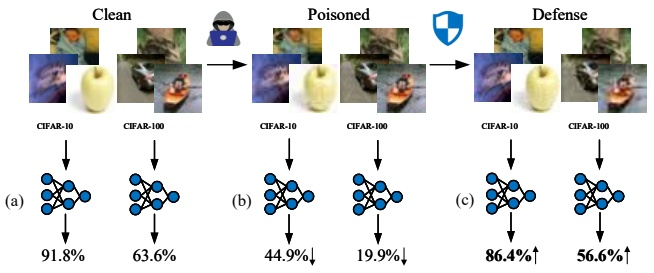
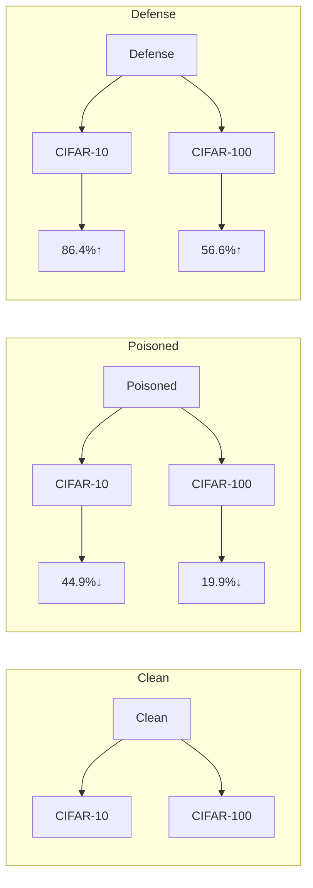
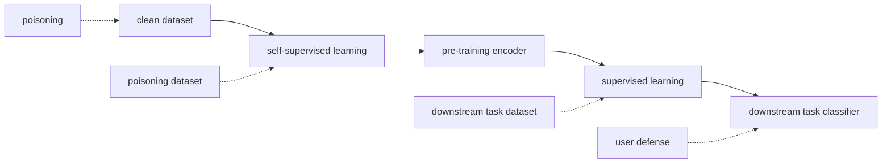
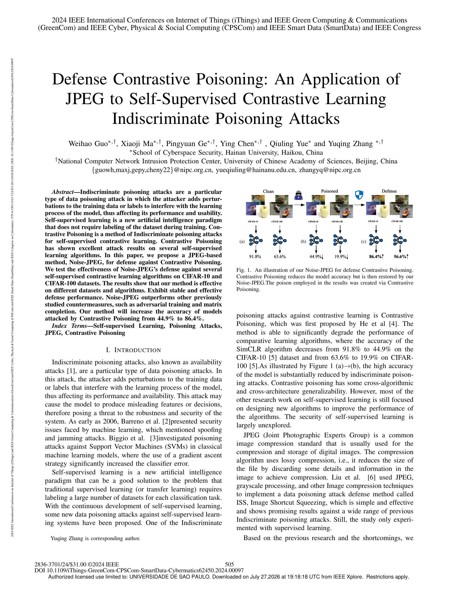
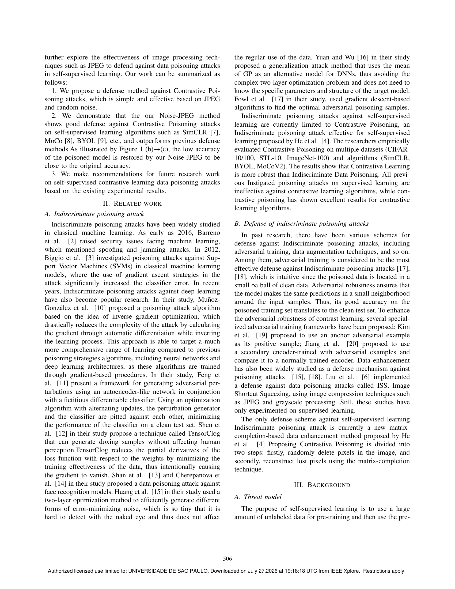

<!-- MinerU 4.0.9, tier advanced, VLM llama.cpp/Vulkan GPU; automatic extraction, tables require comparison with the PDF. -->

[PDF original](../../Defense-Contrastive-Poisoning-An-Application-of-JPEG-to-Self-Supervised-Contrastive-Learning.pdf)

# Defensa contra Contrastive Poisoning: Una Aplicación de JPEG frente a Indiscriminate Poisoning Attacks en Self-Supervised Contrastive Learning

Weihao Guo<sup>∗,†</sup>, Xiaoji Ma<sup>∗,†</sup>, Pingyuan Ge<sup>∗,†</sup>, Ying Chen<sup>∗,†</sup>, Qiuling Yue<sup>∗</sup> y Yuqing Zhang <sup>∗,†</sup>

<sup>∗</sup>School of Cyberspace Security, Hainan University, Haikou, China

†National Computer Network Intrusion Protection Center, University of Chinese Academy of Sciences, Beijing, China

{guowh,maxj,gepy,cheny22}@nipc.org.cn, yueqiuling@hainanu.edu.cn, zhangyq@nipc.org.cn

**Resumen—Los indiscriminate poisoning attacks son un tipo particular de data poisoning attack en el que el atacante añade perturbaciones a los datos de entrenamiento o a las etiquetas para interferir con el proceso de aprendizaje del modelo, afectando así su rendimiento y usabilidad. El self-supervised learning es un nuevo paradigma de inteligencia artificial que no requiere el etiquetado del conjunto de datos durante el entrenamiento. Contrastive Poisoning es un método de indiscriminate poisoning attacks para self-supervised contrastive learning. Contrastive Poisoning ha demostrado excelentes resultados de ataque en diversos algoritmos de self-supervised learning. En este artículo, proponemos un método basado en JPEG, Noise-JPEG, para la defensa contra Contrastive Poisoning. Evaluamos la efectividad de la defensa de Noise-JPEG frente a diversos algoritmos de self-supervised contrastive learning en los conjuntos de datos CIFAR-10 y CIFAR-100. Los resultados muestran que nuestro método es eficaz en diferentes conjuntos de datos y algoritmos, exhibiendo un rendimiento de defensa estable y efectivo. Noise-JPEG supera a otras contramedidas estudiadas previamente, tales como adversarial training y matrix completion. Nuestro método incrementa la accuracy de los modelos atacados por Contrastive Poisoning del 44.9% al 86.4%.**

**Términos del Índice—Self-supervised Learning, Poisoning Attacks, JPEG, Contrastive Poisoning**

## I. INTRODUCCIÓN

Los indiscriminate poisoning attacks, también conocidos como ataques de disponibilidad (availability attacks) [1], son un tipo particular de data poisoning attacks. En este ataque, el atacante introduce perturbaciones en los datos de entrenamiento o en las etiquetas que interfieren con el proceso de aprendizaje del modelo, afectando así su rendimiento y disponibilidad. Este ataque puede hacer que el modelo genere representaciones de características (features) o decisiones engañosas, planteando en consecuencia una amenaza para la robustez y seguridad del sistema. Ya en 2006, Barreno et al. [2] presentaron los problemas de seguridad a los que se enfrenta el machine learning, donde mencionaron ataques de spoofing y jamming. Biggio et al. [3] investigaron los poisoning attacks contra Support Vector Machines (SVMs) en modelos clásicos de machine learning, donde el uso de una estrategia de gradient ascent incrementó significativamente el error del clasificador.

El self-supervised learning es un nuevo paradigma de inteligencia artificial que puede constituir una adecuada solución al problema de que el aprendizaje supervisado tradicional (o transfer learning) requiere el etiquetado de una gran cantidad de conjuntos de datos para cada tarea de clasificación. Con el desarrollo continuo del self-supervised learning, se han propuesto nuevos data poisoning attacks dirigidos a sistemas de self-supervised learning. Uno de los indiscriminate

Yuqing Zhang es el autor de correspondencia.



<details>
<summary>flowchart</summary>


</details>

Fig. 1. Ilustración de nuestro Noise-JPEG para la defensa contra Contrastive Poisoning. Contrastive Poisoning reduce la accuracy del modelo, pero esta es posteriormente restaurada por nuestro Noise-JPEG. El veneno (poison) empleado en los resultados fue creado mediante Contrastive Poisoning.

poisoning attacks contra el contrastive learning es Contrastive Poisoning, el cual fue propuesto por primera vez por He et al. [4]. El método es capaz de degradar significativamente el rendimiento de los algoritmos de aprendizaje contrastivo, donde la accuracy del algoritmo SimCLR disminuye del 91.8% al 44.9% en el conjunto de datos CIFAR-10 [5] y del 63.6% al 19.9% en CIFAR-100 [5]. Como se ilustra en la Figura 1 (a)→(b), la alta accuracy del modelo se reduce sustancialmente mediante indiscriminate poisoning attacks. Contrastive Poisoning posee cierta generalizabilidad interalgorítmica y entre arquitecturas. Sin embargo, la mayor parte de las investigaciones restantes en self-supervised learning aún se centran en el diseño de nuevos algoritmos para mejorar el rendimiento de los mismos. La seguridad del self-supervised learning permanece ampliamente inexplorada.

JPEG (Joint Photographic Experts Group) es un estándar común de compresión de imágenes que se utiliza habitualmente para la compresión y el almacenamiento de imágenes digitales. El algoritmo de compresión emplea compresión con pérdida (lossy compression), es decir, reduce el tamaño del archivo descartando ciertos detalles e información en la imagen para lograr la compresión. Liu et al. [6] utilizaron JPEG, procesamiento en escala de grises y otras técnicas de compresión de imágenes para implementar un método de defensa frente a data poisoning attacks denominado ISS (Image Shortcut Squeezing), el cual resulta simple y efectivo y exhibe resultados prometedores contra una amplia gama de indiscriminate poisoning attacks previos. No obstante, dicho estudio solo experimentó con aprendizaje supervisado.

Con base en las investigaciones previas y en las limitaciones identificadas, exploramos en mayor profundidad la efectividad de técnicas de procesamiento de imágenes tales como JPEG para defenderse contra data poisoning attacks en self-supervised learning. Nuestro trabajo se puede resumir de la siguiente manera:

1. Proponemos un método de defensa contra los ataques de Contrastive Poisoning, el cual es simple y efectivo, fundamentado en JPEG y ruido aleatorio (random noise).

2. Demostramos que nuestro método Noise-JPEG exhibe una sólida defensa contra los ataques de Contrastive Poisoning en algoritmos de self-supervised learning tales como SimCLR [7], MoCo [8], BYOL [9], etc., y supera a los métodos de defensa previos. Como se ilustra en la Figura 1 (b)→(c), la baja accuracy del modelo envenenado es restaurada por nuestro Noise-JPEG hasta aproximarse a la accuracy original.

3. Formulamos recomendaciones para futuros trabajos de investigación sobre data poisoning attacks en self-supervised contrastive learning a partir de los resultados experimentales obtenidos.

## II. TRABAJO RELACIONADO

## A. Indiscriminate poisoning attack

Los indiscriminate poisoning attacks han sido ampliamente estudiados en el machine learning clásico. Ya en 2006 [citado en el texto original como 2016], Barreno et al. [2] plantearon los problemas de seguridad a los que se enfrenta el machine learning, donde mencionaron ataques de spoofing y jamming. En 2012, Biggio et al. [3] investigaron los poisoning attacks contra Support Vector Machines (SVMs) en modelos clásicos de machine learning, donde el empleo de estrategias de gradient ascent en el ataque incrementó significativamente el error del clasificador. En años recientes, los indiscriminate poisoning attacks contra deep learning también se han convertido en un área de investigación popular. En su estudio, Muñoz-González et al. [10] propusieron un algoritmo de poisoning attack fundamentado en la idea de optimización de gradiente inverso (back-gradient optimization), el cual reduce drásticamente la complejidad del ataque calculando el gradiente mediante diferenciación automática a la vez que invierte el proceso de aprendizaje. Esta aproximación es capaz de dirigirse a un rango de algoritmos de aprendizaje mucho más amplio en comparación con las estrategias de envenenamiento previas, incluyendo redes neuronales y arquitecturas de deep learning, dado que estos algoritmos se entrenan mediante procedimientos basados en gradientes. En su estudio, Feng et al. [11] presentan un marco para la generación de adversarial perturbations utilizando una red de tipo autoencoder junto con un clasificador diferenciable ficticio. Mediante un algoritmo de optimización con actualizaciones alternadas, el generador de perturbaciones y el clasificador se enfrentan entre sí, minimizando el rendimiento del clasificador sobre un conjunto de prueba limpio (clean test set). Shen et al. [12], en su estudio, proponen una técnica denominada TensorClog que puede generar muestras de hostigamiento/envenenamiento (doxing samples) sin afectar la percepción humana. TensorClog reduce las derivadas parciales de la loss function con respecto a los pesos al minimizar la efectividad de entrenamiento de los datos, provocando intencionalmente de este modo el desvanecimiento del gradiente (vanishing gradient). Shan et al. [13] y Cherepanova et al. [14], en sus respectivos estudios, propusieron data poisoning attacks contra modelos de reconocimiento facial. Huang et al. [15], en su estudio, utilizaron un método de optimización bi-nivel para generar eficientemente diferentes formas de error-minimizing noise, el cual resulta tan minúsculo que es difícil de detectar a simple vista y, por ende, no interfiere con el uso regular de los datos. Yuan y Wu [16], en su estudio, propusieron un método de ataque de generalización que utiliza la media de procesos gaussianos (GP) como modelo subrogado (surrogate model) para DNNs, eludiendo así el complejo problema de optimización bi-nivel y sin requerir el conocimiento de los parámetros ni de la estructura específica del modelo objetivo. Fowl et al. [17], en su estudio, emplearon algoritmos basados en gradient descent para encontrar las muestras óptimas de envenenamiento adversarial.

Los indiscriminate poisoning attacks contra el self-supervised learning se limitan en la actualidad a Contrastive Poisoning, un indiscriminate poisoning attack eficaz para self-supervised learning propuesto por He et al. [4]. Los investigadores evaluaron empíricamente Contrastive Poisoning en múltiples conjuntos de datos (CIFAR-10/100, STL-10, ImageNet-100) y algoritmos (SimCLR, BYOL, MoCoV2). Los resultados demuestran que el contrastive learning es más robusto frente al data poisoning indiscriminado. Todos los poisoning attacks previos propuestos para aprendizaje supervisado resultan ineficaces contra los algoritmos de contrastive learning, mientras que Contrastive Poisoning ha demostrado resultados excelentes frente a los algoritmos de contrastive learning.

## B. Defensa contra indiscriminate poisoning attacks

En investigaciones previas, han existido diversos esquemas para la defensa contra indiscriminate poisoning attacks, incluyendo adversarial training, técnicas de data augmentation, entre otros. Entre ellos, el adversarial training se considera la defensa más eficaz frente a los indiscriminate poisoning attacks [17], [18], lo cual resulta intuitivo dado que los datos envenenados se localizan en una pequeña bola $\ell_\infty$ respecto a los datos limpios. La robustez adversarial asegura que el modelo produzca las mismas predicciones en un entorno reducido alrededor de las muestras de entrada. Así, su buena accuracy sobre el conjunto de entrenamiento envenenado se traslada al conjunto de prueba limpio. Para mejorar la robustez adversarial del aprendizaje contrastivo, se han propuesto diversos marcos especializados de adversarial training: Kim et al. [19] propusieron utilizar un ejemplo adversarial de anclaje (anchor adversarial example) como su muestra positiva; Jiang et al. [20] propusieron utilizar un codificador secundario entrenado con ejemplos adversariales y compararlo con un codificador entrenado de manera convencional. La mejora de datos (data augmentation) también ha sido ampliamente estudiada como mecanismo de defensa contra poisoning attacks [15], [18]. Liu et al. [6] implementaron una defensa frente a data poisoning attacks denominada ISS (Image Shortcut Squeezing), empleando técnicas de compresión de imágenes tales como JPEG y procesamiento en escala de grises. Sin embargo, dichos estudios solo se han experimentado en el marco del aprendizaje supervisado.

El único esquema de defensa contra indiscriminate poisoning attacks en self-supervised learning es en la actualidad un nuevo método de data augmentation basado en matrix completion propuesto por He et al. [4] al presentar Contrastive Poisoning, el cual se divide en dos pasos: en primer lugar, eliminar aleatoriamente píxeles de la imagen; en segundo lugar, reconstruir los píxeles perdidos mediante la técnica de matrix completion.

## III. ANTECEDENTES

## A. Modelo de amenazas (Threat model)

El propósito del self-supervised learning consiste en utilizar una gran cantidad de datos no etiquetados para el pre-entrenamiento (pre-training) y, posteriormente, emplear el encoder pre-entrenado para construir clasificadores para múltiples tareas downstream con escasos o nulos datos etiquetados.


<details>
<summary>flowchart</summary>


</details>

Fig. 2. Modelo de amenazas (Threat model).

El self-supervised learning representa una excelente solución ante el problema de tener que etiquetar un conjunto masivo de datos para cada tarea de clasificación en el aprendizaje supervisado; no obstante, al mismo tiempo, el self-supervised learning requiere un conjunto de datos no etiquetados a gran escala. La descarga de datos desde Internet se convierte en una vía habitual para recopilar conjuntos de datos para self-supervised learning. Sin embargo, la seguridad del conjunto de datos recopilado de esta manera no puede garantizarse, ya que se ha demostrado que el envenenamiento de un conjunto de datos a escala web es factible [21]. Debido al gran tamaño del conjunto de datos, el usuario no puede verificar los datos uno a uno, lo que permite al atacante explotar el conjunto de datos. El atacante envenena las imágenes para invalidar los clasificadores entrenados por el usuario a partir de dichas imágenes. Concretamente, este envenenamiento se efectúa introduciendo perturbaciones imperceptibles. Los usuarios conscientes de la presencia de datos envenenados en las imágenes que utilizan adoptan ciertas medidas defensivas para asegurar que los clasificadores entrenados sigan funcionando adecuadamente. En algunos estudios, al atacante también se le denomina protector de datos (data protector) y al usuario, explotador (exploiter).

En este contexto, un atacante puede acceder a los datos de entrenamiento del usuario y envenenar dicho conjunto de datos, pero no puede interferir con los procesos de selección del algoritmo por parte del usuario, el pre-training del encoder y la construcción de los clasificadores downstream. El usuario tiene control absoluto tanto sobre el pre-training del encoder en self-supervised learning como sobre la construcción de los clasificadores para las tareas downstream. Por lo tanto, el objetivo del usuario consiste en combatir el envenenamiento y restaurar la accuracy del modelo a través del método de defensa $C$, aun cuando el modelo sea entrenado sobre el conjunto de datos envenenado $P$. Sobre esta base, construimos el modelo de amenazas (threat model). Véase la Figura 2.

$$
\min _ {\theta} \sum_ {(x _ {i}, y _ {i}) \in P} L (F (C (x _ {i} + \delta_ {i}); \theta), y _ {i}) \tag {1}
$$

Aquí $\theta$ denota los parámetros del modelo y $P$ es el conjunto de datos que contiene las muestras envenenadas. $( x _ { i } , y _ { i } )$ son las muestras del conjunto de datos y sus etiquetas correspondientes. $\delta _ { i }$ es la perturbación añadida a las muestras. $F$ es la función del modelo, que puede interpretarse como un mapeo de las entradas a las salidas. $C$ es una contramedida aplicada a los datos de entrada, tal como compresión de datos u otros pasos de preprocesamiento, cuyo propósito es reducir o eliminar el efecto de $\delta _ { i }$. $L$ es la loss function, la cual cuantifica la discrepancia entre las salidas del modelo y las etiquetas verdaderas.

## B. Contrastive Poisoning

Contrastive Poisoning constituye el primer método de ataque eficaz contra el aprendizaje contrastivo no supervisado (unsupervised contrastive learning) que ataca meticulosamente el mecanismo central del mismo. El proceso de ataque consta de tres componentes clave: en primer lugar, la generación del veneno (poison generation) diseña perturbaciones destructivas de datos contra la función objetivo central del contrastive learning, tal como la InfoNCE loss; en segundo lugar, la capacidad de procesamiento de datos del modelo de aprendizaje se debilita aún más atacando la etapa de data augmentation; por último, se emplea un esquema de propagación de gradiente de dos ramas dirigido específicamente a aquellos algoritmos de contrastive learning que emplean momentum encoders (por ejemplo, MoCo y BYOL) para optimizar los venenos obteniendo simultáneamente gradientes tanto del encoder como del momentum encoder. Este enfoque no solo ataca algoritmos de contrastive learning, sino que también se generaliza para atacar modelos de aprendizaje supervisado. Todo el proceso de ataque prescinde de cualquier modificación de etiquetas y las perturbaciones están diseñadas para ser imperceptibles para los seres humanos. El objetivo radica en reducir la eficacia de la extracción de características (feature extraction) del modelo mediante el envenenamiento del conjunto de datos de entrenamiento, degradando así significativamente el rendimiento del modelo en tareas downstream.

Existen dos implementaciones diferentes de Contrastive Poisoning: sample-level poisoning y category-level poisoning. En el Sample-Level Contrastive Poisoning, cada muestra recibe una operación de interferencia independiente. Esto requiere un mayor número de pasos de actualización así como más pasos de gradient descent para optimizar la interferencia para cada muestra y asegurar la efectividad del ataque. El category-level poisoning difiere del sample-level poisoning en que diseña una interferencia común para cada categoría. Este enfoque exige actualizaciones por rotación más frecuentes debido a que cada actualización incide sobre múltiples muestras dentro del mismo batch. Esta metodología es más eficiente en el procesamiento por lotes (batch processing), pero debe tenerse precaución de no sobreoptimizar hasta el punto de perder influencia sobre la dinámica global del modelo.

## IV. MÉTODO

Con base en el modelo de amenazas anterior y en los resultados de investigación, proponemos Noise-JPEG, un método de defensa simple pero efectivo contra Contrastive Poisoning. Combinamos ruido aleatorio (random noise) con el algoritmo de JPEG compression y ajustamos diferentes parámetros para eliminar el efecto del ruido de Contrastive Poisoning sobre un algoritmo de self-supervised contrastive learning. En general, este método consiste en aplicar el Algoritmo 1 a $C(\cdot)$ en la Ecuación (1).

## V. EXPERIMENTOS

En esta sección, evaluamos la efectividad de nuestro método de defensa, así como de otras contramedidas frente a Contrastive Poisoning. Nuestro código experimental ha sido modificado con base en Contrastive Poisoning, mientras que todos los hiperparámetros empleados en el entrenamiento del veneno (poison training) y en el entrenamiento del modelo son coherentes con Contrastive Poisoning.

Algoritmo 1 Noise-JPEG

<div class="docvortex-algorithm" style="white-space: pre-wrap; font-family:monospace;">
Input: $D$, training dataset(unclear if poisoned);
noiseFlag to control whether to add random noise or not;
weight, random noise weights;
quality, JPEG quality (range 0 to 100)
Output: Processed datasets $D^*$
Initialize an empty set of processed training dataset $D^* \leftarrow \emptyset$
for (img, label, index) $\in D$ do
    img$^* \leftarrow img$
    if noiseFlag then
        img$^* \leftarrow \text{addRandNoise}(img, weight)$
    end if
    img$^* \leftarrow \text{JPEGCompression}(img^*, quality)$
    $D^*.add(img^*, label, index)$
end for
return $D^*$
</div>

## A. Configuración experimental (Experimental settings)

Conjuntos de datos y venenos (poisons): Nuestros experimentos utilizan los conjuntos de datos CIFAR-10 y CIFAR-100. Tanto en CIFAR-10 como en CIFAR-100, empleamos 50,000 imágenes para entrenamiento y 10,000 imágenes para evaluación. Utilizamos el poison suministrado por Contrastive Poisoning para el conjunto de datos CIFAR-10 y entrenamos asimismo el poison para el conjunto de datos CIFAR-100 por nosotros mismos siguiendo el método proporcionado por Contrastive Poisoning.

Algoritmos y modelos: Nuestros experimentos consideran un total de tres algoritmos de self-supervised contrastive learning, concretamente SimCLR, BYOL y MoCoV2. Por defecto, en nuestros experimentos el atacante genera los poisons utilizando el modelo ResNet-18, y el usuario también utiliza ResNet-18.

Configuración de hiperparámetros: Todos los hiperparámetros relacionados con los ataques de Contrastive Poisoning utilizados en nuestros experimentos siguen las configuraciones por defecto de Contrastive Poisoning, y el hiperparámetro de peso del ruido (noise weight) involucrado en nuestro método de defensa se establece en 8/255 conforme a la convención de los trabajos previos. El parámetro de calidad de JPEG se determina llevando a cabo experimentos de defensa contra Contrastive Poisoning en el conjunto de datos CIFAR-10 para el algoritmo SimCLR. Inicialmente realizamos experimentos con un tamaño de paso (step size) de 10 y determinamos el parámetro óptimo de calidad JPEG entre 30 y 40. Luego efectuamos experimentos con un step size de 1 entre 30 y 40, y los resultados experimentales muestran que el mejor efecto defensivo se alcanza cuando la calidad JPEG es 35. Continuaremos utilizando este parámetro en el conjunto de datos CIFAR-100, así como en los algoritmos BYOL y MoCoV2 (véase la Figura 3).

Métricas de evaluación: Juzgamos la eficacia del ataque de Contrastive Poisoning y de la defensa de nuestro Noise-JPEG evaluando la accuracy (linear-acc) de los clasificadores downstream.

## B. Evaluación en el escenario común

Hemos verificado nuestros métodos de defensa en los conjuntos de datos CIFAR-10 y CIFAR-100. En este caso, asumimos que el atacante utiliza el mismo algoritmo de contrastive learning que el usuario, con una tasa de envenenamiento (poisoning rate) del atacante del 100% sobre el conjunto de datos.

La Tabla I reporta el linear-acc de los ataques de Contrastive Poisoning dirigidos a distintos tipos de algoritmos de contrastive learning. A modo de referencia, en la primera fila mostramos el linear-acc entrenado sobre el conjunto de datos limpio (clean dataset). Nuestro enfoque de defensa restaura el linear-acc del modelo SimCLR atacado en el conjunto de datos CIFAR-10 de 44.9% a 86.4% y el linear-acc del modelo SimCLR atacado en el conjunto de datos CIFAR-100 de 19.9% a 56.6%. Los resultados de la Tabla I muestran que nuestras defensas son eficaces en diferentes conjuntos de datos, diferentes algoritmos de contrastive learning y diferentes métodos de envenenamiento. Asimismo, a partir de los resultados, se puede apreciar que añadir random noise antes de realizar operaciones de JPEG mejora el rendimiento de la defensa al incrementar el linear-acc de la defensa frente al modelo SimCLR en el conjunto de datos CIFAR-10 de 85.86% (véase la Figura 3(b)) a 86.4%.

La Tabla II presenta el rendimiento de diferentes métodos de defensa. Llevamos a cabo nuestros experimentos en CIFAR-10 utilizando SimCLR y ResNet-18. Entre todas las defensas, solo Adversarial Training, Matrix Completion y nuestro Noise-JPEG logran funcionar de manera estable bajo ambas estrategias de ataque. Nuestro enfoque proporciona el mejor rendimiento de defensa con un linear-acc de 87.2%.

## C. Evaluación en otros escenarios

Para validar aún más la efectividad de nuestro método, realizamos experimentos de envenenamiento parcial (partial poisoning) y experimentos de envenenamiento nulo (zero poisoning) sobre el algoritmo SimCLR en el conjunto de datos CIFAR-10. Como se ilustra en la Figura 4, los usuarios pueden emplear nuestro método incluso en conjuntos de datos con tasas de envenenamiento desconocidas. El impacto de nuestro método en la accuracy de entrenamiento sobre datos con envenenamiento nulo es reducido, con una pérdida inferior al 4% en la accuracy del modelo en comparación con el 91.8% de la Tabla I.

## D. Visualización del proceso de defensa

En la Figura 5 visualizamos Contrastive Poisoning y nuestra defensa Noise-JPEG. Observamos que nuestro método logra eliminar la mayor parte del ruido, pero aún subsiste cierta cantidad de ruido que no es eliminada, y algunos de los detalles originales también pueden perderse. Estos pueden constituir problemas a resolver en el futuro para mejorar el rendimiento de la defensa.

## VI. CONCLUSIÓN Y PERSPECTIVAS FUTURAS

En este artículo, proponemos Noise-JPEG para defenderse contra Contrastive Poisoning, constituyendo un método simple y eficaz, y validamos el rendimiento y la estabilidad de nuestro método en múltiples conjuntos de datos y algoritmos de self-supervised learning. Noise-JPEG supera a otras contramedidas estudiadas previamente, tales como adversarial training y matrix completion. Al mismo tiempo, constatamos que nuestro método perdió ciertos detalles de la imagen original tras eliminar la mayor parte del ruido. Esta puede ser una dirección para mejorar aún más el rendimiento del proceso en el futuro.

Para el trabajo futuro en términos de enfoques defensivos, exploraremos y optimizaremos Noise-JPEG para mejorar su rendimiento manteniendo al mismo tiempo la simplicidad en su operación. En cuanto a los métodos de ataque, alentamos trabajos futuros dirigidos contra nuestro Noise-JPEG.


Fig. 3. Determinación del parámetro de calidad JPEG. La sección discontinua en rojo de la figura (a) corresponde a nuestra predicción basada en la tendencia de la curva en forma de U invertida. Verificamos esta conjetura en la figura (b). En este proceso, no utilizamos la componente de random noise de nuestro método, y en las secciones subsiguientes demostramos que la defensa tras incorporar random noise supera los resultados actuales.

TABLA I RENDIMIENTO DE CONTRASTIVE POISONING EN DIFERENTES ALGORITMOS DE CONTRASTIVE LEARNING Y CONJUNTOS DE DATOS, Y EFECTO DEFENSIVO DE NUESTRO NOISE-JPEG.

<table><tr><td rowspan="2">Attack Type/Defense</td><td colspan="3">CIFAR-10</td><td colspan="3">CIFAR-100</td></tr><tr><td>SimCLR</td><td>MoCoV2</td><td>BYOL</td><td>SimCLR</td><td>MoCoV2</td><td>BYOL</td></tr><tr><td>Clean</td><td>91.8</td><td>91.8</td><td>92.2</td><td>63.6</td><td>65.2</td><td>65.3</td></tr><tr><td>Contrastive Poisoning (CPS)</td><td>44.9</td><td>55.1</td><td>59.6</td><td>19.9</td><td>21.8</td><td>41.9</td></tr><tr><td>Contrastive Poisoning (CPC)</td><td>68</td><td>61.9</td><td>56.9</td><td>34.7</td><td>41.9</td><td>39.2</td></tr><tr><td>Defense-Contrastive Poisoning (CPS)</td><td>86.4</td><td>86.3</td><td>87.4</td><td>56.6</td><td>56.8</td><td>56.8</td></tr><tr><td>Defense-Contrastive Poisoning (CPC)</td><td>87.9</td><td>87.4</td><td>87.5</td><td>57.3</td><td>57.7</td><td>57.2</td></tr></table>


<details>
<summary>line</summary>

| Poisoning rate (%) | Linear acc (%) |
| --- | --- |
| 100 | 86.26 |
| 80 | 86.34 |
| 70 | 86.64 |
| 60 | 86.69 |
| 50 | 86.95 |
| 40 | 87.05 |
| 30 | 87.11 |
| 20 | 87.15 |
| 10 | 87.35 |
| 0 | 87.58 |
</details>

Fig. 4. Envenenamiento parcial (Partial poisoning). Como se puede observar en la figura, la accuracy del modelo aumenta a medida que disminuye la tasa de envenenamiento (virulization rate). Nuestro método mantiene un rendimiento satisfactorio en todos los casos de envenenamiento.

TABLA II RENDIMIENTO DE DIVERSAS DEFENSAS. CONTRASTIVE POISONING SE ABREVIA COMO CP; EL MEJOR RENDIMIENTO DEFENSIVO SE MUESTRA EN NEGRITA. ALGUNOS DE LOS DATOS DE LA TABLA PROVIENEN DE CONTRASTIVE POISONING [4].

<table><tr><td>Defense Methods</td><td>CP (S)</td><td>CP (C)</td><td>Average</td></tr><tr><td>No Defense</td><td>44.9</td><td>68.9</td><td>56.9</td></tr><tr><td>Random Noise ( $\sigma = \frac{8}{255}$ )</td><td>54.1</td><td>90.3</td><td>72.2</td></tr><tr><td>Random Noise ( $\sigma = \frac{64}{255}$ )</td><td>73.6</td><td>73.6</td><td>73.6</td></tr><tr><td>Gauss Smooth ( $k = 3$ )</td><td>47.8</td><td>87.9</td><td>67.9</td></tr><tr><td>Gauss Smooth ( $k = 15$ )</td><td>59.7</td><td>62.0</td><td>60.9</td></tr><tr><td>Cutout [22]</td><td>47.7</td><td>75.0</td><td>61.4</td></tr><tr><td>Adversarial Training [23]</td><td>79.3</td><td>82.3</td><td>80.8</td></tr><tr><td>Matrix Completion [4]</td><td>85.6</td><td>88.2</td><td>86.9</td></tr><tr><td>Our Noise-JPEG</td><td>86.4</td><td>87.9</td><td>87.2</td></tr><tr><td>Clean Data</td><td colspan="3">91.8</td></tr></table>

## AGRADECIMIENTOS

Este trabajo fue respaldado por el National Key Research and Development Program of China (Nº 2023YFB3106400,


<details>
<summary>flowchart</summary>

```mermaid
graph LR
  subgraph Clean
  A[""] --> B[""]
  B --> C[""]
  C --> D[""]
  D --> E[""]
  E --> F[""]
  F --> G[""]
  G --> H[""]
  H --> I[""]
  I --> J[""]
  J --> K[""]
  K --> L[""]
  end

  subgraph Contrastive Poisoning attack
  M[""] --> N[""]
  N --> O[""]
  O --> P[""]
  P --> Q[""]
  Q --> R[""]
  R --> S[""]
  S --> T[""]
  T --> U[""]
  U --> V[""]
  V --> W[""]
  end

  subgraph Noise_JPEG_defense["Noise-JPEG defense"]
  X[""] --> Y[""]
  Y --> Z[""]
  Z --> AA[""]
  AA --> AB[""]
  AB --> AC[""]
  AC --> AD[""]
  AD --> AE[""]
  AE --> AF[""]
  AF --> AG[""]
  AG --> AH[""]
  AH --> AI[""]
  AI --> AJ[""]
  AJ --> AK[""]
  AK --> AL[""]
  AL --> AM[""]
  end
```
</details>

Fig. 5. Visualización de Contrastive Poisoning y de nuestra defensa Noise-JPEG. Se seleccionó aleatoriamente una imagen de cada clase del conjunto de datos CIFAR-10. Contrastive Poisoning generó el ruido utilizado en la figura contra SimCLR.

2023QY1202), la National Natural Science Foundation of China (U2336203, U1836210), el Key Research and Development Science and Technology of Hainan Province (GHYF2022010) y la Beijing Natural Science Foundation (4242031).

## REFERENCIAS

[1] B. Biggio and F. Roli, “Wild patterns: Ten years after the rise of adversarial machine learning,” in Proceedings of the 2018 ACM SIGSAC Conference on Computer and Communications Security, 2018, pp. 2154–2156.
[2] M. Barreno, B. Nelson, R. Sears, A. D. Joseph, and J. D. Tygar, “Can machine learning be secure?” in Proceedings of the 2006 ACM Symposium on Information, computer and communications security, 2006, pp. 16–25.
[3] B. Biggio, B. Nelson, and P. Laskov, “Poisoning attacks against support vector machines,” arXiv preprint arXiv:1206.6389, 2012.
[4] H. He, K. Zha, and D. Katabi, “Indiscriminate poisoning attacks on unsupervised contrastive learning,” in The Eleventh International Conference on Learning Representations, 2023.
[5] A. Krizhevsky, G. Hinton et al., “Learning multiple layers of features from tiny images,” 2009.
[6] Z. Liu, Z. Zhao, and M. Larson, “Image shortcut squeezing: Countering perturbative availability poisons with compression,” in International conference on machine learning. PMLR, 2023, pp. 22 473–22 487.
[7] T. Chen, S. Kornblith, M. Norouzi, and G. Hinton, “A simple framework for contrastive learning of visual representations,” in International conference on machine learning. PMLR, 2020, pp. 1597–1607.
[8] X. Chen, H. Fan, R. Girshick, and K. He, “Improved baselines with momentum contrastive learning,” arXiv preprint arXiv:2003.04297, 2020.
[9] J.-B. Grill, F. Strub, F. Altche, C. Tallec, P. Richemond, E. Buchatskaya, ´ C. Doersch, B. Avila Pires, Z. Guo, M. Gheshlaghi Azar et al., “Bootstrap your own latent-a new approach to self-supervised learning,” Advances in neural information processing systems, vol. 33, pp. 21 271–21 284, 2020.
[10] L. Munoz-Gonz ˜ alez, B. Biggio, A. Demontis, A. Paudice, V. Wongras- ´ samee, E. C. Lupu, and F. Roli, “Towards poisoning of deep learning algorithms with back-gradient optimization,” in Proceedings of the 10th ACM workshop on artificial intelligence and security, 2017, pp. 27–38.
[11] J. Feng, Q.-Z. Cai, and Z.-H. Zhou, “Learning to confuse: Generating training time adversarial data with auto-encoder,” Advances in Neural Information Processing Systems, vol. 32, 2019.
[12] J. Shen, X. Zhu, and D. Ma, “Tensorclog: An imperceptible poisoning attack on deep neural network applications,” IEEE Access, vol. 7, pp. 41 498–41 506, 2019.
[13] S. Shan, E. Wenger, J. Zhang, H. Li, H. Zheng, and B. Y. Zhao, “Fawkes: Protecting privacy against unauthorized deep learning models,” in 29th USENIX security symposium (USENIX Security 20), 2020, pp. 1589–1604.
[14] V. Cherepanova, M. Goldblum, H. Foley, S. Duan, J. Dickerson, G. Taylor, and T. Goldstein, “Lowkey: Leveraging adversarial attacks to protect social media users from facial recognition,” arXiv preprint arXiv:2101.07922, 2021.
[15] H. Huang, X. Ma, S. M. Erfani, J. Bailey, and Y. Wang, “Unlearnable examples: Making personal data unexploitable,” arXiv preprint arXiv:2101.04898, 2021.
[16] C.-H. Yuan and S.-H. Wu, “Neural tangent generalization attacks,” in International Conference on Machine Learning. PMLR, 2021, pp. 12 230–12 240.
[17] L. Fowl, M. Goldblum, P.-y. Chiang, J. Geiping, W. Czaja, and T. Goldstein, “Adversarial examples make strong poisons,” Advances in Neural Information Processing Systems, vol. 34, pp. 30 339–30 351, 2021.
[18] L. Tao, L. Feng, J. Yi, S.-J. Huang, and S. Chen, “Better safe than sorry: Preventing delusive adversaries with adversarial training,” Advances in Neural Information Processing Systems, vol. 34, pp. 16 209–16 225, 2021.
[19] M. Kim, J. Tack, and S. J. Hwang, “Adversarial self-supervised contrastive learning,” Advances in Neural Information Processing Systems, vol. 33, pp. 2983–2994, 2020.
[20] Z. Jiang, T. Chen, T. Chen, and Z. Wang, “Robust pre-training by adversarial contrastive learning,” Advances in neural information processing systems, vol. 33, pp. 16 199–16 210, 2020.
[21] N. Carlini, M. Jagielski, C. A. Choquette-Choo, D. Paleka, W. Pearce, H. Anderson, A. Terzis, K. Thomas, and F. Tramer, “Poisoning web- \` scale training datasets is practical,” arXiv preprint arXiv:2302.10149, 2023.
[22] T. DeVries and G. W. Taylor, “Improved regularization of convolutional neural networks with cutout,” arXiv preprint arXiv:1708.04552, 2017.
[23] L. Fan, S. Liu, P.-Y. Chen, G. Zhang, and C. Gan, “When does contrastive learning preserve adversarial robustness from pretraining to finetuning?” Advances in neural information processing systems, vol. 34, pp. 21 480–21 492, 2021.

<details>
<summary>Páginas originales para cotejo</summary>

### Página 1



### Página 2



### Página 3


### Página 4


### Página 5


### Página 6


</details>
