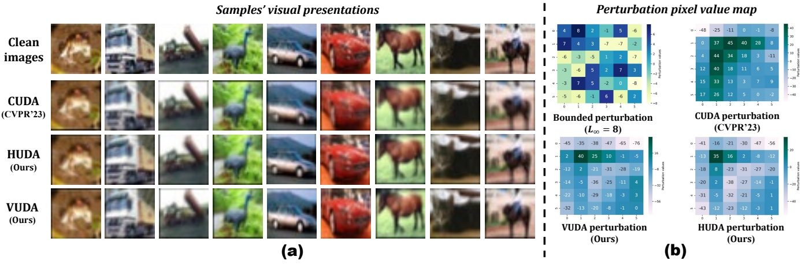
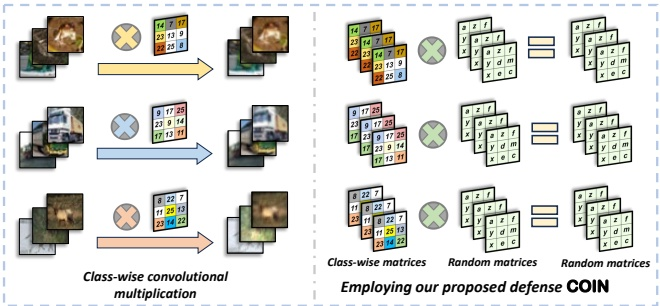
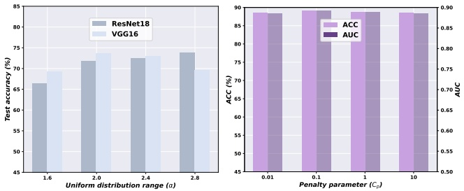

# Detección y corrupción de convolution-based unlearnable examples

**Minghui Li**1\***, Xianlong Wang**2,3\*†**, Zhifei Yu**2**, Shengshan Hu**2,3, **Ziqi Zhou**4**, Longling Zhang**2,3**, Leo Yu Zhang**5

1 School of Software Engineering, Huazhong University of Science and Technology
2 School of Cyber Science and Engineering, Huazhong University of Science and Technology
3 Hubei Key Laboratory of Distributed System Security, Hubei Engineering Research Center on Big Data Security
4 School of Computer Science and Technology, Huazhong University of Science and Technology
5 School of Information and Communication Technology, Griffith University {minghuili,wxl99,yzf,hushengshan,zhouziqi,longlingzhang}@hust.edu.cn, leo.zhang@griffith.edu.au

## Resumen

Los convolution-based unlearnable examples (UEs) aplican ruido convolucional multiplicativo por clase (class-wise) a las muestras de entrenamiento, comprometiendo severamente el rendimiento del modelo. Este nuevo tipo de UEs ha contrarrestado con éxito todos los mecanismos de defensa contra UEs. El fracaso de dichas defensas puede atribuirse a la ausencia de restricciones de norma en el ruido convolucional, lo que conduce a un severo desenfoque de las características de la imagen. Para abordar esto, primero diseñamos un detector basado en píxeles de borde (**EPD**, por sus siglas en inglés, *Edge Pixel-based Detector*) para identificar convolution-based UEs. Tras su detección, proponemos el primer esquema de defensa contra convolution-based UEs, corrompiendo estas muestras mediante multiplicación matricial aleatoria empleando interpolación bilineal (**COIN**, *COrrupting these samples via random matrix multiplication by employing bilinear INterpolation*), de modo que se perturbe la distribución del ruido multiplicativo class-wise. Para evaluar la generalización de nuestro método COIN propuesto, diseñamos adicionalmente dos convolution-based UEs denominados VUDA y HUDA a fin de ampliar el alcance de los convolution-based UEs. Experimentos exhaustivos demuestran la efectividad del esquema de detección EPD y que nuestra defensa COIN supera a 11 defensas state-of-the-art (SOTA), logrando una mejora significativa en los datasets CIFAR e ImageNet.

## Introducción

El éxito de las redes neuronales profundas (DNNs) depende de abundantes datos de entrenamiento de alta calidad, lo que motiva a muchas empresas comerciales a recopilar imágenes de fuentes no identificadas. En este escenario, los adversarios pueden introducir perturbaciones elaboradas e imperceptibles en los datos de imagen para que actúen como unlearnable examples (UEs) que posteriormente se difunden en línea. Esto conduce a una disminución en la capacidad de generalización del modelo víctima tras ser entrenado con dichas muestras (Huang et al. 2021; Lin et al. 2024; Meng et al. 2024). Los UEs previos aplican perturbaciones aditivas bajo la restricción de norma $\mathcal { L } _ { p }$ para garantizar la ocultación visual de la muestra, denominados bounded UEs (Huang et al. 2021; Fu et al. 2022; Ren et al. 2023; Liu, Wang, and Gao 2024). En consecuencia, se han propuesto numerosos esquemas de defensa (Tao et al. 2021; Liu, Zhao, and Larson 2023; Segura et al. 2023; Wang et al. 2024a), comprometiendo en gran medida a los bounded UEs. La facilidad con la que se defienden exitosamente los bounded UEs puede atribuirse a que el ruido aditivo introducido es limitado, lo que hace que la distribución del ruido se desestabilice con facilidad.

| Defensas↓ Métricas→ | Efectividad contra CUDA | Efectividad contra VUDA (Ours) | Efectividad contra HUDA (Ours) | Independiente del modelo |
| --- | --- | --- | --- | --- |
| Cutout (DeVries and Taylor 2017) | ○ | ○ | ○ | ● |
| Mixup (Zhang et al. 2018) | ○ | ○ | ○ | ● |
| Cutmix (Yun et al. 2019) | ○ | ○ | ○ | ● |
| DP-SGD (Hong et al. 2020) | ○ | ○ | ○ | ○ |
| AT (Tao et al. 2021) | ○ | ○ | ○ | ○ |
| AA (Qin et al. 2023) | ○ | ○ | ○ | ● |
| AVATAR (Dolatabadi, Erfani, and Leckie 2023) | ○ | ○ | ○ | ○ |
| OP (Segura et al. 2023) | ○ | ○ | ○ | ○ |
| ISS-G (Liu, Zhao, and Larson 2023) | ○ | ○ | ○ | ● |
| ISS-J (Liu, Zhao, and Larson 2023) | ○ | ○ | ○ | ● |
| ECLIPSE (Wang et al. 2024a) | ○ | ○ | ○ | ○ |
| COIN (Ours) | ● | ● | ● | ● |

Tabla 1: Se presenta la efectividad de las defensas existentes contra tres convolution-based UEs y la dependencia de los modelos. “•” denota cumplimiento total de la condición.

Sin embargo, el UE propuesto más recientemente que emplea operaciones de convolución sin restricciones de norma, conocido como convolution-based UE (Sadasivan, Soltanolkotabi, and Feizi 2023), amplía el alcance del ruido como se demuestra en la Fig. 1 (b), comprometiendo el rendimiento de las defensas actuales, tal como se muestra en la Tab. 1.

Hasta donde sabemos, ninguno de los mecanismos de defensa existentes puede defender eficazmente contra los convolution-based UEs.

Para abordar esto, el primer paso consiste en detectar los convolution-based UEs debido a su ocultación visual, como se muestra en la Fig. 1 (a). Observamos que los valores de los píxeles de borde de las muestras basadas en convolución están sesgados hacia el negro. Motivados por esta observación clave, proponemos un esquema de detección basado en estadísticas de los valores de los píxeles de borde, identificando con éxito las muestras basadas en convolución entre los UEs.

Posteriormente, para simplificar el desafiante problema de defenderse contra los convolution-based UEs, coincidimos con (Javanmard and Soltanolkotabi 2022; Min, Chen, and Karbasi 2021) al considerar las muestras de imágenes como vectores columna generados por un modelo de mezcla gaussiana (Gaussian mixture model, GMM) (Reynolds 2009). De esta manera, los convolution-based UEs existentes pueden expresarse como el producto de una matriz y las muestras limpias. Esta matriz multiplicativa puede entenderse directamente como perturbaciones multiplicativas, en contraste con las perturbaciones aditivas de los bounded UEs. Considerando que la razón detrás de la efectividad de los convolution-based UEs es que

<small>\*Estos autores contribuyeron por igual.</small>

<small>†Autor de correspondencia.</small>

<small>Copyright © 2025, Association for the Advancement of Artificial Intelligence (www.aaai.org). All rights reserved.</small>

Figura 1: (a) Imágenes visuales de muestras limpias y tres convolution-based UEs: CUDA (Sadasivan, Soltanolkotabi, and Feizi 2023), HUDA y VUDA. (b) Gráficos de los valores de perturbación de bounded y convolution-based UEs. Se puede observar que los valores de perturbación acotados están limitados dentro de un cierto rango, mientras que las perturbaciones basadas en convolución carecen de tales restricciones.

las DNNs establecen erróneamente el mapeo entre el ruido multiplicativo class-wise1 y las etiquetas de verdad fundamental (ground truth) (Sadasivan, Soltanolkotabi, and Feizi 2023). A la luz de esto, nuestra intuición clave es perturbar la distribución del ruido multiplicativo class-wise incrementando la inconsistencia intra-clase y reforzando la consistencia inter-clase.

Por ende, definimos formalmente dos métricas cuantitativas en GMM: la inconsistencia dentro de la matriz multiplicativa intra-clase $( \Theta _ { i m i } )$ y la consistencia dentro de la matriz multiplicativa inter-clase $( \Theta _ { i m c } )$. Nuestro objetivo de defensa es diseñar una operación que pueda potenciar simultáneamente tanto $\Theta _ { i m i }$ como $\Theta _ { i m c }.$ Específicamente, aprovechamos una distribución uniforme para generar valores aleatorios y desplazamientos para construir una matriz aleatoria $\mathcal { A } _ { r }$, que posteriormente se aplica para multiplicar los convolution-based UEs en el escenario GMM. Tras realizar experimentos empíricos, verificamos que la matriz aleatoria que diseñamos incrementa eficazmente tanto $\Theta _ { i m i }$ como $\Theta _ { i m c },$ demostrando capacidades defensivas contra los convolution-based UEs.

Con base en estas ideas, proponemos la primera estrategia de defensa para contrarrestar convolution-based UEs, denominada **COIN**, que emplea una transformación de imagen multiplicativa aleatoria como mecanismo. Para verificar la generalización defensiva de COIN frente a convolution-based UEs, proponemos además dos nuevos tipos de convolution-based UEs, denominados HUDA y VUDA, como se muestra en la Fig. 1. Experimentos exhaustivos revelan que nuestra defensa propuesta COIN supera significativamente a todos los esquemas de defensa existentes, con ventajas que van del 19.17% al 44.63% en accuracy en los datasets CIFAR-10 y CIFAR-100, mientras que el ACC supera el 85% y el AUC sobrepasa 0.85 en el método de detección propuesto EPD. Nuestras contribuciones principales se resumen como:

• **Primera defensa contra convolution-based UEs.** Hasta donde sabemos, proponemos el primer enfoque de detección y defensa para convolution-based UEs, el cual utiliza una detección basada en valores de píxeles de borde y una transformación de multiplicación matricial aleatoria.

• **Nuevos convolution-based UEs.** Proponemos de forma inédita dos convolution-based UEs, denominados VUDA y HUDA, para ampliar el espectro de los convolution-based UEs y lograr una evaluación de defensa más convincente.

• **Evaluaciones experimentales.** Amplios experimentos contra convolution-based UEs, incluyendo los existentes y los que proponemos como novedad, en cuatro datasets de benchmark y seis tipos de arquitecturas de modelos, validan la efectividad de nuestra estrategia de detección y defensa.

## Preliminares

## Modelo de amenazas

El atacante genera convolution-based UEs empleando un kernel convolucional class-wise $\mathcal { K } _ { i }$ en cada imagen $x _ { i }$ del conjunto de entrenamiento $\mathcal { D } _ { c },$ provocando así que el modelo $F$ con parámetro θ entrenado en este dataset generalice deficientemente hacia una distribución de prueba limpia D (Sadasivan, Soltanolkotabi, and Feizi 2023). Por lo tanto, el atacante espera formalmente resolver el siguiente objetivo bi-nivel:

$$
\max _ {(x, y) \sim \mathcal {D}} \mathbb {E} \left[ \mathcal {L} \left(F \left(x; \theta_ {p}\right), y\right) \right] \tag {1}
$$

$$
s. t. \theta_ {p} = \arg \min _ {\theta} \sum_ {\left(x _ {i}, y _ {i}\right) \in \mathcal {D} _ {c}} \mathcal {L} \left(F \left(x _ {i} \otimes \mathcal {K} _ {i}; \theta\right), y _ {i}\right) \tag {2}
$$

donde $( x _ { i } , y _ { i } )$ representa los datos limpios de $\mathcal { D } _ { c }, \mathcal { L }$ es una loss function, $e.g.$, pérdida de entropía cruzada (cross-entropy loss), y $\otimes$ representa la operación de convolución, asegurando al mismo tiempo que las modificaciones en $x _ { i }$ no sean excesivas para preservar la ocultación de la muestra. En cuanto a los defensores, al carecer de cualquier conocimiento sobre las muestras limpias $x _ { i }$, su objetivo es realizar ciertas operaciones sobre los UEs para lograr el objetivo opuesto al de la Ec. (1). Los bounded UEs (Huang et al. 2021; Yu et al. 2022; Wu et al. 2023; Liu et al. 2024; Wang et al. 2024a) añaden ruido aditivo con restricción de norma a la muestra $x _ { i }$ en la Ec. (2).

## Ampliación del rango de ataque

Dada la escasez de investigaciones sobre convolution-based UEs existentes, para evaluar de forma más convincente y exhaustiva los enfoques de defensa existentes contra ataques de convolution-based UEs, proponemos como novedad dos tipos de convolution-based UEs, a saber, HUDA y VUDA, a fin de ampliar el alcance de los convolution-based UEs. En particular, HUDA utiliza filtros horizontales class-wise para aplicar operaciones convolucionales, empleadas subsecuentemente sobre las imágenes en función de sus categorías. La definición del kernel convolucional de HUDA es la siguiente:

<small>1“Ruido multiplicativo class-wise” significa que las imágenes de la misma clase utilizan la misma convolución multiplicativa, mientras que aquellas de clases diferentes utilizan convoluciones distintas.</small>

Figura 2: Validación de la hipótesis. Test accuracy (%) con $\Theta _ { i m c }$ (fila superior) y $\Theta _ { i m i }$ (fila inferior) mediante la variación del parámetro $a _ { y }.$

$$
\mathcal {K} _ {h} (i, j, k, l) = \left\{ \begin{array}{l l} b _ {y} & \text {if} j = \frac {\mathcal {T}}{2} \quad \text {and} \quad i \in \{0, 1, 2 \} \\ 0 & \text {else} \end{array} \right. \tag {3}
$$

donde i representa el canal, j y k denotan las filas y columnas del kernel convolucional, l representa la profundidad del kernel convolucional, T denota el tamaño del kernel, y $b _ { y }$ denota el parámetro de desenfoque class-wise. De manera similar, la definición del kernel convolucional vertical de VUDA es:

$$
\mathcal {K} _ {v} (i, j, k, l) = \left\{ \begin{array}{l l} b _ {y} & \text {if} k = \frac {\mathcal {T}}{2} \quad \text {and} \quad i \in \{0, 1, 2 \} \\ 0 & \text {else} \end{array} \right. \tag {4}
$$

Tras obtener los kernels convolucionales class-wise, todo el dataset se procesa utilizando operaciones de convolución para agregar las perturbaciones multiplicativas basadas en convolución.

## Representación de baja dimensión

**Descomposición en un espacio de baja dimensión.** De forma similar a (Javanmard and Soltanolkotabi 2022; Min, Chen, and Karbasi 2021; Wang et al. 2024b), definimos un problema de clasificación binaria que involucra un clasificador bayesiano (Friedman, Geiger, and Goldszmidt 1997), y el dataset limpio $\mathcal { D } _ { c }$ se muestrea a partir de un modelo de mezcla gaussiana $\mathcal { N } ( y \pmb { \mu } , I )$. Aquí, y representa las etiquetas {±1}, con media $\pmb { \mu } ^ { \cdot } \in \mathbb { R } ^ { d }$, y covarianza $I \in \mathbb { R } ^ { d \times d }$ como la matriz identidad (d representa la dimensión de las características). Denotamos la muestra limpia como $x \in \mathbb { R } ^ { d }$, y el convolution-based UE como $x _ { u },$ que puede formularse premultiplicando las matrices class-wise $\mathcal { A } _ { y }$ por x:

$$
x _ {u} = \mathcal {A} _ {y} \cdot x \tag {5}
$$

Figura 3: Intuición clave detrás de nuestra defensa propuesta.

Específicamente, CUDA emplea una matriz tridiagonal $\mathcal { A } _ { t },$ caracterizada por elementos diagonales iguales a 1, con los elementos de la diagonal inferior y superior fijados en un parámetro predefinido $a _ { y }.$

**Intuición clave.** La razón por la que funcionan los convolution-based UEs es que el modelo establece un mapeo entre el ruido multiplicativo class-wise y las etiquetas (Sadasivan, Soltanolkotabi, and Feizi 2023). Por lo tanto, nuestra intuición es que convertir el ruido multiplicativo class-wise en ruido multiplicativo aleatorio puede romper este mapeo, como se demuestra en la Fig. 3. En concreto, al incrementar la inconsistencia de las matrices multiplicativas intra-clase o la consistencia de las matrices multiplicativas inter-clase, podemos hacer que la información del ruido multiplicativo class-wise se vuelva más desordenada. Esto ocasiona que los clasificadores sean incapaces de aprender información carente de sentido a partir del ruido multiplicativo. Con base en esto, definimos formalmente el objetivo en el espacio GMM de la siguiente manera:

**Definición 1.** Definimos la **inconsistencia matricial intra-clase**, denotada como $\Theta _ { i m i } , a s f o l l o w s \colon G i v e n$ las matrices multiplicativas $\left\{ \begin{matrix} { \hat { \mathcal { A } _ { i } } } & { | } & { i } & { \stackrel { \circ } { = } } & { 1 , 2 , \cdots , n } \\ \end{matrix} \right\}$ dentro de una cierta clase $y _ { k }$ (que contiene n muestras), tenemos una matriz promedio intra-clase definida como $\begin{array} { r l r } { { \mathcal { A } _ { \mu } } _ { k } } & { { } = } & { \frac { 1 } { n } { \sum _ { i = 1 } ^ { n } } { \mathcal { A } _ { i } } , } \end{array}$ una varianza matricial intra-clase definida como $\begin{array} { r c l } { \hat { \mathbb { D } } _ { k } } & { = } & { \frac { 1 } { n } { \sum _ { i = 1 } ^ { n } } ( \mathcal { A } _ { i } \: - \: \mathcal { A } _ { \mu } { } _ { k } ) ^ { 2 } \quad \in \quad \mathbb { R } ^ { d \times d } ; } \\ \end{array}$ , un valor medio de la varianza matricial intra-clase definido como $\begin{array} { r c l } { \mathcal { V } _ { m } { } _ { k } } & { = } & { \frac { 1 } { d ^ { 2 } } \sum _ { i = 0 } ^ { d - 1 } \sum _ { j = 0 } ^ { d - 1 } \mathbb { D } _ { k } \left[ i \right] [ j ] , } \\ \end{array}$ , y luego tenemos $\begin{array} { r } { \Theta _ { i m i } ~ = ~ \frac { 1 } { c } \sum _ { k = 0 } ^ { c - 1 } \mathcal { V } _ { m k } } \end{array}$ , donde c denota el número de clases en $\mathcal { D } _ { c }$

Figura 4: Efectividad de nuestra defensa propuesta. Resultados comparativos de test accuracy antes y después de premultiplicar por una matriz aleatoria $\mathcal { A } _ { r }$ sobre todas las muestras de CUDA, fijando α en 0.5.

**Definición 2.** Definimos la **consistencia matricial inter-clase** como $\Theta _ { i m c },$ de la siguiente manera: Dadas las matrices promedio intra-clase aplanadas de las clases j-ésima y k-ésima ${ f l a t } ( { \mathcal { A } _ { \mu } } _ { j } ) , \: { f l a t } ( { \mathcal { A } _ { \mu } } _ { k } ^ { \tilde { } } ),$ tenemos entonces $\Theta _ { \mathit { i m c } } { = } { s i m } ( { f l a t } ( \mathcal { A _ { \mu } } _ { j } ) , \check { { f l a t } ( \mathcal { A _ { \mu } } _ { k } ) } )$, donde $f l a t \left( \right)$ denota aplanar la matriz en un vector fila y $\overset { \circ } { s i m } ( \overset { \circ } { u } , v ) = u \overset { \circ } { v ^ { T } } / ( \left\| u \right\| \overset { \circ } { \left\| v \right\| } )$ denota la similitud del coseno.

**Hipótesis.** Incrementar $\Theta _ { i m i } \: o r \: \Theta _ { i m c }$ puede, en ambos casos, mejorar el test accuracy de los clasificadores entrenados con convolution-based UEs, y viceversa.

**Validación empírica.** Con las dos métricas formalizadas y la hipótesis propuesta, podemos llevar a cabo experimentos para validar nuestra intuición clave. En la fila superior de la $Fig. 2$ (donde $\dot { \Theta } _ { i m i }$ permanece constante), se puede observar que un incremento en $\Theta _ { i m c }$ se corresponde con una mejora en el test accuracy, mientras que una disminución en $\Theta _ { i m c }$ conduce a una caída en el test accuracy. En la fila inferior de la $Fig. 2$ (donde $\Theta _ { i m c }$ se mantiene constante), el test accuracy aumenta a medida que $\Theta _ { i m i }$ sube y disminuye cuando $\Theta _ { i m i }$ cae. Por lo tanto, estos resultados experimentales respaldan sólidamente la hipótesis y la intuición clave propuestas.

## Diseño de la defensa en baja dimensión

A partir de los resultados anteriores, nos encontramos motivados a diseñar un esquema capaz de aumentar $\Theta _ { i m i }$ y $\Theta _ { i m c },$ perturbando así las distribuciones de la matriz multiplicativa $\mathcal { A } _ { y }.$ Asumiendo que $\mathcal { A } _ { y }$ es la matriz diagonal más común, premultiplicamos $\mathcal { A } _ { y }$ por una matriz aleatoria $\mathcal { A } _ { r } \in \mathbb { R } ^ { d \times d }$ para desorganizarla, donde la diagonal de $\mathcal { A } _ { r }$ se establece con valores aleatorios para introducir aleatoriedad. Sin embargo, la estructura de la matriz diagonal permanece inalterada al multiplicar por esta matriz diagonal, limitando la aleatoriedad. Para solucionar esto, intentamos añadir otro conjunto de variables aleatorias por encima de la diagonal, haciéndola aleatoria. No obstante, $\mathcal { A } _ { t }$ empleado en CUDA sigue manteniendo el patrón de matriz tridiagonal, restringiendo aún la aleatoriedad de la matriz. Con el fin de introducir mayor aleatoriedad, concebimos la idea de incorporar pequeños desplazamientos aleatorios a las variables aleatorias de cada fila, logrando así romper la forma tridiagonal sin introducir variables adicionales.

Por consiguiente, unificamos los valores aleatorios y los desplazamientos mediante una distribución uniforme $\mathcal { U } ( \dot { - \alpha } , \alpha )$, buscando de este modo potenciar $\Theta _ { i m c }$ tanto como sea posible, habiendo ya mejorado $\Theta _ { i m i }$. Primero muestreamos una variable $s \sim \mathcal { U } ( - \alpha , \alpha ) , s \in \mathbb { R } ^ { d },$ y luego obtenemos $m _ { i } = \left\lfloor s _ { i } \right\rfloor , n _ { i } = s _ { i } - m _ { i } , 0 \leq i \leq d - 1 . \mathcal { A } _ { r }$ se diseña como:

$$
\mathcal {A} _ {r} = \left[ \begin{array}{c c c c c c} \frac {1 - n _ {0}}{0} & \frac {n _ {0}}{1 - n _ {1}} & 0 & 0 & \dots & 0 \\ 0 & 0 & \frac {n _ {1}}{1 - n _ {2}} & \frac {n _ {2}}{n _ {2}} & \dots & 0 \\ \vdots & \vdots & \vdots & \ddots & \vdots & \vdots \\ \vdots & \vdots & \vdots & \vdots & \ddots & \vdots \\ 0 & \dots & \dots & \dots & 0 & \underline {{1 - n _ {d - 1}}} \end{array} \right] \in \mathbb {R} ^ {d \times d} \tag {6}
$$

donde los elementos i-ésimo e (i+1)-ésimo de la i-ésima fila (0≤ $i \leq d - 1)$ son $1 - n _ { i }$ y $n _ { i },$ y $`` 1-n_{i},n_{i} ''$ significa que las posiciones de estos dos elementos para cada fila se desplazan $m _ { i }$ unidades simultáneamente. Cuando la nueva ubicación $i + m _ { i }$ o $i + 1 + m _ { i }$ excede los límites de la matriz, tomamos su módulo respecto a d, obteniendo así su nueva posición. El proceso de generación de la matriz aleatoria $\mathcal { A } _ { r } ( \alpha )$ puede consultarse en el Algoritmo 1 del material suplementario.

En consecuencia, obtenemos resultados de test accuracy premultiplicando todas las muestras de CUDA con la matriz $\mathcal { A } _ { r },$ y comparamos con el entrenamiento sobre los UEs de CUDA. Como se ilustra en la Fig. 4, se observa que el test accuracy (empleando $\mathcal { A } _ { r })$ supera al accuracy (sin usar $\mathcal { A } _ { r })$ independientemente de los valores de $a _ { 1 }$, demostrando la efectividad defensiva de nuestra matriz aleatoria propuesta $\mathcal { A } _ { r }$.

## Metodología

## Nuestro diseño para el esquema de defensa: COIN

Dada la efectividad de nuestro esquema de defensa $\mathcal { A } _ { r }$ en el espacio de baja dimensión, nuestra intuición clave es que extenderlo al dominio de imágenes reales defenderá con éxito contra los convolution-based UEs. Para lograr esto, observamos que los dos valores aleatorios en cada fila de la Ec. (6) pueden modelarse como dos coeficientes de ponderación, mientras que el desplazamiento de ubicación aleatorio $m _ { i }$ en cada fila puede aprovecharse para ubicar las posiciones de los píxeles. Por lo tanto, consideramos el proceso anterior de multiplicar $\mathcal { A } _ { r }$ como un proceso de interpolación lineal aleatoria, es decir, una transformación multiplicativa aleatoria. En vista de esto, el convolution-based UE $\boldsymbol { x } _ { u } \in \mathbb { R } ^ { C \times H \times W }$ requiere variables tanto a lo largo de la dirección horizontal como de la vertical, aprovechando la interpolación bilineal, las cuales se definen de la siguiente manera:

$$
s _ {x}, s _ {y} \sim \mathcal {U} (- \alpha , \alpha , \text {size} = H \cdot W) \tag {7}
$$

donde U denota una distribución uniforme con un tamaño de H · W (altura × anchura), y α controla el rango de las variables aleatorias generadas. Considerando que $s _ { x }$ y $s _ { y }$ son ambos arreglos con un tamaño de $H \cdot W$, obtenemos los arreglos $m _ { x }$ y $m _ { y }$ redondeando hacia abajo cada variable de los arreglos a su parte entera (es decir, desplazamientos de ubicación aleatorios), formulado como:

diagrama de flujo

Este diagrama ilustra el proceso de cálculo del rango del tensor de valores de píxeles, mostrando cómo una imagen unlearnable es procesada por una imagen de salida para derivar el valor de píxel final en el punto φ.

Figura 5: Nuestro esquema de defensa COIN

$$
m _ {x i} = \left\lfloor s _ {x i} \right\rfloor , \quad m _ {y _ {i}} = \left\lfloor s _ {y _ {i}} \right\rfloor \tag {8}
$$

donde ⌊ ⌋ representa la función piso (floor), e i es el índice en el arreglo, que varía de 0 a $H \cdot W - 1$. Posteriormente, los arreglos con coeficientes $\omega _ { x } , \omega _ { y }$ requeridos para el proceso de interpolación bilineal se calculan como sigue:

$$
\omega_ {x i} = s _ {x i} - m _ {x i}, \quad \omega_ {y _ {i}} = s _ {x i} - m _ {y _ {i}} \tag {9}
$$

Para obtener las coordenadas de los píxeles utilizados para la interpolación, primero inicializamos una cuadrícula de coordenadas, la cual se define como:

$$
c _ {x}, c _ {y} = \mathcal {M} (a r a (W), a r a (H)) \in \mathbb {R} ^ {H \times W} \tag {10}
$$

donde $\mathcal { M }$ denota la función de creación de la cuadrícula de coordenadas, y ara se emplea para producir un arreglo con valores distribuidos uniformemente dentro de un rango especificado. Con ello, obtenemos las coordenadas de los cuatro puntos de píxeles más cercanos alrededor del punto de interpolación deseado en el proceso de interpolación bilineal:

$$
q _ {1 1 i} = ((c _ {x i} + m _ {x i}) \% W, (c _ {y i} + m _ {y i}) \% H) \tag {11}
$$

$$
q _ {2 1 i} = \left(\left(c _ {x i} + m _ {x i} + 1\right) \% W, \left(c _ {y _ {i}} + m _ {y _ {i}}\right) \% H\right) \tag {12}
$$

$$
q _ {1 2 i} = \left(\left(c _ {x i} + m _ {x i}\right) \% W, \left(c _ {y _ {i}} + m _ {y _ {i}} + 1\right) \% H\right) \tag {13}
$$

$$
q _ {2 2 i} = \left(\left(c _ {x i} + m _ {x i} + 1\right) \% W, \left(c _ {y _ {i}} + m _ {y _ {i}} + 1\right) \% H\right) \tag {14}
$$

donde $\%$ representa la función módulo, asegurando que la coordenada horizontal varíe de 0 a $W - 1$ y la coordenada vertical varíe de 0 a $H - 1.$ De este modo, obtenemos nuevos valores de píxeles utilizando los valores de los cuatro puntos mencionados anteriormente mediante interpolación bilineal:

$$
\mathcal {F} _ {j} \left(p _ {i}\right) = \left[ \begin{array}{l l} 1 - \omega_ {x i} & \omega_ {x i} \end{array} \right] \left[ \begin{array}{c c} \mathcal {F} _ {j} \left(q _ {1 1 i}\right) & \mathcal {F} _ {j} \left(q _ {1 2 i}\right) \\ \mathcal {F} _ {j} \left(q _ {2 1 i}\right) & \mathcal {F} _ {j} \left(q _ {2 2 i}\right) \end{array} \right] \left[ \begin{array}{c} 1 - \omega_ {y _ {i}} \\ \omega_ {y _ {i}} \end{array} \right] \tag {15}
$$

donde $\mathcal { F } _ { j } ( { \bf \Lambda } )$ denota el valor de píxel del j-ésimo canal en un determinado punto coordenado, y $p _ { i }$ denota la coordenada del punto de píxel recién generado. Cada valor de píxel generado debe recortarse (clipped) dentro del rango (0,1). Finalmente, obtenemos la imagen transformada $x _ { t }$ aplicando la Ec. (15) y recortando los valores de los píxeles de cada canal de la imagen $x _ { u }$. El diagrama esquemático del proceso anterior se muestra en la Fig. 5.

## Nuestro diseño para el esquema de detección: EPD

**Intuición clave.** Resulta crucial detectar si las perturbaciones están basadas en convolución o no, dado que sin conocimiento previo, los defensores tienen dificultades para discernir el tipo de UEs. La intuición clave detrás de nuestro método de detección es que los convolution-based UEs típicamente exhiben valores de píxel más bajos alrededor de los bordes, apareciendo frecuentemente como píxeles negros, tal como se muestra en la Fig. 1 (a). Aprovechando esta intuición, proponemos el esquema de detección basado en píxeles de borde (edge pixel-based detection, EPD) de la siguiente forma:

**Extracción de características.** Sumamos los valores RGB a lo largo de los cuatro bordes (es decir, superior, inferior, izquierdo y derecho) de la muestra lista para detección $\boldsymbol { x } _ { d } \in \mathbb { \hat { R } } ^ { C \times H \times \hat { W } }$ para que sirvan como característica de detección. El vector de características por canal $v _ { d } ( c )$ se define como:

$$
v _ {d} (c) = \left[ \sum_ {w = 1} ^ {W} e (c, 1, w), \sum_ {w = 1} ^ {W} e (c, H, w), \sum_ {h = 1} ^ {H} e (c, h, 1), \sum_ {h = 1} ^ {H} e (c, h, W) \right] \tag {16}
$$

donde $e ( c , h , w )$ representa el valor del píxel en el canal $c _ { z }$, fila $h ,$ y columna w. El vector de características final $\mathcal { V } _ { d }$ se calcula concatenando $v _ { d } ( c )$ a través de los tres canales, formulado como:

$$
\mathcal {V} _ {d} = \left[ v _ {d} (R), v _ {d} (G), v _ {d} (B) \right] \tag {17}
$$

**Clasificación binaria para detección.** Dada la simplicidad del vector $\mathcal { V } _ { d },$ utilizamos una máquina de vectores de soporte (support vector machine, SVM) (Huang et al. 2018) para la clasificación binaria. La SVM preentrenada clasifica la imagen $x _ { d }$ comparando el puntaje de decisión $\mathcal { S }$ con un umbral predefinido θ (típicamente establecido en 0 en SVM), donde S se define como:

$$
\mathcal {S} = \mathbf {w} \cdot \mathcal {V} _ {d} + b \tag {18}
$$

donde w es el vector de pesos de la SVM, y b es el término de sesgo. La etiqueta predicha $\hat { y } \in \{ 0 , 1 \}$ viene dada por:

$$
\hat {y} = \left\{ \begin{array}{l l} 1 & \text {if} S \left(x _ {d}\right) \geq \theta \\ 0 & \text {if} S \left(x _ {d}\right) <   \theta \end{array} \right. \tag {19}
$$

donde 1 denota un convolution-based UE, mientras que 0 denota que no lo es. Es importante señalar que, dado que nuestra defensa propuesta COIN está diseñada específicamente para UEs convolucionales, solo aplicamos COIN después de que nuestro EPD identifique la muestra como un UE convolucional. De lo contrario, ya sea que la muestra sea un bounded UE, un ejemplo limpio o cualquier otro tipo, no consideramos su diferenciación o procesamiento.

## Experimentos

## Configuraciones experimentales

Se seleccionan redes que incluyen ResNet (RN) (He et al. 2016), DenseNet (DN) (Huang et al. 2017), MobileNetV2 (MNV2) (Sandler et al. 2018) y VGG (Simonyan and Zisserman 2014). Se utilizan datasets de benchmark de tamaño pequeño, mediano y grande como CIFAR-10 (32×32), CIFAR-100 (32×32) (Krizhevsky and Hinton 2009), ImageNet20 (64×64) e ImageNet100 (224×224) (Deng et al. 2009). El rango de distribución uniforme α de COIN se establece empíricamente en 2.0. Durante el preentrenamiento del clasificador SVM de EPD, se utiliza la función de kernel lineal y el parámetro de penalización $C _ { p }$ se fija en 0.1. Asimismo, el umbral θ de EPD durante la detección se fija en 0. Durante el entrenamiento de la tarea de clasificación, utilizamos SGD para entrenar durante 80 epochs con un momento de 0.9, un learning rate de 0.1 y batch sizes de 128 y 32 para CIFAR e ImageNet, respectivamente2.

<table><tr><td colspan="2">Datasets</td><td colspan="5">CIFAR-10</td><td colspan="5">CIFAR-100</td></tr><tr><td>Defensas↓</td><td>Modelos→</td><td>ResNet18</td><td>VGG16</td><td>DenseNet121</td><td>MobileNetV2</td><td>AVG</td><td>ResNet18</td><td>VGG16</td><td>DenseNet121</td><td>MobileNetV2</td><td>AVG</td></tr><tr><td colspan="2">w/o</td><td>26.49</td><td>24.65</td><td>27.21</td><td>21.34</td><td>24.92</td><td>14.31</td><td>12.53</td><td>13.90</td><td>12.94</td><td>13.42</td></tr><tr><td colspan="2">MU (Zhang et al. 2018)</td><td>26.72</td><td>28.07</td><td>24.67</td><td>24.63</td><td>26.02</td><td>17.09</td><td>13.35</td><td>19.97</td><td>13.55</td><td>15.99</td></tr><tr><td colspan="2">CM (Yun et al. 2019)</td><td>26.02</td><td>28.53</td><td>24.64</td><td>20.73</td><td>24.98</td><td>12.51</td><td>10.14</td><td>20.77</td><td>10.14</td><td>13.39</td></tr><tr><td colspan="2">CO (DeVries and Taylor 2017)</td><td>20.07</td><td>27.58</td><td>24.86</td><td>20.46</td><td>23.24</td><td>12.80</td><td>10.56</td><td>16.19</td><td>13.56</td><td>13.28</td></tr><tr><td colspan="2">DP-SGD (Hong et al. 2020)</td><td>25.50</td><td>23.02</td><td>25.25</td><td>25.78</td><td>24.89</td><td>12.42</td><td>10.56</td><td>16.36</td><td>12.72</td><td>13.02</td></tr><tr><td colspan="2">AVATAR (Dolatabadi, Erfani, and Leckie 2023)</td><td>30.67</td><td>29.57</td><td>33.15</td><td>28.53</td><td>30.48</td><td>14.49</td><td>10.81</td><td>12.97</td><td>13.85</td><td>13.03</td></tr><tr><td colspan="2">AA (Qin et al. 2023)</td><td>39.85</td><td>38.68</td><td>38.92</td><td>41.06</td><td>39.63</td><td>24.83</td><td>1.00</td><td>27.89</td><td>20.49</td><td>18.55</td></tr><tr><td colspan="2">OP (Segura et al. 2023)</td><td>29.77</td><td>30.33</td><td>33.82</td><td>28.86</td><td>30.70</td><td>20.17</td><td>14.59</td><td>15.55</td><td>23.02</td><td>18.33</td></tr><tr><td colspan="2">ISS-G (Liu, Zhao, and Larson 2023)</td><td>25.77</td><td>21.42</td><td>26.73</td><td>19.85</td><td>23.44</td><td>8.80</td><td>6.40</td><td>11.48</td><td>8.71</td><td>8.85</td></tr><tr><td colspan="2">ISS-J (Liu, Zhao, and Larson 2023)</td><td>45.10</td><td>40.26</td><td>39.79</td><td>41.46</td><td>41.65</td><td>33.62</td><td>26.92</td><td>28.94</td><td>31.23</td><td>30.18</td></tr><tr><td colspan="2">AT (Tao et al. 2021)</td><td>50.59</td><td>45.95</td><td>49.01</td><td>42.59</td><td>47.04</td><td>37.27</td><td>28.18</td><td>34.21</td><td>35.74</td><td>33.85</td></tr><tr><td colspan="2">ECLIPSE (Wang et al. 2024a)</td><td>32.87</td><td>30.82</td><td>32.26</td><td>32.69</td><td>32.16</td><td>18.54</td><td>15.59</td><td>19.24</td><td>20.23</td><td>18.40</td></tr><tr><td colspan="2">COIN (Ours)</td><td>71.90</td><td>73.65</td><td>70.45</td><td>73.63</td><td>72.41</td><td>48.63</td><td>46.74</td><td>45.72</td><td>48.53</td><td>47.41</td></tr></table>

Tabla 2: Defensas contra CUDA. Resultados de test accuracy (%) en los datasets CIFAR-10 y CIFAR-100.

<table><tr><td>Datasets</td><td colspan="5">ImageNet100 224×224</td><td colspan="5">ImageNet20 64×64</td></tr><tr><td>Defensas,Modelos→</td><td>RN18</td><td>RN50</td><td>DN121</td><td>MNV2</td><td>AVG</td><td>RN18</td><td>RN50</td><td>DN121</td><td>MNV2</td><td>AVG</td></tr><tr><td>w/o</td><td>25.74</td><td>26.66</td><td>21.70</td><td>16.30</td><td>22.60</td><td>39.7</td><td>49.8</td><td>28.8</td><td>31.5</td><td>37.5</td></tr><tr><td>CO</td><td>25.46</td><td>29.20</td><td>23.90</td><td>17.58</td><td>24.04</td><td>42.1</td><td>56.2</td><td>38.2</td><td>36.9</td><td>43.4</td></tr><tr><td>MU</td><td>34.96</td><td>19.38</td><td>27.78</td><td>15.60</td><td>24.43</td><td>23.1</td><td>50.5</td><td>43.0</td><td>30.5</td><td>36.8</td></tr><tr><td>CM</td><td>16.54</td><td>24.04</td><td>23.58</td><td>8.00</td><td>18.04</td><td>32.3</td><td>50.5</td><td>29.8</td><td>25.9</td><td>34.6</td></tr><tr><td>ISS-G</td><td>14.92</td><td>13.50</td><td>9.78</td><td>5.78</td><td>11.00</td><td>12.5</td><td>19.1</td><td>11.3</td><td>11.1</td><td>13.5</td></tr><tr><td>AT</td><td>37.82</td><td>36.80</td><td>30.34</td><td>41.42</td><td>36.60</td><td>53.7</td><td>53.3</td><td>51.9</td><td>51.0</td><td>52.5</td></tr><tr><td>ISS-J</td><td>30.10</td><td>37.04</td><td>25.52</td><td>28.04</td><td>30.18</td><td>43.9</td><td>49.1</td><td>44.2</td><td>43.0</td><td>45.1</td></tr><tr><td>COIN (Ours)</td><td>37.80</td><td>35.38</td><td>35.22</td><td>41.50</td><td>37.48</td><td>62.7</td><td>54.7</td><td>65.1</td><td>61.0</td><td>60.9</td></tr></table>

Tabla 3: Defensas contra CUDA con datasets grandes. Resultados de test accuracy (%) en ImageNet100 (224×224) e ImageNet20 (64×64).

## Comparación con defensas SOTA

Comparamos COIN con 10 esquemas de defensa SOTA, es decir, AT (Tao et al. 2021), ISS (Liu, Zhao, and Larson 2023) incluyendo compresión JPEG (ISS-J) y transformación a escala de grises (ISS-G), AVATAR (Dolatabadi, Erfani, and Leckie 2023), OP (Segura et al. 2023), AA (Qin et al. 2023) y ECLIPSE (Wang et al. 2024a). También aplicamos cuatro defensas, differential privacy SGD (DP-SGD) (Hong et al. 2020; Zhang et al. 2021), cutmix (CM) (Yun et al. 2019), cutout (CO) (DeVries and Taylor 2017) y mixup (MU) (Zhang et al. 2018), que se utilizan habitualmente para evaluar la resistencia contra UEs.

No comparamos EPD con el método de detección de UEs propuesto por (Zhu, Yu, and Gao 2024) debido a que nuestras configuraciones difieren. El esquema de detección de Zhu et al. se emplea para distinguir entre muestras limpias y muestras unlearnable (siendo incapaz de distinguir convolution-based UEs), mientras que EPD está diseñado para diferenciar muestras convolucionales de otros tipos de muestras.

## Métricas de evaluación

Para evaluar la efectividad de COIN, de manera consistente con trabajos previos (Wang et al. 2024a,c), empleamos el test accuracy, es decir, la precisión del modelo en un conjunto de prueba limpio tras ser entrenado en los datasets. Cuanto mayor sea el test accuracy, mejor será la efectividad de la defensa. Para evaluar el rendimiento de la detección, de forma similar a Liu et al. (2023), empleamos la exactitud de clasificación binaria (binary classification accuracy, ACC) (%) y el área bajo la curva de características operativas del receptor (Area Under the Receiver Operating Characteristic Curve, AUC) para medir el rendimiento, donde ACC se calcula como:

$$
A C C = \frac {T P + T N}{T P + T N + F P + F N} \tag {20}
$$

El AUC es el área bajo la curva ROC, lo que indica la capacidad del modelo para distinguir entre clases. Con un rango de 0 a 1, un AUC más alto denota un mejor rendimiento de detección.

## Evaluación del esquema de defensa COIN

Los resultados de test accuracy (%) se presentan en las Tablas 2 a 4. “**AVG**” denota el valor promedio de cada fila. Los valores cubiertos por sombreado gris indican el mejor efecto de defensa. Se puede observar que el rendimiento promedio de las defensas existentes frente a CUDA queda por detrás de COIN, con una brecha que va del 19.17% al 44.63%, como se aprecia en la Tab. 2. Entretanto, COIN mantiene una ventaja de 0.88%-26.48% en el dataset grande, y de 8.4%-47.4% en el dataset mediano, como se observa en la Tab. 3. La razón por la que AT se queda atrás respecto a COIN puede deducirse del hecho de que el ruido multiplicativo subyacente a los UEs convolucionales es más fácilmente derrotado por el ruido aleatorio multiplicativo utilizado por COIN, en lugar del ruido aditivo en el que se fundamenta AT (Madry et al. 2018). Evaluamos además las defensas frente a VUDA y HUDA, como se detalla en la Tab. 4. Asimismo, se evidencia que COIN resulta efectivo para defenderse contra estos convolution-based UEs y presenta un desempeño superior al de otras soluciones de defensa entre un 23.84% y un 40%. Respecto a la practicidad, si bien reconocemos que COIN no puede ser efectivo para todos los tipos de UE, aún muestra efectividad frente a algunos bounded UEs como URP (Tao et al. 2021) y OPS (Wu et al. 2023), mejorando el test accuracy de 16.8% y 28.4% a 81.1% y 80.1%, respectivamente.

## Evaluación del esquema de detección EPD

Formulamos el escenario de detección con un dataset (de tamaño 50000) que combina una distribución uniforme de seis UEs entre 12 UEs SOTA: CUDA (Sadasivan, Soltanolkotabi, and Feizi 2023), HUDA, VUDA, OPS (Wu et al. 2023), AR (Sandoval-Segura et al. 2022), URP (Tao et al. 2021), UHP (Tao et al. 2021), LSP (Yu et al. 2022), TAP (Fowl et al. 2021), EM (Huang et al. 2021), EFP (Wen et al. 2023) y SEP (Chen et al. 2023). Establecemos las siguientes combinaciones para CIFAR-10:

<small>2Nuestro código está disponible en https://github.com/wxldragon/COIN.</small>

<table><tr><td>Datasets</td><td colspan="5">CUDA CIFAR-10</td><td colspan="5">HUDA CIFAR-10</td></tr><tr><td>Defensas↓Modelos→</td><td>RN18</td><td>VGG16</td><td>DN121</td><td>MNV2</td><td>AVG</td><td>RN18</td><td>VGG16</td><td>DN121</td><td>MNV2</td><td>AVG</td></tr><tr><td>w/o</td><td>40.36</td><td>43.95</td><td>44.03</td><td>36.86</td><td>41.30</td><td>39.65</td><td>36.63</td><td>50.32</td><td>34.73</td><td>40.53</td></tr><tr><td>MU</td><td>41.13</td><td>41.66</td><td>39.98</td><td>39.55</td><td>40.58</td><td>43.45</td><td>44.54</td><td>48.96</td><td>42.01</td><td>43.91</td></tr><tr><td>CM</td><td>42.15</td><td>37.71</td><td>39.62</td><td>37.95</td><td>39.36</td><td>38.56</td><td>39.68</td><td>50.38</td><td>41.37</td><td>41.87</td></tr><tr><td>CO</td><td>39.93</td><td>38.95</td><td>36.64</td><td>38.37</td><td>38.47</td><td>40.53</td><td>40.18</td><td>47.74</td><td>36.58</td><td>40.70</td></tr><tr><td>DP-SGD</td><td>39.39</td><td>41.01</td><td>46.04</td><td>37.26</td><td>40.93</td><td>36.76</td><td>41.08</td><td>46.34</td><td>35.75</td><td>40.17</td></tr><tr><td>AVATAR</td><td>39.25</td><td>38.68</td><td>41.64</td><td>39.37</td><td>39.74</td><td>43.53</td><td>39.84</td><td>52.10</td><td>46.28</td><td>42.27</td></tr><tr><td>AA</td><td>51.87</td><td>10.00</td><td>60.09</td><td>51.42</td><td>43.35</td><td>56.83</td><td>10.00</td><td>60.09</td><td>61.08</td><td>46.27</td></tr><tr><td>OP</td><td>42.67</td><td>39.26</td><td>46.25</td><td>41.04</td><td>42.31</td><td>45.36</td><td>46.77</td><td>59.80</td><td>51.79</td><td>49.21</td></tr><tr><td>ISS-G</td><td>38.50</td><td>32.88</td><td>38.46</td><td>33.66</td><td>35.88</td><td>22.43</td><td>43.08</td><td>29.33</td><td>34.52</td><td>33.05</td></tr><tr><td>ISS-J</td><td>51.49</td><td>45.00</td><td>45.54</td><td>38.57</td><td>45.15</td><td>49.89</td><td>49.48</td><td>42.23</td><td>40.58</td><td>45.47</td></tr><tr><td>AT</td><td>43.40</td><td>38.68</td><td>46.88</td><td>36.33</td><td>41.32</td><td>48.62</td><td>41.19</td><td>50.48</td><td>43.74</td><td>45.07</td></tr><tr><td>ECLIPSE</td><td>31.09</td><td>33.47</td><td>35.56</td><td>29.86</td><td>32.49</td><td>34.57</td><td>39.04</td><td>41.12</td><td>35.35</td><td>37.52</td></tr><tr><td>COIN (Ours)</td><td>74.98</td><td>68.74</td><td>74.96</td><td>71.07</td><td>72.44</td><td>75.18</td><td>71.75</td><td>75.78</td><td>70.10</td><td>73.05</td></tr></table>

Tabla 4: Defensas contra VUDA y HUDA. Resultados de test accuracy (%) en el dataset CIFAR-10.

<table><tr><td rowspan="2">Datasets Settings</td><td colspan="5">CIFAR-10 UEs</td><td colspan="4">ImageNet20 UEs</td></tr><tr><td> $\mathcal{S}_1$ </td><td> $\mathcal{S}_2$ </td><td> $\mathcal{S}_3$ </td><td> $\mathcal{S}_4$ </td><td>AVG</td><td> $\mathcal{S}_5$ </td><td> $\mathcal{S}_6$ </td><td> $\mathcal{S}_7$ </td><td>AVG</td></tr><tr><td>ACC</td><td>90.40</td><td>90.94</td><td>87.89</td><td>87.63</td><td>89.21</td><td>99.92</td><td>99.93</td><td>99.89</td><td>99.91</td></tr><tr><td>AUC</td><td>0.904</td><td>0.909</td><td>0.878</td><td>0.876</td><td>0.891</td><td>0.999</td><td>0.999</td><td>0.998</td><td>0.998</td></tr></table>

Tabla 5: Evaluación de EPD. Resultados de ACC (%) y AUC bajo diversas configuraciones en los datasets CIFAR-10 e ImageNet.

$\mathcal { S } _ { 1 }$ −→ CUDA, VUDA, HUDA, OPS, AR, URP
$\mathcal { S } _ { 2 }$ −→ CUDA, VUDA, HUDA, OPS, LSP, URP
$\mathcal { S } _ { 3 }$ −→ CUDA, VUDA, HUDA, TAP, EM, EFP
$\mathcal { S } _ { 4 }$ −→ CUDA, VUDA, HUDA, OPS, EFP, SEP,

y lo siguiente corresponde a ImageNet-20:

$\mathcal { S } _ { 5 }$ −→ CUDA, VUDA, HUDA, LSP, AR, URP
$\mathcal { S } _ { 6 }$ −→ CUDA, VUDA, HUDA, EM, TAP, UHP
$\mathcal { S } _ { 7 }$ −→ CUDA, VUDA, HUDA, TAP, UHP, AR.

Los resultados de EPD en CIFAR-10 e ImageNet20 se muestran en la Tab. 5. Puede observarse que tanto el ACC como el AUC de EPD son elevados, lo que demuestra un excelente rendimiento de detección.

## Análisis de hiperparámetros

Investigamos el impacto de α en la efectividad de COIN, como se muestra en la Fig. 6 (a). El test accuracy contra CUDA se incrementa inicialmente con el aumento de α y luego comienza a descender. Esto se debe a que inicialmente, al aumentar α, las perturbaciones de CUDA se desestabilizan progresivamente. No obstante, a medida que α continúa aumentando, una corrupción excesiva daña las características de la imagen, comprometiendo el efecto defensivo. Optamos empíricamente por un α de 2.0 que produce el mayor efecto de defensa promedio. Además, dado que el parámetro de penalización $C _ { p }$ es un hiperparámetro clave en el entrenamiento de SVM para regular el overfitting y el underfitting, examinamos su efecto en el rendimiento de EPD como se ilustra en la Fig. 6 (b). Se puede observar que el rendimiento promedio es óptimo cuando $C _ { p }$ se fija en 0.1, que es también el parámetro predeterminado empleado en nuestros experimentos.

## Trabajo relacionado

## Unlearnable Examples

Los UEs actuales pueden clasificarse en bounded UEs y convolution-based UEs. Los métodos de bounded UEs utilizan enfoques basados en atajos (shortcuts) para generar ruido unlearnable aditivo (Huang et al. 2021; Fowl et al. 2021; Fu et al. 2022; Wu et al. 2023). No obstante, estudios recientes indican que defensas comúnmente utilizadas como la compresión JPEG pueden mitigar estos bounded UEs (Liu, Zhao, and Larson 2023). Recientemente, Sadasivan, Soltanolkotabi y Feizi propusieron un nuevo tipo de convolution-based UE mediante filtros convolucionales class-wise para generar ruido multiplicativo sin restricciones de norma (CUDA). Desafortunadamente, todos los enfoques de defensa disponibles actualmente demuestran ser ineficaces contra él, y ninguna investigación actual ha explorado estrategias de defensa viables. Para ampliar el alcance de los convolution-based UEs, proponemos dos nuevos tipos de convolution-based UEs mediante filtros verticales y filtros horizontales, denominados VUDA y HUDA, revelando que estos convolution-based UEs superan con facilidad a las defensas existentes.

Figura 6: Análisis de hiperparámetros: (a) Impacto de α en la efectividad de COIN frente a CUDA. (b) Impacto del parámetro de penalización $C _ { p }$ en la efectividad promedio de EPD desde $\mathcal { S } _ { 1 }$ hasta $\mathcal { S } _ { 4 }$.

## Defensas contra UEs

Tao et al. (2021) demuestran experimental y teóricamente que el AT (Madry et al. 2018) puede defender eficazmente contra bounded UEs, y Liu et al. (2023) descubren que incluso transformaciones de imagen simples como la compresión JPEG pueden defender de forma efectiva contra UEs. Con posterioridad, Qin et al. (2023) emplean adversarial augmentations (AA), Dolatabadi et al. (2023) (AVATAR) y Wang et al. (2024a) (ECLIPSE) purifican los UEs mediante modelos de difusión (Ho, Jain, and Abbeel 2020), Segura et al. (2023) entrenan un modelo de regresión lineal para realizar proyección ortogonal (orthogonal projection, OP), mientras que Yu et al. (2024) corrompen los UEs mediante autoencoders variacionales con restricción de tasa (rate-constrained variational auto-encoders). Sin embargo, ninguno de estos enfoques de defensa está adaptado específicamente para convolution-based UEs, fracasando todos frente a ellos. En cuanto a la detección, aunque Zhu et al. (2024) proponen por primera vez un método de detección para UEs, este se limita a bounded UEs y no considera los tipos convolucionales.

## Conclusión

En este trabajo, revelamos que todas las defensas existentes son ineficaces contra los convolution-based UEs. Para abordar este problema, primero proponemos un esquema de detección basado en píxeles de borde para identificar muestras convolucionales. Además, modelamos este proceso utilizando matrices multiplicativas aplicadas a las muestras y proponemos dos métricas, demostrando que incrementar estas métricas mitiga los convolution-based UEs, lo cual se logra mediante el diseño de una matriz aleatoria. Sobre esta base, proponemos la primera defensa efectiva contra convolution-based UEs, utilizando multiplicación aleatoria a nivel de píxel mediante interpolación. Proponemos además dos convolution-based UEs, denominados VUDA y HUDA, para ampliar el alcance de los UEs convolucionales. Amplios experimentos verifican la efectividad de nuestras defensas propuestas contra convolution-based UEs.

## Referencias

- Chen, S.; Yuan, G.; Cheng, X.; Gong, Y.; Qin, M.; Wang, Y.; and Huang, X. 2023. Self-ensemble protection: Training checkpoints are good data protectors. In Proceedings of the 11th International Conference on Learning Representations (ICLR’23).
- Deng, J.; Dong, W.; Socher, R.; Li, L.-J.; Li, K.; and Fei-Fei, L. 2009. Imagenet: A large-scale hierarchical image database. In Proceedings of the 2009 IEEE/CVF Conference on Computer Vision and Pattern Recognition (CVPR’09), 248–255.
- DeVries, T.; and Taylor, G. W. 2017. Improved regularization of convolutional neural networks with cutout. arXiv preprint arXiv:1708.04552.
- Dolatabadi, H. M.; Erfani, S.; and Leckie, C. 2023. The devil’s advocate: Shattering the illusion of unexploitable data using diffusion models. arXiv preprint arXiv:2303.08500.
- Fowl, L.; Goldblum, M.; Chiang, P.-y.; Geiping, J.; Czaja, W.; and Goldstein, T. 2021. Adversarial examples make strong poisons. In Proceedings of the 35th Neural Information Processing Systems (NeurIPS’21), volume 34, 30339–30351.
- Friedman, N.; Geiger, D.; and Goldszmidt, M. 1997. Bayesian network classifiers. Machine Learning, 29: 131–163.
- Fu, S.; He, F.; Liu, Y.; Shen, L.; and Tao, D. 2022. Robust unlearnable examples: Protecting data privacy against adversarial learning. In Proceedings of the 10th International Conference on Learning Representations (ICLR’22).
- He, K.; Zhang, X.; Ren, S.; and Sun, J. 2016. Deep residual learning for image recognition. In Proceedings of the 2016 IEEE/CVF Conference on Computer Vision and Pattern Recognition (CVPR’16), 770–778.
- Ho, J.; Jain, A.; and Abbeel, P. 2020. Denoising diffusion probabilistic models. In Proceedings of the 34th Neural Information Processing Systems (NeurIPS’20), volume 33, 6840–6851.
- Hong, S.; Chandrasekaran, V.; Kaya, Y.; Dumitraş, T.; and Papernot, N. 2020. On the effectiveness of mitigating data poisoning attacks with gradient shaping. arXiv preprint arXiv:2002.11497.
- Huang, G.; Liu, Z.; Van Der Maaten, L.; and Weinberger, K. Q. 2017. Densely connected convolutional networks. In Proceedings of the 2017 IEEE/CVF Conference on Computer Vision and Pattern Recognition (CVPR’17), 4700–4708.
- Huang, H.; Ma, X.; Erfani, S. M.; Bailey, J.; and Wang, Y. 2021. Unlearnable examples: Making personal data unexploitable. In Proceedings of the 9th International Conference on Learning Representations (ICLR’21).
- Huang, S.; Cai, N.; Pacheco, P. P.; Narrandes, S.; Wang, Y.; and Xu, W. 2018. Applications of support vector machine learning in cancer genomics. Cancer genomics & proteomics, 15(1): 41–51.
- Javanmard, A.; and Soltanolkotabi, M. 2022. Precise statistical analysis of classification accuracies for adversarial training. The Annals of Statistics, 50(4): 2127–2156.
- Krizhevsky, A.; and Hinton, G. 2009. Learning multiple layers of features from tiny images.
- Lin, X.; Yu, Y.; Xia, S.; Jiang, J.; Wang, H.; Yu, Z.; Liu, Y.; Fu, Y.; Wang, S.; Tang, W.; et al. 2024. Safeguarding medical image segmentation datasets against unauthorized training via contourand texture-aware perturbations. arXiv preprint arXiv:2403.14250.
- Liu, S.; Wang, Y.; and Gao, X.-S. 2024. Game-theoretic unlearnable example generator. In Proceedings of the AAAI Conference on Artificial Intelligence (AAAI’24), volume 38, 21349–21358.
- Liu, X.; Li, M.; Wang, H.; Hu, S.; Ye, D.; Jin, H.; Wu, L.; and Xiao, C. 2023. Detecting Backdoors During the Inference Stage
- Based on Corruption Robustness Consistency. In Proceedings of the IEEE/CVF Conference on Computer Vision and Pattern Recognition (CVPR’23), 16363–16372.
- Liu, Y.; Xu, K.; Chen, X.; and Sun, L. 2024. Stable unlearnable example: Enhancing the robustness of unlearnable examples via stable error-minimizing noise. In Proceedings of the AAAI Conference on Artificial Intelligence (AAAI’24), volume 38, 3783–3791.
- Liu, Z.; Zhao, Z.; and Larson, M. 2023. Image shortcut squeezing: Countering perturbative availability poisons with compression. In Proceedings of the 40th International Conference on Machine Learning (ICML’23).
- Madry, A.; Makelov, A.; Schmidt, L.; Tsipras, D.; and Vladu, A. 2018. Towards deep learning models resistant to adversarial attacks. In Proceedings of the 6th International Conference on Learning Representations (ICLR’18).
- Meng, R.; Yi, C.; Yu, Y.; Yang, S.; Shen, B.; and Kot, A. C. 2024. Semantic deep hiding for robust unlearnable examples. IEEE Transactions on Information Forensics and Security (TIFS’24).
- Min, Y.; Chen, L.; and Karbasi, A. 2021. The curious case of adversarially robust models: More data can help, double descend, or hurt generalization. In Uncertainty in Artificial Intelligence, 129–139. PMLR.
- Qin, T.; Gao, X.; Zhao, J.; Ye, K.; and Xu, C.-Z. 2023. Learning the unlearnable: Adversarial augmentations suppress unlearnable example attacks. arXiv preprint arXiv:2303.15127.
- Ren, J.; Xu, H.; Wan, Y.; Ma, X.; Sun, L.; and Tang, J. 2023. Transferable unlearnable examples. In Proceedings of the 11th International Conference on Learning Representations (ICLR’23).
- Reynolds, D. A. 2009. Gaussian mixture models. Encyclopedia of Biometrics, 741(659-663).
- Sadasivan, V. S.; Soltanolkotabi, M.; and Feizi, S. 2023. Cuda: Convolution-based unlearnable datasets. In Proceedings of the 2023 IEEE/CVF Conference on Computer Vision and Pattern Recognition (CVPR’23), 3862–3871.
- Sandler, M.; Howard, A.; Zhu, M.; Zhmoginov, A.; and Chen, L.- C. 2018. Mobilenetv2: Inverted residuals and linear bottlenecks. In Proceedings of the 2018 IEEE Conference on Computer Vision and Pattern Recognition (CVPR’18), 4510–4520.
- Sandoval-Segura, P.; Singla, V.; Geiping, J.; Goldblum, M.; Goldstein, T.; and Jacobs, D. W. 2022. Autoregressive perturbations for data poisoning. In Proceedings of the 36th Neural Information Processing Systems (NeurIPS’22), volume 35.
- Segura, P. S.; Singla, V.; Geiping, J.; Goldblum, M.; and Goldstein, T. 2023. What can we learn from unlearnable datasets? In Proceedings of the 37th Neural Information Processing Systems (NeurIPS’23).
- Simonyan, K.; and Zisserman, A. 2014. Very deep convolutional networks for large-scale image recognition. arXiv preprint arXiv:1409.1556.
- Tao, L.; Feng, L.; Yi, J.; Huang, S.-J.; and Chen, S. 2021. Better safe than sorry: Preventing delusive adversaries with adversarial training. In Proceedings of the 35th Neural Information Processing Systems (NeurIPS’21), volume 34, 16209–16225.
- Wang, X.; Hu, S.; Zhang, Y.; Zhou, Z.; Zhang, L. Y.; Xu, P.; Wan, W.; and Jin, H. 2024a. ECLIPSE: Expunging clean-label indiscriminate poisons via sparse diffusion purification. In Proceedings of the 29th European Symposium on Research in Computer Security (ESORICS’24).
- Wang, X.; Li, M.; Liu, W.; Zhang, H.; Hu, S.; Zhang, Y.; Zhou, Z.; and Jin, H. 2024b. Unlearnable 3D point clouds: Class-wise transformation is all you need. In Proceedings of the 38th Conference on Neural Information Processing Systems (NeurIPS’24).
- Wang, X.; Li, M.; Xu, P.; Liu, W.; Zhang, L. Y.; Hu, S.; and Zhang, Y. 2024c. PointAPA: Towards availability poisoning attacks in 3D point clouds. In Proceedings of the European Symposium on Research in Computer Security (ESORICS’24), 125–145. Springer.
- Wen, R.; Zhao, Z.; Liu, Z.; Backes, M.; Wang, T.; and Zhang, Y. 2023. Is adversarial training really a silver bullet for mitigating data poisoning? In Proceedings of the 11th International Conference on Learning Representations (ICLR’23).
- Wu, S.; Chen, S.; Xie, C.; and Huang, X. 2023. One-pixel shortcut: On the learning preference of deep neural networks. In Proceedings of the 11th International Conference on Learning Representations (ICLR’23).
- Yu, D.; Zhang, H.; Chen, W.; Yin, J.; and Liu, T.-Y. 2022. Availability attacks create shortcuts. In Proceedings of the 28th ACM SIGKDD Conference on Knowledge Discovery and Data Mining (KDD’22), 2367–2376.
- Yu, Y.; Wang, Y.; Xia, S.; Yang, W.; Lu, S.; Tan, Y.-P.; and Kot, A. C. 2024. Purify unlearnable examples via rate-constrained variational autoencoders. In Proceedings of the 41th International Conference on Machine Learning (ICML’24).
- Yun, S.; Han, D.; Oh, S. J.; Chun, S.; Choe, J.; and Yoo, Y. 2019. CutMix: Regularization strategy to train strong classifiers with localizable features. In Proceedings of the 17th International Conference on Computer Vision (ICCV’19).
- Zhang, H.; Cisse, M.; Dauphin, Y. N.; and Lopez-Paz, D. 2018. Mixup: Beyond empirical risk minimization. In Proceedings of the 6th International Conference on Learning Representations (ICLR’18).
- Zhang, L.; Shen, B.; Barnawi, A.; Xi, S.; Kumar, N.; and Wu, Y. 2021. FedDPGAN: Federated differentially private generative adversarial networks framework for the detection of COVID-19 pneumonia. Information Systems Frontiers, 23(6): 1403–1415.
- Zhu, Y.; Yu, L.; and Gao, X.-S. 2024. Detection and defense of unlearnable examples. In Proceedings of the AAAI Conference on Artificial Intelligence (AAAI’24), volume 38, 17211–17219.
