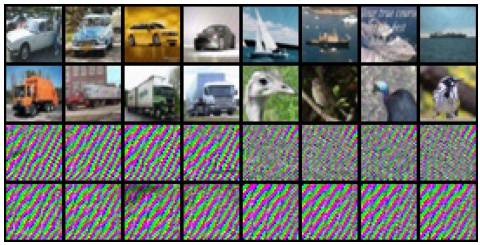
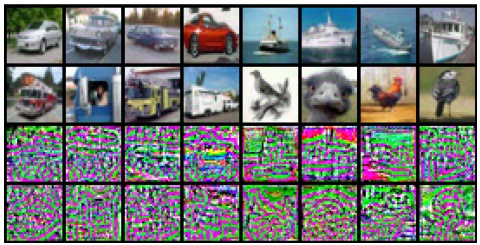
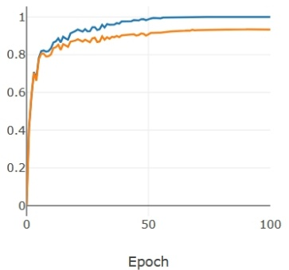
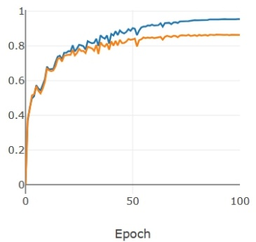
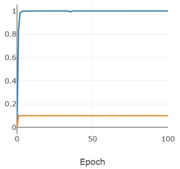
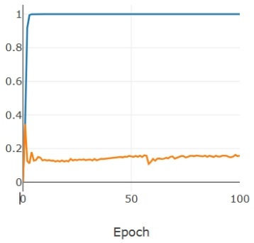
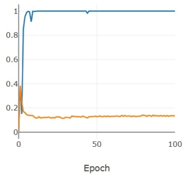
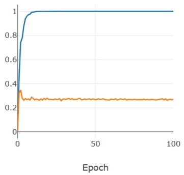

# Detección y defensa de unlearnable examples

**Yifan Zhu**1,3**, Lijia Yu**2,3**, Xiao-Shan Gao**1,3 \*

1Academy of Mathematics and Systems Science, Chinese Academy of Sciences, Beijing 100190, China

2Institute of Software, Chinese Academy of Sciences, Beijing 100190, China

3University of Chinese Academy of Sciences, Beijing 101408, China

zhuyifan@amss.ac.cn, yulijia@ios.ac.cn, xgao@mmrc.iss.ac.cn

## Resumen

La preservación de la privacidad se ha vuelto cada vez más crítica con el surgimiento de las redes sociales. Se han propuesto unlearnable examples para evitar la filtración de información personal en Internet mediante la degradación de las capacidades de generalización de los modelos de deep learning. Sin embargo, nuestro estudio revela que los unlearnable examples son fácilmente detectables. Proporcionamos resultados teóricos sobre la separabilidad lineal de ciertos unlearnable poisoned datasets y métodos de detección basados en redes simples que pueden identificar todos los unlearnable examples existentes, como lo demuestran extensos experimentos. La detectabilidad de los unlearnable examples mediante redes simples nos motiva a diseñar un novedoso método de defense. Proponemos el uso de data augmentations más fuertes combinadas con ruidos adversariales generados por redes simples, con el fin de degradar la detectabilidad y proporcionar así una defense efectiva contra los unlearnable examples a un menor costo. El adversarial training con presupuestos elevados es un método de defense ampliamente utilizado frente a los unlearnable examples. Establecemos criterios cuantitativos entre los presupuestos de veneno y adversarial que determinan la existencia de robust unlearnable examples o el fallo de la defense adversarial.

## 1 Introducción

Las redes neuronales profundas (deep neural networks, DNN) se han convertido en el método de machine learning más potente, impulsando avances significativos en numerosos campos. Sin embargo, la seguridad del deep learning sigue siendo una preocupación fundamental. Una de las amenazas de seguridad más graves es el data poisoning, donde un atacante puede manipular los datos de entrenamiento de manera que induzca intencionalmente el mal funcionamiento de los modelos profundos. Por ejemplo, al inyectar disparadores (triggers) durante la fase de entrenamiento, los backdoor attacks (Chen et al. 2017; Gu et al. 2019) causarán fallos de funcionamiento o permitirán a los atacantes alcanzar objetivos específicos cuando los triggers se activen. Otro tipo de data poisoning attack son los availability attacks (Biggio, Nelson, and Laskov 2012; Koh and Liang 2017; Lu, Kamath, and Yu 2022), orientados a reducir la capacidad de generalización de los modelos de deep learning modificando las características (features) y etiquetas de los datos de entrenamiento. Recientemente, se propusieron los unlearnable data poisoning attacks (Huang et al. 2020a; Wang, Wang, and Wang 2021), los cuales pueden modificar las features de todos los datos de entrenamiento con un pequeño poison budget para generar unlearnable examples.

La preservación de la privacidad ha cobrado una atención creciente en los últimos años, especialmente en el reconocimiento facial (Shan et al. 2020; Cherepanova et al. 2020; Hu et al. 2022). Los unlearnable examples se diseñaron inicialmente bajo el enfoque de «hacer que los venenos sean benevolentes» (“let poisons be kind”) (Huang et al. 2020a; Wang, Wang, and Wang 2021) para la preservación de la privacidad, permitiendo a los individuos modificar ligeramente sus datos personales para volverlos inaprendibles (unlearnable) sin perder su semántica.

Si bien se ha demostrado que los unlearnable examples son altamente efectivos para engañar a las víctimas haciéndoles creer que sus modelos de deep learning han sido entrenados con éxito al alcanzar una alta validation accuracy, este artículo demuestra que los unlearnable examples pueden detectarse con relativa facilidad. Específicamente, proponemos dos métodos efectivos para detectar si un dataset determinado ha sido envenenado por unlearnable data poisoning attacks. En (Yu et al. 2021) se observó experimentalmente que los venenos inaprendibles son linealmente separables. En este artículo, demostramos adicionalmente que para ciertos venenos class-wise de tipo random o region, son los datasets envenenados, más que los venenos por sí solos, los que son linealmente separables si la dimensión de los datos es suficientemente grande. Con base en estos hallazgos teóricos, proponemos el algoritmo Simple Networks Detection, que aprovecha modelos lineales o redes simples de dos capas para detectar datos envenenados. Asimismo, hemos observado experimentalmente que los venenos son inmunes a desplazamientos de sesgo (bias shifts) de gran magnitud. A partir de esta observación, proponemos otro algoritmo de detección denominado Bias-shifting Noise Test, el cual introduce un sesgo (bias) elevado a cada dato de entrenamiento para destruir sus features originales conservando al mismo tiempo las features del veneno inyectado. La diferencia resultante puede utilizarse para detectar la presencia de venenos. Nuestros experimentos en CIFAR-10, CIFAR-100 y TinyImageNet demuestran que los principales unlearnable examples pueden ser detectados eficazmente por ambos algoritmos.

Además, la detectabilidad de los unlearnable examples nos ha inspirado a desarrollar una estrategia de defense centrada en degradarlos. Logramos esto mediante el uso de data augmentations y ruidos adversariales que hacen que estos ejemplos resulten indetectables para redes simples. Al emplear data augmentations más fuertes y una red neuronal (neural network, NN) de dos capas para generar ruidos más potentes, demostramos que generar unlearnable examples se vuelve mucho más difícil. Los experimentos han demostrado que nuestro método de defense es sumamente eficaz contra los unlearnable examples, llegando incluso a superar a los regímenes de adversarial training y a los métodos de defense state-of-the-art (SOTA).

<small>\*Autor de correspondencia. Copyright © 2024, Association for the Advancement of Artificial Intelligence (www.aaai.org). Todos los derechos reservados.</small>

El adversarial training con amplios presupuestos de defense es un método de defense bien conocido contra los unlearnable examples (Tao et al. 2021). Establecemos criterios teóricos sobre la relación entre el poison budget y el presupuesto de defense adversarial. Específicamente, demostramos que si el poison budget supera cuatro veces la magnitud del presupuesto de defense adversarial, o si la brecha entre ambos presupuestos excede cierta constante, pueden crearse robust unlearnable examples que vuelvan linealmente separable al conjunto de entrenamiento adversarial. Estos resultados teóricos garantizan la existencia de robust unlearnable examples, al tiempo que proporcionan una cota inferior para el presupuesto de defense adversarial requerido para que el adversarial training resulte efectivo. También demostramos que, para hacer que un dataset sea linealmente separable, el poison budget debe ser superior a cierta constante, bajo supuestos moderados. Nuestros resultados experimentales confirman la validez de los resultados teóricos, mostrando que conforme el presupuesto adversarial aumenta, los unlearnable examples vuelven a ser aprendibles (learnable), debido a que las features lineales inyectadas por los atacantes se destruyen a través del adversarial training.

Resumimos nuestras contribuciones principales de la siguiente manera:

• Proponemos dos métodos eficaces para detectar si un dataset ha sido envenenado mediante unlearnable data poisoning attacks, fundamentados en resultados teóricos y observaciones experimentales.
• Demostramos que data augmentations más fuertes junto con ruidos adversariales generados por una red simple pueden destruir la detectabilidad, así como lograr un rendimiento de defense satisfactorio.
• Establecemos cotas superiores certificadas para el poison budget en relación con el presupuesto de defense adversarial requerido para generar robust unlearnable examples.

## 2 Trabajo relacionado

**Data Poisoning.** El data poisoning es un tipo de ataque que puede provocar el mal funcionamiento de los modelos de deep learning al modificar el dataset de entrenamiento. Los targeted data poisoning attacks (Shafahi et al. 2018; Zhu et al. 2019; Huang et al. 2020b; Schwarzschild et al. 2021) tenían como objetivo clasificar erróneamente objetivos específicos. Los availability attacks previos (Biggio, Nelson, and Laskov 2012; Muñoz-González et al. 2017) intentaban reducir el rendimiento de prueba de los modelos envenenando una pequeña porción de los datos de entrenamiento. Los unlearnable attacks (Huang et al. 2020a) constituyeron un tipo especial de availability attack en el que el atacante envenena todos los datos de entrenamiento utilizando un pequeño poison budget, lo que provoca una caída significativa en la test accuracy hasta llegar prácticamente a una predicción aleatoria (Feng, Cai, and Zhou 2019; Huang et al. 2020a; Fowl et al. 2021; Sandoval-Segura et al. 2022b). Los robust unlearnable attacks (Fu et al. 2021) intentaron mantener los efectos del envenenamiento bajo regímenes de adversarial training. Otro tipo de data poisoning fueron los backdoor attacks (Chen et al. 2017; Gu et al. 2019; Barni, Kallas, and Tondi 2019; Turner, Tsipras, and Madry 2019), que introducían triggers en los modelos entrenados para provocar fallos de funcionamiento.

**Attack Detection.** En años recientes, se han propuesto diversos métodos para detectar ataques a la seguridad de las DNN. La detección de adversarial attacks ha sido explorada en (Metzen et al. 2016; Grosse et al. 2017; Abusnaina et al. 2021) para que las víctimas determinen si un dato específico es un adversarial example o no. Se han proporcionado algoritmos de detección para identificar triggers y recuperarlos bajo backdoor attacks (Chen et al. 2018, 2019; Dong et al. 2021). Guo, Li, and Liu (2021) detectaron modelos atacados por backdoors utilizando análisis de valores extremos adversariales. Hasta donde llega nuestro conocimiento, nuestros métodos de detección son los primeros en enfocarse en los unlearnable examples.

**Poison Defense.** En años recientes han surgido diversos métodos de defense para el data poisoning. En Ma, Zhu, and Hsu (2019), se propuso un método de defense basado en privacidad diferencial. En Chen et al. (2021), se utilizaron generative adversarial networks para detectar y discriminar datos envenenados. Liu, Yang, and Mirzasoleiman (2022) propusieron el uso de ruido amigable (friendly noise) para mejorar la defense contra el data poisoning. Wang, Mianjy, and Arora (2021) analizaron la robustez del stochastic gradient descent frente a data poisoning attacks. Asimismo, se ha empleado adversarial training para defenderse de los unlearnable data poisoning attacks (Tao et al. 2021). Recientemente, se han presentado métodos de defense específicos para unlearnable examples (Qin et al. 2023; Liu, Zhao, and Larson 2023).

## 3 Notaciones y definiciones de unlearnable examples

**Notaciones.** Denotemos el dataset de entrenamiento como $\begin{array} { r l } { D _ { \mathrm { t r } } } & { { } = } \end{array}$ $\{ ( \pmb { x } _ { i } , y _ { i } ) \} _ { i = 1 } ^ { N } \subset \mathbb { I } ^ { d } \times [ C ]$ , donde $d , \bar { N } , C$ son enteros positivos, e $\mathbb { I } = [ 0 , 1 ]$ es el rango de valores de los datos, $[ { \vec { C } } ] = \{ 1 , \ldots , { \vec { C } } \}$ es el conjunto de etiquetas. Sea $D _ { \mathrm { t r } } ^ { \mathrm { p o } } \stackrel { \sim } { = } \{ ( \pmb { x } _ { i } + \overbrace { \epsilon ( \pmb { x } _ { i } ) } , \overbrace { y _ { i } ) } \} _ { i = 1 } ^ { N }$ el dataset de entrenamiento envenenado de $D_{\mathrm{tr}},$ donde $\epsilon ( x _ { i } )$ es el veneno elaborado minuciosamente por el atacante. En este artículo, asumimos que $\epsilon ( x _ { i } )$ es una pequeña perturbación que satisface $| | \boldsymbol { \epsilon } ( \boldsymbol { x } _ { i } ) | | _ { \infty } \leq \eta ,$ donde $\eta \in \mathbb { R } _ { > 0 }$ se denomina poison budget. Una red bien aprendida $\mathcal { F }$ posee un buen rendimiento de generalización en el conjunto de prueba $D _ { \mathrm { t e } } , \mathrm { es decir }$ , tiene una alta test accuracy denotada como $\operatorname { A c c } ( \mathcal { F } , D _ { \mathrm { t e } } )$

**Unlearnable examples.** Un dataset envenenado $D _ { \mathrm { t r } } ^ { \mathrm { p o } }$ se denomina inaprendible (unlearnable) (Huang et al. 2020a), si el entrenamiento de una red $\mathcal { F }$ sobre $D _ { \mathrm { t r } } ^ { \mathrm { p o } }$ produce una test accuracy $\bar { \operatorname { A c c } } ( \mathcal { F } , D _ { \mathrm { t e } } )$ muy baja, pero alcanza una validation accuracy (envenenada) $\operatorname { A c c } ( \mathcal { F } , D _ { \mathrm { v a l } } ^ { \mathrm { p o } } )$ suficientemente alta sobre el dataset de validación envenenado. Si la víctima recibe un dataset envenenado inaprendible, puede dividirlo en un conjunto de entrenamiento y un conjunto de validación. Dado que la validation accuracy (envenenada) es suficientemente buena, la víctima podría asumir que su modelo está funcionando adecuadamente. Sin embargo, debido a que la víctima no tiene acceso al conjunto de prueba (limpio) $D _ { \mathrm { t e } } ,$ su modelo en realidad tendrá un desempeño deficiente sobre $D _ { \mathrm { t e } } .$ . Como resultado, la víctima será engañada por el generador del veneno.

Existen dos tipos básicos de unlearnable poisoning attacks: sample-wise y class-wise, donde sample-wise significa que cada muestra se envenena de forma independiente con una perturbación específica, y class-wise significa que las muestras con la misma etiqueta se envenenan con la misma perturbación. En el Apéndice C pueden encontrarse algunos ejemplos de datos envenenados y sus correspondientes perturbaciones.

Los principales métodos de unlearnable attack incluyen: Random(C), Region-n (Sandoval-Segura et al. 2022a), Err-min (Huang et al. 2020a), Err-max (Fu et al. 2021), NTGA (Yuan and Wu 2021), AR (Sandoval-Segura et al. 2022b), RobustEM (Fu et al. 2021), CP (He, Zha, and Katabi 2022), TUE (Ren et al. 2022), etc.

## 4 Detección de unlearnable examples

Aunque los unlearnable examples pueden lograr su objetivo de engañar a las víctimas al tener una buena validation accuracy y una deficiente test accuracy en procesos normales de entrenamiento (Huang et al. 2020a), en esta sección demostraremos que los unlearnable examples pueden, en realidad, detectarse con facilidad. También proporcionaremos algoritmos de detección efectivos para detectar unlearnable examples mediante redes simples.

## 4.1 Análisis teóricos de unlearnable examples

En primer lugar, presentamos resultados teóricos que demuestran que ciertos unlearnable examples son linealmente separables, lo cual puede utilizarse para identificar la presencia de venenos. En (Yu et al. 2021), descubren empíricamente la separabilidad lineal de los ruidos de venenos inaprendibles; cabe señalar que nuestro enfoque difiere del trabajo previo (Yu et al. 2021) en que no solo encontramos empíricamente, sino que también demostramos que los datasets envenenados inaprendibles, más que los ruidos por sí solos, son linealmente separables.

Teorema 4.1. Sea $D = \left\{ ( \boldsymbol { x } _ { i } , y _ { i } ) \right\} _ { i = 1 } ^ { N } \subset \mathbb { I } ^ { d } \times [ C ]$ . Para el veneno class-wise $\{ \pmb { v } _ { i } \} _ { i = 1 } ^ { C }   \subset   \mathbb { R } ^ { d }$ que satisface que $\forall i   \in   [ C ]$ y $j \in [ d ] , ( \pmb { v } _ { i } ) _ { j }$ es i.i.d. y sigue la distribución $\Delta ( \epsilon )$ , donde $\Delta ( \epsilon ) = 2 \epsilon$ · Bernoulli $\begin{array} { r } { \left( \frac { 1 } { 2 } \right) - \epsilon , } \end{array}$ , es decir, $( v _ { i } ) _ { j }$ es igual a ±ϵ con probabilidad $\frac { 1 } { 2 }$ respectivamente. Entonces, con probabilidad de al menos $1 - N C \left( 2 e ^ { - \frac { d \epsilon ^ { 2 } } { 1 8 } } + e ^ { - \frac { d } { 3 2 } } \right)$ , el dataset envenenado class-wise $D ^ { \mathrm { p o } } = \left\{ \boldsymbol { x } _ { i } + \boldsymbol { v } _ { y _ { i } } , y _ { i } \right\} _ { i = 1 } ^ { N }$ es linealmente separable.

**Teorema 4.2.** Para el veneno Region-k $\left\{ \boldsymbol { v } _ { i } \right\} _ { i = 1 } ^ { C } \subset \mathbb { R } ^ { d }$ que satisface que $\forall i \in [ C ] ,   ( \pmb { v } _ { i } ) _ { j }$ es igual siempre que j esté en la misma región; $( v _ { i } ) _ { j }$ es i.i.d. y sigue la distribución $\Delta ( \epsilon ) ,$ , siempre que j esté en regiones diferentes. Entonces, con probabilidad de al menos $1 - \overset { \cdot } { N } C \left( 2 e ^ { - \frac { k \epsilon ^ { 2 } } { 1 8 } } + e ^ { - \frac { k } { 3 2 } } \right)$ , el dataset envenenado Region-k $D ^ { \mathrm { p o } } = \left\{ \boldsymbol { x } _ { i } + \boldsymbol { v } _ { y _ { i } } , y _ { i } \right\} _ { i = 1 } ^ { N }$ es linealmente separable.

Las demostraciones de los Teoremas 4.1 y 4.2 se posponen a los Apéndices A.1 y A.2, respectivamente.

Observación 4.3. Por el Teorema 4.1, cuando d o ϵ son suficientemente grandes, determinado dataset envenenado Random(C) es linealmente separable. De manera similar, por el Teorema 4.2, cuando k es suficientemente grande, determinado dataset envenenado Region-k es linealmente separable.

**Magnitud del poison budget para lograr separabilidad lineal.** Añadimos el veneno Random(C) $\bar { \pmb { v } _ { i } } \; \in \; \{ \pmb { + } \epsilon , \pmb { - } \epsilon \} ^ { d }$ a CIFAR-10 con $\epsilon   =   8 / 2 5 5$ , y utilizamos la red lineal $\mathcal { F } ( \pmb { x } ) = [ \pmb { v } _ { 1 } , \cdots , \pmb { v } _ { C } ] ^ { T } \pmb { x }$ para la clasificación. Los resultados experimentales muestran que 49,963 de las 50,000 muestras de entrenamiento envenenadas pueden clasificarse correctamente mediante F. Este hallazgo indica que $\epsilon = 8 / 2 5 5$ es lo suficientemente grande como para lograr separabilidad lineal para el dataset CIFAR-10. La Tabla 8 también muestra que los venenos Region-16 y Err-min(S) con presupuesto $\epsilon = 8 / 2 5 5$ son suficientes para hacer que el dataset envenenado sea linealmente separable.

**Venenos sample-wise.** Los Teoremas 4.1 y 4.2 describen propiedades de los venenos class-wise, pero los venenos sample-wise también poseen propiedades similares. En el Apéndice F, presentamos experimentos para demostrar la similitud entre venenos sample-wise y class-wise mediante la medición de la similitud del coseno y la divergencia KL conmutativa. Además, a partir del Apéndice D.2, se puede observar que tanto los datasets envenenados por error-minimum sample-wise como class-wise presentan curvas de entrenamiento similares.

## 4.2 Detección de unlearnable examples mediante redes simples

Los Teoremas 4.1 y 4.2 implican que un dataset envenenado puede ser aprendido por una red lineal. Sin embargo, los datasets limpios tales como CIFAR-10, CIFAR-100 y TinyImageNet no pueden ajustarse fácilmente mediante un modelo lineal. Evaluamos la tasa de separabilidad lineal (linear separability rate) para estos datasets como se muestra a continuación.

**Definición 4.4** (Tasa de separabilidad lineal). Sea el dataset $S \subset$ $\mathbb { I } ^ { d } \times [ C ]$ y $\mathcal { F } _ { \mathrm { l i n e a r } }$ denota el conjunto de todos los modelos lineales $f$ $\mathbb { R } ^ { d } \stackrel { \mathfrak { c } } { \rightarrow } \mathbb { R } ^ { C }$ . La tasa de separabilidad lineal de S se define como $\beta _ { S } = ~ \mathrm { s u p }$ Acc(f, S). $f   \in   \mathcal { F } _ { \mathrm { l i n e a r } }$

Observación 4.5. Las tasas de separabilidad lineal de CIFAR-10, CIFAR-100 y TinyImageNet son 46.53%, 31.71% y 49.38%, respectivamente, al entrenarlos con una red lineal.

Esta diferencia entre un dataset limpio y uno envenenado puede explotarse para detectar la presencia de unlearnable examples, lo que motiva el Algoritmo 1, denominado Simple Networks Detection.

## Algorithm 1: Simple Networks Detection

**Entrada:** Un dataset D que podría estar envenenado. Una red lineal o una NN de dos capas (cuyo ancho oculto es igual a la dimensión de los datos) ${ \mathcal { F } } .$ Un umbral de detección B (por ejemplo, 0.7).

**Salida:** Función de veneno $\dot { I } ( \dot { D } )$

$\bar { I ( D ) } = 1$ si D es reconocido como dataset envenenado; $I \dot { ( } D \dot { ) } = 0$ si D es reconocido como dataset limpio.

**Hacer:**

Inicializar los parámetros de la red ${ \mathcal { F } } .$

Entrenar la red $\mathcal { F }$ en el dataset D con la loss function $L _ { \mathrm { C E } } ( \mathcal { F } ( \pmb { x } ) , y )$

**if** Acc(F, D) ≤ B: I(D) = 0; **else** $I ( D ) = 1 .$

**Detección bajo data augmentations.** Cabe destacar que, en la práctica, las redes suelen entrenarse con métodos de data augmentation. Por ejemplo, para CIFAR-10, el recorte aleatorio (random crop) y el volteo horizontal aleatorio (random horizontal flip) son métodos comunes de data augmentation. Sin embargo, las observaciones experimentales han demostrado que la separabilidad lineal de los datasets envenenados puede romperse con facilidad mediante data augmentations. Por lo tanto, en aquellos casos donde la separabilidad lineal no se mantenga, recurrir a una red de dos capas surge como el siguiente criterio más adecuado. Además, no podemos relajar más las redes simples hacia una NN de tres capas, debido a que la training accuracy sobre datos limpios se vuelve excesivamente alta, dificultando la distinción entre datasets limpios y envenenados.

## 4.3 Detección de unlearnable examples mediante bias-shifting noise

En esta sección, descubrimos que los unlearnable examples son casi inmunes a ruidos de desplazamiento de sesgo (bias-shifting noises) de gran magnitud. Inspirados por este comportamiento inusual de los unlearnable examples, podemos detectar venenos entrenando el modelo con bias-shifting noises.

**Resistencia del dataset envenenado al bias-shifting noise.** La Tabla 11 en el Apéndice D.3 muestra que los venenos inaprendibles inyectados constituyen features fuertes que dominan los datos envenenados, y que los datasets envenenados son altamente robustos al bias-shifting noise. En el escenario de unlearnable examples, los venenos inyectados son muy pequeños, restringiéndose a menos de $8 \bar { / } 2 5 5$ bajo la norma $l _ { \infty }$. Sin embargo, incluso al someterse a bias-shifting noises decenas de veces más grandes, tales como ±0.5, el modelo víctima aún puede alcanzar un 100% de (validation) accuracy.

Tabla 1: Validation accuracy (%) en diferentes datasets: $D _ { \mathrm { c l e a n } } = \{ ( { \pmb x } _ { i } , y _ { i } ) \}$ es el conjunto de validación limpio, $D _ { \mathrm { p o i } } ~ =$ $\{ ( \pmb { x } _ { i } + \pmb { \epsilon } ( \pmb { x } _ { i } ) , y _ { i } ) \} , D _ { \mathrm { p o i - s h i f t } } ^ { b } = \{ ( \pmb { x } _ { i } + \pmb { \epsilon } ( \pmb { x } _ { i } ) + b \pmb { e } , y _ { i } ) \}$ , donde b es el nivel de bias-shifting noise y e es el vector de unos.

| Poison | Random(C) | Region-16 | Err-min(S) | NTGA | AR |
| --- | --- | --- | --- | --- | --- | --- |
| $D_{clean}$ | 10.46 | 15.27 | 10.02 | 10.10 | 13.63 |
| $D_{poi}$ | 100.0 | 100.0 | 99.99 | 99.98 | 99.98 |
| $D_{poi-shift}^{0.5}$ | 99.84 | 99.64 | 100.0 | 95.26 | 99.82 |
| $D_{poi-shift}^{-0.5}$ | 100.0 | 99.98 | 97.85 | 90.82 | 90.96 |

La Tabla 1 muestra la accuracy en el conjunto (de validación) envenenado y en datasets con un gran bias-shifting noise. Al agregar bias-shifting noises elevados al dataset envenenado, su validation accuracy no se degrada significativamente. Sin embargo, al entrenar sobre el dataset limpio, esta cae drásticamente debido a que las features originales son destruidas por el bias-shifting noise de gran magnitud. Esta observación nos motiva a introducir el Algoritmo 2, denominado Bias-shifting Noise Test.

## Algorithm 2: Bias-shifting Noise Test

**Entrada:** Un dataset D que podría estar envenenado. Una DNN $\mathcal { F }$ (por ejemplo, ResNet18). Un umbral de detección B (por ejemplo, 0.7). Un bias-shifting noise $\epsilon _ { b } .$

**Salida:** Función de veneno $I ( D )$

## Hacer:

Dividir aleatoriamente D en conjunto de entrenamiento y conjunto de validación $D _ { \mathrm { t r } }$ y $D _ { \mathrm { v a } } .$

Sea el conjunto de entrenamiento con desplazamiento de sesgo $D _ { \mathrm { t r } } ^ { \mathrm { r b } } \quad = \quad \{ ( { \pmb x } \quad + \quad$ $\boldsymbol { \epsilon } _ { b } , y ) \left\|   ( \boldsymbol { x } , y ) \in D _ { \mathrm { t r } } \right\}$

Inicializar los parámetros de la red ${ \mathcal { F } } .$

Entrenar la red $\mathcal { F }$ sobre el conjunto de entrenamiento con desplazamiento de sesgo $D _ { \mathrm { t r } } ^ { \mathrm { r b } }$ con la loss function $L _ { \mathrm { C E } } ( \mathcal { F } ( \pmb { x } ) , y )$

if $\operatorname { A c c } ( \mathcal { F } , D _ { \operatorname { v a } } ) \leq B \widehat { : I ( D ) = 0 } ;$ **else** $I ( D ) = 1$

**Elección del bias-shifting noise.** Si los datos yacen en el rango [a, b], se recomienda elegir $\scriptstyle { \frac { b - a } { 2 } } e { \stackrel { \triangledown } { \mathbf { o } } } - { \frac { c _ { b - a } } { 2 } } \mathbf { c }$ e como bias-shifting noise $\epsilon _ { b } .$ Dado que las imágenes siempre se ubican en $[ 0 , 1 ] ,$ , por simplicidad elegimos $\epsilon _ { b } = \pm 0 . \bar { 5 } e$ en este artículo; en el Apéndice G.2 se proporcionan más resultados sobre distintas elecciones de $\epsilon _ { b }$. Dicho ruido puede destruir eficazmente las features originales sin perjudicar las features del ruido inyectado, como se ilustra en la Tabla 1 para el dataset $\tilde { D } _ { \mathrm { p o i - s h i f t } } ^ { \pm 0 . 5 ^ { \circ } }$

## 5 Defensa de unlearnable examples mediante la ruptura de la detectabilidad

En la Sección 4, hemos demostrado que determinados unlearnable examples pueden ser separados mediante redes lineales, y evidenciado que todos los unlearnable examples existentes pueden ser ajustados fácilmente por redes simples como las NN de dos capas, incluso bajo el régimen habitual de data augmentations. Por lo tanto, consideramos que las propiedades que pueden ajustarse mediante redes simples constituyen el principio de por qué funcionan los unlearnable examples, lo cual también puede aprovecharse para su detección.

Con base en esto, una vez que se detecta que el dataset es inaprendible, una solución potencial es defenderlo destruyendo su detectabilidad. El adversarial training es un enfoque bien conocido para defenderse contra unlearnable examples (Tao et al. 2021), pero resulta costoso. Podemos alcanzar objetivos similares a un menor costo rompiendo la detectabilidad de los unlearnable examples.

**Agregar ruidos adversariales difíciles de aprender procedentes de redes simples degrada la detectabilidad.** Para destruir la detectabilidad de las redes simples, podemos añadir un ruido adversarial ϵ a cada $x _ { i } ,$ el cual resulta difícil de aprender para una simple NN de dos capas $\mathcal { F } _ { \mathrm { s } }$ imple. Los ruidos adversariales $\epsilon ( x _ { i } )$ se generan mediante el ataque PGD (Madry et al. 2018) sobre la red aprendida robustamente $\mathcal { F } _ { \mathrm { s i m p l e } } ^ { \mathrm { r o b u s t } }$ , donde $\mathcal { F } _ { \mathrm { s i m p l e } } ^ { \mathrm { r o b u s t } }$ se obtiene mediante adversarial training:

$$
\arg \min _ {\mathcal {F} _ {\text {simple}} ^ {\text {robust}}} \sum_ {\left(\boldsymbol {x} _ {i}, y _ {i}\right) \in D} \max _ {| | \boldsymbol {\delta} | | \leq \eta} \operatorname{Loss} \left(\mathcal {F} _ {\text {simple}} ^ {\text {robust}} \left(\boldsymbol {x} _ {i} + \boldsymbol {\delta} \left(\boldsymbol {x} _ {i}\right)\right), y _ {i}\right).
$$

El ruido adversarial generado hará que resulte difícil ajustar el dataset envenenado mediante redes simples, lo que destruye la detectabilidad de los unlearnable examples, mientras que el pequeño presupuesto η no afectará a las features originales.

Tabla 2: Detection (training) accuracy (%) del Algoritmo 1 bajo NN de dos capas para CIFAR-10 y CIFAR-100 envenenados con data augmentation más fuerte utilizada en aprendizaje contrastivo.

| Poisons | CIFAR-10 | CIFAR-100 |
| --- | --- | --- |
| Clean data | 27.41 | 10.67 |
| Region-16 | 35.20 | 16.57 |
| Err-min(S) | 27.28 | 11.25 |
| RobustEM | 27.27 | 11.51 |

**Data augmentations más fuertes destruyen la detectabilidad.** Como se discutió en la Sección 4, hemos demostrado que ciertos unlearnable examples class-wise son linealmente separables, pero la detección mediante modelos lineales bajo data augmentations estándar fallará. Esto nos inspira a utilizar una versión relajada del modelo, como una NN de dos capas, para lograr una detección efectiva. Por consiguiente, al detectar unlearnable examples mediante redes simples, los métodos de data augmentation pueden degradar la detectabilidad.

Inspirados por el papel de las data augmentations en la detección, introducimos data augmentation más fuerte utilizada en el aprendizaje contrastivo (He et al. 2020; Chen et al. 2020), la cual incluye random resized crop, random horizontal flip, color jitter y random grayscale. Llevamos a cabo experimentos en la Tabla 2 para demostrar el rendimiento de detección bajo data augmentations más fuertes. Los resultados evidencian que a la NN de dos capas le resulta sumamente difícil detectar si un dataset está envenenado bajo data augmentations más fuertes. Por lo tanto, concluimos que las data augmentations más fuertes pueden facilitar la ruptura de la detectabilidad de los unlearnable examples.

Con base en las discusiones anteriores, proponemos un algoritmo rápido (Algoritmo 3) capaz de romper la detectabilidad de los datasets envenenados para defenderse contra los unlearnable examples. Los resultados experimentales del Algoritmo 3 se presentarán en la Sección 7.2.

Algorithm 3: Stronger Data Augmentations with Adversarial Noises (SDA+AN)

Input: Unlearnably poisoned dataset $D = \{(\boldsymbol{x}_i, y_i)\}_{i=1}^N$. Two-layer NN $\mathcal{F}_{\text{simple}}$. Data augmentation method $A$. A DNN $\mathcal{F}$ (Say ResNet18).

Output: Trained network ${ \mathcal { F } } .$

Do:

Initialize parameters of the networks $\mathcal{F}_{\mathrm{simple}}$ and $\mathcal{F}$. Adversarially train the network $\mathcal{F}_{\mathrm{simple}}$ on dataset $D$.

Generate adversarial noise on adversarially-trained network  $F_{simple}^{*}$  with  $\epsilon(\boldsymbol{x}_{i})=\arg\max_{||\epsilon||_{p}\leq\eta}L_{\mathrm{CE}}(\mathcal{F}_{\mathrm{simple}}^{*}(\boldsymbol{x}_{i}+\boldsymbol{\epsilon}),y_{i})$ .

Train classification network $\mathcal { F }$ with data augmentation

$A:\min_{\mathcal{F}}\sum_{i=1}^{N}L_{\mathrm{CE}}(A((\boldsymbol{x}_{i}+\boldsymbol{\epsilon}(\boldsymbol{x}_{i})),y_{i})).$

## 6 Criterios de los presupuestos de veneno y defensa bajo adversarial training

El adversarial training es un método de defense ampliamente utilizado contra los unlearnable examples (Tao et al. 2021). No obstante, existe un trade-off entre accuracy y robustez en el adversarial training; escoger un presupuesto desmedido para resistir a los unlearnable examples perjudicará la accuracy. Por otra parte, (Wang, Wang, and Wang 2021; Fu et al. 2021) demuestran experimentalmente que el adversarial training con presupuestos reducidos puede fracasar al defenderse de ciertos unlearnable attacks, denominados robust unlearnable examples.

En el aspecto teórico, (Tao et al. 2021) demostraron que los unlearnable attacks fallarán cuando el presupuesto adversarial sea mayor o igual al poison budget. En esta sección, demostraremos tres resultados teóricos sobre los criterios entre el poison budget y el presupuesto de defense adversarial y, en particular, ofreceremos una cota superior certificada para el poison budget que asegura la existencia de robust unlearnable examples. Primero, proporcionamos la definición del conjunto de entrenamiento adversarial, que representa el mayor conjunto que el adversarial training puede utilizar para el entrenamiento.

**Definición 6.1** (Conjunto de entrenamiento adversarial). Sea S un conjunto de entrenamiento (limpio). Se denomina $\mathcal { B } _ { p } ( S , \epsilon )$ al conjunto de entrenamiento adversarial de S con un presupuesto pequeño ϵ, definido como sigue:

$$
\mathcal {B} _ {p} (S, \epsilon) = \left\{\left(\boldsymbol {x} + \boldsymbol {\delta}, y\right) \| \left(\boldsymbol {x}, y\right) \in \mathcal {S}, \| \boldsymbol {\delta} \| _ {p} \leq \epsilon \right\}.
$$

En (Kalimeris et al. 2019), se observó que durante las primeras épocas del entrenamiento, el modelo aprende una función altamente correlacionada con las features lineales de los datos. También llevamos a cabo un experimento simple presentado en la Observación I.2 del Apéndice I.1 para mostrar que la separabilidad lineal del dataset provocará que el modelo víctima se comporte como un modelo lineal. Los siguientes dos teoremas nos informan que cuando el poison budget excede cierto umbral en comparación con el presupuesto adversarial, el conjunto de entrenamiento adversarial pasará a ser linealmente separable; en otras palabras, el adversarial training fallará en su funcionamiento.

Teorema 6.2. Sea $S = \left\{ \left( \pmb { x } _ { i } , y _ { i } \right) \right\} _ { i = 1 } ^ { N } \subset \mathbb { I } ^ { d } \times \left[ C \right]$ un conjunto de entrenamiento (limpio) y $\epsilon   \in   \mathbb { R } _ { > 0 }$ satisface $\begin{array} { r } { e ^ { - \frac { d \epsilon ^ { 2 } } { 8 } } + e ^ { - \frac { d } { 5 0 } }   \leq   \frac { 1 } { 2 N C } } \end{array}$ Entonces existe un conjunto de entrenamiento envenenado class-wise $S ^ { \mathrm { p o } }$ con poison budget a lo sumo 4ϵ, tal que el conjunto de entrenamiento adversarial $\mathbf { \hat { \mathcal { B } } } _ { \infty } ( S ^ { \mathrm { p o } } , \epsilon )$ es linealmente separable.

Teorema 6.3. Sea $S = \left\{ ( \pmb { x } _ { i } , y _ { i } ) \right\} _ { i = 1 } ^ { N } \subset \mathbb { I } ^ { d } \times [ C ]$ un conjunto de entrenamiento (limpio). Si existe un conjunto envenenado linealmente separable de $S$ con poison budget $\epsilon ,$ entonces para cualquier $\eta > 0 ,$ existe un conjunto de entrenamiento envenenado $S ^ { \mathrm { p o } }$ de S con presupuesto $\eta + \epsilon ,$ tal que el conjunto de entrenamiento adversarial $\dot { \mathcal { B } } _ { \infty } ( S ^ { \mathrm { p o } } , \eta )$ es linealmente separable por F. En particular, $\begin{array} { r } { \epsilon \; = \; \Omega ( \sqrt { \frac { \log N C } { d } } ) } \end{array}$ satisface la condición anterior.

Las demostraciones de los Teoremas 6.2 y 6.3 se posponen a los Apéndices A.3 y A.4.

Puesto que el dataset limpio tiene una baja accuracy en el modelo lineal como se muestra en la Observación $4 . 5 ,$ en virtud de los Teoremas 6.2 y 6.3, para el dataset $S = \left\{ \left( \boldsymbol { x } _ { i } , y _ { i } \right) \right\} _ { i = 1 } ^ { N } \subset \mathbb { I } ^ { d } \times [ C ]$ , si el poison budget es superior a cuatro veces el presupuesto de defense adversarial, o si el poison budget supera en una cierta cantidad ϵ al presupuesto de defense adversarial $\eta ,$ se podrán realizar robust unlearnable attacks sobre S. En otras palabras, el adversarial training podría fracasar al defenderse de los unlearnable examples de S. Esta conclusión aporta información relevante sobre el presupuesto mínimo requerido para que el adversarial training defienda eficazmente contra los unlearnable examples.

Las discusiones anteriores también explican los resultados presentados en la Tabla 6, donde CIFAR-10 envenenado con un poison budget de $8 / 2 5 5$ no puede ser defendido mediante adversarial training con un presupuesto de defense de 2/255. Asimismo, la separabilidad lineal se alcanza para CIFAR-10 envenenado cuando la diferencia entre el poison budget y el presupuesto de defense alcanza $8 / \bar { 2 5 5 }$ según se muestra en la Sección 4.1. Por consiguiente, junto con el Teorema $6 . 3 ,$ nuestras discusiones explican por qué el adversarial training con presupuesto 8/255 no logra defender contra venenos con presupuesto 16/255, según lo reportado en (Wang, Wang, and Wang 2021), aun cuando este último es únicamente el doble de grande.

Hemos establecido una cota inferior para el presupuesto adversarial capaz de resistir unlearnable examples. Además, bajo ciertos supuestos moderados, el Teorema 6.4 proporciona una cota inferior para el poison budget con el fin de lograr que el dataset envenenado sea linealmente separable, cuya demostración se proporciona en el Apéndice A.5.

Teorema 6.4. Sea el modelo lineal ${ \mathcal { F } } ( { \pmb x } ) = W { \pmb x }   +   { \pmb b } ,$ $\begin{array} { r } { L ( \mathcal { F } ( \pmb { x } ) , y ) = \sum _ { j \neq y } } \end{array}$ max $( 0 , W _ { j } { \pmb x } - W _ { y } { \pmb x } + 1 )$ la hinge loss. Supongamos que el dataset $S = \{ ( \pmb { x } _ { i } , y _ { i } ) \} _ { i = 1 } ^ { N }$ no es linealmente separable y la pérdida no es inferior a una constante $\mu _ { 1 } ,$ mientras que $\vec { S ^ { \mathrm { p o } } } = \{ ( \pmb { x } _ { i }   +   \pmb { \epsilon } _ { i } , y _ { i } ) \} _ { i = 1 } ^ { N }$ es linealmente separable bajo regularización de norma $( 1 , \infty )$ y la pérdida no es superior a una constante µ2. $\mathit { S i }   \mu _ { \mathrm { 1 } } > \mu _ { \mathrm { 2 } } ,$ se cumple max $\begin{array} { r } { \| \mathbf { \epsilon } _ { i } \|   \geq   \frac { \mu _ { 1 } } { 2 \mu _ { 2 } ( C - 1 ) } } \end{array}$ , donde C es el número de clases.

El Teorema 6.4 indica que si el poison budget no es mayor que cierta constante, el conjunto de entrenamiento envenenado no será linealmente separable, lo que provocará el fracaso de los robust unlearnable attacks. La Tabla 8 demuestra que el poison budget de 2/255 no es suficiente para hacer que CIFAR-10 envenenado con Region-16 y Err-min(S) sea linealmente separable. Junto con el Teorema 6.3, nuestras consideraciones explican por qué el adversarial training con presupuesto 6/255 resulta eficaz para defender contra venenos con presupuesto 8/255, según se expone en la Tabla 6.

Tabla 3: Detection accuracy (%) para unlearnable examples bajo los Algoritmos 1 y 2; la accuracy corresponde al conjunto de entrenamiento y de validación, respectivamente. Linear representa el modelo lineal y 2-NN representa la NN de dos capas. Para el Algoritmo 2, las dos columnas corresponden al bias-shifting noise $\epsilon _ { b } = \pm 0 . 5 e$ . Si el dataset es reconocido como un conjunto limpio, su accuracy se resalta en cursiva.

<table><tr><td rowspan="3">Poison</td><td colspan="4">CIFAR-10</td><td colspan="4">CIFAR-100</td><td colspan="4">TinyImageNet</td></tr><tr><td colspan="2">Algorithm 1</td><td colspan="2">Algorithm 2</td><td colspan="2">Algorithm 1</td><td colspan="2">Algorithm 2</td><td colspan="2">Algorithm 1</td><td colspan="2">Algorithm 2</td></tr><tr><td>Linear</td><td>2-NN</td><td>-0.5</td><td>0.5</td><td>Linear</td><td>2-NN</td><td>-0.5</td><td>0.5</td><td>Linear</td><td>2-NN</td><td>-0.5</td><td>0.5</td></tr><tr><td>Clean data</td><td>46.53</td><td>57.33</td><td>49.08</td><td>42.12</td><td>31.71</td><td>26.52</td><td>42.15</td><td>29.02</td><td>49.38</td><td>7.24</td><td>30.63</td><td>20.28</td></tr><tr><td>Random(C)</td><td>100.0</td><td>99.13</td><td>100.0</td><td>99.84</td><td>99.86</td><td>84.19</td><td>99.98</td><td>97.62</td><td>100.0</td><td>97.82</td><td>100.0</td><td>86.02</td></tr><tr><td>Region-16</td><td>99.87</td><td>99.98</td><td>99.98</td><td>99.64</td><td>98.39</td><td>88.72</td><td>100.0</td><td>98.76</td><td>99.54</td><td>97.82</td><td>99.72</td><td>89.02</td></tr><tr><td>Err-min(S)</td><td>99.99</td><td>99.77</td><td>97.85</td><td>100.0</td><td>99.37</td><td>83.94</td><td>100.0</td><td>100.0</td><td>99.93</td><td>97.21</td><td>99.99</td><td>99.27</td></tr><tr><td>Err-min(C)</td><td>100.0</td><td>99.66</td><td>100.0</td><td>100.0</td><td>99.96</td><td>84.78</td><td>100.0</td><td>100.0</td><td>100.0</td><td>98.29</td><td>100.0</td><td>100.0</td></tr><tr><td>Err-max</td><td>82.48</td><td>97.52</td><td>99.96</td><td>99.20</td><td>37.41</td><td>83.34</td><td>97.56</td><td>76.02</td><td>63.89</td><td>97.32</td><td>98.85</td><td>85.22</td></tr><tr><td>RobustEM</td><td>78.49</td><td>99.41</td><td>99.10</td><td>99.40</td><td>40.25</td><td>89.94</td><td>97.84</td><td>76.00</td><td>73.44</td><td>98.75</td><td>94.36</td><td>68.59</td></tr></table>

## 7 Resultados experimentales

En esta sección, se presentan resultados experimentales para verificar los algoritmos de detección de las Secciones 4.2 y 4.3, el poder de defense de las data augmentations más fuertes con ruidos adversariales de la Sección 5, y los criterios teóricos del adversarial training de la Sección 6. Las configuraciones experimentales se detallan en el Apéndice B. Nuestros códigos están disponibles en https://github.com/hala64/udp.

## 7.1 Resultados experimentales sobre la detección de venenos

Los resultados experimentales para los Algoritmos 1 y 2 se presentan en la Tabla 3. El umbral de detección B es 0.7. Para consultar más resultados sobre la detección de venenos, remítase al Apéndice G.

**Rendimiento de detección.** Los resultados de la Tabla 3 muestran que la mayoría de los venenos pueden detectarse mediante modelos lineales y pruebas de bias-shifting noise con $\epsilon _ { b } = 0 . 5 e$ , y todos ellos pueden detectarse mediante una NN de dos capas y bias-shifting noise con $\epsilon _ { b } =$ −0.5e. En combinación con los resultados del Apéndice G, incluso para robust unlearnable examples, tales como RobustEM y Adv Inducing (Wang, Wang, and Wang 2021), o para venenos diseñados para reducir la capacidad de generalización robusta, como Hypocritical (Tao et al. 2022), nuestros métodos de detección continúan funcionando.

**Diferentes ratios de veneno.** Aunque los unlearnable examples solo funcionan cuando todos los datos de entrenamiento están envenenados, nuestros métodos de detección aún se desempeñan bien incluso cuando solo una parte de los datos está envenenada. La Tabla 4 presenta los resultados de detección para diferentes proporciones de veneno (poison ratios). Se demuestra que siempre que al menos el 60% de los datos estén envenenados de forma inaprendible, estos serán detectados por las víctimas.

**Falsos positivos y falsos negativos.** Conviene señalar que nuestros métodos de detección están diseñados para evaluar datasets completos, en lugar de instancias de datos individuales. Por lo tanto, analizamos los falsos positivos (FP) y falsos negativos (FN) en diferentes datasets inaprendibles bajo diversos umbrales de detección B. En referencia a las Tablas 3 y 16, podemos evaluar las ocurrencias de FP y FN a través de una variedad de datasets limpios y envenenados. Los resultados se presentan en la Tabla 7.

Tabla 4: Detection accuracy bajo diferentes poison ratios mediante el Algoritmo 2 con $\epsilon _ { b } = - 0 . 5 e .$

| Ratio | 100% | 80% | 60% | 40% | 20% |
| --- | --- | --- | --- | --- | --- | --- |
| Clean data | 49.08 | — | — | — | — |
| Random(C) | 100.0 | 86.24 | 77.53 | 65.92 | 53.07 |
| Region-16 | 99.98 | 87.15 | 78.77 | 70.53 | 57.90 |
| Err-min(S) | 97.85 | 85.06 | 73.66 | 71.59 | 70.73 |
| Err-min(C) | 100.0 | 85.38 | 75.18 | 62.07 | 53.44 |
| RobustEM | 99.10 | 86.71 | 73.06 | 60.92 | 51.52 |

Tabla 7: Falsos positivos y falsos negativos de nuestros métodos de detección a través de diferentes datasets y unlearnable examples.

| Bound/(FP/FN) | 0.1 | 0.2 | 0.3 | 0.4 | 0.5 | 0.6 | 0.7 | 0.8 | 0.9 |
| --- | --- | --- | --- | --- | --- | --- | --- | --- | --- | --- |
| Bias+0.5 | 3/0 | 3/0 | 1/1 | 1/1 | 0/1 | 0/1 | 0/2 | 0/5 | 0/8 |
| Bias-0.5 | 3/0 | 3/1 | 3/1 | 2/1 | 0/1 | 0/1 | 0/1 | 0/1 | 0/3 |
| Linear | 3/0 | 3/0 | 3/0 | 2/1 | 0/4 | 0/5 | 0/6 | 0/10 | 0/13 |
| 2-NN | 2/0 | 2/0 | 1/0 | 1/0 | 1/0 | 0/1 | 0/1 | 0/2 | 0/9 |

## 7.2 Resultados experimentales sobre la defensa frente al veneno

Evaluamos el poder de defense del Algoritmo 3 frente a métodos basados en AT y métodos de defense propuestos recientemente como UEraser (Qin et al. 2023) e ISS (Liu, Zhao, and Larson 2023). Los resultados demuestran que incluso sin ruidos adversariales, el uso exclusivo de data augmentation más fuerte puede lograr un poder de defense comparable al adversarial training, lo que indica que romper la detectabilidad es clave para defenderse contra los unlearnable examples.

Asimismo, nuestro método de defense alcanza un rendimiento state-of-the-art en la mayoría de los unlearnable examples existentes, como los venenos Region-16, Err-min(S), NTGA y TUE, y logra un poder de defense comparable para los venenos RobustEM y AR, rindiendo solo de manera ligeramente subóptima para los venenos Err-max, como se muestra en la Tabla 5 en comparación con las Tablas 6 y 23. También evaluamos el método de veneno recientemente propuesto para engañar al adversarial training, denominado EntF (Wen et al. 2023), y los resultados también muestran la ventaja de nuestro método. Se proporcionan resultados experimentales adicionales y más discusiones en el Apéndice H.

Tabla 5: Test accuracy (%) de diferentes métodos de defense para CIFAR-10 envenenado.

| Method/Poison | Region-16 | Err-min(S) | Err-max | RobustEM | NTGA | AR | EntF | TUE |
| --- | --- | --- | --- | --- | --- | --- | --- | --- |
| No defense | 19.86 | 10.09 | 7.19 | 25.30 | 11.23 | 17.18 | 83.10 | 10.00 |
| AT-based methods | 85.78 | 84.00 | 84.75 | 81.06 | 84.19 | 85.25 | 73.61 | 83.94 |
| Adversarial Noises | 56.35 | 10.72 | 28.74 | 25.69 | 17.96 | 14.57 | 48.15 | 90.07 |
| UEraser | 82.66 | 86.37 | 47.46 | 78.39 | 82.15 | 87.21 | 87.40 | 75.96 |
| ISS | 67.11 | 85.24 | 84.36 | 83.84 | 85.64 | 85.11 | 77.02 | 84.32 |
| SDA(ours) | 77.20 | 75.62 | 56.96 | 79.21 | 78.48 | 75.81 | 90.84 | 73.80 |
| AN+SDA(ours) | 93.51 | 88.01 | 61.19 | 79.28 | 89.00 | 80.20 | 88.17 | 92.76 |

Tabla 6: Test accuracy (%) al realizar adversarial training con presupuestos $i / 2 5 5 , i = 0 , \ldots$ , 16 para defender CIFAR-10 envenenado con el poison budget $\epsilon = 8 / 2 5 5$ . No utilizamos ninguna data augmentation aquí para una mejor verificación de nuestros teoremas.

| Poison | 0 | 1/255 | 2/255 | 3/255 | 4/255 | 6/255 | 8/255 | 12/255 | 16/255 |
| --- | --- | --- | --- | --- | --- | --- | --- | --- | --- | --- |
| Region-16 | 19.86 | 24.32 | 29.57 | 50.09 | 72.13 | 77.03 | 72.65 | 67.65 | 62.78 |
| Err-min(S) | 10.09 | 10.01 | 10.13 | 18.64 | 69.92 | 76.53 | 72.13 | 67.23 | 61.70 |
| RobustEM | 25.30 | 24.92 | 28.50 | 33.74 | 46.01 | 76.69 | 72.19 | 63.16 | 53.34 |

Además, dado que solo llevamos a cabo adversarial training sobre la simple NN de dos capas, nuestro método es mucho más eficiente en tiempo que los métodos basados en AT; como se muestra en la Tabla 13, los ruidos adversariales generados en una NN de dos capas son más de 3 veces más rápidos que los generados en ResNet18.

## 7.3 Evaluación de los criterios entre el presupuesto de veneno y el presupuesto de defensa

La Tabla 6 muestra la test accuracy bajo diferentes presupuestos de defense adversarial. Para adversarial training con presupuesto $\epsilon   \leq   2 / 2 5 5$ y unlearnable poisoning attacks con presupuesto $\eta = 8 / 2 5 5 \geq 4 \epsilon$ , la test accuracy es inferior al 30%, lo cual es muy inferior a la tasa de separabilidad lineal del 46.53% de CIFAR-10. Esto verifica el Teorema 6.2 en cuanto a que el adversarial training falla cuando el presupuesto de defense es demasiado pequeño.

Adicionalmente, al aumentar los presupuestos de defense, el poder de defense del adversarial training se incrementa rápidamente al principio, pero luego comienza a decrecer de forma gradual. Esto se debe a que cuando el presupuesto de defense se incrementa, la brecha entre los presupuestos de veneno y de defense disminuye, volviéndose eventualmente demasiado pequeña para alcanzar la separabilidad lineal. Como se aprecia en la Tabla 6, el adversarial training resulta efectivo cuando el presupuesto de defense alcanza 6/255, ya que la brecha de 2/255 no es suficientemente grande como para hacer que el dataset envenenado sea linealmente separable, lo cual verifica los Teoremas 6.3 y 6.4.

Cabe destacar que, a diferencia de (Tao et al. 2021), el adversarial training aquí constituye la herramienta para mantener la accuracy más que la robustez. Por lo tanto, el presupuesto de defense efectivo aquí es menor que en (Tao et al. 2021). A partir de la Tabla 8, RobustEM nunca se vuelve linealmente separable, lo que indica que lograr separabilidad lineal es una condición suficiente pero no necesaria para generar unlearnable examples. Con un incremento adicional en el presupuesto de defense, surge el trade-off entre accuracy y robustez (Tsipras et al. 2018), conduciendo a una caída gradual en la test accuracy. Para más discusiones y experimentos sobre este tema, consúltese el Apéndice I.2.

Tabla 8: Tasa de separabilidad lineal de CIFAR-10 envenenado con diferentes poison budgets η.

| Poison/budget | 0 | 1/255 | 2/255 | 4/255 | 6/255 | 8/255 |
| --- | --- | --- | --- | --- | --- | --- | --- |
| Region-16 | 46.53 | 67.85 | 89.06 | 98.32 | 99.65 | 99.87 |
| Err-min(S) | 46.53 | 76.63 | 93.15 | 99.87 | 99.97 | 99.99 |
| RobustEM | 46.53 | 55.44 | 61.29 | 69.03 | 74.62 | 78.49 |

## 8 Conclusión

En este artículo, demostramos que los unlearnable examples pueden detectarse fácilmente. Probamos que la separabilidad lineal siempre existe para ciertos unlearnable poisoned datasets y proponemos métodos de detección efectivos. Utilizamos data augmentations más fuertes con ruidos adversariales de redes simples para lograr una defense efectiva frente a los unlearnable examples. Además, derivamos una cota superior certificada para el poison budget en relación con el presupuesto adversarial en adversarial training.

**Limitaciones y trabajo futuro.** A partir de la Tabla 6, los resultados del Teorema 6.2 admiten margen de mejora; es decir, es posible obtener cotas superiores más ajustadas para el poison budget. En el futuro deberán desarrollarse métodos de defense certificada contra unlearnable examples. Resulta deseable diseñar métodos de defense más potentes contra los venenos Err-max. Asimismo, en la búsqueda de la preservación de la privacidad, es imperativo crear unlearnable examples más sofisticados que resistan los métodos existentes de detección y defense.

**Agradecimientos.** Este trabajo cuenta con el apoyo de la subvención NKRDP No.2018YFA0306702 y la subvención NSFC No.11688101.

## Referencias

- Abusnaina, A.; Wu, Y.; Arora, S.; Wang, Y.; Wang, F.; Yang, H.; and Mohaisen, D. 2021. Adversarial example detection using latent neighborhood graph. In Proceedings of the IEEE/CVF International Conference on Computer Vision, 7687–7696.
- Barni, M.; Kallas, K.; and Tondi, B. 2019. A new backdoor attack in cnns by training set corruption without label poisoning. In 2019 IEEE International Conference on Image Processing (ICIP), 101–105. IEEE.
- Biggio, B.; Nelson, B.; and Laskov, P. 2012. Poisoning attacks against support vector machines. arXiv preprint arXiv:1206.6389.
- Chen, B.; Carvalho, W.; Baracaldo, N.; Ludwig, H.; Edwards, B.; Lee, T.; Molloy, I.; and Srivastava, B. 2018. Detecting backdoor attacks on deep neural networks by activation clus tering. arXiv preprint arXiv:1811.03728.
- Chen, H.; Fu, C.; Zhao, J.; and Koushanfar, F. 2019. DeepInspect: A Black-box Trojan Detection and Mitigation Framework for Deep Neural Networks. In IJCAI, 4658–4664.
- Chen, J.; Zhang, X.; Zhang, R.; Wang, C.; and Liu, L. 2021. De-pois: An attack-agnostic defense against data poisoning attacks. IEEE Transactions on Information Forensics and Security, 16: 3412–3425.
- Chen, T.; Kornblith, S.; Norouzi, M.; and Hinton, G. 2020. A simple framework for contrastive learning of visual representations. In International conference on machine learning, 1597–1607. PMLR.
- Chen, X.; Liu, C.; Li, B.; Lu, K.; and Song, D. 2017. Targeted backdoor attacks on deep learning systems using data poisoning. arXiv preprint arXiv:1712.05526.
- Cherepanova, V.; Goldblum, M.; Foley, H.; Duan, S.; Dickerson, J. P.; Taylor, G.; and Goldstein, T. 2020. LowKey: Leveraging Adversarial Attacks to Protect Social Media Users from Facial Recognition. In International Conference on Learning Representations.
- DeVries, T.; and Taylor, G. W. 2017. Improved regularization of convolutional neural networks with cutout. arXiv preprint arXiv:1708.04552.
- Dong, Y.; Yang, X.; Deng, Z.; Pang, T.; Xiao, Z.; Su, H.; and Zhu, J. 2021. Black-box detection of backdoor attacks with limited information and data. In Proceedings of the IEEE/CVF International Conference on Computer Vision, 16482–16491.
- Dosovitskiy, A.; Beyer, L.; Kolesnikov, A.; Weissenborn, D.; Zhai, X.; Unterthiner, T.; Dehghani, M.; Minderer, M.; Heigold, G.; Gelly, S.; et al. 2020. An image is worth 16x16 words: Transformers for image recognition at scale. arXiv preprint arXiv:2010.11929.
- Feng, J.; Cai, Q.-Z.; and Zhou, Z.-H. 2019. Learning to confuse: generating training time adversarial data with autoencoder. Advances in Neural Information Processing Systems, 32.
- Fowl, L.; Goldblum, M.; Chiang, P.-y.; Geiping, J.; Czaja, W.; and Goldstein, T. 2021. Adversarial examples make strong poisons. Advances in Neural Information Processing Systems, 34: 30339–30351.
- Fu, S.; He, F.; Liu, Y.; Shen, L.; and Tao, D. 2021. Robust unlearnable examples: Protecting data privacy against adversarial learning. In International Conference on Learning Representations.
- Goodfellow, I. J.; Shlens, J.; and Szegedy, C. 2014. Explaining and harnessing adversarial examples. arXiv preprint arXiv:1412.6572.
- Grosse, K.; Manoharan, P.; Papernot, N.; Backes, M.; and Mc-Daniel, P. 2017. On the (statistical) detection of adversarial examples. arXiv preprint arXiv:1702.06280.
- Gu, T.; Liu, K.; Dolan-Gavitt, B.; and Garg, S. 2019. Badnets: Evaluating backdooring attacks on deep neural networks. IEEE Access, 7: 47230–47244.
- Guo, J.; Li, A.; and Liu, C. 2021. AEVA: Black-box Backdoor Detection Using Adversarial Extreme Value Analysis. In International Conference on Learning Representations.
- He, H.; Zha, K.; and Katabi, D. 2022. Indiscriminate poisoning attacks on unsupervised contrastive learning. arXiv preprint arXiv:2202.11202.
- He, K.; Fan, H.; Wu, Y.; Xie, S.; and Girshick, R. 2020. Momentum contrast for unsupervised visual representation learning. In Proceedings of the IEEE/CVF conference on computer vision and pattern recognition, 9729–9738.
- He, K.; Zhang, X.; Ren, S.; and Sun, J. 2016. Deep residual learning for image recognition. In Proceedings of the IEEE conference on computer vision and pattern recognition, 770–778.
- Hu, S.; Liu, X.; Zhang, Y.; Li, M.; Zhang, L. Y.; Jin, H.; and Wu, L. 2022. Protecting facial privacy: Generating adversarial identity masks via style-robust makeup transfer. In Proceedings of the IEEE/CVF Conference on Computer Vision and Pattern Recognition, 15014–15023.
- Huang, G.; Liu, Z.; Van Der Maaten, L.; and Weinberger, K. Q. 2017. Densely connected convolutional networks. In Proceedings of the IEEE conference on computer vision and pattern recognition, 4700–4708.
- Huang, H.; Ma, X.; Erfani, S. M.; Bailey, J.; and Wang, Y. 2020a. Unlearnable Examples: Making Personal Data Unexploitable. In International Conference on Learning Representations.
- Huang, W. R.; Geiping, J.; Fowl, L.; Taylor, G.; and Goldstein, T. 2020b. Metapoison: Practical general-purpose cleanlabel data poisoning. Advances in Neural Information Processing Systems, 33: 12080–12091.
- Kalimeris, D.; Kaplun, G.; Nakkiran, P.; Edelman, B.; Yang, T.; Barak, B.; and Zhang, H. 2019. Sgd on neural networks learns functions of increasing complexity. Advances in neural information processing systems, 32.
- Koh, P. W.; and Liang, P. 2017. Understanding black-box pre-dictions via influence functions. In International conference on machine learning, 1885–1894. PMLR.
- Liu, T. Y.; Yang, Y.; and Mirzasoleiman, B. 2022. Friendly noise against adversarial noise: a powerful defense against data poisoning attack. Advances in Neural Information Processing Systems, 35: 11947–11959.
- Liu, Y.; Wei, L.; Luo, B.; and Xu, Q. 2017. Fault Injection Attack on Deep Neural Network. In Proc. of the IEEE/ACM International Conference on Computer-Aided Design, 131–138.
- Liu, Z.; Zhao, Z.; and Larson, M. 2023. Image shortcut squeezing: Countering perturbative availability poisons with compression. arXiv preprint arXiv:2301.13838.
- Lu, Y.; Kamath, G.; and Yu, Y. 2022. Indiscriminate Data Poisoning Attacks on Neural Networks. In Workshop on Trustworthy and Socially Responsible Machine Learning, NeurIPS 2022.
- Luo, R.; Wang, Y.; and Wang, Y. 2023. Rethinking the Effect of Data Augmentation in Adversarial Contrastive Learning. arXiv preprint arXiv:2303.01289.
- Ma, Y.; Zhu, X.; and Hsu, J. 2019. Data poisoning against differentially-private learners: attacks and defenses. In Proceedings of the 28th International Joint Conference on Artificial Intelligence, 4732–4738.
- Madry, A.; Makelov, A.; Schmidt, L.; Tsipras, D.; and Vladu, A. 2018. Towards Deep Learning Models Resistant to Adversarial Attacks. In International Conference on Learning Representations.
- McDiarmid, C.; et al. 1989. On the method of bounded differences. Surveys in combinatorics, 141(1): 148–188.
- Metzen, J. H.; Genewein, T.; Fischer, V.; and Bischoff, B. 2016. On Detecting Adversarial Perturbations. In International Conference on Learning Representations.
- Miao, Y.; Dong, Y.; Zhu, J.; and Gao, X.-S. 2022. Isometric 3D Adversarial Examples in the Physical World. In Advances in Neural Information Processing Systems.
- Muñoz-González, L.; Biggio, B.; Demontis, A.; Paudice, A.; Wongrassamee, V.; Lupu, E. C.; and Roli, F. 2017. Towards poisoning of deep learning algorithms with back-gradient optimization. In Proceedings of the 10th ACM workshop on artificial intelligence and security, 27–38.
- Qin, T.; Gao, X.; Zhao, J.; Ye, K.; and Xu, C.-Z. 2023. Learning the unlearnable: Adversarial augmentations suppress unlearnable example attacks. arXiv preprint arXiv:2303.15127.
- Ren, J.; Xu, H.; Wan, Y.; Ma, X.; Sun, L.; and Tang, J. 2022. Transferable Unlearnable Examples. In The Eleventh International Conference on Learning Representations.
- Sadasivan, V. S.; Soltanolkotabi, M.; and Feizi, S. 2023. Cuda: Convolution-based unlearnable datasets. In Proceedings of the IEEE/CVF Conference on Computer Vision and Pattern Recognition, 3862–3871.
- Sandoval-Segura, P.; Singla, V.; Fowl, L.; Geiping, J.; Goldblum, M.; Jacobs, D.; and Goldstein, T. 2022a. Poisons that are learned faster are more effective. In Proceedings of the IEEE/CVF Conference on Computer Vision and Pattern Recognition, 198–205.
- Sandoval-Segura, P.; Singla, V.; Geiping, J.; Goldblum, M.; Goldstein, T.; and Jacobs, D. 2022b. Autoregressive perturbations for data poisoning. Advances in Neural Information Processing Systems, 35: 27374–27386.
- Schwarzschild, A.; Goldblum, M.; Gupta, A.; Dickerson, J. P.; and Goldstein, T. 2021. Just how toxic is data poisoning? a
- unified benchmark for backdoor and data poisoning attacks. In International Conference on Machine Learning, 9389–9398. PMLR.
- Shafahi, A.; Huang, W. R.; Najibi, M.; Suciu, O.; Studer, C.; Dumitras, T.; and Goldstein, T. 2018. Poison frogs! targeted clean-label poisoning attacks on neural networks. Advances in neural information processing systems, 31.
- Shan, S.; Wenger, E.; Zhang, J.; Li, H.; Zheng, H.; and Zhao, B. Y. 2020. Fawkes: Protecting privacy against unauthorized deep learning models. In 29th USENIX security symposium (USENIX Security 20), 1589–1604.
- Shijie, J.; Ping, W.; Peiyi, J.; and Siping, H. 2017. Research on data augmentation for image classification based on convolution neural networks. In 2017 Chinese automation congress (CAC), 4165–4170. IEEE.
- Simonyan, K.; and Zisserman, A. 2014. Very deep convolutional networks for large-scale image recognition. arXiv preprint arXiv:1409.1556.
- Tao, L.; Feng, L.; Wei, H.; Yi, J.; Huang, S.-J.; and Chen, S. 2022. Can Adversarial Training Be Manipulated By Non-Robust Features? Advances in Neural Information Processing Systems, 35: 26504–26518.
- Tao, L.; Feng, L.; Yi, J.; Huang, S.-J.; and Chen, S. 2021. Better safe than sorry: Preventing delusive adversaries with adversarial training. Advances in Neural Information Processing Systems, 34: 16209–16225.
- Tsipras, D.; Santurkar, S.; Engstrom, L.; Turner, A.; and Madry, A. 2018. Robustness May Be at Odds with Accuracy. In International Conference on Learning Representations.
- Turner, A.; Tsipras, D.; and Madry, A. 2019. Label-consistent backdoor attacks. arXiv preprint arXiv:1912.02771.
- Wang, Y.; Mianjy, P.; and Arora, R. 2021. Robust learning for data poisoning attacks. In International Conference on Machine Learning, 10859–10869. PMLR.
- Wang, Y.; Zou, D.; Yi, J.; Bailey, J.; Ma, X.; and Gu, Q. 2019. Improving adversarial robustness requires revisiting misclassified examples. In International Conference on Learning Representations.
- Wang, Z.; Wang, Y.; and Wang, Y. 2021. Fooling Adversarial Training with Inducing Noise. arXiv preprint arXiv:2111.10130.
- Wen, R.; Zhao, Z.; Liu, Z.; Backes, M.; Wang, T.; and Zhang, Y. 2023. Is Adversarial Training Really a Silver Bullet for Mitigating Data Poisoning? In The Eleventh International Conference on Learning Representations.
- Wong, E.; Rice, L.; and Kolter, J. Z. 2019. Fast is better than free: Revisiting adversarial training. In International Conference on Learning Representations.
- Wu, D.; Xia, S.-T.; and Wang, Y. 2020. Adversarial weight perturbation helps robust generalization. Advances in Neural Information Processing Systems, 33: 2958–2969.
- Wu, S.; Chen, S.; Xie, C.; and Huang, X. 2022. One-Pixel Shortcut: On the Learning Preference of Deep Neural Networks. In The Eleventh International Conference on Learning Representations.
- Yu, D.; Zhang, H.; Chen, W.; Yin, J.; and Liu, T.-Y. 2021. Indiscriminate poisoning attacks are shortcuts. arXiv preprint arXiv:2111.00898.
- Yu, L.; Wang, Y.; and Gao, X.-S. 2023. Adversarial parameter attack on deep neural networks. In International Conference on Machine Learning, 40354–40372. PMLR.
- Yuan, C.-H.; and Wu, S.-H. 2021. Neural tangent generalization attacks. In International Conference on Machine Learning, 12230–12240. PMLR.
- Zagoruyko, S.; and Komodakis, N. 2016. Wide residual networks. arXiv preprint arXiv:1605.07146.
- Zhang, H.; Yu, Y.; Jiao, J.; Xing, E.; El Ghaoui, L.; and Jordan, M. 2019. Theoretically principled trade-off between robustness and accuracy. In International conference on machine learning, 7472–7482. PMLR.
- Zhu, C.; Huang, W. R.; Li, H.; Taylor, G.; Studer, C.; and Goldstein, T. 2019. Transferable clean-label poisoning attacks on deep neural nets. In International Conference on Machine Learning, 7614–7623. PMLR.

## A Demostraciones

## A.1 Demostración del Teorema 4.1

**Lema A.1** (Desigualdad de McDiarmid (McDiarmid et al. 1989)). Sean $X _ { 1 } , X _ { 2 } , \cdots , X _ { n }$ variables aleatorias independientes sobre $\mathcal { X } _ { 1 } , \mathcal { X } _ { 2 } , \cdots , \mathcal { X } _ { n }$ y $f : \mathcal { X } _ { 1 } \times \widetilde { \mathcal { X } _ { 2 } } \times \dots \times \mathcal { X } _ { n } \to \mathbb { R }$ una función multivariada. Si existen constantes positivas $c _ { 1 } , c _ { 2 } , \cdots , c _ { n } ,$ tales que para todo $( \pmb { x } _ { 1 } , \pmb { x } _ { 2 } , \cdots , \pmb { x } _ { n } ) \in \mathcal { X } _ { 1 } \times \mathcal { X } _ { 2 } \times \cdots \times \mathcal { X } _ { n }$ e $i \in [ n ] ,$ se tiene

$$
\sup _ {\boldsymbol {x} _ {i} ^ {\prime} \in \mathcal {X} _ {i}} | f (\boldsymbol {x} _ {1}, \dots , \boldsymbol {x} _ {i - 1}, \boldsymbol {x} _ {i} ^ {\prime}, \boldsymbol {x} _ {i + 1}, \dots , \boldsymbol {x} _ {n}) - f (\boldsymbol {x} _ {1}, \dots , \boldsymbol {x} _ {i - 1}, \boldsymbol {x} _ {i}, \boldsymbol {x} _ {i + 1}, \dots , \boldsymbol {x} _ {n}) | \leq c _ {i},
$$

entonces para cualquier $\epsilon > 0 ,$ se cumplen las siguientes desigualdades

$$
\begin{array}{l} \mathrm{Prob} (f (X _ {1}, X _ {2}, \dots , X _ {n}) - \mathbb {E} \left[ f (X _ {1}, X _ {2}, \dots , X _ {n}) \right] \geq \epsilon) \leq e ^ {- \frac {2 \epsilon^ {2}}{\sum_ {i = 1} ^ {n} c _ {i} ^ {2}}}, \\ \mathrm{Prob} (f (X _ {1}, X _ {2}, \dots , X _ {n}) - \mathbb {E} \left[ f (X _ {1}, X _ {2}, \dots , X _ {n}) \right] \leq - \epsilon) \leq e ^ {- \frac {2 \epsilon^ {2}}{\sum_ {i = 1} ^ {n} c _ {i} ^ {2}}}. \\ \end{array}
$$

Demostración del Teorema 4.1. Por la desigualdad de McDiarmid, $\forall \gamma > 0$ e $i \neq j ,$ se cumple que

$$
\mathrm{Prob} (\langle \boldsymbol {v} _ {i}, \boldsymbol {v} _ {j} \rangle \geq \gamma) \leq e ^ {- \frac {\gamma^ {2}}{2 d \epsilon^ {4}}},
$$

y $\forall i , j$ se cumple que

$$
\operatorname{Prob} \left(\left| \left\langle \boldsymbol {x} _ {i}, \boldsymbol {v} _ {j} \right\rangle \right| \geq \gamma\right) \leq 2 e ^ {- \frac {\gamma^ {2}}{2 d \epsilon^ {2}}}.
$$

Sea $\begin{array} { r } { \gamma = \frac { d \epsilon ^ { 2 } } { 4 } } \end{array}$ , entonces se tiene

$$
\operatorname{Prob} \left(\langle \boldsymbol {v} _ {i}, \boldsymbol {v} _ {j} \rangle \geq \frac {d \epsilon^ {2}}{4}\right) \leq e ^ {- \frac {d}{3 2}}, i \neq j
$$

y

$$
\operatorname{Prob} \left(\left| \left\langle \boldsymbol {x} _ {i}, \boldsymbol {v} _ {j} \right\rangle \right| \geq \frac {d \epsilon^ {2}}{3}\right) \leq 2 e ^ {- \frac {d \epsilon^ {2}}{1 8}}.
$$

Denotemos el clasificador lineal como $\mathcal { F } ( \pmb { x } ) = W _ { v } \pmb { x }$ , donde

$$
W _ {\boldsymbol {v}} = \left[ \boldsymbol {v} _ {1}, \dots , \boldsymbol {v} _ {C} \right] ^ {T} \in \mathbb {R} ^ {C \times d}.
$$

Entonces, dado $( { \pmb x } + { \pmb v } _ { y } , y ) \in D ^ { \mathrm { p o } }$ , se tiene

$$
\mathcal {F} (\boldsymbol {x} + \boldsymbol {v} _ {y}) = W _ {\boldsymbol {v}} (\boldsymbol {x} + \boldsymbol {v} _ {y}) = \left(\left\langle \boldsymbol {v} _ {1}, \boldsymbol {x} + \boldsymbol {v} _ {y} \right\rangle , \dots , \left\langle \boldsymbol {v} _ {C}, \boldsymbol {x} + \boldsymbol {v} _ {y} \right\rangle\right) ^ {T}.
$$

Entonces, si $\begin{array} { r } { \forall k \in [ C ] , | \left\langle \pmb { v } _ { k } , \pmb { x } \right\rangle | < \frac { d \epsilon ^ { 2 } } { 3 } } \end{array}$ y $\forall k \in [ C ] \setminus \{ y \} , \langle \boldsymbol { v } _ { k } , \boldsymbol { v } _ { y } \rangle < \textstyle \frac { d \epsilon ^ { 2 } } { 4 }$ , se cumple que

$$
\langle \boldsymbol {v} _ {y}, \boldsymbol {x} + \boldsymbol {v} _ {y} \rangle > \frac {2 d \epsilon^ {2}}{3} > \frac {7 d \epsilon^ {2}}{1 2} > \langle \boldsymbol {v} _ {y}, \boldsymbol {x} + \boldsymbol {v} _ {k} \rangle , \forall k \in [ C ] \setminus \{y \},
$$

lo cual conduce directamente a la corrección del clasificador F. Por lo tanto, se deduce que

$$
\begin{array}{l} \operatorname{Prob} \left[ \arg \max _ {j} \mathcal {F} (\boldsymbol {x} + \boldsymbol {v} _ {y}) _ {j} = y \right] \\ \geq \quad \operatorname{Prob} \left[ \left| \left\langle \boldsymbol {v} _ {k}, \boldsymbol {x} \right\rangle \right| <   \frac {d \epsilon^ {2}}{4}, \forall k \in [ C ] \cap \left\langle \boldsymbol {v} _ {k}, \boldsymbol {v} _ {y} \right\rangle <   \frac {d \epsilon^ {2}}{4}, \forall k \in [ C ] \setminus \{y \} \right] \\ \geq \left. 1 - \left(1 - \left(1 - 2 e ^ {- \frac {d e ^ {2}}{1 8}}\right) ^ {C}\right) - \left(1 - \left(1 - e ^ {- \frac {d}{3 2}}\right) ^ {C - 1}\right) \right. \\ \geq 1 - 2 C e ^ {- \frac {d \epsilon^ {2}}{1 8}} - (C - 1) e ^ {- \frac {d}{3 2}}. \\ \end{array}
$$

Entonces la probabilidad de que $\arg \max _ j \mathcal { F } ( \pmb { x } _ { i } + \pmb { v } _ { y _ { i } } ) _ { j } = y _ { i } , \forall i \in [ N ]$ es de al menos

$$
\begin{array}{l} 1 - N \left(1 - \operatorname{Prob} \left[ \arg \max _ {j} \mathcal {F} (\boldsymbol {x} + \boldsymbol {v} _ {y}) _ {j} = y \right]\right) \\ \geq 1 - N C \left(2 e ^ {- \frac {d \epsilon^ {2}}{1 8}} + e ^ {- \frac {d}{3 2}}\right), \\ \end{array}
$$

lo cual concluye la demostración.

□

## A.2 Demostración del Teorema 4.2

Demostración. La demostración es análoga a la del Teorema 4.1.

Por la desigualdad de McDiarmid, $\forall \gamma > 0$ e $i \neq j$ , se cumple que

$$
\mathrm{Prob} (\langle \boldsymbol {v} _ {i}, \boldsymbol {v} _ {j} \rangle \geq \gamma) \leq e ^ {- \frac {\gamma^ {2} k}{2 d ^ {2} \epsilon^ {4}}},
$$

y $\forall i , j$ se cumple que

$$
\operatorname{Prob} \left(\left| \left\langle \boldsymbol {x} _ {i}, \boldsymbol {v} _ {j} \right\rangle \right| \geq \gamma\right) \leq 2 e ^ {- \frac {\gamma^ {2} k}{2 d ^ {2} \epsilon^ {2}}}.
$$

Los detalles restantes son idénticos a los del Teorema 4.1.

## A.3 Demostración del Teorema 6.2

Demostración. Para los vectores de ruido class-wise $\{ \pmb { v } _ { i } \} _ { i = 1 } ^ { C }$ que satisfacen que $\forall i \in [ C ]$ y $j \in [ d ] , ( \pmb { v } _ { i } ) _ { j }$ es i.i.d. y sigue la distribución $\Delta ( 4 \epsilon )$ , donde

$$
\Delta (\epsilon) = 2 \epsilon \cdot \text {Bernoulli} \left(\frac {1}{2}\right) - \epsilon ,
$$

es decir, $( v _ { i } ) _ { j }$ es igual a 4ϵ y −4ϵ con probabilidad $\frac { 1 } { 2 }$ respectivamente.

Denotemos el conjunto envenenado como $S ^ { \mathrm { p o } } \quad = \quad \left\{ ( \boldsymbol { x } _ { i } + \boldsymbol { v } _ { y _ { i } } , y _ { i } ) \right\} _ { i = 1 } ^ { N }$ . Siguiendo el Teorema 4.1, con probabilidad de al menos $1 \mathrm { ~ - ~ }$ $N C \left( 2 e ^ { - \frac { d \epsilon ^ { 2 } } { 8 } } + e ^ { - \frac { d } { 3 2 } } \right)$ , el modelo lineal $\boldsymbol { V } = [ \boldsymbol { v } _ { 1 } , \cdots , \boldsymbol { v } _ { C } ] ^ { T }$ puede clasificar correctamente el dataset $\begin{array} { r } { S ^ { \prime } = \left\{ ( \pmb { x } _ { i } + \frac { \pmb { v } _ { y _ { i } } } { 2 } , y _ { i } ) \right\} _ { i = 1 } ^ { N } } \end{array}$ .

Por la desigualdad de McDiarmid, $\forall i \neq j$ , se cumple que

$$
\operatorname{Prob} \left(\left\langle \boldsymbol {v} _ {i}, \boldsymbol {v} _ {j} \right\rangle \geq \frac {1 6 d \epsilon^ {2}}{5}\right) \leq e ^ {- \frac {d}{5 0}}.
$$

Entonces tal vector aleatorio $\{ \boldsymbol { v } _ { i } \} _ { i = 1 } ^ { C }$ se cumple con probabilidad de al menos $\textstyle 1 - { \frac { C ( C - 1 ) } { 2 } } e ^ { - { \frac { d } { 5 0 } } }$ . Por lo tanto, con probabilidad de al menos

$$
1 - N C \left(2 e ^ {- \frac {d \epsilon^ {2}}{8}} + e ^ {- \frac {d}{3 2}}\right) - \frac {C (C - 1)}{2} e ^ {- \frac {d}{5 0}} > 1 - N C \left(2 e ^ {- \frac {d \epsilon^ {2}}{8}} + 2 e ^ {- \frac {d}{5 0}}\right) > 0
$$

se tiene que $\{ \boldsymbol { v } _ { i } \} _ { i = 1 } ^ { C }$ satisface todas las condiciones anteriores, lo que implica que tal $\{ \pmb { v } _ { i } \} _ { i = 1 } ^ { C }$ existe en la bola $\mathcal { B } _ { \infty } ( 4 \epsilon )$ .

Ahora elegimos tal $\{ \boldsymbol { v } _ { i } \} _ { i = 1 } ^ { C }$ como el ruido inyectado para generar el dataset envenenado $S ^ { \mathrm { p o } }$ . Entonces, para toda perturbación $| | \pmb { \delta } _ { i } | | _ { \infty } \leq \epsilon$ y el dataset $\widetilde { S } = \left\{ ( \boldsymbol { x } _ { i } + \boldsymbol { v } _ { y _ { i } } + \boldsymbol { \delta } _ { i } , y _ { i } ) \right\} _ { i = 1 } ^ { N } \subset B _ { \infty } ( S ^ { \mathrm { p o } } , \epsilon )$ , se cumple que

$$
\begin{array}{l} \left\langle \boldsymbol {x} _ {i} + \boldsymbol {v} _ {y _ {i}} + \boldsymbol {\delta} _ {i}, \boldsymbol {v} _ {y _ {i}} \right\rangle - \left\langle \boldsymbol {x} _ {i} + \boldsymbol {v} _ {y _ {i}} + \boldsymbol {\delta} _ {i}, \boldsymbol {v} _ {k} \right\rangle \\ = \left\langle \boldsymbol {x} _ {i} + \frac {\boldsymbol {v} _ {y _ {i}}}{2}, \boldsymbol {v} _ {y _ {i}} \right\rangle - \left\langle \boldsymbol {x} _ {i} + \frac {\boldsymbol {v} _ {y _ {i}}}{2}, \boldsymbol {v} _ {k} \right\rangle + \left\langle \frac {\boldsymbol {v} _ {y _ {i}}}{2} + \boldsymbol {\delta} _ {i}, \boldsymbol {v} _ {y _ {i}} \right\rangle - \left\langle \frac {\boldsymbol {v} _ {y _ {i}}}{2} + \boldsymbol {\delta} _ {i}, \boldsymbol {v} _ {k} \right\rangle \\ = \left\langle \boldsymbol {x} _ {i} + \frac {\boldsymbol {v} _ {y _ {i}}}{2}, \boldsymbol {v} _ {y _ {i}} \right\rangle - \left\langle \boldsymbol {x} _ {i} + \frac {\boldsymbol {v} _ {y _ {i}}}{2}, \boldsymbol {v} _ {k} \right\rangle + \left\langle \boldsymbol {\delta} _ {i}, \boldsymbol {v} _ {y _ {i}} - \boldsymbol {v} _ {k} \right\rangle + 8 d \epsilon^ {2} - \frac {1}{2} \left\langle \boldsymbol {v} _ {y _ {i}}, \boldsymbol {v} _ {k} \right\rangle \\ \geq \langle \boldsymbol {\delta} _ {i}, \boldsymbol {v} _ {y _ {i}} - \boldsymbol {v} _ {k} \rangle + \frac {3 2}{5} d \epsilon^ {2} \\ \geq \frac {3 2}{5} d \epsilon^ {2} - \| \boldsymbol {\delta} _ {i} \| _ {\infty} \| \boldsymbol {v} _ {y _ {i}} - \boldsymbol {v} _ {k} \| _ {1} \\ \geq \frac {3 2}{5} d \epsilon^ {2} - \epsilon \sqrt {d} \| \boldsymbol {v} _ {y _ {i}} - \boldsymbol {v} _ {k} \| _ {2} \\ = \frac {3 2}{5} d \epsilon^ {2} - \epsilon \sqrt {d} \sqrt {3 2 d \epsilon^ {2} + \left\langle \boldsymbol {v} _ {y _ {i}} , \boldsymbol {v} _ {k} \right\rangle} \\ \geq \frac {3 2}{5} d \epsilon^ {2} - \sqrt {3 2 + \frac {1 6}{5}} d \epsilon^ {2} \\ > 0 \\ \end{array}
$$

para todo $k \neq y _ { i }$ e $i = [ N ]$ . Por lo tanto, para todo dataset $\widetilde { S } \subset \mathcal { B } _ { \infty } ( S ^ { \mathrm { p o } } , \epsilon )$ , el modelo lineal V puede clasificarlos correctamente.

## A.4 Demostración del Teorema 6.3

Lema A.2. Sea $S = \left\{ \left( \boldsymbol { x } _ { i } , y _ { i } \right) \right\} _ { i = 1 } ^ { N } \subset \mathbb { I } ^ { d } \times [ C ]$ un conjunto de entrenamiento (limpio) y $\pmb { v } _ { i } \in \{ - \epsilon , \epsilon \} ^ { d } ,   i \in [ C ]$ el veneno class-wise, tal que la red lineal $\mathcal { F } ( \pmb { x } ) = [ \pmb { v } _ { 1 } , \cdots , \pmb { v } _ { C } ] ^ { T } \pmb { x }$ puede clasificar correctamente el conjunto de entrenamiento envenenado $\{ \pmb { x } _ { i } + \pmb { v } _ { y _ { i } } , y _ { i } \} _ { i = 1 } ^ { N }$ . Entonces, para cualquier $\eta \in \mathbb { R } _ { \geq 0 } ,$ existe un conjunto de entrenamiento envenenado $S ^ { \mathrm { p o } }$ de S con poison budget $\eta + \epsilon$ , tal que $\mathcal { B } _ { \infty } ( S ^ { \widehat { \mathrm { p o } } } , \eta )$ es linealmente separable por ${ \mathcal { F } } .$

Demostración. Demostraremos que $\begin{array} { r } { S ^ { \mathrm { p o } } = \{ \pmb { x } _ { i } + \pmb { v } _ { y _ { i } } + \eta \cdot \mathrm { s i g n } ( \pmb { v } _ { y _ { i } } ) , y _ { i } \} _ { i = 1 } ^ { N } } \end{array}$ es un conjunto envenenado que verifica el teorema. Para toda perturbación adversarial $\| \pmb { \delta } \| _ { \infty } \leq \eta , \forall \left( \pmb { x } + \pmb { v } _ { y } + \eta \cdot \mathrm { s i g n } ( \pmb { v } _ { y } ) , \vec { y } \right) \in S ^ { \mathrm { p o } }$ , cuando $i \neq y ,$ se cumple que

$$
\begin{array}{l} \mathcal {F} (\boldsymbol {x} + \boldsymbol {v} _ {y} + \eta \cdot \operatorname{sign} (\boldsymbol {v} _ {y}) + \boldsymbol {\delta}) _ {y} - \mathcal {F} (\boldsymbol {x} + \boldsymbol {v} _ {y} + \eta \cdot \operatorname{sign} (\boldsymbol {v} _ {y}) + \boldsymbol {\delta}) _ {i} \\ = \langle \boldsymbol {x} + \boldsymbol {v} _ {y} + \eta \cdot \operatorname{sign} (\boldsymbol {v} _ {y}) + \boldsymbol {\delta}, \boldsymbol {v} _ {y} - \boldsymbol {v} _ {i} \rangle \\ > \quad \langle \eta \cdot \operatorname{sign} (\boldsymbol {v} _ {y}) + \boldsymbol {\delta}, \boldsymbol {v} _ {y} - \boldsymbol {v} _ {i} \rangle (\text {Por la clasificación correcta de } (\boldsymbol {x} + \boldsymbol {v} _ {y}, y)) \\ = \eta \epsilon d + \epsilon \left\langle \boldsymbol {\delta}, \operatorname{sign} \left(\boldsymbol {v} _ {y}\right) - \operatorname{sign} \left(\boldsymbol {v} _ {i}\right) \right\rangle - \eta \epsilon \left\langle \operatorname{sign} \left(\boldsymbol {v} _ {y}\right), \operatorname{sign} \left(\boldsymbol {v} _ {i}\right) \right\rangle \\ \geq \eta \epsilon d - \eta \epsilon \| \operatorname{sign} \left(\boldsymbol {v} _ {y}\right) - \operatorname{sign} \left(\boldsymbol {v} _ {i}\right) \| _ {1} - \eta \epsilon \langle \operatorname{sign} \left(\boldsymbol {v} _ {y}\right), \operatorname{sign} \left(\boldsymbol {v} _ {i}\right) \rangle \\ = \eta \epsilon (d - \| \operatorname{sign} (\boldsymbol {v} _ {y}) - \operatorname{sign} (\boldsymbol {v} _ {i}) \| _ {1} - \langle \operatorname{sign} (\boldsymbol {v} _ {y}), \operatorname{sign} (\boldsymbol {v} _ {i}) \rangle). \\ \end{array}
$$

Dado que $\langle { \pmb a } , { \pmb b } \rangle + \| { \pmb a } - { \pmb b } \| _ { 1 } = d \; { \mathrm { para } } \; { \pmb a } , { \pmb b } \in \{ - 1 , + 1 \} ^ { d } ,$ se cumple que

$$
d - \| \operatorname{sign} (\boldsymbol {v} _ {y}) - \operatorname{sign} (\boldsymbol {v} _ {i}) \| _ {1} - \langle \operatorname{sign} (\boldsymbol {v} _ {y}), \operatorname{sign} (\boldsymbol {v} _ {i}) \rangle = 0.
$$

Por lo tanto, $\mathcal { F } ( \boldsymbol { x } + \boldsymbol { v } _ { y } + \eta \cdot \mathrm { s i g n } ( \boldsymbol { v } _ { y } ) + \boldsymbol { \delta } ) _ { y } - \mathcal { F } ( \boldsymbol { x } + \boldsymbol { v } _ { y } + \eta \cdot \mathrm { s i g n } ( \boldsymbol { v } _ { y } ) + \boldsymbol { \delta } ) _ { i } > 0$ , es decir, la red lineal $\mathcal { F } ( \pmb { x } ) = [ \pmb { v } _ { 1 } , \cdots , \pmb { v } _ { C } ] ^ { T } \pmb { x }$ puede clasificar correctamente $\mathcal { B } ( S ^ { \mathrm { p o } } , \epsilon )$ . Resulta claro que $S ^ { \mathrm { p o } }$ posee un poison budget de $\eta + \epsilon$ . El teorema queda demostrado. □

Demostración del Teorema 6.3. Por el Teorema 4.1, si la brecha ϵ satisface que $1 - N C \left( 2 e ^ { - \frac { d \epsilon ^ { 2 } } { 1 8 } } + e ^ { - \frac { d } { 3 2 } } \right) > 0 ,$ tal red lineal $\mathcal { F }$ en el Lema A.2 existe. Por lo tanto, la brecha ϵ satisface

$$
\left(2 e ^ {- \frac {d \epsilon^ {2}}{1 8}} + e ^ {- \frac {d}{3 2}}\right) <   \frac {1}{N C}.
$$

Dado que las imágenes se encuentran en [0, 1], se cumple que $\epsilon \leq 1$ . Por consiguiente, se tiene que $\left( 2 e ^ { - \frac { d \epsilon ^ { 2 } } { 1 8 } } + e ^ { - \frac { d } { 3 2 } } \right) \leq 3 e ^ { - \frac { d \epsilon ^ { 2 } } { 3 2 } }$ . Entonces, siempre que ϵ satisfaga

$$
3 e ^ {- \frac {d \epsilon^ {2}}{3 2}} <   \frac {1}{N C},
$$

es decir, $\begin{array} { r } { \epsilon = \Omega ( \sqrt { \frac { \log N C } { d } } ) } \end{array}$ , la condición del Teorema 4.1 se satisface. La demostración queda completada.

## A.5 Demostración del Teorema 6.4

**Teorema A.3** (reformulado). Sea el modelo lineal $\begin{array} { r } { \mathcal { F } ( \pmb { x } ) = W \pmb { x } + \pmb { b } ,   L ( \mathcal { F } ( \pmb { x } ) , y ) = \sum _ { j \neq y } \operatorname* { m a x } ( 0 , W _ { j } \pmb { x } - W _ { y } \pmb { x } + 1 ) } \end{array}$ la hinge loss. Supongamos que el dataset $S = \{ ( \pmb { x } _ { i } , y _ { i } ) \} _ { i = 1 } ^ { N }$ no es linealmente separable y $\textstyle \frac { 1 } { N } \displaystyle \sum _ { i = 1 } ^ { N } L ( \mathcal { F } ( \boldsymbol { x } _ { i } ) , y _ { i } ) \geq \mu _ { 1 }$ para una constante $\mu _ { 1 } ,$ mientras que $S ^ { \mathrm { p o } } = \{ ( \pmb { x } _ { i }   +   \pmb { \epsilon } _ { i } , y _ { i } ) \} _ { i = 1 } ^ { N }$ es linealmente separable bajo regularización de norma $( 1 , \infty )$ y $\begin{array} { r } { \frac { 1 } { N } \displaystyle \sum _ { i = 1 } ^ { N } L ( \mathcal { F } ( \pmb { x } _ { i } + \pmb { \epsilon } _ { i } ) , y _ { i } ) + \lVert W \rVert _ { 1 , \infty } \leq \mu _ { 2 } } \end{array}$ para una constante $\mu _ { 2 } .   \mathit { S i } \mu _ { 1 } > \mu _ { 2 } ,$ se cumple max $\begin{array} { r } { \| \mathbf { \epsilon } _ { i } \| \geq \frac { \mu _ { 1 } } { 2 \mu _ { 2 } ( C - 1 ) } } \end{array}$ , donde C es el número de clases.

Demostración. Sea $\begin{array} { l } { \displaystyle K = \frac { 1 } { N } \sum _ { i = 1 } ^ { N } L ( \mathcal { F } ( \mathbf { \mathbf { \mathbf { \mathbf { x } } } } _ { i } + \mathbf { \mathbf { \mathbf { \epsilon } } } _ { i } ) , y _ { i } ) = \frac { 1 } { N } \sum _ { i = 1 } ^ { N } \sum _ { j \neq y _ { i } } \operatorname* { m a x } ( 0 , ( W _ { j } - W _ { y _ { i } } ) ( \mathbf { \mathbf { \mathbf { \mathbf { x } } } } _ { i } + \mathbf { \mathbf { \mathbf { \epsilon } } } _ { i } ) + 1 ) } \\ \end{array}$

Entonces se tiene $\textstyle \| W \| _ { 1 , \infty } \leq \mu _ { 2 } - K . \operatorname { \text{Como} } \frac { 1 } { N } \displaystyle \sum _ { i = 1 } ^ { N } L ( \mathcal { F } ( \mathbf { \mathit { x } } _ { i } ) , y _ { i } ) \geq \mu _ { 1 }$ , existe i tal que

$$
\sum_ {j \neq y _ {i}} \max (0, (W _ {j} - W _ {y _ {i}}) \boldsymbol {x} _ {i} + 1) \geq \mu_ {1}.
$$

Por lo tanto, se tiene

$$
\sum_ {j \neq y _ {i}} \left[ \max (0, (W _ {j} - W _ {y _ {i}}) (\boldsymbol {x} _ {i} + \boldsymbol {\epsilon} _ {i}) + 1) - \max (0, (W _ {j} - W _ {y _ {i}}) \boldsymbol {x} _ {i} + 1) \right] \leq K - \mu_ {1},
$$

luego existe j tal que

$$
\max (0, (W _ {j} - W _ {y _ {i}}) (\boldsymbol {x} _ {i} + \boldsymbol {\epsilon} _ {i}) + 1) - \max (0, (W _ {j} - W _ {y _ {i}}) \boldsymbol {x} _ {i} + 1) \leq \frac {K - \mu_ {1}}{C - 1}.
$$

Como $K - \mu _ { 1 } < K - \mu _ { 2 } \leq \| W \| _ { 1 , \infty } \leq 0$ , se cumple que

$$
| (W _ {j} - W _ {y _ {i}}) \boldsymbol {\epsilon} _ {i} | \geq \frac {\mu_ {1} - K}{C - 1}.
$$

Por lo tanto, se tiene

$$
\| W _ {j} - W _ {y _ {i}} \| _ {1} \| \boldsymbol {\epsilon} _ {i} \| _ {\infty} \geq \frac {\mu_ {1} - K}{C - 1},
$$

lo que concluye que

$$
\| \boldsymbol {\epsilon} _ {i} \| _ {\infty} \geq \frac {\mu_ {1} - K}{2 (\mu_ {2} - K) (C - 1)} \geq \frac {\mu_ {1}}{2 \mu_ {2} (C - 1)}
$$

dado que $\mu _ { 1 } > \mu _ { 2 }$

## B Configuración experimental y detalles de los programas de aprendizaje

En la Sección 4, cuando se utiliza el Algoritmo 1, establecemos el initial learning rate en 0.01; y cuando se utiliza el Algoritmo 2, fijamos el initial learning rate en 0.1. Los weight decays y momentums se establecen según la configuración predeterminada. Para el Algoritmo 2, no empleamos ninguna data augmentation. En la Sección 5 y el Apéndice H, utilizamos un learning schedule con 200 epochs en total con decaimiento coseno de las learning rates (cosine learning rates annealing).

En la Sección 6 y el Apéndice I, vallina AT significa que utilizamos PGD-10 como perturbación adversarial. En la evaluación de unlearnable examples mediante adversarial training, para CIFAR-10 empleamos un learning schedule con 110 epochs en total y la learning rate decae en un factor de 0.1 en las épocas 75, 90 y 100; y para CIFAR-100, utilizamos un learning schedule con 200 epochs en total y la learning rate decae en 0.1 en las épocas 80, 140 y 180. El initial learning rate se establece en 0.1 para los tres datasets.

En el Apéndice D, para CIFAR-10, empleamos el learning schedule con 100 epochs en total y la learning rate decae en 0.1 en las épocas 75 y 90; y para CIFAR-100 y TinyImageNet, utilizamos el learning schedule con 200 epochs en total y la learning rate decae en 0.1 en las épocas 60, 120 y 160. Nuestro initial learning rate se fija en 0.1, y al evaluar la test accuracy más alta que el conjunto de entrenamiento envenenado podría alcanzar, probamos learning rates menores: 0.01, 0.001 y 0.0001.

A lo largo de nuestros experimentos, utilizamos SGD como optimizador con un momentum de 0.9 y un weight decay de $5 \times 1 0 ^ { - 4 }$ , y salvo indicación especial, utilizamos data augmentations ordinarias como random crop y random horizontal flip para CIFAR-10 y CIFAR-100; y usamos random crop, random horizontal flip, color jitter (Shijie et al. 2017) y cutout (DeVries and Taylor 2017) para TinyImageNet. Llevamos a cabo todos nuestros experimentos en una única GPU NVIDIA 3090.

## C Datos envenenados y ruidos

En esta sección, presentamos varios tipos de datos envenenados y sus correspondientes perturbaciones con fines ilustrativos.

natural_image

Grid of 24 small-scale images showing various vehicle and landscape scenes, no visible text or symbols

Figura 1: CIFAR-10 envenenado con Err-min(S) y sus perturbaciones correspondientes.

text_image

Grid of 16 small images with corresponding QR codes below each image, likely for digital scanning or data processing.

Figura 2: CIFAR-10 envenenado con RobustEM y sus perturbaciones correspondientes.

Figura 3: CIFAR-10 envenenado con Region-4 y sus perturbaciones correspondientes.

natural_image

Grid of 12 small images showing diverse scenes and objects, including photos, digital devices, and decorative elements (no text or symbols visible)

Figura 4: TinyImageNet envenenado con Err-min(S) y sus perturbaciones correspondientes.

## D Estilos anómalos de los unlearnable examples

Para comprender mejor cómo y por qué funcionan los unlearnable examples, realizamos un seguimiento de su procedimiento de entrenamiento, hallando cierto comportamiento anómalo en la peak accuracy y en las curvas de aprendizaje, lo que revela estilos anormales en los unlearnable examples: aprenden los ruidos inyectados en lugar de las imágenes originales.

## D.1 Peak accuracy de los unlearnable examples

Evaluamos los unlearnable examples presentados en la Sección 3 en diversas redes frecuentemente utilizadas como VGG16 (Simonyan and Zisserman 2014), ResNet18 (He et al. 2016), WRN34-10 (Zagoruyko and Komodakis 2016), DenseNet121 (Huang et al. 2017) y ViT (Dosovitskiy et al. 2020) bajo diferentes initial learning rates: 0.1, 0.01, 0.001 y 0.0001. Los resultados experimentales se presentan en las Tablas 9 y 10.

Con base en las Tablas 9 y 10, observamos que para el initial learning rate comúnmente utilizado de 0.1, la mayoría de los datos envenenados alcanzan el nivel de predicción aleatoria (random guess), es decir, alrededor del 10% para el dataset CIFAR-10. Sin embargo, al emplear learning rates más bajas y early-stopping, todos estos métodos alcanzan una peak accuracy significativamente más alta; algunos métodos como Random(C) y AR alcanzan incluso más del 60% de peak accuracy, haciendo casi que estos unlearnable examples vuelvan a ser aprendibles (learnable).

Tabla 9: Test accuracy (%) de los modelos víctima para CIFAR-10 envenenado bajo algunos unlearnable examples. Highest indica la test accuracy más alta registrada bajo cuatro tipos de learning schedules, con initial learning rate de 0.1, 0.01, 0.001 y 0.0001. Final indica la test accuracy empleando un initial learning rate de 0.1 y el resultado final tras 100 epochs. Los learning schedules detallados se describen en el Apéndice B.

<table><tr><td>Victim Model</td><td colspan="2">VGG16</td><td colspan="2">ResNet18</td><td colspan="2">WRN34-10</td><td colspan="2">DenseNet121</td><td colspan="2">ViT</td></tr><tr><td>Poison</td><td>Final</td><td>Highest</td><td>Final</td><td>Highest</td><td>Final</td><td>Highest</td><td>Final</td><td>Highest</td><td>Final</td><td>Highest</td></tr><tr><td>Random(C)</td><td>10.32</td><td>69.47</td><td>11.02</td><td>79.30</td><td>9.95</td><td>81.84</td><td>80.63</td><td>80.78</td><td>55.71</td><td>58.10</td></tr><tr><td>Region-4</td><td>10.69</td><td>35.48</td><td>13.90</td><td>32.06</td><td>19.43</td><td>34.09</td><td>23.59</td><td>34.15</td><td>21.79</td><td>30.13</td></tr><tr><td>Region-16</td><td>10.84</td><td>31.29</td><td>19.86</td><td>35.81</td><td>10.12</td><td>39.64</td><td>20.90</td><td>44.67</td><td>21.43</td><td>31.00</td></tr><tr><td>Err-min(S)</td><td>9.43</td><td>45.20</td><td>10.09</td><td>40.80</td><td>10.10</td><td>35.84</td><td>10.05</td><td>47.81</td><td>10.35</td><td>56.64</td></tr><tr><td>Err-min(C)</td><td>10.00</td><td>51.24</td><td>10.01</td><td>49.03</td><td>10.31</td><td>38.04</td><td>11.61</td><td>48.37</td><td>26.22</td><td>63.42</td></tr><tr><td>Err-max</td><td>8.21</td><td>62.40</td><td>7.19</td><td>62.03</td><td>8.39</td><td>50.70</td><td>39.77</td><td>68.28</td><td>64.15</td><td>64.21</td></tr><tr><td>NTGA</td><td>10.82</td><td>46.75</td><td>11.23</td><td>45.01</td><td>13.58</td><td>44.70</td><td>36.23</td><td>48.24</td><td>30.66</td><td>54.11</td></tr><tr><td>AR</td><td>14.29</td><td>67.34</td><td>17.18</td><td>65.70</td><td>16.51</td><td>66.23</td><td>82.51</td><td>82.65</td><td>45.97</td><td>67.30</td></tr><tr><td>RobustEM</td><td>24.25</td><td>45.39</td><td>25.30</td><td>41.53</td><td>21.56</td><td>38.08</td><td>27.94</td><td>48.55</td><td>19.17</td><td>50.08</td></tr></table>

Tabla 10: Test accuracy (%) final y más alta para modelos víctima al entrenar en CIFAR-100 y TinyImageNet envenenados bajo algunos unlearnable examples.

<table><tr><td rowspan="2">Dataset</td><td>Victim model</td><td colspan="2">ResNet18</td><td colspan="2">WRN34-10</td><td colspan="2">ViT</td></tr><tr><td>Poison</td><td>Final</td><td>Highest</td><td>Final</td><td>Highest</td><td>Final</td><td>Highest</td></tr><tr><td rowspan="5">CIFAR-100</td><td>Random(C)</td><td>53.59</td><td>55.47</td><td>2.42</td><td>39.19</td><td>36.17</td><td>41.05</td></tr><tr><td>Region-4</td><td>3.95</td><td>13.17</td><td>2.83</td><td>12.60</td><td>8.67</td><td>12.92</td></tr><tr><td>Region-16</td><td>1.06</td><td>20.37</td><td>1.09</td><td>16.44</td><td>6.74</td><td>15.67</td></tr><tr><td>Err-min(S)</td><td>1.00</td><td>34.66</td><td>1.02</td><td>36.18</td><td>16.85</td><td>37.07</td></tr><tr><td>Err-min(C)</td><td>0.75</td><td>32.98</td><td>1.14</td><td>33.05</td><td>18.23</td><td>37.47</td></tr><tr><td rowspan="5">TinyImageNet</td><td>Random(C)</td><td>31.74</td><td>35.23</td><td>37.99</td><td>38.18</td><td>14.39</td><td>16.99</td></tr><tr><td>Region-4</td><td>7.54</td><td>10.80</td><td>5.94</td><td>15.10</td><td>9.48</td><td>12.69</td></tr><tr><td>Region-16</td><td>7.18</td><td>12.72</td><td>3.76</td><td>25.76</td><td>6.71</td><td>13.42</td></tr><tr><td>Err-min(S)</td><td>1.72</td><td>28.18</td><td>0.92</td><td>24.45</td><td>24.13</td><td>24.21</td></tr><tr><td>Err-min(C)</td><td>1.37</td><td>23.01</td><td>1.07</td><td>18.21</td><td>9.14</td><td>13.15</td></tr></table>

## D.2 Curvas de aprendizaje inusuales de datos envenenados

En las Figuras 5, 6, 7 y 8, se muestran las curvas de aprendizaje en el conjunto de entrenamiento normal y en algunos conjuntos de entrenamiento envenenados para diferentes initial learning rates. De las Figuras 6, 7 y 8, podemos observar que la training accuracy del dataset envenenado alcanza rápidamente el 100% para learning rates de 0.01 y 0.001, pero la test accuracy no se eleva, o bien aumenta ligeramente y luego cae con rapidez a un nivel sumamente bajo. Por el contrario, para el conjunto de entrenamiento limpio, la test accuracy crece conjuntamente con la training accuracy.

line

| Epoch | Blue Line | Orange Line |
| --- | --- | --- |
| 0 | 0 | 0 |
| ~5 | ~0.82 | ~0.78 |
| ~10 | ~0.88 | ~0.84 |
| ~20 | ~0.93 | ~0.87 |
| ~30 | ~0.95 | ~0.89 |
| ~40 | ~0.97 | ~0.90 |
| ~50 | ~0.99 | ~0.91 |
| ~60 | ~1.00 | ~0.92 |
| ~70 | ~1.00 | ~0.93 |
| ~80 | ~1.00 | ~0.93 |
| ~90 | ~1.00 | ~0.93 |
| 100 | ~1.00 | ~0.93 |

(a) lr = 1 × 10−2

line

| Epoch | Blue Model | Orange Model |
| --- | --- | --- |
| 0 | 0 | 0 |
| 50 | ~0.88 | ~0.82 |
| 100 | ~0.96 | ~0.86 |

(b) lr = 1 × 10−3

line

| Epoch | Value |
| --- | --- |
| 0 | 0 |
| ~10 | ~0.42 |
| ~20 | ~0.48 |
| ~30 | ~0.52 |
| ~40 | ~0.58 |
| ~50 | ~0.60 |
| ~60 | ~0.63 |
| ~70 | ~0.65 |
| ~80 | ~0.66 |
| ~90 | ~0.67 |
| 100 | ~0.67 |

(c) lr = 1 × 10−4

Figura 5: Curvas de aprendizaje de CIFAR-10 limpio. El modelo víctima es ResNet18. lr denota la initial learning rate. Las curvas azules y las curvas naranjas representan la training y test accuracy, respectivamente.

Además, cuando el initial learning rate es mucho menor, como 0.0001, la peak test accuracy al entrenar sobre el dataset envenenado es mucho más alta que con 0.01. Sin embargo, entrenar sobre el dataset limpio con initial learning rate de 0.0001 no converge, como se aprecia en la Figura 5(c), lo que significa que esta learning rate no es suficiente para que la red aprenda las features originales. Las curvas de entrenamiento del dataset envenenado aumentan muy rápidamente; incluso para una learning rate muy pequeña con la que el dataset limpio no puede aprenderse adecuadamente, logran alcanzar el 100% de training accuracy. En conclusión, los modelos víctima efectivamente aprenden algo útil bajo el dataset envenenado, pero rápidamente lo olvidan.

line

| Epoch | Blue | Orange | Grey |
| --- | --- | --- | --- |
| 0 | 0 | 0 | 0 |
| ~5 | 1 | 0.1 | 0 |
| 100 | 1 | 0.1 | 0 |

(a) $\mathrm { l r } = 1 \times 1 0 ^ { - 2 }$

line

| Epoch | Blue Line | Orange Line |
| --- | --- | --- |
| 0 | 0 | 0 |
| ~5 | ~0.9 | ~0.1 |
| ~10 | ~0.95 | ~0.1 |
| ~20 | 1 | ~0.1 |
| 50 | 1 | ~0.1 |
| 100 | 1 | ~0.1 |

(b) $\mathrm { l r } = 1 \times 1 0 ^ { - 3 }$

line

| Epoch | Blue Model | Orange Model |
| --- | --- | --- |
| 0 | 0 | 0 |
| ~10 | ~0.35 | ~0.35 |
| ~15 | ~0.6 | ~0.1 |
| ~30 | ~0.9 | ~0.1 |
| ~50 | ~0.95 | ~0.1 |
| ~100 | 1 | 0.1 |

(c) $\mathrm { l r } = 1 \times 1 0 ^ { - 4 }$

Figura 6: Curvas de aprendizaje de CIFAR-10 envenenado con Err-min(S). Las notaciones son iguales a las de la Figura 5.

line

| Epoch | Blue Line | Orange Line |
| --- | --- | --- |
| 0 | ~0.35 | ~0.35 |
| 5 | 1 | ~0.15 |
| 10 | 1 | ~0.15 |
| 20 | 1 | ~0.13 |
| 30 | 1 | ~0.13 |
| 40 | 1 | ~0.14 |
| 50 | 1 | ~0.15 |
| 60 | 1 | ~0.12 |
| 70 | 1 | ~0.15 |
| 80 | 1 | ~0.15 |
| 90 | 1 | ~0.15 |
| 100 | 1 | ~0.15 |

(a) lr = 1 × 10−2

line

| Epoch | Blue Line | Orange Line |
| --- | --- | --- |
| 0 | ~0.1 | ~0.1 |
| 5 | ~0.95 | ~0.15 |
| 10 | 1 | ~0.12 |
| 25 | 1 | ~0.12 |
| 50 | 1 | ~0.13 |
| 75 | 1 | ~0.13 |
| 100 | 1 | ~0.13 |

(b) lr = 1 × 10−3

line

| Epoch | Blue Line | Orange Line |
| --- | --- | --- |
| 0 | 0 | 0 |
| 10 | ~0.45 | ~0.42 |
| 20 | ~0.52 | ~0.35 |
| 30 | ~0.82 | ~0.15 |
| 40 | ~0.95 | ~0.12 |
| 50 | ~0.98 | ~0.11 |
| 60 | ~0.99 | ~0.11 |
| 70 | ~0.99 | ~0.11 |
| 80 | ~1.0 | ~0.11 |
| 90 | ~1.0 | ~0.11 |
| 100 | ~1.0 | ~0.11 |

(c) $\mathrm { l r } = 1 \times 1 0 ^ { - 4 }$

Figura 7: Curvas de aprendizaje de CIFAR-10 envenenado con Err-min(C). Las notaciones son iguales a las de la Figura 5.

line

| Epoch | Blue Line | Orange Line |
| --- | --- | --- |
| 0 | 0 | 0 |
| 50 | 1 | ~0.25 |
| 100 | 1 | ~0.25 |

(a) $\mathrm { l r } = 1 \times 1 0 ^ { - 2 }$

line

| Epoch | Blue Line | Orange Line |
| --- | --- | --- |
| 0 | 0 | 0 |
| ~5 | ~0.95 | ~0.35 |
| ~10 | 1 | ~0.28 |
| 50 | 1 | ~0.27 |
| 100 | 1 | ~0.27 |

(b) lr = 1 × 10−3

line

| Epoch | Blue Line | Orange Line |
| --- | --- | --- |
| 0 | 0 | 0 |
| 10 | ~0.65 | ~0.38 |
| 20 | ~0.80 | ~0.35 |
| 30 | ~0.88 | ~0.34 |
| 40 | ~0.92 | ~0.33 |
| 50 | ~0.94 | ~0.32 |
| 60 | ~0.95 | ~0.32 |
| 70 | ~0.96 | ~0.32 |
| 80 | ~0.97 | ~0.32 |
| 90 | ~0.97 | ~0.32 |
| 100 | ~0.98 | ~0.32 |

(c) $\mathrm { l r } = 1 \times 1 0 ^ { - 4 }$

Figura 8: Curvas de aprendizaje de CIFAR-10 envenenado con Region-16. Las notaciones son iguales a las de la Figura 5.

## D.3 Dominio de las características de ruido en los unlearnable examples

En esta sección, extensos experimentos demuestran que entrenar sobre unlearnable examples conducirá a que la red aprenda las features de los venenos en lugar de las imágenes originales.

Sea $D _ { \mathrm { t e } } = \{ ( \pmb { x } _ { i } , y _ { i } ) \}$ el conjunto de prueba (o conjunto de validación), y $D _ { \mathrm { t e } } ^ { \mathrm { p o } } = \{ ( \pmb { x } _ { i } + \pmb { \epsilon } ( \pmb { x } _ { i } ) , y _ { i } ) \}$ el conjunto de prueba envenenado por unlearnable attacks. Consideramos 8 tipos adicionales de conjuntos de prueba (o conjuntos de validación):

(1) $D _ { \mathrm { t e } } ^ { \mathrm { p o } } ( 1 ) = \{ ( \pmb { \epsilon } ( \pmb { x } _ { i } ) , y _ { i } ) \}$ ;
(2) $D _ { \mathrm { t e } } ^ { \mathrm { p o } } ( 2 ) = \{ ( \boldsymbol { \epsilon } ( \boldsymbol { x } _ { i } ) + 0 . 5 \boldsymbol { e } , y _ { i } ) \}$ ;
(3) $D _ { \mathrm { t e } } ^ { \mathrm { p o } } ( 3 ) = \{ ( \pmb { \epsilon } ( \pmb { x } _ { i } ) - 0 . 5 \pmb { e } , y _ { i } ) \}$ ;
(4) $D _ { \mathrm { t e } } ^ { \mathrm { p o } } ( 4 ) = \{ ( \pmb { \epsilon } ( \pmb { x } _ { i } ) + \pmb { x } _ { j } , y _ { i } ) \} , \pmb { x } _ { j }$ es una muestra seleccionada aleatoriamente con etiqueta diferente de $x _ { i };$
(5) $D _ { \mathrm { t e } } ^ { \mathrm { p o } } ( 5 ) = \{ ( \pmb { \epsilon } ( \pmb { x } _ { i } ) + \pmb { x } _ { j } , y _ { j } ) \} , \pmb { x } _ { j }$ es una muestra seleccionada aleatoriamente con etiqueta diferente de $x _ { i };$
(6) $D _ { \mathrm { t e } } ^ { \mathrm { p o } } ( 6 ) = \{ ( \boldsymbol { \epsilon } ( \boldsymbol { x } _ { i } ) + 3 2 / 2 5 5 \delta ( - 1 , 1 ) \boldsymbol { e } , y _ { i } ) \} , \delta ( - 1 , 1 ) = \pm 1$ con probabilidad 0.5 respectivamente.
(7) $D _ { \mathrm { t e } } ^ { \mathrm { p o } } ( 7 ) = \{ ( \pmb { \epsilon } ( \pmb { x } _ { i } ) + U ( - 3 2 / 2 5 5 , 3 2 / 2 5 5 ) \pmb { e } , y _ { i } ) \}$ , U es la distribución uniforme.

Utilizamos ResNet18 como modelo víctima para realizar el noise learnability test. Los resultados se muestran en la Tabla 11. $D _ { \mathrm { t e } } ^ { \mathrm { p o } } ( 2 )$ y $D _ { \mathrm { t e } } ^ { \mathrm { p o } } ( 3 )$ representan la aprendibilidad del ruido bajo un bias-shifting noise de gran magnitud. $D _ { \mathrm { t e } } ^ { \mathrm { p o } } ( 4 )$ y $D _ { \mathrm { t e } } ^ { \mathrm { p o } } ( 5 )$ representan la adición de un veneno a un dato limpio o la adición de un dato limpio a un veneno, con diferentes etiquetas. $D _ { \mathrm { t e } } ^ { \mathrm { p o } } ( 6 )$ y $D _ { \mathrm { t e } } ^ { \mathrm { p o } } ( 7 )$ representan la adición de perturbaciones aleatorias de gran magnitud.

Tabla 11: Noise learnability (%) de algunos métodos de veneno para CIFAR-10.

| Poison | $D_{\text{te}}$ | $D_{\text{te}}^{\text{po}}$ | $D_{\text{te}}^{\text{po}}(1)$ | $D_{\text{te}}^{\text{po}}(2)$ | $D_{\text{te}}^{\text{po}}(3)$ | $D_{\text{te}}^{\text{po}}(4)$ | $D_{\text{te}}^{\text{po}}(5)$ | $D_{\text{te}}^{\text{po}}(6)$ | $D_{\text{te}}^{\text{po}}(7)$ |
| --- | --- | --- | --- | --- | --- | --- | --- | --- | --- | --- |
| Random(C) | 10.46 | 100.0 | 100.0 | 100.0 | 100.0 | 100.0 | 0.00 | 17.96 | 32.17 |
| Region-4 | 17.21 | 99.97 | 100.0 | 100.0 | 100.0 | 99.87 | 0.01 | 75.58 | 97.74 |
| Region-16 | 15.27 | 100.0 | 99.99 | 100.0 | 100.0 | 99.94 | 0.02 | 78.78 | 98.25 |
| Err-min(S) | 10.00 | 99.99 | 99.98 | 100.0 | 100.0 | 99.91 | 0.00 | 84.84 | 89.38 |
| Err-min(C) | 9.60 | 100.0 | 100.0 | 100.0 | 100.0 | 100.0 | 0.00 | 99.20 | 99.98 |
| NTGA | 10.10 | 99.98 | 99.98 | 100.0 | 100.0 | 99.80 | 0.06 | 11.10 | 15.24 |
| AR | 13.63 | 99.98 | 100.0 | 100.0 | 100.0 | 99.53 | 0.18 | 10.14 | 12.65 |

Los resultados demuestran que todos los unlearnable examples poseen una notable capacidad para aprender los venenos deliberadamente inyectados, incluso ante ruidos de desplazamiento de sesgo elevados como $D _ { \mathrm { t e } } ^ { \mathrm { p o } } ( 2 )$ y $D _ { \mathrm { t e } } ^ { \mathrm { p o } } ( 3 )$ , y al añadir imágenes con etiquetas diferentes como $D _ { \mathrm { t e } } ^ { \mathrm { p o } } ( 4 )$ .

Para $D _ { \mathrm { t e } } ^ { \mathrm { p o } } ( 5 )$ , la muestra $\epsilon ( \pmb { x } _ { i } )   +   \pmb { x } _ { j }$ debería correlacionarse con la etiqueta $y _ { j }$ . Sin embargo, el veneno $\epsilon ( x _ { i } )$ es tan fuerte que rompe la relación entre $x _ { j }$ e $y _ { j }$ . Cabe resaltar que, en comparación con $D _ { \mathrm { t e } } ^ { \mathrm { p o } } ( 4 )$ , la red siempre predice las etiquetas $y _ { i }$ para $\pmb { \epsilon } ( \pmb { x } _ { i } ) + \pmb { x } _ { j }$ pero no $y _ { j }$ , lo que indica que se enfoca en la feature del ruido $\epsilon ( x _ { i } )$ en lugar de la original $x _ { j }$ .

Los datasets $D _ { \mathrm { t e } } ^ { \mathrm { p o } } ( 6 )$ y $D _ { \mathrm { t e } } ^ { \mathrm { p o } } ( 7 )$ se proporcionan para mostrar que algunos venenos inyectados son sumamente fuertes y robustos, como los venenos Region-k y Err-min(S,C). Para $D _ { \mathrm { t e } } ^ { \mathrm { p o } } ( 6 )$ y $D _ { \mathrm { t e } } ^ { \mathrm { p o } } ( 7 )$ , el presupuesto de perturbación (32/255) es cuatro veces el presupuesto de inyección de veneno $( 8 / 2 5 5 )$ , pero estos venenos siguen siendo aprendibles, según evidencian los resultados en la Tabla 11. Esto revela adicionalmente que los ruidos inyectados tienen una fuerte correlación con las etiquetas, los cuales resultan sumamente difíciles de destruir.

## E Tiempo de los experimentos

Tabla 12: Tiempo de generación de venenos para CIFAR-10, con una única GPU NVIDIA 3090.

| Poison Attack | Time |
| --- | --- |
| Random(C) | $\approx 3$ s |
| Region-4 | $\approx 30$ s |
| Region-16 | $\approx 30$ s |
| Error-min(S) | $\approx 90$ min |
| Error-min(C) | $\approx 15$ min |
| NTGA | $\approx 10$ h |
| RobustEM | $\approx 50$ h |

A partir de la Tabla 12, podemos observar que el tiempo de generación de venenos class-wise es mucho menor que el de los venenos sample-wise, lo cual es coherente puesto que el número de clases es significativamente menor que el de muestras.

Tabla 13: Tiempo de defense frente a unlearnable examples para CIFAR-10 y CIFAR-100, con una única GPU NVIDIA 3090. AN+SDA denota el uso de data augmentations más fuertes con ruidos adversariales generados por una NN de dos capas; AT denota adversarial training estándar (vallina).

| Defense method | AN+SDA | AT |
| --- | --- | --- |
| CIFAR-10 Time | $\approx 80$ min | $\approx 270$ min |
| CIFAR-100 Time | $\approx 80$ min | $\approx 480$ min |

## F La similitud de los venenos sample-wise para la misma etiqueta

Como se muestra en la Tabla 9, incluso para el unlearnable example Random(C), los modelos víctima pueden ser sorprendentemente engañados bajo los learning schedules habituales. Los unlearnable examples efectivos Region-k y los venenos Err-min(C) también están basados en esquemas class-wise. Estos hechos revelan el gran poder del ruido class-wise para inducir inaprendibilidad (unlearnability), dado que los modelos víctima son engañados para aprender los diferentes ruidos como features de clasificación en lugar de las features de las imágenes en sí. Por lo tanto, resulta razonable suponer que los unlearnable examples sample-wise generan ruidos similares para muestras dentro de la misma clase, comportándose de manera semejante a los unlearnable examples class-wise. En esta sección, analizaremos la similitud de los venenos sample-wise para muestras dentro de la misma clase mediante dos métricas.

**Similitud del coseno de los venenos intra-clases e inter-clases.** La similitud del coseno entre dos venenos $\epsilon ( x _ { i } )$ y $\epsilon ( x _ { j } )$ es cossim $\begin{array} { r } { ( \widetilde { \mathbf { \epsilon } ( \pmb { x } _ { i } ) , \mathbf { \epsilon } ( \pmb { x } _ { j } ) } ) = \frac { \langle \mathbf { \epsilon } ( \pmb { x } _ { i } ) , \mathbf { \epsilon } ( \pmb { x } _ { j } ) \rangle } { \| \mathbf { \epsilon } ( \pmb { x } _ { i } ) \| _ { 2 } \| \mathbf { \epsilon } ( \pmb { x } _ { j } ) \| _ { 2 } } } \end{array}$ , donde ⟨·, ·⟩ es el producto interno. Utilizamos el método de Monte Carlo para muestrear aleatoriamente 10,000 imágenes de dos datasets y tomamos su promedio como la aproximación de la similitud del coseno entre ambos conjuntos. Los resultados se muestran en la Tabla 14.

Tabla 14: Similitud del coseno del ruido bajo unlearnable examples sample-wise. Intra-clases corresponde a muestras dentro de la misma clase. Inter-clases corresponde a muestras de clases diferentes.

| Poisons | Intra-classes | Inter-classes |
| --- | --- | --- |
| Random noise | 0.0000 | -0.0003 |
| Err-min(S) | 0.1232 | 0.0024 |
| Err-max | 0.0253 | 0.0036 |
| NTGA | 0.7757 | 0.2317 |
| AR | 0.0012 | -0.0001 |

**Divergencia KL conmutativa de venenos entre intra-clase e inter-clase.** Por simplicidad asumimos que las muestras de entrenamiento siguen la distribución gaussiana multivariada, debido a que la divergencia KL entre dos distribuciones gaussianas admite soluciones de forma cerrada. Estimamos la media y la covarianza de las distribuciones gaussianas multivariadas con los venenos existentes. Para intra-clases, dividimos aleatoriamente los venenos de la misma clase en dos partes con las mismas cantidades, estimando luego sus medias y covarianzas respectivamente para obtener dos distribuciones gaussianas multivariadas y sus divergencias KL. Dado que la divergencia KL no es conmutativa, utilizamos la divergencia KL conmutativa definida como CKL $\textstyle { \cdot ( A , B ) = \frac { 1 } { 2 } ( \mathbf { K L } ( A , B ) + \mathbf { \widetilde { K L } } ( B , A ) ) }$ . Los resultados se presentan en la Tabla 15.

Tabla 15: Divergencia KL conmutativa de los venenos bajo unlearnable examples sample-wise. Intra-clases corresponde a muestras dentro de la misma clase. Inter-clases corresponde a muestras de clases diferentes.

| Poisoned Data | Intra-classes | Inter-classes |
| --- | --- | --- |
| Random noise | 0.0001 | 0.0002 |
| Err-min(S) | 0.0000 | 0.9961 |
| Err-max | 0.0004 | 0.0314 |
| NTGA | 0.0000 | 1.7677 |
| AR | 0.0002 | 0.0353 |

Como lo muestran las Tablas 14 y 15, aunque los venenos sample-wise poseen perturbaciones inyectadas diferentes para cada muestra, la similitud entre muestras de la misma clase es significativamente mayor que entre clases diferentes, lo que revela que los venenos sample-wise contienen implícitamente propiedades de los venenos inyectados class-wise.

## G Más experimentos sobre la detección de unlearnable examples

En esta sección, presentamos más resultados experimentales para los Algoritmos 1 y 2 con el fin de mostrar su capacidad de detección frente a más unlearnable examples, incluidos algunos ataques indiscriminados que vulneran la restricción de los unlearnable examples en cuanto a la potencia del veneno, como CUDA (Sadasivan, Soltanolkotabi, and Feizi 2023) y OPS (Wu et al. 2022).

## G.1 Algoritmo 1: Simple Networks Detection

Utilizamos un modelo lineal o una NN de dos capas para evaluar la training accuracy en el dataset limpio y en diversos datasets envenenados inaprendibles. Para la NN de dos capas, fijamos el ancho de la capa oculta igual a la dimensión de entrada.

## G.2 Algoritmo 2: Bias-shifting Noise Test

Como se mencionó en la Sección 7, la mayoría de los datasets envenenados pueden detectarse mediante el modelo lineal y la prueba de bias-shifting noise con $\epsilon _ { b } = 0 . 5 e ,$ y todos ellos pueden detectarse mediante la NN de dos capas y la prueba de bias-shifting noise con $\epsilon _ { b } = - 0 . 5 e$ . Los resultados experimentales de esta sección respaldan aún más esta afirmación. Los datasets reconocidos como limpios por los algoritmos de detección se señalan en cursiva. El umbral de detección B es 0.7.

**Elección de bias-shifting noises.** Evaluamos un mayor número de opciones de bias-shifting noises dentro de [−0.9, 0.9] (-1 y 1 carecen de sentido práctico, pues provocarían una degradación completa de la imagen a 0 y 1). Los resultados se presentan en la siguiente tabla.

## H Más experimentos sobre la defensa mediante data augmentations más fuertes

**Poder de defense bajo diferentes intensidades de data augmentations.** Evaluamos asimismo el poder de defense de data augmentations más fuertes con diferentes intensidades sin recurrir a ruidos predeterminados obtenidos por entrenamiento adversarial en la Tabla 18. Los resultados de la Tabla 18 también muestran que el método de data augmentation pura puede por sí solo alcanzar un poder de defense comparable al adversarial training.

Tabla 16: Detection accuracy (%) para CIFAR-10 envenenado. Para Err-min(S, C), utilizamos VGG16 y ResNet18 respectivamente como modelo fuente para generar venenos.

<table><tr><td rowspan="2">Poison Methods</td><td colspan="2">Simple Networks Detection</td><td colspan="2">Bias-shifting Noise Test</td></tr><tr><td>Linear model</td><td>Two-layer NN</td><td> $\epsilon_b = -0.5$ </td><td> $\epsilon_b = 0.5$ </td></tr><tr><td>Clean CIFAR-10</td><td>46.53</td><td>57.33</td><td>49.08</td><td>42.12</td></tr><tr><td>Random(C)</td><td>100.0</td><td>99.13</td><td>100.0</td><td>99.84</td></tr><tr><td>Region-4</td><td>97.15</td><td>99.82</td><td>98.74</td><td>99.84</td></tr><tr><td>Region-16</td><td>99.87</td><td>99.98</td><td>99.98</td><td>99.64</td></tr><tr><td>Region-64</td><td>100.0</td><td>100.0</td><td>100.0</td><td>99.64</td></tr><tr><td>Err-min(VGG16,S)</td><td>89.43</td><td>98.83</td><td>98.56</td><td>96.26</td></tr><tr><td>Err-min(ResNet18,S)</td><td>99.99</td><td>99.77</td><td>97.85</td><td>100.0</td></tr><tr><td>Err-min(VGG16,C)</td><td>100.0</td><td>100.0</td><td>99.33</td><td>99.90</td></tr><tr><td>Err-min(ResNet18,C)</td><td>100.0</td><td>99.66</td><td>100.0</td><td>100.0</td></tr><tr><td>Err-max</td><td>80.48</td><td>98.52</td><td>99.96</td><td>99.20</td></tr><tr><td>NTGA</td><td>97.39</td><td>99.13</td><td>90.82</td><td>95.26</td></tr><tr><td>AR</td><td>46.96</td><td>96.75</td><td>90.96</td><td>99.98</td></tr><tr><td>RobustEM</td><td>78.49</td><td>99.41</td><td>99.10</td><td>99.40</td></tr><tr><td>Hypocritical</td><td>77.48</td><td>99.66</td><td>98.10</td><td>94.06</td></tr><tr><td>Adv Inducing</td><td>53.37</td><td>98.94</td><td>86.25</td><td>75.48</td></tr><tr><td>CP</td><td>47.49</td><td>56.87</td><td>81.31</td><td>78.28</td></tr><tr><td>TUE</td><td>100.0</td><td>78.85</td><td>99.92</td><td>99.37</td></tr><tr><td>CUDA</td><td>97.89</td><td>80.40</td><td>13.62</td><td>25.08</td></tr><tr><td>OPS</td><td>99.94</td><td>99.78</td><td>98.66</td><td>85.13</td></tr></table>

Tabla 17: Detection accuracy para diferentes magnitudes de bias-shifting noises bajo unlearnable examples Err-min(S) en comparación con CIFAR-10 limpio.

| Noise | -0.9 | -0.8 | -0.7 | -0.6 | -0.5 | -0.4 | -0.3 | -0.2 | -0.1 | 0.0 | 0.1 | 0.2 | 0.3 | 0.4 | 0.5 | 0.6 | 0.7 | 0.8 | 0.9 |
| --- | --- | --- | --- | --- | --- | --- | --- | --- | --- | --- | --- | --- | --- | --- | --- | --- | --- | --- | --- | --- |
| Clean | 16.97 | 25.58 | 26.49 | 41.53 | 49.08 | 60.73 | 67.86 | 80.84 | 77.57 | 78.72 | 78.22 | 75.69 | 71.70 | 60.45 | 42.12 | 34.43 | 25.97 | 25.11 | 15.40 |
| Poisoned | 95.65 | 92.65 | 96.83 | 97.95 | 97.85 | 100.0 | 100.0 | 100.0 | 100.0 | 100.0 | 100.0 | 100.0 | 100.0 | 100.0 | 100.0 | 99.98 | 97.76 | 96.78 | 88.30 |

Siguiendo la configuración de (Luo, Wang, and Wang 2023), cuantificamos la intensidad de la data augmentation con una fuerza $s \in [ 0 , 1 ]$ . Cuando $s = 0 ,$ la aumentación se reduce a data augmentations con random resized crop y random horizontal flip. Cuando s = 1, la aumentación equivale a la configuración habitual de aprendizaje contrastivo con random resized crop, random horizontal flip, color jitter y random grayscale.

Tabla 18: Test accuracy (%) bajo diferentes intensidades de data augmentation para CIFAR-10 envenenado sin emplear ruidos entrenados adversarialmente.

| Strength | 1.0 | 0.8 | 0.6 | 0.4 | 0.2 |
| --- | --- | --- | --- | --- | --- |
| Region-16 | 77.20 | 74.30 | 69.68 | 59.53 | 46.95 |
| Err-min(S) | 75.62 | 73.22 | 72.63 | 66.77 | 44.69 |
| RobustEM | 79.21 | 80.55 | 78.44 | 72.19 | 63.72 |

**Poder de defense en CIFAR-100.** Evaluamos nuestro algoritmo de defense (Algoritmo 3) sobre tres tipos representativos de unlearnable examples en CIFAR-100. En comparación con el adversarial training, los resultados demuestran que nuestro método de defense supera a las tres clases de unlearnable examples, e incluso empleando únicamente data augmentations más fuertes, las test accuracies son comparables a las del adversarial training. Los resultados experimentales respaldan aún más nuestra afirmación de la Sección 5: destruir la detectabilidad en lugar de perseguir la robustez permite defenderse eficazmente contra los unlearnable examples.

**Suboptimalidad en el veneno Err-max.** Con el fin de comprender los motivos de la eficacia subóptima de nuestro método de defense al aplicarse a Err-max, realizamos diversos estudios de ablación sencillos. Además de examinar los efectos del ruido adversarial (AN), exploramos también la utilización de ruido anti-adversarial (Anti-AN) aplicado a una red neuronal de dos capas. Esto implica identificar el punto mínimo de la loss function mediante un ataque PGD. Asimismo, consideramos la data augmentation general (DA), que incluye random crop y random horizontal flip. Los resultados se muestran en la Tabla 20.

Tabla 19: Test accuracy (%) de data augmentations más fuertes con ruidos adversariales para CIFAR-100 envenenado.

| Method/Poison | Region-16 | Err-min(S) | RobustEM |
| --- | --- | --- | --- |
| AT-based methods | 53.08 | 52.23 | 49.85 |
| Adversarial noises (AN) | 24.83 | 5.26 | 7.12 |
| Stronger data augmentation (SDA) | 44.60 | 49.82 | 50.61 |
| AN+SDA | 72.86 | 71.56 | 49.40 |

Tabla 20: Rendimiento de defense de diferentes data augmentations y ruidos adversariales.

| Defense Method | DA | AN+DA | AntiAN+DA | SDA | AN+SDA | AntiAN+SDA |
| --- | --- | --- | --- | --- | --- | --- |
| Performance | 14.23 | 28.74 | 63.99 | 56.96 | 61.19 | 74.36 |

Los resultados obtenidos subrayan una observación relevante: la eficacia del ruido adversarial (AN) como mecanismo de defense frente a venenos Err-max es más bien limitada. El AN muestra solo una mejora marginal en comparación con no aplicar ningún procedimiento de eliminación de ruido, y queda por debajo de la aplicación de ruido anti-adversarial (AntiAN) como técnica de denoising. Este resultado podría atribuirse a la naturaleza de los venenos Err-max, los cuales emplean ruidos adversariales en sus unlearnable attacks. Por consiguiente, intentar una aplicación análoga de ruido adversarial sobre redes simples podría arrojar resultados subóptimos en términos de denoising de la perturbación. Si bien AntiAN se esfuerza por mitigar las perturbaciones de Err-max, sigue siendo incapaz de eliminar su detectabilidad, como se muestra en la Tabla 21, resultando en una brecha de rendimiento de aproximadamente el 10% en comparación con el método de defense state-of-the-art.

Tabla 21: Rendimiento de detección en venenos Err-max con diferentes ruidos adversariales.

| Detection Method | 2-NN | Bias-0.5 |
| --- | --- | --- |
| Err-max | 80.48 | 98.52 |
| Err-max+AN | 32.53 | 37.81 |
| Err-max+AntiAN | 90.40 | 97.33 |

Por consiguiente, como se muestra en la Tabla 5, los métodos basados en AT continúan siendo los métodos de defense más efectivos para los venenos Err-max; dejamos el desarrollo de defenses más potentes contra Err-max como trabajo futuro.

## I Más discusiones y experimentos sobre la defensa mediante adversarial training

## I.1 Más teoremas y discusiones sobre los criterios entre el poison budget y el presupuesto de defense

Como se muestra en la Sección D.3, los unlearnable examples tienden a aprender los venenos inyectados en lugar de las features originales de la imagen. Dado que los ruidos son imperceptibles y están acotados por un presupuesto pequeño, es razonable asumir que el adversarial training aportará una defense efectiva, puesto que obliga al modelo a funcionar bien en todos los datos de entrenamiento perturbados dentro de un pequeño presupuesto de perturbación. Teóricamente, el siguiente teorema indica que el adversarial training minimiza una cota superior de la pérdida poblacional del dataset envenenado bajo la distancia de Wasserstein.

**Teorema I.1** ((Tao et al. 2021)). Sea D una distribución de datos, $\mathcal { D } ^ { \mathrm { p o } }$ el dataset envenenado de D bajo la distancia de Wasserstein con norma $l _ { \infty }$ , es decir, $\mathcal { D } ^ { \mathrm { p o } } \in \mathcal { B } _ { W _ { \infty } } ( \mathcal { D } , \epsilon )$ . Entonces, para un clasificador F, se cumple que $\mathcal { R } _ { \mathrm { n a t u r a l } } ^ { \mathrm { ` } } ( \mathcal { F } , \mathcal { D } ) \leq \mathcal { R } _ { \mathrm { r o b u s t } } ^ { \mathrm { ` } } ( \mathcal { F } , \mathcal { D } ^ { \mathrm { p o ` } } )$ , donde $\mathcal { R } _ { \mathrm { n a t u r a l } }$ y $\mathcal { R } _ { \mathrm { r o b u s t } }$ denotan el riesgo natural y el riesgo robusto (con radio robusto ϵ), respectivamente.

**Similitud entre el modelo víctima y el modelo lineal.** Para mostrar aún más la elevada linealidad del modelo víctima bajo unlearnable examples, realizamos un experimento sencillo presentado en la Observación I.2, el cual indica que si $\mathcal { B } _ { p } ( S , \epsilon )$ es linealmente separable, las redes entrenadas adversarialmente funcionarán de forma similar a un modelo lineal. Por ende, como los datasets normales no son linealmente separables según la Observación 4.5, el modelo víctima obtendrá una baja test accuracy incluso bajo regímenes de adversarial training.

Observación I.2. Evaluamos la linealidad de la red entrenada con CIFAR-10 envenenado con Err-min(C) y limpio, empleando el error cuadrático medio para evaluar el logit de los datos mixup $\mathcal { F } ( \lambda \pmb { x } _ { i } + ( 1 - \lambda ) \pmb { x } _ { j } )$ y el logit del mixup $\lambda \mathcal { F } ( \pmb { x } _ { i } ) + ( 1 - \lambda ) \mathcal { F } ( \pmb { x } _ { j } )$ . Los resultados del modelo víctima y del modelo estándar son 0.0002 y 0.0189, respectivamente, lo que muestra una linealidad considerablemente superior en el modelo entrenado con el dataset envenenado respecto al limpio.

## I.2 Más observaciones experimentales sobre el poison budget y el presupuesto de defense

En la Tabla 22, presentamos la test accuracy bajo regímenes de adversarial training con diferentes presupuestos entrenados sobre el dataset envenenado para respaldar aún más la Sección 7.3.

Tabla 22: Test accuracy (%) al utilizar presupuestos de adversarial training de $i / 2 5 5 , i = 0 , \ldots$ , 16 para defender unlearnable examples con poison budget $\epsilon = 8 / \dot { 2 5 } 5$ . No utilizamos ninguna data augmentation aquí para una mejor verificación de nuestros teoremas.

<table><tr><td></td><td>Attack</td><td>Poison</td><td>0</td><td>1/255</td><td>2/255</td><td>3/255</td><td>4/255</td><td>6/255</td><td>8/255</td><td>12/255</td><td>16/255</td></tr><tr><td rowspan="6">CIFAR-10</td><td rowspan="3">PGD-10</td><td>Region-16</td><td>19.86</td><td>24.32</td><td>29.57</td><td>50.09</td><td>72.13</td><td>77.03</td><td>72.65</td><td>67.61</td><td>62.78</td></tr><tr><td>Err-min(S)</td><td>10.09</td><td>10.01</td><td>10.13</td><td>18.64</td><td>69.92</td><td>76.53</td><td>72.13</td><td>67.23</td><td>61.70</td></tr><tr><td>RobustEM</td><td>25.30</td><td>24.92</td><td>28.50</td><td>33.74</td><td>46.01</td><td>76.69</td><td>72.19</td><td>63.16</td><td>53.34</td></tr><tr><td rowspan="3">FGSM</td><td>Region-16</td><td>19.86</td><td>18.97</td><td>23.09</td><td>31.77</td><td>43.80</td><td>58.67</td><td>75.80</td><td>72.94</td><td>64.13</td></tr><tr><td>Err-min(S)</td><td>10.09</td><td>10.00</td><td>10.00</td><td>10.01</td><td>10.57</td><td>23.70</td><td>70.78</td><td>71.04</td><td>63.29</td></tr><tr><td>RobustEM</td><td>25.30</td><td>27.52</td><td>26.37</td><td>26.95</td><td>32.14</td><td>47.16</td><td>65.07</td><td>72.83</td><td>61.18</td></tr><tr><td rowspan="6">CIFAR-100</td><td rowspan="3">PGD-10</td><td>Region-16</td><td>1.06</td><td>2.16</td><td>9.62</td><td>23.79</td><td>42.35</td><td>43.57</td><td>38.74</td><td>33.88</td><td>30.37</td></tr><tr><td>Err-min(S)</td><td>1.00</td><td>2.98</td><td>6.61</td><td>17.87</td><td>47.10</td><td>44.23</td><td>40.30</td><td>34.38</td><td>28.86</td></tr><tr><td>RobustEM</td><td>7.74</td><td>9.37</td><td>10.37</td><td>12.58</td><td>19.95</td><td>42.31</td><td>35.42</td><td>24.70</td><td>18.21</td></tr><tr><td rowspan="3">FGSM</td><td>Region-16</td><td>1.00</td><td>1.36</td><td>5.78</td><td>2.88</td><td>25.35</td><td>43.63</td><td>40.71</td><td>25.95</td><td>37.32</td></tr><tr><td>Err-min(S)</td><td>1.00</td><td>3.50</td><td>7.72</td><td>18.05</td><td>46.49</td><td>44.37</td><td>41.44</td><td>35.64</td><td>25.06</td></tr><tr><td>RobustEM</td><td>7.14</td><td>9.08</td><td>10.21</td><td>10.98</td><td>15.32</td><td>31.02</td><td>38.62</td><td>29.32</td><td>25.57</td></tr></table>

La Tabla 22 demuestra que los venenos inaprendibles pueden ser defendidos mediante adversarial training con FGSM como método de maximización interna, alcanzando una test accuracy comparable a la de PGD-10. Esto implica que los modelos víctima no requieren ataques adversariales más complejos para defenderse contra los unlearnable examples. Lo único que se necesita es destruir las features lineales inyectadas, y un menor número de pasos de perturbación adversarial puede lograr este propósito.

## I.3 Defensa bajo diferentes métodos de adversarial training

El adversarial training se concibió originalmente para defender contra adversarial examples (Goodfellow, Shlens, and Szegedy 2014; Miao et al. 2022), pero encontramos que el AT también puede defender contra los unlearnable examples. Diversos métodos de defense adversarial pueden asimismo defender contra los unlearnable examples, como lo indica el Teorema I.1. Los experimentos sobre varios métodos de defense adversarial se presentan en la Tabla 23. De la Tabla 23 se desprende que todas las defenses alcanzan una test accuracy bastante elevada sobre el dataset envenenado. Cabe señalar que Adversarial Weight Perturbation (AWP) (Wu, Xia, and Wang 2020) logra la mejor capacidad de defense.

Tabla 23: Test accuracy (%) para varios métodos de defense adversarial frente a CIFAR-10 envenenado bajo un presupuesto de defense adversarial $\epsilon = 8 / 2 5 5$

| Adversarial Defense | RobustEM | Region-16 | Err-min(S) | NTGA | AR |
| --- | --- | --- | --- | --- | --- |
| Vallina AT (Madry et al. 2018) | 80.73 | 83.25 | 84.00 | 83.76 | 84.11 |
| FGSM-AT (Wong, Rice, and Kolter 2019) | 78.92 | 81.25 | 80.36 | 81.38 | 78.58 |
| TRADES (Zhang et al. 2019) | 79.25 | 83.10 | 82.89 | 79.32 | 82.27 |
| MART (Wang et al. 2019) | 80.95 | 81.21 | 80.56 | 82.08 | 81.72 |
| AWP (Wu, Xia, and Wang 2020) | 81.06 | 85.78 | 83.12 | 84.19 | 85.25 |

A continuación proporcionamos algunas explicaciones intuitivas. Al entrenar una red sobre datos envenenados $D ^ { \mathrm { p o } }$ , si la semilla aleatoria, la inicialización y el proceso de entrenamiento están determinados, los parámetros de la red tras el entrenamiento mediante el algoritmo A también quedan determinados, denotándose como $\mathcal { A } ( D ^ { \mathrm { p o } } )$ . El adversarial training sobre $D ^ { \mathrm { p o } }$ puede hacer que la red funcione adecuadamente en un entorno de vecindad de cada muestra en $D ^ { \mathrm { p o } }$ , el cual incluye numerosas muestras del dataset limpio $D ,$ si el presupuesto adversarial no es inferior al poison budget. Por lo tanto, un buen algoritmo de defense A conducirá a una baja pérdida poblacional $\mathbb { E } _ { ( \mathbf { \mathit { x } } , y ) \sim \mathcal { D } } L ( \mathcal { F } _ { \mathcal { A } ( D ^ { \operatorname { p o } } ) } ( \mathbf { \mathit { x } } ) , y )$ .

Por otra parte, para un método de defense efectivo, el método de envenenamiento no debería estar restringido y, en consecuencia, $D ^ { \mathrm { p o } }$ puede cambiar. Así, los parámetros de la red $\mathcal { A } ( D ^ { \mathrm { p o } } )$ también pueden modificarse cuando se emplean diferentes datasets envenenados $D ^ { \mathrm { p o } }$ , lo que inspira la idea de que debe alcanzarse una baja pérdida poblacional bajo el régimen de perturbaciones de pesos (weight perturbations) (Liu et al. 2017; Yu, Wang, and Gao 2023). Consideramos que si una red es más robusta frente a perturbaciones de pesos, su capacidad de defense frente a unlearnable data poisoning attacks será mayor. El diseño de métodos de defense más efectivos bajo regímenes de perturbación de pesos y sus posibles análisis teóricos quedan planteados como trabajos futuros.

## J Declaración de impacto más amplio

En este artículo, proponemos métodos efectivos para detectar y defenderse de los unlearnable examples, los cuales están diseñados para preservar la privacidad. Aunque los unlearnable examples no han sido desplegados ampliamente en aplicaciones del mundo real, nuestro trabajo puede motivar a los usuarios potenciales a reconsiderar su uso como mecanismo de preservación de la privacidad. Como método de protección de la privacidad, los unlearnable examples deben someterse a una verificación exhaustiva de detección y defense antes de ser implementados en aplicaciones.
