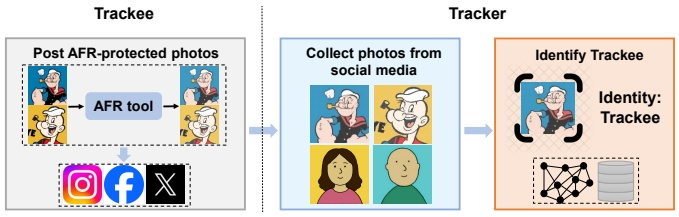
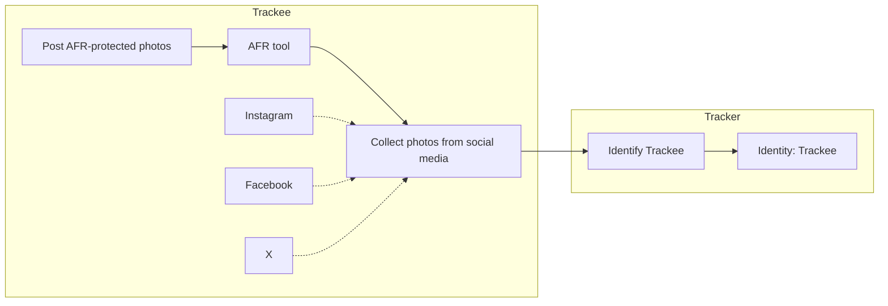
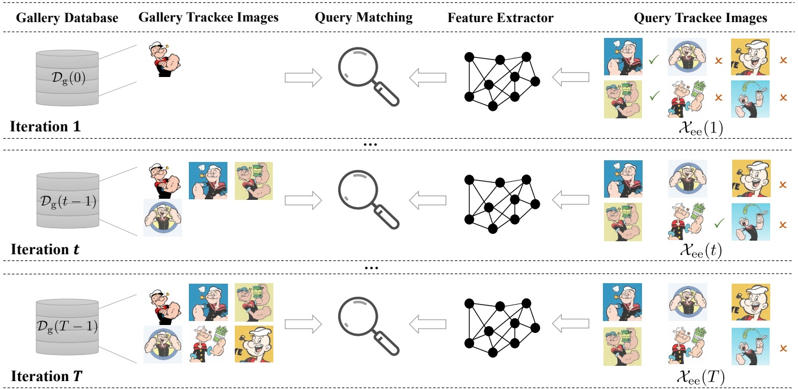
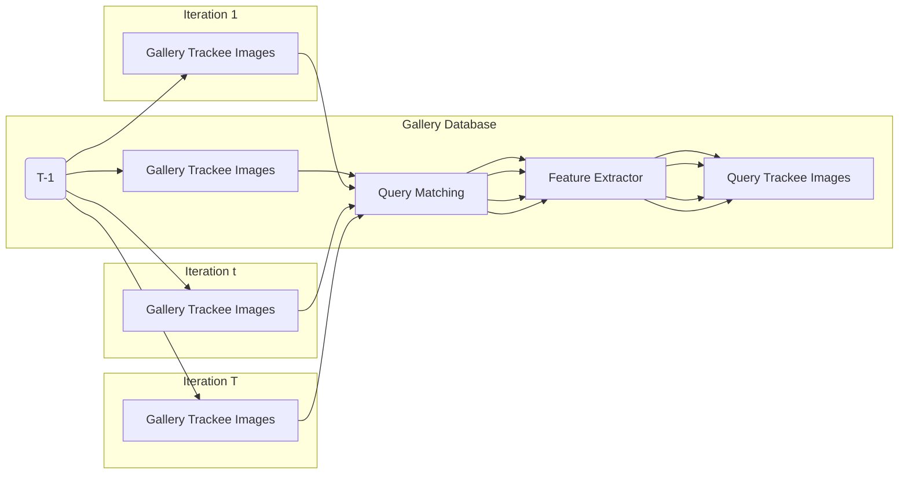

## 2 Antecedentes y Trabajos Relacionados

En esta sección, presentamos las definiciones matemáticas, los conceptos preliminares necesarios y la literatura más relevante sobre modelos de facial recognition y tecnología de anti-facial recognition.

## 2.1 Reconocimiento Facial

Los modelos de facial recognition están diseñados para identificar personas emparejando sus características faciales en una imagen desconocida con una base de datos de rostros conocidos [30], y típicamente constan de tres componentes principales: un feature extractor facial preentrenado, una gallery database de rostros conocidos y un paso de query matching basado en alguna métrica de similitud.

**Feature Extractor.** Sea $\mathcal { X } \subseteq \mathbb { R } ^ { n }$ el espacio de entrada de imágenes faciales y $\mathcal { Z } \subseteq \mathbb { R } ^ { d }$ un espacio de características latentes de baja dimensión. Un feature extractor en un modelo moderno de FR suele ser una red neuronal profunda $f : { \mathcal { X } } \to { \mathcal { Z } }$ entrenada para extraer características faciales distintivas de diferentes identidades a partir de sus imágenes digitales. Dado que los rostros humanos a menudo contienen grandes variaciones entre identidades e incluso dentro de una misma identidad, entrenar un feature extractor de alta calidad desde cero resulta costoso tanto en términos de recolección de datos como de costos computacionales. Para fomentar la colaboración y promover las aplicaciones de facial recognition, diversos feature extractors faciales consolidados se encuentran disponibles públicamente en línea [8, 12, 33, 45, 57]. Tales esfuerzos de código abierto brindan a profesionales e investigadores la viabilidad y facilidad de desplegar modelos de facial recognition personalizados según sus necesidades.

**Gallery Database.** Además de un feature extractor confiable, un modelo de FR requiere una colección de imágenes de galería que cubran un conjunto diverso de identidades, denotada como la gallery database $\mathcal { D } _ { \mathrm { g } } = ( \mathcal { X } _ { \mathrm { g } } , \mathcal { Y } _ { \mathrm { g } } )$ donde $X _ { \mathrm { g } }$ es un conjunto de imágenes de galería e $y _ { \mathrm { g } }$ son sus identidades correspondientes de ground-truth. Dada una identidad objetivo que un modelo de facial recognition pretende reconocer, un requisito implícito es que la gallery database $\mathcal { D } _ { \mathrm { g } }$ contenga al menos una imagen facial anotada de la identidad objetivo, lo cual es un prerrequisito para una identificación facial exitosa. Incluir múltiples imágenes faciales para las identidades dentro de la gallery database puede mejorar la robustez del facial recognition, en particular cuando las imágenes del rostro de la identidad varían ampliamente, lo cual ha sido adoptado en sistemas de facial recognition state-of-the-art.

**Query Matching.** En el momento de la inferencia, un modelo de facial recognition generará una predicción de identidad para cualquier imagen de consulta $x _ { \mathrm { q } } \in \mathcal{X}$ basándose en el feature extractor $f ,$ la gallery database $\mathcal { D } _ { \mathrm { g } } ,$ y un paso de query matching. Para ser más específicos, sea $\mathcal { Z } _ { \mathrm { g } } = \{ z _ { \mathrm { g } } = f ( \boldsymbol { x } _ { \mathrm { g } } ) \mid \pmb { x } _ { \mathrm { g } } \in \mathcal { X } _ { \mathrm { g } } \}$ el conjunto de características latentes extraídas correspondientes a las imágenes de la galería. Sea $z _ { \mathrm { q } } = f ( \pmb { x } _ { \mathrm { q } } )$ las características faciales latentes extraídas de $x _ { \mathrm { q } } .$ El paso de query matching calcula primero una puntuación de cosine similarity entre $z _ { \mathrm { q } }$ y cada una de las características latentes de la galería $z _ { \mathrm { g } } \in \mathcal { Z } _ { \mathrm { g } }$ y luego genera la identidad $\hat { y } _ { \mathrm { g } }$ correspondiente a la imagen de la galería con la puntuación de similitud más alta. Sea $\mathcal{Y}$ el espacio de salida de las identidades; entonces, un modelo de facial recognition puede considerarse como una función FR : $\mathcal{X} \rightarrow { \mathcal { Y } }$ tal que: para cualquier imagen de consulta $x _ { \mathrm { q } } ,$

$$
\mathrm{FR} \left(\boldsymbol {x} _ {\mathrm{q}}\right) = \hat {y} _ {\mathrm{g}}, \text {donde} \left(\hat {\boldsymbol {x}} _ {\mathrm{g}}, \hat {y} _ {\mathrm{g}}\right) = \underset {\left(\boldsymbol {x} _ {\mathrm{g}}, y _ {\mathrm{g}}\right) \in \mathcal {D} _ {\mathrm{g}}} {\operatorname{argmax}} \cos \left(f \left(\boldsymbol {x} _ {\mathrm{q}}\right), f \left(\boldsymbol {x} _ {\mathrm{g}}\right)\right). \tag {1}
$$

Nótese que el modelo de FR, basándose en la distancia coseno respecto a la imagen de consulta, devuelve la identidad de la galería más similar, lo cual se adopta sin mención explícita en nuestro artículo. El uso de cosine similarity para el paso de query matching se alinea con la literatura existente [12, 33, 53]. También pueden utilizarse otras reglas de predicción alternativas, según el escenario de aplicación. Por ejemplo, en [46] también se considera como salida del modelo de FR el retorno de un conjunto de las top-$k$ identidades más similares, mientras que en trabajos anteriores como [45] se empleó la distancia euclidiana para calcular las puntuaciones de similitud. Cuando la gallery database contiene un gran número de imágenes de alta dimensión, a menudo se emplean técnicas de reducción de dimensionalidad y estructuras basadas en árboles en la búsqueda de $k$-nearest neighbors para mejorar la eficiencia computacional del query matching. Además, la verificación facial (facial verification) [7, 41, 50] está estrechamente relacionada con el reconocimiento facial, donde se emplean pasos similares de extracción de características y query matching. Sin embargo, la diferencia clave radica en que se utiliza una única imagen de referencia de la identidad objetivo para calcular la puntuación de similitud con un umbral predefinido para determinar el resultado de la facial verification, mientras que la gallery database contiene múltiples imágenes con diversas identidades y no hay ningún paso de umbralización involucrado en el facial recognition.

## 2.2 Anti-Facial Recognition

El anti-facial recognition es un enfoque para evitar el rastreo en línea de las imágenes faciales de los usuarios basado en ejemplos adversariales (adversarial examples) [11, 19, 54]. Un método de AFR puede entenderse como una función AFR : $\mathcal{X} \rightarrow \mathcal{X}$ que mapea cualquier imagen facial de entrada a una versión perturbada de la misma. Las técnicas de AFR existentes pueden dividirse en dos categorías: gallery-target y query-target, según si el AFR inyecta pequeñas perturbaciones adversariales en las imágenes de la galería o en las imágenes de consulta.

**Gallery-Target.** El gallery-target AFR tiene como objetivo engañar a los modelos de FR inyectando perturbaciones adversariales en las imágenes de galería de la identidad objetivo. Dada una identidad objetivo $y _ { \mathrm { t a r g } }$ que el AFR busca proteger, la colección de imágenes de galería después de la perturbación $\tilde { \mathcal{X} } _ { \mathrm { g } }$ se define como:

$$
\begin{array}{l} \tilde {\mathcal{X}} _ {\mathrm{g}} = \mathcal{X}_ {\mathrm{g}} ^ {\mathrm{nt}} \cup \tilde {\mathcal{X}} _ {\mathrm{g}} ^ {\mathrm{t}}, \text {donde} \mathcal{X}_ {\mathrm{g}} ^ {\mathrm{nt}} = \left\{\boldsymbol {x} _ {\mathrm{g}} \in \mathcal{X}_ {\mathrm{g}} \mid y _ {\mathrm{g}} \neq y _ {\text {targ}} \right\}, \tag {2} \\ \text {y} \tilde {\mathcal {X}} _ {\mathrm{g}} ^ {\mathrm{t}} = \{\operatorname{AFR} (\boldsymbol {x} _ {\mathrm{g}}) \mid \boldsymbol {x} _ {\mathrm{g}} \in \mathcal {X} _ {\mathrm{g}}, y _ {\mathrm{g}} = y _ {\text {targ}} \}, \\ \end{array}
$$

donde $\mathcal{X} _ { \mathrm { g } }$ denota el conjunto de imágenes de galería limpias (clean) antes de la perturbación. Nótese que únicamente las imágenes de galería pertenecientes a $y _ { \mathrm { t a r g } }$ son perturbadas adversarialmente mediante técnicas de gallery-target AFR. Debido a las características adversariales inyectadas en $\tilde { \mathcal{X} } _ { \mathrm { g } } ^ { \mathrm { t } }$ , se espera que un modelo de FR genere una identidad incorrecta cuando se consulta una imagen facial limpia de la identidad objetivo.

**Query-Target.** La otra categoría se conoce como query-target AFR, la cual genera perturbaciones en las imágenes de consulta del objetivo. Sea $y _ { \mathrm { t a r g } }$ el objetivo e $y _ { \mathrm { q } }$ la identidad de ground-truth de $x _ { \mathbf { q } } ,$ entonces la colección de imágenes de consulta (perturbadas) ${ \tilde { \mathcal{X} } } _ { \mathrm { q } }$ se define como:

$$
\tilde {\mathcal {X}} _ {\mathrm{q}} = \mathcal {X} _ {\mathrm{q}} ^ {\mathrm{nt}} \cup \tilde {\mathcal {X}} _ {\mathrm{q}} ^ {\mathrm{t}}, \text {donde} \mathcal {X} _ {\mathrm{q}} ^ {\mathrm{nt}} = \left\{\boldsymbol {x} _ {\mathrm{q}} \in \mathcal {X} _ {\mathrm{q}} \mid y _ {\mathrm{q}} \neq y _ {\text {targ}} \right\} \tag {3}
$$

$$
\text {y} \tilde {\mathcal {X}} _ {\mathrm{q}} ^ {\mathrm{t}} = \{\operatorname{AFR} (\boldsymbol {x} _ {\mathrm{q}}) \mid \boldsymbol {x} _ {\mathrm{q}} \in \mathcal {X} _ {\mathrm{q}}, y _ {\mathrm{q}} = y _ {\text {targ}} \},
$$

donde $\tilde { \mathcal{X} } _ { \mathrm { q } } ^ { \mathrm { t } }$ es el conjunto de imágenes de consulta perturbadas con respecto a $y_{\mathrm{targ}}$ y a alguna técnica de query-target AFR, y $\mathcal{X} _ { \mathrm { q } }$ denota la contraparte limpia de ${ \tilde { \mathcal{X} } } _ { \mathrm { q } } .$ Debido a las características no concordantes entre la galería no perturbada y las imágenes de consulta perturbadas, la privacidad facial de la identidad objetivo puede ser protegida.

**Trabajos Relacionados.** En la literatura previa sobre gallery-target AFR, Shan et al. propusieron agregar pequeñas perturbaciones que simulan ser identidades no objetivo en el espacio latente de características faciales [47], mientras que Cherepanova et al. se enfocaron en engañar a las APIs comerciales de facial recognition creando perturbaciones basadas en un ensemble de modelos de FR [9]. Posteriormente, Radiya-Dixit et al. argumentaron que existe una asimetría entre los usuarios que publicaron imágenes faciales en línea y los entrenadores de los modelos de FR, revelando las limitaciones de las técnicas de gallery-target AFR frente a modelos de FR lanzados en el futuro [40]. En términos generales, el gallery-target AFR impone suposiciones más fuertes tanto sobre el procedimiento de construcción de la gallery database del modelo de FR como sobre el momento en que la identidad objetivo publica sus imágenes faciales en línea con o sin protecciones de AFR. Los intentos iniciales de query-target AFR se centraron en perturbaciones adversariales acotadas en ciertas métricas de distancia tales como la norma $\ell _ { p }$ [13, 14, 32, 36, 56, 60], mientras que otros trabajos consideraron enfoques basados en parches (patch-based), los cuales típicamente colocan un parche adversarial en regiones localizadas [25, 48, 55]. A pesar de una mayor protección de la privacidad, estos métodos sufren de artefactos visuales indeseables debido a la restricción limitante de las perturbaciones inyectadas.

Los trabajos recientes han cambiado el enfoque hacia métodos basados en modelos generativos (generative-based methods) para producir ejemplos adversariales más naturales. Por ejemplo, Hu et al. propusieron AMT-GAN, que emplea redes generativas adversariales para la transferencia de maquillaje (makeup transfer) [19], Shamshad et al. utilizaron modelos generativos text-guided para generar maquillaje adversarial [46], mientras que Sun et al. desarrollaron DiffAM aprovechando la sólida capacidad generativa de los diffusion models [51]. Estos métodos alcanzan una protección de la privacidad state-of-the-art al tiempo que preservan en gran medida la naturalidad de las imágenes faciales originales. Debido a su rendimiento superior y a las suposiciones más moderadas requeridas, en este trabajo nos centramos principalmente en el generative-based AFR.

## 3 Juego de Seguridad Entre Tracker y Trackee

Recordemos que nuestro trabajo tiene como objetivo estudiar la tecnología de AFR para la protección de la privacidad facial frente a modelos no autorizados de FR. Sin embargo, la literatura existente sobre AFR no proporciona una definición unificada de atacantes y defensores debido a sus distintos objetivos de investigación. Para evitar posibles confusiones, definimos formalmente el problema de anti-facial recognition como un security game bipartito entre Tracker y Trackee, el cual se utilizará a lo largo de este artículo.

flowchart

Figura 1: Ilustración del security game entre Tracker y Trackee. Trackee sube imágenes protegidas por AFR a las redes sociales, mientras que Tracker busca rastrear a Trackee utilizando modelos de FR. Para evitar posibles problemas éticos, utilizamos el personaje de dibujos animados ficticio Popeye para representar la identidad de la víctima Trackee.

**Definición 1.** En este security game, Tracker emplea un modelo de FR $\mathrm{FR}(\cdot)$ para rastrear las imágenes en línea que Trackee publica. Antes de publicar, Trackee despliega un esquema de protección de query-target AFR $\mathrm{AFR}(\cdot)$ en sus imágenes para eludir el rastreo. Sea $y _ { \mathrm { e e } }$ la identidad de Trackee y $\mathcal{X} _ { \mathrm { q } }$ una colección de imágenes de consulta limpias; entonces el objetivo de Tracker puede capturarse mediante el siguiente problema de optimización:

$$
\begin{array}{l} \max \sum_ {\boldsymbol {x} _ {\mathrm{q}} \in \mathcal {X} _ {\mathrm{q}}} \mathbb {1} \left\{y _ {\mathrm{q}} = y _ {\mathrm{ee}}, \text {FR} \left(\operatorname{AFR} \left(\boldsymbol {x} _ {\mathrm{q}}\right)\right) = y _ {\mathrm{ee}} \right\}, \\ \text {s.t.} \sum_ {\boldsymbol {x} _ {\mathrm{q}} \in \mathcal {X} _ {\mathrm{q}}} \mathbb {1} \left\{y _ {\mathrm{q}} \neq y _ {\mathrm{ee}}, \operatorname{FR} \left(\boldsymbol {x} _ {\mathrm{q}}\right) = y _ {\mathrm{ee}} \right\} \leq \gamma , \tag {4} \\ \end{array}
$$

donde $y _ { \mathrm { q } }$ representa la identidad de ground-truth de la imagen de consulta $x _ { \mathbf { q } } ,$ y $\gamma \in \mathbb { N } _ { + }$ captura el umbral de tolerancia del número de falsos positivos. Correspondientemente, el objetivo de Trackee puede definirse como:

$$
\min \sum_ {\boldsymbol {x} _ {\mathrm{q}} \in \mathcal {X} _ {\mathrm{q}}} \mathbb {1} \left\{y _ {\mathrm{q}} = y _ {\mathrm{ee}}, \operatorname{FR} \left(\operatorname{AFR} \left(\boldsymbol {x} _ {\mathrm{q}}\right)\right) = y _ {\mathrm{ee}} \right\}. \tag {5}
$$

Las Ecuaciones 4 y 5 codifican los objetivos de Tracker y Trackee, respectivamente. Tracker busca identificar con precisión las imágenes de Trackee (es decir, maximizar los verdaderos positivos) evitando al mismo tiempo reconocimientos incorrectos de imágenes de consulta de otras identidades como Trackee (es decir, manteniendo una baja false positive rate). En contraste, Trackee busca reducir la tasa de identificación tanto como sea posible perturbando ligeramente las imágenes publicadas mediante AFR. La Figura 1 ilustra el security game bipartito entre Tracker y Trackee. Nótese que consideramos la configuración del conjunto de datos de consulta con múltiples imágenes diferentes para cada identidad, lo cual coincide con las características del conjunto de datos recopilado por Tracker en escenarios prácticos. Para distinguir del conjunto de consulta limpio $\mathcal{X} _ { \mathbf { q } } ,$ usamos ${ \tilde { \mathcal{X} } } _ { \mathbf { q } }$ (similar a la Ecuación 3) para denotar el conjunto de imágenes de consulta reales recopiladas por Tracker. En particular, se asume que las perturbaciones de AFR están involucradas en todas las imágenes de consulta de Trackee, mientras que las imágenes faciales de otras identidades permanecen sin perturbar, dado que los Trackees a menudo solo tienen acceso a sus propias imágenes. Esta suposición simplifica en gran medida nuestros análisis posteriores y es razonable ya que, desde la perspectiva de Trackee, perturbar todas las imágenes antes de publicarlas probablemente minimice el riesgo de rastreo por parte de los modelos de FR del Tracker y maximice las tasas de éxito de protección.

En este trabajo, nos centramos en el escenario de ataque de elusión (dodging attack) al evaluar el éxito de AFR, mientras que los ataques de suplantación (impersonating attacks) suelen considerarse de forma primordial en la literatura existente sobre generative-based AFR [19, 46, 51]. La diferencia clave radica en que el dodging persigue un objetivo de ataque no dirigido (untargeted) mediante AFR, mientras que la impersonation está diseñada para imitar una identidad específica diferente a Trackee, lo cual es un ataque dirigido (targeted). Creemos que el dodging es un objetivo más adecuado para proteger la privacidad facial de Trackee que la impersonation. Como se señala en [61], un ataque de impersonation exitoso no implica necesariamente altas tasas de éxito en términos de dodging.

**Modelado de Amenazas del Tracker (Threat Modeling of Tracker).** Introducimos el threat model del Tracker con mayor detalle. Recordemos que el objetivo del Tracker es rastrear las imágenes faciales publicadas en línea por Trackee, donde se asume que toda la colección de imágenes de consulta de Trackee está protegida por AFR. Para lograr el objetivo de rastreo, se asume que Tracker emplea un modelo de FR para reconocer automáticamente las imágenes de Trackee a partir del conjunto de datos de consulta recopilado. Asumimos que Tracker tiene acceso inicialmente a una única imagen facial del Trackee, la cual se incluirá en la gallery database del modelo de facial recognition adoptado. Consideramos que estas suposiciones proporcionan una caracterización realista de las capacidades de Tracker y se alinean con la expectativa de que las restricciones impuestas al comportamiento de Tracker deben ser lo más moderadas posible.

Además de las suposiciones anteriores, no imponemos ninguna restricción sobre Tracker, con el fin de capturar las posibles variabilidades de los esquemas de FR que los Trackers puedan adoptar en la práctica. En particular, consideramos dos escenarios para el conocimiento inicial de Tracker: comenzar con una imagen limpia o protegida por AFR del Trackee, y evaluar la eficacia de AFR con respecto a varios modelos de FR disponibles públicamente e incluso una API de facial verification de caja negra (black-box). La literatura existente sobre generative-based AFR solo considera para la evaluación el conocimiento inicial de una imagen de galería limpia de Trackee. Sin embargo, dado que una imagen protegida por AFR publicada en línea por Trackee también puede ser detectada y descargada por el Tracker, consideramos ambos escenarios en los que Tracker posee inicialmente una imagen limpia o protegida de Trackee para mayor exhaustividad. Además, diseñamos una nueva dynamic FR strategy para el rastreo de Trackee por parte de Tracker en la Sección 4, la cual demuestra ser mucho más potente que los esquemas estáticos de FR existentes y puede capturar mejor el comportamiento real de Trackers determinados y sus incentivos.

**Expectativas de AFR desde la Perspectiva de Trackee.** Trackee busca eludir el rastreo de modelos no autorizados de FR creando perturbaciones de AFR en sus imágenes antes de publicarlas. Por lo general, se espera que un esquema de protección de AFR deseable alcance dos objetivos principales: eficacia de protección (protection efficacy) y calidad visual (visual quality), los cuales se explican a continuación.

El objetivo principal al diseñar AFR es la protection efficacy, que caracteriza con qué éxito puede el AFR evitar la identificación por parte de los modelos de FR. Cabe señalar que Trackee no posee el conocimiento subyacente de ground-truth sobre el modelo real de FR empleado por Tracker. Por lo tanto, es importante considerar la protection efficacy de AFR frente a diversos modelos de FR y promover la transferibilidad en el diseño de AFR. Además, el AFR debe preservar la calidad visual de las imágenes faciales de Trackee para garantizar una experiencia de usuario satisfactoria; de lo contrario, Trackee podría no publicar en línea las imágenes protegidas por AFR si lucen poco naturales o visualmente disímiles a las imágenes iniciales. Nos enfocamos principalmente en esquemas de query-target AFR que no cambian significativamente la apariencia visual de las imágenes de Trackee, mientras que las herramientas de preservación de la privacidad que eliminan características visuales distintivas de la identidad, como la ofuscación facial (face obfuscation) y la anonimización [5, 34, 49], se consideran fuera del alcance. Dado que las imágenes protegidas por AFR de Trackee se publican antes de que Tracker comience el rastreo, desarrollar esquemas de AFR sólidos es más desafiante que generar adversarial examples para engañar a sistemas de ML. Trackee tiene un conocimiento muy limitado sobre el modelo o la estrategia de FR empleados por Tracker. En contraste, los ataques adversariales tradicionales usualmente asumen que el modelo víctima puede ser explotado al menos de manera de caja negra. Como ilustraremos en la Sección 4, una dynamic FR strategy simple puede volver ineficaces a casi todos los esquemas de protección de AFR competitivos existentes, lo que confirma los desafíos que anticipamos para el desarrollo de AFR.

flowchart

Adoptamos imágenes de Popeye que son de dominio público para representar las imágenes faciales de Trackee, con el fin de evitar posibles problemas éticos y de derechos de autor.

Figura 2: Ilustración de la estrategia de reconocimiento facial dinámico propuesta, DynTracker, para el rastreo de Trackee por parte de Tracker.
