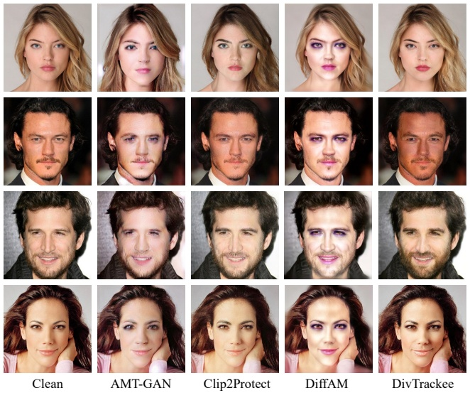
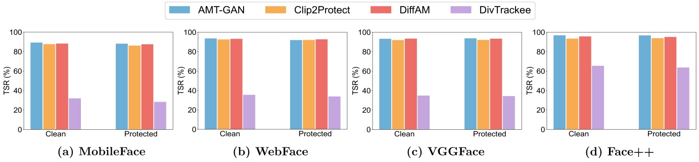
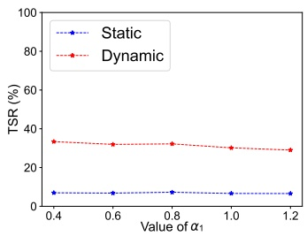
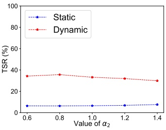
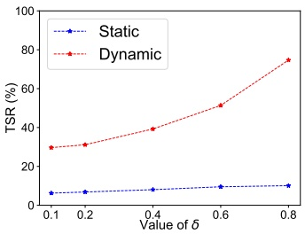
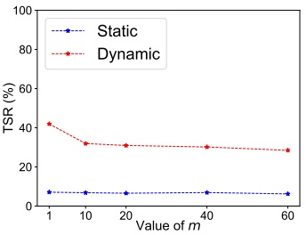

## 6 Experimentos

Para estudiar sistemáticamente la solidez de nuestro DynTracker y validar la superioridad de nuestro DivTrackee con respecto a los esquemas de protección de AFR state-of-the-art, llevamos a cabo experimentos exhaustivos para comparar la eficacia de protección y los aspectos visuales de diferentes métodos de AFR a través de diversos benchmarks de imágenes y configuraciones de facial recognition (Sección 6.1). Además, también evaluamos la generalizabilidad de nuestros métodos a modelos de verificación facial (facial verification) (Sección 6.2). Debido a limitaciones de espacio, los detalles y resultados experimentales adicionales se posponen al apéndice de nuestro artículo completo. A continuación, comenzamos explicando la configuración principal de nuestros experimentos.

**Dataset.** Consideramos 4 benchmarks de imágenes faciales ampliamente utilizados: FaceScrub [35], PubFig [27], UMDFaces [4] y CelebA-HQ [22], entre los cuales CelebA-HQ es el conjunto de datos con imágenes faciales de alta resolución. Todos estos conjuntos de datos constan de imágenes con identidades anotadas, cada una asociada con múltiples imágenes faciales.

**Configuración (Configuration).** Para cada conjunto de datos de referencia, seleccionamos aleatoriamente primero 5 identidades como las identidades objetivo de los Trackees. Luego, para cada identidad de Trackee, generamos protecciones de AFR para todas las imágenes de Trackee, incluida una imagen en la gallery database perteneciente a Tracker, mientras tratamos las imágenes restantes como las imágenes de consulta de los Trackees. Seguimos a Lowkey [9] para configurar las imágenes de consulta y de galería para las identidades restantes distintas de Trackee. Comparamos nuestro DivTrackee con métodos basados en modelos generativos state-of-the-art, tales como Adv-Makeup [58], AMT-GAN [19], Clip2Protect [46] y DiffAM [51]. Para DivTrackee, utilizamos las primeras 2000 imágenes de LFW [20] para construir el conjunto de datos auxiliar $\mathcal{X} _ { \mathrm { aux } }$ en la diverse guidance loss y consideramos el prompt de texto $p _ { \mathrm { targ } }$ como "natural makeup". Elegimos los hiperparámetros involucrados en DivTrackee de la siguiente manera: $m = 10, \alpha_1 = 0.6, \alpha_2 = 1.2, \alpha_3 = 0.5, \alpha_4 = 0.02, \delta = 0.2, \lambda = 0.01$ y $S = 60$ (véase la Sección 7.1 para nuestros experimentos de análisis de sensibilidad).

**Feature Extractor.** Para configurar el modelo de FR de Tracker, consideramos 4 feature extractors faciales preentrenados, incluidos MobileFace [8], WebFace [57], VGGFace [6] y MagFace [33]. Para generar protecciones de AFR para las imágenes de Trackee, utilizamos IR-50 [18], IR-152 [12] y FaceNet [45] como feature extractors sustitutos (substitute feature extractors) para calcular la función de disimilitud coseno $\mathrm{D}_f$ para las pérdidas adversariales en la Ecuación 8. Alineados con la literatura existente [19, 46, 51], consideramos los escenarios donde los feature extractors utilizados para la generación de AFR difieren de los empleados por Tracker. Esta configuración de transferibilidad de caja negra (black-box transferability) simula el escenario de tener un conocimiento impreciso del modelo de FR del Tracker al generar las protecciones de AFR.

**Métrica de Evaluación (Evaluation Metric).** Adoptamos la tasa de éxito de rastreo (tracking success rate, TSR) para evaluar la solidez de una estrategia de FR específica del Tracker. Específicamente,

la TSR se define como la proporción entre el número de imágenes de consulta correctamente identificadas como Trackee y el número total de imágenes de Trackee en el conjunto de datos de consulta. Cuanto mayor sea la TSR, más sólida será la estrategia de FR empleada. Para Trackee, utilizamos la tasa de éxito de protección (protection success rate, PSR), definida como $1 - \mathrm{TSR}_i$, para evaluar la eficacia de un esquema de protección de AFR. También visualizamos las imágenes protegidas por AFR generadas para proporcionar resultados de comparación cualitativa, lo que se considera el criterio principal para evaluar la calidad visual de las imágenes generadas.

## 6.1 Resultados Principales en Reconocimiento Facial

La Tabla 3 resume las tasas de éxito de rastreo de las estrategias de FR de Tracker frente a diversos métodos de generative-based AFR. Reportamos la tasa de éxito de rastreo promedio para cada esquema de AFR sobre las 5 identidades de Trackee seleccionadas frente a la static FR strategy y nuestro DynTracker, respectivamente. Consideramos dos configuraciones del conocimiento inicial de Tracker sobre Trackee, ya sea incluyendo una imagen limpia o protegida por AFR en la gallery database recopilada por Tracker. Como referencia, evaluamos el rendimiento de las estrategias de rastreo cuando no se emplea ninguna protección de AFR en el conjunto de imágenes de consulta de Trackee, representado como No Protection en la Tabla 3.

**Fuerza de DynTracker.** Comenzamos examinando las tasas de éxito de rastreo de DynTracker cuando las imágenes protegidas de Trackee se generan utilizando técnicas de AFR existentes. La Tabla 3 muestra que nuestra estrategia dinámica de FR, DynTracker, es muy efectiva para romper las protecciones generadas por métodos de generative-based AFR existentes que no promueven la diversidad explícitamente, logrando tasas de éxito de rastreo superiores al 80% en casi todos los escenarios evaluados. Por ejemplo, DiffAM solo puede lograr tasas de éxito de protección de alrededor del 10% en el conjunto de datos de alta resolución CelebA-HQ frente a nuestra dynamic FR strategy. En comparación con el escenario donde no se despliegan protecciones, los métodos de AFR existentes solo pueden lograr una mejora marginal en el éxito de protección frente a DynTracker, lo que confirma sus limitaciones frente a trackers determinados.

En marcado contraste, se observa que las tasas de éxito de rastreo de la static FR strategy son significativamente más bajas que las de DynTracker, especialmente cuando Tracker posee una imagen inicial limpia de Trackee. Esta es la configuración de evaluación típica adoptada en la literatura previa de AFR. Incluso si Tracker incluye inicialmente una única imagen protegida de Trackee en la gallery database del modelo de FR, la eficacia de protección de los métodos de AFR existentes disminuye claramente en la mayoría de los casos. Por ejemplo, Clip2Protect es muy efectivo en el conjunto de datos FaceScrub frente a la static FR strategy con MobileFace y una imagen limpia de Trackee, mientras que la TSR aumenta del 2.46% al 31.37% cuando la imagen inicial de Trackee cambia de limpia a protegida. Estos resultados empíricos concuerdan con nuestras observaciones y resultados preliminares discutidos en la Sección 4, lo que sugiere un aspecto crucial pasado por alto en las evaluaciones de AFR. Dicho esto, si utilizamos la static FR strategy para evaluar y comparar métodos de AFR, obtendremos una eficacia de protección sobreestimada en gran medida debido a las fuertes suposiciones impuestas sobre el comportamiento de Tracker de no actualizar la gallery database del modelo de FR con las imágenes protegidas de Trackee recién identificadas. Esta sobreestimación puede conducir a conclusiones erróneas y a una falsa sensación de seguridad para las protecciones de AFR frente a Trackers determinados del mundo real. Por lo tanto, recomendamos encarecidamente a la comunidad considerar estrategias de FR dinámicas como DynTracker al evaluar la eficacia de los esquemas de protección de AFR.

Tabla 3: Comparaciones de las tasas de éxito de rastreo (%) de las estrategias de FR estática y dinámica frente a diferentes métodos de generative-based AFR a través de diversos benchmarks de imágenes y feature extractors. Para cada entrada, el primer número representa la TSR frente a la static FR strategy, y el segundo representa la TSR frente a nuestro DynTracker. Aquí, Clean y Protected significan que Tracker comienza con una única imagen de Trackee limpia y protegida en la gallery database, respectivamente. Para DynTracker, la menor tasa de éxito de rastreo se resalta en negrita para destacar el método de AFR con mejor rendimiento en términos de protección de la privacidad facial de Trackee.

<table><tr><td rowspan="2">Dataset</td><td rowspan="2">AFR Method</td><td colspan="2">MobileFace</td><td colspan="2">WebFace</td><td colspan="2">VGGFace</td><td colspan="2">MagFace</td></tr><tr><td>Clean</td><td>Protected</td><td>Clean</td><td>Protected</td><td>Clean</td><td>Protected</td><td>Clean</td><td>Protected</td></tr><tr><td rowspan="6">FaceScrub</td><td>No Protection</td><td>85.89/87.76</td><td>N/A</td><td>98.17/98.29</td><td>N/A</td><td>98.26/98.29</td><td>N/A</td><td>99.29/99.36</td><td>N/A</td></tr><tr><td>Adv-Makeup</td><td>15.93/85.52</td><td>45.93/82.62</td><td>31.54/91.02</td><td>58.66/88.84</td><td>27.96/92.58</td><td>59.42/89.16</td><td>43.49/98.02</td><td>62.34/97.12</td></tr><tr><td>AMT-GAN</td><td>13.38/85.42</td><td>24.26/82.64</td><td>29.87/92.35</td><td>56.64/91.17</td><td>30.29/92.58</td><td>57.18/91.26</td><td>44.25/99.87</td><td>83.50/98.85</td></tr><tr><td>Clip2Protect</td><td>2.46/83.33</td><td>31.37/83.33</td><td>4.68/91.40</td><td>42.64/89.65</td><td>4.32/90.87</td><td>43.85/88.60</td><td>33.83/98.04</td><td>80.39/98.04</td></tr><tr><td>DiffAM</td><td>14.54/84.96</td><td>34.65/85.20</td><td>27.64/92.72</td><td>52.50/91.46</td><td>24.86/91.25</td><td>53.90/90.82</td><td>39.65/98.26</td><td>83.74/98.06</td></tr><tr><td>DivTrackee</td><td>2.67/26.58</td><td>1.86/22.16</td><td>7.82/30.62</td><td>2.37/29.49</td><td>5.94/31.69</td><td>1.98/32.68</td><td>6.82/31.94</td><td>2.53/28.57</td></tr><tr><td rowspan="6">PubFig</td><td>No Protection</td><td>86.29/88.07</td><td>N/A</td><td>96.85/97.08</td><td>N/A</td><td>98.01/98.15</td><td>N/A</td><td>99.15/99.24</td><td>N/A</td></tr><tr><td>Adv-Makeup</td><td>24.37/83.38</td><td>55.87/79.19</td><td>34.46/86.12</td><td>58.36/82.08</td><td>32.18/88.54</td><td>56.73/83.42</td><td>35.68/94.57</td><td>65.24/92.85</td></tr><tr><td>AMT-GAN</td><td>27.64/83.83</td><td>56.44/79.67</td><td>40.78/87.01</td><td>49.64/84.82</td><td>34.15/88.53</td><td>51.07/85.44</td><td>39.34/94.74</td><td>60.85/93.16</td></tr><tr><td>Clip2Protect</td><td>3.45/81.93</td><td>32.37/79.53</td><td>4.83/84.69</td><td>39.69/82.71</td><td>5.35/86.28</td><td>40.60/83.46</td><td>42.63/93.70</td><td>68.18/91.89</td></tr><tr><td>DiffAM</td><td>22.10/83.90</td><td>52.46/80.40</td><td>27.65/85.38</td><td>46.09/84.46</td><td>28.24/87.32</td><td>48.70/83.98</td><td>38.10/94.65</td><td>63.25/93.18</td></tr><tr><td>DivTrackee</td><td>3.23/28.57</td><td>2.88/29.58</td><td>4.82/32.17</td><td>2.63/29.72</td><td>5.25/35.76</td><td>3.27/32.54</td><td>5.88/37.06</td><td>4.71/34.53</td></tr><tr><td rowspan="6">UMDFaces</td><td>No Protection</td><td>86.89/87.42</td><td>N/A</td><td>96.01/96.27</td><td>N/A</td><td>98.19/98.33</td><td>N/A</td><td>99.30/99.30</td><td>N/A</td></tr><tr><td>Adv-Makeup</td><td>18.93/84.28</td><td>53.58/80.62</td><td>29.23/87.38</td><td>57.32/84.21</td><td>25.03/88.77</td><td>56.79/85.82</td><td>33.68/96.08</td><td>59.60/95.36</td></tr><tr><td>AMT-GAN</td><td>22.37/82.83</td><td>47.68/80.60</td><td>31.23/88.17</td><td>57.72/83.83</td><td>30.78/89.48</td><td>56.28/84.25</td><td>33.48/97.08</td><td>61.34/94.88</td></tr><tr><td>Clip2Protect</td><td>3.01/81.57</td><td>33.01/80.62</td><td>4.54/88.61</td><td>43.60/87.45</td><td>5.38/90.18</td><td>48.52/89.87</td><td>31.46/95.48</td><td>63.56/95.48</td></tr><tr><td>DiffAM</td><td>18.62/83.44</td><td>45.18/81.36</td><td>27.52/87.95</td><td>51.46/87.02</td><td>23.70/91.04</td><td>52.26/91.32</td><td>32.19/96.68</td><td>60.46/96.30</td></tr><tr><td>DivTrackee</td><td>3.69/29.17</td><td>3.22/27.54</td><td>5.63/31.64</td><td>3.89/28.79</td><td>4.86/32.61</td><td>3.46/29.57</td><td>5.18/33.64</td><td>4.10/31.15</td></tr><tr><td rowspan="6">CelebA-HQ</td><td>No Protection</td><td>82.30/85.83</td><td>N/A</td><td>95.62/95.80</td><td>N/A</td><td>96.90/97.08</td><td>N/A</td><td>99.29/99.37</td><td>N/A</td></tr><tr><td>Adv-Makeup</td><td>42.38/90.26</td><td>45.54/91.42</td><td>46.68/91.39</td><td>52.62/91.25</td><td>47.70/92.40</td><td>52.16/90.94</td><td>49.85/90.62</td><td>54.62/92.46</td></tr><tr><td>AMT-GAN</td><td>36.74/89.42</td><td>38.36/90.50</td><td>41.69/90.42</td><td>46.78/92.40</td><td>40.42/91.86</td><td>43.60/90.74</td><td>42.65/93.42</td><td>44.55/91.84</td></tr><tr><td>Clip2Protect</td><td>16.34/86.62</td><td>31.75/88.36</td><td>19.42/92.38</td><td>33.68/91.52</td><td>21.40/91.98</td><td>29.64/90.75</td><td>22.56/94.64</td><td>36.72/93.18</td></tr><tr><td>DiffAM</td><td>28.05/89.60</td><td>36.42/88.16</td><td>37.48/93.25</td><td>48.20/92.66</td><td>36.44/92.50</td><td>43.84/91.94</td><td>43.36/94.90</td><td>46.72/93.56</td></tr><tr><td>DivTrackee</td><td>18.62/45.82</td><td>15.34/42.98</td><td>20.68/49.26</td><td>16.54/47.38</td><td>18.75/51.32</td><td>15.68/44.83</td><td>21.24/52.37</td><td>17.95/50.60</td></tr></table>

**Efectividad de DivTrackee.** A continuación, examinamos la eficacia de protección de nuestro DivTrackee. La Tabla 3 muestra que DivTrackee mejora consistentemente las tasas de éxito de protección contra DynTracker sobre los métodos existentes de generative-based AFR. En particular, DivTrackee mantiene tasas de éxito de rastreo de alrededor del 30% frente a DynTracker en FaceScrub, PubFig y UMDFaces. Para el conjunto de datos de imágenes de alta resolución CelebA-HQ, DivTrackee logra tasas de éxito de protección de alrededor del 50% frente a DynTracker, lo que mejora significativamente la eficacia de protección con respecto a los métodos de AFR existentes con PSR usualmente inferior al 10%. Como hemos explicado en la Sección 5, la diferencia crucial radica en la guía diversa y en las pérdidas promotoras de la diversidad involucradas en DivTrackee, reduciendo la similitud entre las imágenes de Trackee protegidas por AFR durante la generación, razón por la cual DivTrackee puede ser mucho más resiliente a las dynamic FR strategies. Además, al observar las TSRs de la static FR strategy, notamos que la eficacia de protección con respecto a DivTrackee es incluso mejor cuando la imagen de galería inicial de Trackee está protegida, lo cual contrasta fuertemente con la disminución de las PSRs para los métodos de AFR existentes. Nuestros resultados de evaluación destacan la utilidad de la promoción explícita de la diversidad en las protecciones de AFR frente a Trackers que actualizan la gallery database. Creemos que nuestra exploración sobre la diversificación de las imágenes protegidas por AFR en DivTrackee puede servir como un paso inicial importante hacia esquemas de protección de AFR más efectivos contra Trackers determinados en escenarios de aplicación del mundo real.

**Calidad Visual (Visual Quality).** Además de centrarnos en el objetivo principal de mejorar la eficacia de protección de AFR, también estudiamos empíricamente si las imágenes protegidas producidas por DivTrackee pueden preservar la calidad visual de las imágenes faciales originales, lo cual es una búsqueda secundaria pero aún importante desde la perspectiva de Trackee. En particular, visualizamos las imágenes de Trackee protegidas por AFR generadas por diferentes técnicas de query-target AFR en imágenes de alta resolución del conjunto de datos CelebA-HQ.

La Figura 3 compara DivTrackee con métodos de generative-based AFR state-of-the-art, incluidos AMT-GAN, Clip2Protect y DiffAM, para comparar sus capacidades de preservación de la calidad visual de las imágenes faciales originales. Podemos observar que las imágenes faciales protegidas generadas por DivTrackee lucen naturales, sin distorsión visual de la identidad original. En contraste, debido a su severo impacto a nivel de píxeles, las imágenes protegidas generadas por AMT-GAN pueden distinguirse fácilmente de su versión limpia. A pesar de preservar las características faciales, Clip2Protect tiende a tonos de piel más amarillentos. DiffAM tiene un efecto de maquillaje prominente en los ojos y la boca, y el tono general de la piel parece más brillante, mientras que las imágenes protegidas generadas por DivTrackee son más vívidas. Desde la perspectiva de la percepción humana, DivTrackee puede satisfacer ampliamente las expectativas de los Trackees respecto a la calidad visual de sus imágenes, manteniendo al mismo tiempo un sólido rendimiento de protección.

text_image

Clean
AMT-GAN
Clip2Protect
DiffAM
DivTrackee

Figura 3: Visualizaciones de imágenes protegidas de Trackee producidas por diferentes métodos de generative-based AFR. El prompt de texto objetivo $p _ { \mathrm { targ } }$ en DivTrackee se establece como "natural makeup".

## 6.2 Generalización a Verificación Facial

Debido a la similitud con el reconocimiento facial, los Trackers tienen la libertad y la capacidad de utilizar un modelo de facial verification para lograr un objetivo similar de identificar imágenes de Trackee. Por lo tanto, investigamos más a fondo si los propuestos DynTracker y DivTrackee pueden generalizarse a escenarios de verificación facial. A diferencia de los modelos de facial recognition que requieren la construcción de una gallery database, una imagen de referencia de una identidad conocida (p. ej., Trackee) y un umbral predefinido $\gamma \in [-1, 1]$ son suficientes para verificar si una imagen de consulta determinada pertenece a la identidad de referencia. Las imágenes faciales de otros individuos no intervienen en el proceso de facial verification. De manera similar a la configuración de DynTracker en la Sección 4, asumimos que Tracker posee inicialmente una imagen de Trackee, ya sea limpia o protegida, como imagen de referencia para la facial verification. Durante la etapa de actualización dinámica, Tracker verifica iterativamente las imágenes faciales en el conjunto de datos de consulta basándose en las puntuaciones de similitud con respecto a la imagen de referencia. Siempre que exista una coincidencia exitosa, las imágenes recién identificadas se considerarán como imágenes de referencia en las iteraciones siguientes. Cuando hay múltiples imágenes de referencia, una nueva imagen de consulta se compara con cada una de ellas, lo cual se considerará exitoso si alguna imagen de referencia arroja una puntuación de similitud que supere el umbral $\gamma$. El proceso de rastreo finalizará cuando no se puedan devolver nuevas coincidencias de consulta en la iteración actual.

**Resultado.** La Figura 4 resume las comparaciones de las tasas de éxito de rastreo de DynTracker adaptado a la facial verification a través de varios esquemas de generative-based AFR. En este experimento, consideramos el conjunto de datos de imágenes FaceScrub y diferentes modelos de facial verification, incluidos 3 feature extractors disponibles públicamente y Face++, una API comercial de facial verification.2 Fijamos el umbral $\gamma$ en 0.542, el cual permanece fijo durante todo el proceso de rastreo. De manera similar a nuestros experimentos de facial recognition, reportamos la tasa de éxito de rastreo promediada sobre las mismas 5 identidades seleccionadas para comparar la eficacia de varios métodos de AFR. La Figura 4 muestra que DynTracker se puede aplicar con éxito a diferentes frameworks de facial verification, los cuales vuelven ineficaces a los métodos existentes de generative-based AFR. En marcado contraste, DivTrackee logra tasas de éxito de protección significativamente más altas frente a la versión adaptada a facial verification de DynTracker. Por ejemplo, DivTrackee reduce las tasas de éxito de rastreo de DynTracker en más del 50% en comparación con los métodos existentes de generative-based AFR. Estos resultados validan nuevamente la solidez de nuestra estrategia de rastreo dinámico y sugieren que DivTrackee es superior para lograr una alta eficacia de protección, en particular cuando el Tracker actualiza las imágenes de referencia de Trackee.

**Análisis.** En comparación con los feature extractors disponibles públicamente, observamos una caída en el rendimiento de la eficacia de protección lograda por nuestro DivTrackee cuando el Tracker emplea la API de Face++. Sospechamos que Face++ puede haber adoptado técnicas de data augmentation o adversarial training para mejorar la robustez del feature extractor facial empleado, facilitando la identificación de las imágenes protegidas de Trackee generadas por DivTrackee. Esto sugiere que las APIs del mundo real son herramientas poderosas para implementar DynTracker desde la perspectiva de Tracker, donde desarrollar mejores esquemas para mejorar la eficacia de protección de DivTrackee frente a estrategias de rastreo dinámico utilizando herramientas de API sería una dirección futura interesante. Además, observamos que las TSRs de DynTracker bajo la configuración de facial verification son ligeramente superiores a las de la Tabla 3. Dicha diferencia se debe probablemente a la disparidad en el paso de query matching: una coincidencia de consulta se considera exitosa en nuestros experimentos de facial verification siempre que exista una imagen de referencia con una similitud que supere el umbral $\gamma$, mientras que para el facial recognition solo se devuelve la identidad de la galería más similar. Como se ilustrará en la Sección 7.3, al igual que lo que observamos bajo facial recognition, DynTracker bajo configuraciones de facial verification también induce tasas de falsos positivos insignificantes. Dada la mayor precisión de identificación de las imágenes de Trackee y el impacto insignificante en las tasas de falsos positivos, las estrategias de rastreo dinámico con modelos de facial verification plantean amenazas significativas para la privacidad facial de los usuarios, donde nuestro método de AFR que promueve la diversidad, DivTrackee, ofrece una solución viable para mitigar los riesgos de privacidad inducidos por DynTracker.

## 7 Análisis y Discusión Adicionales

En esta sección, estudiamos el impacto de las elecciones de hiperparámetros y de los términos de pérdida diseñados sobre el rendimiento de DivTrackee (Secciones 7.1 y 7.2), así como la manera en que la actualización dinámica de la gallery database afecta a las tasas de falsos positivos (Sección 7.3). Todos los experimentos se llevan a cabo en el conjunto de datos FaceScrub sin pérdida de generalidad.

## 7.1 Sensibilidad a los Hiperparámetros

Llevamos a cabo análisis de sensibilidad de los hiperparámetros clave utilizados en DivTrackee. Específicamente, consideramos el escenario donde Tracker posee inicialmente una imagen limpia de Trackee y emplea MagFace como el feature extractor facial. Registramos las tasas de éxito de rastreo de

<small>2Face++ está disponible en línea en https://www.faceplusplus.com/.</small>

bar

| Dataset | Condition | AMT-GAN (%) | Clip2Protect (%) | DiffAM (%) | DivTrackee (%) |
| :--- | :--- | :--- | :--- | :--- | :--- |
| MobileFace | Clean | ~90 | ~88 | ~89 | ~32 |
| MobileFace | Protected | ~89 | ~86 | ~88 | ~29 |
| WebFace | Clean | ~94 | ~93 | ~94 | ~36 |
| WebFace | Protected | ~92 | ~92 | ~93 | ~34 |
| VGGFace | Clean | ~94 | ~92 | ~94 | ~35 |
| VGGFace | Protected | ~94 | ~92 | ~94 | ~34 |
| Face++ | Clean | ~97 | ~94 | ~96 | ~65 |
| Face++ | Protected | ~97 | ~94 | ~96 | ~63 |

Figura 4: Comparaciones de las tasas de éxito de rastreo (TSR) de DynTracker adaptado a configuraciones de facial verification frente a varios métodos de generative-based AFR. Aquí, las Figuras (a)-(c) consideran los escenarios donde Tracker adopta algún feature extractor facial disponible públicamente, mientras que en la Figura (d) se prueba una API de facial verification, Face++.

line

| Value of \(\alpha1\) | Static TSR (%) | Dynamic TSR (%) |
| --- | --- | --- |
| 0.4 | ~7 | ~34 |
| 0.6 | ~7 | ~32 |
| 0.8 | ~7 | ~33 |
| 1.0 | ~7 | ~30 |
| 1.2 | ~7 | ~29 |

(a) Impacto de $\alpha_1$

line

| Value of \(\alpha2\) | Static TSR (%) | Dynamic TSR (%) |
| --- | --- | --- |
| 0.6 | ~6 | ~34 |
| 0.8 | ~6 | ~35 |
| 1.0 | ~6 | ~33 |
| 1.2 | ~7 | ~32 |
| 1.4 | ~8 | ~30 |

(b) Impacto de $\alpha_2$

line

| Value of \(\delta\) | Static TSR (%) | Dynamic TSR (%) |
| --- | --- | --- |
| 0.1 | ~6 | ~30 |
| 0.2 | ~7 | ~31 |
| 0.4 | ~8 | ~40 |
| 0.6 | ~9 | ~52 |
| 0.8 | ~10 | ~75 |

(c) Impacto de $\delta$

line

| Value of m | Static TSR (%) | Dynamic TSR (%) |
| --- | --- | --- |
| 1 | ~7 | ~42 |
| 10 | ~7 | ~32 |
| 20 | ~6 | ~31 |
| 40 | ~7 | ~30 |
| 60 | ~6 | ~29 |

(d) Impacto de $m$

Figura 5: Visualizaciones de los resultados del análisis de sensibilidad de los hiperparámetros clave con respecto a la eficacia de protección de DivTrackee.
