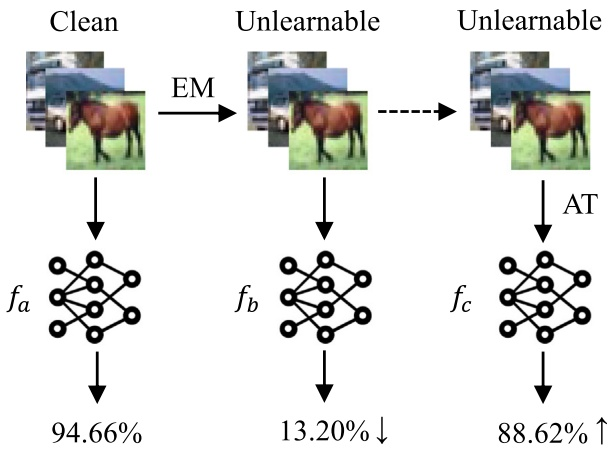
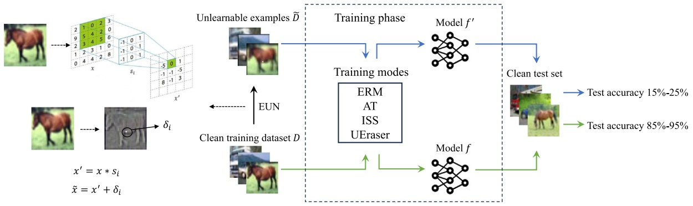
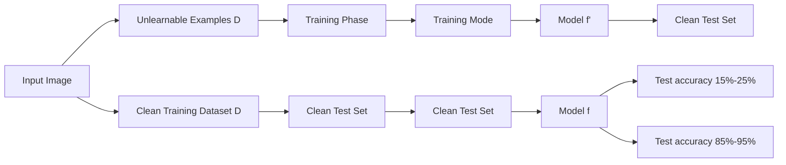
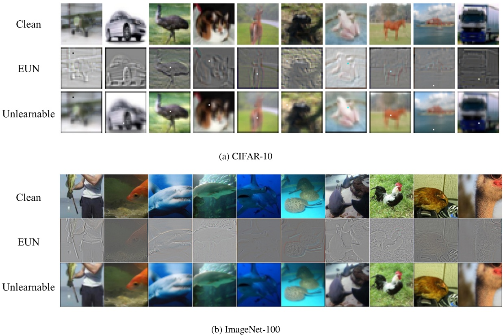
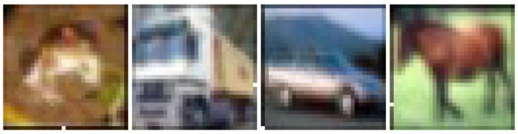
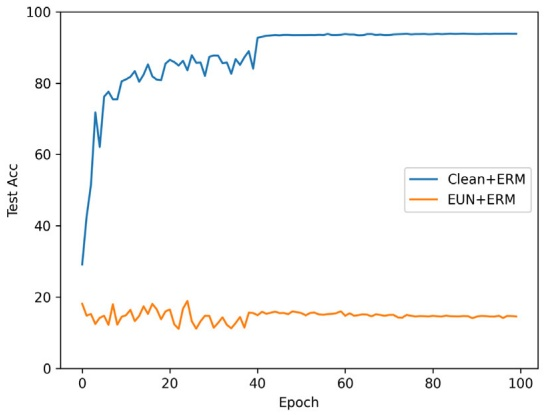
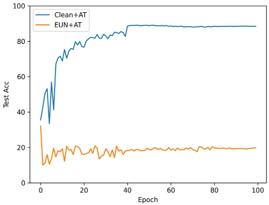
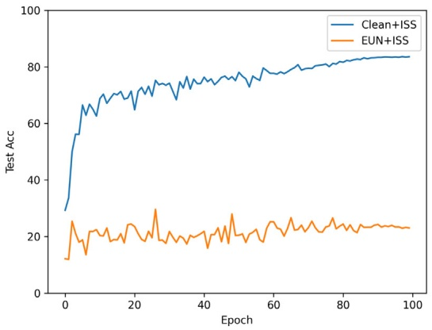
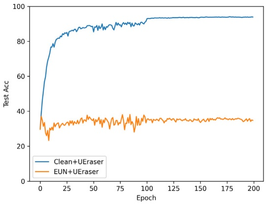

# EUN: Enfoque mejorado de generación de unlearnable examples para la protección de la privacidad✩

**Xiaotian Chen a,b, Yang Xu a,b,**∗**, Sicong Zhang a,b, Jiale Yan c, Weida Xu a,b, Xinlong He a,b**

**a School of Cyber Science and Technology, Guizhou Normal University, Guiyang 550001, China**
**b Guizhou Key Laboratory of NewGen Cyberspace Security, Guiyang 550001, China**
**c School of Cyber Science and Engineering, Wuhan University, Wuhan 430000, China**

## INFORMACIÓN DEL ARTÍCULO

**Comunicado por Massimiliano Mancini**

**Palabras clave:**

**Deep learning**

**Computer vision**

**Image classification**

**Unlearnable examples**

**Data poisoning**

**Protección de la privacidad**

## RESUMEN

**En la era de la inteligencia artificial, la importancia de proteger la privacidad de los usuarios se ha vuelto cada vez más prominente. Los unlearnable examples impiden que los modelos de deep learning aprendan características semánticas en las imágenes al agregar perturbaciones o ruido que son imperceptibles para el ojo humano. Los métodos existentes de generación de perturbaciones no son robustos frente a los métodos de defensa o solo son robustos frente a un único método de defensa. Para abordar este problema, proponemos un método mejorado de generación de perturbaciones para unlearnable examples. Este método genera la perturbación realizando una convolución class-wise sobre la imagen y modificando un píxel en la posición local de la imagen. Este método es robusto frente a múltiples métodos de defensa. Además, al ajustar el orden de la convolución de posición global y la modificación de píxeles en la posición local de la imagen, se generaron y analizaron variantes del método. Hemos evaluado nuestro método en una variedad de datasets con diversos modelos, y lo comparamos con 6 métodos de generación de perturbaciones. Los resultados demuestran que la clean test accuracy del método mejorado de generación de perturbaciones para unlearnable examples sigue siendo inferior al 35% al enfrentarse a métodos de defensa como image shortcut squeezing, adversarial training y adversarial augmentation. Supera a los métodos de generación de perturbaciones existentes en muchos aspectos, y es un 20% menor que CUDA y OPS, dos excelentes métodos de generación de perturbaciones, bajo diversas configuraciones de parámetros.**

## 1. Introducción

**Con el rápido desarrollo de la tecnología de inteligencia artificial, la protección de la privacidad (Huang et al., 2021a; Dong et al., 2023; Yu et al., 2023; Zhang et al., 2024) de los datos de los usuarios enfrenta enormes desafíos. El entrenamiento de deep neural networks (DNN) depende de datasets a gran escala, lo que induce al propietario del modelo a rastrear (crawl) datos de redes sociales para su recolección (Lin et al., 2014; Sariyildiz et al., 2020; Desai and Johnson, 2021). Gran parte de los datos está disponible públicamente en línea; por consiguiente, el uso de estos datos es a menudo no autorizado. En la actualidad, existen sitios web en línea (tales como www.facelib.org) que han establecido sistemas de reconocimiento facial. Este sitio web establece una base de datos facial abierta para figuras públicas y utiliza tecnología de búsqueda facial para ofrecer un reconocimiento rápido de identidad en línea. Además, Hill (2022) señaló que una empresa privada utilizó más de 3 mil millones de imágenes faciales recopiladas de Internet para entrenar un sistema comercial de reconocimiento facial sin el consentimiento de los usuarios. Una cantidad tan ingente de datos puede mejorar significativamente el rendimiento de las DNN, pero plantea serias preocupaciones sobre la privacidad y la seguridad de los datos entre los usuarios.**

**Para prevenir el uso no autorizado de los datos de imágenes divulgados, estudios afines sugieren envenenar los datos (data poisoning) con ruido imperceptible, de tal manera que el rendimiento de los modelos entrenados con los datos modificados se reduzca significativamente (Huang et al., 2021b; Fowl et al., 2021; Yuan and Wu, 2021). Imagínese que si a las imágenes faciales recopiladas de Internet por una persona no autorizada se les añade ruido imperceptible, cuando la persona no autorizada entrene el modelo, ello afectará inevitablemente la accuracy del modelo. Para los usuarios, este ruido protege efectivamente la seguridad de sus datos. Huang et al. (2021b) denominan a tales imágenes con ruido o perturbación imperceptible como unlearnable examples. De acuerdo con Huang et al. (2021b), aunque las perturbaciones en los unlearnable examples son imperceptibles para el ojo humano, pueden engañar a los modelos haciéndoles creer que no hay nada que aprender de estos ejemplos.**

**Además del ruido de minimización de errores (error-minimizing, EM) propuesto por Huang et al. (2021b) para generar unlearnable examples, se han propuesto métodos similares, entre ellos TAP (Fowl et al., 2021), NTGA (Yuan and Wu, 2021), REM (Fu et al., 2022), OPS (Wu et al., 2023), CUDA (Sadasivan et al., 2023), etc. Aunque se generan de maneras diferentes y poseen diferentes efectos de perturbación, todos ellos pueden permitir que el modelo aprenda la correspondencia entre las perturbaciones y las etiquetas. Después de agregar perturbaciones a las imágenes en el training dataset, resulta difícil para el modelo aprender las verdaderas características semánticas de la imagen, lo que conduce a una baja accuracy de clasificación en un clean test set.**

<small>✩ Este trabajo fue respaldado en parte por los Fondos Especiales de Orientación del Gobierno Central para el Desarrollo Local de Ciencia y Tecnología de China bajo la subvención [2018]4008, en parte por el Proyecto de Plataforma de Ciencia y Tecnología de la Provincia de Guizhou, China, bajo la subvención ZSYS[2025]011, y en parte por el Proyecto Planificado de Ciencia y Tecnología de la Provincia de Guizhou, China, bajo la subvención [2023]YB449.</small>

<small>∗ Autor de correspondencia en: School of Cyber Science and Technology, Guizhou Normal University, Guiyang 550001, China.</small>

<small>Dirección de correo electrónico: [xy@gznu.edu.cn](mailto:xy@gznu.edu.cn) (Y. Xu).</small>

**De manera correspondiente, se han propuesto diversos métodos de defensa contra los unlearnable examples, tales como adversarial training (AT) (Tao et al., 2021), image shortcut squeezing (ISS) (Liu et al., 2023) y aumentos adversariales (en lo sucesivo se utiliza UEraser en su lugar) (Qin et al., 2023). Tras añadir perturbaciones a las imágenes en el training dataset, el empleo de métodos de defensa durante el entrenamiento del modelo puede restablecer la accuracy de clasificación del modelo en el clean test set. Por ejemplo, después de añadir perturbaciones generadas por EM a las imágenes en el training dataset, el modelo adopta el método de defensa AT durante el entrenamiento, y luego la accuracy de clasificación del modelo en el clean test set se recupera a casi el 90%. Por consiguiente, las perturbaciones generadas por EM fallan al encontrarse con el método de defensa AT.**

**Como se ilustra en la Fig. 1, los unlearnable examples generados por EM funcionan adecuadamente en el entrenamiento normal, pero fallan cuando el propietario del modelo recurre a AT durante el entrenamiento. Las investigaciones relacionadas carecen de un método de generación de unlearnable examples que exhiba una alta robustez contra diversos métodos de defensa. Con el propósito de hallar un método que sea altamente robusto frente a múltiples métodos de defensa, este artículo propone un método mejorado de generación de perturbaciones para unlearnable examples (EUN). EUN supera a los métodos de generación de perturbaciones existentes en numerosos aspectos y es robusto frente a los tres métodos de defensa: AT, ISS y UEraser.**

**Las principales contribuciones de este artículo comprenden:**

**• Proponemos un método mejorado de generación de perturbaciones para unlearnable examples (EUN), el cual genera perturbaciones aplicando una convolución class-wise a la imagen y modificando un píxel en una posición local de la imagen.**
**• Al ajustar el orden de la convolución global y la modificación de píxeles locales en la imagen, se obtienen y analizan las variantes de EUN, EUN-B y EUN-C.**
**• Evaluamos diferentes modelos en una variedad de datasets y empleamos tres métodos de defensa. Los resultados experimentales demostraron que las perturbaciones generadas por EUN son más robustas frente a los métodos de defensa que los métodos de generación de perturbaciones existentes.**

La estructura de este artículo se organiza de la siguiente manera. En la Sección $^ { 2 , }$ **revisamos los trabajos relacionados sobre unlearnable examples, señalando las limitaciones de los enfoques existentes. La Sección 3 presenta el método propuesto, detallando el fundamento teórico y la implementación práctica, incluida la estrategia dual de convolución class-wise y modificación de píxeles locales. La Sección 4 presenta experimentos exhaustivos y estudios de ablación que demuestran la robustez y efectividad de EUN en comparación con los métodos del state-of-the-art. Finalmente, la Sección 5 concluye el artículo y analiza posibles direcciones futuras de investigación.**

## 2. Trabajos relacionados

**En esta sección, profundizamos en primer lugar en los métodos relacionados de generación de unlearnable examples y los métodos de defensa contra unlearnable examples. Posteriormente, proporcionamos una visión general de adversarial attack y data poisoning. Por último, destacamos el shortcut learning relacionado con el mecanismo de acción de los unlearnable examples.**

## 2.1. Unlearnable examples

**Huang et al. (2021b) propusieron por primera vez los unlearnable examples, los cuales se generan mediante un tipo de ruido de minimización de errores (error-minimizing, EM) que hace que los ejemplos de entrenamiento resulten inaprendibles para las deep neural networks. Este ruido se encuentra limitado a un rango imperceptible para el ojo humano. Los autores formalizan el problema de generación de ruido como un problema de optimización bi-nivel y generan dos modalidades de ruido de minimización de errores mediante la resolución de dicho problema de optimización bi-nivel: sample-wise y class-wise. Fowl et al. (2021) descubrieron que los adversarial examples utilizados originalmente para atacar modelos preentrenados son más efectivos que los métodos recientes diseñados específicamente para data poisoning. Sugirieron utilizar adversarial examples como herramienta de data poisoning y propusieron el envenenamiento adversarial (TAP). El modelo entrenado con datos de entrenamiento envenenados adversarialmente a menudo no logra clasificar correctamente los ejemplos de entrenamiento limpios originales. Yuan y Wu (2021) propusieron el neural tangent generalization attack (NTGA), que modifica ligeramente los datos de entrenamiento con el fin de deteriorar el proceso de entrenamiento de modo que la red entrenada carezca de capacidad de generalización. Los NTGA se fundamentan en el desarrollo reciente de los Neural Tangent Kernels (NTK), los cuales permiten una aproximación en forma cerrada de la evolución de una clase de DNN amplias durante el entrenamiento mediante gradient descent. Los unlearnable examples son vulnerables al adversarial training. Para resolver esta problemática, Fu et al. (2022) introdujeron el ruido de minimización de errores robusto (robust error-minimization, REM). El ruido se genera mediante un algoritmo de optimización min-min–max para minimizar la loss de adversarial training con el fin de proteger los datos frente a aprendices adversariales. Los ejemplos elaborados mediante la adición de ruido de minimización de errores robusto se denominan robust unlearnable examples. Wu et al. (2023) revelaron la sensibilidad de las deep neural networks a perturbaciones de un solo píxel desde la perspectiva del shortcut learning, y propusieron One-Pixel Shortcut (OPS) para lograr la inaprendibilidad de los datos (data unlearnability). OPS modifica un solo píxel en una posición fija en la misma clase de imagen. Esta modificación es sumamente eficiente y posee un efecto significativo en la reducción de la capacidad de generalización del modelo. OPS es robusto frente al adversarial training, pero debido a su dispersión (sparsity), es sensible a técnicas locales de data augmentation como Cutout. Sadasivan et al. (2023) proponen CUDA, un método convolution-based y libre de modelo (model-free) para generar datasets inaprendibles orientados a impedir el entrenamiento no autorizado de modelos sobre datos privados. A diferencia de los enfoques previos que inyectan perturbaciones aditivas, CUDA aplica convoluciones class-wise utilizando filtros generados aleatoriamente derivados de una clave privada, incentivando a los modelos a aprender shortcuts entre los filtros y las etiquetas en lugar de características semánticas significativas. Los autores aportan evidencia tanto teórica como empírica que demuestra que CUDA degrada notablemente la generalización del modelo, incluso bajo configuraciones de defensa avanzadas como adversarial training (AT) y diversas modalidades de data augmentation.**

flowchart

Este diagrama de flujo ilustra un pipeline de procesamiento de datos para la clasificación de imágenes, mostrando la progresión desde imágenes limpias a través de las etapas de procesamiento EM (Empty Vector Machine) e Unlearnable hasta las salidas finales de AT (Attack Training) y fc (Feature Combination) final.

Fig. 1. Un ejemplo sencillo de unlearnable examples generados por EM.

**Tao et al. (2021) observaron que el adversarial training (AT) puede actuar como una defensa con fundamentos sólidos contra ataques engañosos (delusive attacks, es decir, unlearnable examples). La test accuracy reducida por ataques engañosos puede recuperarse en gran medida mediante adversarial training. Asimismo, se descubrió que el adversarial training puede resistir perturbaciones engañosas al evitar que el aprendiz dependa en exceso de características no robustas en un entorno natural. Liu et al. (2023) demuestran mediante extensos experimentos que diversos métodos PAP (es decir, métodos de generación de unlearnable examples) son vulnerables a image shortcut squeezing (ISS) basado en compresión simple. ISS también supera (ligeramente) al adversarial training y posee una mayor generalizabilidad frente a normas de perturbación no observadas, además de una mayor eficiencia. Qin et al. (2023) introducen el método UEraser, el cual aventaja a las defensas actuales contra diferentes modalidades de ataques de unlearnable examples mediante una combinación de políticas eficaces de data augmentation y aumentos adversariales maximizadores de pérdida (loss-maximizing adversarial augmentations).**

**No obstante, los métodos existentes para generar unlearnable examples exhiben limitaciones en cuanto a robustez frente a diversos mecanismos de defensa. Los métodos pioneros como EM, TAP y NTGA resultan por lo general ineficaces frente a cualquiera de los tres métodos de defensa: Adversarial Training (AT), Image Shortcut Squeezing (ISS) y UEraser. Si bien propuestas más recientes como REM, OPS y CUDA han comenzado a abordar la robustez frente a AT, su análisis y validación se restringen primordialmente a ese único método defensivo. De manera notable, omiten una indagación sistemática sobre su efectividad frente a otros métodos de defensa como ISS y UEraser. Nuestras evaluaciones experimentales (Sección 4) ratifican aún más estas carencias. En concreto, REM no logra mantener la inaprendibilidad cuando los modelos se entrenan con ISS o UEraser, al tiempo que tanto OPS como CUDA demuestran una robustez limitada bajo determinados esquemas defensivos. En contraposición, nuestro EUN propuesto integra convolución class-wise y modificación local de píxeles para originar perturbaciones duales que explotan mecanismos diferenciados de shortcut learning. La convolución class-wise incrusta filtros persistentes y dependientes de la clase en el espacio de la imagen. Estos filtros son resistentes a ISS y UEraser debido a su influencia global a lo largo de la imagen y a que su diseño es independiente de los patrones típicos de frecuencia de perturbación. Las modificaciones locales de un solo píxel atenúan el impacto del adversarial training al reducir la training loss. Al sincronizar sinérgicamente estos componentes, EUN consigue robustez frente a múltiples estrategias de defensa (AT, ISS, UEraser) de forma simultánea, subsanando una brecha crítica de los trabajos previos que carecen de resiliencia cruzada entre defensas. Este diseño de perturbaciones duales asegura que incluso si uno de los componentes resulta mitigado, el otro preserva la inaprendibilidad, mejorando de este modo sustancialmente los métodos existentes.**

## 2.2. Adversarial attack

**Los adversarial attacks (Zhang et al., 2020; Nezami et al., 2021; Xiang et al., 2023; Li et al., 2024) pueden inducir a las DNN a clasificar erróneamente ejemplos durante la fase de prueba al adicionar perturbaciones minúsculas a los ejemplos originales. Szegedy et al. (2014) descubrieron por primera vez que los modelos de deep neural networks son vulnerables a los adversarial examples. Goodfellow et al. (2014) propusieron un método de ataque de un solo paso fundamentado en gradientes: el fast gradient sign method (FGSM). El método FGSM agrega perturbaciones en la dirección opuesta al gradiente del ejemplo ordinario en una única iteración, bajo una restricción superior de norma** 𝜀 **predeterminada, para maximizar el error de training loss del modelo objetivo, provocando que el modelo clasifique incorrectamente. Kurakin et al. (2018) optimizaron el principio del método FGSM y propusieron el basic iterative method (BIM), que constituye esencialmente un algoritmo iterativo de FGSM. Con posterioridad, Madry et al. (2018) propusieron el método de projected gradient descent (PGD), el cual se vale de una inicialización con ruido aleatorio uniforme e incrementa la cantidad de iteraciones de ataque. Tras un vasto conjunto de comprobaciones experimentales, el ataque PGD es ampliamente catalogado como el ataque de primer orden más formidable. La existencia de adversarial examples demuestra que las DNN no siempre aprenden características semánticas esenciales y en ocasiones se apoyan en ciertas características no robustas. A diferencia de los adversarial examples (Su et al., 2019), los cuales embaucan a las DNN durante la fase de prueba, los unlearnable examples impiden que las DNN adquieran sus características semánticas durante la fase de entrenamiento, resguardando de esta forma la privacidad de los datos de los usuarios.**

## 2.3. Data poisoning

**En data poisoning (Liu et al., 2020a; He et al., 2024), el atacante emplea los datos envenenados generados para contaminar el dataset ordinario, disminuyendo en consecuencia el desempeño del modelo entrenado sobre el conjunto contaminado. A pesar de que los ataques de data poisoning poseen el potencial de impedir que los datos se utilicen de manera arbitraria, estos métodos ostentan una efectividad sumamente limitada al arremeter contra las DNN y resultan complejos de materializar en escenarios de la vida real. Los backdoor attacks (Liu et al., 2020b; Nguyen and Tran, 2020) configuran un tipo particular de data poisoning, en el cual se insertan detonadores (triggers) en los datos limpios a lo largo de la fase de entrenamiento. El modelo entrenado sobre dichos datos clasificará erróneamente imágenes que porten los triggers durante el testeo. No obstante, los backdoor attacks no perjudican el desempeño del modelo sobre datos limpios. Los unlearnable examples emplean data poisoning para salvaguardar la privacidad. Se incorporan perturbaciones imperceptibles al ojo humano en los datos de imagen antes del entrenamiento del modelo, incitando al modelo a aprender la correspondencia existente entre perturbaciones y etiquetas en lugar de aprender las características semánticas de la imagen, protegiendo así los datos para que no sean explotados en entrenamientos no autorizados de modelos.**

## 2.4. Shortcut learning

**Las investigaciones sobre DNN han revelado que, bajo la condición de lograr una clasificación correcta, las DNN propenden a aprender características más elementales en lugar de las características semánticas propias del objeto en cuestión. A modo de ejemplo, un mismo objeto en entornos disímiles recibirá predicciones divergentes, lo que denota que las DNN dependen de rasgos que no pertenecen al objeto (Beery et al., 2018). Geirhos et al. (2020) examinaron este fenómeno en diversos ámbitos del deep learning y dilucidaron las razones de la presencia de shortcuts y el modo de comprenderlos. La manifestación de natural adversarial examples (Hendrycks et al., 2021) evidencia asimismo que las DNN no asimilan a plenitud las verdaderas características semánticas durante el entrenamiento. En su defecto, pueden aprender a emplear el fondo o la textura de la imagen para formular su predicción. En términos generales, de contarse con suficiente volumen de datos, el vínculo entre diferentes rasgos se consolidará, de suerte que aquellos shortcuts podrían no bastar para las tareas de clasificación; esto es, el modelo se verá forzado a recurrir a características combinadas de mayor complejidad para minimizar el riesgo. Sin embargo, ante la presencia de determinados sesgos específicos en los datos recabados (tales como fondos semejantes), el shortcut learning no se mitigará con eficacia. Dada la existencia del shortcut learning, los unlearnable examples logran orientar al modelo a memorizar la correspondencia entre perturbaciones y etiquetas soslayando las verdaderas características semánticas, lo que desemboca en una reducida accuracy de clasificación del modelo frente a imágenes limpias.**

**Impulsado por estas observaciones relativas al shortcut learning, nuestro método diseña estratégicamente las perturbaciones para explotar de forma simultánea patrones convolucionales globales y alteraciones de píxeles localizadas. Dicho mecanismo dual asegura que aun cuando una de las tipologías de perturbación sea atenuada, la otra conserve la inaprendibilidad, tal como se pormenoriza en la sección subsiguiente.**

## 3. Metodología

**En esta sección, presentamos nuestro método mejorado de generación de perturbaciones. Comenzamos exponiendo los conocimientos preliminares de nuestro método. Posteriormente, introducimos el algoritmo de nuestro método y aportamos un análisis intuitivo sobre el mismo. Por último, analizamos dos variantes de nuestro método.**

## 3.1. Preliminares

**Inspirándonos en CUDA y OPS, ejecutamos una convolución class-wise en la posición global de la imagen y modificamos un píxel en la posición local de la imagen con el propósito de obtener el método mejorado de generación de perturbaciones para unlearnable examples. Por convolución class-wise se entiende que se emplea el mismo filtro de convolución para convolucionar las imágenes de una misma clase en el training dataset, y se utilizan filtros de convolución distintos para imágenes de diferentes clases.**

**La Fig. 2 ilustra el pipeline de EUN para evitar que las imágenes sean aprendidas por el modelo. El proceso da inicio con un clean training dataset** 𝐷**. El método EUN se aplica para generar un unlearnable dataset** 𝐷̃ **a partir del clean training dataset** 𝐷**. Concretamente, se lleva a cabo una convolución class-wise en la posición global de la imagen y se modifica un único píxel en la posición local. A modo de contraste, el clean training dataset** 𝐷 **y el unlearnable dataset** 𝐷̃ **se entrenan de forma independiente. ERM alude a empirical risk minimization y constituye el enfoque estándar para entrenar deep neural networks, en donde la meta consiste en minimizar la pérdida promedio sobre el training dataset. AT, ISS y UEraser son métodos de defensa contra unlearnable examples. AT denota Adversarial Training, un mecanismo de defensa extensamente adoptado contra adversarial attacks que igualmente puede emplearse para defenderse contra unlearnable examples. En AT, los ejemplos de entrenamiento se aumentan mediante adversarial perturbations: modificaciones minúsculas en el peor de los casos diseñadas para maximizar la training loss. ISS alude a métodos defensivos que aprovechan técnicas de compresión o filtrado de imágenes (v. gr., conversión a escala de grises, compresión JPEG o reducción de profundidad de bits) a fin de mitigar el ascendiente de características tipo ''shortcut'' de fácil aprendizaje. UEraser constituye una estrategia defensiva que conjuga una combinación de políticas eficaces de data augmentation y aumentos adversariales maximizadores de pérdida con el propósito de ''borrar'' o atenuar el efecto de las perturbaciones concebidas para envenenar el proceso instructivo. Con independencia del modo de entrenamiento, el modelo entrenado con el unlearnable dataset** $\tilde { D }$ **arroja una reducida accuracy de clasificación (15%–25%) frente al clean test set, en tanto que el modelo entrenado con el clean training dataset** 𝐷 **exhibe una elevada clean test accuracy (85%–95%). En escenarios reales, cuando los usuarios divulgan imágenes en redes sociales, pueden determinar si introducen perturbaciones en las imágenes y optar por el método para generarlas. Una vez que el propietario del modelo recopila datos de imágenes provenientes de Internet, puede determinar el modo de entrenamiento durante el aprendizaje. En la gran mayoría de las situaciones, se elegirá ERM. Empero, si el propietario del modelo sospecha la presencia de unlearnable examples en el training dataset, sopesará la adopción de métodos de defensa.**

flowchart

Fig. 2. Flujo de trabajo de EUN para la protección de datos.

Algoritmo 1 Método mejorado de generación de perturbaciones para unlearnable examples (EUN)

Requerimiento: Clean training dataset $D^n = \{ (x_t, y_t) \}_{t=1}^n$, parámetro de desenfoque $p_b$
Asegurar: Unlearnable examples $\tilde{D}^n = \{ (\tilde{x}_t, y_t) \}_{t=1}^n$
for each class $i$ in $N$ do
    Eq.3 and Eq.4 $\to$ $\sigma_i$ and $\xi_i$
        /* Resolver la ecuación (3) y la ecuación (4) para obtener $\sigma_i$ y $\xi_i$ */
    Eq.2 $\to$ $\delta_i$
        /* Resolver la ecuación (2) para obtener $\delta_i$ */
end for
for each class $i$ in $N$ do
    $s_i = A_v = T(d; a_v, 1, a_v)$
    for each image $x$ in $D_i$ do
        $x' = x * s_i$
        /* Realizar la convolución class-wise sobre cada imagen */
    $\tilde{x} = x' + \delta_i$
end for
end for

## 3.2. Método mejorado de generación de perturbaciones

**Sea** $\left\{ \left( x _ { t } , y _ { t } \right) \right\} _ { t = 1 } ^ { n } \sim D ^ { n }$ **un clean training dataset, donde** $x _ { t } \in \mathbb { R } ^ { d }$ **representan los ejemplos,** 𝑦𝑡 $\in Y$ **son las etiquetas correspondientes, y la clase** $i \in [ 1 , N ]$**. La imagen perturbada viene dada por la fórmula (1).**

$$
\tilde {x} = x * s _ {i} + \delta_ {i} \tag {1}
$$

**donde** $s _ { i }   \in   \mathbb { R } ^ { k \times k }$ **son los filtros de convolución; EUN emplea los filtros de convolución generados para desenfocar las imágenes de cada clase. En cada filtro, un parámetro aleatorio entre los** $k ^ { 2 }$ **parámetros se fija en 1, y los parámetros restantes del filtro se inicializan aleatoriamente a partir de una distribución uniforme** $U \left( 0 , p _ { b } \right)$ **, donde** $p _ { b }$ **es el parámetro de desenfoque. El parámetro de desenfoque modula el grado de difuminación que acontece cuando la imagen** $\stackrel { - } { x } \in [ 0 , 1 ] ^ { H \times W \times C }$ **se convoluciona con el filtro** $s _ { i } ,   H ,   W ,$ **y** 𝐶 **constituyen la altura, la anchura y la cantidad de canales de la imagen, respectivamente. La convolución de** 𝑥 **con el filtro** $s _ { i }$ **puede considerarse como una operación matricial** 𝐴𝑥**. Aquí,** $A \in \mathbb { R } ^ { d \times d }$ **es la matriz de Toeplitz tridiagonal, denotada por** $T   =   ( d ; a , 1 , a ) . \delta$ **es el punto de píxel individual que se modificará, obtenido mediante la fórmula (2).**

$$
\delta = \left[ \xi_ {y 1} \sigma_ {y} - x _ {1} \cdot \sigma_ {y}, \xi_ {y 2} \sigma_ {y} - x _ {2} \cdot \sigma_ {y}, \dots , \xi_ {y C} \sigma_ {y} - x _ {C} \cdot \sigma_ {y} \right] \tag {2}
$$

**donde** $\sigma _ { i } \; \in \; \mathbb { R } ^ { H \times W }$ **designa la máscara de posición perturbada,** $\xi _ { i } \; \in \; \mathbb { R } ^ { C }$ representa el color objetivo perturbado, $\boldsymbol { x } _ { j }   \in   \mathbb { R } ^ { H \times W }$ **es el** 𝑗**-ésimo canal** de $x ,$ y $\xi _ { i j } \in \mathbb { R }$ **denota el** 𝑗**-ésimo canal de** $\xi _ { i } .$ **Resuélvanse la fórmula (3) y la fórmula (4) para obtener** $\sigma _ { i }$ **y** $\xi _ { i }$ **. El algoritmo concreto se muestra en el Algoritmo 1.**

$$
\arg \max _ {\sigma_ {i}, \xi_ {i}} \mathbb {E} _ {(x, y) \in D _ {i}} \left[ G _ {i} \left(x, \sigma_ {i}, \xi_ {i}\right) \right] \tag {3}
$$

$$
G _ {i} = \frac {\mathbb {E} _ {(x , y) \in D _ {i}} \left(\sum_ {j = 1} ^ {C} \left| \left\| x _ {j} \cdot \sigma_ {i} \right\| _ {F} - \xi_ {i j} \right|\right)}{\operatorname{Var} _ {(x , y) \in D _ {i}} \left(\sum_ {j = 1} ^ {C} \left| \left\| x _ {j} \cdot \sigma_ {i} \right\| _ {F} - \xi_ {i j} \right|\right)} \tag {4}
$$

**donde** E **y** Var **representan la esperanza y la varianza respectivamente; la finalidad de la fórmula (3) es explorar la posición y el valor del píxel que puedan suscitar la alteración más determinante en la categoría global. Habiendo acotado el espacio factible a un dominio de búsqueda discreto y finito, se sondea el valor límite de cada canal cromático en cada punto de la imagen. Con miras a garantizar que el píxel quede supeditado a perturbaciones estables, la varianza de las discrepancias entre ellos debe ser exigua, siendo** $G _ { i }$ **la función objetivo para la clase** 𝑖.

**En la Sección 2.4, la literatura relativa a deep neural networks corroboró que, bajo ciertas circunstancias, las DNN se inclinan por asimilar características no semánticas de escasa complejidad presentes en las imágenes. Por consiguiente, las DNN propenden a desdeñar las verdaderas características semánticas si se dispone de otros shortcuts de fácil adquisición que basten para discernir ejemplos de disímiles categorías. Tales shortcuts acontecen de modo natural (Hendrycks et al., 2021; Barbu et al., 2019). Verbigracia, las vacas suelen figurar sobre pastizales, induciendo erróneamente a las DNN a vaticinar vacas mediante extensiones verdes predominantes, por cuanto el color es más asequible de aprehender que dichos atributos semánticos y basta para clasificar acertadamente imágenes** **de vacas durante la fase formativa. Asimismo, los shortcuts pueden concebirse manualmente. Y la modificación de un único píxel constituye uno de los shortcuts que elaboramos por vía manual. Si bien el píxel individual alterado es minúsculo, la disparidad entre este y los píxeles colindantes es lo suficientemente pronunciada para cautivar a las DNN. En tal coyuntura, la DNN aprehenderá la correspondencia entre los shortcuts y las etiquetas durante el entrenamiento, acarreando una exigua accuracy al examinar ejemplos limpios.**

Fig. 3. Comparación de imágenes limpias, perturbaciones y unlearnable examples generados por EUN.

**El filtro convolucional representa otro de los shortcuts diseñados manualmente. La inaprendibilidad de los unlearnable examples engendrados por EUN emana cabalmente de los filtros convolucionales y de los píxeles individuales alterados. El adversarial training acrecentará la training loss. Una training loss superior puede albergar un mayor caudal cognoscitivo factible de ser aprendido. Un radio de perturbación adversarial** $\rho _ { a }$ **más holgado bajo la norma** $L _ { 2 }$ **atenuará el ascendiente de los filtros o de los píxeles individuales sobre el modelo; no obstante, al concurrir ambos simultáneamente, la repercusión del adversarial training es notablemente menor, y el modelo persevera en aprender la correspondencia entre perturbaciones (esto es, shortcuts) y etiquetas. Las operaciones Grayscale y JPEG integradas en ISS consiguen suprimir la gravitación de perturbaciones de baja y alta frecuencia espacial, correspondientemente. La alteración de un píxel encuadra en la circunstancia extrema de alta frecuencia espacial; empero, la inaprendibilidad inducida por los filtros no se halla supeditada a la frecuencia espacial, razón por la cual ISS no logra desarticular el influjo de los filtros sobre el modelo. UEraser acude a una estrategia afín a la del adversarial training (es decir, la maximización de la pérdida) con miras a eliminar la inaprendibilidad, si bien arbitra un procedimiento disímil al del adversarial training (combinando directrices eficaces de data augmentation con aumentos adversariales), preservando con solvencia la semántica originaria de la imagen y desbaratando la injerencia de píxeles aislados sobre el modelo. Pese a ello, el data augmentation y el aumento adversarial poseen una gravitación insignificante sobre los filtros, con lo cual el modelo continúa asimilando la correspondencia existente entre filtros y etiquetas. En consecuencia, los unlearnable examples generados por EUN se revelan robustos frente a los tres métodos de defensa evaluados.**

## 3.3. Variantes de EUN

**El procedimiento de EUN para generar perturbaciones consiste en ejecutar una convolución class-wise sobre el clean training dataset** $D ^ { n }$ **para obtener** $D ^ { \prime n }$ **, al tiempo que** 𝛿 **se calcula y genera igualmente a partir del clean training dataset** $D ^ { n } ,$ y seguidamente 𝛿 se superpone sobre $D ^ { \prime n }$ con el fin de obtener finalmente ${ \tilde { D } } ^ { n } .$ Seleccionamos de forma aleatoria una imagen de cada clase en el training dataset de CIFAR-10 y 10 clases en el training dataset de ImageNet-100, y visualizamos **las imágenes limpias, las perturbaciones generadas por EUN y los unlearnable examples tal como se expone en la Fig. 3. La dimensión de imagen en el dataset ImageNet-100 es de** $2 2 4 \times 2 2 4$ **, motivo por el cual los puntos de píxeles individuales modificados en los unlearnable examples generados por EUN gozan de un elevado mimetismo y solo logran advertirse mediante una inspección minuciosa tras sucesivas ampliaciones.**

**EUN-B, una variante de EUN, altera en primer término un solo píxel en el clean training dataset** $D ^ { n }$ para derivar $D _ { o } ^ { n } ,$ procediendo a continuación a convolucionar $D _ { o } ^ { n } ,$ **, esto es,** ${ \tilde { x } } =$ $\left( x + \delta _ { i } \right)   *   s _ { i } .$ Las perturbaciones originadas por el procedimiento EUN-B carecen de sigilo (stealthiness) en la visualización gráfica, lo que redunda en una severa distorsión de los unlearnable examples gestados por dicha metodología. Conjeturamos que los píxeles adulterados menoscaban el filtro de convolución $s _ { i } .$ EUN-C, otra variante de EUN, efectúa inicialmente la convolución de la imagen para producir $D _ { n ^ { \prime } } ^ { \prime }$ y recurre luego a $D _ { n } ^ { \prime }$ con miras a calcular el píxel individual 𝛿 destinado a ser alterado. Al visualizar las perturbaciones fruto de EUN-C, constatamos que el píxel singular alterado se manifiesta exclusivamente en el contorno o borde de la imagen. La circunstancia de que las perturbaciones de un solo píxel se ubiquen primordialmente en los márgenes de la imagen en EUN-C puede atribuirse a la interacción entre la distribución de características inducida por la convolución y las posteriores restricciones de optimización. En $\mathrm{EUN-C},$ se aplica primero la convolución class-wise, la cual redistribuye globalmente las características de la imagen. Al resolver las ecuaciones (3) y (4) para dilucidar la modificación óptima **del píxel en las imágenes convolucionadas, la dinámica de optimización concede prioridad a aquellas zonas que exhiban una varianza de características minimizada. Los márgenes periféricos en las imágenes convolucionadas suelen denotar una varianza local más reducida que las regiones semánticas centrales (por ejemplo, contornos de objetos y texturas superficiales), configurándose como zonas candidatas más estables para maximizar la fun**ción objetivo $G _ { i }$ en la $\operatorname { E c . }$ **(4). El impacto de las perturbaciones engendradas por EUN-C se verá atenuado tras someter los unlearnable examples a un preprocesamiento de datos (como el recorte aleatorio o random cropping) con anterioridad al entrenamiento. Exhibimos muestras de imágenes producidas por las variantes de EUN sobre CIFAR-10 en la Fig. 4. EUN se utiliza para las pruebas en la sección experimental subsiguiente, y es igualmente el método adoptado al establecer el cotejo con otros procedimientos de generación de perturbaciones.**

natural_image

Gráfico pixelado abstracto con formas amarillas, azules y negras sobre fondo blanco (sin texto ni símbolos)

(a) EUN-B

natural_image

Imagen de cuatro paneles que muestra un caballo, una furgoneta, un automóvil y un caballo en un entorno exterior verde (no se aprecian textos ni símbolos)

(b) EUN-C

Fig. 4. Muestras de imágenes generadas por las variantes de EUN en CIFAR-10.

Tabla 1 Información detallada de los datasets.

| Dataset | Número de etiquetas | Tamaño de entrada | Imágenes de entrenamiento | Imágenes de prueba |
| --- | --- | --- | --- | --- |
| CIFAR-10 | 10 | 32 × 32 | 50 000 | 10 000 |
| CIFAR-100 | 100 | 32 × 32 | 50 000 | 10 000 |
| ImageNet-100 | 100 | 224 × 224 | 130 000 | 5000 |
| CelebA-100 | 100 | 224 × 224 | 2500 | 538 |

Tabla 2 Clean test accuracy de varios modelos entrenados en CIFAR-10 bajo ERM.

| Modelo | Clean | EUN |
| --- | --- | --- |
| ResNet-18 | 94.66 | 14.15 |
| ResNet-50 | 94.41 | 12.36 |
| VGG-16 | 92.68 | 10.61 |
| Wide ResNet-34-10 | 95.50 | 12.30 |
| DenseNet-121 | 87.70 | 19.31 |
| CVT-7-4 | 87.25 | 16.69 |
| CCT-7-3 × 1 | 89.91 | 13.62 |

Tabla 3 Clean test accuracy de ResNet-18 entrenado en varios datasets bajo ERM.

| Dataset | Clean | EUN |
| --- | --- | --- |
| CIFAR-10 | 94.66 | 14.15 |
| CIFAR-100 | 76.27 | 3.02 |
| ImageNet-100 | 80.66 | 6.72 |
| CelebA-100 | 41.26 | 7.43 |

## 4. Experimentos y resultados

**En esta sección, introducimos en primer lugar la configuración experimental en detalle. Con posterioridad, con el propósito de validar la efectividad de EUN, llevamos a cabo experimentos a lo largo de tres ejes: (1) robustez frente a diferentes defensas (AT, ISS, UEraser), (2) transferibilidad entre modelos y datasets, y (3) estudios de ablación sobre hiperparámetros clave. Estos experimentos abordan de manera colectiva las limitaciones de los métodos previos destacadas en la Sección 2.**

## 4.1. Configuraciones experimentales

**Datasets.** Empleamos tres datasets de clasificación de imágenes: CIFAR-10, CIFAR-100 (Krizhevsky, 2009) e ImageNet-100 (un subconjunto de las primeras 100 clases del dataset ImageNet) (Russakovsky et al., 2015). Asimismo, seleccionamos imágenes faciales de 100 personas a partir del dataset de rostros CelebA para conformar CelebA-100. En la Tabla 1 se brinda información detallada al respecto. Todos los datasets emplean técnicas de data augmentation tales como volteo aleatorio (random flipping), recorte (cropping) y redimensionamiento (resizing) (Shorten and Khoshgoftaar, 2019). Para los training datasets de CIFAR-10 y CIFAR-100, efectuamos volteo y recorte aleatorios. En el caso del training dataset de ImageNet-100, recortamos aleatoriamente las imágenes en diferentes dimensiones y posteriormente las redimensionamos a $224 \times 224$. Para el test set de ImageNet-100, redimensionamos las imágenes a 256 × 256 y luego las recortamos desde el centro a $224 \times 224$. Para CelebA-100, redimensionamos las imágenes a $224 \times 224$.

**Modelos.** Empleamos ResNet-18 (He et al., 2016), ResNet-50, VGG-16 (Simonyan and Zisserman, 2015), Wide ResNet-34-10 (Zagoruyko and Komodakis, 2016), DenseNet-121 (Huang et al., 2017), compact vision transformer (CVT-7-4) y compact convolutional transformer (CCT-7-3 × 1) (Hassani et al., 2021). Al realizar la comparación con otros métodos de generación de perturbaciones, los datos experimentales se miden utilizando el modelo ResNet-18.

**Entorno experimental.** En el experimento, se utiliza PyTorch como framework base. La GPU empleada para entrenar el modelo en los datasets CIFAR-10 y CIFAR-100 es una NVIDIA GeForce GTX 1080 Ti, y la GPU utilizada para entrenar el modelo en los datasets ImageNet-100 y CelebA-100 es una NVIDIA GeForce RTX 4090.

**Hiperparámetros.** Para los datasets CIFAR-10 y CIFAR-100, empleamos filtros con un tamaño de kernel $k = 3$ y un parámetro de desenfoque $p_b = 0.3$. Para los datasets ImageNet-100 y CelebA-100, empleamos filtros con un tamaño de kernel $k = 9$ y un parámetro de desenfoque $p_b = 0.06$. Para CVT y CCT, utilizamos el optimizador AdamW con un learning rate fijado en 5e-4, un weight decay de $3e-2$ y 200 epochs. Para los demás modelos bajo ERM o AT, el número de epochs se establece en 100, el learning rate inicial es de 0.1, y decae a 0.01 en la epoch 40 y a 0.001 en la epoch 80. El optimizador emplea stochastic gradient descent (SGD) con un factor de momentum de 0.9 y un factor de weight decay de 0.0005. Para AT, se recurre a un projected gradient descent (PGD) de 10 pasos. Para ISS, el optimizador emplea SGD con un momentum de 0.9, un learning rate de 0.025 y un decaimiento coseno de weight decay; asimismo, utilizamos JPEG con un factor de calidad de 10 y BDR con una profundidad de bits de 2. Para UEraser, el optimizador utiliza SGD con un momentum de 0.9 y un weight decay de 5e-4, fijándose el número de epochs en 200. En lo concerniente a los hiperparámetros de UEraser, adoptamos sus configuraciones predeterminadas en las experimentaciones.

**Métricas de evaluación.** Con la finalidad de evaluar el efecto del método de generación de perturbaciones en el experimento, empleamos la clean test accuracy (Test Acc), que constituye la accuracy de clasificación del modelo sobre el clean test set. Cuanto menor sea la clean test accuracy, más favorable resulta el efecto del método de generación de perturbaciones.

## 4.2. Efectividad de EUN

**Bajo cuatro modos de entrenamiento disímiles, empleamos el clean training dataset de CIFAR-10 y los unlearnable examples generados por EUN en CIFAR-10 para entrenar ResNet-18. La clean test accuracy se expone en la Fig. 5. El adversarial training (AT) emplea** $L _ { \infty } \left( \rho _ { a } = 4 / 2 5 5 \right)$ **, ISS utiliza Gray+JPEG del artículo, y UEraser recurre a la modalidad estándar de UEraser descrita en el artículo.**

**Para facilitar la comparación, elaboramos un gráfico de barras con la clean test accuracy tras la convergencia del modelo en la Fig. 5, tal como se muestra en la Fig. 6. A partir de la figura, se aprecia que sin importar el modo de entrenamiento utilizado por el propietario del modelo, la test accuracy del modelo entrenado sobre el clean training dataset alcanza como mínimo un 83.79%, lo que indica que el modelo ha aprendido las características semánticas de la mayoría de las imágenes del training dataset, mientras que la test accuracy del modelo entrenado con los unlearnable examples generados por EUN se sitúa en un 34.17% en el caso más desfavorable, indicando que las características semánticas reales de la mayor parte de las imágenes no fueron aprendidas por el modelo.**

**Posteriormente, empleamos diferentes datasets y distintos modelos para obtener la clean test accuracy bajo ERM, como se muestra en la Tabla 2, la Tabla 3 y la Tabla 4. A partir de los datos de la tabla, se constata que prescindiendo del modelo utilizado, la clean test accuracy de EUN se mantiene por debajo del 20%, lo que evidencia que el empleo de diferentes modelos prácticamente no ejerce influjo sobre EUN; esto es, EUN posee una elevada transferibilidad respecto al modelo. La test accuracy recabada empleando tres datasets diferentes se sitúa en un nivel sumamente bajo, denotando que EUN ostenta capacidad de generalización frente a diversos datasets.**

line

| Epoch | Clean+ERM (Test Acc) | EUN+ERM (Test Acc) |
| --- | --- | --- |
| 0 | ~30 | ~18 |
| 10 | ~80 | ~15 |
| 20 | ~85 | ~15 |
| 30 | ~85 | ~15 |
| 40 | ~93 | ~15 |
| 50 | ~93 | ~15 |
| 60 | ~93 | ~15 |
| 70 | ~93 | ~15 |
| 80 | ~93 | ~15 |
| 90 | ~93 | ~15 |
| 100 | ~93 | ~15 |

(a) ERM

line

| Epoch | Clean+AT (Test Acc) | EUN+AT (Test Acc) |
| --- | --- | --- |
| 0 | ~36 | ~32 |
| 5 | ~53 | ~10 |
| 10 | ~70 | ~18 |
| 20 | ~78 | ~17 |
| 30 | ~83 | ~18 |
| 40 | ~89 | ~18 |
| 50 | ~89 | ~19 |
| 60 | ~89 | ~19 |
| 70 | ~89 | ~19 |
| 80 | ~89 | ~20 |
| 90 | ~89 | ~20 |
| 100 | ~89 | ~20 |

(b) AT

line

| Epoch | Clean+ISS (Test Acc) | EUN+ISS (Test Acc) |
| --- | --- | --- |
| 0 | ~30 | ~12 |
| 5 | ~65 | ~18 |
| 10 | ~68 | ~22 |
| 15 | ~70 | ~20 |
| 20 | ~70 | ~24 |
| 25 | ~72 | ~20 |
| 30 | ~74 | ~20 |
| 35 | ~74 | ~20 |
| 40 | ~75 | ~21 |
| 45 | ~76 | ~22 |
| 50 | ~77 | ~20 |
| 55 | ~78 | ~22 |
| 60 | ~79 | ~24 |
| 65 | ~80 | ~22 |
| 70 | ~80 | ~23 |
| 75 | ~81 | ~24 |
| 80 | ~82 | ~23 |
| 85 | ~83 | ~24 |
| 90 | ~83 | ~24 |
| 95 | ~83 | ~23 |
| 100 | ~83 | ~23 |

(c) ISS

line

| Epoch | Clean+UEraser (Test Acc) | EUN+UEraser (Test Acc) |
| --- | --- | --- |
| 0 | ~30 | ~30 |
| 25 | ~85 | ~32 |
| 50 | ~88 | ~35 |
| 75 | ~88 | ~35 |
| 100 | ~93 | ~35 |
| 125 | ~94 | ~35 |
| 150 | ~94 | ~35 |
| 175 | ~94 | ~35 |
| 200 | ~94 | ~35 |

(d) UEraser

Fig. 5. Clean test accuracy de ResNet-18 entrenado con imágenes limpias y unlearnable examples generados por EUN bajo diferentes modos de entrenamiento.

bar

| Category | Clean | EUN |
| --- | --- | --- |
| ERM | 94.66 | 14.15 |
| AT | 89.51 | 19.11 |
| ISS | 83.79 | 22.95 |
| UEraser | 93.9 | 34.17 |

Fig. 6. Comparación de la test accuracy de ResNet-18 entrenado sobre CIFAR-10 limpio y CIFAR-10 inaprendible.

Tabla 4 Clean test accuracy de varios modelos entrenados en CelebA-100 bajo ERM.

| Model | Clean | EUN |
| --- | --- | --- |
| ResNet-18 | 41.26 | 7.43 |
| ResNet-50 | 69.33 | 3.16 |
| VGG-16 | 60.22 | 9.67 |
| Wide ResNet-34-10 | 54.65 | 2.04 |
| DenseNet-121 | 66.36 | 4.83 |

## 4.3. Los efectos de varios métodos bajo AT

**La clean test accuracy de ResNet-18 en diferentes datasets bajo ERM y AT se exhibe en la Tabla 5, en donde el adversarial training utiliza** $L _ { \infty } \left( \rho _ { a } = 4 / 2 5 5 \right)$ **. Bajo ERM, el método de generación de perturbaciones más sobresaliente es EM, secundado por EUN. Empero, si el propietario del modelo emplea el método de defensa AT durante el entrenamiento, las perturbaciones generadas por EM fracasarán, dado que la test accuracy resulta sumamente próxima al valor de la columna ''Clean''. A partir de los datos, puede colegirse que métodos de generación de perturbaciones tales como EM, TAP y NTGA distan de ser robustos frente al método de defensa AT.**

**Bajo el modo de entrenamiento AT, seleccionamos los tres métodos de generación de perturbaciones con mejor rendimiento (OPS, CUDA y EUN) para una comparación más exhaustiva, tal como se refleja en la Tabla 6. Si bien OPS supera a CUDA y a EUN al utilizar AT** $L _ { \infty } \left( \rho _ { a } = 8 / 2 5 5 \right)$ **y AT** $L _ { \infty } \left( \rho _ { a } = 1 6 / 2 5 5 \right)$ **en el dataset CIFAR-10, EUN se erige como el mejor bajo los demás parámetros. Inclusive al emplear AT** $L _ { 2 } \left( \rho _ { a } = 0 . 5 0 \right)$ **y AT** $L _ { 2 } \left( \rho _ { a } = 0 . 7 5 \right)$ **, nuestro método EUN puede situarse más de un 20% por debajo de los otros dos.**

## 4.4. Los efectos de varios métodos bajo ISS

**Bajo el modo de entrenamiento ISS, se adicionan distintas perturbaciones al dataset CIFAR-10, y la clean test accuracy del modelo ResNet-18 entrenado se expone en la Tabla 7. ISS abarca tres estrategias (Gray, JPEG y BDR), donde Gray representa compresión a escala de grises, Gray+JPEG encarna la aplicación conjunta de compresión a escala de grises y JPEG durante el entrenamiento, y BDR encarna la reducción de profundidad de bits (bit depth reduction).**

**A partir de los datos contenidos en la tabla, se desprende que JPEG y Gray+JPEG consiguen recuperar la test accuracy de EM, TAP, REM y OPS a cerca del**

Tabla 5 Clean test accuracy de ResNet-18 entrenado en varios datasets.

<table><tr><td rowspan="2">Dataset</td><td rowspan="2">Training mode</td><td rowspan="2">Clean</td><td colspan="7">Perturbation generation methods</td></tr><tr><td>EM</td><td>TAP</td><td>NTGA</td><td>REM</td><td>OPS</td><td>CUDA</td><td>EUN</td></tr><tr><td rowspan="2">CIFAR-10</td><td>ERM</td><td>94.66</td><td>13.20</td><td>22.51</td><td>16.27</td><td>27.09</td><td>26.16</td><td>18.48</td><td>14.15</td></tr><tr><td>AT</td><td>89.51</td><td>88.62</td><td>88.02</td><td>88.96</td><td>48.16</td><td>21.06</td><td>44.40</td><td>19.11</td></tr><tr><td rowspan="2">CIFAR-100</td><td>ERM</td><td>76.27</td><td>1.60</td><td>13.75</td><td>3.22</td><td>10.14</td><td>12.38</td><td>12.69</td><td>3.02</td></tr><tr><td>AT</td><td>64.50</td><td>63.43</td><td>62.39</td><td>62.44</td><td>27.10</td><td>11.19</td><td>34.34</td><td>7.42</td></tr><tr><td rowspan="2">ImageNet-100</td><td>ERM</td><td>80.66</td><td>1.26</td><td>9.10</td><td>8.42</td><td>13.74</td><td>33.88</td><td>8.96</td><td>6.72</td></tr><tr><td>AT</td><td>66.62</td><td>63.40</td><td>63.56</td><td>63.06</td><td>41.66</td><td>27.16</td><td>38.68</td><td>12.10</td></tr></table>

Tabla 6 Clean test accuracy de ResNet-18 entrenado en tres tipos de unlearnable datasets.

<table><tr><td>Dataset</td><td>Clean</td><td>Training mode</td><td>OPS</td><td>CUDA</td><td>EUN</td></tr><tr><td rowspan="7">CIFAR-10</td><td rowspan="7">94.66</td><td>ERM</td><td>26.16</td><td>18.48</td><td>14.15</td></tr><tr><td>AT  $L_{\infty}$  ( $\rho_{a} = 4/255$ )</td><td>21.06</td><td>44.40</td><td>19.11</td></tr><tr><td>AT  $L_{\infty}$  ( $\rho_{a} = 8/255$ )</td><td>14.50</td><td>32.85</td><td>15.51</td></tr><tr><td>AT  $L_{\infty}$  ( $\rho_{a} = 16/255$ )</td><td>11.87</td><td>19.32</td><td>12.44</td></tr><tr><td>AT  $L_{2}$  ( $\rho_{a} = 0.25$ )</td><td>45.74</td><td>39.05</td><td>24.19</td></tr><tr><td>AT  $L_{2}$  ( $\rho_{a} = 0.50$ )</td><td>49.32</td><td>51.19</td><td>29.26</td></tr><tr><td>AT  $L_{2}$  ( $\rho_{a} = 0.75$ )</td><td>53.02</td><td>51.14</td><td>29.01</td></tr><tr><td rowspan="4">CIFAR-100</td><td rowspan="4">76.27</td><td>ERM</td><td>12.38</td><td>12.69</td><td>3.02</td></tr><tr><td>AT  $L_{\infty}$  ( $\rho_{a} = 4/255$ )</td><td>11.19</td><td>34.34</td><td>7.42</td></tr><tr><td>AT  $L_{\infty}$  ( $\rho_{a} = 8/255$ )</td><td>10.14</td><td>30.00</td><td>7.03</td></tr><tr><td>AT  $L_{2}$  ( $\rho_{a} = 0.75$ )</td><td>36.04</td><td>36.90</td><td>21.73</td></tr><tr><td rowspan="4">ImageNet-100</td><td rowspan="4">80.66</td><td>ERM</td><td>33.88</td><td>8.96</td><td>6.72</td></tr><tr><td>AT  $L_{\infty}$  ( $\rho_{a} = 4/255$ )</td><td>27.16</td><td>38.68</td><td>12.10</td></tr><tr><td>AT  $L_{\infty}$  ( $\rho_{a} = 8/255$ )</td><td>17.12</td><td>40.08</td><td>5.54</td></tr><tr><td>AT  $L_{2}$  ( $\rho_{a} = 0.75$ )</td><td>65.44</td><td>20.58</td><td>14.52</td></tr></table>

Tabla 7 Clean test accuracy de ResNet-18 entrenado en varios unlearnable datasets de CIFAR-10 bajo ISS.

<table><tr><td rowspan="2"></td><td rowspan="2">Clean</td><td colspan="7">Perturbation generation methods</td></tr><tr><td>EM</td><td>TAP</td><td>NTGA</td><td>REM</td><td>OPS</td><td>CUDA</td><td>EUN</td></tr><tr><td>BDR</td><td>88.65</td><td>36.16</td><td>45.99</td><td>62.50</td><td>40.77</td><td>53.76</td><td>22.29</td><td>9.89</td></tr><tr><td>Gray</td><td>92.41</td><td>93.01</td><td>9.11</td><td>74.32</td><td>92.84</td><td>42.44</td><td>21.13</td><td>10.90</td></tr><tr><td>JPEG</td><td>85.38</td><td>81.50</td><td>83.87</td><td>69.49</td><td>82.28</td><td>82.53</td><td>23.46</td><td>23.17</td></tr><tr><td>Gray+JPEG</td><td>83.79</td><td>83.06</td><td>81.94</td><td>69.86</td><td>83.00</td><td>79.10</td><td>23.19</td><td>22.95</td></tr></table>

Tabla 8 Clean test accuracy de ResNet-18 entrenado en varios unlearnable datasets de CIFAR-10 bajo UEraser.

<table><tr><td rowspan="2"></td><td rowspan="2">Clean</td><td colspan="7">Perturbation generation methods</td></tr><tr><td>EM</td><td>TAP</td><td>NTGA</td><td>REM</td><td>OPS</td><td>CUDA</td><td>EUN</td></tr><tr><td>UEraser-lite</td><td>93.32</td><td>90.78</td><td>83.29</td><td>78.29</td><td>85.49</td><td>68.5</td><td>40.03</td><td>32.37</td></tr><tr><td>UEraser</td><td>93.90</td><td>93.38</td><td>84.17</td><td>84.41</td><td>91.02</td><td>73.22</td><td>39.47</td><td>34.17</td></tr><tr><td>UEraser-Max</td><td>93.98</td><td>95.24</td><td>82.47</td><td>87.94</td><td>92.54</td><td>81.84</td><td>40.85</td><td>35.07</td></tr></table>

**80%,** $\mathbf { e s \; decir , }$ **JPEG y Gray+JPEG consiguen anular la influencia de las perturbaciones generadas por EM, TAP, REM y OPS. EM, TAP, REM y OPS no son robustos frente a JPEG y Gray+JPEG. Bajo la estrategia Gray, el valor de EUN es cercano al de TAP, y EUN se desempeña de la mejor manera en los restantes casos. El valor máximo alcanzado por EUN en los cuatro casos es de 23.17%, lo cual denota que EUN es robusto frente a todas las estrategias comprendidas en ISS.**

## 4.5. Los efectos de varios métodos bajo UEraser

**Bajo el modo de entrenamiento UEraser, se añaden diversas perturbaciones al dataset CIFAR-10, y la clean test accuracy de ResNet-18 entrenado se expone en la Tabla 8. En la propuesta de UEraser, los autores plantearon tres estrategias: UEraser-lite, UEraser(standard) y UEraser-Max. En comparación con UEraser-lite y UEraser, UEraser-Max logra restaurar la clean test accuracy del modelo a una cota superior, si bien el tiempo formativo es igualmente el más dilatado.**

**A partir de los datos provistos en la tabla, se aprecia que UEraser-lite consigue restablecer la test accuracy de EM, TAP y REM a más del 83%. Las cotas correspondientes a NTGA y OPS alcanzan asimismo más del 80% bajo la estrategia UEraser-Max, indicando que EM, TAP, NTGA, REM y OPS adolecen de robustez ante UEraser. Adicionalmente, aun cuando el registro de CUDA se sitúa en torno al 40%, nuestro método EUN logra posicionarse más de un 5% por debajo del mismo. En síntesis, las perturbaciones gestadas por EUN bajo las tres directrices resultan robustas y aventajan a los restantes métodos.**

## 4.6. Estudio de ablación

**En experimentaciones previas, el parámetro de desenfoque al utilizar EUN para generar unlearnable examples sobre los conjuntos formativos en CIFAR-10 y CIFAR-100 fue de 0.3, mientras que para ImageNet-100 ascendió a 0.06. Ahora bien, hemos examinado EUN variando los valores de los parámetros de desenfoque. Disponemos los datos recabados utilizando diferentes parámetros de desenfoque** $p _ { b }$ **en la Tabla 9. Salvo por ciertos datos particulares, la clean test accuracy decrece a medida que se incrementan los parámetros de desenfoque; esto es, a mayor parámetro de desenfoque, más favorable es el efecto de EUN. No obstante, el parámetro de desenfoque no puede adoptar magnitudes excesivas, debido a que cuanto mayor sea el parámetro de desenfoque, más se deteriorará la calidad de la imagen. En la Fig. 7, cotejamos las imágenes generadas con diversos parámetros de desenfoque. A partir de dicha ilustración se constata que la imagen se torna más difuminada a medida que el valor de** $p _ { b }$ **se incrementa.**

**En las evaluaciones precedentes, EUN alteraba exclusivamente un solo píxel. Ahora ampliamos la cantidad de píxeles modificados de 1 a 5. Disponemos los resultados experimentales en la Tabla 10. A partir de los datos consignados en la tabla, podemos apreciar que la clean test accuracy no decrece invariablemente conforme aumenta el número de píxeles modificados. Ello demuestra que incrementar la cantidad de píxeles alterados no perfecciona de forma eficaz el rendimiento de EUN. Por el contrario, a mayor número de píxeles adulterados, mayores probabilidades existen de que la imagen resulte sospechosa. Por ende, en aras de salvaguardar el mimetismo y sigilo (concealment) de la perturbación, estimamos que este método resulta óptimo cuando se modifica estrictamente un único píxel.**

## 5. Conclusión y trabajo futuro

**Este artículo propone un método mejorado de generación de perturbaciones para unlearnable examples (EUN), el cual produce perturbaciones realizando una convolución class-wise sobre imágenes limpias y alterando un píxel en una posición local de la imagen. Al aprender a partir de unlearnable examples, los modelos de deep learning propenden a memorizar la correspondencia existente entre perturbaciones y etiquetas, soslayando de ese modo las verdaderas características semánticas. La accuracy de clasificación del modelo entrenado sobre el clean test set resultará sumamente exigua. Los unlearnable examples generados por EUN consiguen resguardar eficazmente los datos de imágenes de los usuarios frente a su aprendizaje por modelos no autorizados.**

**En este artículo, mediante el ajuste del orden secuencial entre la convolución global y la modificación de píxeles locales en la imagen, se obtienen las variantes de EUN denominadas EUN-B y EUN-C. Analizamos EUN-B y EUN-C en nuestra indagación. Asimismo, evaluamos EUN, corroboramos la eficacia de EUN empleando diversos modelos sobre una pluralidad de datasets, y sometimos a prueba a EUN mediante variados esquemas de entrenamiento. Los resultados experimentales ratifican que EUN se muestra robusto frente a los métodos de defensa AT, ISS y UEraser, superando a los métodos existentes de generación de perturbaciones en la generalidad de las configuraciones de entrenamiento.**

**El presente artículo y las investigaciones afines se concentran primordialmente en el escenario de la clasificación de imágenes, si bien indagaciones recientes han comenzado a extender los unlearnable examples hacia otros dominios, tales como el reconocimiento de hablantes (Li et al., 2023) y el aprendizaje multimodal (Liu et al., 2024). Resulta plenamente factible trasladar los unlearnable examples a otras tareas, constituyendo nuestro quehacer futuro el estudio de cómo extrapolar nuestra metodología a una gama más dilatada de escenarios.**

Tabla 9 Clean test accuracy de ResNet-18 utilizando diferentes parámetros de desenfoque bajo ERM.

<table><tr><td rowspan="2">Dataset</td><td rowspan="2">Clean</td><td colspan="10">blur parameter of EUN</td></tr><tr><td>0.01</td><td>0.02</td><td>0.04</td><td>0.06</td><td>0.08</td><td>0.1</td><td>0.2</td><td>0.3</td><td>0.4</td><td>0.5</td></tr><tr><td>CIFAR-10</td><td>94.66</td><td>-</td><td>-</td><td>-</td><td>-</td><td>-</td><td>25.65</td><td>12.05</td><td>14.15</td><td>13.95</td><td>13.85</td></tr><tr><td>CIFAR-100</td><td>76.27</td><td>-</td><td>-</td><td>-</td><td>-</td><td>-</td><td>8.59</td><td>5.53</td><td>3.02</td><td>2.29</td><td>2.26</td></tr><tr><td>ImageNet-100</td><td>80.66</td><td>10.29</td><td>9.26</td><td>7.56</td><td>6.72</td><td>5.64</td><td>-</td><td>-</td><td>-</td><td>-</td><td>-</td></tr></table>

Fig. 7. Comparación de imágenes de ImageNet generadas con diferentes parámetros de desenfoque.

Tabla 10 Clean test accuracy de ResNet-18 bajo ERM cuando el número de píxeles modificados es diferente.

<table><tr><td rowspan="2">Dataset</td><td rowspan="2">Clean</td><td colspan="5">The number of pixels changed</td></tr><tr><td>1</td><td>2</td><td>3</td><td>4</td><td>5</td></tr><tr><td>CIFAR-10</td><td>94.66</td><td>14.15</td><td>11.25</td><td>14.45</td><td>14.07</td><td>12.10</td></tr><tr><td>CIFAR-100</td><td>76.27</td><td>3.02</td><td>2.93</td><td>2.78</td><td>2.75</td><td>3.30</td></tr><tr><td>ImageNet-100</td><td>80.66</td><td>6.72</td><td>6.01</td><td>6.13</td><td>5.98</td><td>6.24</td></tr></table>

## Declaración de contribución de autoría CRediT

**Xiaotian Chen: Redacción – borrador original, Metodología, Conceptualización. Yang Xu: Redacción – revisión y edición, Supervisión. Sicong Zhang: Redacción – revisión y edición, Curaduría de datos. Jiale Yan: Redacción – revisión y edición, Software. Weida Xu: Redacción – revisión y edición, Software. Xinlong He: Redacción – revisión y edición.**

## Declaración de conflicto de intereses

**Los autores declaran que no tienen intereses financieros en competencia conocidos ni relaciones personales que pudieran haber parecido influir en el trabajo reportado en este artículo.**

## Disponibilidad de datos

**Los datos se pondrán a disposición previa solicitud.**

## Referencias

- [Barbu, A., Mayo, D., Alverio, J., Luo, W., Wang, C., Gutfreund, D., Tenenbaum, J., Katz, B., 2019. Objectnet: A large-scale bias-controlled dataset for pushing the limits of object recognition models. Adv. Neural Inf. Process. Syst. 32.](http://refhub.elsevier.com/S1077-3142%2825%2900111-0/sb1)
- [Beery, S., Van Horn, G., Perona, P., 2018. Recognition in terra incognita. In: Proceedings of the European Conference on Computer Vision. ECCV, pp. 456–473.](http://refhub.elsevier.com/S1077-3142%2825%2900111-0/sb2)
- [Desai, K., Johnson, J., 2021. Virtex: Learning visual representations from textual annotations. In: Proceedings of the IEEE/CVF Conference on Computer Vision and Pattern Recognition. pp. 11162–11173.](http://refhub.elsevier.com/S1077-3142%2825%2900111-0/sb3)
- [Dong, C., Weng, J., Li, M., Liu, J.N., Liu, Z., Cheng, Y., Yu, S., 2023. Privacy-preserving and byzantine-robust federated learning. IEEE Trans. Dependable Secur. Comput. 21 (2), 889–904.](http://refhub.elsevier.com/S1077-3142%2825%2900111-0/sb4)
- [Fowl, L., Goldblum, M., Chiang, P.y., Geiping, J., Czaja, W., Goldstein, T., 2021. Adversarial examples make strong poisons. Adv. Neural Inf. Process. Syst. 34, 30339–30351.](http://refhub.elsevier.com/S1077-3142%2825%2900111-0/sb5)
- [Fu, S., He, F., Liu, Y., Shen, L., Tao, D., 2022. Robust unlearnable examples: Protecting data against adversarial learning. In: International Conference on Learning Representations.](http://refhub.elsevier.com/S1077-3142%2825%2900111-0/sb6)
- [Geirhos, R., Jacobsen, J.H., Michaelis, C., Zemel, R., Brendel, W., Bethge, M., Wichmann, F.A., 2020. Shortcut learning in deep neural networks. Nat. Mach. Intell. 2 (11), 665–673.](http://refhub.elsevier.com/S1077-3142%2825%2900111-0/sb7)
- Goodfellow, I.J., Shlens, J., Szegedy, C., 2014. Explaining and harnessing adversarial examples. arXiv preprint [arXiv:1412.6572](http://arxiv.org/abs/1412.6572).
- Hassani, A., Walton, S., Shah, N., Abuduweili, A., Li, J., Shi, H., 2021. Escaping the big data paradigm with compact transformers. arXiv preprint [arXiv:2104.05704](http://arxiv.org/abs/2104.05704).
- [He, X., Xu, Y., Zhang, S., Xu, W., Yan, J., 2024. Enhance membership inference attacks in federated learning. Comput. Secur. 136, 103535.](http://refhub.elsevier.com/S1077-3142%2825%2900111-0/sb10)
- [He, K., Zhang, X., Ren, S., Sun, J., 2016. Deep residual learning for image recognition. In: Proceedings of the IEEE Conference on Computer Vision and Pattern Recognition. pp. 770–778.](http://refhub.elsevier.com/S1077-3142%2825%2900111-0/sb11)
- [Hendrycks, D., Zhao, K., Basart, S., Steinhardt, J., Song, D., 2021. Natural adversarial examples. In: Proceedings of the IEEE/CVF Conference on Computer Vision and Pattern Recognition. pp. 15262–15271.](http://refhub.elsevier.com/S1077-3142%2825%2900111-0/sb12)
- [Hill, K., 2022. The secretive company that might end privacy as we know it. In: Ethics of Data and Analytics. Auerbach Publications, pp. 170–177.](http://refhub.elsevier.com/S1077-3142%2825%2900111-0/sb13)
- [Huang, G., Liu, Z., Van Der Maaten, L., Weinberger, K.Q., 2017. Densely connected convolutional networks. In: Proceedings of the IEEE Conference on Computer Vision and Pattern Recognition. pp. 4700–4708.](http://refhub.elsevier.com/S1077-3142%2825%2900111-0/sb14)
- [Huang, H., Luo, W., Zeng, G., Weng, J., Zhang, Y., Yang, A., 2021a. DAMIA: Leveraging domain adaptation as a defense against membership inference attacks. IEEE Trans. Dependable Secur. Comput. 19 (5), 3183–3199.](http://refhub.elsevier.com/S1077-3142%2825%2900111-0/sb15)
- [Huang, H., Ma, X., Erfani, S.M., Bailey, J., Wang, Y., 2021b. Unlearnable examples: Making personal data unexploitable. In: ICLR.](http://refhub.elsevier.com/S1077-3142%2825%2900111-0/sb16)
- [Krizhevsky, A., 2009. Learning Multiple Layers of Features from Tiny Images Master’s thesis. University of Tront.](http://refhub.elsevier.com/S1077-3142%2825%2900111-0/sb17)
- [Kurakin, A., Goodfellow, I.J., Bengio, S., 2018. Adversarial examples in the physical world. In: Artificial Intelligence Safety and Security. Chapman and Hall/CRC, pp. 99–112.](http://refhub.elsevier.com/S1077-3142%2825%2900111-0/sb18)
- [Li, J., Ye, D., Tang, L., Chen, C., Hu, S., 2023. Voice guard: Protecting voice privacy with strong and imperceptible adversarial perturbation in the time domain. In: IJCAI. pp. 4812–4820.](http://refhub.elsevier.com/S1077-3142%2825%2900111-0/sb19)
- [Li, Y., Zhang, C., Qi, H., Lyu, S., 2024. AdaNI: Adaptive Noise Injection to improve adversarial robustness. Comput. Vis. Image Underst. 238, 103855.](http://refhub.elsevier.com/S1077-3142%2825%2900111-0/sb20)
- [Lin, T.Y., Maire, M., Belongie, S., Hays, J., Perona, P., Ramanan, D., Dollár, P., Zitnick, C.L., 2014. Microsoft coco: Common objects in context. In: Computer Vision–ECCV 2014: 13th European Conference, Zurich, Switzerland, September 6-12, 2014, Proceedings, Part V 13. Springer, pp. 740–755.](http://refhub.elsevier.com/S1077-3142%2825%2900111-0/sb21)
- [Liu, X., Jia, X., Xun, Y., Liang, S., Cao, X., 2024. Multimodal unlearnable examples: Protecting data against multimodal contrastive learning. In: Proceedings of the 32nd ACM International Conference on Multimedia. pp. 8024–8033.](http://refhub.elsevier.com/S1077-3142%2825%2900111-0/sb22)
- [Liu, S., Lu, S., Chen, X., Feng, Y., Xu, K., Al-Dujaili, A., Hong, M., O’Reilly, U.M., 2020a. Min-max optimization without gradients: Convergence and applications to black-box evasion and poisoning attacks. In: International Conference on Machine Learning. PMLR, pp. 6282–6293.](http://refhub.elsevier.com/S1077-3142%2825%2900111-0/sb23)
- [Liu, Y., Ma, X., Bailey, J., Lu, F., 2020b. Reflection backdoor: A natural backdoor attack on deep neural networks. In: Computer Vision–ECCV 2020: 16th European Conference, Glasgow, UK, August 23–28, 2020, Proceedings, Part X 16. Springer, pp. 182–199.](http://refhub.elsevier.com/S1077-3142%2825%2900111-0/sb24)
- [Liu, Z., Zhao, Z., Larson, M., 2023. Image shortcut squeezing: Countering perturbative availability poisons with compression. In: International Conference on Machine Learning. PMLR, pp. 22473–22487.](http://refhub.elsevier.com/S1077-3142%2825%2900111-0/sb25)
- [Madry, A., Makelov, A., Schmidt, L., Tsipras, D., Vladu, A., 2018. Towards deep learning models resistant to adversarial attacks. In: International Conference on Learning Representations.](http://refhub.elsevier.com/S1077-3142%2825%2900111-0/sb26)
- [Nezami, O.M., Chaturvedi, A., Dras, M., Garain, U., 2021. Pick-object-attack: Typespecific adversarial attack for object detection. Comput. Vis. Image Underst. 211, 103257.](http://refhub.elsevier.com/S1077-3142%2825%2900111-0/sb27)
- [Nguyen, T.A., Tran, A., 2020. Input-aware dynamic backdoor attack. Adv. Neural Inf. Process. Syst. 33, 3454–3464.](http://refhub.elsevier.com/S1077-3142%2825%2900111-0/sb28)
- Qin, T., Gao, X., Zhao, J., Ye, K., Xu, C.Z., 2023. Learning the unlearnable: Adversarial augmentations suppress unlearnable example attacks. In: 4th Workshop on Adversarial Robustness in the Real World (AROW), ICCV 2023. URL: [https://iccv23-arow.github.io/pdf/arow-0025.pdf](https://iccv23-arow.github.io/pdf/arow-0025.pdf).
- [Russakovsky, O., Deng, J., Su, H., Krause, J., Satheesh, S., Ma, S., Huang, Z., Karpathy, A., Khosla, A., Bernstein, M., et al., 2015. Imagenet large scale visual recognition challenge. Int. J. Comput. Vis. 115, 211–252.](http://refhub.elsevier.com/S1077-3142%2825%2900111-0/sb30)
- [Sadasivan, V.S., Soltanolkotabi, M., Feizi, S., 2023. Cuda: Convolution-based unlearnable datasets. In: Proceedings of the IEEE/CVF Conference on Computer Vision and Pattern Recognition. pp. 3862–3871.](http://refhub.elsevier.com/S1077-3142%2825%2900111-0/sb31)
- [Sariyildiz, M.B., Perez, J., Larlus, D., 2020. Learning visual representations with caption annotations. In: Computer Vision–ECCV 2020: 16th European Conference, Glasgow, UK, August 23–28, 2020, Proceedings, Part VIII 16. Springer, pp. 153–170.](http://refhub.elsevier.com/S1077-3142%2825%2900111-0/sb32)
- [Shorten, C., Khoshgoftaar, T.M., 2019. A survey on image data augmentation for deep learning. J. Big Data 6 (1), 1–48.](http://refhub.elsevier.com/S1077-3142%2825%2900111-0/sb33)
- [Simonyan, K., Zisserman, A., 2015. Very deep convolutional networks for large-scale image recognition. In: 3rd International Conference on Learning Representations. ICLR 2015, Computational and Biological Learning Society.](http://refhub.elsevier.com/S1077-3142%2825%2900111-0/sb34)
- [Su, J., Vargas, D.V., Sakurai, K., 2019. One pixel attack for fooling deep neural networks. IEEE Trans. Evol. Comput. 23 (5), 828–841.](http://refhub.elsevier.com/S1077-3142%2825%2900111-0/sb35)
- [Szegedy, C., Zaremba, W., Sutskever, I., Bruna, J., Erhan, D., Goodfellow, I., Fergus, R., 2014. Intriguing properties of neural networks. In: 2nd International Conference on Learning Representations. ICLR 2014.](http://refhub.elsevier.com/S1077-3142%2825%2900111-0/sb36)
- [Tao, L., Feng, L., Yi, J., Huang, S.J., Chen, S., 2021. Better safe than sorry: Preventing delusive adversaries with adversarial training. Adv. Neural Inf. Process. Syst. 34, 16209–16225.](http://refhub.elsevier.com/S1077-3142%2825%2900111-0/sb37)
- [Wu, S., Chen, S., Xie, C., Huang, X., 2023. One-pixel shortcut: On the learning preference of deep neural networks. In: The Eleventh International Conference on Learning Representations.](http://refhub.elsevier.com/S1077-3142%2825%2900111-0/sb38)
- [Xiang, W., Su, H., Liu, C., Guo, Y., Zheng, S., 2023. Improving the robustness of adversarial attacks using an affine-invariant gradient estimator. Comput. Vis. Image Underst. 229, 103647.](http://refhub.elsevier.com/S1077-3142%2825%2900111-0/sb39)
- [Yu, P., Tang, J., Xia, Z., Li, Z., Weng, J., 2023. A privacy-preserving JPEG image retrieval scheme using the local Markov feature and bag-of-words model in cloud computing. IEEE Trans. Cloud Comput. 11 (3), 2885–2896.](http://refhub.elsevier.com/S1077-3142%2825%2900111-0/sb40)
- [Yuan, C.H., Wu, S.H., 2021. Neural tangent generalization attacks. In: International Conference on Machine Learning. PMLR, pp. 12230–12240.](http://refhub.elsevier.com/S1077-3142%2825%2900111-0/sb41)
- [Zagoruyko, S., Komodakis, N., 2016. Wide residual networks. In: British Machine Vision Conference 2016. British Machine Vision Association.](http://refhub.elsevier.com/S1077-3142%2825%2900111-0/sb42)
- [Zhang, Y., Ji, J., Wen, W., Zhu, Y., Xia, Z., Weng, J., 2024. Understanding visual privacy protection: A generalized framework with an instance on facial privacy. IEEE Trans. Inf. Forensics Secur..](http://refhub.elsevier.com/S1077-3142%2825%2900111-0/sb43)
- [Zhang, B., Tondi, B., Barni, M., 2020. Adversarial examples for replay attacks against CNN-based face recognition with anti-spoofing capability. Comput. Vis. Image Underst. 197, 102988.](http://refhub.elsevier.com/S1077-3142%2825%2900111-0/sb44)
