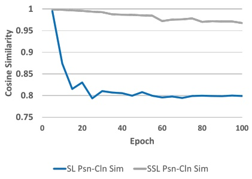
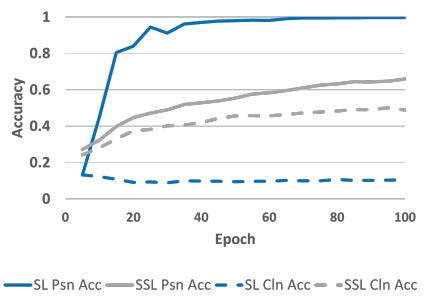
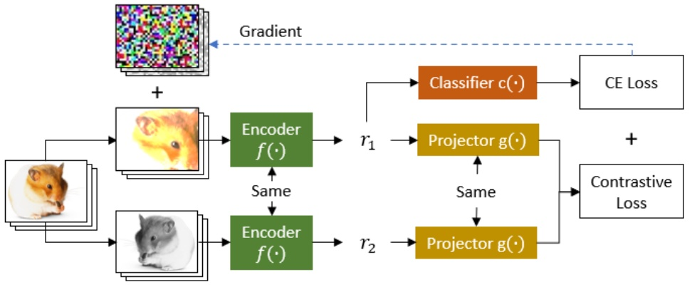
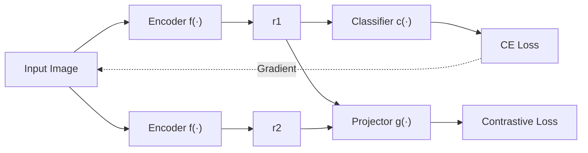
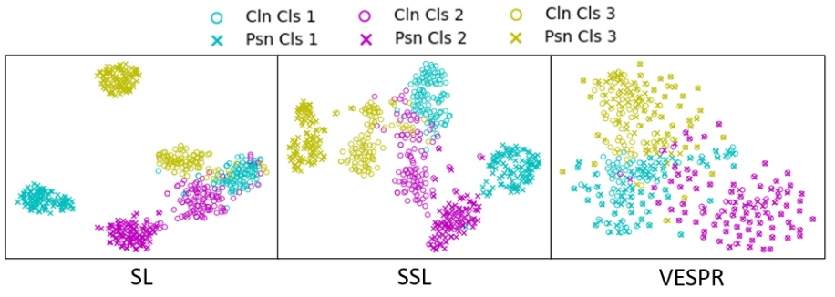
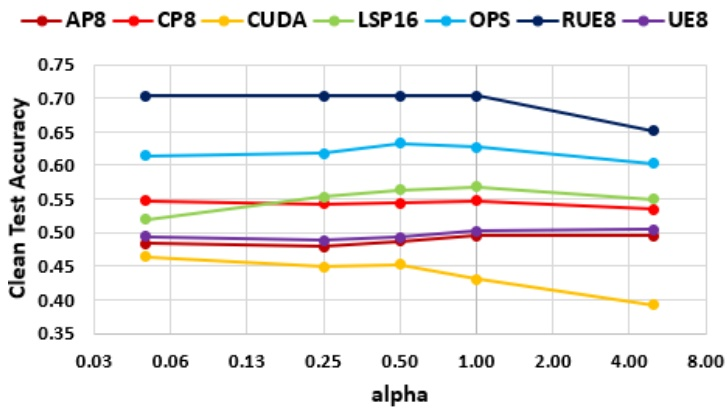

# Explotando la vulnerabilidad al envenenamiento supervisado para fortalecer la defensa autosupervisada

Jeremy Styborski1∗, Mingzhi Lyu2∗, Yi Huang1∗ y Adams Kong1

1 College of Computing and Data Science, Nanyang Technological University, Singapur
2 Rapid-Rich Object Search (ROSE) Lab, Interdisciplinary Graduate Programme, Nanyang Technological University, Singapur {styb0001,lyum0002,AdamsKong}@ntu.edu.sg, shellbyhuang@gmail.com

Resumen. Los availability poisons explotan los algoritmos de supervised learning (SL) introduciendo características de atajo (shortcut features) relacionadas con la clase en las imágenes, de modo que los modelos entrenados con poisoned data resultan inútiles para conjuntos de datos del mundo real. El self-supervised learning (SSL), que utiliza augmentations para aprender instance discrimination, se considera una defensa sólida frente a los poisoned data. Sin embargo, al extender el estudio de SSL a través de múltiples poisons en los conjuntos de datos CIFAR-10 e ImageNet-100, demostramos que a menudo presenta un rendimiento deficiente, muy por debajo del entrenamiento con clean data. Aprovechando la vulnerabilidad de SL ante los poisoning attacks, introducimos adversarial training (AT) sobre SL para ofuscar las características del poison y guiar el aprendizaje de características robustas para SSL. Nuestra defensa propuesta, denominada VESPR (Vulnerability Exploitation of Supervised Poisoning for Robust SSL), supera el rendimiento de seis defensas previas frente a siete availability poisons populares. VESPR muestra un rendimiento superior sobre todas las defensas previas, incrementando las test accuracies mínima y promedio en ImageNet-100 de los modelos envenenados en un 16% y un 9%, respectivamente. A través de análisis y estudios de ablación, dilucidamos los mecanismos mediante los cuales VESPR aprende características de clase robustas. Código: [https://github.com/JStyborski/VESPR](https://github.com/JStyborski/VESPR)

Palabras clave: Adversarial Training · Availability Poisoning · Poison Defense · Self-Supervised Learning

## 1 Introducción

La proliferación de datos etiquetados de código abierto en Internet ha impulsado el rápido desarrollo y la aplicación de redes neuronales profundas en diversos dominios. Sin embargo, la dependencia del supervised learning en tareas como la clasificación de imágenes expone a las redes neuronales al shortcut learning, mediante el cual los modelos aprenden características «fáciles» que están espuriamente correlacionadas con las etiquetas de la tarea en lugar de características de imagen útiles para una representación precisa. El shortcut learning es un comportamiento inherente a las redes neuronales [29,56,69,72]. Los availability poisons explotan esta vulnerabilidad inyectando datos maliciosos en fuentes de datos del mundo real, introduciendo así atajos y reduciendo la efectividad de los modelos entrenados. De manera crucial, los availability poisons son imperceptibles; solo perturban ligeramente las imágenes y no modifican las etiquetas de las mismas, de tal forma que las imágenes envenenadas parecen limpias ante los observadores humanos.

<small>Contribución equitativa</small>

Los modelos entrenados con poisoned data exhiben una pobre generalización en clean data del mundo real, planteando riesgos de seguridad significativos en aplicaciones críticas como vehículos autónomos [61], detección de anomalías [66] e IA médica [2, 3]. Por ejemplo, un sistema de conducción autónoma entrenado con imágenes envenenadas de señales de alto puede fallar al reconocer imágenes reales de señales de alto en escenarios prácticos. Un modelo entrenado con poisoned data clasificará las imágenes basándose en los patrones envenenados en lugar de en características genuinas. En consecuencia, el modelo se vuelve incapaz de clasificar correctamente imágenes benignas, poniendo en peligro su fiabilidad en aplicaciones del mundo real.

Actualmente, existen diversos métodos de defensa propuestos frente a los availability poisons [18, 21, 49, 53, 57, 63, 85, 87]. Sin embargo, estos métodos están limitados en su capacidad para defenderse contra muchos availability poisons populares, dejando vulnerabilidades significativas ante ciertos poisons al tiempo que sufren de un rendimiento promedio reducido. De acuerdo con las revisiones de poison defenses en las Tablas 7 y 8 (véase Material Suplementario Sec. A), no todos estos métodos de defensa han sido evaluados exhaustivamente en poisons del estado del arte. Aunque la mayoría de estas defensas baseline logran un rendimiento robusto en conjuntos de datos de imágenes pequeñas con pocas clases (p. ej., CIFAR-10 [48] y SVHN [59]), nuestros experimentos revelan que a menudo no logran alcanzar un rendimiento comparable en conjuntos de datos de alta resolución con muchas clases (p. ej., ImageNet-100 [20]), evidenciando una brecha crítica en la investigación.

Las perturbaciones envenenadas establecen atajos entre las etiquetas y los patrones venenosos en las imágenes, lo que nos impulsa a explorar alternativas al SL tradicional. Los métodos de SSL, tales como el contrastive learning [12, 34, 60], se enfocan en aprender representaciones de imágenes que sean invariantes a transformaciones de imagen [58], en lugar de modelar explícitamente la correlación entre características y etiquetas. En SSL, el efecto combinado de los augmentations y el objetivo de instance discrimination filtra las características perturbadoras (nuisance features) introducidas por los poisons. En consecuencia, los encoders entrenados con SSL tienden a extraer más información semántica de las imágenes y a evitar el class collapse [80]. Al extender el estudio de la defensa basada en SSL a múltiples poisons en ImageNet-100, nuestros experimentos revelan que SSL desafortunadamente aprende información del poison junto con características genuinas, desafiando observaciones realizadas en gran medida en CIFAR-10 [32].

Motivados por la discrepancia en la robustez frente a poisons entre SL y SSL, proponemos aprovechar la debilidad de SL ante los poisons para generar ruido adversarial con el fin de mejorar los augmentations para SSL, capturando así preferentemente características de imagen genuinas y descartando las características envenenadas. Por ende, presentamos Vulnerability Exploitation of Supervised Poisoning for Robust SSL (VESPR). Como se ilustra en la Fig. 2, VESPR entrena un encoder utilizando una multi-task loss function, mientras que las entradas adversariales se generan utilizando gradientes calculados con la supervised cross-entropy loss. Evaluamos el rendimiento de VESPR frente a siete métodos de poisoning del estado del arte [26, 27, 32, 40, 67, 79, 83] y lo comparamos con seis métodos de defensa baseline [21, 32, 49, 53, 57, 85, 87] en los conjuntos de datos ImageNet-100 [20] y CIFAR-10 [48]. Además, realizamos estudios de ablación exhaustivos para verificar y comprender la efectividad de VESPR.

Nuestro trabajo avanza el estado del arte para los métodos de poison defense a través de las siguientes contribuciones:

Extendemos el estudio de múltiples métodos de defensa, incluido SSL, a siete poisons en los conjuntos de datos CIFAR-10 e ImageNet-100. Para todas las defensas, encontramos que la discrepancia entre el entrenamiento limpio y envenenado se agrava en conjuntos de datos de imágenes grandes.
Explotamos la vulnerabilidad de SL ante los availability poisons para mejorar la robustez del entrenamiento de SSL a través de nuestro método propuesto, VESPR. Al integrar AT para SL dentro del marco de SSL, VESPR genera augmentations adversariales optimizados que enfatizan preferentemente las características de imagen robustas y evitan los atajos del poison.
A través de extensos experimentos, demostramos que VESPR alcanza un rendimiento del estado del arte frente a múltiples poisons prevalentes, mejorando tanto la defensa mínima como la promedio contra poisons por encima de todos los demás baselines.

El resto de este artículo está organizado de la siguiente manera: La Sec. 2 revisa otros trabajos relevantes para nuestra investigación, la Sec. 3 analiza las tendencias en shortcut learning e introduce el marco VESPR, y la Sec. 4 cubre los resultados experimentales, las ablaciones posteriores y los análisis correspondientes.

## 2 Trabajos relacionados

## 2.1 Envenenamiento de datos (Data Poisoning)

El concepto de data poisoning para visión por computadora surgió a partir de los adversarial examples [30, 49, 57, 68], en los cuales las imágenes podían ser alteradas imperceptiblemente y, no obstante, diezmar el rendimiento de la clasificación supervisada. Notablemente, los adversarial examples pueden transferirse entre modelos [19], de modo que generar poisons contra métodos de entrenamiento desconocidos se vuelve factible. Adversarial Poisons (AP) es un método de poisoning temprano que simplemente utiliza adversarial examples [26].

Los synthetic poisons [67,79,83] se diseñan específicamente para envenenar métodos de clasificación supervisada. Los synthetic poisons se elaboran heurísticamente y comúnmente se aplican por clase (class-wise). Su objetivo es introducir características de atajo consistentes por clase. El método de synthetic poisoning más simple es el One-Pixel Shortcut [79], en el cual un único píxel se altera a un color constante para todas las imágenes de una clase. Los min-max poisons [8,25,84] aplican directamente el objetivo de data poisoning: encontrar perturbaciones que minimicen la training loss en poison data mientras maximizan la test loss en clean data. Los min-min poisons [27,32,40] crean ‘unlearnable examples’, tales que una red entrenada sobre las muestras envenenadas aprenderá rápidamente atajos sutiles sin aprender características de imagen útiles.

A diferencia de los availability poisons, los dirty-label attacks [6, 52] típicamente no modifican las imágenes, sino que inyectan imágenes mal etiquetadas en los conjuntos de datos. Los dirty-label attacks son efectivos pero fácilmente detectables; solo pueden envenenar conjuntos de datos con escasa o nula supervisión humana. No consideramos dirty-label attacks en este artículo y, en su lugar, nos enfocamos en poisons que perturban las características de las imágenes.

## 2.2 Defensas contra venenos (Poison Defenses)

Las poison defenses para SL se han basado hasta ahora en gran medida en augmentations y adversarial training. La mayoría de los poisons demuestran una eficacia reducida frente a modelos entrenados con data augmentations como Cutout [21], Mixup [87], CutMix [85] y RandAugment [18]. Se pueden aplicar augmentations de escala de grises (grayscale) y compresión JPEG para contrarrestar poisons de baja y alta frecuencia, respectivamente [53]. UEraser muestrea múltiples augmentations y selecciona aquel que maximiza la pérdida de clasificación [63]. Las defensas basadas en augmentations filtran algunos patrones venenosos no robustos, pero flaquean ante poisons como AP y CUDA [26, 67]. De hecho, múltiples artículos sobre poisoning [26, 32, 79] demuestran su triunfo sobre los métodos basados en augmentations como prueba de su efectividad. El aumento con Gaussian noise aplicado a los datos de entrenamiento reduce la efectividad de los adversarial examples [16]. A diferencia del random noise, AT [57, 74, 82] genera adversarial noise optimizado durante el entrenamiento para mejorar la robustez del modelo. AT se considera en gran medida una poison defense del estado del arte, mejorando el rendimiento frente a múltiples poisons. Sin embargo, múltiples métodos de poison aún imponen una caída significativa de accuracy para modelos defendidos mediante AT [32, 67, 79], y algunos poisons incluso anticipan el uso de AT durante el entrenamiento [27]. De hecho, demostramos en la Sec. 4.3 que estas defensas basadas en SL tienen un rendimiento inferior frente a múltiples poisons.

SSL también se ha descubierto como un método para aprender características de imagen robustas a partir de conjuntos de datos envenenados [32]. Desafortunadamente, los estudios previos son limitados en cuanto a la medida en que evalúan diversos poisons, explorando SSL como poison defense frente a solo un poison de ImageNet-100 y tres poisons de CIFAR-10 (véanse las Tablas 7 y 8 en el Material Suplementario Sec. A). Extendemos el estudio de SSL a través de siete poisons para CIFAR-10 e ImageNet-100. Además, somos los primeros en investigar métodos de adversarial SSL [1, 11, 24, 42, 45, 46, 55] aplicados a la defensa contra poisons.

## 2.3 Aprendizaje autosupervisado (Self-Supervised Learning)

Los autoencoders [23, 33, 36, 37, 47, 54, 75, 81] se consideran uno de los primeros métodos de SSL, utilizando una pérdida basada en reconstrucción con una arquitectura encoder-decoder para aprender embeddings de imágenes comprimidos. Recientemente, los métodos de SSL basados en invarianza han ganado popularidad. Los métodos contrastivos [12,15,34,58,64,70,73,77] típicamente se basan en la función de pérdida InfoNCE [60] para alentar a que todas las proyecciones de vistas de la misma imagen de origen sean similares, y al mismo tiempo diferentes de las proyecciones de vistas de otras imágenes. Los métodos no contrastivos [14,31,71,78,88–90] eliminan el requisito de muestras negativas, enfocando sus funciones de pérdida enteramente en reducir la distancia entre proyecciones del mismo origen.

Al igual que SL, SSL es vulnerable a la feature suppression [43, 50, 65, 69, 78, 86, 90] y al shortcut learning [13, 28]. Múltiples trabajos han propuesto modificaciones a la arquitectura o a los objetivos de entrenamiento con el fin de mitigar la feature suppression en SSL [39, 44, 51, 65, 76]. Para garantizar que SSL no favorezca los atajos del poison, empleamos AT sobre SL con el fin de generar augmentations perturbados adversarialmente que desvíen el foco hacia características de imagen robustas.

## 2.4 Aprendizaje multitarea (Multi-Task Learning)

Más recientemente, múltiples grupos han propuesto combinar arquitecturas y objetivos de pérdida para mejorar la calidad de la representación aprendida y el rendimiento downstream. Diversos trabajos investigan la combinación de objetivos de instance discrimination y reconstrucción [4, 9, 22]. Islam et al. [41] investigan empíricamente el rendimiento de supervised losses combinadas con contrastive SSL. Chen et al. [10] y Xue et al. [80] demuestran que combinar objetivos de contrastive learning supervisado y autosupervisado evita el class-collapse y mitiga la feature suppression. Hasta donde sabemos, nadie ha estudiado aún arquitecturas multitarea u objetivos combinados para data poisoning.

## 3 Método

## 3.1 Formulación de Availability Poison

Describimos el objetivo de availability poison en la Ec. 1. Asumimos un conjunto de datos limpio $D _ { c }   =   \{ ( x _ { c , 1 } , y _ { 1 } ) , ( x _ { c , 2 } , y _ { 2 } ) , . . . , ( x _ { c , N } , y _ { N } ) \}$ con distribución $\mathcal { P } _ { c }$ , donde $x _ { c , i }$ es una imagen benigna e $y _ { i }$ es la etiqueta de clase correspondiente. El conjunto de datos de prueba correspondiente es $\widetilde { D _ { t } ^ { \prime } } = \{ ( x _ { c , 1 } ^ { \prime } , y _ { 1 } ^ { \prime } ) , ( x _ { c , 2 } ^ { \prime } , y _ { 2 } ^ { \prime } ) , . . . , ( x _ { c , M } ^ { \prime } , y _ { M } ^ { \prime } ) \}$ , donde cada par $( x _ { c , i } ^ { \prime } , y _ { i } ^ { \prime } )$ se extrae de la distribución $\mathcal { P } _ { c }$ pero no está incluido en $D _ { c } .$ El objetivo del data poisoning es generar un conjunto de datos envenenado $D _ { p } = \{ ( x _ { p , 1 } , y _ { 1 } ) , ( x _ { p , 2 } , y _ { 2 } ) , . . . , ( x _ { p , N } , y _ { N } ) \}$ tal que un modelo de clasificación $C L S _ { \theta _ { 1 } ^ { * } } ( \cdot )$ entrenado sobre los poison data $D _ { p }$ tenga un desempeño deficiente en los test data limpios $D _ { t } ^ { \prime }$ . La muestra envenenada $x _ { p , i }$ se genera a partir de la correspondiente muestra limpia $x _ { c , i }$ mediante el proceso de envenenamiento $P S \widehat { N _ { \theta _ { 2 } ^ { * } } } ( x _ { c , i } )$

$$
\theta_ {2} ^ {*} = \arg \max _ {\theta_ {2}} \sum_ {i = 0} ^ {M} L (C L S _ {\theta_ {1} ^ {*}} (x _ {c, i} ^ {\prime}), y _ {i} ^ {\prime})
$$

(1)

$$
x _ {p, i} = P S N _ {\theta_ {2}} (x _ {c, i}), \quad d (x _ {p, i}, x _ {c, i}) \leq \epsilon
$$

L es la loss function de supervised learning. En el contexto de la clasificación, L se define frecuentemente como la cross entropy (CE) loss, $L _ { C E } ( C L S _ { \theta _ { 1 } } ( x ) , y ) { = } y \operatorname { l o g } C L S _ { \theta _ { 1 } } ( x )$ donde $C L S _ { \theta _ { 1 } } ( x )$ es el logit de la entrada x con etiqueta y. La métrica de distancia $d ( \cdot )$ entre $x _ { p , i }$ y $x _ { c , i }$ está acotada por un umbral (pequeño) ϵ de tal manera que las imágenes envenenadas retienen una alta calidad de imagen y se asemejan a sus correspondientes imágenes limpias. La Ec. 1 establece que las imágenes envenenadas contienen perturbaciones imperceptibles y, no obstante, engañan al máximo a los modelos entrenados con poison para que tengan un bajo rendimiento en clean data.

## 3.2 Análisis de SL y SSL frente a Availability Poisons

Intuitivamente, si existen características con alta correlación con la tarea y baja varianza a través de las instancias de entrenamiento, los modelos de deep learning otorgarán mayor ponderación a estas características. Las características «fáciles» que están correlacionadas de forma espuria con la tarea de entrenamiento se convierten en atajos, los cuales son aprendidos rápidamente por los modelos de SL. El sesgo de simplicidad (simplicity bias) debido al stochastic gradient descent puede reforzar la preferencia por aprender atajos [56, 80]. Los availability poisons explotan la debilidad del shortcut learning para desviar el entrenamiento del modelo.

line

| Epoch | SL Psn-Cln Sim | SSL Psn-Cln Sim |
| --- | --- | --- |
| 5 | 1.0 | 1.0 |
| 10 | ~0.87 | ~1.0 |
| 15 | ~0.815 | ~1.0 |
| 20 | ~0.83 | ~0.995 |
| 25 | ~0.795 | ~0.99 |
| 30 | ~0.81 | ~0.99 |
| 35 | ~0.805 | ~0.985 |
| 40 | ~0.805 | ~0.985 |
| 45 | ~0.80 | ~0.985 |
| 50 | ~0.805 | ~0.985 |
| 55 | ~0.80 | ~0.985 |
| 60 | ~0.795 | ~0.97 |
| 65 | ~0.80 | ~0.975 |
| 70 | ~0.795 | ~0.975 |
| 75 | ~0.80 | ~0.975 |
| 80 | ~0.80 | ~0.97 |
| 85 | ~0.80 | ~0.97 |
| 90 | ~0.80 | ~0.97 |
| 95 | ~0.80 | ~0.97 |
| 100 | ~0.80 | ~0.965 |

(a)

line

| Epoch | SL Psn Acc | SSL Psn Acc | SL Cln Acc | SSL Cln Acc |
| --- | --- | --- | --- | --- |
| 5 | ~0.13 | ~0.28 | ~0.13 | ~0.24 |
| 10 | ~0.65 | ~0.35 | ~0.12 | ~0.29 |
| 15 | ~0.80 | ~0.42 | ~0.11 | ~0.35 |
| 20 | ~0.84 | ~0.45 | ~0.10 | ~0.38 |
| 25 | ~0.95 | ~0.47 | ~0.09 | ~0.39 |
| 30 | ~0.91 | ~0.49 | ~0.09 | ~0.40 |
| 35 | ~0.96 | ~0.52 | ~0.10 | ~0.41 |
| 40 | ~0.97 | ~0.53 | ~0.10 | ~0.43 |
| 45 | ~0.98 | ~0.55 | ~0.10 | ~0.45 |
| 50 | ~0.98 | ~0.57 | ~0.10 | ~0.46 |
| 55 | ~0.99 | ~0.58 | ~0.10 | ~0.46 |
| 60 | ~0.99 | ~0.59 | ~0.10 | ~0.47 |
| 65 | ~1.00 | ~0.60 | ~0.10 | ~0.47 |
| 70 | ~1.00 | ~0.61 | ~0.10 | ~0.48 |
| 75 | ~1.00 | ~0.62 | ~0.10 | ~0.48 |
| 80 | ~1.00 | ~0.63 | ~0.10 | ~0.49 |
| 85 | ~1.00 | ~0.64 | ~0.10 | ~0.49 |
| 90 | ~1.00 | ~0.64 | ~0.10 | ~0.50 |
| 95 | ~1.00 | ~0.65 | ~0.10 | ~0.50 |
| 100 | ~1.00 | ~0.66 | ~0.10 | ~0.49 |

(b)

Fig. 1: (a) Media de la cosine similarity entre representaciones de imágenes limpias e imágenes envenenadas (Psn-Cln Sim, cossim $[ f ( x _ { p , i } ) , f ( x _ { c , i } ) ] )$ . (b) Classification accuracies envenenada (Psn) y limpia (Cln) evaluadas con $x _ { p , i }$ y $x _ { c , i } ,$ respectivamente. Mostramos curvas para modelos SL y SSL, ambos entrenados con datos de adversarial poison [26].

Con el fin de demostrar los efectos del shortcut learning, entrenamos un encoder ResNet18 [35] con un adversarial poison [26] mediante SL y comparamos representaciones de imágenes limpias y envenenadas. Como se muestra en la Fig. 1a, la similitud de representación entre una imagen benigna $x _ { c , i }$ y su versión envenenada $x _ { p , i }$ se reduce rápidamente (línea azul continua en la Fig. 1a), lo que sugiere que el encoder aprende rápidamente representaciones distintas basadas en las señales de atajo en las imágenes envenenadas. Aunque la poison accuracy (línea azul continua en la Fig. 1b) se maximiza rápidamente cerca del 100%, la clean accuracy nunca mejora (línea azul discontinua en la Fig. 1b).

Dado que los availability poisons se generan a menudo para confundir a los clasificadores de imágenes, exploramos los métodos de SSL, los cuales prescinden del requisito de etiquetas de clase. Las técnicas de SSL basadas en invarianza están diseñadas para aprender representaciones de imágenes que son robustas frente a transformaciones de entrada (p. ej., recorte, alteraciones de color), pero que al mismo tiempo son distintas de las representaciones de otras imágenes.

El contrastive learning es un marco clásico de SSL basado en invarianza, respaldado por una extensa investigación [12,15,34,58,70] y mejoras comprobadas frente a algunos availability poisons [32]. Por lo tanto, utilizamos principalmente contrastive learning para SSL. Como señalan Wang e Isola [77], el objetivo del contrastive learning se optimiza mediante dos medidas: el alineamiento de representaciones entre muestras positivas y la uniformidad a través de todas las representaciones. Debido a que SSL no está motivado por etiquetas de clase, las características del poison compartidas por imágenes de la misma clase son menos relevantes. Además, el objetivo de alineamiento del contrastive learning fomenta la invarianza a los augmentations; las características del poison se ofuscan y el aprendizaje de representaciones favorece las características limpias.

En la Tabla 1, exploramos la feature suppression en SL y SSL analizando las características de representación de sus encoders a través de siete poisons diferentes. Instanciamos el objetivo de SSL $L _ { C L }$ con la comúnmente utilizada InfoNCE loss [60]. Comenzamos por aislar mediante ablación el efecto del augmentation: en comparación con $\mathrm { S L } ,$ el uso de augmentations de estilo SSL durante SL apenas afecta Psn In-Cls Sim y Psn E-Rank, aunque existe una mejora significativa en Psn-Cln Sim. SSL ofrece una Psn In-Cls Sim significativamente menor que SL entrenado con o sin augmentations de estilo SSL, demostrando que el objetivo de entrenamiento de SSL (y no el augmentation de estilo SSL) es crucial para codificar información específica de la instancia en lugar de aprender atajos específicos de clase. Asimismo, mayores Psn E-Rank y Psn-Cln Sim muestran que las representaciones de SSL contienen más características y están menos influenciadas por las señales del poison, lo que probablemente conduce a una mejor generalización en clean test data.

Tabla 1: Los modelos se entrenan en conjuntos de datos envenenados con SL, SL con augmentations de estilo SSL y SSL. Las columnas siguientes muestran la cosine similarity promedio entre representaciones de imágenes envenenadas de la misma clase (Psn In-Cls Sim, cossim $[ f ( x _ { p , i } ) , f ( x _ { p , j } ) ]$ , donde $y _ { i } = y _ { j } )$ , la cosine similarity promedio entre representaciones de imágenes envenenadas y sus correspondientes representaciones de imágenes limpias (Psn-Cln Sim, cossim $[ f ( x _ { p , i } ) , f ( x _ { c , i } ) ] )$ y la diversidad de características de la representación envenenada (Psn E-Rank, véase [88, 90]). Promediamos los resultados a través de siete poisons diferentes (véase Material Suplementario Sec. B.1).

| Method | Psn In-Cls Sim | Psn-Cln Sim | Psn E-Rank |
| --- | --- | --- | --- |
| SL | 0.78 | 0.70 | 16.67 |
| SL (SSL Aug) | 0.79 | 0.79 | 16.43 |
| SSL | 0.47 | 0.86 | 59.61 |

Sin embargo, los modelos de SSL no pueden diferenciar inherentemente entre información semántica e información del poison y, por lo tanto, no pueden evitar las características del poison por completo. Esto se confirma en la Fig. 1b, donde SSL aún permite una brecha significativa entre las accuracies limpia y envenenada. Por consiguiente, el modelo SSL ha aprendido algunas características envenenadas junto con las características genuinas de la imagen, llevando a los clasificadores downstream a clasificar erróneamente datos que carecen de patrones venenosos.

## 3.3 VESPR

Motivados por estas observaciones, buscamos métodos para mejorar los augmentations en SSL que puedan ofuscar mejor las características del poison, permitiendo así que el algoritmo de aprendizaje aprenda características verdaderas. Al notar las discrepancias entre SL y SSL en las similitudes de representación (Tabla 1) y en el rendimiento (Fig. 1b), concluimos que la red de clasificación aprende en gran medida las características del poison, destilándolas de otras características de la imagen. Esto pone de manifiesto una debilidad de los availability poisons: una vez procesados por un encoder envenenado, ¡ya no son sutiles ni imperceptibles! Basándonos en la teoría de los adversarial examples [26, 30], planteamos la hipótesis de que los clasificadores envenenados pueden explotarse para generar adversarial examples que confundan al máximo las señales del poison. Planteamos además la hipótesis de que incorporar estos adversarial examples como augmentations mejorará las representaciones aprendidas por SSL, fortaleciendo así la poison defense. Nuestra arquitectura final es un marco combinado SSL+SL, que utiliza AT sobre la loss supervisada. Denominamos a nuestro método VESPR (Vulnerability Exploitation of Supervised Poisons for Robust SSL).

flowchart

Fig. 2: Descripción general de la arquitectura VESPR. Para cada imagen de entrada, VESPR genera dos vistas mediante augmentation y las codifica con el encoder $f ( \cdot )$ como representaciones $r _ { 1 }$ y $r _ { 2 } ,$ respectivamente. La cross-entropy (CE) loss se calcula a partir de la salida del cabezal clasificador, $c ( r _ { 1 } )$ . El gradiente de la CE loss se utiliza para generar perturbaciones adversariales sobre la primera vista mediante projected gradient descent [49, 57]. Las imágenes adversariales se codifican para reemplazar las representaciones originales. La contrastive loss se calcula a partir de las representaciones proyectadas, $g ( r _ { 1 } )$ y $g ( r _ { 2 } )$ , utilizando proyecciones de otras imágenes como muestras negativas. La red VESPR se entrena a partir de las losses combinadas CE y contrastiva.

Como se muestra en la Fig. 2, VESPR contiene un feature encoder $f ( \cdot )$ , un representation projector $g ( \cdot )$ y un classification head $c ( \cdot )$ . Durante el entrenamiento, cada imagen de un batch se aumenta en dos vistas diferentes. Una vista se toma como la imagen de origen para generar adversarial examples utilizando la siguiente función objetivo:

$$
\delta^ {*} = \underset {\delta} {\arg \max} L _ {C E} (c (f (x + \delta)), y) \tag {2}
$$

$$
\mathrm{s.t.} \quad l _ {p} (\delta) \leq \epsilon_ {A T}
$$

donde $\delta$ es una perturbación adversarial, x es una vista de entrada, $l _ { p } ( \cdot )$ denota la norma p, y $\epsilon _ { A T }$ es el umbral de $\mathrm { A T }$ , con $p = \infty$ en nuestro caso.

El encoder genera representaciones de las vistas de entrada, $f ( x + \delta ^ { * } ) ,   f ( x ^ { + } )$ y $f ( x ^ { - } )$ . La función de pérdida combinada LV ESP R se calcula a partir de las salidas de las redes del projector $g ( \cdot )$ y del classifier $c ( \cdot )$ :

$$
\begin{array}{l} L _ {V E S P R} (x + \delta^ {*}, x ^ {+}, x ^ {-}, y) = \alpha L _ {C L} [ g (f (x + \delta^ {*})), g (f (x ^ {+})), g (f (x ^ {-})) ] \\ + \beta L _ {C E} \left[ c \left(f \left(x + \delta^ {*}\right)\right), y \right] \\ \end{array}
$$

con entradas como la vista $x$ con etiqueta $y ,$ la correspondiente vista positiva $x ^ { + }$ (misma imagen de origen) y las vistas negativas $x ^ { - }$ (diferente imagen de origen). α y $\beta$ ponderan el equilibrio entre $L _ { C L }$ y $L _ { C E }$

A medida que la CE loss se integra en $L _ { V E S P R }$ , VESPR aprovecha las características específicas de clase para el entrenamiento. Simultáneamente, el componente de contrastive loss de $L _ { V E S P R }$ no solo se enfoca en características que distinguen diferentes imágenes, sino que también mitiga el class collapse y el shortcut learning del poison inducidos por la CE loss [10, 80]. Finalmente, las muestras adversariales generadas por la classification loss crean augmentations perturbados que ofuscan al máximo las características del poison.

## 4 Experimentos

## 4.1 Configuración experimental

Evaluamos el rendimiento de VESPR y de otras defensas baseline en siete métodos de poisoning populares: Adversarial Poisons (AP8) [26], Contrastive Poisoning (CP8) [32], Convolution-based Unlearnable Datasets (CUDA) [67], Linearly Separable Poisons (LSP16) [83], One-Pixel Shortcut (OPS) [79], Robust Unlearnable Examples (RUE8) [27] y Unlearnable Examples (UE8) [40]. Se pueden encontrar descripciones adicionales de los poisons en el Material Suplementario Sec. B.1.

Entrenamos modelos principalmente en versiones envenenadas de un subconjunto de 100 clases del conjunto de datos ImageNet [20], cada una con un total de 130.000 imágenes de entrenamiento y 5.000 imágenes de prueba. Con fines de benchmarking, también entrenamos modelos en conjuntos de datos CIFAR-10 envenenados [48], cada uno con un total de 50.000 imágenes de entrenamiento y 10.000 imágenes de prueba. Debido al prolongado proceso de optimización requerido por algunos poisons en imágenes grandes, los poisons AP8, CP8 y UE8 para ImageNet-100 se generan con el 20% del conjunto de datos, conteniendo 100 clases con un total de 26.000 imágenes de entrenamiento.

Para evaluar comparativamente la efectividad de VESPR, lo comparamos con seis métodos de poison defense del estado del arte: adversarial training (SL+AT), Cutout [21], Mixup [87], CutMix [85], ISS [53] y SSL (SimCLR) [12].

Para todos los modelos, empleamos encoders ResNet18 [35] con una dimensión de codificación de 512. Al ejecutar experimentos en CIFAR-10, seguimos la arquitectura de los modelos ResNet para CIFAR, como en [17]. Para todos los conjuntos de datos, todos los métodos SSL utilizan una projection network MLP de 3 capas siguiendo la estructura del projector de MoCo [34] con dimensiones ocultas y de salida de 2048. Para la clasificación, acoplamos una única capa lineal a la salida del encoder. Los adversarial examples se generan utilizando projected gradient descent [49,57] con 10 pasos de tamaño 0.6/255, donde las perturbaciones están $L _ { \infty } \mathrm { - b o u n d e d }$ a $\epsilon _ { A T } = 4 / 2 5 5$ . Los detalles de entrenamiento adicionales se difieren al Material Suplementario Sec. B.

Evaluamos el rendimiento de los modelos entrenados midiendo la classification accuracy en clean test data. Para cada método de defensa, medimos las accuracies mínima (Psn Min) y promedio (Psn Avg) a través de todos los poisons. Un adversario elegirá el poison más efectivo dadas las defensas del estado del arte, por lo que aumentar Psn Min es crucial para mejorar la robustez del modelo en escenarios del mundo real.

## 4.2 Rendimiento de VESPR

La Tabla 2 presenta la clean test accuracy en ImageNet-100 para VESPR así como para múltiples defensas baseline. VESPR debuta como un método de defensa líder, logrando los mayores Psn Min y Psn Avg sobre todas las defensas previas por un 16% y un 9%, respectivamente, además de mantener un sólido rendimiento cuando se entrena con clean data. VESPR alcanza con frecuencia la clean test accuracy más alta (AP8, CUDA y RUE) o la segunda más alta (LSP16, OPS y UE8).

Tabla 2: Accuracies en el conjunto de prueba limpio de ImageNet-100 para VESPR y seis benchmarks de defensa. Los números en negrita indican el mejor método de defensa para cada poison, mientras que los números subrayados indican los segundos mejores métodos.

| Poison | SL | SL+AT | Cutout [21] | Mixup [87] | CutMix [85] | ISS [53] | SSL [12] | VESPR |
| --- | --- | --- | --- | --- | --- | --- | --- | --- |
| Clean | 77.66 | 69.76 | 78.04 | 80.38 | 81.08 | 71.58 | 70.96 | 74.84 |
| AP8 [26] | 8.18 | 42.88 | 7.68 | 9.68 | 8.38 | 24.22 | 41.80 | 48.68 |
| CP8 [32] | 57.46 | 48.76 | 58.20 | 61.76 | 62.28 | 50.18 | 14.80 | 54.40 |
| CUDA [67] | 6.10 | 36.34 | 8.66 | 5.16 | 5.70 | 3.58 | 26.12 | 45.20 |
| LSP16 [83] | 6.62 | 28.92 | 5.06 | 5.50 | 7.84 | 33.70 | 62.06 | 56.34 |
| OPS [79] | 51.00 | 52.56 | 53.86 | 48.82 | 65.12 | 57.36 | 62.22 | 63.26 |
| RUE8 [27] | 14.18 | 57.34 | 15.60 | 33.08 | 16.10 | 67.52 | 65.30 | 70.36 |
| UE8 [40] | 6.32 | 43.26 | 6.42 | 12.38 | 5.80 | 41.18 | 50.02 | 49.34 |
| Psn Min | 6.10 | 28.92 | 5.06 | 5.16 | 5.70 | 3.58 | 14.80 | 45.20 |
| Psn Avg | 21.41 | 44.29 | 22.21 | 25.20 | 24.46 | 39.68 | 46.05 | 55.37 |

Tabla 3: Accuracies en el conjunto de prueba limpio de CIFAR-10 para VESPR y seis benchmarks de defensa.

| Poison | SL | SL+AT | Cutout [21] | Mixup [87] | CutMix [85] | ISS [53] | SSL [12] | VESPR |
| --- | --- | --- | --- | --- | --- | --- | --- | --- |
| Clean | 93.86 | 89.57 | 95.62 | 95.46 | 95.78 | 82.40 | 90.55 | 89.35 |
| AP8 [26] | 12.45 | 85.67 | 9.70 | 33.27 | 8.38 | 81.10 | 75.77 | 86.78 |
| CP8 [32] | 93.59 | 88.43 | 94.51 | 93.36 | 93.77 | 82.21 | 73.08 | 89.20 |
| CUDA [67] | 21.89 | 48.58 | 23.46 | 21.75 | 24.04 | 21.94 | 66.58 | 80.31 |
| LSP16 [83] | 21.47 | 85.67 | 18.47 | 22.76 | 21.68 | 79.33 | 88.87 | 88.96 |
| OPS [79] | 27.24 | 20.10 | 65.12 | 37.56 | 85.27 | 72.14 | 87.79 | 84.74 |
| RUE8 [27] | 18.91 | 34.45 | 19.67 | 23.27 | 27.46 | 80.04 | 86.70 | 87.82 |
| UE8 [40] | 32.53 | 89.31 | 36.18 | 54.19 | 38.40 | 82.12 | 88.45 | 89.39 |
| Psn Min | 18.91 | 20.10 | 9.70 | 21.75 | 8.38 | 21.94 | 66.58 | 80.31 |
| Psn Avg | 32.58 | 64.60 | 38.16 | 40.88 | 42.71 | 71.27 | 81.03 | 86.74 |

Aunque las defensas basadas en augmentations logran ocasionalmente un rendimiento superior (p. ej., CutMix en CP8 y OPS), a menudo son eclipsadas por otros métodos. De hecho, los valores de Psn Min para los métodos basados en augmentations son todos inferiores al 10%. SL+AT y SSL son competidores consistentemente sólidos, alcanzando test accuracies promedio de 44.29% y 46.05% a través de todos los poisons. Sin embargo, su rendimiento cuando se entrenan únicamente con clean data resulta modesto en comparación con otros métodos. Esto es desafortunado, ya que sugiere una cota superior menor para la clean test accuracy tras el entrenamiento con poison; intuitivamente, un modelo entrenado con poison data no superará al mismo modelo entrenado con clean data. Como era de esperar, SSL es particularmente débil frente a CP8, un poison diseñado específicamente para contrarrestar SSL.

La Tabla 3 muestra que las tendencias observadas en el rendimiento sobre ImageNet-100 se reflejan en CIFAR-10. En CIFAR-10, VESPR supera a otros métodos de defensa en múltiples poisons (AP8, CUDA, LSP16, RUE8 y UE8). VESPR mantiene el rendimiento mínimo y promedio más alto a través de los poisons por un 13% y un 5%, respectivamente. Para todas las defensas, la brecha de rendimiento entre el entrenamiento limpio y envenenado se reduce en comparación con ImageNet-100, probablemente debido al menor número de clases y a la facilidad de clasificar imágenes de menor resolución.

## 4.3 Estudios de ablación

Ablación de arquitectura En la Tabla 4, presentamos el rendimiento de poison defense de todas las combinaciones de SL, SSL y AT en ImageNet-100. Con anterioridad a este trabajo, los métodos SSL+AT y SSL+SL no habían sido evaluados para poison defense. Medido según el rendimiento de Psn Min y Psn Avg, VESPR supera a todas las ablaciones en un 13% y un 4%, respectivamente.

Tabla 4: Accuracies en el conjunto de prueba limpio de ImageNet-100 para VESPR y múltiples ablaciones de arquitectura y procedimiento de entrenamiento.

| Poison | SL | SL (SSL Aug) | SL+AT | SSL [12] | SSL+AT [42] | SSL+SL | VESPR |
| --- | --- | --- | --- | --- | --- | --- | --- |
| Clean | 77.66 | 75.48 | 69.76 | 70.96 | 60.86 | 79.66 | 74.84 |
| AP8 [26] | 8.18 | 16.54 | 42.88 | 41.80 | 40.46 | 28.82 | 48.68 |
| CP8 [32] | 57.46 | 60.40 | 48.76 | 14.80 | 44.00 | 58.38 | 54.40 |
| CUDA [67] | 6.10 | 17.30 | 36.34 | 26.12 | 31.78 | 21.82 | 45.20 |
| LSP16 [83] | 6.62 | 49.30 | 28.92 | 62.06 | 49.00 | 52.36 | 56.34 |
| OPS [79] | 51.00 | 63.68 | 52.56 | 62.22 | 53.16 | 70.14 | 63.26 |
| RUE8 [27] | 14.18 | 49.08 | 57.34 | 65.30 | 54.30 | 70.02 | 70.36 |
| UE8 [40] | 6.32 | 34.46 | 43.26 | 50.02 | 40.94 | 56.68 | 49.34 |
| Psn Min | 6.10 | 16.54 | 28.92 | 14.80 | 31.78 | 21.82 | 45.20 |
| Psn Avg | 21.41 | 41.54 | 44.29 | 46.05 | 44.81 | 51.17 | 55.37 |

Con el fin de evaluar el impacto de los augmentations, evaluamos adicionalmente SL con augmentations de estilo SSL. Para facilitar la comparación, compilamos todos los resultados de métodos de defensa basados en augmentations para ImageNet-100 en la Tabla 10 del Material Suplementario Sec. C.1. Como se muestra en la Tabla 10, SL con augmentations de estilo SSL logra los mayores Psn Min y Psn Avg sobre los otros métodos basados en augmentations en un 10% y un 2%, respectivamente. Sin embargo, al compararlo con VESPR, SSL+SL, SSL y SL+AT en la Tabla 4, SL con augmentations de estilo SSL muestra consistentemente un rendimiento inferior. Planteamos la hipótesis de que las defensas basadas en augmentations existentes son débiles ante el data poisoning debido a su dependencia del recorte de imágenes (image cropping); la mayoría de los poisons se extienden por toda la imagen, de modo que todos los recortes resultan envenenados. Esta hipótesis se ve respaldada adicionalmente por el hecho de que todas las defensas basadas en augmentations son particularmente resistentes a OPS, el único poison que no se propaga por toda la imagen. Esta ablación subraya que los augmentations no pueden explicar completamente los avances observados con VESPR.

Como se ilustra en la Tabla 4, integrar AT con SL mejora el rendimiento sobre SL por sí solo para todos los poisons excepto CP8. Aunque SL+AT, que se entrena utilizando ruido aditivo acotado, es particularmente efectivo contra poisons aditivos acotados (p. ej., AP8, UE8), la mejora es relativamente limitada en poisons no aditivos (p. ej., OPS) o poisons con perturbaciones grandes (p. ej., LSP16). Además, aplicar AT a SSL degrada el rendimiento relativo a SSL para la mayoría de los poisons. Esto resalta la naturaleza matizada de la aplicación de AT: dado que los poisons buscan socavar la supervised classification accuracy, las señales adversariales procedentes de SSL por sí solas poseen una capacidad limitada para ignorar los patrones venenosos.

Alineándose con las expectativas de la literatura previa [10, 80], SSL+SL alcanza el rendimiento máximo cuando se entrena con clean data, ya que los objetivos combinados de SSL y SL previenen los modos de falla de cualquiera de los objetivos individuales. No obstante, la intuición de la literatura previa no se aplica necesariamente al entrenamiento con poison, donde SSL+SL a menudo tiene un desempeño inferior al de otras defensas, incluida SSL (p. ej., AP8, CUDA y LSP16). Esto indica que el componente SL de SSL+SL sigue siendo vulnerable a los patrones del poison, degradando el rendimiento de SSL+SL. Además, enfatiza que el componente adicional de AT en VESPR es crucial. Para todos los poisons donde SSL+SL tiene un rendimiento inferior a SSL, VESPR utiliza muestras adversariales guiadas por SL para superar a SSL+SL. Esto valida la premisa de que el SL envenenado puede proporcionar una guía útil para la generación de ejemplos adversariales al ofuscar las características del poison.

Diferimos la correspondiente ablación de arquitectura para CIFAR-10 a la Tabla 11 del Material Suplementario Sec. C.2. Las tendencias observadas para ImageNet-100 en la Tabla 4 se reflejan en gran medida en CIFAR-10, y VESPR alcanza el rendimiento superior en Psn Min y Psn Avg a través de todas las ablaciones de arquitectura.

Análisis de la ablación de arquitectura Expandimos nuestro análisis previo sobre las representaciones aprendidas (Tabla 1) a todas las ablaciones de arquitectura en la Tabla 5. Adicionalmente evaluamos la rugosidad de la representación (es decir, la variabilidad) mediante una métrica de Lipschitz local (Psn Local Lip) [82], donde valores más bajos corresponden a paisajes de representación más suaves y robustos.

Como se ilustra en la Tabla 5, VESPR mantiene valores de Psn In-Cls Sim que son similares a los de SSL+SL y sustancialmente más altos que los de SSL o SSL+AT. Además, la utilización de AT incrementa consistentemente Psn-Cln Sim y reduce Psn Local Lip en todos los métodos, incluido VESPR, en comparación con aquellos sin AT. En particular, la Psn Local Lip de VESPR disminuye en un orden de magnitud, de 8546 a 712, con respecto a SSL+SL. Esta mejora en la suavidad es mayor que la de cualquier otra arquitectura que incorpore AT, subrayando el efecto superior de AT sobre VESPR. En conjunto, las tendencias de la Tabla 5 sugieren que SSL+SL asiste a VESPR en el establecimiento de clusters de representaciones bien diferenciados por clase, mientras que el AT guiado por SL de VESPR garantiza que estas representaciones dependan de características limpias y robustas. Estos hallazgos justifican el rendimiento superior de clasificación limpia de VESPR a través de múltiples poisons.

Tabla 5: Las columnas muestran Psn In-Cls Sim, Psn-Cln Sim y Psn E-Rank, al igual que en la Tabla 1. También presentamos la rugosidad de la representación de imágenes envenenadas (Psn Local Lip, véase [82]). Promediamos los resultados a través de siete poisons diferentes (véase Material Suplementario Sec. B.1).

| Method | Psn In-Cls Sim | Psn-Cln Sim | Psn E-Rank | Psn Local Lip |
| --- | --- | --- | --- | --- |
| SL | 0.78 | 0.70 | 16.67 | 6180 |
| SL (SSL Aug) | 0.79 | 0.79 | 16.43 | 5868 |
| SL+AT | 0.76 | 0.85 | 31.64 | 3312 |
| SSL | 0.47 | 0.86 | 59.61 | 317 |
| SSL+AT | 0.60 | 0.97 | 23.47 | 40 |
| SSL+SL | 0.77 | 0.83 | 34.07 | 8546 |
| VESPR | 0.72 | 0.91 | 30.29 | 712 |

Las tendencias en la similitud de representación de la Tabla 5 también pueden identificarse visualmente. La Fig. 3 muestra gráficos t-SNE bidimensionales [38] de las representaciones en 512D para tres clases de imágenes limpias y envenenadas y sus contrapartes envenenadas con CUDA para varios métodos de entrenamiento. Es de esperar una ligera mezcla entre codificaciones, dado que las tres clases son tipos de peces; no obstante, una clasificación exitosa requiere que los clusters sean en gran medida diferenciados. Tanto SL como SSL tienden a agrupar estrechamente las representaciones envenenadas, pero las imágenes limpias correspondientes se codifican en representaciones distantes. Además, todas las representaciones de imágenes limpias de SL y SSL se agrupan juntas, independientemente de la clase, lo que sugiere que las imágenes limpias se tratan como una clase fuera de distribución (out-of-distribution). En contraste, VESPR logra un alineamiento poison-clean superior, con representaciones de muestras envenenadas y limpias que se superponen para la mayoría de las muestras. Esto verifica el alto valor de Psn-Cln Sim obtenido por VESPR en la Tabla 5.

scatter

| Category | Series | X (range) | Y (range) |
| --- | --- | --- | --- |
| SL | Cln Cls 1 | ~0.1 ~0.4 | ~0.1 ~0.3 |
| SL | Cln Cls 2 | ~0.2 ~0.5 | ~0.1 ~0.3 |
| SL | Cln Cls 3 | ~0.1 ~0.4 | ~0.6 ~0.9 |
| SL | Psn Cls 1 | ~0.1 ~0.4 | ~0.1 ~0.3 |
| SL | Psn Cls 2 | ~0.2 ~0.5 | ~0.1 ~0.3 |
| SL | Psn Cls 3 | ~0.2 ~0.5 | ~0.6 ~0.9 |
| SSL | Cln Cls 1 | ~0.3 ~0.6 | ~0.3 ~0.7 |
| SSL | Cln Cls 2 | ~0.3 ~0.6 | ~0.3 ~0.7 |
| SSL | Cln Cls 3 | ~0.2 ~0.5 | ~0.3 ~0.6 |
| SSL | Psn Cls 1 | ~0.3 ~0.6 | ~0.3 ~0.6 |
| SSL | Psn Cls 2 | ~0.3 ~0.6 | ~0.1 ~0.3 |
| SSL | Psn Cls 3 | ~0.2 ~0.5 | ~0.3 ~0.5 |
| VESPR | Cln Cls 1 | ~0.3 ~0.6 | ~0.1 ~0.4 |
| VESPR | Cln Cls 2 | ~0.3 ~0.6 | ~0.1 ~0.4 |
| VESPR | Cln Cls 3 | ~0.2 ~0.5 | ~0.6 ~0.9 |
| VESPR | Psn Cls 1 | ~0.3 ~0.6 | ~0.1 ~0.3 |
| VESPR | Psn Cls 2 | ~0.3 ~0.6 | ~0.1 ~0.3 |
| VESPR | Psn Cls 3 | ~0.2 ~0.5 | ~0.6 ~0.9 |

Fig. 3: Gráficos t-SNE bidimensionales [38] de representaciones de imágenes limpias y envenenadas con CUDA para modelos SL, SSL y VESPR entrenados sobre datos de CUDA.

Ablación adversarial de VESPR En la Tabla 6, realizamos la ablación del método de generación de muestras adversariales. Específicamente, comparamos el efecto del Gaussian noise aleatorio (SSL+SL+GN) frente a métodos de perturbación adversarial (VESPR y variantes). VESPR se mantiene como la implementación con mejor rendimiento.

Para SSL+SL+GN, se aplica Gaussian noise con una desviación estándar de 4/255 a las imágenes con un 50% de probabilidad. Como la perturbación gaussiana admisible es mayor que la cota de perturbación de AT, el dominio de muestras posibles generadas por Gaussian noise subsume el dominio de muestras generadas por AT. SSL+SL+GN supera ligeramente a SSL+SL en la mayoría de los poisons, pero en general muestra un rendimiento similar. Notablemente, el rendimiento de SSL+SL+GN es conspicuamente distinto al de VESPR, lo que sugiere que las perturbaciones basadas en gradientes procedentes de AT son cruciales para aprender características robustas. Observamos que VESPR supera consistentemente a VESPR-SSL y VESPR-Both, con mejoras notables en CUDA y RUE8 en particular. VESPR también alcanza las accuracies de prueba limpia mínima y promedio más altas. Esto sugiere que VESPR explota mejor la señal adversarial de SL, permitiendo que el encoder aprenda características robustas con SSL.

Tabla 6: Clean test set accuracy en ImageNet-100 para diferentes métodos de perturbación de muestras. SSL+SL+GN es similar a SSL+SL, pero con augmentation adicional de Gaussian noise. VESPR-SSL utiliza AT con loss de SSL, VESPR-Both utiliza AT con la pérdida combinada de VESPR de la Ec. 3, y VESPR utiliza AT con loss de SL.

| Poison | SSL+SL | SSL+SL+GN | VESPR-SSL | VESPR-Both | VESPR |
| --- | --- | --- | --- | --- | --- |
| Clean | 79.66 | 78.86 | 73.74 | 73.96 | 74.84 |
| AP8 [26] | 28.82 | 29.92 | 47.56 | 48.02 | 48.68 |
| CP8 [32] | 58.38 | 59.14 | 54.20 | 53.64 | 54.40 |
| CUDA [67] | 21.82 | 24.02 | 36.64 | 41.26 | 45.20 |
| LSP16 [83] | 52.36 | 53.00 | 54.36 | 55.88 | 56.34 |
| OPS [79] | 70.14 | 71.12 | 64.30 | 63.14 | 63.26 |
| RUE8 [27] | 70.02 | 69.90 | 66.38 | 68.58 | 70.36 |
| UE8 [40] | 56.68 | 58.80 | 49.28 | 48.20 | 49.34 |
| Psn Min | 21.82 | 24.02 | 36.64 | 41.26 | 45.20 |
| Psn Avg | 51.17 | 52.27 | 53.25 | 54.10 | 55.37 |

## 5 Conclusión

Extendemos la investigación de la poison defense a siete poisons en los conjuntos de datos CIFAR-10 e ImageNet-100, revelando el rendimiento limitado de los métodos de defensa actuales, incluido SSL. A partir de los hallazgos sobre la defensa contra poisons en SL y SSL, presentamos VESPR, el cual aprovecha la vulnerabilidad al envenenamiento supervisado para fortalecer la defensa autosupervisada. A través de extensos experimentos, demostramos que VESPR logra una defensa del estado del arte frente a múltiples poisons prevalentes, superando a todos los demás baselines tanto en rendimiento mínimo como promedio contra poisons.

## Agradecimientos

Esta investigación cuenta con el apoyo de la National Research Foundation de Singapur y de la Infocomm Media Development Authority bajo su Trust Tech Funding Initiative y Strategic Capability Research Centres Funding Initiative. Cualesquiera opiniones, hallazgos y conclusiones o recomendaciones expresadas en este material pertenecen al autor o autores y no reflejan las opiniones de la National Research Foundation de Singapur ni de la Infocomm Media Development Authority.

## Referencias

1. Addepalli, S., Jain, S., Babu, R.V.: Efficient and effective augmentation strategy for adversarial training (2022)
2. Adnan, M., Ioannou, Y., Tsai, C.Y., Galloway, A., Tizhoosh, H.R., Taylor, G.W.: Monitoring shortcut learning using mutual information (2022)
3. Alkhunaizi, N., Kamzolov, D., Takáč, M., Nandakumar, K.: Suppressing poisoning attacks on federated learning for medical imaging. In: International Conference on Medical Image Computing and Computer-Assisted Intervention. pp. 673–683. Springer (2022)
4. Baier, F., Mair, S., Fadel, S.G.: Self-supervised siamese autoencoders (2023)
5. Bardes, A., Ponce, J., LeCun, Y.: Vicreg: Variance-invariance-covariance regularization for self-supervised learning (2022)
6. Carlini, N., Terzis, A.: Poisoning and backdooring contrastive learning. In: International Conference on Learning Representations (2022), [https://openreview.net/forum?id=iC4UHbQ01Mp](https://openreview.net/forum?id=iC4UHbQ01Mp)
7. Caron, M., Touvron, H., Misra, I., Jégou, H., Mairal, J., Bojanowski, P., Joulin, A.: Emerging properties in self-supervised vision transformers (2021)
8. Chan-Hon-Tong, A.: An algorithm for generating invisible data poisoning using adversarial noise that breaks image classification deep learning. Machine Learning and Knowledge Extraction 1(1), 192–204 (2019), [https://www.mdpi.com/2504-4990/1/1/11](https://www.mdpi.com/2504-4990/1/1/11)
9. Chen, K., Liu, Z., Hong, L., Xu, H., Li, Z., Yeung, D.Y.: Mixed autoencoder for self-supervised visual representation learning (2024)
10. Chen, M.F., Fu, D.Y., Narayan, A., Zhang, M., Song, Z., Fatahalian, K., Ré, C.: Perfectly balanced: Improving transfer and robustness of supervised contrastive learning (2022)
11. Chen, T., Liu, S., Chang, S., Cheng, Y., Amini, L., Wang, Z.: Adversarial robustness: From self-supervised pre-training to fine-tuning (2020)
12. Chen, T., Kornblith, S., Norouzi, M., Hinton, G.: A simple framework for contrastive learning of visual representations (2020)
13. Chen, T., Luo, C., Li, L.: Intriguing properties of contrastive losses (2021)
14. Chen, X., He, K.: Exploring simple siamese representation learning (2020)
15. Chen, X., Xie, S., He, K.: An empirical study of training self-supervised vision transformers (2021)
16. Cohen, J.M., Rosenfeld, E., Kolter, J.Z.: Certified adversarial robustness via randomized smoothing (2019)
17. da Costa, V.G.T., Fini, E., Nabi, M., Sebe, N., Ricci, E.: Solo-learn: A library of self-supervised methods for visual representation learning (2022)
18. Cubuk, E.D., Zoph, B., Shlens, J., Le, Q.V.: Randaugment: Practical automated data augmentation with a reduced search space (2019)
19. Demontis, A., Melis, M., Pintor, M., Jagielski, M., Biggio, B., Oprea, A., Nita-Rotaru, C., Roli, F.: Why do adversarial attacks transfer? explaining transferability of evasion and poisoning attacks (2019)
20. Deng, J., Dong, W., Socher, R., Li, L.J., Li, K., Fei-Fei, L.: ImageNet: A Large-Scale Hierarchical Image Database. In: CVPR09 (2009)
21. DeVries, T., Taylor, G.W.: Improved regularization of convolutional neural networks with cutout (2017)
22. Dippel, J., Vogler, S., Höhne, J.: Towards fine-grained visual representations by combining contrastive learning with image reconstruction and attention-weighted pooling (2022)
23. Eastwood, C., Williams, C.K.I.: A framework for the quantitative evaluation of disentangled representations. In: International Conference on Learning Representations (2018), [https://openreview.net/forum?id=By-7dz-AZ](https://openreview.net/forum?id=By-7dz-AZ)
24. Fan, L., Liu, S., Chen, P.Y., Zhang, G., Gan, C.: When does contrastive learning preserve adversarial robustness from pretraining to finetuning? (2021)
25. Feng, J., Cai, Q.Z., Zhou, Z.H.: Learning to confuse: Generating training time adversarial data with auto-encoder (2019)
26. Fowl, L., Goldblum, M., yeh Chiang, P., Geiping, J., Czaja, W., Goldstein, T.: Adversarial examples make strong poisons (2021)
27. Fu, S., He, F., Liu, Y., Shen, L., Tao, D.: Robust unlearnable examples: Protecting data privacy against adversarial learning. In: International Conference on Learning Representations (2022), [https://openreview.net/forum?id=baUQQPwQiAg](https://openreview.net/forum?id=baUQQPwQiAg)
28. Geirhos, R., Narayanappa, K., Mitzkus, B., Bethge, M., Wichmann, F.A., Brendel, W.: On the surprising similarities between supervised and self-supervised models (2020)
29. Geirhos, R., Rubisch, P., Michaelis, C., Bethge, M., Wichmann, F.A., Brendel, W.: Imagenet-trained CNNs are biased towards texture; increasing shape bias improves accuracy and robustness. In: International Conference on Learning Representations (2019), [https://openreview.net/forum?id=Bygh9j09KX](https://openreview.net/forum?id=Bygh9j09KX)
30. Goodfellow, I.J., Shlens, J., Szegedy, C.: Explaining and harnessing adversarial examples (2015)
31. Grill, J.B., Strub, F., Altché, F., Tallec, C., Richemond, P.H., Buchatskaya, E., Doersch, C., Pires, B.A., Guo, Z.D., Azar, M.G., Piot, B., Kavukcuoglu, K., Munos, R., Valko, M.: Bootstrap your own latent: A new approach to self-supervised learning (2020)
32. He, H., Zha, K., Katabi, D.: Indiscriminate poisoning attacks on unsupervised contrastive learning. In: The Eleventh International Conference on Learning Representations (2023), [https://openreview.net/forum?id=f0a\_dWEYg-Td](https://openreview.net/forum?id=f0a_dWEYg-Td)
33. He, K., Chen, X., Xie, S., Li, Y., Dollár, P., Girshick, R.: Masked autoencoders are scalable vision learners (2021)
34. He, K., Fan, H., Wu, Y., Xie, S., Girshick, R.: Momentum contrast for unsupervised visual representation learning (2020)
35. He, K., Zhang, X., Ren, S., Sun, J.: Deep residual learning for image recognition (2015)
36. Higgins, I., Matthey, L., Pal, A., Burgess, C., Glorot, X., Botvinick, M., Mohamed, S., Lerchner, A.: beta-VAE: Learning basic visual concepts with a constrained variational framework. In: International Conference on Learning Representations (2017), [https://openreview.net/forum?id=Sy2fzU9gl](https://openreview.net/forum?id=Sy2fzU9gl)
37. Hinton, G.E., Salakhutdinov, R.R.: Reducing the dimensionality of data with neural networks. Science 313(5786), 504–507 (2006). [https://doi.org/10.1126/science.1127647](https://doi.org/10.1126/science.1127647), [https://www.science.org/doi/abs/10.1126/science.1127647](https://www.science.org/doi/abs/10.1126/science.1127647)
38. Hinton, G.E., Roweis, S.: Stochastic neighbor embedding. In: Becker, S., Thrun, S., Obermayer, K. (eds.) Advances in Neural Information Processing Systems. vol. 15. MIT Press (2002), [https://proceedings.neurips.cc/paper\_files/paper/2002/file/6150ccc6069bea6b5716254057a194ef-Paper.pdf](https://proceedings.neurips.cc/paper_files/paper/2002/file/6150ccc6069bea6b5716254057a194ef-Paper.pdf)
39. Hua, T., Wang, W., Xue, Z., Ren, S., Wang, Y., Zhao, H.: On feature decorrelation in self-supervised learning (2021)
40. Huang, H., Ma, X., Erfani, S.M., Bailey, J., Wang, Y.: Unlearnable examples: Making personal data unexploitable (2021)
41. Islam, A., Chen, C.F., Panda, R., Karlinsky, L., Radke, R., Feris, R.: A broad study on the transferability of visual representations with contrastive learning (2021)
42. Jiang, Z., Chen, T., Chen, T., Wang, Z.: Robust pre-training by adversarial contrastive learning (2020)
43. Jing, L., Vincent, P., LeCun, Y., Tian, Y.: Understanding dimensional collapse in contrastive self-supervised learning (2022)
44. Kahana, J., Hoshen, Y.: A contrastive objective for learning disentangled representations (2022)
45. Kim, M., Ha, H., Son, S., Hwang, S.J.: Effective targeted attacks for adversarial self-supervised learning (2023)
46. Kim, M., Tack, J., Hwang, S.J.: Adversarial self-supervised contrastive learning (2020)
47. Kingma, D.P., Welling, M.: Auto-encoding variational bayes (2022)
48. Krizhevsky, A.: Learning multiple layers of features from tiny images (2009), [https://api.semanticscholar.org/CorpusID:18268744](https://api.semanticscholar.org/CorpusID:18268744)
49. Kurakin, A., Goodfellow, I., Bengio, S.: Adversarial examples in the physical world (2017)
50. Li, A.C., Efros, A.A., Pathak, D.: Understanding collapse in non-contrastive siamese representation learning (2022)
51. Li, T., Fan, L., Yuan, Y., He, H., Tian, Y., Feris, R., Indyk, P., Katabi, D.: Addressing feature suppression in unsupervised visual representations (2021)
52. Liu, H., Jia, J., Gong, N.Z.: Poisonedencoder: Poisoning the unlabeled pre-training data in contrastive learning (2023), [https://arxiv.org/abs/2205.06401](https://arxiv.org/abs/2205.06401)
53. Liu, Z., Zhao, Z., Larson, M.: Image shortcut squeezing: Countering perturbative availability poisons with compression (2023)
54. Locatello, F., Bauer, S., Lucic, M., Rätsch, G., Gelly, S., Schölkopf, B., Bachem, O.: Challenging common assumptions in the unsupervised learning of disentangled representations (2019)
55. Luo, R., Wang, Y., Wang, Y.: Rethinking the effect of data augmentation in adversarial contrastive learning (2023)
56. Lyu, K., Li, Z., Wang, R., Arora, S.: Gradient descent on two-layer nets: Margin maximization and simplicity bias (2021)
57. Madry, A., Makelov, A., Schmidt, L., Tsipras, D., Vladu, A.: Towards deep learning models resistant to adversarial attacks (2019)
58. Misra, I., van der Maaten, L.: Self-supervised learning of pretext-invariant representations (2019)
59. Netzer, Y., Wang, T., Coates, A., Bissacco, A., Wu, B., Ng, A.Y.: Reading digits in natural images with unsupervised feature learning. In: NIPS Workshop on Deep Learning and Unsupervised Feature Learning 2011 (2011), [http://ufldl.stanford.edu/housenumbers/nips2011\_housenumbers.pdf](http://ufldl.stanford.edu/housenumbers/nips2011_housenumbers.pdf)
60. van den Oord, A., Li, Y., Vinyals, O.: Representation learning with contrastive predictive coding (2019)
61. Patel, N., Krishnamurthy, P., Garg, S., Khorrami, F.: Bait and switch: Online training data poisoning of autonomous driving systems. arXiv preprint arXiv:2011.04065 (2020)
62. Qin, T., Gao, X., Zhao, J., Ye, K., Xu, C.Z.: Apbench: A unified benchmark for availability poisoning attacks and defenses (2023)
63. Qin, T., Gao, X., Zhao, J., Ye, K., Xu, C.Z.: Learning the unlearnable: Adversarial augmentations suppress unlearnable example attacks (2023)
64. Radford, A., Kim, J.W., Hallacy, C., Ramesh, A., Goh, G., Agarwal, S., Sastry, G., Askell, A., Mishkin, P., Clark, J., Krueger, G., Sutskever, I.: Learning transferable visual models from natural language supervision (2021)
65. Robinson, J., Sun, L., Yu, K., Batmanghelich, K., Jegelka, S., Sra, S.: Can contrastive learning avoid shortcut solutions? (2021)
66. Rubinstein, B.I., Nelson, B., Huang, L., Joseph, A.D., Lau, S.h., Rao, S., Taft, N., Tygar, J.D.: Antidote: understanding and defending against poisoning of anomaly detectors. In: Proceedings of the 9th ACM SIGCOMM Conference on Internet Measurement. pp. 1–14 (2009)
67. Sadasivan, V.S., Soltanolkotabi, M., Feizi, S.: Cuda: Convolution-based unlearnable datasets (2023)
68. Szegedy, C., Zaremba, W., Sutskever, I., Bruna, J., Erhan, D., Goodfellow, I., Fergus, R.: Intriguing properties of neural networks (2014)
69. Tian, Y., Sun, C., Poole, B., Krishnan, D., Schmid, C., Isola, P.: What makes for good views for contrastive learning? (2020)
70. Tian, Y.: Understanding deep contrastive learning via coordinate-wise optimization (2022)
71. Tian, Y., Chen, X., Ganguli, S.: Understanding self-supervised learning dynamics without contrastive pairs (2021)
72. Tishby, N., Pereira, F.C., Bialek, W.: The information bottleneck method (2000)
73. Tsai, Y.H.H., Ma, M.Q., Yang, M., Zhao, H., Morency, L.P., Salakhutdinov, R.: Self-supervised representation learning with relative predictive coding (2021)
74. Uesato, J., Alayrac, J.B., Huang, P.S., Stanforth, R., Fawzi, A., Kohli, P.: Are labels required for improving adversarial robustness? (2019)
75. Vincent, P., Larochelle, H., Bengio, Y., Manzagol, P.A.: Extracting and composing robust features with denoising autoencoders. In: Proceedings of the 25th International Conference on Machine Learning. pp. 1096–1103 (01 2008). [https://doi.org/10.1145/1390156.1390294](https://doi.org/10.1145/1390156.1390294)
76. Wang, T., Yue, Z., Huang, J., Sun, Q., Zhang, H.: Self-supervised learning disentangled group representation as feature (2021)
77. Wang, T., Isola, P.: Understanding contrastive representation learning through alignment and uniformity on the hypersphere (2022)
78. Wang, X., Chen, X., Du, S.S., Tian, Y.: Towards demystifying representation learning with non-contrastive self-supervision (2022)
79. Wu, S., Chen, S., Xie, C., Huang, X.: One-pixel shortcut: on the learning preference of deep neural networks (2023)
80. Xue, Y., Joshi, S., Gan, E., Chen, P.Y., Mirzasoleiman, B.: Which features are learnt by contrastive learning? on the role of simplicity bias in class collapse and feature suppression (2023)
81. Yang, W., Kirichenko, P., Goldblum, M., Wilson, A.G.: Chroma-vae: Mitigating shortcut learning with generative classifiers (2022)
82. Yang, Y.Y., Rashtchian, C., Zhang, H., Salakhutdinov, R., Chaudhuri, K.: A closer look at accuracy vs. robustness (2020)
83. Yu, D., Zhang, H., Chen, W., Yin, J., Liu, T.Y.: Availability attacks create shortcuts. In: Proceedings of the 28th ACM SIGKDD Conference on Knowledge Discovery and Data Mining. ACM (aug 2022). [https://doi.org/10.1145/3534678.3539241](https://doi.org/10.1145/3534678.3539241)
84. Yuan, C.H., Wu, S.H.: Neural tangent generalization attacks. In: Meila, M., Zhang, T. (eds.) Proceedings of the 38th International Conference on Machine Learning. Proceedings of Machine Learning Research, vol. 139, pp. 12230–12240. PMLR (18–24 Jul 2021), [https://proceedings.mlr.press/v139/yuan21b.html](https://proceedings.mlr.press/v139/yuan21b.html)
85. Yun, S., Han, D., Oh, S.J., Chun, S., Choe, J., Yoo, Y.: Cutmix: Regularization strategy to train strong classifiers with localizable features (2019)
86. Zhang, C., Zhang, K., Zhang, C., Pham, T.X., Yoo, C.D., Kweon, I.S.: How does simsiam avoid collapse without negative samples? a unified understanding with self-supervised contrastive learning (2022)
87. Zhang, H., Cisse, M., Dauphin, Y.N., Lopez-Paz, D.: mixup: Beyond empirical risk minimization (2018)
88. Zhang, Y., Tan, Z., Yang, J., Huang, W., Yuan, Y.: Matrix information theory for self-supervised learning (2023)
89. Zhou, J., Dong, L., Gan, Z., Wang, L., Wei, F.: Non-contrastive learning meets language-image pre-training (2022)
90. Zhuo, Z., Wang, Y., Ma, J., Wang, Y.: Towards a unified theoretical understanding of non-contrastive learning via rank differential mechanism (2023)

## A Métodos de defensa en la literatura

Existen brechas significativas en la literatura con respecto al rendimiento de defensa en diversos poisons. Examinamos múltiples trabajos sobre ataques de envenenamiento [26,32,40,67,79,83] y poison defenses [53,62] en busca de datos sobre evaluaciones de ataque/defensa. Los resultados para CIFAR-10 se muestran en la Tabla 7 y los resultados para ImageNet-100 se muestran en la Tabla 8. En CIFAR-10, existe una escasez de datos disponibles para el poison CUDA y para SSL como defensa. En ImageNet-100, la falta de datos es más severa; CP8, CUDA y OPS no han sido evaluados en la mayoría de las defensas y SSL no ha sido evaluado en la mayoría de los poisons.

Tabla 7: Poison defense en CIFAR-10 en la literatura. Las entradas individuales enumeran dónde se pueden encontrar los datos para el correspondiente poison y método de defensa. Las entradas vacías indican que no se encontraron datos.

| Poison | SL+AT | Cutout [21] | Mixup [87] | CutMix [85] | ISS [53] | SSL |
| --- | --- | --- | --- | --- | --- | --- |
| AP8 [26] | [26, 27, 53, 62, 67] | [26, 53, 62] | [26, 53, 62] | [26, 53, 62] | [53, 62] | [32] |
| CP8 [32] | [32] | [32] | - | - | [62] | [32, 62] |
| CUDA [67] | [67] | - | - | - | - | - |
| LSP16 [83] | [53, 62] | [53, 62, 83] | [53, 62, 83] | [53, 62, 83] | [53, 62] | - |
| OPS [79] | [53, 62, 79] | [53, 62, 79] | [53, 62, 79] | [53, 62] | [53, 62] | - |
| RUE8 [27] | [27, 53, 62, 67] | [53, 62] | [53, 62] | [53, 62] | [53, 62] | - |
| UE8 [40] | [27, 53, 62, 67, 79] | [53, 62, 79, 83] | [53, 62, 79, 83] | [53, 62, 83] | [53, 62] | [32] |

Tabla 8: Poison defense en ImageNet-100 en la literatura. Las entradas individuales enumeran dónde se pueden encontrar los datos para el correspondiente poison y método de defensa. Las entradas vacías indican que no se encontraron datos.

| Poison | SL+AT | Cutout [21] | Mixup [87] | CutMix [85] | ISS [53] | SSL |
| --- | --- | --- | --- | --- | --- | --- |
| AP8 [26] | [27, 53, 67] | [53] | [53] | [53] | [53] | - |
| CP8 [32] | - | - | - | - | - | [32] |
| CUDA [67] | [67] | - | - | - | - | - |
| LSP16 [83] | [53, 62] | [53, 62] | [53, 62] | [53, 62] | [53, 62] | - |
| OPS [79] | - | - | - | - | - | - |
| RUE8 [27] | [27, 53, 62, 67] | [53, 62] | [53, 62] | [53, 62] | [53, 62] | - |
| UE8 [40] | [27, 53, 62, 67] | [53, 62] | [53, 62] | [53, 62] | [53, 62] | - |

## B Configuración experimental

## B.1 Conjuntos de datos

Evaluamos nuestros métodos principalmente en un subconjunto del conjunto de datos ImageNet [20], utilizando las primeras 100 clases para un total de 130.000 imágenes de entrenamiento y 5.000 imágenes de prueba. Consideramos que las imágenes de ImageNet son representativas de las imágenes del mundo real. Con fines de benchmarking, medimos adicionalmente el rendimiento en el conjunto de datos CIFAR-10 [48], con un total de 50.000 imágenes de entrenamiento y 10.000 imágenes de prueba.

Verificamos frente a siete poisons populares. Cuando está disponible, generamos los poisons utilizando el código presentado por los autores correspondientes; de lo contrario, intentamos seguir la formulación del poison lo más fielmente posible. Específicamente, utilizamos Adversarial Poisons3[26] con perturbaciones de 8/255, Contrastive Poisoning4[32] con perturbaciones de 8/255, Convolution-based Unlearnable Datasets5[67], Linearly Separable Poisons6[83] con perturbaciones de 16/255, One-Pixel Shortcut7[79], Robust Unlearnable Examples [27] con perturbaciones de 8/255 y Unlearnable Examples8[40] con perturbaciones de 8/255. Debido al prolongado proceso de optimización requerido para generar algunos poisons en imágenes grandes, los poisons AP8, CP8 y UE8 para ImageNet-100 se generan como conjuntos de datos al 20%, conteniendo 100 clases con un total de 26.000 imágenes de entrenamiento. Aunque la generación de RUE8 también requiere una optimización prolongada, el conjunto de datos completo de RUE8 ImageNet-100 es proporcionado por los autores del artículo de RUE [27].

Con la excepción de CP8, todos los poisons estudiados fueron diseñados para SL. El poison CP8 sigue el algoritmo de ‘unlearnable examples’ [40] pero utiliza arquitecturas y funciones de pérdida de SSL [12,31,34]. Por lo tanto, el poison CP8 está diseñado específicamente para SSL. Nuestra implementación de CP8 genera sample-wise poisons con la arquitectura y loss de SimCLR [12].

<small>3https://github.com/lhfowl/adversarial\_poisons</small>

<small>4https://github.com/kaiwenzha/contrastive-poisoning</small>

<small>5https://github.com/vinusankars/Convolution-based-Unlearnability</small>

<small>6https://github.com/dayu11/Availability-Attacks-Create-Shortcuts</small>

<small>7https://github.com/cychomatica/One-Pixel-Shotcut</small>

<small>8https://github.com/HanxunH/Unlearnable-Examples</small>

## B.2 Implementación

Para todos los experimentos, empleamos un encoder ResNet18 [35] con una dimensión de codificación de 512. Al ejecutar experimentos en CIFAR-10, seguimos a otros modelos ResNet para CIFAR [17] modificando la primera capa convolucional para usar un kernel y stride más pequeños, y omitiendo la primera capa maxpool. También implementamos un momentum encoder para BYOL [31] con una tasa de actualización por momento de 0.999. Todos los métodos de SSL utilizan una projection network MLP de 3 capas siguiendo la estructura del projector de MoCo [34] con dimensiones ocultas y de salida de 2048. Para los métodos SSL que utilizan un prediction head (p. ej., BYOL, SimSiam), seguimos a SimSiam [14] y utilizamos un MLP de 2 capas con una dimensión oculta de 512 y una dimensión de salida de 2048. Para experimentos con un clasificador, acoplamos una única capa lineal a la salida del encoder.

## B.3 Formulación de las funciones de pérdida

Los experimentos con BYOL y SimSiam utilizan cosine similarity loss con proyecciones normalizadas. Los experimentos con SimCLR utilizan la InfoNCE loss [60] con proyecciones normalizadas y una temperatura de 0.2. Todas las pérdidas de SSL están simetrizadas. Los clasificadores (para linear probe y SL) utilizan la cross-entropy loss. Las pérdidas combinadas de SSL+SL se calculan como en la Ec. 3, con $\alpha = \beta = 0 . 5$

## B.4 Augmentations

El procedimiento de data augmentation sigue a SimSiam [14]. Los augmentations de preentrenamiento de SSL y SSL+SL involucran random-resized-crop, color-jitter, grayscale, Gaussian blur, horizontal flip y normalización. Los augmentations de linear probe involucran random-resized-crop, horizontal flip y normalización. Los augmentations de SL para ImageNet-100 son idénticos a los de linear probe, aunque los augmentations de SL para CIFAR-10 utilizan random-crop en su lugar. Los augmentations de prueba involucran resize, center crop y normalización. Para ImageNet-100, utilizamos un valor de resize de 256 y un tamaño de crop de 224. Para CIFAR-10, mantenemos la misma proporción de resize/crop que en ImageNet, utilizando un valor de resize de 32 y un tamaño de crop de 28.

Tabla 9: Parámetros de configuración del entrenamiento para varios métodos. Para las celdas con dos valores, el valor de la izquierda corresponde a CIFAR-10 y el valor de la derecha a ImageNet-100.

| Setting | SSL+SL | SSL Pretrain | SSL LinProbe | SL |
| --- | --- | --- | --- | --- |
| Augmentations | Pretrain | Pretrain | LinProbe | LinProbe |
| Epochs | 400 \| 200 | 400 \| 200 | 100 | 100 |
| Batch Size | 512 \| 128 | 512 \| 128 | 512 | 256 |
| LR x BatchSize/256 | 1.0 \| 0.25 | 1.0 \| 0.25 | 1.0 \| 10.0 | 0.1 |
| LR Warmup | 10 | 10 | 0 | 0 |
| LR Decay | Cosine | Cosine | Step(0.2x at 60,75,90) | Cosine |
| Optimizer | SGD | SGD | SGD | SGD |
| Momentum | 0.9 | 0.9 | 0.9 | 0.9 |
| Weight Decay | 1e-4 | 1e-4 | 0 | 5e-4 |

## B.5 Procedimiento de entrenamiento

Presentamos las configuraciones de entrenamiento para diferentes métodos en la Tabla 9. Llevamos a cabo todos los experimentos entrenando primero con poisoned data y luego evaluando en clean test data. Para los métodos SL, SSL+SL y VESPR, simplemente evaluamos la accuracy del classification head. Para los métodos SSL, evaluamos la accuracy de un classification head ajustado mediante fine-tuning sobre poisoned data (es decir, linear probe con encoder congelado). A menos que se indique lo contrario, todos los métodos SSL, SSL+SL y VESPR utilizan el marco de contrastive learning SimCLR [12]. Los experimentos con SSL siguen en gran medida las configuraciones detalladas en He et al. [32]. Los experimentos con métodos SL siguen las configuraciones dadas por Liu et al. [53].

## B.6 Entrenamiento adversarial (Adversarial Training)

El entrenamiento adversarial sigue en gran medida el procedimiento descrito en [53]. Utilizamos Projected Gradient Descent (PGD) [49,57] para generar perturbaciones acotadas en $L _ { \infty } .$ sobre los augmentations de entrada. Empleamos 10 pasos de PGD de tamaño 0.6/255, una cota en 4/255, inicio aleatorio y cero reinicios. Para AT con SSL, seguimos de cerca el algoritmo de Adversarial Contrastive Learning [42], específicamente su método A2S donde un augmentation se perturba adversarialmente y el otro se mantiene tal cual. No aplicamos batch norms separados para los augmentations adversariales y estándar. Los parámetros adversariales para SSL se mantienen idénticos a los de AT para SL.

## C Resultados adicionales

## C.1 Comparación de defensas basadas en augmentations

En la Tabla 10, concatenamos los resultados de la Tabla 2 y la Tabla 4 para comparar mejor el rendimiento de las defensas basadas en augmentations para SL. SL con augmentations de SSL alcanza las clean test accuracies mínima y promedio más altas a través de los poisons, superando a otras defensas comúnmente utilizadas.

Tabla 10: Clean test set accuracy en ImageNet-100 a través de defensas basadas en augmentations: Cutout, Mixup, CutMix, ISS y SL con augmentations de SSL.

| Poison | SL | Cutout [21] | Mixup [87] | CutMix [85] | ISS [53] | SL (SSL Aug) |
| --- | --- | --- | --- | --- | --- | --- |
| Clean | 77.66 | 78.04 | 80.38 | 81.08 | 71.58 | 75.48 |
| AP8 [26] | 8.18 | 7.68 | 9.68 | 8.38 | 24.22 | 16.54 |
| CP8 [32] | 57.46 | 58.20 | 61.76 | 62.28 | 50.18 | 60.40 |
| CUDA [67] | 6.10 | 8.66 | 5.16 | 5.70 | 3.58 | 17.30 |
| LSP16 [83] | 6.62 | 5.06 | 5.50 | 7.84 | 33.70 | 49.30 |
| OPS [79] | 51.00 | 53.86 | 48.82 | 65.12 | 57.36 | 63.68 |
| RUE8 [27] | 14.18 | 15.60 | 33.08 | 16.10 | 67.52 | 49.08 |
| UE8 [40] | 6.32 | 6.42 | 12.38 | 5.80 | 41.18 | 34.46 |
| Psn Min | 6.10 | 5.06 | 5.16 | 5.70 | 3.58 | 16.54 |
| Psn Avg | 21.41 | 22.21 | 25.20 | 24.46 | 39.68 | 41.54 |

## C.2 Ablación de arquitectura en CIFAR-10

La Tabla 11 muestra las clean test accuracies para ablaciones de la arquitectura VESPR entrenadas en varios poisons de CIFAR-10. Encontramos que las tendencias en poison defense para CIFAR-10 típicamente reflejan las observadas para ImageNet-100 en la Tabla 4, aunque con discrepancias menores entre poison y clean.

Tabla 11: Clean test set accuracies en CIFAR-10 para VESPR y múltiples ablaciones de arquitectura y procedimiento de entrenamiento.

| Poison | SL | SL+AT | SSL [12] | SSL+SL | VESPR |
| --- | --- | --- | --- | --- | --- |
| Clean | 93.86 | 89.57 | 90.55 | 94.45 | 89.35 |
| AP8 [26] | 12.45 | 85.67 | 75.77 | 77.23 | 86.78 |
| CP8 [32] | 93.59 | 88.43 | 73.08 | 92.20 | 89.20 |
| CUDA [67] | 21.89 | 48.58 | 66.58 | 67.80 | 80.31 |
| LSP16 [83] | 21.47 | 85.67 | 88.87 | 90.67 | 88.96 |
| OPS [79] | 27.24 | 20.10 | 87.79 | 91.88 | 84.74 |
| RUE8 [27] | 18.91 | 34.45 | 86.70 | 88.47 | 87.82 |
| UE8 [40] | 32.53 | 89.31 | 88.45 | 91.54 | 89.39 |
| Psn Min | 18.91 | 20.10 | 66.58 | 67.80 | 80.31 |
| Psn Avg | 32.58 | 64.60 | 81.03 | 85.68 | 86.74 |

## C.3 Ablaciones de clasificadores en ImageNet-100

La Tabla 12 cuantifica el rendimiento de clasificación en prueba limpia de VESPR y múltiples ablaciones de arquitectura utilizando un clasificador KNN. Esto es similar a la Tabla 4 pero con un método de clasificación que no depende de una red clasificadora entrenada. Para clasificar una sola imagen de prueba limpia, se clasifica por rango la proximidad (cosine similarity) de la codificación de la imagen limpia respecto a 10.240 codificaciones de imágenes envenenadas muestreadas aleatoriamente. La clase de la imagen limpia se decide por sus 20 vecinos más cercanos.

Intuitivamente, la KNN accuracy es una destilación de las métricas Psn In-Cls Sim y Psn-Cln Sim de las Tablas 1 y 5. Si las codificaciones de imágenes envenenadas están fuertemente agrupadas (alta Psn In-Cls Sim) y bien alineadas con sus contrapartes limpias (alta Psn-Cln Sim), entonces la KNN accuracy debería ser alta. Como se esperaba, los resultados de KNN accuracy de la Tabla 12 siguen de cerca los de la accuracy del linear classifier (Tabla 4), y VESPR alcanza el mayor rendimiento en Psn Min y Psn Avg. Esto demuestra aún más que las codificaciones de imágenes de VESPR son robustas frente a las características del poison a través de múltiples métodos de poisoning y respalda los análisis de la Sec. 4.3.

También evaluamos mediante ablación el efecto de entrenar el clasificador de VESPR simultáneamente con SSL. Con este fin, congelamos un encoder entrenado con VESPR y entrenamos un nuevo clasificador mediante linear probe en poisoned data con las mismas configuraciones que el linear probe de SSL (Tabla 9). La Tabla 13 muestra que el encoder VESPR con un clasificador linear-probe (VESPR+LPC) se desempeña peor que el clasificador VESPR original. Esto es de esperar; aunque las Tablas 5 y 12 demuestran que las codificaciones de VESPR son robustas, entrenar un nuevo clasificador con poisoned data permite que las características del poison determinen los límites de decisión del clasificador. Sorprendentemente, VESPR+LPC también tiene un rendimiento inferior a SSL (que utiliza linear probe envenenado). Planteamos la hipótesis de que esto se debe a una mayor expresividad de características en SSL (véase Psn E-Rank en la Tabla 5), lo que puede inhibir el shortcut learning del poison en el clasificador. Esta ablación demuestra que el clasificador de VESPR es imperativo para la robustez frente al poison. Se requiere investigación adicional sobre la expresividad de características de VESPR; las posibles soluciones incluyen la regularización de uniformidad y la utilización de otros métodos de SSL (p. ej., VICReg [5], DINO [7]) dentro de VESPR.

Tabla 12: Accuracies del clasificador KNN en ImageNet-100 para VESPR y múltiples ablaciones. Los números en negrita indican el mejor método de defensa para cada poison, mientras que los números subrayados indican los segundos mejores métodos.

| Poison | SL | SL (SSL Aug) | SL+AT | SSL [12] | SSL+AT [42] | SSL+SL | VESPR |
| --- | --- | --- | --- | --- | --- | --- | --- |
| Clean | 70.31 | 71.28 | 68.79 | 56.48 | 41.88 | 78.20 | 69.14 |
| AP8 [26] | 9.80 | 10.86 | 47.50 | 35.16 | 24.84 | 28.48 | 44.96 |
| CP8 [32] | 51.33 | 56.56 | 52.07 | 5.20 | 28.98 | 56.02 | 50.47 |
| CUDA [67] | 5.12 | 17.23 | 30.08 | 23.98 | 21.56 | 20.70 | 41.29 |
| LSP16 [83] | 11.80 | 44.10 | 23.67 | 47.42 | 32.77 | 52.27 | 49.96 |
| OPS [79] | 50.12 | 60.70 | 45.43 | 51.17 | 38.01 | 68.79 | 55.66 |
| RUE8 [27] | 13.32 | 41.91 | 53.40 | 53.32 | 40.00 | 68.16 | 65.90 |
| UE8 [40] | 7.27 | 27.07 | 46.64 | 36.80 | 25.63 | 55.74 | 44.45 |
| Psn Min | 5.12 | 10.86 | 23.67 | 5.20 | 21.56 | 20.70 | 41.29 |
| Psn Avg | 21.25 | 36.92 | 42.68 | 36.15 | 30.26 | 50.02 | 50.38 |

Tabla 13: Clean test set accuracies en ImageNet-100 para SSL, VESPR y el encoder VESPR con clasificador linear probe. Los valores en negrita destacan los métodos de mejor rendimiento.

| Poison | SSL | VESPR | VESPR+LPC |
| --- | --- | --- | --- |
| Clean | 70.96 | 74.84 | 69.74 |
| AP8 [26] | 41.80 | 48.68 | 44.82 |
| CP8 [32] | 14.80 | 54.40 | 50.88 |
| CUDA [67] | 26.12 | 45.20 | 20.50 |
| LSP16 [83] | 62.06 | 56.34 | 48.14 |
| OPS [79] | 62.22 | 63.26 | 55.98 |
| RUE8 [27] | 65.30 | 70.36 | 59.80 |
| UE8 [40] | 50.02 | 49.34 | 44.70 |
| Psn Min | 14.80 | 45.20 | 20.50 |
| Psn Avg | 46.05 | 55.37 | 46.40 |

## C.4 Ablación de métodos SSL

En la Tabla 14, demostramos el rendimiento de múltiples métodos de SSL. Los métodos que utilizan momentum encoders (MoCo y BYOL) tienden a superar a los métodos que no los utilizan (SimCLR y SimSiam). No parece haber una diferencia importante en el rendimiento entre métodos contrastivos (SimCLR y MoCo) y métodos no contrastivos (SimSiam y BYOL), aunque los métodos contrastivos tienden a proporcionar una mejor defensa contra AP8 y UE8. En relación con el preentrenamiento en clean data, todos los métodos de SSL se desempeñan deficientemente en múltiples poisons, particularmente en CP8 y CUDA. Como era de esperar, todos los métodos SSL son más débiles frente a CP8, el poison diseñado específicamente para contrarrestar SSL.

Además, investigamos el efecto de utilizar diferentes técnicas de SSL dentro de VESPR. Observamos que todas las variantes de VESPR ofrecen un rendimiento similar. Esto es alentador, ya que sugiere que el marco VESPR es robusto a través de diferentes técnicas de SSL. En comparación con los métodos SSL, todas las variantes de VESPR proporcionan un rendimiento superior en AP8, CP8 y CUDA. Notablemente, VESPR con BYOL eleva la clean test accuracy después del entrenamiento con CUDA al 50.14%, que es el valor de defensa ante CUDA más alto observado hasta ahora. Todas las variantes de VESPR también son resistentes al poison basado en SSL, CP8. Todas las variantes de VESPR incrementan Psn Min al menos un 20% más que cualquier método SSL. VESPR con SimCLR alcanza el rendimiento Psn Avg más alto, con una mejora del 8% sobre el mejor método SSL (BYOL) y una mejora del 0.5% sobre la segunda mejor variante de VESPR (BYOL).

Tabla 14: Clean test set accuracies en ImageNet-100 para varios métodos SSL y VESPR. Los valores subrayados y en negrita destacan los métodos SSL y VESPR de mejor rendimiento, respectivamente.

| Poison | SimCLR [12] | MoCo [15] | SimSiam [14] | BYOL [31] | VESPR SimCLR | VESPR MoCo | VESPR SimSiam | VESPR BYOL |
| --- | --- | --- | --- | --- | --- | --- | --- | --- |
| Clean | 70.96 | 75.00 | 70.68 | 75.34 | 74.84 | 74.84 | 74.78 | 75.02 |
| AP8 [26] | 41.80 | 43.44 | 37.88 | 33.84 | 48.68 | 47.74 | 48.82 | 48.50 |
| CP8 [32] | 14.80 | 15.80 | 12.82 | 23.64 | 54.40 | 54.20 | 54.26 | 54.80 |
| CUDA [67] | 26.12 | 29.84 | 27.62 | 31.44 | 45.20 | 44.88 | 45.94 | 50.14 |
| LSP16 [83] | 62.06 | 67.10 | 61.98 | 67.04 | 56.34 | 56.94 | 51.20 | 50.22 |
| OPS [79] | 62.22 | 68.04 | 64.54 | 69.00 | 63.26 | 63.08 | 59.50 | 61.70 |
| RUE8 [27] | 65.30 | 70.38 | 66.84 | 70.40 | 70.36 | 70.56 | 70.04 | 70.34 |
| UE8 [40] | 50.02 | 51.04 | 43.92 | 37.64 | 49.34 | 48.54 | 48.12 | 48.58 |
| Psn Min | 14.80 | 15.80 | 12.82 | 23.64 | 45.20 | 44.88 | 45.94 | 48.50 |
| Psn Avg | 46.05 | 49.38 | 45.09 | 47.57 | 55.37 | 55.13 | 53.98 | 54.90 |

## C.5 Ablación de los pesos de la pérdida de VESPR

La Fig. 4 analiza mediante ablación el valor de α de la Ec. 3, variando efectivamente la importancia relativa de la contrastive loss en VESPR. El conjunto de valores de α evaluados es {0.05, 0.25, 0.50, 1.00, 5.00}. Para garantizar que el classification head esté adecuadamente entrenado, β se mantiene constante en 0.5 a lo largo de las ablaciones. El conjunto de datos es ImageNet-100. La robustez frente a poisons es en gran medida consistente para todos los valores de $\alpha ,$ aunque a menudo disminuye ligeramente para valores excesivamente grandes de α. La poison defense es usualmente máxima para valores moderados de α ({0.25, 0.50, 1.00}).

line

| alpha | AP8 | CP8 | CUDA | LSP16 | OPS | RUE8 | UE8 |
| --- | --- | --- | --- | --- | --- | --- | --- |
| 0.06 | ~0.48 | ~0.55 | ~0.47 | ~0.52 | ~0.62 | ~0.70 | ~0.49 |
| 0.25 | ~0.48 | ~0.54 | ~0.45 | ~0.55 | ~0.62 | ~0.70 | ~0.49 |
| 0.50 | ~0.49 | ~0.54 | ~0.46 | ~0.57 | ~0.64 | ~0.70 | ~0.49 |
| 1.00 | ~0.50 | ~0.55 | ~0.43 | ~0.57 | ~0.63 | ~0.70 | ~0.50 |
| 4.50 | ~0.50 | ~0.54 | ~0.40 | ~0.55 | ~0.60 | ~0.65 | ~0.51 |

Fig. 4: Ablación del peso α de la Ec. 3. β se mantiene constante en 0.5. El conjunto de datos es ImageNet-100.

## C.6 Gráficos t-SNE

La Figura 5 muestra gráficos t-SNE adicionales a través de múltiples métodos de entrenamiento tanto para AP8 como para CUDA. Observamos que, a través de los métodos de entrenamiento, los clusters de clase para AP8 tienden a ser más difusos que los de CUDA, sugiriendo que las perturbaciones de CUDA imponen fuertes señales basadas en la clase. En particular, CUDA impone una marcada separación de clases para SL, SSL y SSL+SL, formando las representaciones limpias su propio cluster fuera de distribución (out-of-distribution). El alineamiento entre representaciones limpias y envenenadas es generalmente más alto para encoders envenenados con AP8. Para ambos poisons, añadir AT (p. ej., SL+AT o VESPR) mejora notablemente el alineamiento entre representaciones envenenadas y limpias. VESPR impone de forma consistente un alto alineamiento poison-clean, además de reducir la separación de clusters entre clases.

scatter

| Condition | Method | X (range) | Y (range) |
| --- | --- | --- | --- |
| SL | AP8 | 0~100 | 0~100 |
| SL | CUDA | 0~100 | 0~100 |
| SL+AT | AP8 | 0~100 | 0~100 |
| SL+AT | CUDA | 0~100 | 0~100 |
| SSL | AP8 | 0~100 | 0~100 |
| SSL | CUDA | 0~100 | 0~100 |
| SSL+SL | AP8 | 0~100 | 0~100 |
| SSL+SL | CUDA | 0~100 | 0~100 |
| VESPR | AP8 | 0~100 | 0~100 |
| VESPR | CUDA | 0~100 | 0~100 |

Fig. 5: Gráficos t-SNE bidimensionales [38] de representaciones de imágenes limpias y envenenadas para modelos SL, SL+AT, SSL, SSL+SL y VESPR entrenados sobre datos de AP8 y CUDA. Los esquemas de color denotan diferentes clases de imágenes.
