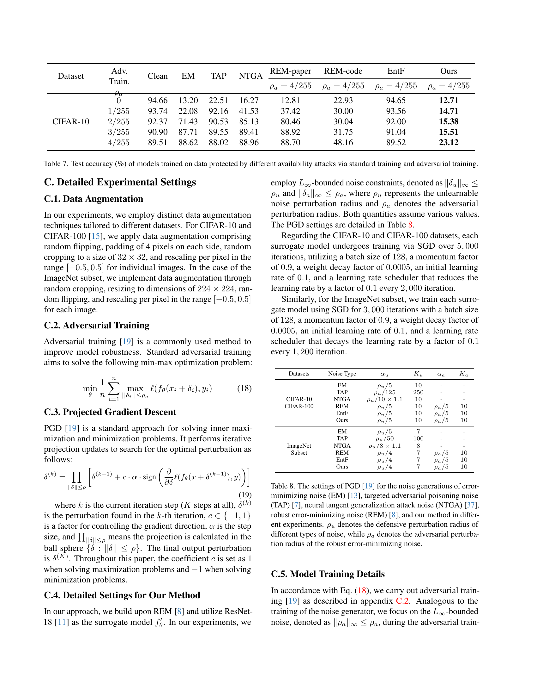

<!-- MinerU 4.0.9, tier advanced, VLM llama.cpp/Vulkan GPU; automatic extraction, tables require comparison with the PDF. -->

[PDF original](../../Fang_Re-thinking_Data_Availability_CVPR_2024_supplemental.pdf)

# Material Suplementario: Re-thinking Data Availability Attacks Against Deep Neural Networks

## A. Demostraciones omitidas (The Omitted Proofs)

**Lema 1.** Sea $f _ { \theta } ( x _ { i } ) [ k ]$ el k-ésimo valor del vector predicho. Sea $\begin{array} { r c l r } { \mathcal { R } } & { = } & { ( \frac { 1 } { K } , \ldots , \frac { 1 } { K } ) } & { \in } \\ \end{array}$ $R ^ { K }$ la probabilidad de random guess y $\begin{array} { r l } { \Theta } & { { } = } \end{array}$ $\begin{aligned} { ( f _ { \theta } ( x _ { i } ) [ 0 ] , \ldots , f _ { \theta } ( x _ { i } ) [ K ] ) \in R ^ { K } } \\ \end{aligned}$ la probabilidad predicha. Entonces, tenemos:

$$
- \mathcal {R} \log \Theta = K L (\mathcal {R} | \Theta) + \log K. \tag {9}
$$

Demostración (Proof).

$$
\begin{array}{l} \mathrm{KL} (\mathcal {R} | \Theta) = \sum_ {j = 1} ^ {K} \frac {1}{K} \left(\log \frac {1}{K} - \log (f _ {\theta} (x) [ j ])\right) \\ = \sum_ {j = 1} ^ {K} \frac {1}{K} \log \frac {1}{K} - \sum_ {j = 1} ^ {K} \frac {1}{K} \log \left(f _ {\theta} (x) [ j ]\right) \tag {10} \\ = - \log K + \mathcal {R} \log \Theta \\ \end{array}
$$

**Teorema 2.** Sea $f _ { \theta } ( x _ { i } ) [ k ]$ el k-ésimo valor del vector predicho. Sea $\textstyle \mathcal { R } = ( \frac { 1 } { K } , \ldots , \frac { 1 } { K } ) \in R ^ { K }$ la probabilidad de random guess. Entonces, tenemos:

$$
0 \leq \frac {1}{K} \sum_ {j = 1} ^ {K} (f _ {\theta} (x) [ j ] - \frac {1}{K}) ^ {2} <   \frac {4}{K} \tag {11}
$$

Demostración (Proof). Dado que $\begin{array} { r } { | f _ { \theta } ( x ) [ j ] - \frac { 1 } { K } | \geq 0 } \end{array}$ , tenemos:

$$
\begin{array}{l} \frac {1}{K} \sum_ {j = 1} ^ {K} (f _ {\theta} (x) [ j ] - \frac {1}{K}) ^ {2} \\ \leq \frac {1}{K} \left(\sum_ {j = 1} ^ {K} \left(f _ {\theta} (x) [ j ] - \frac {1}{K}\right) ^ {2} \right. \tag {12} \\ \left. + \sum_ {j = 1} ^ {K} \left| f _ {\theta} (x) [ j ] - \frac {1}{K} \right| \cdot \sum_ {k = 1, k \neq j} ^ {K} \left| f _ {\theta} (x) [ k ] - \frac {1}{K} \right|\right) \\ = \frac {1}{K} \left(\sum_ {j = 1} ^ {K} \left| f _ {\theta} (x) [ j ] - \frac {1}{K} \right|\right) ^ {2} \\ \end{array}
$$

Dado que $f _ { \theta } ( x ) [ j ] \geq 0 ,$ , entonces $\textstyle | f _ { \theta } ( x ) [ k ] - \frac { 1 } { K } | < | f _ { \theta } ( x ) [ k ] +$ $\frac { 1 } { K }$ . Tenemos:

$$
\begin{array}{l} \frac {1}{K} \left(\sum_ {j = 1} ^ {K} \left| f _ {\theta} (x) [ j ] - \frac {1}{K} \right|\right) ^ {2} <   \frac {1}{K} \left(\sum_ {j = 1} ^ {K} \left| f _ {\theta} (x) [ j ] + \frac {1}{K} \right|\right) ^ {2} \\ = \frac {1}{K} \left(\sum_ {j = 1} ^ {K} \left(f _ {\theta} (x) [ j ] + \frac {1}{K}\right)\right) ^ {2} \tag {13} \\ \end{array}
$$

Dado que $\begin{array} { r } { \sum _ { j = 1 } ^ { K } f _ { \theta } ( x ) [ j ] = 1 } \end{array}$ , tenemos:

$$
\frac {1}{K} \left(\sum_ {j = 1} ^ {K} (f _ {\theta} (x) [ j ] + \frac {1}{K})\right) ^ {2} = \frac {4}{K} \tag {14}
$$

En resumen, tenemos:

$$
0 \leq \frac {1}{K} \sum_ {j = 1} ^ {K} (f _ {\theta} (x) [ j ] - \frac {1}{K}) ^ {2} <   \frac {4}{K} \tag {15}
$$

## B. Análisis de REM (An Analysis of REM)

## B.1. El objetivo de optimización del artículo de REM y su implementación en código son inconsistentes (The optimization object of REM’s paper and code implementation are inconsistent)

La razón por la cual REM [8] sostiene que el adversarial training puede desbaratar los ataques no robustos radica en que el modelo puede aprender a partir de los adversarial examples. Estos adversarial examples contribuyen a un aumento en la classification loss del modelo, lo que puede codificar información valiosa utilizable para actualizar los parámetros del modelo y mejorar su rendimiento. Como resultado, REM [8] genera unlearnable noise exclusivamente para adversarial examples, en lugar de datos limpios (clean data), garantizando que el unlearnable noise se mantenga efectivo frente al adversarial training. La Ec. (16) representa el optimization objective propuesto.

Sea $\mathcal { D } \: = \: \{ ( x _ { 1 } , y _ { 1 } ) , ( x _ { 2 } , y _ { 2 } ) , \ldots , ( x _ { n } , y _ { n } ) \}$ un dataset constituido por n muestras, donde $x _ { i } \in \mathcal { X }$ es la i-ésima muestra e $y _ { i } \in \mathcal { Y } = \{ 1 , \ldots , K \}$ es la etiqueta correspondiente. Denótese un modelo parametrizado de machine learning mediante $f _ { \theta } : { \mathcal { X } } \to { \mathcal { Y } }$ , donde $\theta \in \Omega$ representa el parámetro del modelo. Sea ℓ una loss function. Entonces, el objetivo de entrenamiento para el robust noise generator se formula como sigue:

$$
\underline {{\min _ {\theta} \frac {1}{n} \sum_ {i = 1} ^ {n}}} \quad \underline {{\min _ {\| \delta_ {i} ^ {u} \| \leq \rho_ {u}} \max _ {\| \delta_ {i} ^ {a} \| \leq \rho_ {a}} \ell (f _ {\theta} ^ {\prime} (x _ {i} + \delta_ {i} ^ {u} + \delta_ {i} ^ {a}) , y _ {i})}}
$$

standard unlearnable noise for

trainingadversarial examples

(16)

donde $\rho _ { u }$ es el radio de perturbación defensiva que obliga a que el robust unlearnable noise generado sea imperceptible.

Sin embargo, la implementación en código de REM [8]2 no sigue estrictamente los objetivos de optimización presentados en el artículo, los cuales se exponen a continuación:

<small>2https://github.com/fshp971/robust-unlearnableexamples/blob/main/generate robust em.py</small>

$\frac{\min_{\theta} \frac{1}{n} \sum_{i=1}^{n} \max_{\delta_i^{a'}}}{\text{adversarial}}$ $\frac{\min_{\delta_i^u} \max_{\delta_i^a}\ell(f_\theta'(x_i + \delta_i^u + \delta_i^a + \delta_i^{a'})}, y_i)}{\text{unlearnable noise for training}}$ adversarial examples
(17)

Hemos extraído algunos fragmentos del código. En el bloque de código mostrado a continuación, la línea 8 representa el proceso de optimización adicional incorporado por los autores de REM en el código. Es evidente que los autores de REM realizaron un proceso adicional de maximización antes de entrenar el surrogate model.

if args.cpu:
    def_x = train_trans(x + torch.tensor(def_noise[ii]))
else:
    def_x = train_trans(x + torch.tensor(def_noise[ii]).cuda())
def_x.clamp_(-0.5, 0.5)

# the additional max step
adv_x = attacker.perturb(model,criterion, def_x, y)

model.train()
_y = model(adv_x)
def_acc = (_y.argmax(dim=1) == y).
    sum().item() / len(x)
def_loss = criterion(_y, y)
optim.zero_grad()
def_loss.backward()
optim.step()

## B.2. Ni el artículo ni el código constituyen el objetivo de optimización adecuado (Both Paper and Code Are not The Proper Optimization Object)

## El objetivo de optimización en el artículo de REM es equivalente a EM (The optimization object in REM’s paper is equal to EM)

Como se expone en la Ec. (16), dividimos el optimization objective de REM presentado en el artículo en dos partes: la parte interna, encargada de generar unlearnable noise, y la parte externa, encargada de entrenar el modelo de forma estándar. El proceso de entrenamiento de este surrogate model es esencialmente idéntico al de EM [13], con la única discrepancia radicando en el objetivo al que se dirige el unlearnable noise generado. El unlearnable noise de REM apunta a adversarial examples, mientras que el unlearnable noise de EM apunta a ejemplos limpios (clean examples). Como se detalla en la Tabla 7, el unlearnable noise generado para cualquiera de estos tipos de ejemplos no ofrece resistencia frente al adversarial training. Esta observación concuerda plenamente con nuestra perspectiva teórica, lo que nos lleva a postular que la emergencia del robust unlearnable noise es atribuible a la robustez inherente del surrogate model. La concordancia entre nuestros hallazgos y dicha hipótesis fundamenta sólidamente el vínculo existente entre la robustez del modelo y la generación de unlearnable noise.

**El objetivo de optimización en el código de REM es complejo e incorrecto (The optimization object in REM’s code is complex and incorrect).** Tal como se ilustra en la Ec. (17), dividimos de forma similar el optimization objective empleado en REM-code en dos componentes diferenciados: un componente interno responsable de generar unlearnable noise contra las muestras, y un componente externo destinado al entrenamiento de surrogate models robustos (robust alternative models). Al contrastar REM-paper y REM-code según se muestra en la Tabla 7, se evidencia que el proceso de optimización adicional de maximización, introducido en el código de REM, constituye el factor determinante para permitir que el unlearnable noise resista el adversarial training. Dicha constatación refuerza nuestra convicción de que la generación de robust unlearnable noise depende fundamentalmente de la disponibilidad de un modelo alternativo robusto. No obstante, el proceso de optimización actual presenta dos deficiencias:

1. El unlearnable noise generado por REM es específico para el adversarial example, lo cual no constituye una suposición válida. Por lo tanto, proponemos optimizar el componente interno de REM-code conservando exclusivamente el proceso de optimización por minimización.
2. Aunque REM-code recurre al adversarial training para incrementar la robustez del modelo, no toma en consideración la definición de unlearnable examples. Como solución, refinamos el proceso de entrenamiento del modelo alternativo incorporando la Attack Success Rate (ASR) a la vez que consideramos la aleatoriedad del modelo al emitir predicciones de probabilidad para muestras limpias (clean samples).

Considerando estos factores, formulamos nuestro optimization objective refinado, cuyo propósito es solventar las problemáticas precedentes y brindar una comprensión más precisa y rigurosa sobre la generación de robust unlearnable noise.

La Tabla 7 pone de manifiesto con claridad que generar unlearnable noise para adversarial examples continúa siendo susceptible a la degradación frente al adversarial training. Comparando las metodologías de REM-paper [8] y EM [13] bajo distintos radios de perturbación en adversarial training, se observa que ambas técnicas alcanzan efectos de protección equiparables. Dicho resultado apoya nuestra hipótesis de que REM-paper [8] es conceptualmente equivalente a EM [13]. Asimismo, la evidencia expuesta corrobora que los surrogate models no robustos son incapaces de producir unlearnable examples que resistan el adversarial training.

Por consiguiente, consideramos que contar con un surrogate model robusto resulta crucial para generar unlearnable examples con capacidad de resistir el adversarial training. Adicionalmente, el término complementario de corrección ASR incorporado en nuestra formulación enfatiza especialmente el comportamiento del modelo alternativo cuando se enfrenta a clean samples. En síntesis, el método que proponemos prescinde de pasos de optimización superfluos al tiempo que efectúa una ponderación exhaustiva de los factores determinantes. De este modo, manifiesta un rendimiento marcadamente superior en comparación con el resto de metodologías analizadas.

<table><tr><td>Dataset</td><td>Adv. Train. $\rho_a$ </td><td>Clean</td><td>EM</td><td>TAP</td><td>NTGA</td><td>REM-paper $\rho_a = 4/255$ </td><td>REM-code $\rho_a = 4/255$ </td><td>EntF $\rho_a = 4/255$ </td><td>Ours $\rho_a = 4/255$ </td></tr><tr><td rowspan="5">CIFAR-10</td><td>0</td><td>94.66</td><td>13.20</td><td>22.51</td><td>16.27</td><td>12.81</td><td>22.93</td><td>94.65</td><td>12.71</td></tr><tr><td>1/255</td><td>93.74</td><td>22.08</td><td>92.16</td><td>41.53</td><td>37.42</td><td>30.00</td><td>93.56</td><td>14.71</td></tr><tr><td>2/255</td><td>92.37</td><td>71.43</td><td>90.53</td><td>85.13</td><td>80.46</td><td>30.04</td><td>92.00</td><td>15.38</td></tr><tr><td>3/255</td><td>90.90</td><td>87.71</td><td>89.55</td><td>89.41</td><td>88.92</td><td>31.75</td><td>91.04</td><td>15.51</td></tr><tr><td>4/255</td><td>89.51</td><td>88.62</td><td>88.02</td><td>88.96</td><td>88.70</td><td>48.16</td><td>89.52</td><td>23.12</td></tr></table>

Tabla 7. Test accuracy (%) de modelos entrenados con datos protegidos por diferentes data availability attacks mediante standard training y adversarial training.

## C. Configuraciones experimentales detalladas (Detailed Experimental Settings)

## C.1. Data Augmentation

En nuestras evaluaciones experimentales, aplicamos técnicas diferenciadas de data augmentation ajustadas a cada conjunto de datos. Para CIFAR-10 y CIFAR-100 [15], aplicamos data augmentation compuesta por inversión aleatoria (random flipping), relleno (padding) de 4 píxeles por lado, recorte aleatorio (random cropping) a un tamaño de $3 2 \times 3 2$ , y reescalado de píxeles al rango [−0.5, 0.5] para cada imagen. En el caso del subconjunto de ImageNet, implementamos data augmentation mediante random cropping, redimensionamiento a dimensiones de 224 × 224, random flipping y reescalado por píxel en el rango [−0.5, 0.5] para cada imagen.

## C.2. Adversarial Training

El adversarial training [19] es un procedimiento estándar para reforzar la robustez del modelo. El adversarial training estándar persigue la resolución del siguiente problema de optimización min-max:

$$
\left| \min _ {\theta} \frac {1}{n} \sum_ {i = 1} ^ {n} \max _ {| | \delta_ {i} | | \leq \rho_ {a}} \ell (f _ {\theta} (x _ {i} + \delta_ {i}), y _ {i}) \right. \tag {18}
$$

## C.3. Projected Gradient Descent

PGD [19] representa la técnica estándar para la resolución de los problemas internos de maximización y minimización. Realiza actualizaciones iterativas mediante proyección para encontrar la perturbación óptima según la siguiente expresión:

$$
\delta^ {(k)} = \prod_ {\| \delta \| \leq \rho} \left[ \delta^ {(k - 1)} + c \cdot \alpha \cdot \operatorname{sign} \left(\frac {\partial}{\partial \delta} \ell (f _ {\theta} (x + \delta^ {(k - 1)}), y)\right) \right] \tag {19}
$$

donde k es la etapa de iteración en curso (K iteraciones en su totalidad), $\delta ^ { ( k ) }$ denota la perturbación calculada en la k-ésima iteración, $c \in \{ - 1 , 1 \}$ es un factor que gobierna la orientación del gradiente, α denota el step size, y $\Pi _ { \| \delta \| \leq \rho }$ expresa que la proyección se realiza dentro de la bola $\{ \widetilde { \delta } : \| \delta \|   \leq   \rho \}$ . La perturbación final generada corresponde a $\delta ^ { ( \bar { K ^ { \prime } } ) }$ . En la totalidad de este artículo, el coeficiente c se fija en 1 al resolver problemas de maximización y en −1 cuando se abordan problemas de minimización.

## C.4. Parámetros detallados para nuestro método (Detailed Settings for Our Method)

En nuestro método, tomando como base a REM [8], empleamos ResNet-18 [11] en calidad de surrogate model $f _ { \theta } ^ { \prime } .$ En nuestros experimentos, establecemos restricciones de ruido delimitadas por norma $L _ { \infty }$ , expresadas como $\| \delta _ { u } \| _ { \infty } \leq$ $\rho _ { u }$ y $\| \delta _ { a } \| _ { \infty } \leq \rho _ { a }$ , donde $\rho _ { u }$ define el radio de perturbación para el unlearnable noise y $\rho _ { a }$ determina el radio de perturbación adversarial. Ambos parámetros abarcan diferentes valores. Los hiperparámetros de PGD quedan especificados en la Tabla 8.

En lo concerniente a los datasets CIFAR-10 y CIFAR-100, cada surrogate model se entrena a través de SGD durante 5,000 iteraciones, empleando un batch size de 128, un factor de momentum de 0.9, un factor de weight decay de 0.0005, un learning rate inicial de 0.1 y un learning rate scheduler que reduce el learning rate en un factor de 0.1 a intervalos de 2,000 iteraciones.

De forma equivalente, para el subconjunto de ImageNet, entrenamos cada surrogate model a través de SGD a lo largo de 3,000 iteraciones con un batch size de 128, un factor de momentum de 0.9, un factor de weight decay de 0.0005, un learning rate inicial de 0.1 y un learning rate scheduler que decae el learning rate en un factor de 0.1 cada 1,200 iteraciones.

<table><tr><td>Datasets</td><td>Noise Type</td><td> $\alpha_u$ </td><td> $K_u$ </td><td> $\alpha_a$ </td><td> $K_a$ </td></tr><tr><td rowspan="6">CIFAR-10 CIFAR-100</td><td>EM</td><td> $\rho_u/5$ </td><td>10</td><td>-</td><td>-</td></tr><tr><td>TAP</td><td> $\rho_u/125$ </td><td>250</td><td>-</td><td>-</td></tr><tr><td>NTGA</td><td> $\rho_u/10 \times 1.1$ </td><td>10</td><td>-</td><td>-</td></tr><tr><td>REM</td><td> $\rho_u/5$ </td><td>10</td><td> $\rho_a/5$ </td><td>10</td></tr><tr><td>EntF</td><td> $\rho_u/5$ </td><td>10</td><td> $\rho_a/5$ </td><td>10</td></tr><tr><td>Ours</td><td> $\rho_u/5$ </td><td>10</td><td> $\rho_a/5$ </td><td>10</td></tr><tr><td rowspan="6">ImageNet Subset</td><td>EM</td><td> $\rho_u/5$ </td><td>7</td><td>-</td><td>-</td></tr><tr><td>TAP</td><td> $\rho_u/50$ </td><td>100</td><td>-</td><td>-</td></tr><tr><td>NTGA</td><td> $\rho_u/8 \times 1.1$ </td><td>8</td><td>-</td><td>-</td></tr><tr><td>REM</td><td> $\rho_u/4$ </td><td>7</td><td> $\rho_a/5$ </td><td>10</td></tr><tr><td>EntF</td><td> $\rho_u/4$ </td><td>7</td><td> $\rho_a/5$ </td><td>10</td></tr><tr><td>Ours</td><td> $\rho_u/4$ </td><td>7</td><td> $\rho_a/5$ </td><td>10</td></tr></table>

Tabla 8. Parámetros de PGD [19] para la generación de error-minimizing noise (EM) [13], targeted adversarial poisoning noise (TAP) [7], neural tangent generalization attack noise (NTGA) [37], robust error-minimizing noise (REM) [8] y nuestro método en diferentes experimentos. $\rho _ { u }$ denota el radio de perturbación defensiva de los distintos tipos de ruido, mientras que $\rho _ { a }$ denota el radio de perturbación adversarial del robust error-minimizing noise.

## C.5. Detalles del entrenamiento de los modelos (Model Training Details)

De conformidad con la Ec. (18), llevamos a cabo el adversarial training [19] como se describe en el apéndice C.2. De forma análoga al entrenamiento del generador de ruido, nos concentramos en el ruido acotado por norma $L _ { \infty }$ , denotado como $\| \rho _ { a } \| _ { \infty } \leq \rho _ { a }$ , durante el proceso de adversarial training.

<table><tr><td>Dataset</td><td>Random Seed</td><td>Method</td><td>VGG16</td><td>ResNet18</td><td>ResNet50</td><td>DenseNet121</td><td>WRN-34-10</td><td>Average</td></tr><tr><td rowspan="9">CIFAR-10</td><td rowspan="3">Random-1</td><td>EM</td><td>86.17</td><td>86.25</td><td>85.18</td><td>82.65</td><td>72.43</td><td>82.54</td></tr><tr><td>REM</td><td>49.45</td><td>42.31</td><td>39.12</td><td>64.65</td><td>42.27</td><td>47.56</td></tr><tr><td>Ours</td><td>35.94</td><td>27.71</td><td>22.26</td><td>60.82</td><td>29.86</td><td>35.32</td></tr><tr><td rowspan="3">Random-20</td><td>EM</td><td>87.70</td><td>89.21</td><td>90.18</td><td>82.36</td><td>87.72</td><td>87.43</td></tr><tr><td>REM</td><td>53.60</td><td>47.42</td><td>43.37</td><td>68.01</td><td>48.71</td><td>52.22</td></tr><tr><td>Ours</td><td>34.35</td><td>22.15</td><td>18.61</td><td>57.21</td><td>22.05</td><td>30.87</td></tr><tr><td rowspan="3">Random-42</td><td>EM</td><td>87.24</td><td>88.62</td><td>89.66</td><td>81.77</td><td>79.87</td><td>85.43</td></tr><tr><td>REM</td><td>65.23</td><td>48.16</td><td>40.65</td><td>82.38</td><td>48.39</td><td>56.96</td></tr><tr><td>Ours</td><td>37.78</td><td>23.12</td><td>19.30</td><td>72.42</td><td>18.67</td><td>34.26</td></tr><tr><td rowspan="9">CIFAR-100</td><td rowspan="3">Random-1</td><td>EM</td><td>56.35</td><td>63.77</td><td>66.44</td><td>53.56</td><td>68.13</td><td>61.65</td></tr><tr><td>REM</td><td>50.51</td><td>27.54</td><td>26.85</td><td>54.62</td><td>26.43</td><td>37.19</td></tr><tr><td>Ours</td><td>40.64</td><td>12.29</td><td>16.42</td><td>44.12</td><td>16.00</td><td>25.89</td></tr><tr><td rowspan="3">Random-20</td><td>EM</td><td>56.37</td><td>63.32</td><td>66.43</td><td>53.74</td><td>68.35</td><td>61.64</td></tr><tr><td>REM</td><td>39.03</td><td>27.80</td><td>27.81</td><td>54.84</td><td>27.27</td><td>35.35</td></tr><tr><td>Ours</td><td>31.41</td><td>11.35</td><td>12.55</td><td>46.05</td><td>15.33</td><td>23.34</td></tr><tr><td rowspan="3">Random-42</td><td>EM</td><td>56.94</td><td>63.43</td><td>66.43</td><td>53.52</td><td>68.27</td><td>61.72</td></tr><tr><td>REM</td><td>58.07</td><td>27.35</td><td>26.03</td><td>56.63</td><td>27.71</td><td>39.16</td></tr><tr><td>Ours</td><td>55.05</td><td>23.00</td><td>21.47</td><td>52.25</td><td>20.14</td><td>34.38</td></tr></table>

Tabla 9. Test accuracy (%) de diferentes modelos entrenados mediante adversarial training en CIFAR-10 y CIFAR-100 con diferentes semillas aleatorias (random seeds).

A lo largo de nuestros experimentos, el modelo se entrena utilizando SGD durante 40,000 iteraciones con un batch size de 128, un factor de momentum de 0.9, un factor de weight decay de 0.0005, un learning rate inicial de 0.1 y un learning rate scheduler que reduce el learning rate en un factor de 0.1 a intervalos de 16,000 iteraciones. Para los conjuntos de datos CIFAR-10 y CIFAR-100, el número de pasos $K _ { a }$ y el step size $\alpha _ { a }$ en PGD se configuran en 10 y $\rho _ { a } / 5 ,$ respectivamente. Para el subconjunto de ImageNet, fijamos el número de pasos $K _ { a }$ y el step size $\alpha _ { a }$ en 8 y $\rho _ { a } / 4 ,$ respectivamente. Lo anterior garantiza un marco experimental riguroso, uniforme y coherente entre los distintos conjuntos de datos.

## D. Consumo de tiempo (Time Consumption)

Nuestro método demanda un menor tiempo para entrenar el robust noise generator en comparación con REM. La Tabla 10 reporta los costes temporales de los tres métodos evaluados. Cabe señalar que los tiempos para CIFAR-10 y CIFAR-100 se midieron utilizando una GPU V100, mientras que el cómputo para ImageNet-Subset se evaluó distribuyéndolo en 4 GPUs V100.

|  | EM | TAP | NTGA | REM | Ours |
| --- | --- | --- | --- | --- | --- | --- |
| CIFAR-10 | 0.4 | 0.5 | 5.2 | 22.6 | 5.6 |
| CIFAR-100 | 0.4 | 0.5 | 5.2 | 22.6 | 5.6 |
| ImageNet-Subset | 3.9 | 5.2 | 14.6 | 51.2 | 11.3 |

Tabla 10. Consumo de tiempo (h) de los diferentes métodos en los distintos conjuntos de datos.

## E. Semillas aleatorias (Random Seeds)

La semilla aleatoria (random seed) para la totalidad de experimentos reportados en el artículo se fija en 42. Asimismo, evaluamos el comportamiento con diversas random seeds, cuyos resultados experimentales se recopilan en la Tabla 9 previa. En dichos experimentos, se emplea ResNet-18 como generador de ruido.

Páginas originales para cotejo

### Página 1

### Página 2

### Página 3

### Página 4

