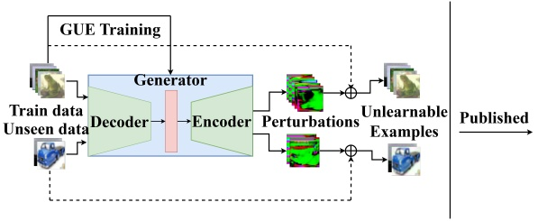
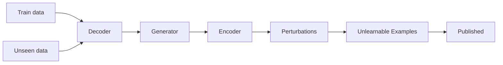
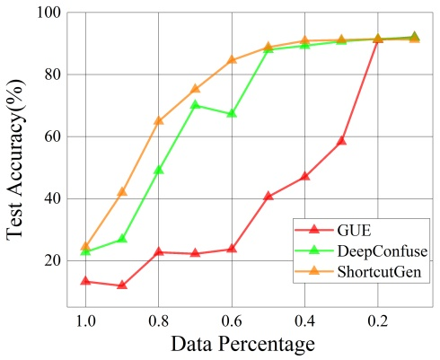
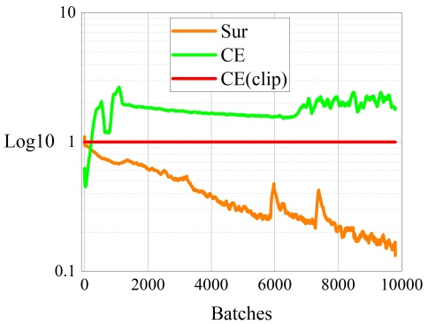

# Game-Theoretic Unlearnable Example Generator

**Shuang Liu**1, 2**, Yihan Wang**1, 2**, Xiao-Shan Gao**1, 2\*

1Academy of Mathematics and Systems Science, Chinese Academy of Sciences

2University of Chinese Academy of Sciences

liushuang2020@amss.ac.cn, yihanwang@amss.ac.cn, xgao@mmrc.iss.ac.cn

## Abstract

Los ataques de unlearnable examples son poisoning attacks de datos cuyo objetivo es degradar la clean test accuracy del deep learning agregando perturbaciones imperceptibles a las muestras de entrenamiento, lo cual puede formularse como un problema de optimización bi-nivel. Sin embargo, resolver directamente este problema de optimización resulta intratable para redes neuronales profundas. En este artículo, investigamos los ataques de unlearnable examples desde una perspectiva game-theoretic, formulando el ataque como un Stackelberg game de suma no nula. En primer lugar, se demuestra la existencia de equilibrios del juego bajo la configuración normal y bajo la configuración de adversarial training. Se demuestra que el equilibrio del juego produce el poison attack más potente, en el sentido de que la víctima obtiene la test accuracy más baja entre todas las redes dentro del mismo espacio de hipótesis cuando se utilizan ciertas loss functions. En segundo lugar, proponemos un método de ataque novedoso, denominado Game Unlearnable Example (GUE), el cual posee tres componentes principales: (1) Los poisons se obtienen resolviendo directamente el equilibrio del Stackelberg game mediante un algoritmo de primer orden. (2) Empleamos un modelo de red generativa de tipo autoencoder como poison attacker. (3) Se introduce una nueva payoff function para evaluar el rendimiento del poison. Experimentos exhaustivos demuestran que GUE puede envenenar eficazmente el modelo en diversos escenarios. Además, GUE sigue funcionando utilizando un porcentaje relativamente pequeño de los datos de entrenamiento para entrenar el generador, y el poison generator se generaliza adecuadamente a datos no vistos (unseen data). Nuestro código de implementación se encuentra disponible en https://github.com/hong-xian/gue.

## Introducción

El deep learning ha alcanzado un éxito notable en diversos campos, incluyendo computer vision (He et al. 2016), procesamiento de lenguaje natural y large language models (Brown et al. 2020), donde típicamente resulta necesaria la adquisición de una cantidad sustancial de datos de entrenamiento. Sin embargo, en escenarios prácticos, existe el problema potencial de recolectar datos privados no autorizados de Internet para entrenar dichos modelos. Esto suscita importantes preocupaciones sobre la privacidad y subraya la necesidad de abordar cómo proteger los datos personales contra su explotación.

Para prevenir el uso no autorizado de datos privados, se han propuesto diversos métodos de poisoning (Feng, Cai, and Zhou 2019; Huang et al. 2021; Fowl et al. 2021; Yuan and Wu 2021; Tao et al. 2021; Yu et al. 2022; van Vlijmen et al. 2022; Sandoval-Segura et al. 2022b). Estos métodos consisten en agregar perturbaciones imperceptibles a las muestras de entrenamiento, envenenando así los modelos y provocando un desempeño deficiente sobre datos de test limpios (clean test data), haciendo que los datos de entrenamiento sean unlearnable. Sin embargo, existe un consenso generalizado en que los métodos anteriores son vulnerables al adversarial training. En respuesta, se han propuesto enfoques novedosos como (Fu et al. 2022; Wen et al. 2023) para generar unlearnable examples robustos capaces de resistir el adversarial training. Comúnmente denominados como "unlearnable examples attack" o "availability attack", estos poison attacks han atraído una atención significativa.

En trabajos previos (Feng, Cai, and Zhou 2019; Tao et al. 2021; Yu et al. 2022), los ataques de unlearnable examples se formulaban habitualmente como un problema de optimización bi-nivel. Sin embargo, resolver directamente el problema de optimización resulta intratable; Feng, Cai, and Zhou (2019) emplearon una actualización alternada y Yuan and Wu (2021) utilizaron Neural Tangent Kernels (Jacot, Gabriel, and Hongler 2018) para optimizar de manera aproximada el objetivo bi-nivel. Yu et al. (2022) diseñaron poison perturbations que el modelo aprende fácilmente como "atajos" (shortcuts) para evitar que aprenda la información proveniente de los datos reales.

En este artículo, formulamos el ataque de unlearnable examples como un Stackelberg game de suma no nula, en el cual el atacante, como líder, elabora poison perturbations sobre los datos de entrenamiento con el objetivo de disminuir la test accuracy, mientras que el clasificador, como seguidor, optimiza los parámetros de la red sobre el dataset de entrenamiento envenenado. Demostramos la existencia de equilibrios de Stackelberg tanto en la configuración de entrenamiento estándar como en la de adversarial training. Además, proponemos un enfoque novedoso y eficaz, denominado Game Unlearnable Example (GUE), en el que calculamos directamente el equilibrio del Stackelberg game mediante un algoritmo de primer orden (Liu et al. 2022) y seleccionamos una payoff function apropiada para el poison attacker. Cabe destacar que nuestro GUE no solo es aplicable al entrenamiento natural estándar, sino que también puede extenderse al adversarial training.

Los ataques de unlearnable examples existentes típicamente requieren modificar la totalidad del dataset de entrenamiento. No obstante, en escenarios prácticos, el flujo continuo de nuevos datos limpios a lo largo del tiempo puede hacer que el efecto inaprendible sea casi despreciable. Para mitigar este problema, ante una corriente continua de nuevos datos, el usuario debe repetir el proceso de generación para todo el dataset, lo cual resulta costoso en tiempo. Con el fin de superar esta dificultad, utilizamos un generador tipo autoencoder como atacante, y demostramos que un atacante bien entrenado puede generalizarse con facilidad a datos no vistos (unseen data). El generador puede emplearse para realizar una simple forward propagation sobre los datos entrantes y generar la poison perturbation correspondiente. La Figura 1 ilustra el pipeline del ataque GUE.

<small>\*Corresponding author.</small>

flowchart

Figura 1: Ilustración del ataque GUE, donde el generador entrenado puede generalizarse adecuadamente a datos no vistos (unseen data).

En resumen, nuestro trabajo presenta tres contribuciones principales:

• Los ataques de unlearnable examples se formulan como un Stackelberg game y se demuestra la existencia de equilibrios del juego bajo diversas configuraciones útiles. Además, se demuestra que el equilibrio del juego produce el poison attack más potente, en el sentido de que la red víctima obtiene la menor test accuracy entre todas las redes dentro del mismo espacio de hipótesis cuando se emplean ciertas loss functions.
• Proponemos un nuevo ataque de unlearnable examples, denominado GUE, el cual, hasta donde sabemos, es el primer método de envenenamiento basado directamente en el cálculo de los equilibrios del juego. Asimismo, al utilizar un generador tipo autoencoder como atacante, las poison perturbations para nuevos datos pueden generarse mediante una simple forward propagation.
• Se llevan a cabo amplios experimentos para demostrar la efectividad y la capacidad de generalización de GUE en diferentes escenarios. En particular, se demuestra que GUE sigue funcionando al utilizar un porcentaje relativamente pequeño de los datos de entrenamiento para entrenar el generador.

## Trabajos Relacionados

Nuestro ataque GUE está estrechamente relacionado con los ataques de unlearnable examples, el Stackelberg game y los problemas de optimización bi-nivel. En primer lugar, ofrecemos una breve descripción de la trayectoria de desarrollo de los ataques de unlearnable examples y explicamos su relación con nuestro enfoque.

Los ataques de unlearnable examples son métodos de data poisoning con perturbaciones acotadas aditivas que impiden el entrenamiento no autorizado de modelos. Error-minimizing noise (EM) (Huang et al. 2021) genera una perturbación imperceptible resolviendo una optimización Min-Min. Las perturbaciones hipócritas (Hypocritical perturbations, HYP) (Tao et al. 2021) siguen una idea similar, pero emplean directamente un modelo preentrenado en lugar de la optimización Min-Min mencionada. Error maximizing noise (TAP) (Fowl et al. 2021) genera adversarial examples como datos envenenados. NTGA (Yuan and Wu 2021) genera poison perturbations en un ensamble de redes neuronales modelado con neural tangent kernels. Existen otros métodos que no involucran optimización. LSP (Yu et al. 2022) sintetiza perturbaciones linealmente separables como ataques, y AR (Sandoval-Segura et al. 2022b) introduce una perturbación genérica aplicable a diversos datasets y arquitecturas.

Sin embargo, los métodos anteriores no pueden envenenar modelos entrenados mediante adversarial training, y se propusieron varios métodos novedosos para mitigar este problema. REM (Fu et al. 2022) genera una perturbación más fuerte resolviendo un problema de optimización de tres niveles Min-Min-Max. INF (Wen et al. 2023) genera una poison perturbation basada en la inducción de características indiscriminadas entre distintas clases para envenenar un modelo entrenado mediante adversarial training bajo un presupuesto adversarial mayor.

Lu, Kamath, and Yu (2022) formularon los ataques tradicionales de data poisoning como un Stackelberg game y emplearon total gradient descent para resolver el juego, aunque consideraron agregar una pequeña porción de datos envenenados al conjunto de entrenamiento en lugar de modificar las muestras de entrenamiento. Además, no consideraron la existencia del equilibrio del juego.

Los trabajos más relevantes para el nuestro son DeepConfuse (Feng, Cai, and Zhou 2019) y ShortcutGen (van Vlijmen et al. 2022). Feng, Cai, and Zhou (2019) formularon el ataque de unlearnable examples como un problema de optimización bi-nivel y lo optimizaron desacoplando el procedimiento de actualización alternada. No obstante, este método no puede garantizar la convergencia teóricamente y requiere múltiples rondas de optimización, lo que resulta sumamente costoso en tiempo. En DeepConfuse también se empleó un generador tipo autoencoder como atacante, pero no se analizó la generalizabilidad del generador. van Vlijmen et al. (2022) utilizaron un discriminador estático inicializado aleatoriamente para entrenar un poison generator, con el fin de alentar al generador a aprender atajos espurios (spurious shortcuts) en el marco Min-Min (Huang et al. 2021). Esto se basa en su conjetura de que un discriminador inicializado aleatoriamente proporciona un mapeo ruidoso entre imágenes y etiquetas, careciendo por tanto de garantía teórica.

## Juego de Unlearnable Examples

Formulamos el ataque de unlearnable examples como un Stackelberg game, denominado juego de unlearnable examples (unlearnable example game), denotado como $\mathcal{G}$. A continuación, demostramos la existencia de su equilibrio en el caso general, el cual se extiende a diversos escenarios de ataque.

## Marco Unificado del Juego

**Configuración.** El juego $\mathcal{G}$ tiene dos participantes: un poison attacker y un clasificador víctima. Sea $\mathcal{S}$ un dataset de entrenamiento limpio finitamente muestreado a partir de una distribución de datos $\mathcal{D}$ sobre $\mathcal { X } \times \mathcal { Y }$, donde $\mathcal { X } \subset \mathbb { R } ^ { n }$ es el espacio de datos e $\mathcal { Y }   =   [ K ]   =   \{ i \} _ { i = 1 } ^ { K }$ es el conjunto de etiquetas para $K \in \mathbb { N } _ { + }$. El atacante modifica $x$ en cada par muestra-etiqueta $( x , y ) \in \mathcal { S }$ mediante una perturbación imperceptible $\mathcal { A } ( x , y )$ tal que

$$
\left\| \mathcal {A} (x, y) \right\| _ {\infty} \leq \epsilon .
$$

En nuestro método propuesto en el Algoritmo $1$, $\mathcal{A}$ se especificará como un generador encoder-decoder. Aquí, puede considerarse simplemente como un mapeo $\mathcal{A} ( x , y ) : { \tilde { \mathcal { S } } } \to \mathbb { R } ^ { n }$, donde $n$ es la dimensión de los datos. El clasificador víctima solo tiene acceso al dataset de entrenamiento envenenado, sobre el cual se entrenará un clasificador $f$ con parámetros $\theta$. El objetivo del atacante es degradar el rendimiento de $f _ { \theta }$. Denotamos la loss function utilizada en el entrenamiento del clasificador por $\mathcal { L } _ { c }$ y la loss function empleada en la evaluación del rendimiento del ataque por $\mathcal { L } _ { a }$.

**Modelo del juego.** En presencia de un envenenamiento $\mathcal{A}$ introducido por el líder del juego, la payoff function de la víctima es el riesgo empírico en el proceso de entrenamiento:

$$
\mathcal {J} _ {c} (\mathcal {A}, \theta) := \underset {(x, y) \sim \mathcal {S}} {\mathbb {E}} \left[ \mathcal {L} _ {c} (x + \mathcal {A} (x, y), y; \theta) \right].
$$

Como seguidor del juego, la víctima debe elegir una de las mejores respuestas:

$$
\theta^ {*} \in \mathbf {B R} (\mathcal {A}) := \underset {\theta^ {\prime}} {\arg \inf} \mathcal {J} _ {c} (\mathcal {A}, \theta^ {\prime}).
$$

Debido a que el entrenamiento de redes neuronales usualmente alcanza óptimos locales, consideramos las respuestas $\eta$-aproximadamente mejores:

$$
\theta^ {*} \in \mathrm{BR} _ {\eta} (\mathcal {A}) := \{\theta | \mathcal {J} _ {c} (\mathcal {A}, \theta) <   \inf _ {\theta^ {\prime}} \mathcal {J} _ {c} (\mathcal {A}, \theta^ {\prime}) + \eta \}.
$$

La payoff function del atacante es el valor negativo del riesgo poblacional:

$$
\mathcal {J} _ {a} (\mathcal {A}, \theta) := \sup _ {\theta \in \mathrm{BR} _ {\eta} (\mathcal {A})} \left\{- \underset {(x, y) \sim \mathcal {D}} {\mathbb {E}} \left[ \mathcal {L} _ {a} (x, y; \theta) \right] \right\}. \tag {1}
$$

El atacante debe elegir una estrategia de Stackelberg

$$
\mathcal {A} ^ {*} \in \underset {\mathcal {A}} {\arg \inf} \mathcal {J} _ {a} (\mathcal {A}, \theta). \tag {2}
$$

Aunque no se garantiza que la estrategia de Stackelberg sea única, el costo de Stackelberg sí es único. Para una estrategia de Stackelberg $\mathcal { A } ^ { * }$, cada $\theta ^ { * } \in \mathbf { \bar { B R } } _ { \eta } ( \mathcal { A } ^ { * } )$ es una estrategia óptima aproximada para la víctima con respecto a $\mathcal{A}^*$. Denominamos al perfil de acciones $( \mathcal { A } ^ { * } , \theta ^ { * } )$ un equilibrio de Stackelberg sin distinción.

## Existencia del Equilibrio

Una de las principales preocupaciones para el juego $\mathcal { G }$ es si este juego posee un equilibrio. Demostraremos la existencia del equilibrio, proporcionando consecuentemente un objetivo bien definido para el aprendizaje. La siguiente sección profundizará en los métodos para resolver este juego.

Asumimos que los parámetros $\theta$ del clasificador víctima están restringidos a un espacio de estrategias factible $\Theta \subset \mathbb { R } ^ { N }$, donde $N$ es el número de parámetros. Se requieren las siguientes suposiciones habituales para la existencia de un equilibrio de Stackelberg.

**Suposición 1.** El espacio de estrategias $\Theta$ es compacto, por ejemplo $\Theta = [ - E , E ] ^ { N }   f _ { } { o r }   E \in \widehat { \mathbb { R } _ { + } }$.

**Suposición 2.** Las loss functions $\mathcal { L } _ { a } ( x , y ; \theta )$ y $\mathcal { L } _ { c } ( x , y ; \theta )$ son continuas en $x$ y $\theta$.

**Teorema 3.** Bajo las Suposiciones 1 y 2, el juego de unlearnable examples $\mathcal{G}$ posee un equilibrio de Stackelberg $( \mathcal { A } ^ { * } , \theta ^ { * } )$.

Esbozo de la demostración. Sea $\Gamma$ el espacio factible para las perturbaciones sobre el conjunto de entrenamiento, es decir, $\mathcal { A } ( \bar { \mathcal { S } } ) \subset \Gamma$. Con un ligero abuso de notación, denotamos $\mathcal { A } \in \Gamma$.

Por las Suposiciones 1 y $2$, $\mathcal { J } _ { c } ( \mathcal { A } , \theta )$ es continua, y $\Theta$ y $\Gamma$ son compactos. Entonces, para cualquier $\dot { \mathcal { A } }$, $\dot { \mathbf { B } } \mathbf { R } _ { \eta } ( \mathcal { A } )$ es no vacío. Sea $\mathcal { J } ( \theta ) \; : = \; - \mathop { \mathbb { E } } _ { ( x , y ) \sim \mathcal { D } } \big [ \mathcal { L } _ { a } ( x , y ; \theta ) \big ]$. Por lo tanto, la existencia del equilibrio de Stackelberg es equivalente a la existencia de $\mathcal { A } ^ { * } \in \Gamma$ tal que

$$
\sup _ {\theta \in \mathrm{BR} _ {\eta} (\mathcal {A} ^ {*})} \mathcal {J} (\theta) = \inf _ {\mathcal {A}} \sup _ {\theta \in \mathrm{BR} _ {\eta} (\mathcal {A})} \mathcal {J} (\theta).
$$

Dado que $\mathcal { J } ( \theta )$ es continua en $\Theta$, la función marginal

$$
V (\mathcal {A}) := \sup _ {\theta \in \mathrm{BR} _ {\eta} (\mathcal {A})} \mathcal {J} (\theta)
$$

es semicontinua inferiormente. Por consiguiente, $V ( \mathcal { A } )$ puede alcanzar el mínimo puesto que $\Gamma$ es compacto; es decir, existe un $\mathcal { A } ^ { * }$ tal que

$$
V (\mathcal {A} ^ {*}) = \inf _ {\mathcal {A} \in \Gamma} V (\mathcal {A}) = \sup _ {\theta \in \mathrm{BR} _ {\eta} (\mathcal {A} ^ {*})} \mathcal {J} (\theta).
$$

Puesto que $\mathbf { B } \mathbf { R } _ { \eta } ( \mathcal { A } )$ no es vacío, existe un $\theta ^ { * } \in \mathrm { B R } _ { \eta } ( \mathcal { A } ^ { * } )$ y el teorema queda demostrado. Los detalles de la demostración se presentan en la subsección correspondiente. □

## Diversos Escenarios de Ataque

Hemos demostrado la existencia del equilibrio de Stackelberg respecto a loss functions generales $\mathcal { L } _ { c }$ y $\bar { \mathcal { L } } _ { a }$. A continuación, consideraremos loss functions específicas para los diferentes escenarios descritos abajo. Siempre que $\mathcal { L } _ { c }$ y $\mathcal { L } _ { a }$ satisfagan la Suposición 2, el juego de unlearnable examples especificado posee un equilibrio.

**Configuración estándar.** El escenario de ataque más común para tareas de clasificación aprovecha la cross-entropy loss tanto para $\mathcal { L } _ { c }$ como para $\mathcal { L } _ { a }$. En este caso, el atacante busca reducir la standard accuracy sobre la distribución original de datos, mientras que la víctima entrena el clasificador $f_{\theta}$ para mejorar la standard accuracy sobre el conjunto de entrenamiento envenenado. Obtenemos el siguiente corolario como consecuencia directa del Teorema 3.

**Corolario 4.** Sea $\mathcal { L } _ { c }   =   \mathcal { L } _ { a }   =   \mathcal { L } _ { c e }$, entonces el juego de unlearnable examples $\mathcal{G}$ posee un equilibrio de Stackelberg.

En la práctica, resolver este juego también requiere tomar en consideración la efectividad del algoritmo. Buscar una estrategia de Stackelberg para el atacante implica minimizar su payoff function en la Ecuación (1), la cual involucra $\mathcal { L } _ { c e }$. Sin embargo, la cross-entropy loss no posee una cota superior y, por consiguiente, carece de forma natural de un criterio de convergencia para dicha optimización. Además, provoca una explosión de gradientes, como se analizará en la sección experimental.

Para abordar esta cuestión, en su lugar recurrimos a una surrogate loss function que se encuentra acotada superiormente y es equivalente a la cross-entropy loss para resolver el juego.

**Surrogate loss.** Proponemos una loss function novedosa para que el atacante mida el rendimiento del envenenamiento:

$$
\mathcal {L} _ {s u r} (x, y; \theta) := - \max _ {k \in [ K ] \backslash \{y \}} \mathcal {L} _ {c e} (x, k; \theta). \tag {3}
$$

Intuitivamente, maximizar $\mathcal { L } _ { s u r }$ significa minimizar la cross-entropy loss de $x$ con respecto a todas las demás etiquetas distintas de $y$, provocando la clasificación errónea del modelo entrenado sobre el conjunto de entrenamiento envenenado. Al maximizar $\mathcal { L } _ { c e }$, a menudo se forma un valle profundo en la etiqueta verdadera dentro de la distribución de confianza de etiquetas. Por otra parte, al maximizar $\mathcal { L } _ { s u r }$, además de formar un valle profundo en la etiqueta verdadera, también se hace uniforme el nivel de confianza de las demás etiquetas.

Las siguientes propiedades de la surrogate loss permiten que nuestro método resuelva el juego de manera efectiva. Además, sigue existiendo un equilibrio para la surrogate loss.

**Proposición 5.** Asúmase que los datos tienen $K$ clases.

1. $\mathcal { L } _ { s u r }$ está acotada superiormente:

$$
\mathcal {L} _ {s u r} (x, y; \theta) \leq - \log (K - 1).
$$

2. $\mathcal { L } _ { c e }$ crece a medida que $\mathcal { L } _ { s u r }$ crece:

$$
\mathcal {L} _ {c e} (x, y; \theta) \geq - \log (1 - (K - 1) e ^ {\mathcal {L} _ {s u r} (x, y; \theta)}).
$$

**Corolario 6.** Sean $\mathcal { L } _ { c } = \mathcal { L } _ { c e }$ y $\mathcal { L } _ { a } = \mathcal { L } _ { s u r }$. Denotamos este juego como $\mathcal { G } _ { u e }$. Entonces este juego de unlearnable examples $\mathcal { G } _ { u e }$ posee un equilibrio de Stackelberg $( \mathcal { A } _ { u e } ^ { * } , \theta _ { u e } ^ { * } )$.

**Configuración adversarial.** Estudios recientes (Tao et al. 2021) han sugerido que el adversarial training puede mitigar el impacto de los ataques de unlearnable examples. Posteriormente se propusieron enfoques de poisoning (Fu et al. 2022; Wen et al. 2023) diseñados para funcionar contra modelos entrenados adversarialmente.

Nuestro marco unificado de juego también contempla el escenario adversarial en el que la víctima es consciente del conjunto de entrenamiento potencialmente envenenado y decide desplegar adversarial training, mientras que el atacante todavía desea impedir que la víctima obtenga un modelo utilizable.

Solo necesitamos modificar la training loss $\mathcal { L } _ { c }$ para adaptarla a las configuraciones adversariales. Aquí consideramos las dos adversarial losses ampliamente utilizadas:

• Adversarial Loss (Madry et al. 2017):

$$
\mathcal {L} _ {a d v} (x, y; \theta) := \max _ {| | \mu | | _ {\infty} \leq \epsilon_ {d}} \mathcal {L} _ {c e} (x + \mu , y; \theta)
$$

donde $\epsilon _ { d }$ es el radio de adversarial training.

• TRADES Loss (Zhang et al. 2019):

$$
\begin{array}{l} \mathcal {L} _ {t r a} (x, y; \theta) := \frac {1}{\lambda} \max _ {| | \mu | | _ {\infty} \leq \epsilon_ {d}} \mathrm{KL} (f _ {\theta} (x) | | f _ {\theta} (x + \mu)) \\ + \mathcal {L} _ {c e} (x, y; \theta). \\ \end{array}
$$

El siguiente lema establece que $\mathcal{L}_{adv}$ y $\mathcal{L}_{tra}$ satisfacen la Suposición 2.

**Lema 7.** $\mathcal { L } _ { a d v } ( x , y ; \theta )$ y $\mathcal { L } _ { t r a } ( x , y ; \theta )$ son continuas.

Como consecuencia del Teorema 3, el equilibrio existe en el escenario adversarial.

**Corolario 8.** Sean $\mathcal { L } _ { c } = \mathcal { L } _ { a d v } \: \text{o} \: \mathcal { L } _ { t r a }$, y $\mathcal { L } _ { a } = \mathcal { L } _ { s u r }$. Denotamos este juego mediante $\mathcal{G}_{at}$. Entonces este juego de unlearnable examples $\mathcal { G } _ { a t }$ posee un equilibrio de Stackelberg $( \mathcal { A } _ { a t } ^ { * } , \theta _ { a t } ^ { * } )$.

Esto implica que existe un poisoning attack capaz de degradar el rendimiento de clasificación de un modelo que obtiene parámetros aproximadamente óptimos mediante adversarial training sobre el conjunto de entrenamiento envenenado. En el resto del artículo consideramos principalmente el caso con $\mathcal { L } _ { c } = \mathcal { L } _ { t r a }$.

**Observación 9.** De manera similar a (Gao, Liu, and Yu 2022), utilizando la loss function $\mathcal { L } _ { c w } ( f _ { \theta } ( \tilde { x } ) , y ) { = } { \operatorname* { m a x } } _ { l \neq y } [ f _ { \theta } ( \tilde { x ) } ] _ { l } \dot { - } [ f _ { \theta } ( \tilde { x } ) ] _ { y }$, podemos demostrar que el equilibrio del juego correspondiente existe y proporciona el poison attack más potente, en el sentido de que la víctima obtiene la test accuracy más baja entre todas las redes dentro del espacio de hipótesis, al ser entrenada sobre el conjunto de entrenamiento envenenado.

## Generador de Unlearnable Examples

En la sección precedente, establecimos teóricamente el marco del juego de unlearnable examples y demostramos la existencia del equilibrio en diversos escenarios.

En esta sección, al resolver el juego mediante un algoritmo de primer orden, proponemos un generador de unlearnable examples novedoso capaz de generalizarse eficazmente a datos futuros que se incorporen al conjunto de entrenamiento. Al hacer esto, buscamos reducir la alta dependencia que tienen los unlearnable examples respecto al poisoning ratio, con el fin de alinearnos mejor con la necesidad del mundo real de proteger datos no autorizados. Además, este enfoque game-theoretic puede extenderse a la configuración adversarial.

## Protección de Datos No Autorizados

En la era del big data, innumerables datos personales son subidos a servidores a través de diversas aplicaciones, publicados en Internet y accesibles por terceros sin restricciones. Si estos datos son obtenidos sin autorización por individuos maliciosos y utilizados para entrenar modelos de machine learning, existe el riesgo de que la información de privacidad personal de los usuarios sea objeto de un uso indebido. Como medio de protección de datos no autorizados, los unlearnable examples se utilizan para preprocesar los datos entrantes antes de su publicación, haciendo que los modelos entrenados con dichos datos procesados resulten inutilizables.

**Desafíos.** Sin embargo, existen problemas comunes que obstaculizan el despliegue y la aplicación de los métodos de unlearnable examples existentes en el mundo real. Entre estos desafíos se incluyen:

• Dependencia de un poisoning ratio extremadamente alto.
• Ineficiencia en la generación de poisons.
• Vulnerabilidad ante enfoques de recuperación.

En primer lugar, incluso una ligera disminución en el poisoning ratio puede traducirse en una reducción sustancial de la inaprendibilidad (unlearnability) (Huang et al. 2021). Cuando un conjunto de entrenamiento envenenado se diluye mediante unas pocas muestras limpias nuevas, la protección de los datos se destruye. Esto constituye un obstáculo esencial para la aplicación de unlearnable examples en el mundo real. Además, la mayoría de los ataques de unlearnable examples existentes se basan en un número enorme de propagaciones y back-propagations iterativas (Fowl et al. 2021). Cuando se trata de volver a desplegar el envenenamiento ante un nuevo flujo de datos, el problema de la ineficiencia se vuelve aún más prominente. Por último, pero no menos importante, el adversarial training puede restablecer la usabilidad de los modelos entrenados sobre conjuntos de entrenamiento contaminados por poisons que no han sido diseñados específicamente para adversarial training (Tao et al. 2021). Las perturbaciones class-wise son más fáciles de recuperar en comparación con las perturbaciones sample-wise (Sandoval-Segura et al. 2022a).

## Generador de Poisons Generalizable

Para mitigar los problemas antes mencionados, proponemos un enfoque novedoso que difiere de los métodos existentes. En lugar de optimizar empíricamente perturbaciones para crear atajos (shortcuts) de aprendizaje, sugerimos utilizar un marco game-theoretic para entrenar un generador de unlearnable examples capaz de generalizarse a datos no vistos (unseen data) de manera efectiva.

En detalle, nuestro enfoque consiste en que el atacante dentro del juego utilice un poison generator $g _ { \omega }$ basado en un encoder-decoder con parámetros $\omega$. Es decir, $\mathcal { A } ( x , y ) = g _ { \omega } ( x )$, el cual genera perturbaciones sample-wise. La activación para la capa final es $\epsilon \cdot \operatorname { t a n h } ( \cdot )$ para controlar la perturbación dentro del radio de envenenamiento $\epsilon$, es decir, $\| \widehat { g } _ { w } ( x ) \| _ { \infty } \leq \epsilon$.

Ahora, el clasificador busca minimizar la payoff function:

$$
\mathcal {J} _ {c} (w, \theta) = \underset {(x, y) \sim S} {\mathbb {E}} \left[ \mathcal {L} _ {c} (x + g _ {w} (x), y; \theta) \right]
$$

eligiendo los parámetros

$$
\theta^ {*} \in \mathbf {B R} _ {\eta} (w) = \{\theta | \mathcal {J} _ {c} (w, \theta) <   \inf _ {\theta^ {\prime}} \mathcal {J} _ {c} (w, \theta^ {\prime}) + \eta \}.
$$

El atacante elige los parámetros del generador $w^*$ para minimizar la payoff function:

$$
\mathcal {J} _ {a} (\omega , \theta) := \sup _ {\theta \in \mathrm{BR} _ {\eta} (\omega)} \left\{- \underset {(x, y) \sim \mathcal {S}} {\mathbb {E}} \left[ \mathcal {L} _ {a} (x, y; \theta) \right] \right\}. \tag {4}
$$

Para hacer viable el cómputo en la práctica, aquí consideramos la loss sobre el conjunto de entrenamiento limpio $\mathcal{S}$ en lugar de la distribución de datos $\mathcal{D}$ en la Ecuación (1).

Una vez que el generador $g _ { \omega }$ está bien entrenado sobre un conjunto de entrenamiento dado, solo requiere de forward propagation para generar poisons para imágenes del conjunto de entrenamiento y potencialmente para futuras imágenes que puedan agregarse al conjunto de entrenamiento. Gracias a la selección flexible de $\mathcal { L } _ { c }$ y $\mathcal { L } _ { a }$, el generador es capaz de abordar diferentes escenarios, incluyendo configuraciones estándar y adversariales.

## Cálculo del Equilibrio del Juego

De hecho, un Stackelberg game puede simplificarse como un problema de optimización bi-nivel:

$$
\min _ {w, \theta} l (w, \theta) \tag {5}
$$

$$
\text {s.t.} \quad \theta \in \arg \min _ {\theta^ {\prime}} h (w, \theta^ {\prime}).
$$

En el contexto de un juego de unlearnable examples, tenemos $l = \mathcal { J } _ { a }$ y $h = \mathcal { J } _ { c }$. Resolver directamente un problema de optimización bi-nivel requiere el cálculo de matrices hessianas de segundo orden, lo cual resulta inviable para tareas habituales de machine learning con entradas y parámetros de alta dimensionalidad.

Aprovechamos BOME (Liu et al. 2022) propuesto previamente y el algoritmo dynamic barrier gradient descent (Gong, Liu, and Liu 2021) para entrenar eficientemente un generador de unlearnable examples; el algoritmo detallado se presenta en el Algoritmo 1. BOME es un algoritmo de optimización bi-nivel de primer orden desarrollado recientemente que emplea un enfoque de función de valor para transformar el problema bi-nivel en un problema de optimización con restricciones de un solo nivel. Luego, el problema de un solo nivel se resuelve mediante el algoritmo dynamic barrier gradient descent, el cual posee la notable ventaja de no requerir que el problema de nivel inferior posea una solución única.

**BOME.** Asumiendo que $h(w, \cdot)$ puede alcanzar un mínimo para cada $w$. El problema (5) es equivalente a la siguiente optimización con restricciones (incluso para $h$ no convexo):

$$
\min _ {w, \theta} l (w, \theta)
$$

$$
\text {s.t.} \quad q (w, \theta) := h (w, \theta) - h (w, \theta^ {*} (w)) \leq 0,
$$

donde $h ( w , \theta ^ { * } ( w ) ) =$ minθ $h ( w , \theta )$. En la práctica, aproximamos $\theta ^ { * } ( w )$ mediante $\theta ^ { \widehat { T } } ( w )$, que representa el gradient descent de $T$ pasos de $h ( w , \cdot )$ sobre $\theta$ para algún step size $\alpha > 0$

$$
\theta^ {t + 1} (w) = \theta^ {t} (w) - \alpha \nabla_ {\theta} h \left(w, \theta^ {t} (w)\right). \tag {6}
$$

Entonces obtenemos una estimación de $q(w, \theta)$

$$
\widehat {q} (w, \theta) = h (w, \theta) - h (w, \theta^ {T} (w)).
$$

Algoritmo 1: Entrenamiento del generador de unlearnable examples

**Entrada**: Conjunto de entrenamiento S, pasos internos $T ,$ tamaños de paso interno y externo $\alpha , \beta ,$ , batch size b, épocas de entrenamiento e.

**Salida**: Generador de poisons aprendido $g _ { w }$

1: Inicializar el clasificador $f _ { \theta }$ y el atacante $g _ { w }$
2: **for** $k = 1$ to e **do**
3: Muestrear un mini-batch $\{ ( x _ { i } , y _ { i } ) \} _ { i = 1 } ^ { b } \sim \mathcal { S }$
4: Calcular $\theta ^ { T } ( w _ { k } )$ mediante $T$ pasos de gradient descent sobre $J _ { c } ( \bar { w _ { k } } , \cdot )$ comenzando desde $\theta _ { k }$ (como en la Ec.(6))
5: Definir $\widehat{q}(w_k, \theta_k) = J_c(w_k, \theta_k) - J_c(w_k, \theta^T(w_k))$
6: Actualizar $( w , \theta ) ;$
donde $\begin{array} { l } { \lambda _ { k } \; = \; \operatorname* { m a x } ( \frac { \phi _ { k } - \left\langle \nabla J ( \theta _ { k } ) , \nabla _ { \theta _ { k } } \widehat { q } ( w _ { k } , \theta _ { k } ) \right\rangle } { | | \nabla \widehat { q } ( w _ { k } , \theta _ { k } ) | | ^ { 2 } } , 0 ) } \\ \end{array}$ y
(Fijar $\rho = 1 . 5$ y $T \stackrel { \cdots } { = } 1 0$ por defecto)

$$
\theta_ {k + 1} \leftarrow \theta_ {k} - \beta \left(\nabla J _ {a} \left(\theta_ {k}\right) + \lambda_ {k} \nabla_ {\theta_ {k}} \widehat {q} \left(w _ {k}, \theta_ {k}\right)\right)
$$

$$
w _ {k + 1} \leftarrow w _ {k} - \beta \left(\lambda_ {k} \nabla_ {w _ {k}} \widehat {q} \left(w _ {k}, \theta_ {k}\right)\right)
$$

$$
\phi_ {k} = \rho | | \nabla \widehat {q} (w _ {k}, \theta_ {k}) | | ^ {2}.
$$

7: **end for**

8: **return** $g _ { w }$

**Dynamic barrier gradient descent.** El método consiste en actualizar iterativamente $( w , \theta )$ con un step size $\beta > 0$ para reducir $l$ mientras se controla el decrecimiento de $q$:

$$
(w _ {k + 1}, \theta_ {k + 1}) \leftarrow (w _ {k}, \theta_ {k}) - \beta (\nabla l (w _ {k}, \theta_ {k}) + \lambda_ {k} \nabla \widehat {q} (w _ {k}, \theta_ {k}))
$$

donde

$$
\lambda_ {k} = \max (\frac {\phi_ {k} - \langle \nabla l (w _ {k} , \theta_ {k}) , \nabla \widehat {q} (w _ {k} , \theta_ {k}) \rangle}{| | \nabla \widehat {q} (w _ {k} , \theta_ {k}) | | ^ {2}}, 0)
$$

y $\begin{array} { r c l } { \phi _ { k } } & { = } & { \rho | | \nabla \widehat { q } ( w _ { k } , \theta _ { k } ) | | ^ { 2 } } \\ \end{array}$ por defecto con un hiperparámetro $\rho > 0$

## Experimentos

En esta sección, llevamos a cabo experimentos exhaustivos para validar la efectividad de GUE sobre datasets de benchmark ampliamente utilizados. Aquí consideramos no solo el entrenamiento estándar, sino también el adversarial training.

## Configuración Experimental

Realizamos experimentos principalmente en datasets de clasificación de imágenes: CIFAR-10 y CIFAR-100, los cuales han sido comúnmente utilizados en la literatura sobre envenenamiento. Empleamos ResNet-18 (He et al. 2016) como clasificador ${ \bar { f } } ( \theta )$ y U-Net (Ronneberger, Fischer, and Brox 2015) como poison generator $g _ { w }$ durante el entrenamiento. A menos que se indique explícitamente lo contrario, nos centramos en la configuración razonable con un radio de envenenamiento $\epsilon = 8 / 2 5 5$.

Utilizamos la test accuracy sobre el conjunto de test limpio para evaluar la efectividad de los ataques de unlearnable examples; una menor accuracy implica que el ataque es más potente para impedir que el modelo aprenda información proveniente del dataset de entrenamiento envenenado.

## Entrenamiento Estándar

En esta subsección, llevamos a cabo experimentos bajo la configuración de entrenamiento estándar para verificar la efectividad de nuestro ataque GUE resolviendo directamente el juego $\mathcal { G } _ { u e }$ definido en el Corolario 6.

| Poison method | CIFAR10 | CIFAR100 |
| --- | --- | --- |
| None(Clean) | 92.36 | 70.59 |
| EM | 10.16 | 1.90 |
| TAP | 20.28 | 15.40 |
| DeepConfuse | 22.74 | 25.73 |
| ShortcutGen | 24.42 | 8.62 |
| GUE | 13.25 | 8.35 |

Tabla 1: Test accuracy de ResNet-18 entrenado con datos envenenados provenientes de diferentes ataques de unlearnable examples en CIFAR.

line

| Epochs | EM (%) | GUE (%) | TAP (%) | DeepConfuse (%) | Clean (%) | ShortcutGen (%) |
| --- | --- | --- | --- | --- | --- | --- |
| 0 | ~18 | ~18 | ~35 | ~35 | ~45 | ~45 |
| 10 | ~11 | ~14 | ~25 | ~20 | ~80 | ~35 |
| 20 | ~11 | ~13 | ~23 | ~19 | ~84 | ~36 |
| 30 | ~11 | ~13 | ~22 | ~19 | ~85 | ~35 |
| 40 | ~11 | ~14 | ~22 | ~19 | ~86 | ~30 |
| 50 | ~11 | ~14 | ~21 | ~20 | ~88 | ~28 |
| 60 | ~11 | ~13 | ~20 | ~20 | ~88 | ~28 |
| 70 | ~11 | ~13 | ~20 | ~21 | ~89 | ~25 |
| 80 | ~11 | ~13 | ~20 | ~22 | ~92 | ~24 |
| 90 | ~11 | ~13 | ~20 | ~22 | ~92 | ~24 |
| 100 | ~11 | ~13 | ~20 | ~22 | ~92 | ~24 |

Figura 2: Curvas de test accuracy de ResNet-18 entrenado con datos envenenados de diferentes ataques de unlearnable examples en CIFAR-10.

Entrenamos 50 epochs para generar GUE con el algoritmo 1, utilizando el optimizador SGD con un learning rate de 0.01 para el clasificador $f _ { \theta }$ y el optimizador SGD con un learning rate de 0.1 para el atacante $g _ { w }$. Asimismo, empleamos Adam (Kingma and Ba 2014) con un learning rate de 0.001 para la aproximación interna de T pasos. Para la evaluación de los unlearnable examples, entrenamos un modelo sobre el dataset envenenado durante 100 epochs utilizando el optimizador SGD con un learning rate inicial de 0.01 que se reduce por un factor de 0.1 en las épocas de entrenamiento 75 y 90. El optimizador se configura con momentum 0.9 y weight decay $5 \times 1 \bar { 0 } ^ { - 4 }$.

**Comparación con diferentes ataques de unlearnable examples.** En primer lugar, evaluamos el rendimiento de nuestro GUE y de diferentes métodos de envenenamiento state-of-the-art bajo entrenamiento estándar, incluyendo DeepConfuse (Feng, Cai, and Zhou 2019), Unlearnable Examples (EM) (Huang et al. 2021), Targeted Adversarial Poisoning (TAP) (Fowl et al. 2021) y ShortcutGen (van Vlijmen et al. 2022). Como se muestra en la Tabla 1, nuestro GUE puede reducir sustancialmente la clean test accuracy y se desempeña mejor que todos los métodos excepto EM. Además, como podemos observar en la Figura 2, nuestro GUE mantiene su efectividad inaprendible a lo largo de todas las épocas de entrenamiento, mientras que todos los demás ataques exhiben un pico de accuracy al inicio del entrenamiento.

**Diferentes porcentajes de datos para entrenar** $g _ { w }$ **y capacidad de generalización.** En la práctica, no siempre es posible que el atacante tenga acceso al dataset de entrenamiento completo; el clasificador víctima puede recolectar más datos para entrenar un modelo. Se ha observado que otros ataques de unlearnable examples tales como EM o TAP fallan en envenenar el modelo cuando existe una pequeña proporción de datos limpios, como por ejemplo un 10% del dataset de entrenamiento. Por lo tanto, cuando se dispone de más datos limpios, estos ataques requieren regenerar los unlearnable examples correspondientes sobre la totalidad de los datos de entrenamiento tras agregar los nuevos datos limpios. Esto nos motiva a examinar la capacidad de generalización del poison generator $g _ { w }$ entrenado únicamente sobre una proporción de ejemplos de entrenamiento seleccionados aleatoriamente; y cuando se dispone de más datos limpios, podemos emplear $g _ { w }$ para generar unlearnable examples para dichos datos.

line

| Data Percentage | GUE (%) | DeepConfuse (%) | ShortcutGen (%) |
| --- | --- | --- | --- |
| 1.0 | ~13 | ~23 | ~24 |
| 0.9 | ~12 | ~27 | ~42 |
| 0.8 | ~23 | ~49 | ~65 |
| 0.7 | ~22 | ~70 | ~76 |
| 0.6 | ~24 | ~67 | ~85 |
| 0.5 | ~41 | ~88 | ~89 |
| 0.4 | ~47 | ~89 | ~91 |
| 0.3 | ~58 | ~91 | ~91 |
| 0.2 | ~91 | ~91 | ~91 |
| 0.1 | ~91 | ~92 | ~91 |

Figura 3: Test accuracy de ResNet-18 entrenado sobre CIFAR-10 envenenado, donde el poison generator se entrena con diferentes porcentajes de datos de entrenamiento.

Utilizamos diferentes porcentajes de datos de entrenamiento para entrenar el poison generator y, a continuación, empleamos el generador correspondiente para generar unlearnable examples sobre la totalidad del dataset de entrenamiento. Los resultados se presentan en las Figuras 3 y 4. Podemos observar que la capacidad de generalización de nuestro GUE es muy superior a la de DeepConfuse y ShortcutGen. Específicamente, nuestro GUE sigue siendo eficaz para degradar la test accuracy a aproximadamente un 20% cuando solo utilizamos el 60% de los datos de entrenamiento en CIFAR10. Esto indica que el poison generator entrenado mediante GUE es capaz de generalizarse adecuadamente a datos no vistos (unseen data).

**Transferibilidad a diferentes arquitecturas de modelos.** Generamos un GUE con una estructura fija de clasificador correspondiente a ResNet-18. Por esta razón, surge una pregunta natural: ¿el poison generator entrenado con una arquitectura de modelo determinada sigue siendo eficaz cuando el clasificador víctima adopta una arquitectura diferente? La Tabla 2 muestra que los efectos de envenenamiento de nuestro GUE optimizado frente a un clasificador ResNet-18 pueden transferirse a otras arquitecturas de modelos. (Para ahorrar espacio, denotamos DeepConfuse y ShortcutGen como DC y SG). Específicamente, podemos observar que la transferibilidad de nuestro GUE es más estable que la de DeepConfuse y ShortcutGen. Nuestro GUE es capaz de reducir la test accuracy a 12.97% ∼ 14.68% a través de diversas arquitecturas de modelos.

**Efectos de las defensas contra GUE.** Hemos demostrado la eficacia de nuestro GUE en la configuración en la que el clasificador víctima solo emplea entrenamiento estándar. No obstante, el clasificador víctima podría emplear diversas defensas propuestas contra poison attacks. Por lo tanto, evaluamos la efectividad de varias defensas populares contra nuestro GUE.

line

| Data Percentage | GUE (%) | DeepConfuse (%) | ShortcutGen (%) |
| --- | --- | --- | --- |
| 1.0 | ~8 | ~26 | ~8 |
| 0.9 | ~14 | ~22 | ~26 |
| 0.8 | ~22 | ~48 | ~37 |
| 0.7 | ~27 | ~50 | ~55 |
| 0.6 | ~41 | ~56 | ~65 |
| 0.5 | ~58 | ~60 | ~67 |
| 0.4 | ~63 | ~60 | ~68 |
| 0.3 | ~66 | ~64 | ~69 |
| 0.2 | ~71 | ~68 | ~70 |
| 0.1 | ~71 | ~66 | ~70 |

Figura 4: Test accuracy de ResNet-18 entrenado sobre CIFAR-100 envenenado, donde el poison generator se entrena con diferentes porcentajes de datos de entrenamiento.

| Poison method | Clean | GUE | DC | SG |
| --- | --- | --- | --- | --- | --- |
| ResNet-18 | 92.36 | 13.25 | 22.74 | 24.42 |
| VGG16 | 91.18 | 13.72 | 25.35 | 12.32 |
| ResNet-50 | 92.14 | 12.97 | 20.56 | 17.35 |
| DenseNet-121 | 92.10 | 13.71 | 21.44 | 16.59 |
| WRN-28-10 | 92.86 | 14.68 | 29.02 | 25.09 |

Tabla 2: Transferibilidad de GUE desde ResNet-18 a otras arquitecturas de modelos en CIFAR-10.

Aquí estudiamos en primer lugar si el data augmentation puede mitigar nuestro GUE. Siguiendo trabajos previos, evaluamos un conjunto diverso de técnicas de data augmentation, incluyendo Mixup (Zhang et al. 2017), Cutout (DeVries and Taylor 2017) y Cutmix (Yun et al. 2019). Dado que el adversarial training se considera ampliamente como una defensa eficaz frente a ataques de unlearnable examples, también evaluamos el adversarial training con radios adversariales $\epsilon _ { d } =$ 2/255 y 4/255.

La Tabla 3 muestra que todos los métodos de data augmentation fracasan en mitigar nuestro GUE. El adversarial training puede contrarrestar el efecto de envenenamiento, pero nuestro GUE sigue siendo efectivo cuando el radio adversarial es pequeño $\epsilon _ { d } = 2 / 2 5 5$. Es más efectivo que otros métodos existentes, tales como EM y TAP, los cuales alcanzan una test accuracy superior al 70%.

## Adversarial Training

Encontramos que nuestro GUE no puede defenderse contra el adversarial training para un radio adversarial grande en la subsección precedente. Para resolver este problema, consideramos resolver el juego $\mathcal { G } _ { a t }$ en el cual el clasificador víctima también adopta adversarial training. Y denotamos los ataques como $\mathrm { G U E - A T } ( \epsilon , \epsilon _ { d } )$, donde $\epsilon$ es el radio de envenenamiento y $\epsilon _ { d }$ es el radio adversarial en el juego $\mathcal { G } _ { a t }.$

Entrenamos 150 epochs para generar GUE-AT con el algoritmo 1; los optimizadores se configuran igual que en el entrenamiento estándar. Establecemos $\lambda = 1$ en la trade-off loss, y la maximización interna (es decir, la generación de adversarial examples) del adversarial training se resuelve mediante PGD de 10 pasos con un step size de $\epsilon _ { d } / 4$. Para los experimentos de evaluación con adversarial training, todas las configuraciones de entrenamiento son idénticas a las del entrenamiento estándar, excepto que el learning rate inicial se cambia a 0.1.

| Defenses | Clean test accuracy |
| --- | --- |
| Baseline(Clean) | 92.36 |
| Mixup | 11.83 |
| Cutout | 14.71 |
| Cutmix | 19.84 |
| Adv training($\epsilon_{d} = 2/255$) | 22.55 |
| Adv training($\epsilon_{d} = 4/255$) | 76.96 |

Tabla 3: Evaluación de GUE frente a diferentes defensas.

| Poison method | $\epsilon_{d} = 0$ | $\epsilon_{d} = 2/255$ | $\epsilon_{d} = 4/255$ |
| --- | --- | --- | --- |
| None(Clean) | 92.36 | 92.41 | 89.82 |
| INF | 88.78 | 80.91 | 77.96 |
| REM(8-2) | 21.14 | 29.75 | 74.20 |
| GUE-AT(8-2) | 16.11 | 22.27 | 60.11 |
| REM(8-4) | 26.15 | 30.90 | 44.91 |
| GUE-AT(8-4) | 17.86 | 21.19 | 52.79 |

Tabla 4: Test accuracy de ResNet-18 entrenado adversarialmente con radio $\epsilon _ { d }   =   0 , 2 / 2 5 5 , 4 / 2 5 5$. INF proviene de (Wen et al. 2023).

**Diferentes radios de perturbación en adversarial training.** Entrenamos modelos utilizando diferentes radios de perturbación en adversarial training sobre estos unlearnable examples. El radio de adversarial training $\epsilon _ { d }$ varía de 0/255 a 4/255. Es importante señalar que cuando $\epsilon _ { d } = 0$, los modelos se entrenan utilizando el método de entrenamiento estándar. La Tabla 4 reporta las accuracies de los modelos entrenados bajo diferentes ataques de unlearnable examples.

Podemos observar que nuestro GUE-AT supera al método SOTA REM entre un 7.48% y un 9.71% cuando el radio adversarial es $\epsilon _ { d } = 2 / 2 5 5$. Para un radio adversarial mayor, nuestro GUE-AT también resulta efectivo. En conjunto, estos experimentos demuestran que nuestro método puede aplicarse a diferentes radios de perturbación en adversarial training manteniendo un efecto de envenenamiento significativo.

## Estudios de Ablación

En esta subsección, llevamos a cabo experimentos para proporcionar una comprensión empírica de la surrogate loss propuesta. Como se analizó al introducir la surrogate loss, la cross-entropy loss no posee cota superior y no proporciona un criterio de convergencia. Por lo tanto, proponemos la surrogate loss $\mathcal { L } _ { s u r }$, la cual se encuentra acotada superiormente y es equivalente a $\mathcal { L } _ { c e }$. Empíricamente, calculamos el equilibrio del juego con $L _ { a } = \mathcal { L } _ { c e }$ y $\mathcal { L } _ { a } = \mathcal { L } _ { s u r }$, y observamos el gradiente de $\mathcal { J } _ { a }$ y la loss envenenada $\mathcal { J } _ { c } ( w , \theta )$ en cada batch de datos durante el entrenamiento.

La Figura 5 (a) muestra que $\| \nabla _ { \theta } \mathcal { J } _ { a } \| _ { 2 }$ con $\mathcal { L } _ { c e }$ es aproximadamente dos órdenes de magnitud mayor que con $\mathcal { L } _ { s u r }$, y diverge. Un método directo para superar la explosión de gradientes es el gradient clipping. Por consiguiente, utilizamos gradient clipping para controlar la norma del gradiente $\| \nabla _ { \theta } \mathcal { J } _ { a } \| _ { 2 } \stackrel { \circ } { = } 10$. Sin embargo, en la Figura 5(b) se puede apreciar que, como condición necesaria para la convergencia, la loss envenenada $\mathcal { J } _ { c } ( w , \theta )$ no puede converger cuando utilizamos $\mathcal { L } _ { c e }$ o $\mathcal { L } _ { c e }$ con gradient clipping. Solo la loss propuesta por nosotros garantiza la convergencia. Esto verifica la necesidad de nuestra loss propuesta $\mathcal { L } _ { s u r }$ para calcular el equilibrio.

line

| Batches | Sur | CE | CE(clip) |
| --- | --- | --- | --- |
| 0 | ~1.0 | ~0.5 | 1.0 |
| 2000 | ~0.7 | ~2.0 | 1.0 |
| 4000 | ~0.5 | ~1.8 | 1.0 |
| 6000 | ~0.3 | ~1.7 | 1.0 |
| 8000 | ~0.2 | ~2.0 | 1.0 |
| 10000 | ~0.15 | ~1.8 | 1.0 |

(a) ||∇θJa||2

line

| Bathces | Sur | CE | CE(clip) |
| --- | --- | --- | --- |
| 0 | ~0.3 | ~0.3 | ~0.3 |
| 2000 | ~0.1 | ~1.2 | ~1.2 |
| 4000 | ~-0.5 | ~1.1 | ~1.2 |
| 6000 | ~-1.0 | ~1.0 | ~1.1 |
| 8000 | ~-1.2 | ~1.2 | ~1.3 |
| 10000 | ~-1.3 | ~1.2 | ~1.3 |

(b) Loss envenenada $\mathcal { J } _ { c } ( w , \theta )$

Figura 5: Curvas de entrenamiento de $\| \nabla _ { \theta } \mathcal { J } _ { a } \| _ { 2 }$ y $\mathcal { J } _ { c } ( w , \theta )$ al utilizar diferentes loss functions en $\mathcal { J } _ { a }$ para calcular el equilibrio: $\mathcal { L } _ { c e }$, $\mathcal { L } _ { s u r }$ y $\mathcal { L } _ { c e }$ con gradient clipping. Se toma $\log _ { 1 0 }$ de todos los valores para una mejor visualización.

## Demostraciones

En esta sección, presentamos las demostraciones de los resultados teóricos del artículo y ofrecemos un enunciado completo de la Observación 9.

## Demostración del Teorema 3

Primero introducimos algunos lemas sobre la semicontinuidad de mapas de valores múltiples (set-valued maps) y luego presentamos la demostración completa de la existencia del equilibrio de Stackelberg en el juego de unlearnable examples.

De manera similar al Lema 3.2 en (Gao, Liu, and Yu 2022), podemos demostrar las siguientes propiedades de las payoff functions.

**Lema 10.** Las payoff functions $J _ { c } ( \mathcal { A } , \theta )$ y $J _ { a } ( \theta )$ son continuas.

**Lema 11.** Sean X, Y dos espacios de Hausdorff con X compacto, y $F : X \times Y \to \mathbb{R}$ continua. Entonces $\operatorname* { i n f } _ { x \in X } F ( x , y )$ es continua en $Y .$

Demostración. Es equivalente demostrar que $\forall \epsilon ~ > ~ 0 , \exists \delta ~ > ~ 0$ tal que para cualquier $| | y _ { 1 } \: \bar { - } \: y _ { 2 } | | \leq \delta ,$ tenemos $\begin{array} { r } { | \operatorname* { i n f } _ { x \in X } F ( x , y _ { 1 } )   - } \end{array}$ $\textstyle \operatorname* { i n f } _ { x \in X } \widehat { F ( x , y _ { 2 } ) } | \leq \epsilon$ . Dado que $F ( x , y )$ es continua y X es compacto, existe un $x ^ { * }$ para cualquier y tal que $F(x^{*},y)=$ inf $\operatorname { f } _ { x \in X } F ( x , y )$ , por lo que existen $x _ { 1 } ^ { * } , x _ { 2 } ^ { * }$ correlacionados con $y _ { 1 } , y _ { 2 }$ respectivamente.

Dado que $F ( x , y )$ es continua, $\forall \epsilon > 0 , \exists \delta ( x ) > 0$ , tal que cuando $| | y _ { 1 } - y _ { 2 } | | \leq \delta ( x )$ , tenemos $| F ( x , y _ { 1 } ) - F ( x , y _ { 2 } ) | \leq \epsilon$ . Por lo tanto $\forall \epsilon > 0$ , existe un $\delta ( x _ { 2 } ^ { * } )$ , tal que

$$
\inf _ {x \in X} F (x, y _ {1}) - \inf _ {x \in X} F (x, y _ {2}) \leq F (x _ {2} ^ {*}, y _ {1}) - F (x _ {2} ^ {*}, y _ {2}) \leq \epsilon
$$

y existe un $\delta ( x _ { 1 } ^ { * } )$ tal que

$$
\begin{array}{l} \inf _ {x \in X} F (x, y _ {1}) - \inf _ {x \in X} F (x, y _ {2}) \\ \geq F (x _ {1} ^ {*}, y _ {1}) - F (x _ {1} ^ {*}, y _ {2}) \geq - \epsilon . \\ \end{array}
$$

Sea $\delta ~ = ~ \operatorname* { m i n } \{ \delta ( x _ { 1 } ^ { * } ) , \delta ( x _ { 2 } ^ { * } ) \}$ . Entonces $\forall \epsilon \quad > \quad 0 , \exists \delta \quad > \quad 0$ tal que para cualquier $\textstyle | | \widehat { y _ { 1 } } \: - \: \widehat { y _ { 2 } } | | \leq \delta , \; | \operatorname* { i n f } _ { x \in X } \dot { F } ( x , y _ { 1 } ) \: -$ $\textstyle \operatorname* { i n f } _ { x \in X } F ( x , y _ { 2 } ) | \leq \overset { \sim } { \epsilon }$ se cumple, es decir, $\operatorname* { i n f } _ { x \in X } F ( x , y )$ es continua en Y . □

**Lema 12.** (Aubin and Ekeland 1984) Sean X, Y dos espacios de Hausdorff, G un mapeo de valores múltiples (set-valued map) de Y a X, y W una función de valor real definida en X. Supóngase que W es semicontinua inferiormente y G es semicontinua inferiormente en $Y$ . Entonces la función marginal $V ( y ) = \mathrm { ~ \operatorname* { s u p } ~ } W ( x )$ para $x \in G(y)$ es semicontinua inferiormente en Y .

**Lema 13.** Sean X, Y dos subconjuntos compactos en un espacio métrico, $F : X \times Y \stackrel { \cdot } { \rightarrow }$ R una función continua, y $G ( y ) =$ $\{ x   \in   X   :   F(x,y)   <   \inf_{z \in X} F(z,y) + \eta \}$ donde $\eta \: > \: 0 \; i s \; a$ constante. Entonces $G ( y ) : Y \to X$ es semicontinua inferiormente.

Demostración. El hecho de que $G ( y )$ sea semicontinua inferiormente es equivalente a demostrar que para cualquier $y   \in   Y$ , cualquier sucesión $\{ y ^ { m } \} _ { m = 1 } ^ { \infty }$ convergente a $y ,$ y $\forall \dot { x ^ { 0 } } ^ { \circ } \in G ( y )$ , existe una sucesión $\{ x ^ { m } \} _ { m = 1 } ^ { \tilde { \infty } }$ convergente a $x ^ { 0 }$ tal que $x ^ { m } \in G ( y ^ { m } )$ se cumple para m suficientemente grande.

Dado que $\dot { x ^ { 0 } } \in \dot { G } ( y )$ , tenemos $F ( x ^ { 0 } , y )   <   \operatorname* { i n f } _ { x } F ( x , y ) + \eta ,$ y como X es compacto, existe una sucesión $\{ x ^ { m } \} _ { m = 1 } ^ { \infty }$ que converge a $\dot { x } ^ { 0 }$ . Debido a que $x ^ { m } \; \rightarrow \; \dot { x } ^ { 0 }$ , $y ^ { m } \; \rightarrow \; y$ y $F ( x , y )$ es continua, tenemos lim $F(x^{m},y^{m}) =$ m→∞ $F ( x ^ { 0 } , y )$ . De acuerdo con el Lema 11, dado que X es compacto, $\operatorname* { i n f } _ { x \in X } F ( x , y )$ es continua en $Y$ . Entonces

$$
\begin{array}{l} \lim _ {m \to \infty} F (x ^ {m}, y ^ {m}) = F (x ^ {0}, y) <   \inf _ {x} F (x, y) + \eta \\ = \lim _ {m \to \infty} \inf _ {x \in X} F (x, y ^ {m}) + \eta . \\ \end{array}
$$

Entonces, para un m suficientemente grande, tenemos $F(x^{m},y^{m}) <$ $\inf_{x \in X} F(x, y^m) + \eta,$ es decir, $x^m \in G(y^m)$ para m suficientemente grande. Por lo tanto, $G ( y )$ es semicontinua inferiormente en y. □

Ahora podemos demostrar el teorema principal:

**Teorema 14.** (Reiteración del Teorema 3) El juego de unlearnable examples G posee un equilibrio de Stackelberg.

Demostración. Por el Lema 10, tenemos que $J _ { c } ( \mathcal { A } , \theta )$ es continua, y por la Suposición 1, Θ y Γ son compactos. Entonces, para cualquier $\mathcal { A } ,$ $\dot { R } _ { \eta } ( \mathcal { A } )$ es no vacío. Sea $J ( \theta ) \: : = \: - \mathop { \mathbb { E } } _ { ( x , y ) \sim \mathcal { D } } \big [ \widetilde { \mathcal { L } } _ { a } ( x , y ; \theta ) \big ]$

Entonces la existencia de un equilibrio de Stackelberg es equivalente a $\exists \mathcal { A } ^ { * } \in \Gamma$ tal que:

$$
\sup _ {\theta \in R _ {\eta} (\mathcal {A} ^ {*})} J (\theta) = \inf _ {\mathcal {A}} \sup _ {\theta \in R _ {\eta} (\mathcal {A})} J (\theta).
$$

Por el Lema 13, tenemos que $R _ { \eta } ( \cdot )$ es semicontinua inferiormente. Y dado que $J ( \theta )$ es semicontinua inferiormente en Θ, por el Lema 12, $V ( \mathcal { A } ) \: = \: \operatorname* { s u p } _ { \theta \in R _ { \eta } ( \mathcal { A } ) } J ( \theta )$ es semicontinua inferiormente. Por lo tanto,

$V ( \mathcal { A } )$ puede alcanzar el mínimo puesto que Γ es compacto. Entonces $\exists { \mathcal { A } } ^ { * }$ tal que

$$
V (\mathcal {A} ^ {*}) = \inf _ {\mathcal {A} \in \Gamma} V (\mathcal {A}) = \sup _ {\theta \in R _ {\eta} (\mathcal {A} ^ {*})} J (\theta).
$$

Dado que $R _ { \eta } ( \mathcal { A } )$ es un subconjunto no vacío, existe un $\theta ^ { * } \in$ $R _ { \eta } ( \mathcal { A } ^ { * } )$ . Así, hemos demostrado que existen $\mathcal { A } ^ { * } \in \Gamma$ y $\dot { \theta ^ { * } \in R _ { \eta } ( \mathcal { A } ^ { * } ) }$ tales que $( \mathcal { A } ^ { * } , \theta ^ { * } )$ es un equilibrio de Stackelberg. □

## Demostración del Lema 7

**Lema 15.** (Reiteración del Lema 7) La adversarial loss function $\widehat { L _ { a d v } ( x , y ; f _ { \theta } ) } = \operatorname* { m a x } _ { | | \mu | | _ { \infty } \leq \epsilon _ { d } } \widehat { L _ { c e } ( f _ { \theta } ( x + \mu ) , y ) }$ es continua.

Demostración. Demostramos que $L _ { a d v } ( x , y ; f _ { \theta } )$ es continua en θ; la continuidad respecto a x es análoga. Es evidente que $L _ { c e } ( f _ { \theta } ( x   +   \mu ) , y )$ es continua en θ. Por lo tanto, para cualquier $\gamma > 0 ,$ existe un $\Delta ( x ) > 0$ (que depende de x), tal que para cualquier $| | \theta _ { 1 } - \theta _ { 2 } | | \leq$ $\Delta ( x )$ tenemos $| L _ { c e } ( x , \theta _ { 1 } ) - L _ { c e } ( x , \theta _ { 2 } ) | \leq \gamma .$

Sean $L _ { a d v } ( x _ { 1 } , \theta _ { 1 } ) = \max _ { | | \mu | | _ { \infty } \leq \epsilon _ { d } } L _ { c e } ( f _ { \theta _ { 1 } } ( x _ { 1 } + \mu ) , y )$ y $L _ { a d v } ( x _ { 2 } , \theta _ { 2 } ) = \operatorname* { m a x } _ { \substack { \llcorner \llcorner \llcorner \llcorner } } L _ { c e } ( f _ { \theta _ { 2 } } ( x _ { 2 } \: + \: \mu ) , y )$ . Entonces para $| | \theta _ { 1 } - \theta _ { 2 } | | \leq \Delta ( x _ { 2 } )$:

$$
\begin{array}{l} L _ {c e} (x _ {1}, \theta_ {1}) - L _ {c e} (x _ {2}, \theta_ {2}) \\ \geq L _ {c e} (x _ {2}, \theta_ {1}) - L _ {c e} (x _ {2}, \theta_ {2}) \geq - \gamma \\ \end{array}
$$

y para $| | \theta _ { 1 } - \theta _ { 2 } | | \leq \Delta ( x _ { 1 } )$:

$$
\begin{array}{l} L _ {c e} (x _ {1}, \theta_ {1}) - L _ {c e} (x _ {2}, \theta_ {2}) \\ \leq L _ {c e} \left(x _ {1}, \theta_ {1}\right) - L _ {c e} \left(x _ {1}, \theta_ {2}\right) \leq \gamma . \\ \end{array}
$$

Por consiguiente, para cualquier $\gamma \quad > \quad 0$ , existe una constante $\Delta ~ =$ min $\mathbf { . } \{ \Delta ( x _ { 1 } ) , \dot { \Delta } ( \dot { x _ { 2 } } ) \} > 0$ , tal que para cualquier $| | \theta _ { 1 } - \theta _ { 2 } | | \leq \Delta$ tenemos $| \operatorname* { m a x } _ { x ^ { \prime } } \widehat { L } _ { c e } ( x ^ { \prime } , \theta _ { 1 } ) - \operatorname* { m a x } _ { x ^ { \prime } } L _ { c e } ( x ^ { \prime } , \widehat { \theta _ { 2 } } ) | \: \leq \: \gamma$ , lo que significa que $L _ { a d v } ( x , y ; f _ { \theta } )$ es continua en θ. □

De manera similar, podemos demostrar que la trade-off adversarial loss es continua:

**Lema 16.** La TRADES Loss function $L _ { t r a } ( x , y ; f _ { \theta } ) =$ $L _ { c e } ( f _ { \theta } ( x ) , y )   +   \frac { 1 } { \lambda } \operatorname* { m a x } _ { | | \mu | | _ { \infty } \leq \epsilon _ { d } } K L ( \mathring { f } _ { \theta } ( x ) | | f _ { \theta } ( x   +   \mu ) )$ es continua.

## Loss Discreta para la Mínima Accuracy

Como señalamos en la Observación 9, con el fin de degradar con exactitud la test accuracy del clasificador víctima, consideramos una loss function discreta similar a (Gao, Liu, and Yu 2022):

$$
\mathcal {L} _ {a c c} (f _ {\theta} (x), y) = \left\{ \begin{array}{l l} 0 & \mathcal {L} _ {c w} (f _ {\theta} (x), y) \geq 0 \\ - 1 & \mathcal {L} _ {c w} (f _ {\theta} (x), y) <   0 \end{array} \right.
$$

donde $\mathcal { L } _ { c w } ( f _ { \theta } ( x ) , y ) \: = \: { \operatorname* { m a x } } _ { l \neq y } [ f _ { \theta } ( x ) ] _ { l } \: - \: [ f _ { \theta } ( x ) ] _ { y }$ es la Carlini-Wagner loss (Carlini and Wagner 2017). Entonces el valor negativo del riesgo poblacional: $- \mathop { \mathbb { E } } _ { ( x , y ) \sim \mathcal { D } } \left[ \dot { \mathcal { L } _ { a c c } } ( x , y ; \theta ) \right]$

es exactamente la accuracy de clasificación.

Aunque aquí $\mathcal { L } _ { a c c }$ no es continua, también podemos extender nuestro Teorema 3 de existencia a este caso:

**Corolario 17.** Sean $L _ { a }   =   L _ { a c c } ,   L _ { c }   =   L _ { c e } ,$ denotamos este Stackelberg game como $\mathcal { G } _ { a c c } ,$ . Entonces el juego de unlearnable examples $\mathcal { G } _ { a c c }$ posee un equilibrio de Stackelberg $( \mathcal { A } _ { a c c } ^ { * } , \theta _ { a c c } ^ { * } )$.

Demostración. Dado que $L _ { c w } ( f _ { \theta } ( x ) , y )$ es continua en θ, es fácil verificar que $- L _ { a c c } ( f _ { \theta } ( x ) , y )$ es semicontinua inferiormente en θ. Además $J ( \theta )$ es semicontinua inferiormente en θ. Y el resto de la demostración es análogo al caso anterior. □

## Conclusión

Si bien los ataques de unlearnable examples han sido exhaustivamente estudiados bajo diversas formulaciones, un marco teórico unificado permanecía inexplorado. En este artículo, formulamos el ataque de unlearnable examples como un Stackelberg game que engloba una amplia variedad de escenarios. Proponemos un ataque novedoso, GUE, mediante el cálculo directo del equilibrio de Stackelberg empleando un método de optimización de primer orden y utilizando una loss function más adecuada. Nuestro enfoque posee una intuición teórica más sólida, a diferencia de otros métodos que se basan fundamentalmente en prácticas empíricas. Además, demostramos que el equilibrio del juego produce el poison attack más potente en el sentido de que la red neuronal víctima obtiene la test accuracy más baja entre todas las redes dentro del mismo espacio de hipótesis.

Experimentos exhaustivos demuestran la efectividad de GUE en diferentes escenarios, en particular la capacidad de generalización del poison generator entrenado con un porcentaje bajo de datos de entrenamiento y su eficacia frente al adversarial training.

**Limitaciones** Nuestro algoritmo no puede converger adecuadamente cuando el radio adversarial es mayor, por lo que no resulta eficaz para envenenar modelos entrenados mediante adversarial training con presupuestos más agresivos. Se requieren investigaciones futuras para encontrar algoritmos más eficaces que permitan resolver los juegos de unlearnable examples.

## Agradecimientos

Este trabajo está financiado parcialmente por la subvención de la NSFC N.º 11688101 y la subvención de la NKRDP N.º 2018YFA0306702. Los autores agradecen a los revisores anónimos por sus valiosos comentarios.

## Referencias

Aubin, J.-P.; and Ekeland, I. 1984. Applied Nonlinear Analysis. Wiley, New York.

- Brown, T.; Mann, B.; Ryder, N.; Subbiah, M.; Kaplan, J. D.; Dhariwal, P.; Neelakantan, A.; Shyam, P.; Sastry, G.; Askell, A.; et al. 2020. Language models are few-shot learners. Advances in neural information processing systems, 33: 1877–1901.
- Carlini, N.; and Wagner, D. 2017. Towards evaluating the robustness of neural networks. In 2017 ieee symposium on security and privacy (sp), 39–57. Ieee.
- DeVries, T.; and Taylor, G. W. 2017. Improved regularization of convolutional neural networks with cutout. arXiv preprint arXiv:1708.04552.
- Feng, J.; Cai, Q.-Z.; and Zhou, Z.-H. 2019. Learning to confuse: generating training time adversarial data with autoencoder. Advances in Neural Information Processing Systems, 32.
- Fowl, L.; Goldblum, M.; Chiang, P.-y.; Geiping, J.; Czaja, W.; and Goldstein, T. 2021. Adversarial Examples Make Strong Poisons. In Advances in Neural Information Processing Systems, volume 34, 30339–30351.
- Fu, S.; He, F.; Liu, Y.; Shen, L.; and Tao, D. 2022. Robust unlearnable examples: Protecting data against adversarial learning. arXiv preprint arXiv:2203.14533.
- Gao, X.-S.; Liu, S.; and Yu, L. 2022. Achieving optimal adversarial accuracy for adversarial deep learning using Stackelberg games. Acta Math Sci, 2399–2418.
- Gong, C.; Liu, X.; and Liu, Q. 2021. Automatic and harmless regularization with constrained and lexicographic optimization: A dynamic barrier approach. Advances in Neural Information Processing Systems, 34: 29630–29642.
- He, K.; Zhang, X.; Ren, S.; and Sun, J. 2016. Deep Residual Learning for Image Recognition. In Proceedings of the IEEE Conference on Computer Vision and Pattern Recognition (CVPR), 770–778.
- Huang, H.; Ma, X.; Erfani, S. M.; Bailey, J.; and Wang, Y. 2021. Unlearnable examples: Making personal data unexploitable. arXiv preprint arXiv:2101.04898.
- Jacot, A.; Gabriel, F.; and Hongler, C. 2018. Neural tangent kernel: Convergence and generalization in neural networks. Advances in neural information processing systems, 31.
- Kingma, D. P.; and Ba, J. 2014. Adam: A method for stochastic optimization. arXiv preprint arXiv:1412.6980.
- Liu, B.; Ye, M.; Wright, S.; Stone, P.; and Liu, Q. 2022. Bome! bilevel optimization made easy: A simple first-order approach. Advances in Neural Information Processing Systems, 35: 17248–17262.
- Lu, Y.; Kamath, G.; and Yu, Y. 2022. Indiscriminate Data Poisoning Attacks on Neural Networks. arXiv preprint arXiv:2204.09092.
- Madry, A.; Makelov, A.; Schmidt, L.; Tsipras, D.; and Vladu, A. 2017. Towards deep learning models resistant to adversarial attacks. arXiv preprint arXiv:1706.06083.
- Ronneberger, O.; Fischer, P.; and Brox, T. 2015. U-net: Convolutional networks for biomedical image segmentation. In Medical Image Computing and Computer-Assisted Intervention–MICCAI 2015: 18th International Conference, Proceedings, Part III 18, 234–241. Springer.
- Sandoval-Segura, P.; Singla, V.; Fowl, L.; Geiping, J.; Goldblum, M.; Jacobs, D.; and Goldstein, T. 2022a. Poisons that are learned faster are more effective. In Proceedings of the IEEE/CVF Conference on Computer Vision and Pattern Recognition, 198–205.
- Sandoval-Segura, P.; Singla, V.; Geiping, J.; Goldblum, M.; Goldstein, T.; and Jacobs, D. 2022b. Autoregressive perturbations for data poisoning. Advances in Neural Information Processing Systems, 35: 27374–27386.
- Tao, L.; Feng, L.; Yi, J.; Huang, S.-J.; and Chen, S. 2021. Better safe than sorry: Preventing delusive adversaries with adversarial training. Advances in Neural Information Processing Systems, 34: 16209–16225.
- van Vlijmen, D.; Kolmus, A.; Liu, Z.; Zhao, Z.; and Larson, M. 2022. Generative Poisoning Using Random Discriminators. arXiv preprint arXiv:2211.01086.
- Wen, R.; Zhao, Z.; Liu, Z.; Backes, M.; Wang, T.; and Zhang, Y. 2023. Is Adversarial Training Really a Silver Bullet for Mitigating Data Poisoning? In The Eleventh International Conference on Learning Representations.
- Yu, D.; Zhang, H.; Chen, W.; Yin, J.; and Liu, T.-Y. 2022. Availability attacks create shortcuts. In Proceedings of the 28th ACM SIGKDD Conference on Knowledge Discovery and Data Mining, 2367–2376.
- Yuan, C.-H.; and Wu, S.-H. 2021. Neural tangent generalization attacks. In International Conference on Machine Learning, 12230–12240. PMLR.
- Yun, S.; Han, D.; Oh, S. J.; Chun, S.; Choe, J.; and Yoo, Y. 2019. Cutmix: Regularization strategy to train strong classifiers with localizable features. In Proceedings of the IEEE/CVF international conference on computer vision, 6023–6032.
- Zhang, H.; Cisse, M.; Dauphin, Y. N.; and Lopez-Paz, D. 2017. mixup: Beyond empirical risk minimization. arXiv preprint arXiv:1710.09412.
- Zhang, H.; Yu, Y.; Jiao, J.; Xing, E.; El Ghaoui, L.; and Jordan, M. 2019. Theoretically principled trade-off between robustness and accuracy. In International conference on machine learning, 7472–7482. PMLR.
