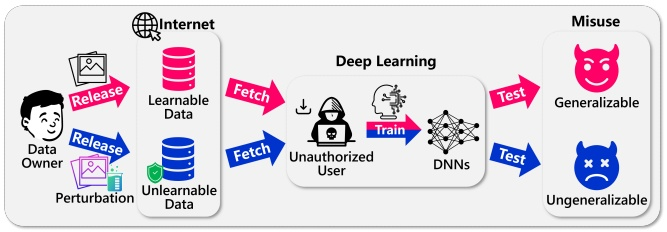
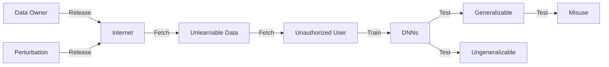
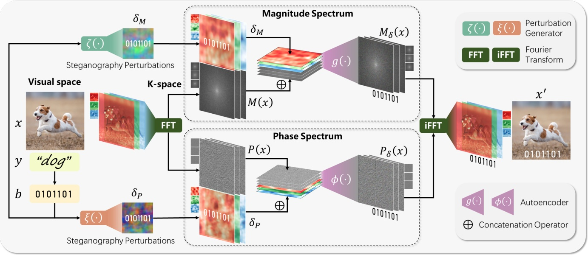
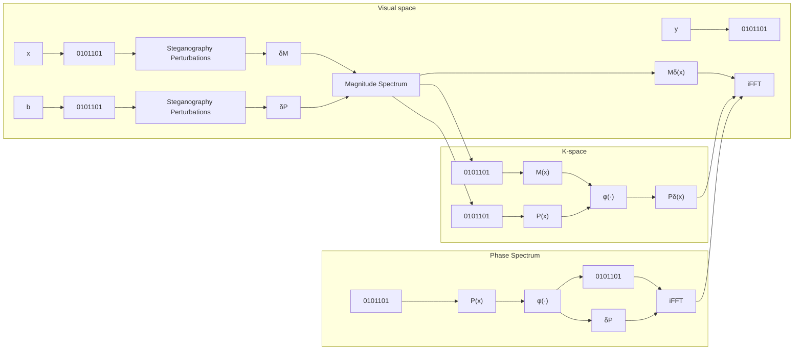
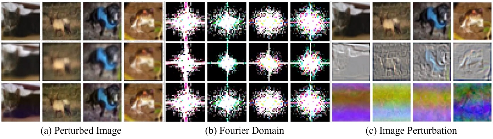
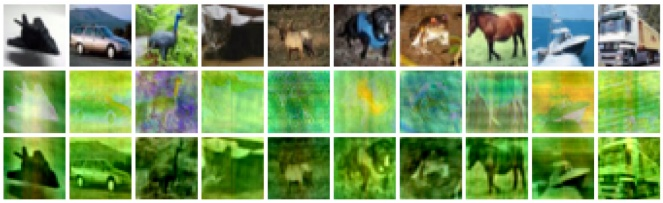

# K-Space Bispectrum Steganography for Robust Unlearnable Data

[Jiahao Li](https://orcid.org/0000-0001-6011-688X)

www.lijiahao@live.cn

Institute of Computing Technology,

Chinese Academy of Sciences

Pengcheng Laboratory

University of Chinese Academy of

Sciences

Beijing, China

[Yiqiang Chen](https://orcid.org/0000-0002-8407-0780)∗

yqchen@ict.ac.cn

Institute of Computing Technology,

Chinese Academy of Sciences

University of Chinese Academy of

Sciences

Beijing, China

[Yunbing Xing](https://orcid.org/0009-0006-4419-9025)

xingyunbing@ict.ac.cn

Institute of Computing Technology,

Chinese Academy of Sciences

Beijing, China

[Yang Gu](https://orcid.org/0000-0001-8572-2907)

guyang@ict.ac.cn

Institute of Computing Technology,

Chinese Academy of Sciences

University of Chinese Academy of

Sciences

Beijing, China

[Xiangyuan Lan](https://orcid.org/0000-0001-8564-0346)†

lanxy@pcl.ac.cn

Pengcheng Laboratory

Pazhou Laboratory (Huangpu)

Shenzhen, China

## Resumen

La amplia disponibilidad de datos públicamente accesibles en Internet acelera el progreso del deep learning, pero también suscita preocupación sobre el uso no autorizado de datos para el entrenamiento de redes neuronales. Los primeros métodos de salvaguarda introducen pequeñas perturbaciones cuidadosamente diseñadas mediante un surrogate model en los datos para generar unlearnable data, con el objetivo de evitar que los modelos aprendan patrones significativos. Sin embargo, estos métodos carecen de robustez frente al adversarial training. Posteriormente, algunos trabajos introdujeron adversarial examples para resolver este problema, pero a costa de un mayor overhead del surrogate model. Recientemente, Convolution-based unlearnable data (CUDA), un método surrogate-free, ha sido propuesto para abordar esta cuestión mediante kernels de convolución por clase (class-wise) diseñados manualmente. A pesar de su éxito, CUDA sufre de pérdida de detalles de alta frecuencia, colisiones de hash en las perturbaciones y vulnerabilidad frente a ataques de filtrado en frecuencia. En este artículo, proponemos **KBS** (K-Space Bispectrum Steganography), el cual incrusta información específica de cada clase en los componentes de magnitud y fase del Fourier domain, preservando al mismo tiempo la fidelidad visual bajo restricciones de reconstrucción. Al llevar a cabo la steganography directamente en el frequency domain, KBS preserva los detalles de alta frecuencia y evita las colisiones de hash mediante códigos binarios compactos, permitiendo la escalabilidad a datasets con un gran número de clases. Además, KBS resiste los ataques de filtrado en frecuencia incrustando perturbaciones de forma que permanezcan imperceptibles en el espacio de píxeles. Los resultados experimentales en benchmarks públicos demuestran que KBS supera a los métodos state-of-the-art.

∗Autor de correspondencia.

†Autor de correspondencia.

[Este trabajo está bajo una Licencia Internacional Creative Commons Atribución-NoComercial-CompartirIgual 4.0.](https://creativecommons.org/licenses/by-nc-sa/4.0)

MM ’25, Dublín, Irlanda

© 2025 Derechos de autor retenidos por el propietario/autor(es).

ACM ISBN 979-8-4007-2035-2/2025/10

[https://doi.org/10.1145/3746027.3755349](https://doi.org/10.1145/3746027.3755349)

## Conceptos CCS

• **Seguridad y privacidad** → **Protecciones de privacidad**; **Usabilidad en seguridad y privacidad**; • **Metodologías de computación** → **Machine learning**; **Inteligencia artificial**.

## Palabras Clave

Unlearnability, Steganography, Stealthiness, Anomaly, Fourier

## Formato de Referencia ACM:

Jiahao Li, Yiqiang Chen, Yunbing Xing, Yang Gu, and Xiangyuan Lan. 2025. K-Space Bispectrum Steganography for Robust Unlearnable Data. In Proceedings of the 33rd ACM International Conference on Multimedia (MM ’25), October 27–31, 2025, Dublin, Ireland. ACM, New York, NY, USA, 10 pages. [https://doi.org/10.1145/3746027.3755349](https://doi.org/10.1145/3746027.3755349)

## 1 Introducción

El rápido avance del deep learning está impulsado por la disponibilidad de datasets a gran escala y de acceso público en Internet. Estos datasets proporcionan la base para el entrenamiento de modelos de alto rendimiento en diversas aplicaciones como computer vision [41], natural language processing [40] y speech recognition [42]. Sin embargo, el uso generalizado de datos compartidos públicamente también ha generado una preocupación crítica en torno al uso no autorizado de datos [3, 20, 36, 52]. Por ejemplo, los propietarios de datos a menudo se enfrentan al riesgo de que sus datasets sean utilizados sin su consentimiento para entrenar modelos comerciales de machine learning, lo que podría derivar en violaciones éticas [38, 44], robo de propiedad intelectual [18, 29] y uso indebido de datos sensibles [24, 37]. Estas preocupaciones subrayan la urgente necesidad de métodos para salvaguardar los datos contra el uso no autorizado, manteniendo al mismo tiempo su utilidad para propósitos legítimos, tales como su publicación, compartición o inspección humana.

Para abordar este desafío, los investigadores han propuesto el concepto de unlearnable data (ULD) como se muestra en la Figura 1, un concepto novedoso cuyo objetivo es evitar que las redes neuronales profundas (DNNs) aprendan patrones significativos a partir de los datos [14, 28, 30, 35, 53, 54]. Estos enfoques logran esto normalmente introduciendo perturbaciones imperceptibles mediante un surrogate model, asegurando que los modelos entrenados con dichos datos generalicen deficientemente hacia muestras no observadas. Los primeros métodos [15, 22, 55] generan ULD basándose en adversarial perturbations diseñadas para perturbar el proceso de entrenamiento. Sin embargo, aunque estos enfoques degradan eficazmente el rendimiento del modelo en configuraciones de entrenamiento estándar (naive), son vulnerables al adversarial training [13] y a ciertas técnicas de data augmentation [4, 10, 12, 46, 56, 58], las cuales mitigan el impacto de las perturbaciones. Para subsanar las deficiencias de los métodos iniciales, trabajos recientes como REM [42] proponen robust ULD, el cual incorpora el adversarial training del surrogate model como parte de la optimización. Aunque este método es eficaz, la complejidad temporal es elevada debido a que el adversarial training se introduce en el surrogate model para simular el proceso de entrenamiento adversarial.

flowchart

Figura 1: Visión general del flujo de trabajo de unlearnable data.

Para mejorar aún más la robustez y reducir el tiempo de cálculo, CUDA [45] descarta por completo el surrogate model, aprovechando kernels convolucionales por clase (class-wise) diseñados manualmente para incrustar patrones de desenfoque adaptados a clases específicas. Si bien esto representa un avance significativo, CUDA presenta varias limitaciones: (1) Pérdida de detalles de alta frecuencia: El proceso convolucional introduce efectos de borde [1] y desenfoque que degradan la fidelidad visual de las imágenes perturbadas, particularmente en altas frecuencias, haciendo que las perturbaciones sean visualmente perceptibles en algunos casos. (2) Escalabilidad limitada: CUDA depende de kernels convolucionales de tamaño fijo, lo que restringe el número de perturbaciones únicas que pueden generarse. Esta limitación conduce a colisiones de hash, especialmente en datasets con un gran número de clases, tales como CIFAR-100 o ImageNet-100, donde los patrones de perturbación para diferentes clases pueden solaparse. (3) Vulnerabilidad ante ataques en frecuencia: Estudios recientes [26] demuestran que CUDA es susceptible a técnicas de realce de nitidez (sharpening) y filtrado en frecuencia, las cuales pueden debilitar o eliminar las perturbaciones de CUDA, anulando la inaprendibilidad. A pesar de estas deficiencias, CUDA demuestra que el enfoque surrogate-free es viable y eficiente.

En este artículo, proponemos **KBS** (K-Space Bispectrum Steganography), un novedoso método surrogate-free que incrusta información esteganográfica específica de clase en el frequency domain para generar robust unlearnable data. A diferencia de la perturbación explícita de CUDA, que opera en el dominio espacial, KBS lleva a cabo la steganography directamente en el Fourier domain modificando los componentes de magnitud y fase bajo restricciones de reconstrucción, generando una perturbación implícita en los datos brutos de forma indirecta. Para evaluar la eficacia de KBS, llevamos a cabo extensos experimentos en benchmarks públicos. Las principales contribuciones de este artículo son las siguientes:

• **Método Surrogate-Free basado en Steganography**: Proponemos un método de unlearnable data de tipo surrogate-free y basado en steganography, el cual utiliza steganography en el espacio de Fourier, garantizando la transferibilidad entre diversas arquitecturas.

• **Preservación de detalles de alta frecuencia**: En comparación con el método basado en convolución, KBS elimina los efectos de borde, asegurando que las imágenes perturbadas conserven su fidelidad visual y sean indistinguibles de los datos originales.

• **Robustez frente a data augmentations**: KBS incrusta perturbaciones de manera que permanezcan imperceptibles en el espacio de píxeles, haciéndolas resistentes a aumentos comunes y a ataques adaptativos en frecuencia.

## 2 Trabajos Relacionados

El concepto de unlearnable data (ULD) [28] tiene como objetivo evitar que los modelos de machine learning aprendan patrones útiles a partir de los datos mediante la introducción de perturbaciones que degradan la generalización del modelo. Esta sección revisa los métodos clave en este campo, centrándose en los enfoques tradicionales, los robust ULD y otras técnicas relevantes de manipulación en el frequency domain.

## 2.1 Unlearnable Data Tradicionales

Los enfoques tradicionales para generar unlearnable data suelen implicar la adición de perturbaciones imperceptibles a los datos, de tal modo que los modelos entrenados con los datos perturbados no logren generalizar. EM [22] introduce el concepto de error-minimizing noise, que añade perturbaciones imperceptibles a los datos. Este enfoque busca degradar el rendimiento del modelo asegurando que el proceso de entrenamiento falle al generalizar patrones significativos. El método es particularmente eficaz para proteger los datos personales contra el uso no autorizado. TAP [15] demuestra que los adversarial examples, utilizados tradicionalmente para atacar modelos preentrenados, también pueden servir como eficaces herramientas de envenenamiento de datos (data poisoning). Al combinar los adversarial examples con sus etiquetas originales, el proceso de entrenamiento deteriora significativamente el rendimiento del modelo en muestras de prueba limpias, destacando el potencial de los ataques adversariales en la salvaguarda de datos sensibles. NTGA [55] introduce perturbaciones que preservan las etiquetas en los datos de entrenamiento para perjudicar la generalización de las redes neuronales profundas. Operando en un entorno clean-label y de caja negra, NTGA utiliza neural tangent kernels [6, 23] para aproximar la dinámica del entrenamiento y predecir cómo pequeños cambios en la entrada afectan el aprendizaje. NTGA impide eficazmente que los modelos extraigan patrones significativos, creando unlearnable data.

Sin embargo, aunque estos métodos tradicionales muestran eficacia en la generación de unlearnable data, carecen de robustez frente al adversarial training [2], un proceso que mejora la capacidad de un modelo para manejar adversarial examples al incluirlos en los datos de entrenamiento. El AT reduce significativamente la efectividad de los unlearnable data tradicionales. Esta limitación conduce al desarrollo de enfoques más robustos que resistan mejor el adversarial training.

## 2.2 Robust Unlearnable Data

En respuesta a las limitaciones de los métodos tradicionales, la investigación reciente se centra en la generación de unlearnable data que sean robustos frente al adversarial training. Estos métodos buscan crear perturbaciones que sigan siendo eficaces incluso bajo el adversarial training del modelo. REM [16] introduce un método para generar robust unlearnable examples agregando un tipo específico de robust error-minimizing noise a los datos. Este ruido incluye la pérdida del adversarial training, suprimiendo eficazmente el contenido informativo de los datos y volviéndolos inaprendibles para los modelos, incluso cuando se emplea adversarial training. El enfoque garantiza que las perturbaciones agregadas sean imperceptibles para los observadores humanos, al tiempo que degradan significativamente el rendimiento del modelo en los datos protegidos. No obstante, una limitación potencial de este método radica en su intensidad computacional, ya que la generación de robust error-minimizing noise requiere procesos de optimización iterativos, los cuales pueden ser de uso intensivo de recursos y requerir mucho tiempo [43]. CUDA propone la técnica de convolution-based unlearnable data [45], la cual emplea convoluciones por clase con filtros generados aleatoriamente para modificar el dataset. Este proceso estimula a la red neuronal a aprender la relación entre los filtros aplicados y las etiquetas, en lugar de las características intrínsecas de los datos limpios. El método es model-free y no requiere conocimiento de la arquitectura del modelo objetivo, lo que lo hace versátil y fácil de implementar. Los experimentos demuestran que los modelos entrenados en datasets procesados con CUDA exhiben un rendimiento significativamente reducido en datos de prueba limpios, incluso cuando se someten a adversarial training.

Sin embargo, a pesar de su éxito, CUDA presenta varias limitaciones notables: (1) Pérdida de detalles de alta frecuencia. Las operaciones convolucionales introducen efectos de borde [1, 47], lo que conduce a la pérdida de detalles de alta frecuencia y a artefactos visibles en las imágenes perturbadas. (2) Escalabilidad limitada. El tamaño fijo de los kernels de convolución restringe el número de perturbaciones únicas que pueden generarse, causando colisiones de hash en datasets con un gran número de clases donde múltiples clases pueden compartir la misma perturbación. (3) Ineficacia frente a ataques en frecuencia. Recientemente, RSKFF [26] encuentra que la combinación de realce de nitidez de imagen (image sharpening) y técnicas de filtrado en frecuencia puede restaurar parcialmente la aprendibilidad de los datasets protegidos por CUDA, indicando que CUDA no es eficaz contra contramedidas específicas de mejora de datos.

## 2.3 Steganography

La steganography es la práctica de ocultar información dentro de portadores no obvios, tales como imágenes, audio o video, para garantizar una comunicación segura e imperceptible [5]. A diferencia de la criptografía [8], que se centra en cifrar el contenido de un mensaje para hacerlo ilegible, la steganography tiene como objetivo ocultar la existencia misma del mensaje, haciendo que su detección sea más desafiante [25]. Las aplicaciones de la steganography incluyen comunicaciones seguras [50], marcas de agua [9] y sistemas anti-manipulación [17]. Hasta donde alcanza nuestro conocimiento, este artículo es el primero en aplicar steganography de imágenes específica de clase en el bispectrum del Fourier domain para la generación de unlearnable data. A diferencia de los métodos esteganográficos tradicionales que incrustan datos arbitrarios, el método KBS aprovecha los componentes de magnitud y fase del espectro de Fourier para codificar información específica de clase de forma imperceptible bajo restricciones de reconstrucción. Este enfoque garantiza la robustez al tiempo que preserva los detalles de alta frecuencia.

## 3 Formulación del Problema

Dado un dataset $D = \{ ( x _ { i } , y _ { i } ) \} _ { i = 1 } ^ { N }$ , donde $x _ { i } \in D \subset \mathbb { R } ^ { d }$ denota la $i$-ésima muestra de datos e $y _ { i } \in \{ 1 , 2 , . . . , C \}$ representa su etiqueta correspondiente, el objetivo de la generación de unlearnable datasets es crear un dataset perturbado $D ^ { \prime }   =   \{ ( x _ { i } ^ { \prime } , y _ { i } ) \} _ { i = 1 } ^ { N }$ tal que el surrogate model $f _ { \theta }$ entrenado sobre $D ^ { \prime }$ falle al aprender patrones significativos y generalizar eficazmente a datos de prueba limpios, mientras que $x _ { i } ^ { \prime }$ permanezca visualmente similar a $x _ { i } ,$ donde $N$ es el número de muestras de datos y $d$ es la dimensión de los datos. Matemáticamente, $x _ { i } ^ { \prime } = x _ { i } + \delta _ { i }$ , siendo $\delta _ { i }$ una perturbación imperceptible restringida por $\| \delta _ { i } \| _ { p } \leq \epsilon$ para un $\epsilon > 0$ pequeño.

El método tradicional EM [22] genera $\delta _ { i }$ minimizando la loss function $\mathcal { L } ( f _ { \theta } ( x _ { i } + \delta _ { i } ) , y _ { i } )$ , suprimiendo eficazmente el contenido informativo de $x_i$. Sin embargo, REM [16] muestra que tales perturbaciones son vulnerables al adversarial training, el cual incorpora adversarial examples en el proceso de entrenamiento para mejorar la robustez de $D ^ { \prime } ;$

$$
\delta_ {i} = \arg \min _ {\| \delta_ {i} \| _ {p} \leq \epsilon} \max _ {\| \eta_ {i} \| _ {p} \leq \rho} \mathcal {L} \left(f _ {\theta} \left(x _ {i} + \delta_ {i} + \eta_ {i}\right), y _ {i}\right), \tag {1}
$$

donde $\eta _ { i }$ representa una perturbación adversarial acotada por $\rho .$ Esta formulación asegura que el dataset perturbado $D ^ { \prime }$ permanezca inaprendible incluso bajo regímenes de adversarial training. Formalmente, el problema se define como encontrar una perturbación $\delta _ { i }$ para cada $x _ { i }$ tal que el valor de $\mathbb { E } _ { ( x , y ) \sim \mathcal { D } _ { t e s t } } \left[ \mathcal { L } ( f _ { \theta } ( x ) , y ) \right]$ en los datos de prueba limpios $\mathcal { D } _ { t e s t }$ permanezca alto para cualquier modelo $f _ { \theta }$ entrenado sobre $D ^ { \prime }$ , indicando una generalización deficiente.
## 4 Metodología

En esta sección, presentamos el enfoque K-Space Bispectrum Steganography (KBS) para generar robust unlearnable data, como se ilustra en la Figura 2. A diferencia de la perturbación explícita tradicional en el dominio espacial, KBS incrusta información esteganográfica específica de clase directamente en el Fourier domain mediante steganography basada en bispectrum, produciendo indirectamente una perturbación implícita sobre los datos brutos. El método comprende un pipeline end-to-end que optimiza el trade-off entre robustez e imperceptibilidad.

## 4.1 Visión General del Marco KBS

El marco KBS adopta una optimización de minimización surrogate-free $\min \mathcal { L } ( x _ { i } + \delta _ { i } , y _ { i } )$ estructurada de la siguiente manera: (1) Generación de Perturbaciones Esteganográficas: A cada clase $c \in \{ 1 , 2 , \ldots , C \}$ se le asigna un código binario único $b \in \{ 0 , 1 \} ^ { k }$ , donde $k = \lceil \log _ { 2 } C \rceil$ . (2) Inyección de Perturbaciones en el Bispectro: El código binario $b$ se utiliza para generar perturbaciones $\delta _ { M }$ y $\delta _ { P }$ , que perturban los componentes de magnitud y fase del espectro de Fourier de la imagen. (3) Reconstrucción de Imágenes: Los componentes de magnitud y fase perturbados se recombinan y se convierten nuevamente al dominio espacial mediante la transformada inversa de Fourier (iFFT). (4) Extracción del Código Esteganográfico: Los códigos binarios incrustados se extraen a partir de los componentes y de las imágenes perturbadas. (5) Optimización Conjunta: Las pérdidas de reconstrucción y de steganography se entrenan de forma end-to-end para garantizar la imperceptibilidad y la robustez de la perturbación esteganográfica.

## 4.2 Generación de Perturbaciones Esteganográficas

Para un dataset $D = \{ x _ { i } , y _ { i } \} _ { i = 1 } ^ { N }$ con $C$ clases, las perturbaciones esteganográficas se generan mediante códigos esteganográficos binarios únicos $b \in \{ 0 , 1 \} ^ { k }$ , los cuales se convierten a partir de las etiquetas de clase $y \in \{ 1 , 2 , \ldots , C \}$. Aquí, $k = \lceil \log _ { 2 } C \rceil$ es la longitud del código. Los métodos como CUDA [22] dependen de perturbaciones generadas por kernels convolucionales diseñados con ubicaciones específicas y se enfrentan a limitaciones inherentes: cuando $C$ excede la capacidad del kernel, ocurren colisiones de hash, lo que provoca que múltiples clases compartan perturbaciones idénticas. Por ejemplo, un kernel convolucional de 9 × 9 solo puede producir 81 patrones de perturbación únicos, obligando a las clases restantes a reutilizar los existentes. Esto degrada el rendimiento de los unlearnable data debido a la reducida especificidad de clase de las perturbaciones.

flowchart

Figura 2: Visión general del marco KBS.

Por el contrario, la codificación binaria de KBS asegura compacidad y escalabilidad. Tras obtener $b$ para la imagen $x$, los generadores de perturbaciones $\zeta ( \cdot )$ y $\xi ( \cdot )$ toman el código binario $b$ como entrada y producen, respectivamente, la perturbación del espectro de magnitud específica de clase $\delta _ { M } = \zeta ( b )$ y la perturbación del espectro de fase $\delta _ { P } = \xi ( b )$. Luego, $\delta _ { M }$ y $\delta _ { P }$ se inyectan en el frequency domain de $x$.

## 4.3 Inyección de Perturbaciones en el Bispectro

Tras generar las perturbaciones esteganográficas $\delta _ { M }$ y $\delta _ { P } ,$ el marco KBS las inyecta en el bispectro del K-space. Este proceso ajusta los componentes de magnitud y fase de la transformada de Fourier de la imagen ${ \mathcal { F } } ( x )$ , asegurando la imperceptibilidad al tiempo que se codifica la información esteganográfica. En primer lugar, se calcula la transformada de Fourier de la imagen de entrada $x$ utilizando la Fast Fourier Transform (FFT):

$$
\mathcal {F} (x) = \operatorname{FFT} (x) = M (x) \cdot e ^ {j P (x)}, \tag {2}
$$

donde $M ( x ) = | { \mathcal { F } } ( x ) |$ y $P ( x ) = \angle { \mathcal { F } } ( x )$ representan los componentes de magnitud y fase, respectivamente. Estos componentes codifican conjuntamente la información espacial de la imagen. Las perturbaciones esteganográficas específicas de clase $\delta _ { M }$ y $\delta _ { P }$ se concatenan a continuación para prepararlas para la inyección:

$$
M ^ {\prime} (x) = M (x) \oplus \delta_ {M}, \quad P ^ {\prime} (x) = P (x) \oplus \delta_ {P}, \tag {3}
$$

donde $\oplus$ representa la concatenación a lo largo de la dimensión de canal. Luego, $M ^ { \prime } ( x )$ y $P ^ { \prime } ( x )$ se pasan a través de autoencoders independientes $g ( \cdot )$ y $\phi ( \cdot )$ para reconstruir $M(x)$ y $P(x)$:

$$
M _ {\delta} (x) = g (M ^ {\prime} (x)), \quad P _ {\delta} (x) = \phi (P ^ {\prime} (x)), \tag {4}
$$

Los autoencoders restablecen la dimensionalidad y garantizan la imperceptibilidad de la inyección de perturbaciones.

## 4.4 Reconstrucción de Imágenes

El proceso de reconstrucción de imágenes tiene como objetivo garantizar que la imagen perturbada $x ^ { \prime }$ permanezca visualmente imperceptible, preservando al mismo tiempo la información esteganográfica incrustada. Los componentes esteganográficos de magnitud y fase se recombinan en la representación de Fourier perturbada mediante:

$$
\mathcal {F} _ {\delta} (x) = M _ {\delta} (x) \cdot e ^ {j P _ {\delta} (x)}. \tag {5}
$$

La imagen perturbada $x ^ { \prime }$ en el dominio espacial se obtiene entonces mediante la transformada inversa de Fourier:

$$
x ^ {\prime} = \mathrm{iFFT} (\mathcal {F} _ {\delta} (x)). \tag {6}
$$

Aquí, $\mathrm{iFFT}(\cdot)$ convierte la representación en el frequency domain de regreso al dominio espacial. Dado que KBS modifica tanto los componentes de magnitud como de fase de la transformada de Fourier, las restricciones de reconstrucción se aplican no solo en el dominio espacial sino también en el Fourier domain. Para asegurar que $x ^ { \prime }$ permanezca visualmente similar a la original $x ,$ aplicamos una pérdida de reconstrucción en el dominio espacial:

$$
\mathcal {L} _ {\text {spatial}} = \mathbb {E} _ {x \sim D} \left[ \| x ^ {\prime} - x \| _ {1} \right], \tag {7}
$$

donde $\| \cdot \| _ { 1 }$ denota la norma $L _ { 1 }$ , la cual enfatiza la similitud píxel a píxel. Además de las restricciones en el dominio espacial, KBS impone consistencia entre los componentes del bispectro original y perturbado en el Fourier domain. Específicamente, introducimos pérdidas de reconstrucción separadas para los componentes de magnitud y fase:

$$
\mathcal {L} _ {\text {magnitude}} = \mathbb {E} _ {x \sim D} \left[ \left\| M _ {\delta} (x) - M (x) \right\| _ {1} \right] \tag {8}
$$

$$
\mathcal {L} _ {\text {phase}} = \mathbb {E} _ {x \sim D} \left[ \left\| P _ {\delta} (x) - P (x) \right\| _ {1} \right], \tag {9}
$$

donde $M ( x )$ y $P ( x )$ son los componentes originales de magnitud y fase, y $M _ { \delta } ( x ) , P _ { \delta } ( x )$ son sus contrapartes con steganography inyectada. Nótese que la representación de Fourier no solo tiene forma en coordenadas polares, sino también en el plano complejo. Para proporcionar una restricción holística sobre la representación de Fourier y capturar las interacciones entre los componentes de magnitud y fase, introducimos la pérdida de consistencia de Fourier $\mathcal { L } _ { \mathrm { f r e q } } ,$ la cual compara directamente las transformadas de Fourier de valor complejo de la original ${ \mathcal { F } } ( x )$ y las transformadas inversas de Fourier de la magnitud y fase recombinadas:

$$
\mathcal {L} _ {\text {freq}} = \mathbb {E} _ {x \sim D} \left[ \| \Re \left[ \mathcal {F} _ {\delta} (x) - \mathcal {F} (x) \right] \| _ {1} + \| \Im \left[ \mathcal {F} _ {\delta} (x) - \mathcal {F} (x) \right] \| _ {1} \right], \tag {10}
$$

donde $\Re [ \cdot ]$ e $\Im [ \cdot ]$ representan la parte real e imaginaria. $\Re [ \mathcal { F } ( x ) ] = M(x) \cos P (x)$ e $\Im \left[ \mathcal { F } ( x ) \right] = M ( x ) \sin P ( x )$ corresponden a los componentes coseno y seno en el espacio complejo. Lo mismo aplica para $\Re [ \mathcal { F } _ { \delta } ( x ) ]$ e $\Im [ \mathcal { F } _ { \delta } ( x ) ]$ . La restricción holística evita inconsistencias que podrían surgir si solo se restringieran individualmente la magnitud o la fase, ya que la interacción entre la magnitud y el componente seno/coseno es crucial para una representación precisa en el frequency domain. La pérdida de reconstrucción total combina las pérdidas del dominio espacial y del Fourier domain para imponer de forma conjunta la consistencia en ambos dominios:

$$
\mathcal {L} _ {\text {recon}} = \left(\mathcal {L} _ {\text {spatial}} + \mathcal {L} _ {\text {magnitude}} + \mathcal {L} _ {\text {phase}} + \mathcal {L} _ {\text {freq}}\right) / 4, \tag {11}
$$

## 4.5 Extracción del Código Esteganográfico

Para garantizar que el código esteganográfico binario $b$ se incruste correctamente y pueda extraerse de forma fiable a partir de la imagen perturbada $x ^ { \prime } ,$ el marco KBS introduce extractores neuronales diseñados para predecir directamente el código a partir de la entrada perturbada. Esta tarea se formula como un problema de clasificación binaria bit a bit. La extracción se lleva a cabo no solo en el dominio espacial, sino también en el Fourier domain, específicamente sobre los componentes perturbados de magnitud y fase, todos los cuales codifican información de clase recuperable. Dadas las representaciones perturbadas $x ^ { \prime } , M _ { \delta } ( x )$ y $P _ { \delta } ( x )$ , los extractores $\Psi _ { \alpha } , \Psi _ { \beta }$ y $\Psi _ { \gamma }$ producen los vectores de código binario predichos:

$$
\hat {b} ^ {(x)} = \Psi_ {\alpha} (x ^ {\prime}), \quad \hat {b} ^ {(M)} = \Psi_ {\beta} (M _ {\delta} (x)), \quad \hat {b} ^ {(P)} = \Psi_ {\gamma} (P _ {\delta} (x)). \tag {12}
$$

Para asegurar una extracción precisa, adoptamos la loss de entropía cruzada binaria (binary cross-entropy, BCE), la cual mide la discrepancia entre las probabilidades predichas y el código binario de referencia (ground-truth) $b$. La pérdida de steganography se define como:

$$
\mathcal {L} _ {\text {stego}} = \frac {1}{3 N} \sum_ {i = 1} ^ {N} \sum_ {\pi \in \{x, M, P \}} \mathcal {L} _ {\mathrm{BCE}} \left(\hat {b} _ {i} ^ {(\pi)}, b _ {i}\right), \tag {13}
$$

$$
\mathcal {L} _ {\mathrm{BCE}} (\hat {b} _ {i} ^ {(\pi)}, b _ {i}) = - \frac {1}{k} \sum_ {j = 1} ^ {k} \left[ b _ {i j} \log \hat {b} _ {i j} ^ {(\pi)} + (1 - b _ {i j}) \log (1 - \hat {b} _ {i j} ^ {(\pi)}) \right], \tag {14}
$$

donde $b _ { i j } \in \{ 0 , 1 \}$ es el valor de referencia del $j$-ésimo bit en $b _ { i } ,$ y $\hat { b } _ { i j } ^ { ( \pi ) } \in [ 0 , 1 ]$ denota la probabilidad predicha de que el $j$-ésimo bit sea 1 en el dominio $\pi \in \{ x , M , P \}$ . Esta formulación facilita una recuperación robusta e invariante al dominio del código esteganográfico. Aquí, la longitud del código es $k = \lceil \log _ { 2 } C \rceil$.

## 4.6 Optimización Conjunta

El marco KBS emplea optimización conjunta para garantizar que las imágenes perturbadas $\{ x _ { i } ^ { \prime } \} _ { i = 1 } ^ { N }$ sean visualmente indistinguibles de las imágenes originales $\{ x _ { i } \} _ { i = 1 } ^ { N }$ mientras se incrustan códigos esteganográficos robustos y específicos de cada clase. La loss function total se define como:

$$
\mathcal {L} = \mathcal {L} _ {\text {recon}} + \lambda \mathcal {L} _ {\text {stego}}, \tag {15}
$$

donde $\lambda$ es un coeficiente. El pseudocódigo del proceso completo del marco KBS para generar unlearnable data con robustez e imperceptibilidad se muestra en el Algoritmo 1.

Algoritmo 1 K-Space Bispectrum Steganography (KBS)

Input: Dataset $\{x_i, y_i\}_{i=1}^N$, classes $C$, code length $k = \lceil \log_2 C \rceil$,
coefficient $\lambda$, training epoch $T$, learning rate $\eta$
Output: Unlearnable dataset $\{x_i', y_i\}_{i=1}^N$
Initialize KBS model parameters $\theta$ and counter $t$
repeat
    for $i = 1$ to $N$ do
        $M(x_i), P(x_i) \leftarrow \mathcal{F}(x_i)$ // Fourier decomposition
        $b_i \leftarrow y_i$ // Convert label to binary codes
        $\delta_M^i, \delta_P^i \leftarrow b_i$ // Generate perturbation
        $M_\delta(x_i) \xleftarrow{\delta_M^i} M(x_i)$ //Perturbation Injection
        $P_\delta(x_i) \xleftarrow{\delta_P^i} P(x_i)$ //Perturbation Injection
        $\mathcal{F}_\delta(x_i) \leftarrow M_\delta(x_i) \cdot e^{jP_\delta(x_i)}$ // Recombination
        $x_i' \leftarrow \text{iFFT}(\mathcal{F}_\delta(x_i))$ // Inverse Fourier transform
    end for
    Compute loss: $\mathcal{L} = \mathcal{L}_{\text{recon}} + \lambda \mathcal{L}_{\text{stego}}$
    Update model: $\theta \leftarrow \theta - \eta \nabla_\theta \mathcal{L}$
    Counter update: $t \leftarrow t + 1$
until $t = T$

## 5 Experimentos

Esta sección describe la configuración experimental, los datasets, las métricas de evaluación y los resultados para validar el marco KBS. Los experimentos tienen como objetivo demostrar la eficacia del método KBS para mejorar la seguridad y la robustez de los datos, manteniendo al mismo tiempo la calidad visual y el rendimiento en la tarea.

## 5.1 Configuración Experimental

Utilizamos tres benchmark datasets públicos para evaluar el marco KBS: CIFAR-10, CIFAR-100 [27] e ImageNet-100 [11], los cuales son ampliamente adoptados en trabajos previos [16, 22, 45], lo que permite una comparación justa y significativa con los métodos state-of-the-art. Evaluamos el marco KBS utilizando ResNet-18 [19], VGG-16 [49], Wide ResNet-34-10 [57] y DenseNet-121 [21] para garantizar la transferibilidad a través de diferentes arquitecturas. Comparamos el marco KBS con TAP [15], NTGA [55], EM [22], REM [16], SEM [32], PUE [51], GUE [31] y CUDA [45], los métodos state-of-the-art de unlearnability. El accuracy sobre el conjunto de prueba limpio (clean test set) sirve como métrica de evaluación, donde un menor accuracy refleja una mayor inaprendibilidad (unlearnability). Todos los métodos se evalúan bajo configuraciones idénticas para asegurar comparaciones justas y consistentes. Las arquitecturas detalladas de las redes del autoencoder, del generador de perturbaciones esteganográficas y del extractor de códigos esteganográficos en KBS se proporcionan en el Material Suplementario. Todos los experimentos se llevan a cabo en una GPU RTX 3090. Empleamos PyTorch [39] para la implementación. Se aplican técnicas de data augmentation [48] como volteo aleatorio (random flipping), recorte (cropping) y redimensionamiento (resizing) para todos los datasets. La longitud del código binario $k$ se fija en $\lceil \log _ { 2 } C \rceil$ para todos los datasets. KBS se entrena con la configuración predeterminada del optimizador AdamW [34] utilizando una tasa de aprendizaje de 0.001, un weight decay de 1e-5, un batch size de 512 y un total de 100 epochs. El valor de $\lambda$ se fija en 1.0. Los radios de perturbación de REM se establecen en $\rho _ { u } = 8 / 2 5 5 ,$ tal como se recomienda en su trabajo original [16], al igual que en SEM [32], PUE [51] y GUE [31]. CUDA utiliza filtros de tamaño $k = 3$ y un parámetro de desenfoque $p _ { b } = 0 . 3$ tanto para CIFAR-10 como para CIFAR-100, y un tamaño $k = 9$ con $p _ { b } = 0 . 0 6$ para ImageNet-100, según lo recomendado [45]. A menos que se indique lo contrario, AT utiliza la norma $\ell_\infty$ con $\rho _ { a } = 4 / 2 5 5$ siguiendo trabajos previos [15, 16, 22, 31, 32, 45, 51, 55].

## 5.2 Resultados y Análisis

**Inaprendibilidad entre Datasets.** Evaluamos el rendimiento de unlearnability de KBS a través de diferentes datasets y lo comparamos con los métodos state-of-the-art. La Tabla 1 presenta el test accuracy de ResNet-18 entrenada en tres benchmark datasets bajo las configuraciones de Empirical Risk Minimization (ERM) y Adversarial Training (AT). Bajo la configuración ERM, KBS alcanza un clean test accuracy competitivo en todos los datasets, demostrando su capacidad para incrustar perturbaciones efectivas que impiden que el modelo aprenda patrones significativos. Por ejemplo, en CIFAR-10, KBS logra un accuracy del 13.53%, superando a CUDA y aproximándose a EM. Bajo AT, KBS alcanza resultados superiores, con una notable reducción del clean accuracy al 20.97% en CIFAR-10 y al 26.04% en ImageNet-100, superando significativamente a todos los demás baselines. Estos resultados demuestran que KBS desorganiza eficazmente el aprendizaje semántico del modelo incluso en entornos de AT. Mantener la inaprendibilidad mientras se sacrifica la menor cantidad posible de información de la imagen representa un desafío. La Figura 3 visualiza una comparación de ULD entre el método CUDA y KBS.

Tabla 1: Test accuracy (%) de ResNet-18 entrenada en diversos unlearnable datasets.

<table><tr><td rowspan="2">Dataset</td><td rowspan="2">Training Method</td><td rowspan="2">Clean</td><td colspan="7">Surrogate-based</td><td colspan="2">Surrogate-Free</td></tr><tr><td>TAP</td><td>NTGA</td><td>EM</td><td>REM</td><td>SEM</td><td>PUE</td><td>GUE</td><td>CUDA</td><td>KBS</td></tr><tr><td rowspan="2">CIFAR-10</td><td>ERM</td><td>94.66</td><td>22.51</td><td>16.27</td><td>13.20</td><td>27.09</td><td>13.00</td><td>17.39</td><td>13.25</td><td>18.48</td><td>13.53</td></tr><tr><td>AT</td><td>89.51</td><td>88.02</td><td>88.96</td><td>88.62</td><td>48.16</td><td>31.92</td><td>84.54</td><td>52.79</td><td>44.40</td><td>20.97</td></tr><tr><td rowspan="2">CIFAR-100</td><td>ERM</td><td>76.27</td><td>13.75</td><td>3.22</td><td>1.60</td><td>10.14</td><td>1.95</td><td>3.40</td><td>8.35</td><td>12.69</td><td>1.82</td></tr><tr><td>AT</td><td>64.50</td><td>62.39</td><td>62.44</td><td>63.43</td><td>27.10</td><td>20.25</td><td>62.71</td><td>43.02</td><td>34.34</td><td>18.04</td></tr><tr><td rowspan="2">ImageNet-100</td><td>ERM</td><td>80.66</td><td>9.10</td><td>8.42</td><td>1.26</td><td>13.74</td><td>4.10</td><td>3.87</td><td>11.54</td><td>8.96</td><td>3.46</td></tr><tr><td>AT</td><td>66.62</td><td>63.56</td><td>63.06</td><td>63.40</td><td>41.66</td><td>37.82</td><td>65.33</td><td>38.90</td><td>38.68</td><td>26.04</td></tr></table>

**Inaprendibilidad entre Arquitecturas.** Para evaluar la generalizabilidad de KBS, evaluamos su rendimiento en CIFAR-10 utilizando diversas arquitecturas de redes neuronales, incluyendo ResNet-18, VGG-16, Wide ResNet-34-10 y DenseNet-121. Como se muestra en la Tabla 2, KBS mantiene de forma consistente el clean test accuracy más bajo a través de diversas arquitecturas. Por ejemplo, en VGG-16, KBS reduce el accuracy al 17.03%, lo que representa una mejora significativa respecto a CUDA (42.98%) y REM (65.23%). Esto indica que las perturbaciones de KBS son agnósticas a la arquitectura y robustas frente a diversos diseños de modelos.

Tabla 2: Test accuracy (%) de datos de CIFAR-10 unlearnable entrenados en diversas arquitecturas.

<table><tr><td rowspan="2">Model</td><td rowspan="2">Clean</td><td colspan="7">Surrogate-based</td><td colspan="2">Surrogate-Free</td></tr><tr><td>TAP</td><td>NTGA</td><td>EM</td><td>REM</td><td>SEM</td><td>PUE</td><td>GUE</td><td>CUDA</td><td>KBS</td></tr><tr><td>ResNet-18</td><td>89.51</td><td>88.02</td><td>88.96</td><td>88.62</td><td>48.16</td><td>31.92</td><td>84.54</td><td>52.79</td><td>44.40</td><td>20.97</td></tr><tr><td>VGG-16</td><td>87.51</td><td>86.27</td><td>86.65</td><td>86.48</td><td>65.23</td><td>44.37</td><td>86.43</td><td>68.83</td><td>42.98</td><td>17.03</td></tr><tr><td>WRN-34-10</td><td>91.21</td><td>90.23</td><td>89.95</td><td>90.05</td><td>48.39</td><td>31.42</td><td>90.85</td><td>51.36</td><td>53.02</td><td>43.80</td></tr><tr><td>DenseNet-121</td><td>83.27</td><td>81.72</td><td>80.73</td><td>82.44</td><td>81.48</td><td>77.85</td><td>81.57</td><td>82.71</td><td>45.95</td><td>39.02</td></tr></table>

**Inaprendibilidad según el Porcentaje de Protección.** Este experimento investiga cómo la variación del porcentaje de datos de entrenamiento protegidos afecta la inaprendibilidad del modelo. Como se muestra en la Tabla 3, KBS logra consistentemente el clean test accuracy más bajo en todos los niveles de protección tanto bajo AT como bajo ERM. En particular, cuando el 100% de los datos de entrenamiento está protegido, KBS reduce el clean accuracy al 20.97% bajo AT y al 15.94% bajo ERM, superando a CUDA y a todos los demás baselines. Además, incluso con protección parcial (por ejemplo, el 80%), KBS sigue siendo altamente efectivo, logrando un 82.74% bajo AT, en comparación con el 84.34% de CUDA.

Tabla 3: Test accuracy (%) de ResNet-18 en CIFAR-10 con diferentes porcentajes de protección de datos. Las dos últimas filas muestran los resultados con la configuración ERM.

<table><tr><td rowspan="3">Unlearnability Method</td><td colspan="10">Data Protection Percentage</td></tr><tr><td rowspan="2">0%</td><td colspan="2">20%</td><td colspan="2">40%</td><td colspan="2">60%</td><td colspan="2">80%</td><td rowspan="2">100%</td></tr><tr><td>Mixed</td><td>Clean</td><td>Mixed</td><td>Clean</td><td>Mixed</td><td>Clean</td><td>Mixed</td><td>Clean</td></tr><tr><td>TAP</td><td></td><td>89.01</td><td></td><td>88.66</td><td></td><td>88.40</td><td></td><td>88.04</td><td></td><td>88.02</td></tr><tr><td>NTGA</td><td></td><td>89.56</td><td></td><td>89.35</td><td></td><td>89.22</td><td></td><td>89.17</td><td></td><td>88.96</td></tr><tr><td>EM</td><td></td><td>89.60</td><td></td><td>89.40</td><td></td><td>89.49</td><td></td><td>89.10</td><td></td><td>88.62</td></tr><tr><td>REM</td><td></td><td>89.60</td><td></td><td>89.34</td><td></td><td>89.61</td><td></td><td>88.09</td><td></td><td>48.16</td></tr><tr><td>SEM</td><td>89.51</td><td>89.82</td><td>88.17</td><td>89.65</td><td>86.76</td><td>88.66</td><td>85.07</td><td>85.19</td><td>79.41</td><td>31.29</td></tr><tr><td>PUE</td><td></td><td>88.49</td><td></td><td>89.42</td><td></td><td>88.43</td><td></td><td>86.51</td><td></td><td>85.54</td></tr><tr><td>GUE</td><td></td><td>89.75</td><td></td><td>89.71</td><td></td><td>88.57</td><td></td><td>87.26</td><td></td><td>52.79</td></tr><tr><td>CUDA</td><td></td><td>88.54</td><td></td><td>87.24</td><td></td><td>86.03</td><td></td><td>84.34</td><td></td><td>44.40</td></tr><tr><td>KBS</td><td></td><td>88.41</td><td></td><td>85.70</td><td></td><td>83.93</td><td></td><td>82.74</td><td></td><td>20.97</td></tr><tr><td>CUDA+ERM</td><td>94.66</td><td>93.28</td><td>93.75</td><td>91.34</td><td>92.56</td><td>89.91</td><td>89.77</td><td>85.61</td><td>84.30</td><td>18.48</td></tr><tr><td>KBS+ERM</td><td></td><td>92.64</td><td></td><td>90.62</td><td></td><td>87.25</td><td></td><td>74.52</td><td></td><td>15.94</td></tr></table>

Tabla 4: Test accuracy (%) de ResNet-18 con CUDA y KBS bajo diversas configuraciones de entrenamiento.

<table><tr><td>Dataset</td><td>Clean</td><td>Training method</td><td>CUDA</td><td>KBS</td></tr><tr><td rowspan="7">CIFAR-10</td><td rowspan="7">94.66</td><td>ERM</td><td>18.48</td><td>13.53</td></tr><tr><td>AT  $\ell_{\infty}$  ( $\rho_{a} = 4/255$ )</td><td>44.40</td><td>20.97</td></tr><tr><td>AT  $\ell_{\infty}$  ( $\rho_{a} = 8/255$ )</td><td>32.85</td><td>25.51</td></tr><tr><td>AT  $\ell_{\infty}$  ( $\rho_{a} = 16/255$ )</td><td>19.32</td><td>27.46</td></tr><tr><td>AT  $\ell_{2}$  ( $\rho_{a} = 0.25$ )</td><td>39.05</td><td>14.35</td></tr><tr><td>AT  $\ell_{2}$  ( $\rho_{a} = 0.50$ )</td><td>51.19</td><td>23.89</td></tr><tr><td>AT  $\ell_{2}$  ( $\rho_{a} = 0.75$ )</td><td>51.14</td><td>27.79</td></tr><tr><td rowspan="4">CIFAR-100</td><td rowspan="4">76.27</td><td>ERM</td><td>12.69</td><td>1.82</td></tr><tr><td>AT  $\ell_{\infty}$  ( $\rho_{a} = 4/255$ )</td><td>34.34</td><td>18.04</td></tr><tr><td>AT  $\ell_{\infty}$  ( $\rho_{a} = 8/255$ )</td><td>30.00</td><td>16.32</td></tr><tr><td>AT  $\ell_{2}$  ( $\rho_{a} = 0.75$ )</td><td>36.90</td><td>7.03</td></tr><tr><td rowspan="4">ImageNet-100</td><td rowspan="4">80.66</td><td>ERM</td><td>8.96</td><td>3.46</td></tr><tr><td>AT  $\ell_{\infty}$  ( $\rho_{a} = 4/255$ )</td><td>38.68</td><td>26.04</td></tr><tr><td>AT  $\ell_{\infty}$  ( $\rho_{a} = 8/255$ )</td><td>40.08</td><td>32.17</td></tr><tr><td>AT  $\ell_{2}$  ( $\rho_{a} = 0.75$ )</td><td>20.58</td><td>15.82</td></tr></table>

**Robustez frente a Configuraciones de Entrenamiento.** Evaluamos la robustez de KBS frente a diversas configuraciones de entrenamiento, incluyendo ERM y AT con diferentes normas y presupuestos. Como se observa en la Tabla 4, KBS logra de manera consistente un clean test accuracy más bajo en comparación con CUDA en todas las configuraciones de entrenamiento, lo que demuestra su resiliencia superior. Por ejemplo, en CIFAR-100 con AT $\ell _ { \infty } \; ( \rho _ { a } = 4 / 2 5 5 )$ , KBS alcanza un 18.04% de accuracy frente al 34.34% de CUDA. Incluso con presupuestos de ataque más elevados de 16/255, KBS se mantiene efectivo, logrando un 16.32% y superando el 30.00% de CUDA.

**Robustez frente a Data Augmentations.** Evaluamos la robustez de KBS frente a diversas técnicas de data augmentation en CIFAR-10, incluyendo Mixup [58], Cutout [12], Cutmix [56], Autoaugment [10], Regularización Ortogonal [4], Escala de Grises [46], JPEG [33] y Randomized Smoothing [7]. KBS se mantiene efectivo bajo todas las transformaciones evaluadas. Específicamente, KBS permanece altamente robusto bajo Autoaugment (10.58%), Regularización Ortogonal (11.03%) y Mixup (15.57%), indicando su capacidad para resistir tanto transformaciones geométricas complejas como modificaciones estructurales. De manera similar, Cutout, Cutmix, JPEG y Randomized Smoothing dan como resultado accuracies de 16.66%, 16.17%, 16.82% y 16.19%, respectivamente, demostrando aún más la robustez de KBS. Incluso bajo la conversión a escala de grises, que elimina la información cromática, KBS alcanza un accuracy del 35.24%, destacando su eficacia más allá de las características dependientes del color. Estos resultados confirman que las perturbaciones esteganográficas son inherentemente resilientes a diversas estrategias de aumento, consolidando aún más su aplicabilidad práctica en la protección robusta de datos.

text_image

(a) Perturbed Image
(b) Fourier Domain
(c) Image Perturbation

Figura 3: Comparación entre los métodos CUDA y KBS. (a) Imagen Perturbada: Las filas de arriba hacia abajo muestran las imágenes originales (raw), las imágenes procesadas por CUDA y las imágenes procesadas por KBS. (b) Dominio de Fourier: El dominio de Fourier de la imagen se visualiza utilizando un modo RGB combinado para una mejor ilustración. (c) Perturbación de la Imagen: La perturbación se obtiene a partir del residuo entre la imagen procesada y la imagen original, y se normaliza en el rango de [0,1] para una mejor visibilidad. Puede observarse que el método CUDA introduce artefactos de borde debido a la convolución, lo que resulta en bordes oscuros alrededor de las imágenes. Además, el espectro de Fourier muestra que CUDA sacrifica detalles de alta frecuencia para lograr la inaprendibilidad. Por el contrario, el método KBS preserva los detalles de alta frecuencia sin introducir artefactos de borde, haciendo que las imágenes sean más naturales mientras mantiene la inaprendibilidad.

Tabla 5: En comparación con augmentations comunes como AT, un ataque reciente en frecuencia aplicado a los datos de CUDA puede entrenar una ResNet-18 alcanzando un mayor test accuracy en CIFAR-10, CIFAR-100 e ImageNet-100, pero fracasa cuando se trata de KBS.

<table><tr><td></td><td>Dataset</td><td>Clean</td><td>ULD</td><td>AT</td><td>RSKFF</td></tr><tr><td rowspan="3">CUDA</td><td>CIFAR-10</td><td>94.66</td><td>18.48</td><td>44.40</td><td>78.53</td></tr><tr><td>CIFAR-100</td><td>76.27</td><td>12.69</td><td>34.34</td><td>53.33</td></tr><tr><td>ImageNet-100</td><td>80.66</td><td>8.96</td><td>38.68</td><td>43.08</td></tr><tr><td rowspan="3">KBS</td><td>CIFAR-10</td><td>94.66</td><td>13.53</td><td>20.97</td><td>42.53</td></tr><tr><td>CIFAR-100</td><td>76.27</td><td>1.82</td><td>18.04</td><td>11.13</td></tr><tr><td>ImageNet-100</td><td>80.66</td><td>3.46</td><td>26.04</td><td>25.48</td></tr></table>

**Robustez frente a Ataques en Frecuencia.** Estudios recientes [26] introducen el ataque RSKFF, el cual explota con éxito las debilidades espectrales de CUDA aprovechando la combinación de realce de nitidez de imagen (image sharpening) y filtrado en frecuencia, como se muestra en la Tabla 5. El ataque RSKFF elude con éxito las protecciones de CUDA, alcanzando un accuracy del 78.53% en CIFAR-10, lo que representa una recuperación del 60.05% de la unlearnability declarada por CUDA. Por el contrario, KBS mantiene una fuerte protección, limitando el accuracy de clasificación al 42.53% bajo el mismo ataque. En comparación con la convolución por clase de CUDA, que puede revertirse gradualmente mediante filtrado basado en frecuencia, la codificación biespectral de KBS introduce la perturbación esteganográfica en un acoplamiento no lineal entre fase y magnitud, haciendo que sea más difícil para RSKFF separar y aprender las características originales. Este resultado resalta la robustez de KBS frente a ataques adaptativos avanzados.

Tabla 6: Resultados del estudio de ablación del test accuracy (%) de ResNet-18 con diferentes configuraciones de steganography en el k-space.

<table><tr><td colspan="3">Ablation</td><td colspan="3">Dataset</td></tr><tr><td> $\Psi_{\alpha}$ </td><td> $\Psi_{\beta}$ </td><td> $\Psi_{\gamma}$ </td><td>CIFAR-10</td><td>CIFAR-100</td><td>ImageNet-100</td></tr><tr><td>✗</td><td>✓</td><td>✓</td><td>78.72</td><td>56.33</td><td>58.82</td></tr><tr><td>✓</td><td>✗</td><td>✓</td><td>26.93</td><td>23.90</td><td>30.95</td></tr><tr><td>✓</td><td>✓</td><td>✗</td><td>27.89</td><td>24.75</td><td>31.68</td></tr><tr><td>✓</td><td>✗</td><td>✗</td><td>32.93</td><td>28.94</td><td>35.41</td></tr><tr><td>✗</td><td>✓</td><td>✗</td><td>79.19</td><td>57.81</td><td>59.64</td></tr><tr><td>✗</td><td>✗</td><td>✓</td><td>78.83</td><td>58.66</td><td>60.03</td></tr><tr><td>✓</td><td>✓</td><td>✓</td><td>20.97</td><td>18.03</td><td>26.04</td></tr></table>

**Estudio de Ablación.** Para evaluar el rol de cada componente espectral y la importancia de la steganography en el dominio conjunto en el marco KBS, llevamos a cabo un estudio de ablación habilitando selectivamente los extractores $\Psi _ { \alpha } , \Psi _ { \beta }$ y $\Psi _ { \gamma } ,$ los cuales operan sobre la imagen espacial, el espectro de magnitud y el espectro de fase, respectivamente. La Tabla 6 reporta el test accuracy de ResNet-18 bajo AT utilizando datasets perturbados por diferentes combinaciones de extractores. Un menor accuracy indica una mayor unlearnability. Realizamos dos observaciones clave. Primero, la steganography en el dominio espacial $(\Psi _ { \alpha })$ es esencial para degradar el aprendizaje del modelo. Deshabilitar el extractor del dominio espacial $\Psi _ { \alpha }$ debilita significativamente la protección. Por ejemplo, cuando solo los extractores del dominio de la frecuencia $\Psi _ { \beta }$ (magnitud) y $\Psi _ { \gamma }$ (fase) están activos, el test accuracy en CIFAR-10 se mantiene tan alto como 78.72%, cercano al de un entrenamiento con datos limpios. Este patrón es consistente también en CIFAR-100 e ImageNet-100. Este resultado demuestra que incrustar señales esteganográficas únicamente en el frequency domain es insuficiente. La steganography en el dominio espacial guía las perturbaciones en frecuencia para generar distorsiones semánticamente perjudiciales pero visualmente imperceptibles, las cuales son críticas para una unlearnability eficaz. Segundo, aprovechar conjuntamente las perturbaciones de magnitud $(\Psi _ { \beta })$ y fase $(\Psi _ { \gamma })$ en el frequency domain genera una protección más sólida que utilizar cualquiera de ellas por separado. Con la steganography espacial habilitada, exploramos adicionalmente el impacto de utilizar solo la información de magnitud $(\Psi _ { \beta })$ o solo la de fase $(\Psi _ { \gamma })$ para las perturbaciones en el frequency domain. Ambas configuraciones mejoran la protección en comparación con deshabilitar por completo los extractores del dominio de la frecuencia, logrando reducciones moderadas en el test accuracy (por ejemplo, 26.93% y 27.89% en CIFAR-10, respectivamente). Notablemente, las perturbaciones exclusivas de la fase superan ligeramente a las exclusivas de la magnitud en CIFAR-100 e ImageNet-100, lo que coincide con hallazgos previos que señalan que la información de fase preserva mejor la estructura semántica. Sin embargo, la combinación completa de los tres extractores $(\Psi _ { \alpha } , \Psi _ { \beta }$ y $\Psi _ { \gamma })$ logra la protección más fuerte en todos los datasets (por ejemplo, 20.97% en CIFAR-10). Esto confirma que los componentes de magnitud y fase proporcionan señales dependientes de la clase complementarias que, al incrustarse conjuntamente, forman códigos esteganográficos más ricos y robustos.

En general, este estudio de ablación valida dos principios centrales de diseño de KBS: (1) la steganography espacial es indispensable para guiar las perturbaciones en frecuencia y desarticular la semántica de manera efectiva, y (2) el uso conjunto de la información de magnitud y fase en el frequency domain logra una inaprendibilidad superior al codificar señales específicas de clase más entrelazadas y completas.

Tabla 7: Sensibilidad de KBS a diferentes valores de $\lambda$ en CIFAR-10 bajo AT $(\ell _ { \infty } , \rho = 4 / 2 5 5 )$. Un menor test accuracy implica una mayor inaprendibilidad.

| λ | 0.01 | 0.1 | 0.3 | 1.0 | 3.0 | 10.0 |
| --- | --- | --- | --- | --- | --- | --- |
| Accuracy (%) | 42.87 | 28.52 | 24.09 | 20.97 | 18.34 | 11.73 |

**Estudio de Sensibilidad.** Para evaluar la influencia del hiperparámetro de trade-off $\lambda$ en el marco KBS, llevamos a cabo un análisis de sensibilidad en CIFAR-10 bajo AT. El hiperparámetro $\lambda$ equilibra la pérdida de reconstrucción $\mathcal { L } _ { \mathrm { r e c o n } }$ y la pérdida esteganográfica $\mathcal { L } _ { \mathsf { s t e g o } }$ en la Ecuación 15, controlando el trade-off entre imperceptibilidad y codificación condicional a la clase. Variamos $\lambda \in \{ 0.01, 0.1, 0.3, 1.0, 3.0, 10.0 \}$ y reportamos el test accuracy de un modelo ResNet-18 entrenado bajo AT con perturbaciones acotadas por $\ell _ { \infty }$ $(\rho _ { a } = 4 / 2 5 5 )$. Un menor accuracy indica una mayor unlearnability. Los resultados se presentan en la Tabla 7.

A medida que $\lambda$ aumenta, el modelo prioriza la codificación esteganográfica sobre la reconstrucción, lo que lleva a una mayor confusión semántica bajo AT y a un menor test accuracy, pasando del 42.87% con $\lambda = 0.01$ al 11.73% con $\lambda = 10.0$. Sin embargo, valores de $\lambda$ excesivamente grandes comprometen la fidelidad visual, como se ilustra en la Figura 4. Las imágenes perturbadas muestran artefactos visibles, lo que indica que un énfasis desmedido en la steganography puede perjudicar la imperceptibilidad. En resumen, si bien valores mayores de $\lambda$ refuerzan la inaprendibilidad al mejorar la codificación en el frequency domain, deben seleccionarse con cuidado para no comprometer el sigilo (stealthiness) de las perturbaciones. Un valor moderado como $\lambda = 1.0$ puede proporcionar el mejor trade-off, dependiendo de la tolerancia de la aplicación a la distorsión visual.

natural_image

Cuadrícula de 20 imágenes abstractas que incluyen aviones, caballos, animales y escenas de paisajes (sin texto ni símbolos)

Figura 4: Impacto visual de $\lambda = 10.0$ en las imágenes reconstruidas. De arriba hacia abajo: imágenes originales (raw), perturbaciones normalizadas e imágenes perturbadas. La fidelidad visual se degrada, revelando el trade-off entre inaprendibilidad e imperceptibilidad.

**Análisis de Costo Computacional.** El costo computacional se muestra en la Tabla 8. En particular, CUDA logra el más bajo. Sin embargo, no existe "almuerzo gratis" (No Free Lunch, NFL) en machine learning. Esta rapidez tiene un precio, ya que CUDA sacrifica tanto la robustez de la inaprendibilidad como la calidad de la imagen, haciéndolo vulnerable a contramedidas recientes como los ataques RSKFF. Por el contrario, KBS logra un trade-off sustancialmente mejor entre robustez, imperceptibilidad y rendimiento de inaprendibilidad. Aunque CUDA sigue siendo un baseline rápido, KBS presenta una solución más práctica para la protección de datasets en entornos del mundo real, donde la robustez y el sigilo son igualmente críticos.

Tabla 8: Tiempo requerido para la generación de unlearnable data en diversos datasets utilizando diferentes técnicas de unlearnability.

| Dataset | EM | TAP | NTGA | REM | SEM | PUE | GUE | CUDA | KBS |
| --- | --- | --- | --- | --- | --- | --- | --- | --- | --- |
| CIFAR-10 | 0.40 h | 0.50 h | 5.20 h | 22.6 h | 6.35 h | 2.16 h | 3.75 h | 10.8 s | 0.25 h |
| CIFAR-100 | 0.40 h | 0.50 h | 5.20 h | 22.6 h | 6.35 h | 2.16 h | 3.75 h | 15.5 s | 0.25 h |
| ImageNet-100 | 3.90 h | 5.20 h | 14.6 h | 51.2 h | 18.4 h | 7.80 h | 10.2 h | 0.15 h | 2.65 h |

## 6 Conclusión

En este artículo, propusimos K-Space Bispectrum Steganography (KBS), un novedoso enfoque surrogate-free para generar robust unlearnable data mediante la incrustación de perturbaciones esteganográficas específicas de clase en el frequency domain. A diferencia de los métodos en el dominio espacial, KBS modifica tanto los componentes de magnitud como de fase para lograr imperceptibilidad y robustez frente a data augmentations y ataques adversariales. Mediante perturbaciones basadas en steganography, KBS hace posible la preservación de detalles de alta frecuencia, superando las limitaciones de los enfoques basados en convolución. Experimentos exhaustivos en múltiples datasets y arquitecturas de redes neuronales demuestran que KBS supera de forma consistente a los métodos existentes de unlearnable data en términos de robustez, transferibilidad e inaprendibilidad (unlearnability). De cara al futuro, las líneas de investigación incluyen extender el marco KBS a otras modalidades de datos más allá de las imágenes, tales como señales de audio, donde las perturbaciones pueden incrustarse mediante análisis de Fourier 1D, y datos de video, que pueden beneficiarse de representaciones basadas en Fourier 3D. Además, pretendemos explorar el potencial de KBS en machine learning con preservación de la privacidad.

## Agradecimientos

Este trabajo cuenta con el apoyo del Fondo de Innovación del ICT, CAS (Subvención N.º E461020), el Proyecto del Pengcheng Laboratory (Subvención N.º PCL2023A08) y la Fundación Nacional de Ciencias Naturales de China (Subvención N.º 62402252).

## Referencias

[1] Antonio Alguacil, Wagner Gonçalves Pinto, Michael Bauerheim, Marc C Jacob, and Stéphane Moreau. 2021. Effects of boundary conditions in fully convolutional networks for learning spatio-temporal dynamics. In Joint European Conference on Machine Learning and Knowledge Discovery in Databases. Springer, 102–117.

[2] Anish Athalye, Nicholas Carlini, and David Wagner. 2018. Obfuscated gradients give a false sense of security: Circumventing defenses to adversarial examples. In International conference on machine learning. PMLR, 274–283.

[3] Abeba Birhane and Vinay Uday Prabhu. 2021. Large image datasets: A pyrrhic win for computer vision?. In 2021 IEEE Winter Conference on Applications of Computer Vision (WACV). IEEE, 1536–1546.

[4] Andrew Brock, Theodore Lim, James Millar Ritchie, and Nicholas J Weston. 2017. Neural Photo Editing With Introspective Adversarial Networks. In 5th International Conference on Learning Representations 2017.

[5] Abbas Cheddad, Joan Condell, Kevin Curran, and Paul Mc Kevitt. 2010. Digital image steganography: Survey and analysis of current methods. Signal processing 90, 3 (2010), 727–752.

[6] Lenaic Chizat, Edouard Oyallon, and Francis Bach. 2019. On lazy training in differentiable programming. Advances in neural information processing systems 32 (2019).

[7] Jeremy Cohen, Elan Rosenfeld, and Zico Kolter. 2019. Certified adversarial robustness via randomized smoothing. In international conference on machine learning. PMLR, 1310–1320.

[8] J-S Coron. 2006. What is cryptography? IEEE S&P 4, 1 (2006), 70–73.

[9] Ingemar Cox, Matthew Miller, Jeffrey Bloom, Jessica Fridrich, and Ton Kalker. 2007. Digital watermarking and steganography. Morgan kaufmann.

[10] Ekin D Cubuk, Barret Zoph, Dandelion Mane, Vijay Vasudevan, and Quoc V Le. 2018. Autoaugment: Learning augmentation policies from data. arXiv preprint arXiv:1805.09501 (2018).

[11] Jia Deng, Wei Dong, Richard Socher, Li-Jia Li, Kai Li, and Li Fei-Fei. 2009. Imagenet: A large-scale hierarchical image database. In 2009 IEEE conference on computer vision and pattern recognition. Ieee, 248–255.

[12] Terrance DeVries. 2017. Improved Regularization of Convolutional Neural Networks with Cutout. arXiv preprint arXiv:1708.04552 (2017).

[13] Logan Engstrom, Andrew Ilyas, and Anish Athalye. 2018. Evaluating and understanding the robustness of adversarial logit pairing. arXiv preprint arXiv:1807.10272 (2018).

[14] Liam Fowl, Ping-yeh Chiang, Micah Goldblum, Jonas Geiping, Arpit Bansal, Wojtek Czaja, and Tom Goldstein. 2021. Preventing unauthorized use of proprietary data: Poisoning for secure dataset release. arXiv preprint arXiv:2103.02683 (2021).

[15] Liam Fowl, Micah Goldblum, Ping-yeh Chiang, Jonas Geiping, Wojciech Czaja, and Tom Goldstein. 2021. Adversarial examples make strong poisons. Advances in Neural Information Processing Systems 34 (2021), 30339–30351.

[16] Shaopeng Fu, Fengxiang He, Yang Liu, Li Shen, and Dacheng Tao. 2022. Robust unlearnable examples: Protecting data against adversarial learning. arXiv preprint arXiv:2203.14533 (2022).

[17] Filippo Gandino, Bartolomeo Montrucchio, and Maurizio Rebaudengo. 2010. Tampering in RFID: A survey on risks and defenses. Mobile Networks and Applications 15 (2010), 502–516.

[18] Trystan S Goetze. 2024. AI Art is Theft: Labour, Extraction, and Exploitation: Or, On the Dangers of Stochastic Pollocks. In Proceedings of the 2024 ACM Conference on Fairness, Accountability, and Transparency. 186–196.

[19] Kaiming He, Xiangyu Zhang, Shaoqing Ren, and Jian Sun. 2016. Deep residual learning for image recognition. In Proceedings of the IEEE conference on computer vision and pattern recognition. 770–778.

[20] Kashmir Hill. 2022. The secretive company that might end privacy as we know it. In Ethics of Data and Analytics. Auerbach Publications, 170–177.

[21] Gao Huang, Zhuang Liu, Laurens Van Der Maaten, and Kilian Q Weinberger. 2017. Densely connected convolutional networks. In Proceedings of the IEEE conference on computer vision and pattern recognition. 4700–4708.

[22] Hanxun Huang, Xingjun Ma, Sarah Monazam Erfani, James Bailey, and Yisen Wang. 2021. Unlearnable examples: Making personal data unexploitable. arXiv preprint arXiv:2101.04898 (2021).

[23] Arthur Jacot, Franck Gabriel, and Clément Hongler. 2018. Neural tangent kernel: Convergence and generalization in neural networks. Advances in neural information processing systems 31 (2018).

[24] Seyyed Ahmad Javadi, Chris Norval, Richard Cloete, and Jatinder Singh. 2021. Monitoring AI services for misuse. In Proceedings of the 2021 AAAI/ACM Conference on AI, Ethics, and Society. 597–607.

[25] Neil F Johnson and Sushil Jajodia. 1998. Exploring steganography: Seeing the unseen. Computer 31, 2 (1998), 26–34.

[26] Dohyun Kim and Pedro Sandoval-Segura. 2024. Learning from Convolution-based Unlearnable Datastes. arXiv preprint arXiv:2411.01742 (2024).

[27] Alex Krizhevsky, Geoffrey Hinton, et al. 2009. Learning multiple layers of features from tiny images. (2009).

[28] Jiahao Li, Yiqiang Chen, Yunbing Xing, Yang Gu, and Xiangyuan Lan. 2025. A Survey on Unlearnable Data. arXiv preprint arXiv:2503.23536 (2025).

[29] Daryl Lim. 2018. AI & IP: innovation & creativity in an age of accelerated change. Akron L. Rev. 52 (2018), 813.

[30] Xun Lin, Yi Yu, Song Xia, Jue Jiang, Haoran Wang, Zitong Yu, Yizhong Liu, Ying Fu, Shuai Wang, Wenzhong Tang, et al. 2024. Safeguarding Medical Image Segmentation Datasets against Unauthorized Training via Contour-and Texture-Aware Perturbations. arXiv preprint arXiv:2403.14250 (2024).

[31] Shuang Liu, Yihan Wang, and Xiao-Shan Gao. 2024. Game-theoretic unlearnable example generator. In Proceedings of the AAAI Conference on Artificial Intelligence, Vol. 38. 21349–21358.

[32] Yixin Liu, Kaidi Xu, Xun Chen, and Lichao Sun. 2024. Stable Unlearnable Example: Enhancing the Robustness of Unlearnable Examples via Stable Error-Minimizing Noise. Proceedings of the AAAI Conference on Artificial Intelligence 38, 4 (Mar. 2024), 3783–3791. [https://doi.org/10.1609/aaai.v38i4.28169](https://doi.org/10.1609/aaai.v38i4.28169)

[33] Zhuoran Liu, Zhengyu Zhao, and Martha Larson. 2023. Image shortcut squeezing: Countering perturbative availability poisons with compression. In International conference on machine learning. PMLR, 22473–22487.

[34] I Loshchilov. 2017. Decoupled weight decay regularization. arXiv preprint arXiv:1711.05101 (2017).

[35] Ruohan Meng, Chenyu Yi, Yi Yu, Siyuan Yang, Bingquan Shen, and Alex C Kot. 2024. Semantic deep hiding for robust unlearnable examples. IEEE Transactions on Information Forensics and Security (2024).

[36] Milad Nasr, Reza Shokri, and Amir Houmansadr. 2019. Comprehensive privacy analysis of deep learning: Passive and active white-box inference attacks against centralized and federated learning. In 2019 IEEE symposium on security and privacy (SP). IEEE, 739–753.

[37] Samuel Okechukwu Omeje, Buike Oparaugo, and Mary Onyedikachi Chukwuka. 2024. Artificial Intelligence on Social Media: Use, Misuse, And Impacts. Emergence of Social Media: Shaping the Digital Discourse of the Next Generation (2024), 38.

[38] Reza Arkan Partadiredja, Carlos Entrena Serrano, and Davor Ljubenkov. 2020. AI or human: the socio-ethical implications of AI-generated media content. In 2020 13th CMI Conference on Cybersecurity and Privacy (CMI)-Digital Transformation-Potentials and Challenges (51275). IEEE, 1–6.

[39] Adam Paszke, Sam Gross, Francisco Massa, Adam Lerer, James Bradbury, Gregory Chanan, Trevor Killeen, Zeming Lin, Natalia Gimelshein, Luca Antiga, et al. 2019. Pytorch: An imperative style, high-performance deep learning library. Advances in neural information processing systems 32 (2019).

[40] Alec Radford. 2018. Improving language understanding by generative pre-training. (2018).

[41] Alec Radford, Jong Wook Kim, Chris Hallacy, Aditya Ramesh, Gabriel Goh, Sandhini Agarwal, Girish Sastry, Amanda Askell, Pamela Mishkin, Jack Clark, et al. 2021. Learning transferable visual models from natural language supervision. In International conference on machine learning. PMLR, 8748–8763.

[42] Alec Radford, Jong Wook Kim, Tao Xu, Greg Brockman, Christine McLeavey, and Ilya Sutskever. 2023. Robust speech recognition via large-scale weak supervision. In International conference on machine learning. PMLR, 28492–28518.

[43] Leslie Rice, Eric Wong, and Zico Kolter. 2020. Overfitting in adversarially robust deep learning. In International conference on machine learning. PMLR, 8093–8104.

[44] Stefania Romenti, Elanor Colleoni, Grazia Murtarelli, and Camilla Moroni. 2025. Artificial Intelligence Ethical Violations and Corporate Response Strategies. In Responsibility in Strategic Communication: Truth or Trap? Emerald Publishing Limited, 147–164.

[45] Vinu Sankar Sadasivan, Mahdi Soltanolkotabi, and Soheil Feizi. 2023. Cuda: Convolution-based unlearnable datasets. In Proceedings of the IEEE/CVF Conference on Computer Vision and Pattern Recognition. 3862–3871.

[46] Chandran Saravanan. 2010. Color image to grayscale image conversion. In 2010 second international conference on computer engineering and applications, Vol. 2. IEEE, 196–199.

[47] Stefan Schubert, Peer Neubert, Johannes Pöschmann, and Peter Protzel. 2019. Circular convolutional neural networks for panoramic images and laser data. In 2019 IEEE intelligent vehicles symposium (IV). IEEE, 653–660.

[48] Connor Shorten and Taghi M Khoshgoftaar. 2019. A survey on image data augmentation for deep learning. Journal of big data 6, 1 (2019), 1–48.

[49] Karen Simonyan. 2014. Very deep convolutional networks for large-scale image recognition. arXiv preprint arXiv:1409.1556 (2014).

[50] Mustafa Sabah Taha, Mohd Shafry Mohd Rahim, Sameer Abdulsattar Lafta, Mohammed Mahdi Hashim, and Hassanain Mahdi Alzuabidi. 2019. Combination of steganography and cryptography: A short survey. In IOP conference series: materials science and engineering, Vol. 518. IOP Publishing, 052003.

[51] Derui Wang, Minhui Xue, Bo Li, Seyit Camtepe, and Liming Zhu. 2024. Provably unlearnable data examples. arXiv preprint arXiv:2405.03316 (2024).

[52] Zhenting Wang, Chen Chen, Lingjuan Lyu, Dimitris N Metaxas, and Shiqing Ma. 2023. Diagnosis: Detecting unauthorized data usages in text-to-image diffusion models. In The Twelfth International Conference on Learning Representations.

[53] Qiangqiang Wu, Yi Yu, Chenqi Kong, Ziquan Liu, Jia Wan, Haoliang Li, Alex C. Kot, and Antoni B. Chan. 2025. Temporal Unlearnable Examples: Preventing Personal Video Data from Unauthorized Exploitation by Object Tracking. In Proceedings of the IEEE/CVF International Conference on Computer Vision (ICCV).

[54] Yi Yu, Song Xia, Siyuan Yang, Chenqi Kong, Wenhan Yang, Shijian Lu, Yap-Peng Tan, and Alex Kot. 2025. MTL-UE: Learning to Learn Nothing for Multi-Task Learning. In International Conference on Machine Learning. PMLR.

[55] Chia-Hung Yuan and Shan-Hung Wu. 2021. Neural tangent generalization attacks. In International Conference on Machine Learning. PMLR, 12230–12240.

[56] Sangdoo Yun, Dongyoon Han, Seong Joon Oh, Sanghyuk Chun, Junsuk Choe, and Youngjoon Yoo. 2019. Cutmix: Regularization strategy to train strong classifiers with localizable features. In Proceedings of the IEEE/CVF international conference on computer vision. 6023–6032.

[57] Sergey Zagoruyko. 2016. Wide residual networks. arXiv preprint arXiv:1605.07146 (2016).

[58] Hongyi Zhang, Moustapha Cisse, Yann N Dauphin, and David Lopez-Paz. 2018. mixup: Beyond Empirical Risk Minimization. In International Conference on Learning Representations.
