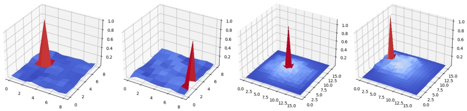

# Aprovechamiento de Imperfect Restoration para Data Availability Attack

Yi Huang1∗, Jeremy Styborski1∗, Mingzhi Lyu2∗, Fan Wang2 y Adams Kong1

1 College of Computing and Data Science, Nanyang Technological University, Singapur  
2 Rapid-Rich Object Search (ROSE) Lab, Interdisciplinary Graduate Programme, Nanyang Technological University, Singapur  
shellbyhuang@gmail.com, {styb0001,lyum0002,fan005,AdamsKong}@ntu.edu.sg

Abstract. La abundancia de datos en línea corre el riesgo de un uso no autorizado en el entrenamiento de modelos de deep learning. Para contrarrestar esto, se han diseñado diversos Data Availability Attacks (DAAs) con el fin de hacer que los datos sean unlearnable para dichos modelos mediante la perturbación sutil de los datos de entrenamiento. Sin embargo, los ataques existentes a menudo destacan frente a escenarios de Supervised Learning (SL) o de Self-Supervised Learning (SSL), pero no en ambos. Entre estos, un enfoque libre de modelo (model-free) que genera un Convolution-based Unlearnable Dataset (CUDA) se destaca como el DAA más robusto tanto en SSL como en SL. No obstante, la efectividad de CUDA frente a SSL es insuficiente y enfrenta un severo trade-off entre la calidad de la imagen y su efecto de envenenamiento (poisoning effect). En este artículo, realizamos un análisis teórico de CUDA, descubriendo los gradientes subóptimos que introduce y dilucidando la estrategia que emplea para inducir un sesgo por clase (class-wise bias) para el envenenamiento de datos (data poisoning). Con base en esto, proponemos un método de envenenamiento novedoso denominado Imperfect Restoration Poisoning (IRP), con el objetivo de preservar una alta calidad de imagen y alcanzar al mismo tiempo fuertes efectos de envenenamiento. A través de extensas comparaciones de IRP con ocho baselines tanto en SL como en SSL, junto con evaluaciones frente a cinco métodos de defensa representativos, demostramos la superioridad de IRP. Código: [https://github.com/lyumingzhi/IRP](https://github.com/lyumingzhi/IRP)

Keywords: Data Availability Attacks · Supervised Learning · Self-Supervised Learning

## 1 Introducción

La proliferación de datos en línea ha demostrado ser un recurso indispensable para el avance de los modelos de deep learning. Sin embargo, la recopilación de ciertos conjuntos de datos sin el consentimiento explícito plantea una posible amenaza para la privacidad personal [2]. Además, el surgimiento de la IA generativa presenta nuevos desafíos, ya que el entrenamiento con datos no autorizados podría infringir los derechos de autor de los propietarios [34].

Los DAAs han surgido como una estrategia prometedora para abordar el problema del uso no autorizado de datos [12–14, 17, 20, 27, 29, 33, 40–42]. Estos ataques introducen perturbaciones sutiles en los datos de entrenamiento, obstaculizando la capacidad del modelo para aprender información útil de manera efectiva, lo que posteriormente conduce a un bajo rendimiento en datos no vistos. Este bajo rendimiento se manifiesta como una disminución sustancial en la accuracy cuando el modelo se evalúa sobre datos limpios (clean data) en tareas de clasificación. Actualmente, la mayoría de los DAAs se desarrollan dentro del marco de SL. Sin embargo, un estudio reciente de He et al. [17] revela que Adversarial Poison (AP) [13], un DAA de vanguardia dirigido a SL, carece de efectividad cuando se aplica a SSL. En respuesta, introducen un nuevo enfoque, denominado Contrastive Poison (CP) [17], para contrarrestar SSL. Su investigación plantea varias interrogantes: (1) ¿Son otros DAAs diseñados para SL también ineficaces frente a SSL? (2) ¿Mantiene el método CP propuesto una efectividad similar en escenarios de SL? (3) ¿Podemos desarrollar un DAA capaz de llevar a cabo ataques efectivos tanto en escenarios de SL como de SSL?

<small>\*Contribución equitativa</small>

Para responder a estas preguntas, evaluamos experimentalmente en SSL siete DAAs representativos diseñados para SL. SSL constituye una defensa sólida frente a la mayoría de los DAAs debido a su objetivo de invariancia a aumentos (augmentation invariance objective); las características del DAA que son distorsionadas u ofuscadas por los aumentos son ignoradas por el algoritmo de SSL y no pueden afectar a las tareas posteriores (downstream tasks). En concordancia con ello, encontramos en la Fig. 1 que la mayoría de los venenos para CIFAR-10 [23] no logran generalizar a SSL. Únicamente CUDA [27] y CP [17] exhiben un impacto significativo sobre SSL. Los filtros de CUDA inyectan características de veneno en toda la imagen que resultan resistentes a recortes (cropping), volteos (flipping) y variaciones de color (color shifts), y CP está diseñado específicamente para contrarrestar SSL. Observamos una pérdida significativa de rendimiento para CP en escenarios de SL. Por lo tanto, CUDA emerge como el DAA más potente tanto en SSL como en

bar

| Category | SL (%) | SSL (%) |
| --- | --- | --- |
| Clean | ~94 | ~91 |
| EM | ~33 | ~88 |
| REM | ~19 | ~86 |
| AP | ~12 | ~75 |
| CP | ~94 | ~73 |
| LSP | ~21 | ~89 |
| OPS | ~27 | ~88 |
| AR | ~11 | ~77 |
| CUDA | ~22 | ~66 |

Fig. 1: Las clean test accuracies de diferentes DAAs en CIFAR-10 [23]. Una menor accuracy representa un mejor rendimiento de ataque.

text_image

Kernel Size = 7
Kernel Size = 9
Kernel Size = 11

Fig. 2: Imágenes envenenadas (poisoned images) generadas por CUDA con diferentes tamaños de kernel.

SL. Sin embargo, la clean test accuracy de SSL entrenado con CUDA aún oscila alrededor del 70%, lo que sugiere que los modelos entrenados con datos envenenados conservan cierta utilidad. Como sugirieron Sadasivan et al. [27], aumentar el tamaño de los kernels de convolución en CUDA podría proporcionar un efecto de envenenamiento más fuerte, pero también degrada la calidad de la imagen. La Fig. 2 muestra que un mayor tamaño de kernel da como resultado imágenes visiblemente borrosas. Este compromiso suele ser inaceptable en escenarios prácticos, particularmente para compartir imágenes y obras artísticas en línea.

Para comprender la eficacia de CUDA, Sadasivan et al. proporcionan un análisis teórico bajo suposiciones de datos distribuidos gaussianamente con elementos independientes y un escenario de dos clases. Sin embargo, estas suposiciones pueden no cumplirse en escenarios del mundo real. Además, su análisis no se basa en deep learning, lo que dificulta la obtención de intuiciones para diseñar un método de envenenamiento más efectivo.

Para profundizar en la comprensión del impacto de CUDA en el entrenamiento de modelos, primero realizamos un análisis teórico de CUDA utilizando un modelo de deep learning. Nuestro análisis revela cómo CUDA genera gradientes subóptimos para datos limpios e introduce un sesgo por clase (class-wise bias) mediante filtros aleatorios. A partir de este análisis, proponemos un nuevo método de envenenamiento, denominado Imperfect Restoration Poisoning (IRP), que mantiene una alta calidad de imagen al tiempo que logra un efecto de envenenamiento más potente. Comparamos IRP con ocho DAAs representativos tanto en escenarios de SL como de SSL. En el escenario de SL, además comparamos IRP con otros DAAs bajo diversos mecanismos de defensa, incluidos el entrenamiento adversarial (adversarial training) [33], Image Shortcut Squeezing [24], Mixup [44], Cutout [9] y CutMix [43]. Todos los resultados experimentales indican que IRP supera significativamente a los DAAs anteriores. Nuestras principales contribuciones son:

– Evaluamos experimentalmente ocho DAAs representativos en escenarios de aprendizaje supervisado y autosupervisado, revelando que los DAAs existentes no logran alcanzar una efectividad satisfactoria simultáneamente en ambos contextos.
– Realizamos un análisis teórico de CUDA en modelos de deep learning, revelando cómo genera gradientes subóptimos para datos limpios e introduce un sesgo por clase mediante filtros aleatorios.
– Proponemos un DAA novedoso denominado IRP basado en imperfect restoration, que logra una alta efectividad tanto en SL como en SSL y mantiene una calidad de imagen superior en comparación con CUDA.
– Llevamos a cabo una comparación exhaustiva entre IRP y otros ocho DAAs en SL, SSL y cinco técnicas de defensa sobre CIFAR-10 y un subconjunto de ImageNet [8]. IRP supera a los venenos baseline por un amplio margen en todos los casos. Verificamos además IRP en cinco arquitecturas adicionales y dos conjuntos de datos suplementarios. IRP muestra una alta efectividad en todos los experimentos.

## 2 Trabajos relacionados

Los DAAs han captado una atención significativa en los últimos años debido a su aplicación en la protección de datos. Se han propuesto diversas metodologías para inducir deliberadamente un mal funcionamiento en el modelo objetivo con el fin de salvaguardarse contra el uso no autorizado de datos. Los DAAs pueden categorizarse a grandes rasgos en dos tipos: métodos dependientes del modelo (model-reliant methods) [12–14, 17, 20, 42] y métodos libres de modelo (model-free methods) [27, 29, 40, 41].

Métodos dependientes del modelo (Model-Reliant Methods): Los primeros enfoques de DAAs a menudo formulan el problema del envenenamiento como una tarea de optimización binivel (bilevel optimization), equilibrando la minimización de la pérdida con respecto a los parámetros del modelo con la maximización de la pérdida con respecto a las entradas perturbadas. Si bien estos métodos [1, 22] mostraron promesa inicialmente, su aplicabilidad a redes neuronales profundas se ve limitada debido a la intratabilidad para obtener soluciones exactas. Los esfuerzos para abordar los desafíos de optimización en la generación de perturbaciones, como se aprecia en los trabajos de Feng et al. [12] y Yuan et al. [42], a menudo introducen una sobrecarga computacional sustancial, limitando la escalabilidad para aplicaciones del mundo real. Como alternativa, Huang et al. [20] proponen otro enfoque binivel de Minimización de Error (Error Minimizing, EM), optimizando deliberadamente las perturbaciones para minimizar la pérdida de entrenamiento. Al entrenar alternadamente un surrogate model y optimizar las perturbaciones, la eficacia de las perturbaciones se alcanza a través de múltiples rondas de optimización. En contraste con los enfoques binivel tradicionales, Fowl et al. [13] demuestran la efectividad de utilizar objetivos comunes de ejemplos adversariales para generar potentes Adversarial Poisons (AP). Sin embargo, Tao et al. [33] señalan que estos DAAs pueden romperse fácilmente mediante adversarial training. En respuesta, Fu et al. [14] introducen Robust Error Minimizing (REM), que mejora los efectos de envenenamiento frente al adversarial training al reemplazar el surrogate en EM con un modelo entrenado adversarialmente. Recientemente, He et al. [17] afirman que todos los métodos antes mencionados están diseñados para escenarios supervisados, lo que los hace inadecuados para el aprendizaje autosupervisado. Para cerrar esta brecha, introducen Contrastive Poison (CP), diseñado específicamente para el aprendizaje autosupervisado. No obstante, su evaluación de los DAAs diseñados para SL se centra exclusivamente en AP, dejando otros DAAs inexplorados. Además, aunque demuestran cierta efectividad de su CP por clase (class-wise CP) tanto en SL como en SSL, las test accuracies en SSL permanecen altas, oscilando entre el 60.7% y el 68.0%. Asimismo, las perturbaciones aditivas por clase pueden recuperarse mediante la imagen promedio de una clase, lo que las hace relativamente fáciles de eliminar [29]. Por lo tanto, no consideramos los venenos por clase que aplican el mismo ruido aditivo a las imágenes, incluidos los ataques por clase de EM, AP y CP.

Métodos libres de modelo (Model-Free Methods): Los DAAs libres de modelo abordan el problema de la protección de datos aprovechando el aprendizaje de atajos (shortcut learning). Estos métodos se fundamentan en la observación de que las Redes Neuronales Profundas (DNNs) suelen priorizar atajos fáciles de aprender por encima de las características semánticas, lo que les permite distinguir entre ejemplos de diferentes clases [3, 21]. Al expandir este concepto, Yu et al. [41] proponen incorporar en las imágenes patrones linealmente separables (Linearly Separable Patterns, LSP) generados artificialmente y muestreados a partir de distribuciones gaussianas de alta dimensión como un método efectivo para el envenenamiento de datos. Sandoval-Segura et al. [29] descubren que aplicar perturbaciones aditivas derivadas de procesos autorregresivos (AR) a datos limpios puede servir como un atajo efectivo. Wu et al. [40] examinan la susceptibilidad del modelo a venenos dispersos (sparse poisons) y demuestran que perturbar consistentemente un solo píxel es suficiente para generar venenos potentes. En contraste con la aplicación de perturbaciones aditivas, Sadasivan et al. [27] introducen un método de generación de Convolution-based Unlearnable Dataset (CUDA), que utiliza filtros convolucionales por clase generados aleatoriamente. En nuestra evaluación, CUDA demuestra una robustez moderada frente a SSL. Sin embargo, su efectividad en SSL sigue siendo insuficiente y CUDA lidia con un severo trade-off entre la calidad de la imagen y la eficacia del veneno.

Estrategias de mitigación de DAAs: Estudios previos han demostrado que el Adversarial Training (AT) [15] es un método efectivo para mitigar la potencia de los DAAs [33, 39]. Sin embargo, AT se ve obstaculizado por sus altas demandas computacionales. Como alternativa, se han explorado diversas técnicas de preprocesamiento de imágenes, como el data augmentation (por ejemplo, Mixup [44], Cutout [9] y CutMix [43]). Si bien estas técnicas basadas en aumento muestran cierto impacto, no son tan efectivas como AT [13]. Recientemente, Liu et al. [24] introducen Image Shortcut Squeezing (ISS) [24], un enfoque basado en compresión para contrarrestar los DAAs. Demuestran que ISS supera a las contramedidas de data augmentation previamente estudiadas y logra resultados comparables a AT. Evaluamos el IRP propuesto frente a múltiples contramedidas, incluidas AT, ISS, Mixup, Cutout y CutMix.

## 3 Análisis

## 3.1 Modelo de amenaza

Al igual que CUDA, la mayoría de los artículos sobre DAAs definen a un “atacante” que aplica un DAA sobre un conjunto de datos etiquetado que desea proteger pero a la vez publicar. El atacante asume que no tiene conocimiento de ningún proceso de entrenamiento de DNN posterior. Por lo tanto, es crucial demostrar que los DAAs son efectivos en múltiples métodos de entrenamiento, incluidos SL, SSL y AT. El atacante genera perturbaciones basadas en clases en su conjunto de imágenes con el fin de inyectar características de veneno. El atacante publica sus imágenes envenenadas, opcionalmente con descripciones (captions) o etiquetas. Los entrenadores de modelos recopilan estas imágenes envenenadas en conjuntos de datos y pueden alterar o etiquetar aún más las imágenes.

## 3.2 Notación y preliminares

Para mayor claridad, definimos un conjunto de notaciones. $f$ representa una Convolutional Neural Network (CNN), incluida su loss function de entrenamiento pero excluyendo el filtro 2D de convolución de la primera capa $W \in \mathbb { R } ^ { d _ { 1 } \times d _ { 2 } } . X \in \mathbb { R } ^ { m _ { 1 } \times m _ { 2 } }$ denota una imagen de entrada y $X _ { c }$ representa una imagen perteneciente a la clase $c \in [ 1 , . . . , \mathbb { C } ]$ , donde C es el número total de clases. Dado que en la práctica se utiliza predominantemente la correlación cruzada (cross-correlation) en lugar de convoluciones, la operación de la primera capa se denota como $X \star W$ , donde ⋆ significa correlación cruzada. Nótese que $W$ es parte de la CNN y $f ( X \star W )$ es el valor de pérdida de X. Para mantener la legibilidad, nos centramos en el análisis del gradiente del filtro de la primera capa, W. CUDA emplea filtros convolucionales específicos por clase para el envenenamiento de datos, y proporcionamos una breve descripción general de su funcionamiento. Sea $R _ { c } \in \mathbb { R } ^ { \kappa \times \kappa }$ un filtro de CUDA para imágenes de clase c. De acuerdo con [27], el procedimiento de generación para $R _ { c }$ implica fijar un parámetro aleatorio entre los $\kappa ^ { 2 }$ parámetros en 1 dentro de cada $R _ { c }$ . De forma concurrente, los parámetros restantes se inicializan aleatoriamente, extraídos de una distribución uniforme con soporte $[ 0 , p _ { u } ]$ . Una imagen $X _ { c }$ perteneciente a la clase c se envenena mediante correlación cruzada con el correspondiente filtro de CUDA $R _ { c } ,$ denotado como $X _ { c } \star R _ { c }$ .

## 3.3 El gradiente no óptimo

Para comprender cómo CUDA reduce la accuracy de los datos limpios, analizamos el gradiente de f tanto para datos limpios como para datos envenenados con CUDA. Sin pérdida de generalidad, el conjunto de entrenamiento consta de C imágenes limpias, cada una perteneciente a una clase distinta, con las imágenes envenenadas correspondientes denotadas como $X _ { i } { \star } R _ { i } ,   i \in [ 1 , . . . , \mathbb { C } ]$ . El gradiente de los datos de entrenamiento limpios es

$$
\frac {\partial \sum_ {i = 1} ^ {\mathbb {C}} f \left(X _ {i} \star W\right)}{\partial W} = \sum_ {i = 1} ^ {\mathbb {C}} X _ {i} \star \frac {\partial f \left(u _ {i}\right)}{\partial u _ {i}}, \tag {1}
$$

donde $u _ { i }$ es una variable intermedia igual a $X _ { i }   \star   W$ . El gradiente de los datos de entrenamiento envenenados es

$$
\frac {\partial \sum_ {i = 1} ^ {\mathbb {C}} f ((X _ {i} \star R _ {i}) \star W)}{\partial W} = \sum_ {i = 1} ^ {\mathbb {C}} (X _ {i} \star R _ {i}) \star \frac {\partial f (u _ {p , i})}{\partial u _ {p , i}}, \tag {2}
$$

donde el subíndice p indica que la variable intermedia proviene de datos envenenados. Utilizando estos gradientes para actualizar W, obtenemos

$$
W _ {t + 1} = W _ {t} - \lambda \sum_ {i = 1} ^ {\mathbb {C}} X _ {i} \star \frac {\partial f \left(u _ {i}\right)}{\partial u _ {i}} \tag {3}
$$

$$
W _ {p, t + 1} = W _ {t} - \lambda \sum_ {i = 1} ^ {\mathbb {C}} (X _ {i} \star R _ {i}) \star \frac {\partial f (u _ {p , i})}{\partial u _ {p , i}}
$$

donde λ es el learning rate. Al ingresar todas las imágenes de entrenamiento limpias, $X _ { 1 } , \cdots , X _ { C }$ a $f ( \cdot \star W _ { t + 1 } )$ y $f ( \cdot \star W _ { p , t + 1 } )$ , obtenemos los valores de pérdida limpia y de pérdida de veneno $\textstyle \sum _ { i = 1 } ^ { \mathbb { C } } f \left( X _ { i } \star W _ { t + 1 } \right)$ y $\textstyle \sum _ { i = 1 } ^ { \mathbb { C } } f \left( X _ { i } \star W _ { p , t + 1 } \right)$ , respectivamente. Dado que $\textstyle \sum _ { i = 1 } ^ { \mathbb { C } } X _ { i } { \scriptstyle \star } \frac { \partial f ( \vec { o } _ { i } ) } { \partial i }$ en la Ec. 1 es la dirección de descenso de gradiente (gradient descent) óptima para los datos limpios, cualquier desviación de esta dirección resultará en un aumento de la pérdida cuando λ es pequeño. Por lo tanto, $\textstyle \sum _ { i = 1 } ^ { \mathbb { C } } f \left( X _ { i } \star W _ { p , t + 1 } \right) > \textstyle \sum _ { i = 1 } ^ { \mathbb { C } } f \left( X _ { i } \star W _ { t + 1 } \right)$ para los datos limpios. En otras palabras, CUDA emplea un gradiente no óptimo para alterar el entrenamiento, haciendo que los datos limpios sean irreconocibles.

## 3.4 Envenenamiento mediante sesgo por clase

Aunque la subsección anterior descubre cómo los filtros de CUDA incrementan la pérdida de entrenamiento, no indica cómo estos filtros envenenan la red. Para investigar más a fondo su mecanismo, introducimos $X _ { c } \star R _ { c }$ a $f ( \cdot \star W _ { p , t + 1 } )$ , cuya salida de la primera capa es

$$
(X _ {c} \star R _ {c}) \star W _ {p, t + 1} = (X _ {c} \star R _ {c}) \star W _ {t} - \lambda (X _ {c} \star R _ {c}) \star \sum_ {i = 1} ^ {C} \left((X _ {i} \star R _ {i}) \star \frac {\partial f (u _ {p , i})}{\partial u _ {p , i}}\right). \tag {4}
$$

Asumiendo que $W _ { t }$ no está envenenado por los filtros de CUDA, ignoramos el término $( X _ { c }   \star   R _ { c } )   \star   W _ { t }$ . Dado que la correlación cruzada es equivalente a una convolución rotada $( \mathrm { i . e . , ~ } X _ { c } \star R _ { c } = X _ { c } * R _ { c \pi }$ , donde ∗ representa la convolución y $R _ { c \pi }$ representa rotar el filtro 2D $R _ { c } \mathrm { ~en~ } \pi )$ , el segundo término de la Ec. 4 puede reescribirse como

$$
\lambda X _ {c} * \sum_ {i = 1} ^ {C} R _ {c \pi} * R _ {i} * X _ {i \pi} * \frac {\partial f (u _ {p , i})}{\partial u _ {p , i}}. \tag {5}
$$

La Ec. 5 muestra que la salida de la primera capa está influenciada por $R _ { c \pi } * R _ { i }$ . Dado que $R _ { c \pi } * R _ { i } = R _ { c \pi } * R _ { i \pi }$ , analizamos $R _ { c \pi } \star R _ { i \pi }$ . El Teorema 1 describe las probabilidades estadísticas de $R _ { c \pi } \star R _ { i \pi }$ y $R _ { c \pi } \star R _ { c \pi }$ . La demostración se proporciona en el Apéndice A.1.

Teorema 1. Dados dos filtros diferentes, $R _ { i }$ y $R _ { c }$ , generados por CUDA, si $1 > ( \kappa ^ { 2 } - 2 ) p _ { u } ^ { 2 } + 2 p _ { u }$ , entonces $R _ { c \pi }   \star   R _ { i \pi }$ y $R _ { c \pi }   \star   R _ { c \pi }$ tienen las siguientes propiedades:

1. El pico de $R _ { c \pi } \star R _ { c \pi } \mathit { ~se~encuentra~ }$ ubicado en el centro.
2. El pico de $R _ { c \pi } * R _ { i \pi }$ ocurre en la posición donde dos unos en $R _ { c \pi }$ y $R _ { i \tau }$ aparecen en la misma posición en $R _ { c \pi } \star R _ { i \pi }$
3. La probabilidad de que el pico de $R _ { c \pi } \star R _ { i \pi }$ se ubique en el centro es $\frac { 1 } { \kappa ^ { 2 } }$
4. El pico esperado de $R _ { c \pi } \star R _ { c \pi }$ es mayor que el pico esperado de $R _ { c \pi } \star R _ { i \pi }$

La Figura 3 presenta dos filtros de CUDA junto con los correspondientes $R _ { c \pi } \star R _ { c \pi }$ y $R _ { c \pi }   \star   R _ { i \pi }$ para ilustrar estas propiedades estadísticas. En la práctica, CUDA utiliza $p _ { u } = 0 . 0 6$ y $\kappa = 9$ para ImageNet, lo que satisface $1 > ( \kappa ^ { 2 } - 2 ) p _ { u } ^ { 2 } + 2 p _ { u }$ . Propiedades similares se aplican también en CIFAR-10 (véase el Apéndice A.3). Estas propiedades indican que $R _ { c \pi } * R _ { c }$ en la Ec. 5 retiene más información en $\begin{array} { r } { \bar { X } _ { c \pi } * \frac { \partial \bar { f ( u _ { p , c } ) } } { \partial u _ { p , c } } } \end{array}$ pero $R _ { c \pi } * R _ { i }$ desplaza la información en $\begin{array} { l } { X _ { i \pi } * \frac { \partial f ( u _ { p , i } ) } { \partial u _ { p , i } } } \\ \end{array}$ a una posición diferente con una probabilidad de $( \kappa ^ { 2 } - 1 ) / \kappa ^ { 2 }$ . Para $\kappa = 9$ , la probabilidad es 0.988. En consecuencia, las capas superiores reciben la información de la clase c en la posición correcta, pero la información de otras clases se desplaza a posiciones incorrectas. Para $p _ { u } = 0 . 0 6$ , observamos que el valor pico de $R _ { c \pi } \star R _ { i \pi }$ es menor que la suma de sus valores no pico (razón media estimada de 0.099). Esto significa que los valores no pico también desempeñan un papel importante en la degradación de la información de otras clases. Este efecto de desenfoque también afecta a la clase c, aunque en menor medida. De forma más clara, la razón media estimada del valor pico de $R _ { c \pi } \star R _ { c \pi }$ sobre la suma de sus valores no pico es 0.106. Combinando estos dos efectos, los filtros de CUDA utilizan desplazamientos de pico y patrones únicos de desenfoque para introducir sesgo por clase en la clase envenenada.

Fig. 3: Dos filtros de CUDA $R _ { c \pi }$ y $R _ { i \pi }$ (el primer y segundo gráfico) junto con los correspondientes $R _ { c \pi } \star R _ { c \pi }$ (el tercer gráfico) y $R _ { c \pi } \star R _ { i \pi }$ (el último gráfico).

## 3.5 Envenenamiento con Imperfect Restoration

El análisis anterior muestra que los filtros de CUDA crean sesgo por clase, y que $R _ { c \pi } \star R _ { c \pi }$ retiene la información de entrenamiento de la clase c. Cuando $X _ { c } \star R _ { c }$ está más cerca de $X _ { c } ,$ se espera que preserve mejor la información de la clase c y mejore la calidad de la imagen. Sin embargo, si $X _ { c } \star R _ { c } = X _ { c } ,$ entonces no hay efecto de envenenamiento. Por lo tanto, proponemos el Imperfect Restoration Poison (IRP). Sea $X _ { c i }$ una de las imágenes de clase c, donde $i \in 1 , \cdots , n$ . IRP primero aplica el filtro de CUDA $R _ { c }$ en todas las imágenes de entrenamiento de clase c y obtiene $X _ { c i } \star R _ { c }$ . Luego, las imágenes filtradas se recortan en patches con el mismo tamaño que el filtro de CUDA, es decir, $\kappa \times \kappa ,$ denotados como $( X _ { c i } \star R _ { c } ) _ { j }$ . El valor de píxel de $X _ { c i }$ correspondiente al centro del patch se denota como $y _ { c i j }$ , y el patch se remodela en un vector columna denotado como $\eta _ { c i j }$ . Finalmente, se utilizan un modelo lineal por clase $\alpha _ { c } \in \mathbb { R } ^ { \kappa ^ { 2 } \times 1 }$ y la pérdida de error cuadrático medio para estimar el valor de $y _ { c i j }$ . De forma más precisa, el modelo por clase $\widehat { \alpha _ { c } }$ se obtiene minimizando

$$
\widehat {\alpha_ {c}} = \underset {\alpha_ {c}} {\operatorname{argmin}} \sum_ {i} \sum_ {j} \| y _ {c i j} - \alpha_ {c} ^ {T} \eta_ {c i j} \| _ {2} ^ {2} \tag {6}
$$

Una vez obtenido $\widehat { \alpha _ { c } }$ , este se remodela nuevamente a un filtro de $\kappa \times \kappa$ , denotado como $A _ { c } .$ Finalmente, IRP utiliza $X _ { c i } { \star } P _ { c }$ para realizar el envenenamiento, donde $P _ { c } = R _ { c } { \star } A _ { c }$ . El Teorema 2 establece que IRP es incapaz de lograr una restauración perfecta (demostración en el Apéndice A.2).

Teorema 2. Dado un tamaño de filtro de CUDA mayor que 1 y siendo $x _ { c i j }$ la forma vectorial del patch en $X _ { c i }$ involucrado en producir $\eta _ { c i j }$ $( i . e . , \; \eta _ { c i j } = \wp x _ { c i j }$ , donde ℘ es una matriz de $\kappa ^ { 2 }   \times   ( 3 \kappa   -   2 ) ^ { 2 }$), si los vectores columna de ℘, excluyendo el que corresponde a $y _ { c i j }$ , generan $\mathbb { R } ^ { \kappa ^ { 2 } }$ , entonces, $\exists x _ { c i j } \in \mathbb { R } ^ { ( 3 \kappa - 2 ) ^ { 2 } }$ tal que $y _ { c i j } \neq a _ { c } ^ { T } \wp x _ { c i j }$ .

Fig. 4: Dos filtros de IRP $P _ { c \pi }$ y $P _ { i \pi }$ (el primer y segundo gráfico) junto con los correspondientes $P _ { c \pi } \star P _ { c \pi }$ (el tercer gráfico) y $P _ { c \pi } \star P _ { i \pi }$ (el último gráfico).

La Fig. 4 muestra dos filtros de IRP con la correspondiente autocorrelación y correlación cruzada. De manera similar a CUDA, observamos que $P _ { c \pi } \star P _ { c \pi }$ exhibe un pico en el centro, mientras que $P _ { c \pi } \star P _ { i \pi }$ tiene un pico en una posición diferente. Sin embargo, presentan patrones más complejos alrededor de los picos. Por lo tanto, al igual que CUDA, IRP explota los desplazamientos de pico para crear sesgo por clase. No obstante, los filtros de IRP presentan patrones turbulentos alrededor de los picos, creando patrones de ataque de alta frecuencia únicos que son más complejos que los patrones de baja frecuencia de CUDA. Debido a su dependencia de los datos de entrenamiento, resultaría difícil analizar teóricamente los filtros de IRP, como se hizo para CUDA, sin suposiciones adecuadas sobre la distribución de datos. Nos abstenemos de imponer suposiciones poco realistas sobre la distribución de datos (por ejemplo, gaussiana), ya que esto podría conducir a resultados analíticos engañosos.

La Fig. 5 muestra algunas imágenes generadas por IRP y CUDA. Las imágenes de IRP son visualmente más claras y mantienen una mayor calidad. Notablemente, el rostro del hombre es más nítido y las manchas de la salamandra y la mantarraya son fácilmente distinguibles bajo la protección de IRP. Los fondos de las tres imágenes son más nítidos bajo IRP.

(a) CUDA

(b) IRP

Fig. 5: Ejemplos envenenados generados por CUDA (izquierda) e IRP (derecha).

## 4 Experimentos

En esta sección, comenzamos evaluando la efectividad de IRP junto con ocho métodos de DAA en configuraciones estándar de SL y SSL, así como frente a métodos de defensa representativos. Luego investigamos la efectividad de diferentes DAAs en escenarios de envenenamiento parcial. Para los métodos dependientes del modelo, nuestros experimentos se centran principalmente en la configuración nominal, en la que un surrogate model genera imágenes envenenadas. Para evaluar la transferibilidad de IRP, evaluamos IRP a través de seis arquitecturas diferentes en tres conjuntos de datos. Finalmente, comparamos la calidad de imagen generada por CUDA e IRP y realizamos ablaciones de diferentes tipos de filtros a través de varios métodos de entrenamiento.

## 4.1 Configuración experimental

Datasets: Examinamos el envenenamiento en CIFAR-10 [23], CIFAR-100 [23], STL-10 [7] e ImageNet-100, un subconjunto de ImageNet [8] que consta de 100 clases. Por defecto, utilizamos 50,000 imágenes para entrenamiento y 10,000 imágenes para prueba en CIFAR-10 y CIFAR-100. Para STL-10, utilizamos sus 5,000 imágenes de entrenamiento y 8,000 imágenes de prueba predeterminadas para entrenamiento y prueba, respectivamente. Para ImageNet-100, entrenamos sobre las imágenes de las primeras 100 clases del conjunto de entrenamiento oficial y evaluamos en todas las imágenes correspondientes del conjunto de validación oficial.

Poison Settings: Comparamos IRP con ocho DAAs de última generación (state-of-the-art), incluidos cuatro métodos dependientes del modelo: EM [20], TAP [13], REM [14] y CP [17], y cuatro métodos libres de modelo: CUDA [27], LSP [41], OPS [40] y AR [29]. Dado que generar datos envenenados utilizando métodos dependientes del modelo consume mucho tiempo en ImageNet, generamos un subconjunto del 20% de ImageNet-100 para CP, TAP y EM. Mantenemos todas las configuraciones predeterminadas y conservamos la norma $L _ { \infty }$ de la perturbación defensiva en 8/255. Utilizamos el conjunto de datos completo ImageNet-100 envenenado con REM compartido por los autores de REM. De acuerdo con [14], la norma $L _ { \infty }$ de la perturbación defensiva $\rho _ { u }$ se establece en 8/255, y el radio de perturbación adversarial $\rho _ { a }$ se fija en 4/255 para controlar el nivel de protección del ruido contra el adversarial training. Para los métodos libres de modelo, mantenemos las configuraciones según sus publicaciones originales, excepto para LSP y OPS en ImageNet-100. Dado que las configuraciones originales no pudieron producir un efecto de envenenamiento satisfactorio, amplificamos la perturbación de LSP y OPS a $L _ { \infty } = 1 6 / 2 5 5$ y $L _ { 0 } = 5$ , respectivamente. Dado que AR no reporta su efectividad en ImageNet-100 y ha demostrado ser vulnerable a SSL y AT en CIFAR-10, optamos por no incluir AR en pruebas adicionales en ImageNet-100.

Modelos: A menos que se indique lo contrario, empleamos ResNet-18 [18] como el surrogate para los métodos dependientes del modelo y como los modelos objetivo para todos los métodos de prueba tanto en escenarios de SL como de SSL. Se emplean diversos algoritmos de SSL, incluidos SimCLR [4], SimSiam [5], MoCoV3 [6] y BYOL [16]. Se utiliza la linear probing accuracy, de manera consistente con CP [17], para evaluar la efectividad de los DAAs en SSL. Para evaluar la transferibilidad, evaluamos IRP en modelos objetivo con diversas arquitecturas, incluyendo ResNet-18, ResNet-34 [18], VGG-19 [32], DenseNet-121 [19], MobileNet-V2 [28] y ViT [11]. Los detalles de entrenamiento se posponen al Apéndice B.1.

Table 1: Top-1 clean test accuracies (%) de ResNet-18 entrenado con datos envenenados por varios DAAs en CIFAR-10. La columna “Max” representa la clean test accuracy más alta, lo que corresponde al peor rendimiento de cada DAA bajo diferentes escenarios de entrenamiento. La negrita indica el mejor rendimiento y el subrayado denota el segundo mejor rendimiento.

| DAA | SL | SSL | AT | Cutout | Cutmix | Mixup | ISS | Max |
| --- | --- | --- | --- | --- | --- | --- | --- | --- | --- |
| Clean | 93.86 | 90.55 | 89.57 | 95.62 | 95.78 | 95.46 | 82.40 | 95.62 |
| EM | 32.53 | 88.45 | 89.31 | 36.18 | 38.40 | 54.19 | 82.12 | 89.31 |
| REM | 18.91 | 86.70 | 34.45 | 19.67 | 27.46 | 23.27 | 80.04 | 86.70 |
| AP | 12.45 | 75.77 | 85.67 | 9.70 | 8.38 | 33.27 | 81.10 | 85.67 |
| CP | 93.59 | 73.08 | 88.43 | 94.51 | 93.77 | 93.36 | 82.21 | 94.51 |
| LSP | 21.47 | 88.87 | 85.67 | 18.47 | 21.68 | 22.76 | 79.33 | 88.87 |
| OPS | 27.24 | 87.79 | 20.10 | 65.12 | 85.27 | 37.56 | 72.14 | 87.79 |
| AR | 10.95 | 86.86 | 72.94 | 12.17 | 12.95 | 14.15 | 82.83 | 86.86 |
| CUDA | 21.89 | 66.58 | 48.58 | 23.46 | 24.04 | 21.75 | 21.94 | 66.58 |
| IRP | 10.39 | 43.24 | 32.21 | 10.85 | 15.21 | 16.03 | 29.42 | 43.24 |

## 4.2 Comparaciones con DAAs de referencia

Efectividad en SL y SSL: Primero evaluamos IRP y los otros DAAs en escenarios de entrenamiento estándar de SL y SSL sobre CIFAR-10 e ImageNet-100. Se utiliza SimCLR para el preentrenamiento del modelo en la evaluación de SSL. Las columnas 2-3 de las Tablas 1 y 2 muestran que IRP logra un envenenamiento de última generación (state-of-the-art), imponiendo las clean test accuracies más bajas tanto en SL como en SSL y tanto para CIFAR-10 como para ImageNet-100.

Comenzamos analizando los resultados para CIFAR-10 en la Tabla 1. Para SL con CIFAR-10, AR e IRP demuestran un nivel similar de efecto de envenenamiento bajo SL, reduciendo la test accuracy a alrededor del 10%. Sin embargo, AR tiene un rendimiento inferior en SSL, permitiendo una accuracy significativamente mayor del 86.86% en comparación con la de IRP en 43.24%. CUDA es el segundo mejor DAA para SSL con una accuracy de 66.58%, lo cual sigue siendo drásticamente superior a la de IRP.

Para los resultados de ImageNet-100 en la Tabla 2, comenzamos notando la caída en la efectividad de OPS en relación con CIFAR-10. Esto se atribuye al data augmentation RandomResizeCrop utilizado para entrenar modelos en ImageNet-100. Elegimos utilizar este aumento en ImageNet-100 ya que se usa comúnmente para SL y SSL en ImageNet-100 en la literatura y mejora la efectividad de todos los métodos de defensa. Para SL con ImageNet-100, CUDA, EM, AP y LSP demuestran fuertes capacidades de envenenamiento, reduciendo la clean test accuracy a menos del 10%. Aun así, IRP supera a todos los demás con una test accuracy de 1.98%. Para SSL con ImageNet-100, las test accuracies de la mayoría de los DAAs se mantienen altas, excepto para CUDA con 21.89% y CP con 18.76%. IRP supera tanto a CUDA como a CP, alcanzando una clean test accuracy de 9.30%. Estos resultados establecen a IRP como el DAA más efectivo bajo escenarios tanto de SL como de SSL.

Table 2: Top-1 clean test accuracies (%) de ResNet-18 entrenado con datos envenenados por varios DAAs en ImageNet-100. La columna “Max” representa la clean test accuracy más alta, lo que corresponde al peor rendimiento de cada DAA bajo diferentes escenarios de entrenamiento. La negrita indica el mejor rendimiento y el subrayado denota el segundo mejor rendimiento.

| DAA | SL | SSL | AT | Cutout | Cutmix | Mixup | ISS | Max |
| --- | --- | --- | --- | --- | --- | --- | --- | --- | --- |
| Clean | 77.66 | 70.96 | 69.76 | 78.04 | 81.08 | 80.38 | 71.58 | 80.38 |
| EM | 6.32 | 50.02 | 43.26 | 6.42 | 5.80 | 12.38 | 41.18 | 50.02 |
| REM | 14.18 | 65.30 | 57.34 | 15.60 | 16.10 | 33.08 | 67.52 | 67.52 |
| AP | 8.18 | 41.80 | 42.88 | 7.68 | 8.38 | 9.68 | 24.22 | 42.88 |
| CP | 57.46 | 18.76 | 48.76 | 58.20 | 62.28 | 61.76 | 50.18 | 62.28 |
| LSP | 6.62 | 62.06 | 28.92 | 5.06 | 7.84 | 5.50 | 33.70 | 62.06 |
| OPS | 51.00 | 62.22 | 52.56 | 53.86 | 65.12 | 48.82 | 57.36 | 65.12 |
| CUDA | 6.10 | 26.12 | 36.34 | 8.66 | 5.70 | 5.16 | 3.58 | 36.34 |
| IRP | 1.98 | 9.30 | 22.10 | 2.18 | 1.52 | 2.02 | 4.14 | 22.10 |

Efectividad bajo contramedidas comunes: Para evaluar más a fondo la efectividad de IRP bajo escenarios defensivos, evaluamos IRP y los baselines en métodos de defensa representativos, incluidos Adversarial Training (AT) [15], Image Shortcut Squeezing (ISS) [24] y técnicas comunes de data augmentation como Cutout, CutMix y Mixup. Siguiendo a [14], empleamos la norma $L _ { \infty }$ para AT y establecemos el límite de la norma en 4/255. Se utiliza PGD de 10 pasos con un tamaño de paso de 0.6/255 para AT. Como sugieren [24], empleamos una combinación de escala de grises y JPEG con el factor de calidad JPEG predeterminado (JPEG-10) para ISS para garantizar una efectividad global contra todos los DAAs. Los resultados en CIFAR-10 e ImageNet-100 se presentan en las columnas 4-8 de las Tablas 1 y 2, respectivamente. La última columna muestra la máxima clean test accuracy de los métodos correspondientes en todos los escenarios de prueba, representando el peor rendimiento entre todos los casos evaluados.

Los resultados de los DAAs en CIFAR-10 en la Tabla 1 varían según las defensas. Por ejemplo, OPS muestra una alta efectividad en AT pero es susceptible a ISS y CutMix, mientras que AP se desempeña bien frente a CutMix y Cutout pero es menos efectivo frente a AT e ISS. Únicamente CUDA e IRP demuestran efectividad en todas las contramedidas. Sin embargo, CUDA permite accuracies limpias máximas de 48.58% a través de todas las contramedidas y 66.58% a través de todos los casos de prueba, que son 16.37% y 23.24% superiores, respectivamente, a la accuracy máxima del 43.24% permitida por IRP.

De manera similar, CUDA e IRP surgen como los dos métodos más efectivos a través de todas las defensas en ImageNet-100 en la Tabla 2. Sin embargo, CUDA permite una accuracy limpia máxima del 36.34%, significativamente superior a la de IRP con 22.10%. Los resultados demuestran que IRP es el DAA más efectivo en todos los escenarios de prueba.

Evaluación en otros algoritmos de SSL: Para evaluar más a fondo la eficacia de IRP en SSL, evaluamos ImageNet-100 envenenado con IRP en tres algoritmos de SSL adicionales: SimSiam [5], MoCoV3 [6] y BYOL [16]. Como se muestra en la Tabla 3, IRP reduce las test accuracies de todos los algoritmos de SSL a alrededor del 10%. Incluso en su peor caso de rendimiento con BYOL, IRP reduce la clean accuracy a 11.6%.

Table 3: Top-1 accuracies (%) de ResNet-18 entrenado con diferentes algoritmos de SSL en ImageNet-100.

|  | SimCLR | MoCoV3 | SimSiam | BYOL | Max |
| --- | --- | --- | --- | --- | --- |
| Clean | 70.96 | 75.54 | 70.68 | 75.34 | 75.54 |
| IRP | 9.3 | 10.58 | 7.82 | 11.6 | 11.6 |

## 4.3 Escenarios de entrenamiento y conjuntos de datos adicionales

Diferentes porcentajes de veneno: En esta sección, primero evaluamos IRP en un escenario de aprendizaje más desafiante y realista, donde solo una porción de los datos está protegida por IRP. Seleccionamos aleatoriamente una porción de los datos de entrenamiento de todo el conjunto de entrenamiento de CIFAR-10 y aplicamos IRP al subconjunto seleccionado. Los datos envenenados se denotan como $D _ { p }$ y los datos limpios en el conjunto de entrenamiento que no se han utilizado para generar datos de veneno se denotan como $D _ { c } .$ . Luego, llevamos a cabo un entrenamiento supervisado estándar con ResNet-18 sobre los datos mixtos $( D _ { p + c } )$ que consisten en $D _ { p }$ y $D _ { c } ,$ así como sobre el subconjunto de datos limpios $D _ { c } .$ . Los resultados en la Tabla 4 muestran que la efectividad cae rápidamente cuando los datos no están envenenados al 100%. Este fenómeno se aplica también a todos los demás DAAs. Los modelos entrenados únicamente con $D _ { c }$ demuestran un nivel similar de rendimiento al de los modelos entrenados con $D _ { p + c } .$ Esto sugiere que el alto rendimiento para un envenenamiento $<100\%$ no se debe a una falla de los DAAs. Finalmente, los trabajos sobre DAAs para la protección de obras de arte [30, 31] han observado tendencias similares, pero encuentran que los individuos aún pueden proteger sus propios datos mediante DAAs incluso si la mayoría de las obras de arte no están protegidas. Es decir, todavía es posible hacer que subconjuntos de los datos de entrenamiento sean unlearnable.

Table 4: Las top-1 clean test accuracies $( \% )$ de ResNet-18 entrenado con datos parcialmente envenenados en CIFAR-10. El porcentaje en la primera fila indica el porcentaje de datos envenenados, y Dc indica los datos limpios restantes. 0% y 100% significan escenarios de entrenamiento donde todo el conjunto de datos permanece completamente limpio o completamente envenenado, respectivamente.

<table><tr><td rowspan="2"></td><td rowspan="2">0%</td><td colspan="2">20%</td><td colspan="2">40%</td><td colspan="2">60%</td><td colspan="2">80%</td><td rowspan="2">100%</td></tr><tr><td> $D_{p+c}$ </td><td> $D_c$ </td><td> $D_{p+c}$ </td><td> $D_c$ </td><td> $D_{p+c}$ </td><td> $D_c$ </td><td> $D_{p+c}$ </td><td> $D_c$ </td></tr><tr><td>EM</td><td rowspan="8">93.86</td><td>94.02</td><td></td><td>92.72</td><td></td><td>90.71</td><td></td><td>85.75</td><td></td><td>32.53</td></tr><tr><td>REM</td><td>92.85</td><td></td><td>92.15</td><td></td><td>90.05</td><td></td><td>86.29</td><td></td><td>18.91</td></tr><tr><td>AP</td><td>92.57</td><td></td><td>91.16</td><td></td><td>90.72</td><td></td><td>88.11</td><td></td><td>12.45</td></tr><tr><td>LSP</td><td>92.95</td><td rowspan="2">92.38</td><td>92.40</td><td rowspan="2">91.74</td><td>90.19</td><td rowspan="2">87.84</td><td>85.76</td><td rowspan="2">77.36</td><td>21.47</td></tr><tr><td>OPS</td><td>93.40</td><td>92.25</td><td>90.63</td><td>86.68</td><td>27.24</td></tr><tr><td>AR</td><td>92.98</td><td></td><td>92.66</td><td></td><td>90.94</td><td></td><td>87.93</td><td></td><td>10.95</td></tr><tr><td>CUDA</td><td>93.27</td><td></td><td>92.27</td><td></td><td>90.51</td><td></td><td>86.90</td><td></td><td>21.89</td></tr><tr><td>IRP</td><td>93.07</td><td></td><td>92.56</td><td></td><td>89.89</td><td></td><td>85.70</td><td></td><td>10.39</td></tr></table>

Efectividad en diferentes modelos: Todas las evaluaciones anteriores se llevan a cabo sobre ResNet-18 (RN18). Para evaluar la efectividad de IRP en diferentes arquitecturas, evaluamos ResNet-34 (RN34), VGG19, DenseNet121 (DN121), MobileNetv2 (MNv2) y ViT-S en CIFAR-10 envenenado con IRP. Todos los modelos se entrenan con AT (restricción $L _ { \infty }$ de 4/255, como antes), que emergió como la defensa más fuerte contra diferentes DAAs a partir de nuestros experimentos en la Sección 4.2. Incluimos CUDA en esta evaluación como referencia. En todas las redes examinadas, IRP supera a CUDA por un margen significativo. En sus respectivos peores casos, CUDA permite una test accuracy de 49.44%, mientras que IRP permite una test accuracy de 35.39%. La Tabla 5 muestra que incluso bajo la defensa de AT, IRP sigue siendo efectivo en todas las arquitecturas examinadas.

Table 5: Las top-1 clean test accuracies (%) de diferentes modelos entrenados sobre datos envenenados por IRP y CUDA con AT.

<table><tr><td>Dataset</td><td></td><td>RN18</td><td>RN34</td><td>VGG19</td><td>DN121</td><td>MNv2</td><td>ViT-S</td><td>Max</td></tr><tr><td rowspan="3">CIFAR10</td><td>Clean</td><td>89.57</td><td>89.32</td><td>78.57</td><td>79.97</td><td>75.94</td><td>47.84</td><td>89.57</td></tr><tr><td>CUDA</td><td>48.58</td><td>43.63</td><td>42.02</td><td>49.44</td><td>26.33</td><td>44.93</td><td>49.44</td></tr><tr><td>IRP</td><td>32.21</td><td>17.37</td><td>19.06</td><td>17.87</td><td>14.13</td><td>35.39</td><td>35.39</td></tr><tr><td rowspan="3">CIFAR100</td><td>Clean</td><td>65.30</td><td>66.43</td><td>48.50</td><td>58.92</td><td>47.00</td><td>27.19</td><td>66.43</td></tr><tr><td>CUDA</td><td>37.21</td><td>37.95</td><td>27.44</td><td>23.07</td><td>16.00</td><td>24.88</td><td>37.95</td></tr><tr><td>IRP</td><td>27.13</td><td>28.85</td><td>22.50</td><td>25.24</td><td>20.70</td><td>20.82</td><td>28.85</td></tr><tr><td rowspan="3">STL10</td><td>Clean</td><td>71.94</td><td>69.73</td><td>64.35</td><td>72.41</td><td>58.93</td><td>43.86</td><td>72.41</td></tr><tr><td>CUDA</td><td>44.70</td><td>44.35</td><td>45.99</td><td>39.39</td><td>44.49</td><td>42.14</td><td>45.99</td></tr><tr><td>IRP</td><td>34.10</td><td>34.33</td><td>33.89</td><td>33.19</td><td>33.81</td><td>35.58</td><td>35.58</td></tr></table>

Evaluación en diferentes conjuntos de datos: Extendemos nuestra evaluación a los conjuntos de datos CIFAR-100 y STL-10. Se utiliza el mismo conjunto de modelos y configuraciones de AT. Como se muestra en la Tabla 5, tanto IRP como CUDA demuestran efectividad en CIFAR-100 y STL-10 en todas las arquitecturas de red bajo AT. IRP supera consistentemente a CUDA por un amplio margen en la mayoría de las redes tanto para CIFAR-100 como para STL-10. En los dos casos donde IRP es más débil que CUDA, las clean test accuracies de IRP todavía se encuentran dentro del 5% de las de CUDA. Las máximas clean test accuracies de IRP en CIFAR-100 y STL-10 son 28.85% y 35.58%, respectivamente. Ambos valores son significativamente más bajos que los de CUDA, que son 37.95% y 45.99% en CIFAR-100 y STL-10, respectivamente. Este experimento demuestra que IRP es universalmente efectivo a través de redes y a través de diferentes conjuntos de datos.

## 4.4 Comparación de calidad de imagen frente a CUDA

Comparamos la calidad de las imágenes de ImageNet-100 envenenadas por IRP y CUDA. Cuantificamos la calidad de imagen con tres índices comunes de calidad con referencia completa, incluidos LPIPS [45], SSIM [37] y MS-SSIM [38], y dos índices de calidad sin referencia, incluidos CLIP-IQA [35] y BRISQUE [25]. La imagen original se utiliza como referencia para LPIPS, SSIM y MS-SSIM. La Tabla 6 presenta los resultados de evaluación de todos los índices de calidad. Tanto la Tabla 6 como la Fig. 5 demuestran que IRP genera imágenes envenenadas con mejor calidad de imagen que CUDA.

| Metric | Clean | CUDA | IRP |
| --- | --- | --- | --- | --- |
| LPIPS ↓ | - | 0.272 | 0.142 |
| SSIM ↑ | - | 0.561 | 0.775 |
| MS-SSIM↑ | - | 0.831 | 0.903 |
| CLIP-IQA↑ | 0.787 | 0.528 | 0.706 |
| BRISQUE↓ | 16.625 | 29.570 | 17.318 |

Table 6: ImageNet-100 image quality under different quality indices.

bar

| Category | SL (%) | SSL (%) | AT (%) |
| --- | --- | --- | --- |
| Clean | 77.66 | 70.96 | 69.76 |
| CUDA | 6.10 | 26.12 | 36.34 |
| Random | 4.56 | 19.46 | 28.4 |
| Double Blur | 3.48 | 18.34 | 38.32 |
| IRP | 1.98 | 9.3 | 22.10 |

Fig. 6: La Top-1 accuracy de diferentes configuraciones en ImageNet-100.

## 4.5 Ablación de filtros

El filtro de IRP $P _ { c } = R _ { c } \star A _ { c }$ es un kernel con un tamaño mayor de $( 2 \kappa + 1 ) \times ( 2 \kappa + 1 )$ donde $R _ { c }$ y $A _ { c }$ son ambos filtros de tamaño $\kappa \times \kappa$. Para verificar que la alta efectividad de IRP no es causada por el mayor tamaño del kernel, generamos filtros del mismo tamaño que IRP bajo dos configuraciones de filtros diferentes. Para ‘Random Sharpness’, generamos un filtro de nitidez aleatorio $A _ { c 1 }$ de tamaño $\kappa \times \kappa$ para cada clase. Dentro de cada $A _ { c 1 }$ , se establece en 1 un parámetro aleatorio entre los $\kappa \times \kappa$ parámetros, mientras que los parámetros restantes se inicializan aleatoriamente a partir de una distribución uniforme con soporte $[ - p _ { s } ,   0 ]$ . Después de probar varios valores para $p _ { s }$ , encontramos que 0.01 es adecuado para generar imágenes envenenadas con buena calidad visual. Luego envenenamos las imágenes de clase c mediante $X _ { c } \star R _ { c } \star A _ { c 1 }$ . Para ‘Double Blur’, generamos otro filtro de CUDA aleatorio $R _ { c 1 }$ de tamaño $\kappa \times \kappa$ para cada clase, y luego envenenamos las imágenes de clase c mediante $X _ { c } \star R _ { c } \star R _ { c 1 }$ .

Comparamos la efectividad de las dos configuraciones de filtros adicionales con CUDA e IRP en SL, SSL y AT para ImageNet-100. Los resultados en la Fig. 6 muestran que Random Sharpness y Double Blur exhiben un rendimiento ligeramente mejor que CUDA en SSL. Sin embargo, la efectividad de Random Sharpness y Double Blur no puede igualar la de IRP. Adicionalmente, proporcionamos ejemplos de imágenes generadas por Double Blur y Random Sharpness en el Apéndice C.1. Estas muestras resaltan su calidad inferior en comparación con las generadas por IRP.

## 5 Conclusión

En este estudio, realizamos un análisis teórico de CUDA, descubriendo los gradientes subóptimos que introduce y dilucidando la estrategia que emplea para inducir sesgo por clase para el envenenamiento de datos. A partir de estos hallazgos, introducimos IRP, el cual demuestra una alta efectividad tanto en SL como en SSL, así como bajo escenarios de defensa de última generación (state-of-the-art). IRP también mantiene una alta calidad de imagen, lo que lo hace adecuado para la protección de datos en aplicaciones del mundo real.

## Agradecimientos

Esta investigación cuenta con el apoyo de la National Research Foundation, Singapore y la Infocomm Media Development Authority bajo su Trust Tech Funding Initiative y la Strategic Capability Research Centres Funding Initiative. Todas las opiniones, hallazgos y conclusiones o recomendaciones expresadas en este material pertenecen al autor o autores y no reflejan los puntos de vista de la National Research Foundation, Singapore ni de la Infocomm Media Development Authority.

Mingzhi Lyu y Fan Wang cuentan con el apoyo de ROSE @ NTU, Interdisciplinary Graduate Programme, Nanyang Technological University, Singapur.

## Referencias

1. Biggio, B., Nelson, B., Laskov, P.: Poisoning attacks against support vector machines. arXiv preprint arXiv:1206.6389 (2012)
2. Birhane, A., Prabhu, V.U.: Large image datasets: A pyrrhic win for computer vision? In: 2021 IEEE Winter Conference on Applications of Computer Vision (WACV). pp. 1536–1546. IEEE (2021)
3. Caron, E., Chrétien, S.: A finite sample analysis of the benign overfitting phenomenon for ridge function estimation. arXiv preprint arXiv:2007.12882 (2020)
4. Chen, T., Kornblith, S., Norouzi, M., Hinton, G.: A simple framework for contrastive learning of visual representations. arXiv preprint arXiv:2002.05709 (2020)
5. Chen, X., He, K.: Exploring simple siamese representation learning. In: Proceedings of the IEEE/CVF conference on computer vision and pattern recognition. pp. 15750–15758 (2021)
6. Chen\*, X., Xie\*, S., He, K.: An empirical study of training self-supervised vision transformers. arXiv preprint arXiv:2104.02057 (2021)
7. Coates, A., Ng, A., Lee, H.: An analysis of single-layer networks in unsupervised feature learning. In: Proceedings of the fourteenth international conference on artificial intelligence and statistics. pp. 215–223. JMLR Workshop and Conference Proceedings (2011)
8. Deng, J., Dong, W., Socher, R., Li, L.J., Li, K., Fei-Fei, L.: Imagenet: A large-scale hierarchical image database. In: 2009 IEEE conference on computer vision and pattern recognition. pp. 248–255. Ieee (2009)
9. DeVries, T., Taylor, G.W.: Improved regularization of convolutional neural networks with cutout. arXiv preprint arXiv:1708.04552 (2017)
10. Dolatabadi, H.M., Erfani, S., Leckie, C.: The devil’s advocate: Shattering the illusion of unexploitable data using diffusion models (2024), [https://arxiv.org/abs/2303.08500](https://arxiv.org/abs/2303.08500)
11. Dosovitskiy, A., Beyer, L., Kolesnikov, A., Weissenborn, D., Zhai, X., Unterthiner, T., Dehghani, M., Minderer, M., Heigold, G., Gelly, S., et al.: An image is worth 16x16 words: Transformers for image recognition at scale. arXiv preprint arXiv:2010.11929 (2020)
12. Feng, J., Cai, Q.Z., Zhou, Z.H.: Learning to confuse: generating training time adversarial data with auto-encoder. Advances in Neural Information Processing Systems 32 (2019)
13. Fowl, L., Goldblum, M., Chiang, P.y., Geiping, J., Czaja, W., Goldstein, T.: Adversarial examples make strong poisons. Advances in Neural Information Processing Systems 34, 30339–30351 (2021)
14. Fu, S., He, F., Liu, Y., Shen, L., Tao, D.: Robust unlearnable examples: Protecting data privacy against adversarial learning. In: International Conference on Learning Representations (2022), [https://openreview.net/forum?id=baUQQPwQiAg](https://openreview.net/forum?id=baUQQPwQiAg)
15. Goodfellow, I.J., Shlens, J., Szegedy, C.: Explaining and harnessing adversarial examples. arXiv preprint arXiv:1412.6572 (2014)
16. Grill, J.B., Strub, F., Altché, F., Tallec, C., Richemond, P., Buchatskaya, E., Doersch, C., Avila Pires, B., Guo, Z., Gheshlaghi Azar, M., et al.: Bootstrap your own latent-a new approach to self-supervised learning. Advances in neural information processing systems 33, 21271–21284 (2020)
17. He, H., Zha, K., Katabi, D.: Indiscriminate poisoning attacks on unsupervised contrastive learning. In: The Eleventh International Conference on Learning Representations (2023), [https://openreview.net/forum?id=f0a\_dWEYg-Td](https://openreview.net/forum?id=f0a_dWEYg-Td)
18. He, K., Zhang, X., Ren, S., Sun, J.: Deep residual learning for image recognition. In: Proceedings of the IEEE conference on computer vision and pattern recognition. pp. 770–778 (2016)
19. Huang, G., Liu, Z., Van Der Maaten, L., Weinberger, K.Q.: Densely connected convolutional networks. In: Proceedings of the IEEE conference on computer vision and pattern recognition. pp. 4700–4708 (2017)
20. Huang, H., Ma, X., Erfani, S.M., Bailey, J., Wang, Y.: Unlearnable examples: Making personal data unexploitable. arXiv preprint arXiv:2101.04898 (2021)
21. Ilyas, A., Santurkar, S., Tsipras, D., Engstrom, L., Tran, B., Madry, A.: Adversarial examples are not bugs, they are features. Advances in neural information processing systems 32 (2019)
22. Jagielski, M., Oprea, A., Biggio, B., Liu, C., Nita-Rotaru, C., Li, B.: Manipulating machine learning: Poisoning attacks and countermeasures for regression learning. In: 2018 IEEE symposium on security and privacy (SP). pp. 19–35. IEEE (2018)
23. Krizhevsky, A., Hinton, G., et al.: Learning multiple layers of features from tiny images (2009)
24. Liu, Z., Zhao, Z., Larson, M.: Image shortcut squeezing: Countering perturbative availability poisons with compression. arXiv preprint arXiv:2301.13838 (2023)
25. Mittal, A., Moorthy, A.K., Bovik, A.C.: No-reference image quality assessment in the spatial domain. IEEE Transactions on image processing 21(12), 4695–4708 (2012)
26. Qin, T., Gao, X., Zhao, J., Ye, K., Xu, C.Z.: Learning the unlearnable: Adversarial augmentations suppress unlearnable example attacks (2023), [https://arxiv.org/abs/2303.15127](https://arxiv.org/abs/2303.15127)
27. Sadasivan, V.S., Soltanolkotabi, M., Feizi, S.: Cuda: Convolution-based unlearnable datasets. In: Proceedings of the IEEE/CVF Conference on Computer Vision and Pattern Recognition. pp. 3862–3871 (2023)
28. Sandler, M., Howard, A., Zhu, M., Zhmoginov, A., Chen, L.C.: Mobilenetv2: Inverted residuals and linear bottlenecks. In: Proceedings of the IEEE conference on computer vision and pattern recognition. pp. 4510–4520 (2018)
29. Sandoval-Segura, P., Singla, V., Geiping, J., Goldblum, M., Goldstein, T., Jacobs, D.: Autoregressive perturbations for data poisoning. Advances in Neural Information Processing Systems 35, 27374–27386 (2022)
30. Shan, S., Cryan, J., Wenger, E., Zheng, H., Hanocka, R., Zhao, B.Y.: Glaze: Protecting artists from style mimicry by text-to-image models (2023), [https://arxiv.org/abs/2302.04222](https://arxiv.org/abs/2302.04222)
31. Shan, S., Ding, W., Passananti, J., Wu, S., Zheng, H., Zhao, B.Y.: Nightshade: Prompt-specific poisoning attacks on text-to-image generative models (2024), [https://arxiv.org/abs/2310.13828](https://arxiv.org/abs/2310.13828)
32. Simonyan, K., Zisserman, A.: Very deep convolutional networks for large-scale image recognition. arXiv preprint arXiv:1409.1556 (2014)
33. Tao, L., Feng, L., Yi, J., Huang, S.J., Chen, S.: Better safe than sorry: Preventing delusive adversaries with adversarial training. Advances in Neural Information Processing Systems 34, 16209–16225 (2021)
34. Vincent, J.: Getty images sues ai art generator stable diffusion in the us for copyright infringement (2023), [https://www.theverge.com/2023/2/6/23587393/ai-art-copyright-lawsuit-getty-images-stable-diffusion](https://www.theverge.com/2023/2/6/23587393/ai-art-copyright-lawsuit-getty-images-stable-diffusion)
35. Wang, J., Chan, K.C., Loy, C.C.: Exploring clip for assessing the look and feel of images. In: Proceedings of the AAAI Conference on Artificial Intelligence. vol. 37, pp. 2555–2563 (2023)
36. Wang, X., Hu, S., Li, M., Yu, Z., Zhou, Z., Zhang, L.Y.: Corrupting convolutionbased unlearnable datasets with pixel-based image transformations (2024), [https://arxiv.org/abs/2311.18403](https://arxiv.org/abs/2311.18403)
37. Wang, Z., Bovik, A.C., Sheikh, H.R., Simoncelli, E.P.: Image quality assessment: from error visibility to structural similarity. IEEE transactions on image processing 13(4), 600–612 (2004)
38. Wang, Z., Simoncelli, E.P., Bovik, A.C.: Multiscale structural similarity for image quality assessment. In: The Thrity-Seventh Asilomar Conference on Signals, Systems & Computers, 2003. vol. 2, pp. 1398–1402. Ieee (2003)
39. Wen, R., Zhao, Z., Liu, Z., Backes, M., Wang, T., Zhang, Y.: Is adversarial training really a silver bullet for mitigating data poisoning? In: The Eleventh International Conference on Learning Representations (2023), [https://openreview.net/forum?id=zKvm1ETDOq](https://openreview.net/forum?id=zKvm1ETDOq)
40. Wu, S., Chen, S., Xie, C., Huang, X.: One-pixel shortcut: On the learning preference of deep neural networks. In: The Eleventh International Conference on Learning Representations (2023)
41. Yu, D., Zhang, H., Chen, W., Yin, J., Liu, T.Y.: Availability attacks create shortcuts. In: Proceedings of the 28th ACM SIGKDD Conference on Knowledge Discovery and Data Mining. pp. 2367–2376 (2022)
42. Yuan, C.H., Wu, S.H.: Neural tangent generalization attacks. In: International Conference on Machine Learning. pp. 12230–12240. PMLR (2021)
43. Yun, S., Han, D., Oh, S.J., Chun, S., Choe, J., Yoo, Y.: Cutmix: Regularization strategy to train strong classifiers with localizable features. In: Proceedings of the IEEE/CVF international conference on computer vision. pp. 6023–6032 (2019)
44. Zhang, H., Cisse, M., Dauphin, Y.N., Lopez-Paz, D.: mixup: Beyond empirical risk minimization. In: International Conference on Learning Representations (2018)
45. Zhang, R., Isola, P., Efros, A.A., Shechtman, E., Wang, O.: The unreasonable effectiveness of deep features as a perceptual metric. In: Proceedings of the IEEE conference on computer vision and pattern recognition. pp. 586–595 (2018)

## A Demostraciones

## A.1 Demostración del Teorema 1

Lema 1. Dada una variable aleatoria, X sigue una distribución uniforme con soporte $U ( 0 , p _ { u } )$ . La p.d.f. de $X ^ { 2 } { \it ~ e s ~ } \frac { 1 } { 2 p _ { u } \sqrt { x } }$ y $\begin{array} { r } { E ( X ^ { 2 } ) = \frac { p _ { u } ^ { 2 } } { 3 } } \end{array}$ .

Demostración. Considerando

$$
\Pr (X ^ {2} <   x) = \Pr (X <   \sqrt {x}) = \int_ {0} ^ {\sqrt {x}} \frac {1}{p _ {u}} d x = \frac {1}{p _ {u}} \sqrt {x}, \tag {7}
$$

que es la c.d.f. de $X ^ { 2 }$ . Para obtener la p.d.f. de $X ^ { 2 }$ , calculamos $\begin{array} { r l } { { \frac { d } { d x } } \left( { \frac { 1 } { p _ { u } } } { \sqrt { x } } \right) = } \end{array} \frac { 1 } { 2 p _ { u } \sqrt { x } }$ . Nótese que el soporte de $X ^ { 2 }$ es $[ 0 , p _ { u } ^ { 2 } ]$ y no $[ 0 , p _ { u } ]$ . Para obtener

$$
E (X ^ {2}) = \int_ {0} ^ {p _ {u} ^ {2}} \frac {1}{2 p _ {u} \sqrt {x}} x d x = \left. \frac {1}{2 p _ {u}} \frac {2}{3} x ^ {3 / 2} \right| _ {0} ^ {p _ {u} ^ {2}} = \frac {1}{3 p _ {u}} p _ {u} ^ {3} = \frac {p _ {u} ^ {2}}{3} \tag {8}
$$

q.e.d.

Teorema 1. Dados dos filtros diferentes, $R _ { i }$ y $R _ { c } ,$ generados por CUDA, si se satisface la condición $1 > ( \kappa ^ { 2 } - 2 ) p _ { u } ^ { 2 } + 2 p _ { u }$ , $R _ { c \pi } \star R _ { i \pi }$ y $R _ { c \pi } \star R _ { c \pi }$ tienen las siguientes propiedades.

1. El pico de $R _ { c \pi } \star R _ { c \pi }$ se encuentra ubicado en el centro.
2. El pico de $R _ { c \pi } * R _ { i \pi }$ ocurre en la posición donde dos unos en $R _ { c \pi }$ y $R _ { i \pi }$ aparecen en la misma posición en $R _ { c \pi } \star R _ { i \pi }$ .
3. La probabilidad del pico de $R _ { c \pi } \star R _ { i \pi }$ en el centro es $\frac { 1 } { \kappa ^ { 2 } }$ .
4. El pico esperado de $R _ { c \pi } \star R _ { c \pi }$ es mayor que el pico esperado de $R _ { c \pi } \star R _ { i \pi }$ .

Demostración. Propiedad 1: El centro de $R _ { c \pi } { \star } R _ { c \pi }$ está en $( \kappa , \kappa )$ , donde dos filtros se superponen completamente, y su valor mínimo es mayor que 1. El valor máximo en otras posiciones es menor que $( \kappa ^ { 2 } - \kappa - 2 ) p _ { u } ^ { 2 } + 2 p _ { u }$ . Utilizando la suposición, podemos deducir que $R _ { c \pi } \star R _ { c \pi } ( \kappa , \kappa ) > R _ { c \pi } \star R _ { c \pi } ( i , j )$ , para todo $( i , j ) \neq ( \kappa , \kappa )$ .

Propiedad 2: Cuando el uno en $R _ { c \pi }$ y el uno en $R _ { j \pi }$ aparecen en la misma posición en $R _ { c \pi } \star R _ { j \pi }$ , el valor mínimo de $R _ { c \pi } \star R _ { j \pi }$ en esa ubicación es mayor que uno. El valor máximo de otras posiciones es menor que $( \kappa ^ { 2 } - 2 ) p _ { u } ^ { 2 } + 2 p _ { u }$ . Con base en la suposición, logramos la propiedad 2.

Propiedad 3: Con base en la propiedad 2, el pico de $R _ { c \pi } \star R _ { j \pi }$ se encuentra en la posición donde el uno en $R _ { c \pi }$ y el uno en $R _ { j \pi }$ aparecen en la misma posición en $R _ { c \pi }   \star   R _ { j \pi }$ . Si el pico se encuentra en el centro de $R _ { c \pi } \star R _ { j \pi }$ , significa que el uno en $R _ { c \pi }$ y el uno en $R _ { j \pi }$ deben estar en dicha posición. La probabilidad de que estén en esa posición es $\frac { 1 } { \kappa ^ { 2 } }$ .

Propiedad 4: Utilizando el Lema 1 y las propiedades precedentes, podemos derivar el valor pico esperado de $R _ { c \pi } \star R _ { c \pi }$

$$
E (R _ {c \pi} \star R _ {c \pi} (\kappa , \kappa)) = 1 + (\kappa^ {2} - 1) \left(\frac {p _ {u} ^ {2}}{3}\right). \tag {9}
$$

Cuando dos unos se encuentran en la misma posición en $R _ { c \pi }$ y $R _ { i \pi } ,   R _ { c \pi }   \star   R _ { i \pi } ( \kappa , \kappa )$ alcanza su valor máximo. Por lo tanto, el valor pico máximo esperado de $R _ { c \pi } \star R _ { i \pi }$ es

$$
E (R _ {c \pi} \star R _ {i \pi} (\kappa , \kappa)) = 1 + (\kappa^ {2} - 1) \left(\frac {p _ {u} ^ {2}}{4}\right). \tag {10}
$$

## A.2 Demostración del Teorema 2

Teorema 2. Dado que el tamaño del filtro de CUDA es mayor que 1 y siendo $x _ { c i j }$ la forma vectorial del patch en $X _ { c i }$ involucrado en producir $\eta _ { c i j } , \; i . e . , \; \eta _ { c i j } = \wp x _ { c i j }   \mathrm { ~ , ~ }$ donde $\wp$ es una matriz de $\kappa ^ { 2 } \times ( 2 \kappa - 1 ) ^ { 2 }$ , si los vectores columna de $\wp ,$ excluyendo el que corresponde a $y _ { c i j }$ , generan $\mathbb { R } ^ { \kappa ^ { 2 } }$ , entonces, $\exists x _ { c i j } \in \mathbb { R } ^ { ( 2 \kappa - 1 ) ^ { 2 } }$ tal que $y _ { c i j } \neq a _ { c } ^ { T } \wp x _ { c i j }$ .

Demostración. Sea el patch en $X _ { c i }$ involucrado en el cómputo del patch $( X _ { c i } { \star } R _ { c } ) _ { j }$ denotado como $( X _ { c i } ) _ { j }$ . Dado que el tamaño del patch de $( X _ { c i } \star R _ { c } ) _ { j }$ y el tamaño de $R _ { c }$ son ambos de $\kappa \times \kappa ,   ( ( X _ { c i } ) _ { j } )$ tiene el tamaño de $( 2 \kappa - 1 ) \times ( 2 \kappa - 1 )$ . Cuando $\kappa > 1 ,   ( X _ { c i } ) _ { j }$ es más grande que $( X _ { c i }   \star   R _ { c } ) _ { j }$ . Remodelando $( X _ { c i } ) _ { j }$ y $( X _ { c i }   \star   R _ { c } ) _ { j }$ como vectores, $x _ { c i j }$ y $\eta _ { c i j }$ , su relación puede representarse como una ecuación lineal, es decir, $\eta _ { c i j } = \wp x _ { c i j } ,$ donde $\wp$ es una matriz de $\kappa ^ { 2 } \times ( 2 \kappa - 1 ) ^ { 2 }$ . La matriz $\wp$ está construida por $R _ { c }$ . Para lograr una reconstrucción perfecta $y _ { c i j } = ( \alpha _ { c } ^ { T } \wp ) x _ { c i j }$ para todo $x _ { c i j } \in \mathbb { R } ^ { ( 2 \kappa - 1 ) ^ { 2 } } ,   \alpha _ { c } ^ { T } \wp$ debe ser $[ 0 \cdots 0   1   0 \cdots 0 ]$ , donde la ubicación del uno corresponde a $y _ { c i j }$ en $( X _ { c i } ) _ { j }$ . Dado que los vectores columna de $\wp ,$ excluyendo el que corresponde a $y _ { c i j } ,$ generan $\mathbb { R } ^ { \kappa ^ { 2 } } ,   \alpha _ { c }$ no puede ser ortogonal a todos estos vectores columna. Por lo tanto, no se puede obtener $\alpha _ { c } ^ { T } \wp = \left[ 0 \cdots 0   1   0 \cdots 0 \right]$ .

## A.3 Extensión de CUDA a CIFAR-10

Dado que CUDA utiliza $p _ { u }   =   0 . 3$ y $\kappa   =   3$ para CIFAR-10, cumple la condición $\begin{array} { r } { 1   >   \frac { 1 } { 4 } ( \kappa ^ { 2 } - 2 ) p _ { u } ^ { 2 } + p _ { u } } \end{array}$ . De acuerdo con el Teorema 3, los filtros de CUDA exhiben propiedades similares a las mostradas en el Teorema 1 en CIFAR-10.

Teorema 3. Dados dos filtros diferentes, $R _ { i }$ y $R _ { c }$ generados por CUDA, si se satisface la condición $\begin{array} { r } { 1 > \frac { 1 } { 4 } ( \kappa ^ { 2 } - 2 ) p _ { u } ^ { 2 } + p _ { u } } \end{array}$ , $R _ { c \pi } \star R _ { i \pi }$ y $R _ { c \pi } \star R _ { c \pi }$ tienen las siguientes propiedades.

1. El pico esperado de $R _ { c \pi } \star R _ { c \pi }$ se encuentra ubicado en el centro.
2. El pico esperado de $R _ { c \pi } \star R _ { i \pi }$ ocurre en la posición donde dos unos en $R _ { c \pi }$ y $R _ { i \pi }$ aparecen en la misma posición en $R _ { c \pi } \star R _ { i \pi }$ .
3. La probabilidad del pico esperado de $R _ { c \pi } \star R _ { i \pi }$ en el centro es $\frac { 1 } { k ^ { 2 } }$ .
4. El pico esperado de $R _ { c \pi } \star R _ { c \pi }$ es mayor que el pico esperado de $R _ { c \pi } \star R _ { i \pi }$ .

Demostración. Propiedad 1: El centro de $R _ { c \pi } { \star } R _ { c \pi }$ está en $( \kappa , \kappa )$ , donde dos filtros se superponen completamente, y su valor esperado es

$$
E (R _ {c \pi} \star R _ {c \pi} (\kappa , \kappa)) = 1 + \frac {1}{3} (\kappa^ {2} - 1) p _ {u} ^ {2}. \tag {11}
$$

Sea $\omega$ el número de píxeles superpuestos al calcular $E ( R _ { c \pi } \star R _ { c \pi } ( i , j ) )$ , donde $( i , j ) \neq ( \kappa , \kappa )$ . Tenemos los siguientes casos:

Caso 1: Si ambos unos no están dentro de la región de superposición,

$$
E (R _ {c \pi} \star R _ {c \pi} (i, j)) = \frac {1}{4} \omega p _ {u} ^ {2}
$$

Caso 2: Si ambos unos están dentro de la región de superposición pero en diferentes ubicaciones,

$$
E (R _ {c \pi} \star R _ {c \pi} (i, j)) = \rho_ {u} + \frac {1}{4} (\omega - 2) p _ {u} ^ {2}
$$

Caso 3: Si ambos unos están dentro de la región de superposición y en la misma ubicación,

$$
E (R _ {c \pi} \star R _ {c \pi} (i, j)) = 1 + \frac {1}{4} (\omega - 1) p _ {u} ^ {2}
$$

Caso 4: Si solo uno está dentro de la región de superposición,

$$
E (R _ {c \pi} \star R _ {c \pi} (i, j)) = \frac {1}{2} \rho_ {u} + \frac {1}{4} (\omega - 1) p _ {u} ^ {2}
$$

Entre los cuatro casos, el tercer caso es el mayor, dado que $\rho _ { u } < 1$ . Claramente, $E ( R _ { c \pi } \star R _ { c \pi } ( \kappa , \kappa ) )$ es mayor que $E ( R _ { c \pi } \star R _ { c \pi } ( i , j ) )$ en el tercer caso. Por lo tanto, el pico esperado de $E ( R _ { c \pi } \star R _ { c \pi } ( \kappa , \kappa ) )$ se encuentra en el centro.

Propiedad 2: Cuando dos unos se superponen, el valor mínimo de $E ( R _ { c \pi } \star R _ { i \pi } ( i , j ) )$ es mayor que 1. El valor máximo esperado de $E ( R _ { c \pi } \star R _ { i \pi } ( i , j ) )$ cuando dos unos no se superponen es

$$
E (R _ {c \pi} \star R _ {i \pi} (i, j)) = \rho_ {u} + \frac {1}{4} (\kappa^ {2} - 2) p _ {u} ^ {2}.
$$

Utilizando la suposición, el pico esperado aparece en la posición donde dos unos se superponen.

Propiedad 3: Con base en la propiedad 2, el pico esperado aparece en la posición cuando dos unos se encuentran en la misma posición. Por lo tanto, la probabilidad de que el pico esperado aparezca en el centro es $\frac { 1 } { \kappa ^ { 2 } }$ .

Propiedad 4: La demostración es la misma que la demostración de la propiedad 4 en el Teorema 1.

## B Configuración experimental

## B.1 Detalles de entrenamiento

Los detalles de entrenamiento se proporcionan en la Tabla 7. Sin embargo, hay dos excepciones: para los modelos VGG-19 y ViT, el learning rate en SL se fija en 0.01, y el epoch de entrenamiento para ViT se ajusta a 200. Para el entrenamiento en SL, utilizamos la linear probing augmentation estándar de SSL, ya que ha demostrado una mejora en la clean test accuracy. Esto implica que la linear probing augmentation actúa como una defensa efectiva contra ciertos DAAs. Específicamente, en el entrenamiento de ImageNet, el data augmentation comprende RandomResizedCrop con un tamaño de salida esperado de 224 junto con RandomHorizontalFlip. Para el entrenamiento en CIFAR-10, se emplea Random-Crop con un tamaño de salida de 32 y padding fijado en 4, junto con RandomHorizontalFlip. Para el preentrenamiento de SSL y el linear probing, seguimos los augmentations estándar utilizados en [4–6, 16].

Table 7: Training settings for SL and SSL. For cells with two values, the left value is for CIFAR-10 and the right value is for ImageNet-100. ‘Pretrain’ is the standard augmentation utilized in SSL pretraining, while ‘LinProbe’ is the standard augmentation employed in SSL linear probing.

| Setting | SSL Pretrain | SSL Linear Probing | SL |
| --- | --- | --- | --- |
| Augmentations | Pretrain | LinProbe | LinProbe |
| Epochs | 400 \| 200 | 100 | 100 |
| Batch Size | 512 \| 128 | 512 | 256 |
| LR x BatchSize/256 | 1.0 \| 0.25 | 1.0 \| 10.0 | 0.1 |
| LR Warmup | 10 | 0 | 0 |
| LR Decay | Cosine | Step (0.2x at 60,75,90) | Cosine |
| Optimizer | SGD | SGD | SGD |
| Momentum | 0.9 | 0.9 | 0.9 |
| Weight Decay | 1e-4 | 0 | 5e-4 |

## C Resultados adicionales

## C.1 Imágenes con Double Blur y Random Sharpness

Los ejemplos presentados en la Figura 7 representan salidas generadas mediante Double Blur, Random Sharpness e IRP. Las imágenes producidas por Double Blur exhiben el mayor nivel de borrosidad. El grado de borrosidad en las imágenes generadas por Random Sharpness varía, ya que los filtros de nitidez se generan aleatoriamente por clase. Por el contrario, las imágenes producidas por IRP son las más claras, debido al proceso de optimización personalizado para el filtro de borrosidad en IRP.

Fig. 7: Imágenes de ejemplo generadas por Double Blur (primera fila), Random Sharpness (segunda fila) e IRP (tercera fila) en ImageNet-100.

## C.2 Defensas adicionales

Evaluamos además IRP en tres defensas contra venenos recientemente propuestas. AVATAR [10] agrega ruido gaussiano a las imágenes envenenadas y las ‘purifica’ con un diffusion model preentrenado. UEraser [26] aplica múltiples augmentations a las imágenes envenenadas y selecciona el que maximiza la pérdida. COIN [36] aplica interpolaciones aleatorias de píxeles para reducir el impacto de los venenos basados en filtros.

La Figura 8 muestra que AVATAR y COIN son defensas útiles tanto contra los venenos de CUDA como de IRP. Bajo la purificación de COIN, CIFAR-10 envenenado con CUDA permite una clean test accuracy de 71.90%. AVATAR eleva la accuracy máxima de CIFAR-10 envenenado con IRP a 54.78%, aunque este valor sigue siendo severamente bajo en comparación con el entrenamiento sobre datos limpios. UEraser es menos efectivo como defensa que los métodos estándar como SSL y AT. En todas las defensas, IRP es un DAA más potente que CUDA.

Table 8: Top-1 clean test accuracies (%) de ResNet-18 entrenado con datos envenenados por varios DAAs en CIFAR-10. La columna “Max” representa la clean test accuracy más alta, lo que corresponde al peor rendimiento de cada DAA bajo diferentes escenarios de entrenamiento. La negrita indica el mejor rendimiento.

| DAA | SL | SSL | AT | AVATAR | UEraser | COIN | Max |
| --- | --- | --- | --- | --- | --- | --- | --- |
| Clean | 93.86 | 90.55 | 89.57 | - | - | - | 93.86 |
| CUDA | 21.89 | 66.58 | 48.58 | 55.93 | 40.56 | 71.90 | 71.90 |
| IRP | 10.39 | 43.24 | 32.21 | 54.78 | 26.55 | 53.32 | 54.78 |
