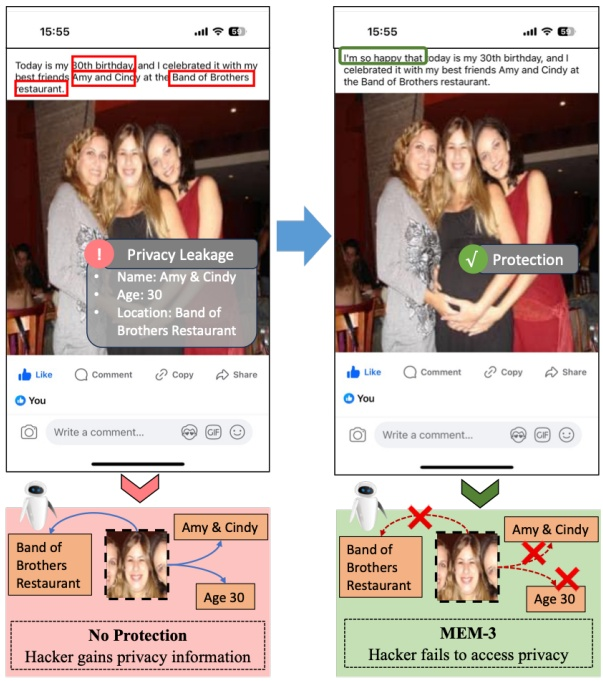
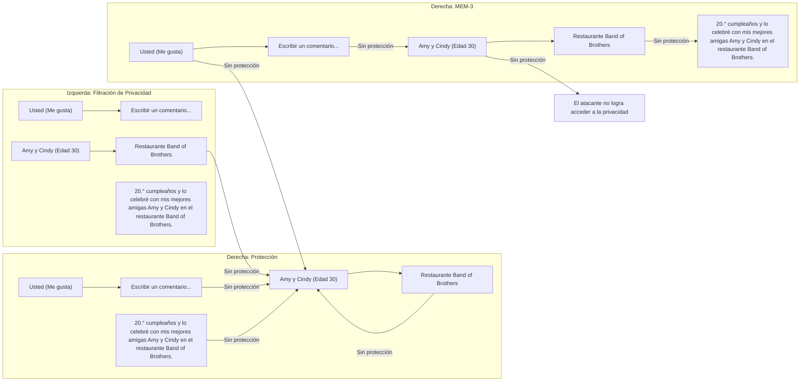
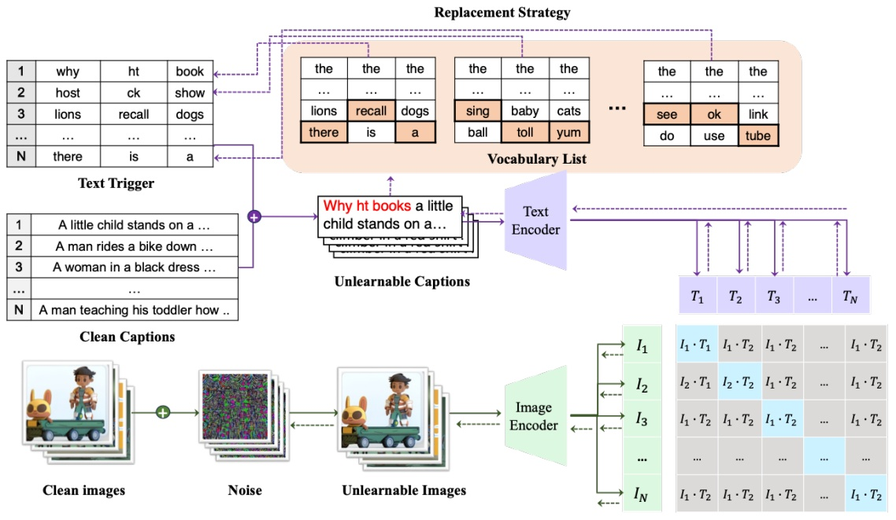
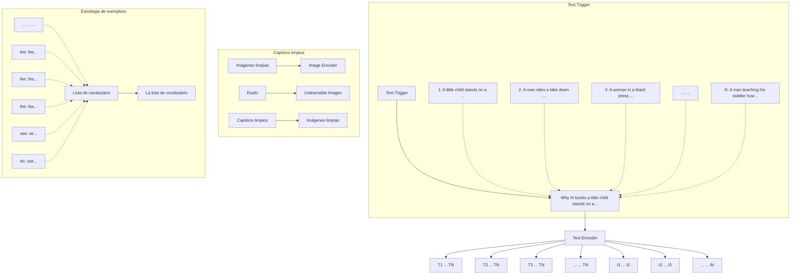

<!-- MinerU 4.0.9, tier advanced, VLM llama.cpp/Vulkan GPU; automatic extraction, tables require comparison with the PDF. -->

[PDF original](../../Multimodal%20Unlearnable%20Examples%3A%20Protecting%20Data%20against%20Multimodal%20Contrastive%20Learning.pdf)

# Multimodal Unlearnable Examples: Protecting Data against Multimodal Contrastive Learning

[Xinwei Liu](https://orcid.org/0009-0009-9510-418X)

Institute of Information Engineering,

Chinese Academy of Sciences &

School of Cyberspace Security,

University of Chinese Academy of Sciences

Pekín, China

liuxinwei@iie.ac.cn

[Xiaojun Jia](https://orcid.org/0000-0002-2018-9344)∗

Cyber Security Research Centre @

NTU, Nanyang Technological

University

Singapur

jiaxiaojunqaq@gmail.com

[Yuan Xun](https://orcid.org/0009-0006-7069-9816)

Institute of Information Engineering,

Chinese Academy of Sciences &

School of Cyberspace Security,

University of Chinese Academy of Sciences

Pekín, China

xunyuan@iie.ac.cn

[Siyuan Liang](https://orcid.org/0000-0002-6154-0233)

School of Computing, National

University of Singapore

Singapur

pandaliang521@gmail.com

[Xiaochun Cao](https://orcid.org/0000-0001-7141-708X)

School of Cyber Science and

Technology, Shenzhen Campus, Sun

Yat-sen University

Shenzhen, China

caoxiaochun@mail.sysu.edu.cn

## RESUMEN

El multimodal contrastive learning (MCL) ha mostrado avances notables en la clasificación zero-shot al aprender a partir de millones de pares de imagen-caption recopilados de Internet. Sin embargo, esta dependencia plantea riesgos para la privacidad, ya que atacantes pueden explotar de forma no autorizada datos de imagen-texto para el entrenamiento de modelos, que potencialmente incluyen información personal y sensible para la privacidad. Trabajos recientes proponen generar unlearnable examples añadiendo perturbaciones imperceptibles a las imágenes de entrenamiento para construir atajos (shortcuts) de protección. No obstante, están diseñados para la clasificación unimodal, manteniéndose en gran medida inexplorados en MCL. En primer lugar, exploramos este contexto evaluando el rendimiento de los métodos existentes en pares de imagen-caption, los cuales no se generalizan eficazmente a datos multimodales y muestran un impacto limitado para construir shortcuts debido a la ausencia de etiquetas y a la dispersión de los pares en MCL. En este artículo, proponemos Multi-step Error Minimization (MEM), un novedoso proceso de optimización para generar multimodal unlearnable examples. Extiende el marco de Error-Minimization (EM) para optimizar tanto el ruido de la imagen como un text trigger adicional, ampliando así el espacio optimizado y engañando eficazmente al modelo para que aprenda el shortcut entre las características del ruido y el text trigger. Específicamente, adoptamos projected gradient descent para resolver el problema de minimización del ruido y empleamos HotFlip para aproximar el gradiente y reemplazar palabras con el fin de encontrar el text trigger óptimo. Extensos experimentos demuestran la efectividad de MEM, con resultados de recuperación posteriores a la protección cercanos a la mitad de una suposición aleatoria (random guessing), así como su alta transferabilidad entre diferentes modelos. Nuestro código está disponible en [https://github.com/thinwayliu/Multimodal-Unlearnable-Examples](https://github.com/thinwayliu/Multimodal-Unlearnable-Examples)

## CONCEPTOS CCS

• **Seguridad y privacidad** → **Protecciones de privacidad**; • **Metodologías de computación** → **Visión por computadora**; **Machine learning**.

## PALABRAS CLAVE

Protección de datos; Protección de la privacidad; Unlearnable Examples; Poisoning Attack; Multimodal Contrastive Learning

## Formato de referencia ACM:

Xinwei Liu, Xiaojun Jia, Yuan Xun, Siyuan Liang, and Xiaochun Cao. 2024. Multimodal Unlearnable Examples: Protecting Data against Multimodal Contrastive Learning. In Proceedings of the 32nd ACM International Conference on Multimedia (MM '24), October 28–November 1, 2024, Melbourne, VIC, Australia. ACM, New York, NY, USA, 10 pages. [https://doi.org/10.1145/3664647.3680708](https://doi.org/10.1145/3664647.3680708)

## 1 INTRODUCCIÓN

En los últimos años, ha habido un creciente interés en los modelos multimodales dentro de la comunidad de investigadores [3]. Los métodos tradicionales [44, 51, 61] se han centrado principalmente en el análisis de una única modalidad de datos. Sin embargo, con el auge del aprendizaje multimodal, diferentes tipos de datos, tales como texto, imágenes y audio, se combinan en un marco unificado. Uno de los enfoques más populares para el aprendizaje multimodal es el Multimodal Contrastive Learning (MCL), como lo demuestran modelos como CLIP [66] y ALIGN [35]. Estos modelos se entrenan con una loss contrastiva, la cual promueve la correlación entre pares de imágenes y captions al tiempo que los mantiene diferenciados de pares no relacionados. Este enfoque reduce la necesidad de una anotación manual exhaustiva de los datos de entrenamiento y permite el uso de datasets de mayor tamaño que contienen millones de ejemplos. El MCL ha mostrado gran potencial en diversas aplicaciones, incluyendo la clasificación de imágenes [66], el subtitulado de imágenes (image captioning) [41, 63] y la generación de imágenes [43, 65].

<small>∗Autores de correspondencia conjunta</small>

<small>Se concede permiso para hacer copias digitales o impresas de parte o de la totalidad de este trabajo para uso personal o en el aula sin cargo alguno, siempre que las copias no se hagan ni se distribuyan con fines de lucro o ventaja comercial y que las copias lleven este aviso y la citación completa en la primera página. Deben respetarse los derechos de autor de los componentes de este trabajo que pertenezcan a personas distintas de los autores. Se permite la reproducción de resúmenes con mención de procedencia. Para copiar de otro modo, republicar, colocar en servidores o redistribuir en listas, se requiere autorización previa específica o el pago de una tarifa. Solicite permisos a permissions@acm.org.</small>

<small>MM '24, October 28–November 1, 2024, Melbourne, VIC, Australia.</small>

<small>© 2024 Copyright en posesión del propietario/autor(es). Derechos de publicación licenciados a ACM.</small>

<small>ACM ISBN 979-8-4007-0686-8/24/10</small>

<small>[https://doi.org/10.1145/3664647.3680708](https://doi.org/10.1145/3664647.3680708)</small>

flowchart

Figura 1: Las publicaciones en Facebook filtran inadvertidamente información personal. Utilizar MEM-3 para proteger los datos puede evitar que modelos no autorizados accedan a características privadas.

El entrenamiento de modelos multimodales de alto rendimiento depende en gran medida de grandes cantidades de datos multimodales, a menudo obtenidos de datasets públicamente disponibles como CC12M [5], YFCC100M [74] y LAION-5B [69]. Sin embargo, a medida que la demanda de datasets más grandes continúe aumentando en el futuro, estos datasets pueden resultar aún insuficientes. En consecuencia, actores maliciosos pueden recurrir a la adquisición no autorizada de datos de la web o participar en el raspado (crawling) de publicaciones de usuarios en redes sociales con fines de entrenamiento comercial. No obstante, estos datasets a menudo contienen cantidades significativas de información personal confidencial, lo que genera preocupación en las personas sobre el posible uso no autorizado de datos personales y la filtración de la privacidad de los usuarios.

Una serie de trabajos recientes realizan esfuerzos para prevenir el uso no autorizado en la clasificación de imágenes haciendo que la imagen sea inexplotable. Específicamente, envenenan los datos con algunas perturbaciones imperceptibles [48, 52–54, 77], creando "shortcuts" [82] en el proceso de entrenamiento que impiden que los modelos aprendan las características de las imágenes [83]. Este tipo de ataque se denomina availability attacks o indiscriminate poisoning attacks, y estos datos de entrenamiento envenenados se llaman unlearnable examples. Estos métodos de desaprendizaje [50] se pueden clasificar ampliamente en dos categorías: ataques model-free y model-based. Los ataques model-free generalmente generan ruido inaprendible a nivel de píxel sin ningún conocimiento de los datos limpios y crean directamente shortcuts entre el ruido de la imagen y las etiquetas, como LSP [82] y CUDA [67]. Debido a su asociación directa con las etiquetas, estos patrones suelen exhibir una alta eficiencia. Los ataques model-based generan típicamente ruido a través de modelos sustitutos (surrogate models). El surrogate model aprende las características a través de la fase de entrenamiento y genera el ruido a nivel de características, como Error-Minimizing [31] y Adversarial Poisoning [17]. Sin embargo, aún no existen investigaciones que consideren la protección de datos multimodales en el contexto de MCL.

Somos los primeros en considerar un escenario centrado en generar multimodal unlearnable examples contra los riesgos de privacidad [6, 11, 13, 26, 49] asociados con MCL. En este contexto, nos concentramos en pares de imagen-texto como un dataset multimodal representativo. Se asume que los usuarios comparten con frecuencia fotos personales con texto en plataformas de redes sociales como Facebook, incluyendo información de identidad privada como rostros, nombres, números de teléfono y direcciones. Actualmente, atacantes intentan recopilar grandes cantidades de tales pares de imagen-texto de Internet y utilizan técnicas de MCL para entrenar modelos fundacionales modernos, como se ilustra en el segmento izquierdo de la Fig. 1. Estos modelos capturan inadvertidamente la información privada y las características faciales del usuario, conduciendo a una posible filtración de privacidad. Los protectores tienen como objetivo evitar la explotación no autorizada de estos datos sensibles realizando métodos de desaprendizaje sobre datos multimodales. Estos métodos buscan hacer que los modelos entrenados sobre tales multimodal unlearnable examples sean incapaces de acceder a las características de privacidad de los usuarios, sin obstaculizar las interacciones sociales de los usuarios al publicar imágenes y texto, como se muestra en el segmento derecho de la Fig. 1.

Una idea intuitiva implica extender los métodos de desaprendizaje para la clasificación de imágenes a MCL. Sin embargo, exploramos el rendimiento de estos métodos en datos multimodales, y todos ellos fallan en presentar una protección efectiva debido al aumento de las modalidades de datos o a la dispersión de los pares de datos. Para los ataques model-free, estos no logran generar patrones de ruido específicos que se correlacionen fuertemente con la categoría para un shortcut debido a la falta de etiquetas certeras en los pares de imagen-texto. Para los ataques model-based, aunque puede ser factible optimizar el ruido para construir shortcuts con captions limpios, su eficacia se reduce significativamente. Nuestro análisis se atribuyó principalmente a la dispersión de los pares de datos, lo que plantea desafíos en el aprendizaje del par de ruido y los captions en comparación con las imágenes y etiquetas en clasificación, como se ilustra en la Fig. 2. Por lo tanto, establecer shortcuts más eficientes es clave para generar multimodal unlearnable examples efectivos.

En este artículo, proponemos un novedoso marco de optimización que genera eficientemente ejemplos multimodales inaprendibles para pares de imagen-caption. Primero adoptamos el marco de Error-minimizing (EM) [31] como base para nuestro ataque, y consideramos optimizar el ruido junto con un text trigger adicional. Específicamente, siguiendo los triggers adversariales en NLP [76], proponemos añadir secuencias cortas de texto como triggers al principio del caption limpio, lo cual no afecta la comprensión del texto por parte del usuario. Por lo tanto, se puede formular un problema de minimización de pasos múltiples para optimizar el par de ruido y text trigger y construir el shortcut entre ellos, al que denominamos Multi-step Minimization (MEM), con el fin de evitar que el modelo no autorizado aprenda las características de las imágenes y los captions. Durante la optimización, consideramos adoptar projected gradient descent (PGD) [62] para resolver el problema de minimización del ruido y utilizar el método HotFlip [12] para aproximar el gradiente y la estrategia de reemplazo en [76] para seleccionar el trigger óptimo en el problema de minimización de texto. Mediante extensos experimentos, verificamos que los unlearnable examples generados por MEM brindan una mejor protección y exhiben transferabilidad entre diferentes modelos.

En resumen, nuestras principales contribuciones son:

• Somos los primeros en considerar un nuevo escenario denominado protección de datos multimodales, cuyo objetivo es evitar que los datos personales multimodales en redes sociales sean sometidos a MCL no autorizado, y tomamos los pares de imagen-texto como ejemplos.

• Analizamos las limitaciones de los métodos previos extendidos al multimodal contrastive learning, atribuidas al incremento en la modalidad y a la dispersión de las características de los captions.

• Proponemos Multi-step Error Minimization (MEM) para generar multimodal unlearnable examples efectivos, el cual aprovecha un text trigger optimizado adicional para lograr una mejor convergencia sobre la base de Error-minimizing (EM).

• Se llevan a cabo extensos experimentos para verificar la efectividad de nuestro método con diferentes datasets. Además, presentamos un estudio de caso práctico sobre la protección de la privacidad facial dentro de un escenario de fine-tuning.

## 2 TRABAJOS RELACIONADOS

## 2.1 Multimodal Contrastive Learning

Diseñados inicialmente para el aprendizaje autorregulado de representaciones en contextos unimodales, los métodos de aprendizaje contrastivo buscan mejorar la concordancia entre vistas aumentadas de forma diferente de una misma instancia, mientras reducen la concordancia entre vistas de instancias distintas [7, 10, 27, 29, 64]. Recientemente, estas técnicas se han extendido a dominios multimodales, en particular en el contexto de datasets emparejados de imagen-texto. Modelos contrastivos multimodales como CLIP [66] y ALIGN [35] han sido sometidos a un preentrenamiento extensivo en vastos datasets que incluyen de cientos de millones a miles de millones de pares de imagen-texto. Su objetivo es maximizar la concordancia entre las representaciones de los pares coincidentes de imagen-caption, minimizando al mismo tiempo la concordancia para pares no coincidentes. Como resultado, estos modelos han exhibido un rendimiento excepcional en tareas de clasificación zero-shot y han demostrado robustez frente a desplazamientos distribucionales (distributional shifts).

## 2.2 Poisoning Attacks

Los ataques de envenenamiento de datos (data poisoning attacks) tienen como objetivo perturbar el proceso de entrenamiento del modelo procesando el dataset de entrenamiento, lo que genera un aumento significativo en los errores de prueba para ciertas muestras específicas durante la fase de evaluación [9, 58, 71]. Un tipo común de ataque de envenenamiento de datos es el backdoor attack [20, 25, 34, 46, 47, 55–57, 59, 60, 78, 85, 86], que típicamente implica inyectar triggers en las muestras de entrenamiento, llevando a una clasificación errónea de las imágenes que contienen estos patrones de trigger durante la fase de prueba [19, 42]. Sin embargo, típicamente solo afecta a las muestras con trigger, mientras que las muestras limpias permanecen inalteradas y pueden ser clasificadas correctamente. Trabajos recientes también exploran los poisoning attacks sobre multimodal contrastive learning (MCL). Yang et al. [80] estudian los poisoning attacks contra modelos multimodales en modalidades visuales y lingüísticas. Carlini y Terzis [4] introdujeron un marco que envenenó eficazmente modelos CLIP mediante backdoor attacks. Además, algunos trabajos buscan entrenar un modelo CLIP robusto frente a ataques de envenenamiento de datos y backdoor attacks [2, 79]. Debido a que entrenar un modelo de alto rendimiento con un dataset a gran escala requiere mucho tiempo, seguiremos la configuración experimental de estos trabajos para entrenar un modelo más simple con un dataset pequeño en este artículo. Cuando el objetivo se generaliza a todo el conjunto de prueba, el ataque de envenenamiento se denomina indiscriminate/availability poisoning attack [28, 82]. En la comunidad, esto se considera un caso especial de poisoning attack, que también puede dividirse en escenarios clean-label y dirty-label.

## 2.3 Métodos Inaprendibles (Unlearnable Methods)

Los unlearnable methods tienen como objetivo proteger los datos del entrenamiento no autorizado de modelos de clasificación introduciendo ruido imperceptible en las imágenes, consistiendo de hecho en ataques de envenenamiento de disponibilidad/indiscriminados clean-label (clean-label indiscriminate/availability poisoning attacks). Los modelos entrenados con tales unlearnable examples muestran típicamente una notable disminución de accuracy en conjuntos de prueba limpios.

Existen dos categorías para generar unlearnable examples en la clasificación de imágenes. La primera categoría involucra ataques model-based, los cuales requieren un modelo sustituto (surrogate model) para guiar la generación de perturbaciones [16, 72]. El método Error-Minimizing (EM) [31] minimiza el error de clasificación de las imágenes en un clasificador sustituto y actualiza iterativamente el surrogate model con estas imágenes perturbadas. Fowl et al. [17] proponen el adversarial poisoning, que incluye targeted adversarial perturbation (TAP) y untargeted adversarial perturbation (UAP), utilizando ejemplos adversariales [21–24, 32, 33] como datos envenenados para hacer que el modelo desaprenda las características. TAP presenta una protección efectiva para el dataset de imágenes. Si bien los métodos model-based son potentes, a menudo son computacionalmente exigentes. Algunos hallazgos revelan que estos enfoques pueden ser fácilmente neutralizados mediante adversarial training (AT) [1, 36–38, 45]. Para abordar esto, varios trabajos intentan aprovechar protecciones robustas contra AT [15, 18]. Por otro lado, los métodos model-free no requieren un surrogate model para generar ruido en las imágenes. Yu et al. [82] investigan empíricamente varios métodos inaprendibles y demuestran que todos ellos utilizan estas características espurias para crear un shortcut en el modelo. También proponen Linear-separable Synthetic Perturbation (LSP) en respuesta a esta característica y muestran una gran efectividad. Autoregressive poisoning [68] propone una generación de perturbaciones genérica para cada clase que se puede aplicar a diferentes datasets, la cual consiste en una serie de perturbaciones independientes del dataset. CUDA [67] se genera mediante convoluciones controladas por clase con filtros generados aleatoriamente a través de una clave privada. Estos trabajos previos se centran en la clasificación de imágenes utilizando la cross-entropy loss, y He et al. [28] exploran los unlearnable examples para el aprendizaje contrastivo no supervisado, descubriendo que los métodos EM y TAP extendidos aún pueden proteger eficazmente contra el aprendizaje no supervisado. Sin embargo, al extenderlos al multimodal contrastive learning, su efectividad disminuye debido al aumento de modalidad.

## 3 MULTIMODAL UNLEARNABLE EXAMPLES

## 3.1 Preliminares

Nuestro escenario involucra a dos partes principales: el protector y el atacante (hacker). Asumimos que el protector es consciente de que los datos privados multimodales pueden ser utilizados de manera no autorizada por atacantes. En consecuencia, el protector toma medidas para hacer que las muestras sean inaprendibles realizando operaciones sobre el conjunto de datos. Posteriormente, el protector publica estos multimodal unlearnable examples en Internet. Luego, cuando los atacantes extraen los datos multimodales de la web para entrenar modelos multimodales desde cero con un modelo inicial o para realizar fine-tuning de un modelo preentrenado, estos unlearnable examples evitarán que el modelo aprenda las características de los datos privados y presentarán una pobre representación de características entre modalidades. En este artículo, tomamos el par de imagen-texto como datos multimodales de ejemplo y seleccionamos CLIP [66] como el modelo utilizado por los atacantes, siendo este el marco de multimodal contrastive learning más representativo.

Figura 2: Comparación de diferentes métodos en clasificación y multimodal contrastive learning (MCL). 𝐼𝑖 denota la imagen y $T _ { i }$ es el caption emparejado. El área azul es el límite de decisión esperado de los modelos entrenados con unlearnable examples.

Aquí formulamos nuestro problema: comenzamos considerando un dataset personal de imagen-caption $\mathcal { D } \subset \mathcal { I } \times \mathcal { T }$ que comprende pares $( I _ { i } , T _ { i } )$, donde $I _ { i }$ es una imagen y $T _ { i }$ es el caption asociado. El protector tiene como objetivo generar un conjunto inaprendible $\mathcal { D } _ { u }$ que contiene los pares inaprendibles de imagen-texto $\left( I _ { i } ^ { \prime } , T _ { i } ^ { \prime } \right)$, y hacer que un modelo CLIP $f ^ { * }$ entrenado con él se generalice deficientemente sobre la distribución limpia $\mathcal{D}$:

$$
\arg \max _ {\mathbb {E} _ {(I, T) \sim \mathcal {D}}} \left[ \mathcal {L} \left(f ^ {*} (I, T)\right) \right],
$$

$$
\text {s.t.} f ^ {*} \in \arg \min _ {f} \sum_ {\left(I ^ {\prime}, T ^ {\prime}\right) \in \mathcal {D} _ {u}} \left[ \mathcal {L} \left(f \left(I ^ {\prime}, T ^ {\prime}\right)\right) \right] \tag {1}
$$

## 3.2 Limitaciones de los Trabajos Existentes

Resolver directamente la Ec. 1 es intratable para redes neuronales profundas, y trabajos recientes han diseñado múltiples soluciones aproximadas. Podemos seguir estos trabajos y extenderlos a MCL. Sin embargo, todos los métodos model-free para clasificación fallan en generar ruido de imagen en este contexto porque dichos métodos buscan encontrar una serie de patrones de ruido específicos para imágenes relacionadas con una clase determinada, mientras que no existen etiquetas en los datos de pares de imagen-caption. Por lo tanto, solo los métodos model-based pueden aplicarse a MCL, y extendemos dos métodos típicos para generar multimodal unlearnable examples. Específicamente, aprovecharon la adición de un conjunto de perturbaciones $\Delta$ sobre las imágenes y emplearon una cota $l_\infty$ para cada ruido $\delta$.

3.2.1 El ruido de minimización de error (EM). Huang et al. [31] proponen un objetivo bi-nivel para generar perturbaciones $\delta$ en las imágenes con un surrogate model, cuyo propósito es minimizar la loss del surrogate model sobre los datos de entrenamiento. Denotamos el ruido de la imagen por $\delta$ y el surrogate model por $f$. Por lo tanto, podemos aplicarlo a los multimodal unlearnable examples con la loss de CLIP $\mathcal { L }$, y el objetivo es el siguiente:

$$
\arg \min _ {\delta \in \Delta} \mathbb {E} _ {(I, T) \rightharpoonup \mathcal {D}} \left[ \min _ {f} \mathcal {L} (f (I + \delta , T)) \right]. \tag {2}
$$

3.2.2 Perturbación adversarial no dirigida (Untargeted Adversarial Perturbation, UAP). En lugar de emplear objetivos bi-nivel, Fowl et al. [17] demuestran que los objetivos comunes utilizados para generar ejemplos adversariales son suficientes como perturbaciones inaprendibles. Utilizaron untargeted adversarial perturbations (UAP) y targeted adversarial perturbations (TAP) como ejemplos de perturbaciones inaprendibles. Sin embargo, extender TAP a datos de imagen-caption es un desafío debido a la dificultad para seleccionar el objetivo deseado para el caption. Por lo tanto, solo podemos construir UAP $\delta$ utilizando el siguiente objetivo:

$$
\arg \max _ {\delta \in \Delta} \mathbb {E} _ {(I, T) \sim \mathcal {D}} \left[ \mathcal {L} \left(f ^ {*} (I + \delta , T)\right) \right]. \tag {3}
$$

Sin embargo, a partir de la Tabla 1, encontramos experimentalmente que, aunque EM y UAP pueden aplicarse a pares de imagen-caption, no logran alcanzar una protección altamente efectiva, especialmente UAP. Exploramos las razones de la disminución de efectividad de estos métodos al pasar de la clasificación de imágenes al multimodal contrastive learning. En la clasificación de imágenes, EM y UAP optimizan las imágenes con la misma etiqueta para que converjan en un espacio de características, lo que da como resultado que el modelo capture fácilmente estos ruidos aditivos y aprenda la correlación con las etiquetas, como se muestra en la Fig. 2(a). Sin embargo, en el multimodal contrastive learning (MCL), para aplicar eficazmente los métodos EM y UAP, la dirección del ruido de imagen optimizado debe relacionarse con las características del caption, haciendo que las características de la imagen se acerquen o se alejen de estas características. No obstante, las características de los captions de diferentes pares pueden estar ampliamente dispersas en el dataset de imagen-caption. En consecuencia, como se ilustra en la Fig. 2 (b) y (c), resulta más difícil para el modelo capturar la correlación entre los captions y el ruido generado por EM y UAP en comparación con la clasificación. En la Fig. 2 (c), el espacio de decisión de aprendizaje de UAP es mucho más complejo, por lo que su deficiente protección es de esperarse.

## 3.3 Multi-step Error Minimization (MEM)

En la sección anterior, mostramos que los métodos model-based todavía no logran una protección efectiva debido a la dispersión de los pares de imagen-texto. Una estrategia intuitiva de mejora implica optimizar tanto la imagen como los captions para lograr un espacio optimizado más amplio, impulsando su convergencia a través de diferentes pares en el espacio de características. En consecuencia, las representaciones de características optimizadas del conjunto de imágenes y captions exhiben distribuciones similares, facilitando que el modelo aprenda su shortcut, como se ilustra en la Fig. 2 (d).

Con este fin, tomamos el método EM como marco básico y proponemos añadir un text trigger corto adicional al caption para minimizar la contrastive loss, siguiendo la configuración de un ataque adversarial en tareas de texto [76]. En cuanto a la longitud del trigger, los triggers más largos son más efectivos, mientras que los triggers más cortos son más sigilosos.

flowchart

Figura 3: El esquema de MEM. En cada paso, concatenamos el trigger actual a los captions limpios y añadimos ruido a las imágenes limpias. Luego calculamos el gradiente con las imágenes y tokens actuales. Actualizamos las imágenes usando la Ec. 5 y actualizamos los text triggers con la Ec. 6. La línea continua representa la propagación hacia adelante (forward propagation) y la línea discontinua representa la propagación hacia atrás (backward propagation).

Por lo tanto, nuestro método puede conceptualizarse como un problema de optimización iterativa de tres niveles (tri-level iterative optimization), semejante a un proceso de pasos múltiples de EM. Específicamente, optimizamos secuencialmente el ruido $\delta$ y el text trigger $t$ para reducir la contrastive loss entre las imágenes optimizadas $I + \delta$ y el texto optimizado $T \oplus t$, donde $\oplus$ denota los triggers que se pueden insertar en el texto limpio $T$ en varias posiciones. Por simplicidad, optamos por añadir text triggers al comienzo del texto. Como resultado, nuestro Multi-step Error Minimization (MEM) puede formularse de la siguiente manera:

$$
\arg \min _ {\delta \in \Delta , t \in \mathcal {T}} \mathbb {E} _ {(I, T) \sim \mathcal {D}} \left[ \min _ {f} \mathcal {L} (I + \delta , T \oplus t) \right]. \tag {4}
$$

Podemos optimizar iterativamente el problema anterior de manera secuencial haciendo referencia al método en EM. Usamos projected gradient descent (PGD) [62] para resolver el problema de minimización del ruido en la Ec. 4. Notablemente, para mitigar que el ruido sobreajuste (overfit) a los captions limpios, los aumentamos reorganizando aleatoriamente (shuffling) el caption limpio en un batch y añadiéndoles los text triggers correspondientes correctos. De este modo, este ruido generado puede centrarse más en el text trigger que en partes de los captions cuando se enfrenta a captions semánticamente incorrectos. Así, podemos obtener el $\delta$ óptimo según la siguiente fórmula iterativa:

$$
\delta^ {t + 1} = \operatorname{Proj} \left(\delta^ {t} - \alpha \operatorname{sign} \left(\nabla_ {\delta^ {t}} \mathcal {L} (I + \delta , S (T) \oplus t)\right)\right), \tag {5}
$$

donde $\nabla _ { \delta ^ { t } } \mathcal { L }$ es el gradiente de la loss con respecto a $\delta^t$, $\alpha$ es el tamaño de paso (step size) y $\operatorname{Proj}()$ denota la proyección de $\delta$ dentro de los límites de la norma $(-\epsilon, \epsilon)$. $\mathcal{S}(\cdot)$ significa permutar el orden de las muestras de captions limpios en un batch en cada iteración. Para el problema de minimización del text trigger, primero inicializamos la secuencia del trigger repitiendo la palabra "the" o "a" al frente de todas las entradas. Además, optimizamos el text trigger basándonos en HotFlip [12], un método que aproxima el efecto de reemplazar un token utilizando el gradiente. Denotamos un text trigger como $t_i$, el cual es un vector one-hot y puede incrustarse en la forma $e_i$. Por lo tanto, podemos actualizar el embedding para cada token del trigger $e_i$ con el fin de minimizar la aproximación de Taylor de primer orden de la loss de CLIP alrededor del embedding del token actual:

$$
\underset {\mathbf {e} _ {j} ^ {\prime} \in \mathcal {V}} {\arg \min} \left[ \mathbf {e} _ {j} ^ {\prime} - \mathbf {e} _ {i} \right] ^ {\top} \nabla_ {\mathbf {e} _ {i}} \mathcal {L}, \tag {6}
$$

donde $\mathcal{V}$ es el conjunto de todos los embeddings de tokens en el vocabulario y $\nabla_{\mathbf{e}_i}\mathcal{L}$ es el gradiente de la loss con respecto a $e_i$. Podemos calcular un conjunto de tokens candidatos $e'_j$ mediante un producto punto entre el embedding del token del vocabulario y los gradientes. Finalmente, podemos buscar cada text trigger óptimo con una beam search dentro del conjunto de tokens candidatos. Consideramos los top-k candidatos de la Ec. 6 y buscamos desde el principio hasta el final en cada posición del trigger, evaluando cada haz (beam) utilizando la loss en el batch actual. Seguimos a Wallace et al. [76] y utilizamos un tamaño de haz pequeño por eficiencia. En la Fig. 3, se puede observar el esquema de generación de multimodal unlearnable examples con nuestro MEM.
