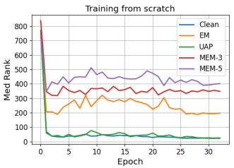
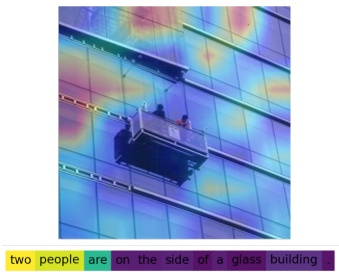

## 4 EXPERIMENTOS

## 4.1 Configuración Experimental

**Modelos objetivo y datasets.** Siguiendo trabajos previos [2, 79, 80], adoptamos la implementación de código abierto de CLIP en la comunidad1. Para la arquitectura del surrogate model, elegimos el modelo con ResNet50 [30] como image encoder y un Transformer [75] con ciertas modificaciones arquitectónicas como text encoder. Nuestro experimento abarca tres datasets: Flickr8K [81], Flickr30K [81] y MS-COCO [8]. Específicamente, Flickr8K y Flickr30K constan de 8.000 y 31.000 imágenes, respectivamente, cada una acompañada

<small>1[https://github.com/mlfoundations/open\_clip](https://github.com/mlfoundations/open_clip)</small>

Tabla 1: Comparación de la efectividad con diferentes unlearnable examples en varios datasets.

<table><tr><td>Dataset</td><td colspan="4">Flick8k</td><td colspan="4">Flick30k</td><td colspan="4">MSCOCO</td></tr><tr><td rowspan="2">Methods</td><td colspan="2">Image → Text</td><td colspan="2">Text → Image</td><td colspan="2">Image → Text</td><td colspan="2">Text → Image</td><td colspan="2">Image → Text</td><td colspan="2">Text → Image</td></tr><tr><td>Hit@10</td><td>Medr</td><td>Hit@10</td><td>Medr</td><td>Hit@10</td><td>Medr</td><td>Hit@10</td><td>Medr</td><td>Hit@10</td><td>Medr</td><td>Hit@10</td><td>Medr</td></tr><tr><td>Random</td><td>1.2</td><td>727</td><td>0.9</td><td>490</td><td>1.0</td><td>711</td><td>1.0</td><td>498</td><td>0.2</td><td>3419</td><td>0.2</td><td>2491</td></tr><tr><td>Clean</td><td>22.7</td><td>58</td><td>18.5</td><td>60</td><td>46.5</td><td>12</td><td>42.7</td><td>16</td><td>65.1</td><td>5</td><td>58.3</td><td>7</td></tr><tr><td>EM [31]</td><td>13.8</td><td>117</td><td>15.9</td><td>86</td><td>9.6</td><td>197</td><td>7.9</td><td>170</td><td>1.7</td><td>1213</td><td>1.6</td><td>880</td></tr><tr><td>UAP [17]</td><td>12.9</td><td>110</td><td>16.5</td><td>76</td><td>36.7</td><td>26</td><td>35.6</td><td>24</td><td>63.8</td><td>5</td><td>57.1</td><td>7</td></tr><tr><td>MEM-3 (ours)</td><td>4.1</td><td>304</td><td>3.7</td><td>250</td><td>3.8</td><td>412</td><td>2.2</td><td>308</td><td>1.7</td><td>1705</td><td>1.3</td><td>1301</td></tr><tr><td>MEM-5 (ours)</td><td>3.8</td><td>308</td><td>3.0</td><td>275</td><td>3.9</td><td>445</td><td>2.0</td><td>325</td><td>0.8</td><td>1883</td><td>1.1</td><td>1466</td></tr></table>

Tabla 2: Transferabilidad de MEM-3 generado sobre un modelo ResNet50 a través de modelos de diferentes arquitecturas.

<table><tr><td>Dataset</td><td colspan="4">Flick8k</td><td colspan="4">Flick30k</td><td colspan="4">MSCOCO</td></tr><tr><td rowspan="2">Model</td><td colspan="2">Image → Text</td><td colspan="2">Text → Image</td><td colspan="2">Image → Text</td><td colspan="2">Text → Image</td><td colspan="2">Image → Text</td><td colspan="2">Text → Image</td></tr><tr><td> $D_c$ </td><td> $D_u$ </td><td> $D_c$ </td><td> $D_u$ </td><td> $D_c$ </td><td> $D_u$ </td><td> $D_c$ </td><td> $D_u$ </td><td> $D_c$ </td><td> $D_u$ </td><td> $D_c$ </td><td> $D_u$ </td></tr><tr><td>RN50</td><td>58</td><td>308</td><td>60</td><td>275</td><td>12</td><td>445</td><td>16</td><td>325</td><td>5</td><td>1086</td><td>7</td><td>988</td></tr><tr><td>RN101</td><td>52</td><td>236</td><td>58</td><td>197</td><td>10</td><td>404</td><td>17</td><td>306</td><td>5</td><td>989</td><td>6</td><td>844</td></tr><tr><td>ViT-B/32</td><td>53</td><td>241</td><td>52</td><td>194</td><td>9</td><td>343</td><td>13</td><td>287</td><td>4</td><td>1064</td><td>4</td><td>920</td></tr></table>

por cinco captions. Nos adherimos al protocolo establecido por [14, 39, 84], dividiendo los datasets en conjuntos de entrenamiento/validación/prueba con proporciones de 6.000/1.000/1.000 y 29.000/1.000/1.000 para Flickr8K y Flickr30K, respectivamente. MS-COCO comprende 123.287 imágenes, cada una anotada con cinco descripciones. En [39], MS-COCO se dividió en 82.783 imágenes de entrenamiento, 5.000 imágenes de validación y 5.000 imágenes de prueba. A pesar de su menor tamaño en comparación con los datasets a gran escala utilizados para entrenar el modelo CLIP original, estos datasets siguen siendo adecuados para recursos de almacenamiento y cómputo, y han encontrado un uso generalizado en estudios de MCL [79, 80].

**Configuración de entrenamiento y de ataque.** Inicialmente, nos centramos en entrenar modelos desde cero (from scratch) en los experimentos principales y reservamos la discusión del escenario de fine-tuning para el estudio de caso sobre protección de la privacidad facial. Siguiendo la configuración de entrenamiento del modelo CLIP en [2, 66], elegimos un batch size de 128 y fijamos la tasa de aprendizaje inicial en 0,0005. La tasa de weight decay se establece en 0,2 y empleamos un optimizador Adam con regularización de weight decay desacoplada, mientras que la tasa de aprendizaje decae mediante un cosine scheduler. Entrenamos estos modelos from scratch en 1 GPU A100 durante 32 epochs. Durante la etapa de ataque, extendemos los métodos EM y UAP a MCL. En ambos casos, asumimos que los surrogate models son modelos CLIP con ResNet50, mientras que el surrogate model para UAP ya está entrenado sobre datos limpios. Para nuestro MEM, elegimos un CLIP sustituto inicial y optimizamos iterativamente el ruido y el text trigger, deteniéndonos cuando la loss está por debajo de un umbral. Seleccionamos un umbral de 0,01. Con respecto al text trigger, fijamos las longitudes de la secuencia de texto en tres y cinco, denominadas MEM-3 y MEM-5, respectivamente. Típicamente, fijamos el límite de ruido de todos los métodos con la norma $l_\infty$ $\epsilon = 8 / 255$.

**Métricas de evaluación.** Evaluamos el impacto de la protección de datos examinando la disminución del rendimiento en las tareas de recuperación de imágenes y textos, basándonos en trabajos previos sobre ataques en MCL [79, 80]. Se emplean dos métricas para ilustrarlo. **Hit@10** mide la proporción de todas las imágenes/textos objetivo que aparecen dentro del top 10 de la lista de ranking. Valores más altos de Hit@10 indican que muchas muestras de texto/imagen logran recuperar tempranamente las imágenes/textos objetivo, reflejando una mejor lista de ranking. **Medr** se refiere a la posición mediana de todas las imágenes/textos objetivo en la lista de imágenes/textos de prueba. Valores de Rank más bajos indican un acceso más temprano a las imágenes objetivo, lo que indica una lista de ranking superior. El rendimiento de los multimodal unlearnable examples se evalúa utilizando Hit@10 y Medr para la recuperación de imágenes (Image → Text) y la recuperación de texto (Text → Image) en todas las imágenes de prueba. Un menor Hit@10 y un mayor Medr significan una protección más efectiva de los datos.

line

| Epoch | Clean | EM | UAP | MEM-3 | MEM-5 |
| --- | --- | --- | --- | --- | --- | --- |
| 0 | ~4.7 | ~3.4 | ~4.6 | ~1.1 | ~1.1 |
| 5 | ~1.2 | ~0.6 | ~1.4 | ~0.3 | ~0.2 |
| 10 | ~0.5 | ~0.4 | ~0.7 | ~0.2 | ~0.2 |
| 15 | ~0.2 | ~0.1 | ~0.3 | ~0.1 | ~0.1 |
| 20 | ~0.1 | ~0.05 | ~0.1 | ~0.05 | ~0.05 |
| 25 | ~0.05 | ~0.02 | ~0.05 | ~0.02 | ~0.02 |
| 30 | ~0.02 | ~0.01 | ~0.02 | ~0.01 | ~0.01 |

(a) Training Loss

line

| Epoch | Clean | EM | UAP | MEM-3 | MEM-5 |
| --- | --- | --- | --- | --- | --- | --- |
| 0 | ~840 | ~840 | ~840 | ~840 | ~840 |
| 1 | ~360 | ~230 | ~60 | ~360 | ~360 |
| 2 | ~35 | ~200 | ~40 | ~320 | ~410 |
| 3 | ~40 | ~210 | ~40 | ~320 | ~410 |
| 4 | ~40 | ~230 | ~40 | ~350 | ~430 |
| 5 | ~40 | ~260 | ~40 | ~380 | ~440 |
| 6 | ~40 | ~290 | ~40 | ~360 | ~450 |
| 7 | ~40 | ~240 | ~40 | ~360 | ~460 |
| 8 | ~40 | ~310 | ~70 | ~370 | ~490 |
| 9 | ~40 | ~240 | ~50 | ~370 | ~510 |
| 10 | ~40 | ~320 | ~60 | ~370 | ~480 |
| 11 | ~40 | ~290 | ~50 | ~370 | ~480 |
| 12 | ~40 | ~310 | ~50 | ~370 | ~460 |
| 13 | ~40 | ~290 | ~50 | ~390 | ~450 |
| 14 | ~40 | ~290 | ~60 | ~360 | ~450 |
| 15 | ~40 | ~290 | ~50 | ~370 | ~450 |
| 16 | ~40 | ~280 | ~40 | ~360 | ~450 |
| 17 | ~40 | ~290 | ~40 | ~370 | ~460 |
| 18 | ~40 | ~280 | ~40 | ~360 | ~480 |
| 19 | ~40 | ~250 | ~50 | ~360 | ~490 |
| 20 | ~40 | ~240 | ~40 | ~370 | ~480 |
| 21 | ~40 | ~230 | ~40 | ~360 | ~450 |
| 22 | ~40 | ~310 | ~40 | ~370 | ~430 |
| 23 | ~40 | ~280 | ~40 | ~360 | ~440 |
| 24 | ~40 | ~230 | ~40 | ~360 | ~420 |
| 25 | ~40 | ~230 | ~30 | ~360 | ~430 |
| 26 | ~40 | ~200 | ~30 | ~360 | ~420 |
| 27 | ~40 | ~190 | ~30 | ~350 | ~410 |
| 28 | ~40 | ~190 | ~30 | ~360 | ~410 |
| 29 | ~40 | ~190 | ~30 | ~360 | ~400 |
| 30 | ~40 | ~190 | ~30 | ~360 | ~400 |
| 31 | ~40 | ~190 | ~30 | ~360 | ~400 |

(b) Métrica de prueba Medr

Figura 4: Curvas de training loss y curvas de la métrica de prueba Medr en Flickr30K con diferentes métodos.

## 4.2 Efectividad y Transferabilidad

En esta sección, comparamos nuestro método con extensiones de métodos inaprendibles populares existentes, incluyendo EM [31] y UAP [17]. La Tabla 1 presenta sus resultados de recuperación en diferentes datasets. Es evidente que UAP casi no logra proporcionar ninguna protección para los datos multimodales, mientras que EM demuestra un cierto nivel de protección. Además, a medida que aumenta el tamaño del dataset, el efecto de EM mejora debido a la distribución más densa de captions en el espacio de características, lo cual es consistente con nuestro análisis en la Sección 3.2. Sin embargo, nuestro MEM ofrece sistemáticamente una protección robusta para datos multimodales, reduciendo el rendimiento de recuperación a casi la mitad de una suposición aleatoria (random guessing). En particular, MEM-5, con un text trigger más largo, obtuvo mayores resultados al reducir el rendimiento del modelo atacante en comparación con MEM-3, probablemente porque los text triggers más largos permiten que el modelo se enfoque más eficazmente en el trigger y establezca un shortcut.

text_image

two people are on the side of a glass building

(1) Clean

text_image

two people are on the side of a glass building.

(2) EM

text_image

two people are on the side of a glass building

(3) UAP

text_image

two people are on the side of a glass building

(4) MEM-3 (Ours)

Figura 5: Visualización de mapas de atención: comparación de cuatro modelos sobre datos limpios y unlearnable examples con diferentes métodos.

La Fig. 4 ilustra las curvas descendentes de la training loss entrenada sobre unlearnable examples generados por diferentes métodos y la Medr de recuperación sobre el conjunto de prueba limpio. A partir de (a), observamos que, aunque EM permite que la loss caiga más rápido en comparación con el entrenamiento normal, nuestro método, MEM-3 y MEM-5, presentan una menor loss en la primera epoch, lo que sugiere que el modelo puede aprender rápidamente los shortcuts. UAP apenas acelera la disminución de la loss de manera significativa, por lo que comprensiblemente resulta ineficiente. A partir de (b), encontramos que todos los modelos se entrenan con una disminución de Medr en comparación con el random guessing, pero el modelo envenenado por MEM se detiene de aprender más rápidamente, alcanza el peor resultado y no continúa aprendiendo a medida que aumentan las epochs. Las observaciones anteriores son consistentes con los resultados de la Tab. 1.

Asumimos que la protección de datos es un escenario completamente de caja negra (black-box), en el que el protector desconoce la arquitectura del modelo atacante. Por lo tanto, evaluamos el rendimiento de nuestro MEM generado sobre el modelo sustituto ResNet50 en diferentes modelos atacantes, incluyendo ResNet101 y ViT-B/32. Los resultados se presentan en la Tab. 2. Encontramos que estos ejemplos pueden transferirse con éxito entre diferentes modelos y pueden degradar el rendimiento del modelo CLIP. Aunque se hayan generado con un surrogate model cuya estructura difiere de la del modelo atacante, también pueden exhibir el mismo efecto protector; esta observación se alinea con la de los unlearnable examples en la clasificación de imágenes. Esto se debe probablemente a que las preferencias de características aprendidas por los modelos son similares.

## 4.3 Análisis

**Atención de los modelos.** La Fig. 5 presenta los mapas de calor de imágenes y texto, ilustrando la atención de los modelos entrenados sobre datos limpios y unlearnable examples. Se utiliza Grad-CAM [70] para visualizar la atención del modelo hacia las imágenes, mientras que se emplea Integrated Gradients [73] para visualizar la atención hacia el texto. Los colores más claros representan una mayor atención por parte del modelo. Notablemente, para la imagen, los modelos en (1), (2) y (3) se enfocan todos en la región central, la cual se correlaciona con los captions. Por el contrario, el modelo (4), entrenado sobre muestras generadas por MEM-3, no logra reconocer con precisión la imagen limpia debido a que solo aprende características del ruido. De manera similar en el texto, los modelos en (1), (2) y (3) se centran todos en las palabras clave de 'glass', mientras que el modelo en (d) pone la atención en las tres primeras palabras, probablemente porque MEM-3 siempre optimiza el ruido y los primeros tres text triggers para crear shortcuts. Estas visualizaciones reportan que EM y UAP no son lo suficientemente efectivos para proteger los datos multimodales, mientras que MEM-3 presenta una efectividad evidente.

**Visualización de unlearnable examples.** Visualizamos las distribuciones de características de muestras limpias bajo el modelo normal y las distribuciones de características de unlearnable examples optimizados por MEM-3 sobre el modelo desaprendido en la Fig. 6. Representamos las características de las imágenes con triángulos y las características del texto con círculos, donde el mismo color indica cinco imágenes idénticas pero transformadas y sus correspondientes descripciones diferentes en el dataset. A partir de (a), observamos que bajo el modelo limpio, las mismas imágenes y textos se agrupan internamente y los correspondientes pares de imagen-texto están próximos entre sí. Sin embargo, en (b), existe una divergencia entre las mismas imágenes y textos, estando únicamente los pares próximos entre sí por parejas. Esto indica que nuestros métodos facilitan eficazmente que el modelo aprenda los shortcuts entre el ruido y los textual triggers. **Extensión con Semantic Triggers.** En las partes anteriores, proponemos utilizar el gradiente mediante el método HotFlip para seleccionar embeddings en la lista de vocabulario con productos internos grandes que sirvan como palabras candidatas para el reemplazo. Sin embargo, este enfoque puede dar lugar a la generación de palabras candidatas que carezcan de información semántica, lo que potencialmente impacta la lectura social o facilita su eliminación por parte de los atacantes. Aquí, aprovechamos los parámetros de preentrenamiento del modelo BERT para generar algunas sustituciones semánticamente relevantes como listas de vocabulario. Posteriormente, incrustamos estas sustituciones para obtener $\mathcal{V}_{\mathrm{bert}}$, y luego calculamos el producto interno con el gradiente y los token embeddings de las sustituciones, lo que produce palabras reemplazadas con semántica. La Tabla 3 muestra ejemplos de text triggers generados por nuestro método MEM-3 bajo diferentes datasets, incluyendo aquellos generados con y sin el método BERT. Los text triggers generados con BERT exhiben una mayor naturalidad y coherencia semántica en comparación con los generados sin BERT. Además, mostramos los resultados de Medr de estos triggers en la recuperación de texto-imagen. Se observa que los triggers generados sin BERT tienen un mejor rendimiento de protección, lo cual se atribuye a su mayor espacio de búsqueda, mientras que los triggers generados con BERT están restringidos a un espacio de vocabulario $\mathcal { V } _ { \mathrm { b e r t } }$, resultando en una eficacia de protección inferior.
