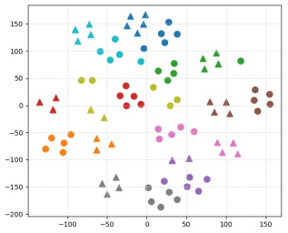
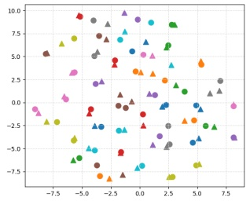

scatter

| Serie | Rango X | Rango Y |
| --- | --- | --- |
| Azul (círculo) | -100~50 | 80~160 |
| Cian (círculo) | -90~-20 | 120~140 |
| Naranja (círculo) | -130~-70 | -90~-50 |
| Verde (círculo) | -100~-60 | 45~50 |
| Azul (triángulo) | -30~10 | 160~170 |
| Cian (triángulo) | 20~40 | 130~155 |
| Verde (triángulo) | 20~50 | 50~80 |
| Naranja (triángulo) | -60~-30 | -70~-60 |
| Azul (círculo) | -30~10 | 0~40 |
| Azul (triángulo) | -30~10 | 0~40 |
| Verde (círculo) | 20~50 | 50~80 |
| Naranja (círculo) | 20~60 | -150~-100 |
| Gris (círculo) | 10~60 | -180~-150 |
| Azul (triángulo) | 40~70 | 130~155 |
| Verde (círculo) | 40~90 | 60~95 |
| Naranja (círculo) | 80~120 | -10~10 |
| Verde (círculo) | 80~120 | 75~95 |
| Azul (triángulo) | 130~140 | 15~25 |
| Naranja (círculo) | 140~160 | -10~25 |
| Verde (círculo) | 130~140 | 80~85 |
| Azul (triángulo) | 140~150 | 15~25 |
| Naranja (círculo) | 140~150 | 0~25 |
| Gris (círculo) | 140~150 | -10~10 |
| Azul (triángulo) | 140~150 | 15~25 |
| Naranja (círculo) | 140~150 | 0~25 |
| Gris (círculo) | 140~150 | -10~10 |
| Azul (triángulo) | 140~150 | 15~25 |
| Naranja (círculo) | 140~150 | 0~25 |
| Gris (círculo) | 140~150 | -10~10 |
| Azul (triángulo) | 140~150 | 15~25 |
| Naranja (círculo) | 140~150 | 0~25 |
| Gris (círculo) | 140~150 | -10~10 |
| Azul (triángulo) | 140~150 | 15~25 |
| Naranja (círculo) | 140~150 | 0~25 |
| Gris (círculo) | 140~150 | -10~10 |
| Azul (triángulo) | 140~150 | 15~25 |
| Naranja (círculo) | 140~150 | 0~25 |
| Gris (círculo) | 140~150 | -10~10 |
| Azul (triángulo) | 140~150 | 15~25 |
| Naranja (círculo) | 140~150 | 0~25 |
| Gris (círculo) | 140~150 | -10~10 |
| Azul (triángulo) | 140~150 | 15~25 |
| Naranja (círculo) | 140~150 | 0~25 |
| Gris (círculo) | 140~150 | -10~10 |
| Azul (triángulo) | 140~150 | 15~25 |
| Naranja (círculo) | 140~150 | 0~25 |
| Gris (círculo) | 140~150 | -10~10 |
| Azul (triángulo) | 140~150 | 15~25 |
| Naranja (círculo) | 140~150 | 0~25 |
| Gris (círculo) | 140~150 | -10~10 |
| Azul (triángulo) | 140~150 | 15~25 |
| Naranja (círculo) | 140~150 | 0~25 |
| Gris (círculo) | 140~150 | -10~10 |
| Azul (triángulo) | 140~150 | 15~25 |
| Naranja (círculo) | 140~150 | 0~25 |
| Gris (círculo) | 140~150 | -10~10 |
| Azul (triángulo) | 140~150 | 15~25 |
| Naranja (círculo) | 140~150 | 0~25 |
| Gris (círculo) | 140~150 | -10~10 |
| Azul (triángulo) | 140~150 | 15~25 |
| Naranja (círculo) | 140~150 | 0~25 |
| Gris (círculo) | 140~150 | -10~10 |
| Azul (triángulo) | 140~150 | 15~25 |
| Naranja (círculo) | 140~150 | 0~25 |
| Gris (círculo) | 140~150 | -10~10 |
| Azul (triángulo) | 140~150 | 15~25 |
| Naranja (círculo) | 140~150 | 0~25 |
| Gris (círculo) | 140~150 | -10~10 |
| Azul (triángulo) | 140~150 | 15~25 |
| Naranja (círculo) | 140~150 | 0~25 |
| Gris (círculo) | 140~150 | -10~10 |
| Azul (triángulo) | 140~150 | 15~25 |
| Naranja (círculo) | 140~150 | 0~25 |
| Gris (círculo) | 140~150 | -10~10 |
| Azul (triángulo) | 140~150 | 15~25 |
| Naranja (círculo) | 140~150 | 0~25 |
| Gris (círculo) | 140~150 | -10~10 |
| Azul (triángulo) | 140~150 | 15~25 |
| Naranja (círculo) | 140~150 | 0~25 |
| Gris (círculo) | 140~150 | -10~10 |
| Azul (triángulo) | 140~150 | 15~25 |
| Naranja (círculo) | 140~150 | 0~25 |
| Gris (círculo) | 140~150 | -10~10 |
| Azul (triángulo) | 140~150 | 15~25 |
| Naranja (círculo) | 140~150 | 0~25 |
| Gris (círculo) | 140~150 | -10~10 |
| Azul (triángulo) | 140~150 | 15~25 |
| Naranja (círculo) | 140~150 | 0~25 |
| Gris (círculo) | 140~150 | -10~10 |
| Azul (triángulo) | 140~150 | 15~25 |
| Naranja (círculo) | 140~150 | 0~25 |
| Gris (círculo) | 140~150 | -10~10 |
| Azul (triángulo) | 140~150 | 15~25 |
| Naranja (círculo) | 140~150 | 0~25 |
| Gris (círculo) | 140~150 | -10~10 |
| Azul (triángulo) | 140~150 | 15~25 |
| Naranja (círculo) | 140~150 | 0~25 |
| Gris (círculo) | 140~150 | -10~10 |
| Azul (triángulo) | 140~150 | 15~25 |
| Naranja (círculo) | 140~150 | 0~25 |
| Gris (círculo) | 140~150 | -10~10 |
| Azul (triángulo) | 140~150 | 15~25 |
| Naranja (círculo) | 140~150 | 0~25 |
| Gris (círculo) | 140~150 | -10~10 |
| Azul (triángulo) | 140~150 | 15~25 |
| Naranja (círculo) | 140~150 | 0~25 |
| Gris (círculo) | 140~150 | -10~10 |
| Azul (triángulo) | 140~150 | 15~25 |
| Naranja (círculo) | 140~150 | 0~25 |
| Gris (círculo) | 140~150 | -10~10 |
| Azul (triángulo) | 140~150 | 15~25 |
| Naranja (círculo) | 140~150 | 0~25 |
| Gris (círculo) | 140~150 | -10~10 |
| Azul (triángulo) | 140~150 | 15~25 |
| Naranja (círculo) | 140~150 | 0~25 |
| Gris (círculo) | 140~150 | -10~10 |
| Azul (triángulo) | 140~150 | 15~25 |
| Naranja (círculo) | 140~150 | 0~25 |
| Gris (círculo) | 140~150 | -10~10 |
| Azul (triángulo) | 140~150 | 15~25 |
| Naranja (círculo) | 140~150 | 0~25 |
| Gris (círculo) | 140~150 | -10~10 |
| Azul (triángulo) | 140~150 | 15~25 |
| Naranja (círculo) | 140~150 | 0~25 |
| Gris (círculo) | 140~150 | -10~10 |
| Azul (triángulo) | 140~150 | 15~25 |
| Naranja (círculo) | 140~150 | 0~25 |
| Gris (círculo) | 140~150 | -10~10 |
| Azul (triángulo) | 140~150 | 15~25 |
| Naranja (círculo) | 140~150 | 0~25 |
| Gris (círculo) | 140~150 | -10~10 |
| Azul (triángulo) | 140~150 | 15~25 |
| Naranja (círculo) | 140~150 | 0~25 |
| Gris (círculo) | 140~150 | -10~10 |
| Azul (triángulo) | 140~150 | 15~25 |
| Naranja (círculo) | 140~150 | 0~25 |
| Gris (círculo) | 140~150 | -10~10 |
| Azul (triángulo) | 140~150 | 15~25 |
| Naranja (círculo) | 140~150 | 0~25 |
| Gris (círculo) | 140~150 | -10~10 |
| Azul (triángulo) | 140~150 | 15~25 |
| Naranja (círculo) | 140~150 | 0~25 |
| Gris (círculo) | 140~150 | -10~10 |
| Azul (triángulo) | 140~150 | 15~25 |
| Naranja (círculo) | 140~150 | 0~25 |
| Gris (círculo) | 140~150 | -10~10 |
| Azul (triángulo) | 140~150 | 15~25 |
| Naranja (círculo) | 140~150 | 0~25 |
| Gris (círculo) | 140~150 | -10~10 |
| Azul (triángulo) | 140~150 | 15~25 |
| Naranja (círculo) | 140~150 | 0~25 |
| Gris (círculo) | 140~150 | -10~10 |
| Azul (triángulo) | 140~150 | 15~25 |
| Naranja (círculo) | 140~150 | 0~25 |
| Gris (círculo) | 140~150 | -10~10 |
| Azul (triángulo) | 140~150 | 15~25 |
| Naranja (círculo) | 140~150 | 0~25 |
| Gris (círculo) | 140~150 | -10~10 |
| Azul (triángulo) | 140~150 | 15~25 |
| Naranja (círculo) | 140~150 | 0~25 |
| Gris (círculo) | 140~150 | -10~10 |
| Azul (triángulo) | 140~150 | 15~25 |
| Naranja (círculo) | 140~150 | 0~25 |
| Gris (círculo) | 140~150 | -10~10 |
| Azul (triángulo) | 140~150 | 15~25 |
| Naranja (círculo) | 140~150 | 0~25 |
| Gris (círculo) | 140~150 | -10~10 |
| Azul (triángulo) | 140~150 | 15~25 |
| Naranja (círculo) | 140~150 | 0~25 |
| Gris (círculo) | 140~150 | -10~10 |
| Azul (triángulo) | 140~150 | 15~25 |
| Naranja (círculo) | 140~150 | 0~25 |
| Gris (círculo) | 140~150 | -10~10 |
| Azul (triángulo) | 140~150 | 15~25 |
| Naranja (círculo) | 140~150 | 0~25 |
| Gris (círculo) | 140~150 | -10~10 |
| Azul (triángulo) | 140~150 | 15~25 |
| Naranja (círculo) | 140~150 | 0~25 |
| Gris (círculo) | 140~150 | -10~10 |
| Azul (triángulo) | 140~150 | 15~25 |
| Naranja (círculo) | 140~150 | 0~25 |
| Gris (círculo) | 140~150 | -10~10 |
| Azul (triángulo) | 140~150 | 15~25 |
| Naranja (círculo) | 140~150 | 0~25 |
| Gris (círculo) | 140~150 | -10~10 |
| Azul (triángulo) | 140~150 | 15~25 |
| Naranja (círculo) | 140~150 | 0~25 |
| Gris (círculo) | 140~150 | -10~10 |
| Azul (triángulo) | 140~150 | 15~25 |
| Naranja (círculo) | 140~150 | 0~25 |
| Gris (círculo) | 140~150 | -10~10 |
| Azul (triángulo) | 140~150 | 15~25 |
| Naranja (círculo) | 140~150 | 0~25 |
| Gris (círculo) | 140~150 | -10~10 |
| Azul (triángulo) | 140~150 | 15~25 |
| Naranja (círculo) | 140~150 | 0~25 |
| Gris (círculo) | 140~150 | -10~10 |
| Azul (triángulo) | 140~150 | 15~25 |
| Naranja (círculo) | 140~150 | 0~25 |
| Gris (círculo) | 140~150 | -10~10 |
| Azul (triángulo) | 140~150 | 15~25 |
| Naranja (círculo) | 140~150 | 0~25 |
| Gris (círculo) | 140~150 | -10~10 |
| Azul (triángulo) | 140~150 | 15~25 |
| Naranja (círculo) | 140~150 | 0~25 |
| Gris (círculo) | 140~150 | -10~10 |
| Azul (triángulo) | 140~150 | 15~25 |
| Naranja (círculo) | 140~150 | 0~25 |
| Gris (círculo) | 140~150 | -10~10 |
| Azul (triángulo) | 140~150 | 15~25 |
| Naranja (círculo) | 140~150 | 0~25 |
| Gris (círculo) | 140~150 | -10~10 |
| Azul (triángulo) | 140~150 | 15~25 |
| Naranja (círculo) | 140~150 | 0~25 |
| Gris (círculo) | 140~150 | -10~10 |
| Azul (triángulo) | 140~150 | 15~25 |
| Naranja (círculo) | 140~150 | 0~25 |
| Gris (círculo) | 140~150 | -10~10 |
| Azul (triángulo) | 140~150 | 15~25 |
| Naranja (círculo) | 140~150 | 0~25 |
| Gris (círculo) | 140~150 | -10~10 |
| Azul (triángulo) | 140~150 | 15~25 |
| Naranja (círculo) | 140~150 | 0~25 |
| Gris (círculo) | 140~150 | -10~10 |
| Azul (triángulo) | 140~150 | 15~25 |
| Naranja (círculo) | 140~150 | 0~25 |
| Gris (círculo) | 140~150 | -10~10 |
| Azul (triángulo) | 140~150 | 15~25 |
| Naranja (círculo) | 140~150 | 0~25 |
| Gris (círculo) | 140~150 | -10~10 |
| Azul (triángulo) | 140~150 | 15~25 |
| Naranja (círculo) | 140~150 | 0~25 |
| Gris (círculo) | 140~150 | -10~10 |
| Azul (triángulo) | 140~150 | 15~25 |
| Naranja (círculo) | 140~150 | 0~25 |
| Gris (círculo) | 140~150 | -10~10 |
| Azul (triángulo) | 140~150 | 15~25 |
| Naranja (círculo) | 140~150 | 0~25 |
| Gris (círculo) | 140~150 | -10~10 |
| Azul (triángulo) | 140~150 | 15~25 |
| Naranja (círculo) | 140~150 | 0~25 |
| Gris (círculo) | 140~150 | -10~10 |
| Azul (triángulo) | 140~150 | 15~25 |
| Naranja (círculo) | 140~150 | 0~25 |
| Gris (círculo) | 140~150 | -10~10 |
| Azul (triángulo) | 140~150 | 15~25 |
| Naranja (círculo) | 140~150 | 0~25 |
| Gris (círculo) | 140~150 | -10~10 |
| Azul (triángulo) | 140~150 | 15~25 |
| Naranja (círculo) | 140~150 | 0~25 |
| Gris (círculo) | 140~150 | -10~10 |
| Azul (triángulo) | 140~150 | 15~25 |
| Naranja (círculo) | 140~150 | 0~25 |
| Gris (círculo) | 140~150 | -10~10 |
| Azul (triángulo) | 140~150 | 15~25 |
| Naranja (círculo) | 140~150 | 0~25 |
| Gris (círculo) | 140~150 | -10~10 |
| Azul (triángulo) | 140~150 | 15~25 |
| Naranja (círculo) | 140~150 | 0~25 |
| Gris (círculo) | 140~150 | -10~10 |
| Azul (triángulo) | 140~150 | 15~25 |
| Naranja (círculo) | 140~150 | 0~25 |
| Gris (círculo) | 140~150 | -10~10 |
| Azul (triángulo) | 140~150 | 15~25 |
| Naranja (círculo) | 140~150 | 0~25 |
| Gris (círculo) | 140~150 | -10~10 |
| Azul (triángulo) | 140~150 | 15~25 |
| Naranja (círculo) | 140~150 | 0~25 |
| Gris (círculo) | 140~150 | -10~10 |
| Azul (triángulo) | 140~150 | 15~25 |
| Naranja (círculo) | 140~150 | 0~25 |
| Gris (círculo) | 140~150 | -10~10 |
| Azul (triángulo) | 140~150 | 15~25 |
| Naranja (círculo) | 140~150 | 0~25 |
| Gris (círculo) | 140~150 | -10~10 |
| Azul (triángulo) | 140~150 | 15~25 |
| Naranja (círculo) | 140~150 | 0~25 |
| Gris (círculo) | 140~150 | -10~10 |
| Azul (triángulo) | 140~150 | 15~25 |
| Naranja (círculo) | 140~150 | 0~25 |
| Gris (círculo) | 140~150 | -10~10 |
| Azul (triángulo) | 140~150 | 15~25 |
| Naranja (círculo) | 140~150 | 0~25 |
| Gris (círculo) | 140~150 | -10~10 |
| Azul (triángulo) | 140~150 | 15~25 |
| Naranja (círculo) | 140~150 | 0~25 |
| Gris (círculo) | 140~150 | -10~10 |
| Azul (triángulo) | 140~150 | 15~25 |
| Naranja (círculo) | 140~150 | 0~25 |
| Gris (círculo) | 140~150 | -10~10 |
| Azul (triángulo) | 140~150 | 15~25 |
| Naranja (círculo) | 140~150 | 0~25 |
| Gris (círculo) | 140~150 | -10~10 |
| Azul (triángulo) | 140~150 | 15~25 |
| Naranja (círculo) | 140~150 | 0~25 |
| Gris (círculo) | 140~150 | -10~10 |
| Azul (triángulo) | 140~150 | 15~25 |
| Naranja (círculo) | 140~150 | 0~25 |
| Gris (círculo) | 140~150 | -10~10 |
| Azul (triángulo) | 140~150 | 15~25 |
| Naranja (círculo) | 140~150 | 0~25 |
| Gris (círculo) | 140~150 | -10~10 |
| Azul (triángulo) | 140~150 | 15~25 |
| Naranja (círculo) | 140~150 | 0~25 |
| Gris (círculo) | 140~150 | -10~10 |
| Azul (triángulo) | 140~150 | 15~25 |
| Naranja (círculo) | 140~150 | 0~25 |
| Gris (círculo) | 140~150 | -10~10 |
| Azul (triángulo) | 140~150 | 15~25 |
| Naranja (círculo) | 140~150 | 0~25 |
| Gris (círculo) | 140~150 | -10~10 |
| Azul (triángulo) | 140~150 | 15~25 |
| Naranja (círculo) | 140~150 | 0~25 |
| Gris (círculo) | 140~150 | -10~10 |
| Azul (triángulo) | 140~150 | 15~25 |
| Naranja (círculo) | 140~150 | 0~25 |
| Gris (círculo) | 140~150 | -10~10 |
| Azul (triángulo) | 140~150 | 15~25 |
| Naranja (círculo) | 140~150 | 0~25 |
| Gris (círculo) | 140~150 | -10~10 |
| Azul (triángulo) | 140~150 | 15~25 |
| Naranja (círculo) | 140~150 | 0~25 |
| Gris (círculo) | 140~150 | -10~10 |
| Azul (triángulo) | 140~150 | 15~25 |
| Naranja (círculo) | 140~150 | 0~25 |
| Gris (círculo) | 140~150 | -10~10 |
| Azul (triángulo) | 140~150 | 15~25 |
| Naranja (círculo) | 140~150 | 0~25 |
| Gris (círculo) | 140~150 | -10~10 |
| Azul (triángulo) | 140~150 | 15~25 |
| Naranja (círculo) | 140~150 | 0~25 |
| Gris (círculo) | 140~150 | -10~10 |
| Azul (triángulo) | 140~150 | 15~25 |
| Naranja (círculo) | 140~150 | 0~25 |
| Gris (círculo) | 140~150 | -10~10 |
| Azul (triángulo) | 140~150 | 15~25 |
| Naranja (círculo) | 140~150 | 0~25 |
| Gris (círculo) | 140~150 | -10~10 |
| Azul (triángulo) | 140~150 | 15~25 |
| Naranja (círculo) | 140~150 | 0~25 |
| Gris (círculo) | 140~150 | -10~10 |
| Azul (triángulo) | 140~150 | 15~25 |
| Naranja (círculo) | 140~150 | 0~25 |
| Gris (círculo) | 140~150 | -10~10 |
| Azul (triángulo) | 140~150 | 15~25 |
| Naranja (círculo) | 140~150 | 0~25 |
| Gris (círculo) | 140~150 | -10~10 |
| Azul (triángulo) | 140~150 | 15~25 |
| Naranja (círculo) | 140~150 | 0~25 |
| Gris (círculo) | 140~150 | -10~10 |
| Azul (triángulo) | 140~150 | 15~25 |
| Naranja (círculo) | 140~150 | 0~25 |
| Gris (círculo) | 140~150 | -10~10 |
| Azul (triángulo) | 140~150 | 15~25 |
| Naranja (círculo) | 140~150 | 0~25 |
| Gris (círculo) | 140~150 | -10~10 |
| Azul (triángulo) | 140~150 | 15~25 |
| Naranja (círculo) | 140~150 | 0~25 |
| Gris (círculo) | 140~150 | -10~10 |
| Azul (triángulo) | 140~150 | 15~25 |
| Naranja (círculo) | 140~150 | 0~25 |
| Gris (círculo) | 140~150 | -10~10 |
| Azul (triángulo) | 140~150 | 15~25 |
| Naranja (círculo) | 140~150 | 0~25 |
| Gris (círculo) | 140~150 | -10~10 |
| Azul (triángulo) | 140~150 | 15~25 |
| Naranja (círculo) | 140~150 | 0~25 |
| Gris (círculo) | 140~150 | -10~10 |
| Azul (triángulo) | 140~150 | 15~25 |

(a) Clean

scatter

| Serie | Rango X | Rango Y |
| --- | --- | --- |
| Rojo (círculo) | -5.0~-2.5 | 4.8~9.6 |
| Gris (triángulo) | -3.5~-1.5 | 7.5~9.8 |
| Azul (círculo) | -2.5~0.5 | -5.5~9.0 |
| Verde (triángulo) | 2.5~5.0 | -8.0~8.8 |
| Púrpura (triángulo) | -3.0~-1.0 | -4.5~7.2 |
| Rosa (círculo) | -6.5~-4.5 | -0.5~3.2 |
| Amarillo (triángulo) | -7.5~-5.0 | -2.2~-4.0 |
| Gris (círculo) | 2.5~8.5 | -4.8~2.5 |
| Marrón (círculo) | -1.5~0.5 | -2.0~3.5 |
| Verde (triángulo) | 2.5~6.0 | -2.5~1.2 |
| Rosa (círculo) | -7.5~-5.0 | 5.2~7.2 |
| Gris (triángulo) | -3.0~-1.5 | 5.2~8.2 |
| Azul (círculo) | -2.5~-1.0 | -2.8~-0.2 |
| Verde (triángulo) | 2.5~6.0 | -2.5~1.2 |
| Marrón (círculo) | -3.0~-1.0 | -7.0~-0.2 |
| Gris (círculo) | -2.5~-1.5 | -7.8~-0.2 |
| Verde (triángulo) | 2.5~6.0 | -2.5~1.2 |
| Rosa (círculo) | -3.0~-1.0 | -2.8~-0.2 |
| Marrón (círculo) | -2.5~-1.0 | -7.8~-0.2 |
| Gris (círculo) | -2.5~-1.5 | -7.8~-0.2 |
| Azul (círculo) | -2.5~-1.0 | -2.8~-0.2 |
| Verde (triángulo) | 2.5~6.0 | -2.5~1.2 |
| Marrón (círculo) | -3.0~-1.0 | -7.8~-0.2 |
| Gris (círculo) | -2.5~-1.5 | -7.8~-0.2 |
| Azul (círculo) | -2.5~-1.0 | -2.8~-0.2 |
| Marrón (círculo) | -2.5~-1.0 | -7.8~-0.2 |
| Gris (círculo) | -2.5~-1.5 | -7.8~-0.2 |
| Azul (círculo) | -2.5~-1.0 | -2.8~-0.2 |
| Marrón (círculo) | -2.5~-1.0 | -7.8~-0.2 |
| Gris (círculo) | -2.5~-1.5 | -7.8~-0.2 |
| Azul (círculo) | -2.5~-1.0 | -2.8~-0.2 |
| Marrón (círculo) | -2.5~-1.0 | -7.8~-0.2 |
| Gris (círculo) | -2.5~-1.5 | -7.8~-0.2 |
| Azul (círculo) | -2.5~-1.0 | -2.8~-0.2 |
| Marrón (círculo) | -2.5~-1.0 | -7.8~-0.2 |
| Gris (círculo) | -2.5~-1.5 | -7.8~-0.2 |
| Azul (círculo) | -2.5~-1.0 | -2.8~-0.2 |
| Marrón (círculo) | -2.5~-1.0 | -7.8~-0.2 |
| Gris (círculo) | -2.5~-1.5 | -7.8~-0.2 |
| Azul (círculo) | -2.5~-1.0 | -2.8~-0.2 |
| Marrón (círculo) | -2.5~-1.0 | -7.8~-0.2 |
| Gris (círculo) | -2.5~-1.5 | -7.8~-0.2 |
| Azul (círculo) | -2.5~-1.0 | -2.8~-0.2 |
| Marrón (círculo) | -2.5~-1.0 | -7.8~-0.2 |
| Gris (círculo) | -2.5~-1.5 | -7.8~-0.2 |
| Azul (círculo) | -2.5~-1.0 | -2.8~-0.2 |
| Marrón (círculo) | -2.5~-1.0 | -7.8~-0.2 |
| Gris (círculo) | -2.5~-1.5 | -7.8~-0.2 |
| Azul (círculo) | -2.5~-1.0 | -2.8~-0.2 |
| Marrón (círculo) | -2.5~-1.0 | -7.8~-0.2 |
| Gris (círculo) | -2.5~-1.5 | -7.8~-0.2 |
| Azul (círculo) | -2.5~-1.0 | -2.8~-0.2 |
| Marrón (círculo) | -2.5~-1.0 | -7.8~-0.2 |
| Gris (círculo) | -2.5~-1.5 | -7.8~-0.2 |
| Azul (círculo) | -2.5~-1.0 | -2.8~-0.2 |
| Marrón (círculo) | -2.5~-1.0 | -7.8~-0.2 |
| Gris (círculo) | -2.5~-1.5 | -7.8~-0.2 |
| Azul (círculo) | -2.5~-1.0 | -2.8~-0.2 |
| Marrón (círculo) | -2.5~-1.0 | -7.8~-0.2 |
| Gris (círculo) | -2.5~-1.5 | -7.8~-0.2 |
| Azul (círculo) | -2.5~-1.0 | -2.8~-0.2 |
| Marrón (círculo) | -2.5~-1.0 | -7.8~-0.2 |
| Gris (círculo) | -2.5~-1.5 | -7.8~-0.2 |
| Azul (círculo) | -2.5~-1.0 | -2.8~-0.2 |
| Marrón (círculo) | -2.5~-1.0 | -7.8~-0.2 |
| Gris (círculo) | -2.5~-1.5 | -7.8~-0.2 |
| Azul (círculo) | -2.5~-1.0 | -2.8~-0.2 |
| Marrón (círculo) | -2.5~-1.0 | -7.8~-0.2 |
| Gris (círculo) | -2.5~-1.5 | -7.8~-0.2 |
| Azul (círculo) | -2.5~-1.0 | -2.8~-0.2 |
| Marrón (círculo) | -2.5~-1.0 | -7.8~-0.2 |
| Gris (círculo) | -2.5~-1.5 | -7.8~-0.2 |
| Azul (círculo) | -2.5~-1.0 | -2.8~-0.2 |
| Marrón (círculo) | -2.5~-1.0 | -7.8~-0.2 |
| Gris (círculo) | -2.5~-1.5 | -7.8~-0.2 |
| Azul (círculo) | -2.5~-1.0 | -2.8~-0.2 |
| Marrón (círculo) | -2.5~-1.0 | -7.8~-0.2 |
| Gris (círculo) | -2.5~-1.5 | -7.8~-0.2 |
| Azul (círculo) | -2.5~-1.0 | -2.8~-0.2 |
| Marrón (círculo) | -2.5~-1.0 | -7.8~-0.2 |
| Gris (círculo) | -2.5~-1.5 | -7.8~-0.2 |
| Azul (círculo) | -2.5~-1.0 | -2.8~-0.2 |
| Marrón (círculo) | -2.5~-1.0 | -7.8~-0.2 |
| Gris (círculo) | -2.5~-1.5 | -7.8~-0.2 |
| Azul (círculo) | -2.5~-1.0 | -2.8~-0.2 |
| Marrón (círculo) | -2.5~-1.0 | -7.8~-0.2 |
| Gris (círculo) | -2.5~-1.5 | -7.8~-0.2 |
| Azul (círculo) | -2.5~-1.0 | -2.8~-0.2 |
| Marrón (círculo) | -2.5~-1.0 | -7.8~-0.2 |
| Gris (círculo) | -2.5~-1.5 | -7.8~-0.2 |
| Azul (círculo) | -2.5~-1.0 | -2.8~-0.2 |
| Marrón (círculo) | -2.5~-1.0 | -7.8~-0.2 |
| Gris (círculo) | -2.5~-1.5 | -7.8~-0.2 |
| Azul (círculo) | -2.5~-1.0 | -2.8~-0.2 |
| Marrón (círculo) | -2.5~-1.0 | -7.8~-0.2 |
| Gris (círculo) | -2.5~-1.5 | -7.8~-0.2 |
| Azul (círculo) | -2.5~-1.0 | -2.8~-0.2 |
| Marrón (círculo) | -2.5~-1.0 | -7.8~-0.2 |
| Gris (círculo) | -2.5~-1.5 | -7.8~-0.2 |
| Azul (círculo) | -2.5~-1.0 | -2.8~-0.2 |
| Marrón (círculo) | -2.5~-1.0 | -7.8~-0.2 |
| Gris (círculo) | -2.5~-1.5 | -7.8~-0.2 |
| Azul (círculo) | -2.5~-1.0 | -2.8~-0.2 |
| Marrón (círculo) | -2.5~-1.0 | -7.8~-0.2 |
| Gris (círculo) | -2.5~-1.5 | -7.8~-0.2 |
| Azul (círculo) | -2.5~-1.0 | -2.8~-0.2 |
| Marrón (círculo) | -2.5~-1.0 | -7.8~-0.2 |
| Gris (círculo) | -2.5~-1.5 | -7.8~-0.2 |
| Azul (círculo) | -2.5~-1.0 | -2.8~-0.2 |
| Marrón (círculo) | -2.5~-1.0 | -7.8~-0.2 |
| Gris (círculo) | -2.5~-1.5 | -7.8~-0.2 |
| Azul (círculo) | -2.5~-1.0 | -2.8~-0.2 |
| Marrón (círculo) | -2.5~-1.0 | -7.8~-0.2 |
| Gris (círculo) | -2.5~-1.5 | -7.8~-0.2 |
| Azul (círculo) | -2.5~-1.0 | -2.8~-0.2 |
| Marrón (círculo) | -2.5~-1.0 | -7.8~-0.2 |
| Gris (círculo) | -2.5~-1.5 | -7.8~-0.2 |
| Azul (círculo) | -2.5~-1.0 | -2.8~-0.2 |
| Marrón (círculo) | -2.5~-1.0 | -7.8~-0.2 |
| Gris (círculo) | -2.5~-1.5 | -7.8~-0.2 |
| Azul (círculo) | -2.5~-1.0 | -2.8~-0.2 |
| Marrón (círculo) | -2.5~-1.0 | -7.8~-0.2 |
| Gris (círculo) | -2.5~-1.5 | -7.8~-0.2 |
| Azul (círculo) | -2.5~-1.0 | -2.8~-0.2 |
| Marrón (círculo) | -2.5~-1.0 | -7.8~-0.2 |
| Gris (círculo) | -2.5~-1.5 | -7.8~-0.2 |
| Azul (círculo) | -2.5~-1.0 | -2.8~-0.2 |
| Marrón (círculo) | -2.5~-1.0 | -7.8~-0.2 |
| Gris (círculo) | -2.5~-1.5 | -7.8~-0.2 |
| Azul (círculo) | -2.5~-1.0 | -2.8~-0.2 |
| Marrón (círculo) | -2.5~-1.0 | -7.8~-0.2 |
| Gris (círculo) | -2.5~-1.5 | -7.8~-0.2 |
| Azul (círculo) | -2.5~-1.0 | -2.8~-0.2 |
| Marrón (círculo) | -2.5~-1.0 | -7.8~-0.2 |
| Gris (círculo) | -2.5~-1.5 | -7.8~-0.2 |
| Azul (círculo) | -2.5~-1.0 | -2.8~-0.2 |
| Marrón (círculo) | -2.5~-1.0 | -7.8~-0.2 |
| Gris (círculo) | -2.5~-1.5 | -7.8~-0.2 |
| Azul (círculo) | -2.5~-1.0 | -2.8~-0.2 |
| Marrón (círculo) | -2.5~-1.0 | -7.8~-0.2 |
| Gris (círculo) | -2.5~-1.5 | -7.8~-0.2 |
| Azul (círculo) | -2.5~-1.0 | -2.8~-0.2 |
| Marrón (círculo) | -2.5~-1.0 | -7.8~-0.2 |
| Gris (círculo) | -2.5~-1.5 | -7.8~-0.2 |
| Azul (círculo) | -2.5~-1.0 | -2.8~-0.2 |
| Marrón (círculo) | -2.5~-1.0 | -7.8~-0.2 |
| Gris (círculo) | -2.5~-1.5 | -7.8~-0.2 |
| Azul (círculo) | -2.5~-1.0 | -2.8~-0.2 |
| Marrón (círculo) | -2.5~-1.0 | -7.8~-0.2 |
| Gris (círculo) | -2.5~-1.5 | -7.8~-0.2 |
| Azul (círculo) | -2.5~-1.0 | -2.8~-0.2 |
| Marrón (círculo) | -2.5~-1.0 | -7.8~-0.2 |
| Gris (círculo) | -2.5~-1.5 | -7.8~-0.2 |
| Azul (círculo) | -2.5~-1.0 | -2.8~-0.2 |
| Marrón (círculo) | -2.5~-1.0 | -7.8~-0.2 |
| Gris (círculo) | -2.5~-1.5 | -7.8~-0.2 |
| Azul (círculo) | -2.5~-1.0 | -2.8~-0.2 |
| Marrón (círculo) | -2.5~-1.0 | -7.8~-0.2 |
| Gris (círculo) | -2.5~-1.5 | -7.8~-0.2 |
| Azul (círculo) | -2.5~-1.0 | -2.8~-0.2 |
| Marrón (círculo) | -2.5~-1.0 | -7.8~-0.2 |
| Gris (círculo) | -2.5~-1.5 | -7.8~-0.2 |
| Azul (círculo) | -2.5~-1.0 | -2.8~-0.2 |
| Marrón (círculo) | -2.5~-1.0 | -7.8~-0.2 |
| Gris (círculo) | -2.5~-1.5 | -7.8~-0.2 |
| Azul (círculo) | -2.5~-1.0 | -2.8~-0.2 |
| Marrón (círculo) | -2.5~-1.0 | -7.8~-0.2 |
| Gris (círculo) | -2.5~-1.5 | -7.8~-0.2 |
| Azul (círculo) | -2.5~-1.0 | -2.8~-0.2 |
| Marrón (círculo) | -2.5~-1.0 | -7.8~-0.2 |
| Gris (círculo) | -2.5~-1.5 | -7.8~-0.2 |
| Azul (círculo) | -2.5~-1.0 | -2.8~-0.2 |
| Marrón (círculo) | -2.5~-1.0 | -7.8~-0.2 |
| Gris (círculo) | -2.5~-1.5 | -7.8~-0.2 |
| Azul (círculo) | -2.5~-1.0 | -2.8~-0.2 |
| Marrón (círculo) | -2.5~-1.0 | -7.8~-0.2 |
| Gris (círculo) | -2.5~-1.5 | -7.8~-0.2 |
| Azul (círculo) | -2.5~-1.0 | -2.8~-0.2 |
| Marrón (círculo) | -2.5~-1.0 | -7.8~-0.2 |
| Gris (círculo) | -2.5~-1.5 | -7.8~-0.2 |
| Azul (círculo) | -2.5~-1.0 | -2.8~-0.2 |
| Marrón (círculo) | -2.5~-1.0 | -7.8~-0.2 |
| Gris (círculo) | -2.5~-1.5 | -7.8~-0.2 |
| Azul (círculo) | -2.5~-1.0 | -2.8~-0.2 |
| Marrón (círculo) | -2.5~-1.0 | -7.8~-0.2 |
| Gris (círculo) | -2.5~-1.5 | -7.8~-0.2 |
| Azul (círculo) | -2.5~-1.0 | -2.8~-0.2 |
| Marrón (círculo) | -2.5~-1.0 | -7.8~-0.2 |
| Gris (círculo) | -2.5~-1.5 | -7.8~-0.2 |
| Azul (círculo) | -2.5~-1.0 | -2.8~-0.2 |
| Marrón (círculo) | -2.5~-1.0 | -7.8~-0.2 |
| Gris (círculo) | -2.5~-1.5 | -7.8~-0.2 |
| Azul (círculo) | -2.5~-1.0 | -2.8~-0.2 |
| Marrón (círculo) | -2.5~-1.0 | -7.8~-0.2 |
| Gris (círculo) | -2.5~-1.5 | -7.8~-0.2 |
| Azul (círculo) | -2.5~-1.0 | -2.8~-0.2 |
| Marrón (círculo) | -2.5~-1.0 | -7.8~-0.2 |
| Gris (círculo) | -2.5~-1.5 | -7.8~-0.2 |
| Azul (círculo) | -2.5~-1.0 | -2.8~-0.2 |
| Marrón (círculo) | -2.5~-1.0 | -7.8~-0.2 |
| Gris (círculo) | -2.5~-1.5 | -7.8~-0.2 |
| Azul (círculo) | -2.5~-1.0 | -2.8~-0.2 |
| Marrón (círculo) | -2.5~-1.0 | -7.8~-0.2 |
| Gris (círculo) | -2.5~-1.5 | -7.8~-0.2 |
| Azul (círculo) | -2.5~-1.0 | -2.8~-0.2 |
| Marrón (círculo) | -2.5~-1.0 | -7.8~-0.2 |
| Gris (círculo) | -2.5~-1.5 | -7.8~-0.2 |
| Azul (círculo) | -2.5~-1.0 | -2.8~-0.2 |
| Marrón (círculo) | -2.5~-1.0 | -7.8~-0.2 |
| Gris (círculo) | -2.5~-1.5 | -7.8~-0.2 |
| Azul (círculo) | -2.5~-1.0 | -2.8~-0.2 |
| Marrón (círculo) | -2.5~-1.0 | -7.8~-0.2 |
| Gris (círculo) | -2.5~-1.5 | -7.8~-0.2 |
| Azul (círculo) | -2.5~-1.0 | -2.8~-0.2 |
| Marrón (círculo) | -2.5~-1.0 | -7.8~-0.2 |
| Gris (círculo) | -2.5~-1.5 | -7.8~-0.2 |
| Azul (círculo) | -2.5~-1.0 | -2.8~-0.2 |
| Marrón (círculo) | -2.5~-1.0 | -7.8~-0.2 |
| Gris (círculo) | -2.5~-1.5 | -7.8~-0.2 |
| Azul (círculo) | -2.5~-1.0 | -2.8~-0.2 |
| Marrón (círculo) | -2.5~-1.0 | -7.8~-0.2 |
| Gris (círculo) | -2.5~-1.5 | -7.8~-0.2 |
| Azul (círculo) | -2.5~-1.0 | -2.8~-0.2 |
| Marrón (círculo) | -2.5~-1.0 | -7.8~-0.2 |
| Gris (círculo) | -2.5~-1.5 | -7.8~-0.2 |
| Azul (círculo) | -2.5~-1.0 | -2.8~-0.2 |
| Marrón (círculo) | -2.5~-1.0 | -7.8~-0.2 |
| Gris (círculo) | -2.5~-1.5 | -7.8~-0.2 |
| Azul (círculo) | -2.5~-1.0 | -2.8~-0.2 |
| Marrón (círculo) | -2.5~-1.0 | -7.8~-0.2 |
| Gris (círculo) | -2.5~-1.5 | -7.8~-0.2 |
| Azul (círculo) | -2.5~-1.0 | -2.8~-0.2 |
| Marrón (círculo) | -2.5~-1.0 | -7.8~-0.2 |
| Gris (círculo) | -2.5~-1.5 | -7.8~-0.2 |
| Azul (círculo) | -2.5~-1.0 | -2.8~-0.2 |
| Marrón (círculo) | -2.5~-1.0 | -7.8~-0.2 |
| Gris (círculo) | -2.5~-1.5 | -7.8~-0.2 |
| Azul (círculo) | -2.5~-1.0 | -2.8~-0.2 |
| Marrón (círculo) | -2.5~-1.0 | -7.8~-0.2 |
| Gris (círculo) | -2.5~-1.5 | -7.8~-0.2 |
| Azul (círculo) | -2.5~-1.0 | -2.8~-0.2 |
| Marrón (círculo) | -2.5~-1.0 | -7.8~-0.2 |
| Gris (círculo) | -2.5~-1.5 | -7.8~-0.2 |
| Azul (círculo) | -2.5~-1.0 | -2.8~-0.2 |
| Marrón (círculo) | -2.5~-1.0 | -7.8~-0.2 |
| Gris (círculo) | -2.5~-1.5 | -7.8~-0.2 |
| Azul (círculo) | -2.5~-1.0 | -2.8~-0.2 |
| Marrón (círculo) | -2.5~-1.0 | -7.8~-0.2 |
| Gris (círculo) | -2.5~-1.5 | -7.8~-0.2 |
| Azul (círculo) | -2.5~-1.0 | -2.8~-0.2 |
| Marrón (círculo) | -2.5~-1.0 | -7.8~-0.2 |
| Gris (círculo) | -2.5~-1.5 | -7.8~-0.2 |
| Azul (círculo) | -2.5~-1.0 | -2.8~-0.2 |
| Marrón (círculo) | -2.5~-1.0 | -7.8~-0.2 |
| Gris (círculo) | -2.5~-1.5 | -7.8~-0.2 |
| Azul (círculo) | -2.5~-1.0 | -2.8~-0.2 |
| Marrón (círculo) | -2.5~-1.0 | -7.8~-0.2 |
| Gris (círculo) | -2.5~-1.5 | -7.8~-0.2 |
| Azul (círculo) | -2.5~-1.0 | -2.8~-0.2 |
| Marrón (círculo) | -2.5~-1.0 | -7.8~-0.2 |
| Gris (círculo) | -2.5~-1.5 | -7.8~-0.2 |
| Azul (círculo) | -2.5~-1.0 | -2.8~-0.2 |
| Marrón (círculo) | -2.5~-1.0 | -7.8~-0.2 |
| Gris (círculo) | -2.5~-1.5 | -7.8~-0.2 |
| Azul (círculo) | -2.5~-1.0 | -2.8~-0.2 |
| Marrón (círculo) | -2.5~-1.0 | -7.8~-0.2 |
| Gris (círculo) | -2.5~-1.5 | -7.8~-0.2 |
| Azul (círculo) | -2.5~-1.0 | -2.8~-0.2 |
| Marrón (círculo) | -2.5~-1.0 | -7.8~-0.2 |
| Gris (círculo) | -2.5~-1.5 | -7.8~-0.2 |
| Azul (círculo) | -2.5~-1.0 | -2.8~-0.2 |
| Marrón (círculo) | -2.5~-1.0 | -7.8~-0.2 |
| Gris (círculo) | -2.5~-1.5 | -7.8~-0.2 |
| Azul (círculo) | -2.5~-1.0 | -2.8~-0.2 |
| Marrón (círculo) | -2.5~-1.0 | -7.8~-0.2 |
| Gris (círculo) | -2.5~-1.5 | -7.8~-0.2 |
| Azul (círculo) | -2.5~-1.0 | -2.8~-0.2 |
| Marrón (círculo) | -2.5~-1.0 | -7.8~-0.2 |
| Gris (círculo) | -2.5~-1.5 | -7.8~-0.2 |
| Azul (círculo) | -2.5~-1.0 | -2.8~-0.2 |
| Marrón (círculo) | -2.5~-1.0 | -7.8~-0.2 |
| Gris (círculo) | -2.5~-1.5 | -7.8~-0.2 |
| Azul (círculo) | -2.5~-1.0 | -2.8~-0.2 |
| Marrón (círculo) | -2.5~-1.0 | -7.8~-0.2 |
| Gris (círculo) | -2.5~-1.5 | -7.8~-0.2 |
| Azul (círculo) | -2.5~-1.0 | -2.8~-0.2 |
| Marrón (círculo) | -2.5~-1.0 | -7.8~-0.2 |
| Gris (círculo) | -2.5~-1.5 | -7.8~-0.2 |
| Azul (círculo) | -2.5~-1.0 | -2.8~-0.2 |
| Marrón (círculo) | -2.5~-1.0 | -7.8~-0.2 |
| Gris (círculo) | -2.5~-1.5 | -7.8~-0.2 |
| Azul (círculo) | -2.5~-1.0 | -2.8~-0.2 |
| Marrón (círculo) | -2.5~-1.0 | -7.8~-0.2 |
| Gris (círculo) | -2.5~-1.5 | -7.8~-0.2 |
| Azul (círculo) | -2.5~-1.0 | -2.8~-0.2 |
| Marrón (círculo) | -2.5~-1.0 | -7.8~-0.2 |
| Gris (círculo) | -2.5~-1.5 | -7.8~-0.2 |
| Azul (círculo) | -2.5~-1.0 | -2.8~-0.2 |
| Marrón (círculo) | -2.5~-1.0 | -7.8~-0.2 |
| Gris (círculo) | -2.5~-1.5 | -7.8~-0.2 |
| Azul (círculo) | -2.5~-1.0 | -2.8~-0.2 |
| Marrón (círculo) | -2.5~-1.0 | -7.8~-0.2 |
| Gris (círculo) | -2.5~-1.5 | -7.8~-0.2 |
| Azul (círculo) | -2.5~-1.0 | -2.8~-0.2 |
| Marrón (círculo) | -2.5~-1.0 | -7.8~-0.2 |
| Gris (círculo) | -2.5~-1.5 | -7.8~-0.2 |
| Azul (círculo) | -2.5~-1.0 | -2.8~-0.2 |
| Marrón (círculo) | -2.5~-1.0 | -7.8~-0.2 |
| Gris (círculo) | -2.5~-1.5 | -7.8~-0.2 |
| Azul (círculo) | -2.5~-1.0 | -2.8~-0.2 |
| Marrón (círculo) | -2.5~-1.0 | -7.8~-0.2 |
| Gris (círculo) | -2.5~-1.5 | -7.8~-0.2 |
| Azul (círculo) | -2.5~-1.0 | -2.8~-0.2 |
| Marrón (círculo) | -2.5~-1.0 | -7.8~-0.2 |
| Gris (círculo) | -2.5~-1.5 | -7.8~-0.2 |
| Azul (círculo) | -2.5~-1.0 | -2.8~-0.2 |
| Marrón (círculo) | -2.5~-1.0 | -7.8~-0.2 |
| Gris (círculo) | -2.5~-1.5 | -7.8~-0.2 |
| Azul (círculo) | -2.5~-1.0 | -2.8~-0.2 |
| Marrón (círculo) | -2.5~-1.0 | -7.8~-0.2 |
| Gris (círculo) | -2.5~-1.5 | -7.8~-0.2 |
| Azul (círculo) | -2.5~-1.0 | -2.8~-0.2 |
| Marrón (círculo) | -2.5~-1.0 | -7.8~-0.2 |
| Gris (círculo) | -2.5~-1.5 | -7.8~-0.2 |
| Azul (círculo) | -2.5~-1.0 | -2.8~-0.2 |
| Marrón (círculo) | -2.5~-1.0 | -7.8~-0.2 |
| Gris (círculo) | -2.5~-1.5 | -7.8~-0.2 |
| Azul (círculo) | -2.5~-1.0 | -2.8~-0.2 |
| Marrón (círculo) | -2.5~-1.0 | -7.8~-0.2 |
| Gris (círculo) | -2.5~-1.5 | -7.8~-0.2 |
| Azul (círculo) | -2.5~-1.0 | -2.8~-0.2 |
| Marrón (círculo) | -2.5~-1.0 | -7.8~-0.2 |
| Gris (círculo) | -2.5~-1.5 | -7.8~-0.2 |
| Azul (círculo) | -2.5~-1.0 | -2.8~-0.2 |
| Marrón (círculo) | -2.5~-1.0 | -7.8~-0.2 |
| Gris (círculo) | -2.5~-1.5 | -7.8~-0.2 |
| Azul (círculo) | -2.5~-1.0 | -2.8~-0.2 |
| Marrón (círculo) | -2.5~-1.0 | -7.8~-0.2 |
| Gris (círculo) | -2.5~-1.5 | -7.8~-0.2 |
| Azul (círculo) | -2.5~-1.0 | -2.8~-0.2 |
| Marrón (círculo) | -2.5~-1.0 | -7.8~-0.2 |
| Gris (círculo) | -2.5~-1.5 | -7.8~-0.2 |
| Azul (círculo) | -2.5~-1.0 | -2.8~-0.2 |
| Marrón (círculo) | -2.5~-1.0 | -7.8~-0.2 |
| Gris (círculo) | -2.5~-1.5 | -7.8~-0.2 |
| Azul (círculo) | -2.5~-1.0 | -2.8~-0.2 |
| Marrón (círculo) | -2.5~-1.0 | -7.8~-0.2 |
| Gris (círculo) | -2.5~-1.5 | -7.8~-0.2 |
| Azul (círculo) | -2.5~-1.0 | -2.8~-0.2 |
| Marrón (círculo) | -2.5~-1.0 | -7.8~-0.2 |
| Gris (círculo) | -2.5~-1.5 | -7.8~-0.2 |
| Azul (círculo) | -2.5~-1.0 | -2.8~-0.2 |
| Marrón (círculo) | -2.5~-1.0 | -7.8~-0.2 |
| Gris (círculo) | -2.5~-1.5 | -7.8~-0.2 |
| Azul (círculo) | -2.5~-1.0 | -2.8~-0.2 |
| Marrón (círculo) | -2.5~-1.0 | -7.8~-0.2 |
| Gris (círculo) | -2.5~-1.5 | -7.8~-0.2 |
| Azul (círculo) | -2.5~-1.0 | -2.8~-0.2 |
| Marrón (círculo) | -2.5~-1.0 | -7.8~-0.2 |
| Gris (círculo) | -2.5~-1.5 | -7.8~-0.2 |
| Azul (círculo) | -2.5~-1.0 | -2.8~-0.2 |
| Marrón (círculo) | -2.5~-1.0 | -7.8~-0.2 |
| Gris (círculo) | -2.5~-1.5 | -7 |

(b) MEM-3

Figura 6: Visualización t-SNE de las muestras limpias y unlearnable examples para el modelo limpio y el modelo envenenado.
