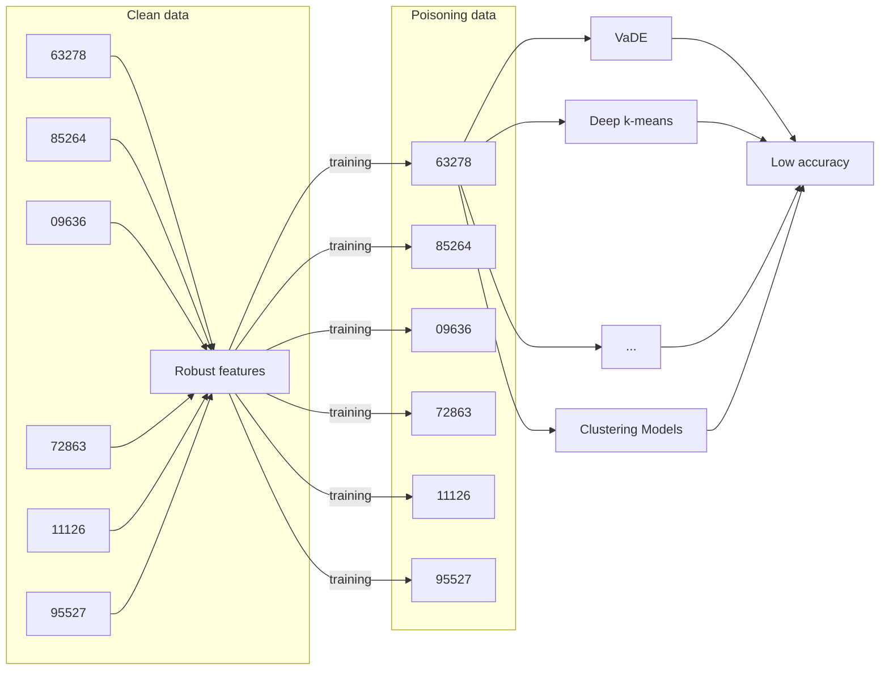
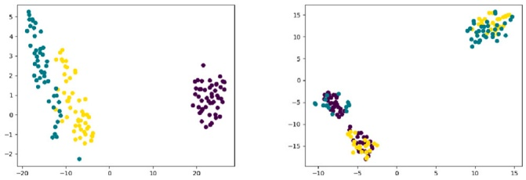
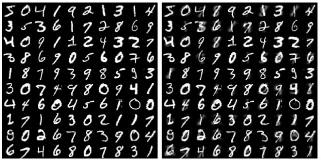
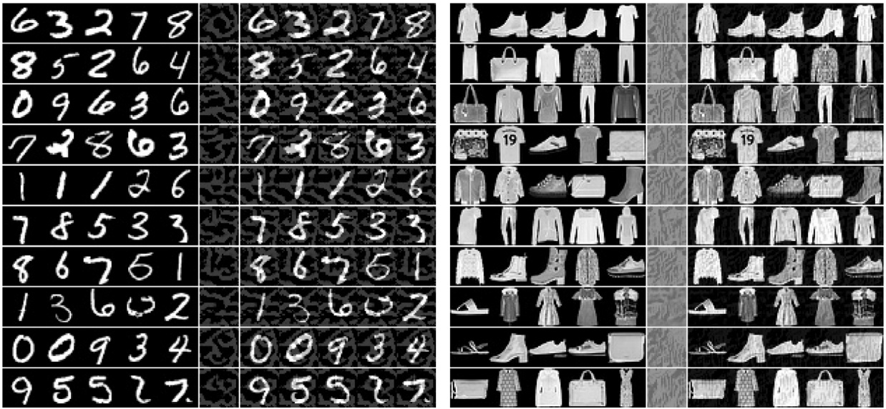
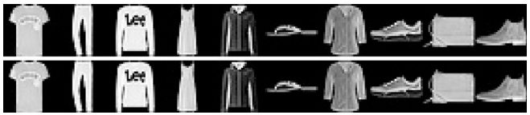

# Novel poisoning attacks for clustering methods via robust feature generation✩

**Chen Zhang a,b, Zhuo Tang b,**∗

**a College of Computer Science and Technology, China University of Petroleum, Qingdao, China**
**b College of Computer Science and Electronic Engineering, Hunan University, Changsha, China**

## I N F O R M A C I Ó N   D E L   A R T Í C U L O

**Comunicado por K. Liu**

## Palabras clave:

**Adversarial attacks**

**Data poisoning attacks**

**Clustering models**

**Unlearnable examples**

## R E S U M E N

**Diversos investigadores han demostrado que los modelos de deep learning son susceptibles a los adversarial examples; sin embargo, la mayoría de los trabajos existentes se centran en el aprendizaje supervisado. Recientemente, las investigaciones han demostrado que el aprendizaje no supervisado, como el clustering, tiende a ser vulnerable frente a adversarial attacks y poisoning attacks. Este trabajo explora principalmente los adversarial attacks contra clustering models en dos situaciones: ataques en el decision time y data poisoning attacks. Presentamos la posibilidad de adversarial attacks sobre el modelo de clustering y ofrecemos clean-label poisoning attacks para clustering models añadiendo pequeñas perturbaciones a todos los datos de entrenamiento. Concretamente, en primer lugar, mostramos que los adversarial examples en el decision time para el modelo k-means y el Gaussian mixture model (GMM) pueden ser generados desplazando la entrada original (raw input) hacia el límite de decisión (decision boundary), lo cual también es apropiado para el data poisoning attack. En segundo lugar, generamos datos envenenados (poisoning data) añadiendo robust features a las entradas benignas. El poisoning attack puede hacer que los datos personales sean unlearnable para los clustering models, preservando así la privacidad individual. Los resultados experimentales cuantitativos muestran que la tasa de éxito de los adversarial attacks propuestos para clustering models es cercana al 100%, y nuestro data poisoning attack puede hacer que el modelo de clustering se comporte como una estimación aleatoria (random guess), lo que demuestra la efectividad de nuestros enfoques. Los adversarial attacks en clustering, que abarcan ataques en el decision time y data poisoning attacks, deberían recibir una mayor atención.**

## 1. Introducción

**Como es ampliamente reconocido, las redes neuronales profundas (deep neural networks, DNNs) son sensibles a los adversarial examples similares a las entradas originales (raw inputs) y pueden engañar a las redes en tareas de clasificación de imágenes. La diferencia entre un adversarial example y su entrada benigna a menudo es apenas perceptible desde la perspectiva humana. Investigaciones seminales en [1,2], así como numerosos estudios recientes [3–5], han ilustrado que los adversarial examples son diversos y pueden generarse fácilmente mediante diversos métodos. A los adversarial examples se les añaden pequeñas perturbaciones que provocan que las salidas de las DNNs cambien de categorías correctas a incorrectas. De manera significativa, una entrada perturbada y su correspondiente entrada original pertenecen a la misma categoría bajo supervisión humana. Aunque existen algunos métodos de defensa contra adversarial examples [6–8], el atacante siempre puede diseñar métodos de ataque más potentes para vulnerar la defensa. Por lo tanto, la seguridad de los modelos de deep learning se ha convertido en un tema de gran relevancia.**

**Sin embargo, la mayoría de los estudios previos se han concentrado en la utilización de adversarial examples en tareas de clasificación, donde las DNNs asignan categorías a las imágenes de entrada. El clustering, otra tarea esencial del machine learning que ha logrado avances significativos debido al vigoroso desarrollo del deep learning, debería prestar mayor atención a la seguridad. Los modelos de deep clustering, tales como [9–11], aprenden a asignar muestras del conjunto de datos (que generalmente son de alta dimensionalidad) a una misma clase. Estos modelos de redes neuronales profundas para clustering operan con las siguientes etapas: utilizar DNNs para el aprendizaje de representaciones (representation learning) y utilizar dichas representaciones como entrada para un enfoque de clustering específico.**

**Para mitigar el costo computacional en grandes conjuntos de datos, el clustering de flujos de datos (data stream clustering) presenta mayores ventajas de uso, ya que se añaden nuevos puntos de datos en cada iteración y los centros de los clústeres se refinan en consecuencia. Por ende, estos modelos son susceptibles de ser atacados al encontrarse con nuevos puntos de datos. Por otra parte, aunque el clustering sobre datos estáticos es menos propenso a ser atacado en comparación con el data stream clustering, el data poisoning representa una amenaza mayor sobre todos los modelos de clustering, tanto estáticos como de flujo de datos. Muchos escenarios de recopilación de datos se llevan a cabo de manera no supervisada. Por ejemplo, las muestras de malware se recopilan habitualmente de Internet mediante honeypots u otros servicios especializados. En consecuencia, datos envenenados (poisoned data), constituidos por muestras cuidadosamente diseñadas, podrían inyectarse en los datos recopilados para subvertir el proceso de clustering e impedir que el sistema adquiera conocimiento útil. Esto significa que los clustering models utilizados para analizar dichos datos están expuestos a posibles ataques.**

<small>✩ El trabajo está respaldado por el National Key Research and Development Program of China (2021ZD40303), la National Natural Science Foundation of China (Subvenciones N.º 62225205, 92055213), la Natural Science Foundation of Hunan Province of China (2021JJ10023), el Shenzhen Basic Research Project (Natural Science Foundation), China (JCYJ20210324140002006), la Shandong Provincial Natural Science Foundation (Youth Project ZR2023QF153), y el China University of Petroleum (East China) Independent Innovation Research Program Project (22CX06065A).</small>

<small>∗ Autor de correspondencia.</small>

<small>Direcciones de correo electrónico: [zhangchen2@hnu.edu.cn](mailto:zhangchen2@hnu.edu.cn) (C. Zhang), [ztang@hnu.edu.cn](mailto:ztang@hnu.edu.cn) (Z. Tang).</small>

**Recientemente se han llevado a cabo trabajos de investigación preliminares sobre adversarial learning para tareas convencionales de clustering [12–17]. En intentos previos, Chhabra et al. propusieron un adversarial attack libre de sospechas (suspicion-free) sobre clustering models [13]. El ataque perturba una sola muestra adyacente al límite de decisión (decision boundary), lo que induce el clustering incorrecto de varias entradas originales que los autores denominaron spill-over adversarial examples. Sin embargo, este ataque solo es aplicable a clustering models simples, binarios y linealmente separables. Otro enfoque de adversarial learning para clustering es un método de robust deep clustering [17]. Los autores definieron adversarial examples en el espacio de embedding para las capas de clustering con el fin de engañar los resultados de clustering, de manera análoga a un clasificador. Posteriormente, proporcionaron un enfoque de defensa práctico para incrementar la robustez de los clustering models. No obstante, su rendimiento sobre muestras adversarias es ligeramente inferior al obtenido sobre muestras limpias. Chhabra et al. investigaron los adversarial attacks y la robustez para modelos de deep clustering [14]. Propusieron un adversarial attack de caja negra (black-box) contra modelos de deep clustering en el test time basado en una GAN simple. Sin embargo, solo llevaron a cabo experimentos en clustering models basados en contrastive learning debido a que su ataque requiere el conocimiento de las puntuaciones de softmax. Los autores también propusieron un marco de ataque y defensa de equidad (fairness attack and defense) para clustering models [12]. Su ataque puede reducir la utilidad de equidad de los fair clustering models, mientras que su modelo de defensa resulta robusto frente a dicho ataque.**

**El data stream clustering es susceptible a ataques al encontrarse con nuevos puntos de datos. De manera similar, podemos utilizar el modelo de clustering entrenado como un modelo de clasificación en el que se infiere a qué categoría pertenecen los nuevos datos, ya sea que se actualicen o no los centros de los clústeres. En primer lugar, investigamos el uso de adversarial examples para atacar clustering models en el decision time. En esta situación, existen dos necesidades primarias para este tipo de trabajo: representar un escenario creíble en el que los atacantes pretendan vulnerar modelos de deep clustering, y estructurar e ilustrar un ataque que resulte exitoso contra dichos modelos. Ambas necesidades son abordadas en nuestro trabajo.**

**Por ejemplo, una de las aplicaciones primordiales del clustering es la clasificación por grupos de usuarios objetivo. El algoritmo de clustering divide al grupo de usuarios objetivo en varios subgrupos con características distintivas, lo cual resulta de gran utilidad en motores de recomendación [18]. En las operaciones comerciales se pueden adoptar servicios refinados y personalizados para estos subgrupos, mejorando en última instancia la eficiencia operativa y los efectos comerciales. Cuando se agrupa una gran cantidad de datos, habitualmente se infiere a qué categoría pertenecen los nuevos datos en lugar de volver a realizar el clustering con la totalidad de los datos que abarcan tanto los originales como los nuevos.**

**Estas propiedades de recomendación posterior al clustering inspiran diversos ataques que adversarios efectivos podrían desplegar contra modelos de deep clustering. Cualquier ataque que confunda la inferencia puede generar vulnerabilidades de seguridad naturales en aplicaciones construidas para utilizar un modelo de clustering, de forma análoga a los adversarial attacks en problemas de clasificación. Específicamente, un atacante podría crear adversarial examples para confundir el perfil del usuario (user portrait), ocasionando un servicio deficiente para los usuarios, o incluso recomendando maliciosamente productos falsificados y de baja calidad para obtener ganancias u otros propósitos maliciosos. Por lo tanto, resulta necesario estudiar el adversarial attack a clustering models en el decision time.**

**Por otro lado, solo unos pocos estudios han investigado sistemáticamente los data poisoning attacks contra modelos de clustering de deep learning. En la tarea de clasificación, diversos ataques funcionan bien sobre modelos tradicionales de machine learning, tales como SVMs [19] y modelos de regresión [20], mientras que los data poisoning attacks contra deep neural networks continúan bajo investigación [21,22]. Para clustering, Biggio et al. propusieron métodos que añaden un conjunto de puntos de datos al dataset inicial para distorsionar al máximo una asignación original de clústeres en el contexto del clustering [23], así como tomar un conjunto específico de puntos de datos para inducir un clúster incorrecto para dicho punto sin afectar la asignación de clústeres de ningún otro punto [24]. Cinà et al. presentaron un adversarial attack de caja negra para envenenar el clustering, inspirado en el Abstract Genetic Algorithm (AGA) [15]. Su ataque permite que el resultado de clustering del dataset envenenado se aleje sustancialmente del resultado de clustering del conjunto limpio. Sin embargo, el algoritmo es muy costoso computacionalmente.**

**Xu et al. diseñaron un ataque de mapeo espacial adversario (adversarial space-mapping attack) para confundir el subspace clustering [16]. El ataque proyecta una muestra hacia una clase incorrecta desplazándola hacia el punto más cercano en el subespacio lineal de la clase objetivo. El método posee la capacidad de generar el conjunto envenenado donde las muestras pueden agruparse incorrectamente. Sin embargo, solo realizaron experimentos en modelos de subspace clustering y no en modelos de deep clustering.**

**En este trabajo, nos concentramos en data poisoning attacks que manipulan muestras de entrenamiento para provocar un rendimiento deficiente en los resultados de clustering. Los trabajos previos se centran en reducir el rendimiento restringiendo el número de muestras envenenadas [21,22]. Sin embargo, episodios recientes se han concentrado en la liberación segura de datos (secure data release), donde los atacantes tienen acceso a la totalidad de los datos de entrenamiento utilizados por la víctima [25–27]. En este marco de secure data release, Feng et al. denominaron a sus entradas envenenadas como datos adversarios en tiempo de entrenamiento (training time adversarial data) [25], mientras que Huang et al. las denominaron unlearnable examples [27].**

**En la práctica, controlar la totalidad del conjunto de entrenamiento es una hipótesis realista. Por ejemplo, una empresa podría proporcionar algunos datos internos a otra organización cuando requiere servicios de modelado de datos. Sin embargo, para proteger la privacidad, la empresa no desea que dichos modelos basados en sus datos resulten efectivos para sus datos de prueba; esto podría lograrse utilizando los datos envenenados mencionados anteriormente antes de su divulgación. Implementamos nuestros poisoning attacks en este escenario donde los atacantes pueden modificar la totalidad de los datos de entrenamiento.**

**Un ataque también puede constituir una defensa. Por consiguiente, nuestro ataque también puede ser utilizado para la protección de la privacidad personal. Considérese el caso de las imágenes faciales individuales, uno de los escenarios más significativos del mundo real. Una gran cantidad de fotos de rostros es sumamente fácil de adquirir en sitios de redes sociales. Los atacantes pueden entrenar sistemas de clustering o verificación facial sobre estas imágenes para vulnerar la privacidad personal. De este modo, los atacantes podrían reconocer la identidad de una persona a través de una imagen facial capturada por una cámara en cualquier lugar. Por lo tanto, los usuarios esperan que los clustering models entrenados sobre imágenes faciales públicas no puedan reconocer sus fotografías capturadas por una cámara. Dedicamos nuestro trabajo a superar esta preocupación. Podemos ‘‘envenenar’’ las imágenes faciales de entrenamiento para degradar el rendimiento de los clustering models sobre los datos de entrenamiento o incluso de prueba, manteniendo al mismo tiempo la calidad de las imágenes originales.**

**Con base en la situación descrita, exploramos adversarial examples para clustering models en el decision time y data poisoning attacks. Concretamente, nuestras principales contribuciones son las siguientes:**

**• Proponemos un algoritmo para generar adversarial examples contra el modelo K-means y el Gaussian mixture model (GMM) [28] en el decision time. Esto también resulta efectivo en términos de data poisoning attacks.**
**• Proponemos un data poisoning attack contra modelos de deep clustering, tales como Deep k-means [9] y VaDE [11]. La perturbación de las imágenes de entrada se puede generar optimizando frente a las diferencias en el latent embedding. Los datos envenenados que poseen las mismas robust features pueden agruparse fácilmente en una sola categoría.**
**• Asimismo, analizamos cuantitativamente la tasa de éxito de nuestros adversarial attacks para clustering models y la reducción del rendimiento de clustering sobre datos envenenados. Los resultados experimentales demuestran la efectividad de nuestros enfoques.**

**Por ende, los adversarial attacks en clustering, que abarcan ataques en el decision time y data poisoning attacks, deberían recibir más atención. Organizamos nuestro artículo de la siguiente manera. Los fundamentos de los algoritmos de clustering, los adversarial examples y los data poisoning attacks se presentan en la Sección 2. Nuestros métodos se discuten en la Sección 3, la cual presenta principalmente los enfoques para atacar k-means, GMM y modelos de deep clustering en el decision time y mediante data poisoning. En la Sección 4 llevamos a cabo experimentos para confirmar la efectividad de los métodos propuestos. La conclusión se presenta en la Sección 5.**

## 2. Fundamentos

**En esta sección, exponemos los fundamentos sobre clustering, adversarial examples y data poisoning attacks.**

## 2.1. Modelos tradicionales de clustering

## 2.1.1. K-means

**El clustering asigna muestras similares dentro del conjunto de muestras a la misma categoría y muestras disimilares a clases distintas. Supóngase que el espacio de entrada es euclídeo:** $X \subseteq \mathbf { R } ^ { n }$ **, y el espacio de salida es una colección de categorías:** $Z = 1 , 2 , \ldots , k$ **. Dado un conjunto de datos** $\pmb { x } _ { i } \in \pmb { X } , i = 1 , 2 , \dots , N ,$ **el objetivo del clustering consiste en dividir** 𝑁 **muestras de datos en** 𝑘 **categorías.**

**K-means es el algoritmo de clustering más popular [29].** 𝑘 **clases** $G _ { 1 } , G _ { 2 } , \ldots , G _ { k }$ **conforman la partición del conjunto de muestras de datos** {𝒙}**, donde** $G _ { i } \cap G _ { j } =$ $\varnothing , \bigcup _ { i = 1 } ^ { k } = \{ { \pmb x } \}$ **. Sea** 𝐶 **la división, donde una división corresponde a un resultado de clustering. La estrategia de k-means consiste en seleccionar la partición óptima** 𝐶 **minimizando la función de costo:**

$$
C ^ {*} = \arg \min _ {C} \sum_ {l = 1} ^ {k} \sum_ {C (i) = l} \| \boldsymbol {x} _ {i} - \bar {\boldsymbol {x}} _ {l} \| ^ {2}, \tag {1}
$$

donde $\bar { \pmb { x } } _ { l } = ( \bar { \pmb { x } } _ { 1 l } , \bar { \pmb { x } } _ { 2 l } , \dots , \bar { \pmb { x } } _ { n l } )$ **es el centro de la** 𝑙**-ésima clase,** $C ( i ) = l$ **denota que la** 𝑖**-ésima muestra pertenece a la** 𝑙**-ésima clase. El número de muestras que pertenecen a la categoría** 𝑙 es $\begin{array} { r } { N _ { l } = \sum _ { i = 1 } ^ { N }   I \big ( C ( i ) = l \big ) } \end{array}$ **, donde** $I { \bigl ( } C ( i ) = l { \bigr ) }$ **es la función indicadora con un valor de** 0 **o** 1.

**K-means funciona de manera adecuada y rápida cuando las muestras de datos se distribuyen uniformemente alrededor de sus centros y la dimensión de las muestras es baja. Sin embargo, los datos de alta dimensionalidad no son adecuados para k-means debido a la variedad de los datos (data manifold) y la baja eficiencia. En la práctica, para obtener mejores resultados, se emplean técnicas de reducción de dimensionalidad como PCA [30] o NMF [31] a modo de preprocesamiento para reducir la dimensión de las muestras de datos sin procesar antes de aplicar k-means.**

## 2.1.2. GMM

**Los modelos de mezclas gaussianas (Gaussian mixture models, GMM) son modelos probabilísticos que consideran que todas las muestras se generan a partir de un número finito de distribuciones gaussianas con parámetros desconocidos. Para un modelo de mezcla gaussiana con** 𝑘 **componentes** $C _ { k } ,$ **la distribución de probabilidad puede expresarse como:**

$$
p (\boldsymbol {x}) = \sum_ {i = 1} ^ {K} \phi_ {i} \mathcal {N} (\boldsymbol {x} | \boldsymbol {\mu} _ {i}, \boldsymbol {\Sigma} _ {i}), \tag {2}
$$

**donde** $\phi _ { i }$ **denota los pesos de las componentes de mezcla para la componente** $C _ { i } ,$ **con la restricción de que** $\begin{array} { r } { \sum _ { i = 1 } ^ { K } \phi _ { i } = 1 ; } \end{array}$ y la componente $C _ { i }$ **es una distribución normal con media** $\mu _ { i }$ y matriz de covarianza $\pmb { \Sigma } _ { i } ;$

$$
\begin{array}{l} \mathcal {N} (\boldsymbol {x} | \boldsymbol {\mu} _ {i}, \boldsymbol {\Sigma} _ {i}) \\ = \frac {1}{\sqrt {(2 \pi) ^ {n} \left| \boldsymbol {\Sigma} _ {i} \right|}} \exp \left(- \frac {1}{2} \left(\boldsymbol {x} - \boldsymbol {\mu} _ {i}\right) ^ {T} \boldsymbol {\Sigma} _ {i} ^ {- 1} \left(\boldsymbol {x} - \boldsymbol {\mu} _ {i}\right)\right). \tag {3} \\ \end{array}
$$

**En el algoritmo k-means, primero asignamos cada muestra a una clase específica de acuerdo con la distancia euclídea de** $\| \pmb { x } _ { i } \; - \; \bar { \pmb { x } } _ { l } \| ^ { 2 }$ **. Luego, actualizamos el centro de clase** $\bar{x}_{l}$ **al valor promedio de las muestras asignadas a dicha clase. Sin embargo, en un GMM, primero determinamos la probabilidad de que cada muestra pertenezca a cada clase. Posteriormente, actualizamos el centro de clase a la media ponderada de todas las muestras. Por lo tanto, un GMM también puede considerarse como un ‘‘soft k-means’’.**

**Para mitigar el costo temporal en grandes conjuntos de datos y seleccionar buenos puntos de partida de manera determinista desde diferentes partes del espacio de búsqueda, los investigadores se inclinan por el uso de enfoques incrementales. Los algoritmos de clustering incremental existentes pueden dividirse en dos categorías. Un tipo se denomina algoritmos de clustering incremental de una sola pasada (single pass incremental clustering algorithms), donde se añaden nuevos puntos de datos en cada iteración y los centros de los clústeres se refinan consecuentemente. Otro tipo se denomina algoritmos de clustering secuencial (sequential clustering algorithms), donde los clústeres se construyen de manera incremental añadiendo un centro de clúster a la vez.**

**En los algoritmos incrementales de una sola pasada, tales como single pass incremental k-means y k-medians [32], los nuevos puntos de datos se presentan en forma de secuencias de elementos y solo pueden verificarse en pocas pasadas. En cada iteración de estos algoritmos, los clústeres se actualizan en función de los puntos de datos recién llegados.**

**En el segundo tipo, el conjunto de datos se considera estático y el clustering se calcula de manera incremental. Estos algoritmos, tales como sequential incremental k-means y k-medians [33], parten de un clúster de todo el conjunto de datos, calculan gradualmente los clústeres y añaden paulatinamente un centro de clúster en cada iteración.**

## 2.2. Modelos de deep clustering

## 2.2.1. VaDE

**Jiang et al. propusieron Variational Deep Embedding (VaDE), un método de clustering basado en el marco de Variational Auto-Encoder (VAE) con un prior de mezcla gaussiana sobre el latent embedding [11]. Específicamente, bajo el supuesto de que una muestra observada es generada por:**

$$
p (\boldsymbol {x}, \boldsymbol {z}, c) = p (\boldsymbol {x} | \boldsymbol {z}) p (\boldsymbol {z} | c) p (c),
$$

**la loss de VaDE puede expresarse como:**

$$
\mathcal {L} = \mathbb {E} _ {q (\boldsymbol {z}, c | \boldsymbol {x})} [ - \log p (\boldsymbol {x} | \boldsymbol {z}) ] + \mathrm{KL} (q (\boldsymbol {z}, c | \boldsymbol {x}) | | p (\boldsymbol {z}, c)). \tag {4}
$$

**El primer término de la loss es la pérdida de reconstrucción (reconstruction loss), que garantiza que VaDE capture adecuadamente la información central del conjunto de datos. El segundo término es la pérdida de clustering (clustering loss), donde** KL(⋅) **denota la divergencia de Kullback–Leibler (KL). La clustering loss minimiza la divergencia KL entre el prior de mezcla gaussiana** $p ( z , c )$ **y el posterior variacional** $q ( \boldsymbol { z } , c | \boldsymbol { x } ) ,$ **, coordinando la representación latente 𝒛 para ubicarse en una variedad de mezcla de gaussianas.**

## 2.2.2. Deep K-means

**El modelo deep k-means aprende conjuntamente el clustering y las representaciones [9]. El aprendizaje de un embedding dedicado a los datos de entrenamiento y adaptado al enfoque de clustering puede potenciar el rendimiento y la eficiencia. La loss function de deep k-means es:**

$$
\begin{array}{l} \mathcal {L} = \sum_ {\boldsymbol {x}} \| \boldsymbol {x} - \operatorname{AE} (\boldsymbol {x}) \| ^ {2} \\ + \lambda \sum_ {k} \text {closeness} \left(\boldsymbol {h} _ {\theta} (x), \boldsymbol {r} _ {k}\right) \times \left\| \boldsymbol {h} _ {\theta} (x) - \boldsymbol {r} _ {k} \right\| _ {2} ^ {2}, \\ \end{array}
$$

**donde** $\mathbf { A E } ( \cdot )$ denota el modelo auto-encoder, $h _ { \theta } ( x )$ **denota la representación latente,** $r _ { k }$ es el centro de clustering para la clase $k ,$ **y** closeness(⋅) es la función indicadora tal que si $r _ { i }$ es el vector más cercano a $h _ { \theta } ( x )$ **, el valor de esta función es** 1**, y de lo contrario es** 0**. Además, los autores descubrieron que el enfoque de deep k-means con preentrenamiento mediante auto-encoder podía mejorar el rendimiento del clustering.**

## 2.3. Ataques contra modelos de machine learning

## 2.3.1. Adversarial examples

**Los ataques a modelos de machine learning pueden categorizarse de múltiples formas. Una manera simple de clasificarlos consiste en considerar la dimensión temporal en la que ocurre el ataque. Siguiendo esta consideración, los ataques pueden dividirse en evasion attacks (comúnmente conocidos como ataques en el decision time) y poisoning attacks (ampliamente conocidos como ataques en el tiempo de entrenamiento o training time) [34].**

**Los evasion attacks, frecuentemente denominados adversarial examples, propuestos por primera vez por Szegedy et al. [2], se encuentran ampliamente en las redes neuronales profundas. Un adversarial example es una entrada a la que se le añade deliberadamente una perturbación sutil e indetectable a la muestra original, capaz de provocar que un modelo bien entrenado produzca una salida errónea con alta confianza.**

**Para la definición matemática, nuestro objetivo es encontrar un término de perturbación mínima 𝜹 que se sume a la entrada original 𝒙 para generar un** adversarial example ${ \pmb x } ^ { * } ,$ **. En general, el enfoque para encontrar adversarial examples puede formularse como un problema de optimización:**

$$
\left\{ \begin{array}{l} \boldsymbol {\delta} = \min \left\| \boldsymbol {x} - \boldsymbol {x} ^ {*} \right\| _ {p} \\ \text {s.t.} \quad f \left(\boldsymbol {x} ^ {*}\right) \neq f (\boldsymbol {x}), \boldsymbol {x} ^ {*} \in [ 0, 1 ], \end{array} \right. \tag {6}
$$

**donde** $f ( \cdot )$ **es el resultado de clasificación del modelo DNN,** $\left\| \cdot \right\| _ { p }$ es la norma $\ell _ { p }$ **de un vector, y el rango de valores de** $x ^ { * }$ **es** [0, 1] **cuando los datos de entrada 𝒙 corresponden a una imagen. La restricción de caja (box constraint) simplemente impone una restricción natural para que los ataques generen una imagen válida (con píxeles normalizados entre 0 y 1). En la actualidad, diversas investigaciones han explorado métodos para generar adversarial examples en el decision time [1,3–5].**

## 2.3.2. Data poisoning attacks

**Los data poisoning attacks básicos influyen en las redes neuronales profundas durante el training time, corrompiendo puntos de datos de entrenamiento o contaminando el conjunto de entrenamiento con adversarial examples para producir un modelo de deep learning incompatible con la distribución original de los datos [22, 25]. Genéricamente, según [35], en cuanto a la definición matemática, el data poisoning puede transformarse en un problema de optimización:**

$$
\left\{ \begin{array}{l} \min _ {\mathcal {D}} R _ {A} (\mathcal {D}, \mathcal {S}) \\ \text {s.t.} \quad c \left(\mathcal {D} _ {0}, \mathcal {D}\right) \leq \epsilon , \end{array} \right. \tag {7}
$$

**donde el dataset envenenado es** $\mathcal { D } ,$ **transformado a partir del conjunto de datos de entrenamiento original** $\mathcal { D } _ { 0 } ;   R _ { A } ( \mathcal { D } , S )$ **es una función de riesgo genérica del atacante, que a menudo depende de los parámetros de aprendizaje** 𝑤 **obtenidos al entrenar el modelo sobre los datos envenenados,** 𝑆 **es un conjunto objetivo de instancias que los atacantes desean que el modelo envenenado produzca ante entradas específicas;** 𝑐(⋅) **es una medida del costo de modificación; y** 𝜖 **es el umbral presupuestario del costo de modificación.**

**Comúnmente, el poisoning attack sobre clustering resulta considerablemente desafiante desde el punto de vista computacional, ya que el clustering en sí mismo constituye un problema de optimización altamente no trivial. La idea de Biggio consiste en añadir un único punto de datos a la vez de forma tal que conecte (haga de puente entre) un par de clústeres cercanos [23]. Sin embargo, esto también es sumamente costoso y no puede aplicarse a modelos de deep learning.**

**Unlearnable Examples. En la tarea de clasificación, Feng et al. presentaron un algoritmo eficaz para generar training time adversarial data, los cuales pueden interpretarse como datos envenenados [25]. Utilizaron un auto-encoder para generar la perturbación de las muestras, acoplado con una red neuronal diferenciable que actuaba como clasificador víctima. Formalizaron el problema como un problema de optimización:**

$$
\begin{array}{l} \max \sum_ {(\boldsymbol {x}, y) \in \mathcal {D}} \left[ \mathcal {L} \left(f _ {\theta^ {*} (r)} (\boldsymbol {x}), y\right) \right] \\ \text {s.t.} \left\{ \begin{array}{l} \theta^ {*} (\xi) = \arg \min _ {\theta} \sum_ {(\boldsymbol {x}, y) \in D} \left[ \mathcal {L} \left(f _ {\theta} (\boldsymbol {x} + r), y\right) \right], \\ \| r \| _ {p} \leq \epsilon , \\ \boldsymbol {x} + r \in [ 0, 1 ], \end{array} \right. \tag {8} \\ \end{array}
$$

**donde** $\mathcal { L } ( \cdot , \cdot )$ **es la cross-entropy loss function para el entrenamiento de DNNs, y** 𝑟 **es la perturbación cuya norma** 𝑝 **es menor o igual a una constante** 𝜖 **añadida a una entrada 𝒙.**

**En otra investigación, Fowl et al. generaron perturbaciones manipulando el gradiente de una red [26]. Transformaron la Ec. (8) en la minimización del siguiente objetivo:**

$$
\mathcal {A} (\epsilon , \theta) = 1 - \frac {\left\langle \nabla_ {\theta} \mathcal {L} ^ {\prime} (\mathcal {D} ; \theta) , \nabla_ {\theta} \mathcal {L} (\mathcal {D} + r ; \theta) \right\rangle}{\left\| \nabla_ {\theta} \mathcal {L} ^ {\prime} (\mathcal {D} ; \theta) \right\| _ {2} \cdot \left\| \nabla_ {\theta} \mathcal {L} (\mathcal {D} + r ; \theta) \right\| _ {2}}, \tag {9}
$$

**donde** $\mathcal { L } ^ { \prime } ( F ( \pmb { x } _ { i } ; \theta ) , y _ { i } )$ **es la ‘‘reverse’’ cross-entropy loss [36], la cual impide que el modelo** 𝐹 clasifique una entrada $x _ { i }$ **con la etiqueta** $y _ { i }$ .

**Los dos enfoques anteriores son poisoning attacks típicos que modifican la totalidad del conjunto de entrenamiento contra modelos profundos de clasificación. Modificamos los dos algoritmos anteriores para adaptarlos a modelos de deep clustering, tomándolos como línea base (baseline) de data poisoning attack en este artículo.**

text_image

HP(m1, m2)
m1
x0
r*(x0)
m2
x'0
HP(m1, m3)
m3

Fig. 1. Adversarial examples para un modelo K-means.

## 3. Nuestro ataque propuesto

**Dado un modelo de clustering** 𝐶 **con k centros** {} **y nuevas muestras originales** $x ,$ **generar adversarial examples de clustering en el decision time puede plantearse como la siguiente optimización:**

$$
\begin{array}{l} \arg \min _ {\boldsymbol {x} ^ {\prime}} \ell_ {p} (\boldsymbol {x}, \boldsymbol {x} ^ {\prime}) \\ \text {s.t.} \arg \min _ {c _ {1} \in \{\mathcal {C} \}} L \left(\boldsymbol {x}, c _ {1}\right) \neq \arg \min _ {c _ {2} \in \{\mathcal {C} \}} L \left(\boldsymbol {x} ^ {\prime}, c _ {2}\right), \tag {10} \\ \end{array}
$$

**donde** $\ell _ { p } ( \cdot , \cdot )$ es una medida de distancia seleccionada entre las muestras adversarias y las entradas originales (p. ej., las normas $\ell _ { 0 }$ **o** $\ell _ { 2 }$ **),** 𝐿(⋅) **es la distancia entre dos puntos en el espacio de Hilbert, y** $c _ { 1 }$ **y** $c _ { 2 }$ **son los centros de clustering en** {}.

**Para los poisoning attacks en clustering, definimos el siguiente problema de optimización:**

$$
\left\{ \begin{array}{l} \min \operatorname{ACC} \left(C _ {\mathcal {D}}\right) \\ \text {s.t.} \quad c \left(\mathcal {D} _ {0}, \mathcal {D}\right) \leq \epsilon , \end{array} \right. \tag {11}
$$

**donde** $C _ { D }$ **es el modelo de clustering entrenado con el dataset** $\mathcal { D } ,$ y ACC(⋅) es una medida de unsupervised clustering accuracy, que puede definirse como:

$$
\mathrm{ACC} (C _ {D}) = \max _ {m \in \mathcal {M}} \frac {\sum_ {i = 1} ^ {N} 1 \{l _ {i} = m (c _ {i}) \}}{N}, \tag {12}
$$

**donde** 𝑁 **es el número total de puntos de datos,** $l _ { i }$ **es la etiqueta real (ground truth),** $c _ { i }$ **es el resultado de clustering obtenido por el modelo de clustering,**  **es el conjunto de todas las asignaciones biyectivas posibles entre resultados de clúster y etiquetas, y** 1{⋅} **es la función indicadora.**

## 3.1. Adversarial attacks contra K-means y GMM

**El modelo K-means y GMM son dos de los algoritmos de clustering más ampliamente utilizados, los cuales agrupan puntos en un número predefinido de clases. En primer lugar, proponemos nuestro algoritmo de adversarial attack para K-means y GMM. Dado que GMM puede tratarse como un ‘‘soft k-means’’, utilizamos k-means como ejemplo para ilustrar nuestro algoritmo por simplicidad. En otras palabras, para un modelo k-means, asumimos que tras el entrenamiento se han obtenido** 𝑘 centros de clustering $\pmb { m } = ( \pmb { m } _ { 1 } , \dots , \pmb { m } _ { l } . \cdots , \pmb { m } _ { k } )$ **, donde**

$$
\boldsymbol {m} _ {i} = [ \mu_ {i 1}, \mu_ {i 2}, \dots , \mu_ {i n} ] ^ {T}, i = 1, 2, \dots , k,
$$

𝑛 **es la dimensión de los datos de clustering. Luego, para cada dos categorías cuyos centros son** $m _ { i }$ y $m _ { j }$ **, existe un hiperplano** $H P ( \pmb { m } _ { i } , \pmb { m } _ { j } )$ **que las separa:**

$$
H P \left(\boldsymbol {m} _ {i}, \boldsymbol {m} _ {j}\right): \sum_ {l = 1} ^ {n} \left(x _ {l} - \frac {\mu_ {i l} + \mu_ {j l}}{2}\right) \left(\mu_ {i l} - \mu_ {j l}\right) = 0 \tag {13}
$$

$$
i, j = 1, 2, \dots , k, i \neq j.
$$

**Sea:**

$$
\boldsymbol {w} = \left[ \mu_ {i 1} - \mu_ {j 1}, \mu_ {i 2} - \mu_ {j 2}, \dots , \mu_ {i n} - \mu_ {j n} \right] ^ {T},
$$

$$
b = - \frac {1}{2} \sum_ {l = 1} ^ {n} \left(\mu_ {i l} + \mu_ {j l}\right) \left(\mu_ {i l} - \mu_ {j l}\right), \tag {14}
$$

**la Ec. (13) puede reescribirse como:**

$$
H P \left(\boldsymbol {m} _ {i}, \boldsymbol {m} _ {j}\right): \boldsymbol {w} ^ {T} \boldsymbol {x} + b = 0. \tag {15}
$$

**En el caso donde el hiperplano es afín, podemos simplemente considerar la robustez del modelo en el punto** $x _ { 0 } .$ **Definimos** $L ( { \pmb x } , H P )$ **como la distancia del punto 𝒙 al hiperplano** 𝐻𝑃 :

$$
L (\boldsymbol {x}, H P) = \frac {1}{\| \boldsymbol {w} \|} \left| \boldsymbol {w} ^ {T} \boldsymbol {x} + b \right|, \tag {16}
$$

**donde** $L ( { \pmb x } , { \pmb y } )$ **es la distancia entre dos puntos 𝒙 e 𝒚:**

$$
L (\boldsymbol {x}, \boldsymbol {y}) = \sqrt {\sum_ {i = 1} ^ {n} \left(x _ {i} - y _ {i}\right) ^ {2}}. \tag {17}
$$

**Como se muestra en la Fig. 1, para el ataque en el decision time, la perturbación mínima para alterar la decisión del clúster corresponde a la proyección ortogonal de** $x _ { 0 }$ **sobre el hiperplano más cercano, el cual está relacionado con el centro de clustering correcto. La fórmula en forma cerrada la proporciona:**

$$
\boldsymbol {r} _ {*} (\boldsymbol {x} _ {0}) := \arg \min \| \boldsymbol {r} \| _ {2}
$$

$$
\begin{array}{l} \text {sujeto a} \left(\underset {\boldsymbol {m} _ {i}} {\arg \min} L \left(\boldsymbol {x} _ {0} + \boldsymbol {r}, \boldsymbol {m} _ {i}\right)\right) \neq \boldsymbol {m} _ {y} \tag {18} \\ = \min _ {h p \in H P (\boldsymbol {m} _ {y}, \boldsymbol {m} _ {i}), i \neq y} L \left(\boldsymbol {x} _ {0}, h p\right), \\ \end{array}
$$

donde $m _ { y }$ es el centro de categoría correcto del punto $x _ { 0 } .$ **Entonces, el punto adversario puede derivarse mediante:**

$$
\begin{array}{c} x _ {0 (i)} ^ {\prime} = \frac {\left(\boldsymbol {w} ^ {T} \boldsymbol {w} - w _ {i} ^ {2}\right) x _ {0 (i)} - w _ {i} \left(\boldsymbol {w} ^ {T} \boldsymbol {x} _ {0} - w _ {i} x _ {0 (i)} + b\right)}{\boldsymbol {w} ^ {T} \boldsymbol {w}} \\ i = 1, 2, \dots , n, \end{array} \tag {19}
$$

**donde el** $H P$ **óptimo es** $\pmb { w } ^ { T } \pmb { x } + b = 0 ,$ 𝑤𝑖 **es el** 𝑖-ésimo elemento de $w ,$ $x _ { 0 ( i ) }$ y $x _ { 0 ( i ) } ^ { \prime }$ **son los** 𝑖-ésimos elementos de $x _ { 0 }$ y del adversarial example $\pmb { x } _ { 0 } ^ { \prime }$ **respectivamente. Nuestro ataque en el decision time para el modelo k-means se resume en el Algoritmo 1. Solo requiere realizar modificaciones simples para ser aplicable al ataque de GMM. Al calcular la distancia desde un punto hacia el centro del clúster, debe dividirse por la varianza para asegurar la normalización.**

## Algoritmo 1 Adversarial examples para el modelo K-means.

1: Entrada: Punto $x _ { 0 } ,$ **modelo K-means** 𝐶.
2: Salida: Punto de adversarial example $x _ { 0 } ^ { \prime } .$
3: Obtener el centro de categoría correcto $m _ { y }$ del punto $x _ { 0 }$ mediante la ecuación: $m _ { y } =$ arg min $\mathbf { \boldsymbol { \mathrm { l } } } _ { \pmb { m } _ { i } \in \pmb { m } }   L ( \pmb { x } _ { 0 } , \pmb { m } _ { i } ) .$
**4: Obtener el** 𝐻𝑃 **óptimo mediante la Ec. (18),**
**5: Para** $i = 1 , 2 , \cdots , n$
**6: Calcular** $x _ { 0 ( i ) } ^ { \prime }$ **mediante la Ec. (19),**
**7: Fin Para**
8: Retornar $\mathbf { x } _ { 0 } ^ { \prime } .$

**Los adversarial examples obtenidos mediante el Algoritmo 1 estarán distribuidos sobre el hiperplano de frontera. Por lo tanto, podemos entrenar primero un modelo K-means sobre los datos limpios para el data poisoning attack, y luego obtener datos envenenados mediante el Algoritmo 1 sobre el conjunto de entrenamiento. Al entrenar un nuevo modelo de clustering (k-means o GMM) sobre estos datos envenenados distribuidos aleatoriamente sobre el hiperplano de frontera original, este se confundirá.**

## 3.2. Poisoning attacks para deep clustering

**A diferencia del modelo k-means, los adversarial examples generados desplazando puntos de datos hacia la frontera no son aplicables a los modelos de deep clustering. No existe garantía de que el espacio sea el mismo tras la reducción de dimensionalidad sobre imágenes envenenadas y limpias en el primer paso del deep clustering. Por lo tanto, generamos datos envenenados desde la perspectiva de las robust features. Como se muestra en la Fig. 2, el procedimiento de nuestro data poisoning attack se ilustra visualmente. En detalle, el procedimiento puede formularse de la siguiente manera:**

**• Paso 1: Entrenar un modelo de deep clustering sobre datos de entrenamiento limpios.**
**• Paso 2: Generar robust features para cada categoría de clustering. Estas características añadidas a otras entradas siguen siendo dominantes al realizar el clustering.**
**• Paso 3: A cada imagen limpia se le añade aleatoriamente un tipo de robust feature.**
**• Paso 4: Entrenar modelos de deep clustering con datos envenenados.**

**A continuación se presenta la descripción detallada del paso 2, el paso esencial en el proceso. Una explicación actual para el deep learning es que las DNNs son feature extractors [37]. Desde esta perspectiva, Ilyas et al. ilustraron que la aparición de muestras adversarias se debe a non-robust features presentes en los datos de entrenamiento [38]. Zhang et al. propusieron que las perturbaciones universales que poseen robust features pueden engañar a las DNNs analizando la influencia mutua de imágenes y perturbaciones [39]. Inspirados por este trabajo, intentamos generar una serie de robust features añadidas a los datos limpios de modo que, cuando se lleve a cabo el clustering envenenado, los datos envenenados con las mismas robust features sean agrupados conjuntamente. Aquí, ‘‘robust’’ denota el grado de contribución de dicha característica a los resultados de clustering al sumar dos características suministradas a un modelo de deep clustering. Ciertamente, estas robust features deben ser sumamente imperceptibles, de modo que los datos envenenados y su imagen original pertenezcan a la misma categoría desde la perspectiva humana. Al mismo tiempo, a diferencia de los data poisoning attacks generales que solo permiten modificar unas pocas muestras de entrenamiento, nosotros envenenamos la totalidad del conjunto de datos de entrenamiento.**

**Como se mencionó en la Sección 2, una vez completado el entrenamiento de los modelos de deep clustering, estos pueden tratarse como clasificadores. Por lo tanto, podemos generar robust features de una clase dada sobre los modelos de clustering bien entrenados. Consideramos un modelo de deep clustering que puede denotarse como** $f ( x )   =   y ,$ **el cual recibe un punto** $x   \in   \mathbb { R } ^ { n }$ **y produce una etiqueta de salida** 𝑦 **después de ser entrenado. Un conjunto de datos** 𝐷 **contiene** $N _ { D }$ **puntos de datos** {𝒙} **y sus correspondientes etiquetas de clase** {𝑌 } **obtenidas mediante el modelo de clustering. La generación de robust features 𝒓 para una etiqueta objetivo dada puede definirse como el siguiente problema:**

$$
\begin{array}{l} \begin{array}{l} f (\boldsymbol {x} + \boldsymbol {r}) = t, \\ f _ {\text {equation}} = \text {Re} \text {and} \text {equation} \end{array} \tag {20} \\ \text {para} \boldsymbol {x} \in D, \quad \| \boldsymbol {r} \| _ {p} \leq \epsilon , \\ \end{array}
$$

**donde 𝒓 denota las robust features o perturbación cuya norma** 𝑝 **está acotada por** 𝜖 **para ser imperceptible desde una perspectiva humana,** 𝑡 **es la etiqueta objetivo que deseamos que** 𝑓(𝒙 + 𝒓) **produzca, e** 𝑦 **es la etiqueta de clustering para la imagen 𝒙. Esto asegura que, sin importar a qué categoría pertenezca la imagen original, las perturbaciones sean lo suficientemente fuertes como para determinar los resultados del clustering. Es decir, los datos envenenados con las mismas robust features se agruparán en una sola categoría.**

**Para satisfacer el objetivo requerido en la Ec. (20), resolvemos en su lugar el siguiente problema:**

$$
\begin{array}{l} \mathcal {L} _ {t} = \max \Big (L \big (\boldsymbol {h} _ {\theta} (\boldsymbol {x} + \boldsymbol {r}), C _ {t} \big) - \\ \left. \min _ {c \neq t} L \left(\boldsymbol {h} _ {\theta} (\boldsymbol {x} + \boldsymbol {r}), C _ {c}\right), - \kappa\right) \tag {21} \\ \text {s.t.} \quad \| \boldsymbol {r} \| _ {p} \leq \epsilon , \\ \end{array}
$$

donde $h _ { \theta } ( \cdot )$ **denota la representación latente,** 𝐿(⋅) es la distancia en**tre dos puntos en el espacio de Hilbert,** 𝐶 **es el centro de clustering para la clase** 𝑖, 𝜅 **fomenta la confianza, y 𝒙 son muestras de los datos de entrenamiento originales.**

**Nótese que para el modelo VaDE, existe una red totalmente conectada (fully connected network) para implementar** 𝑝(𝑦|𝒛)**. Por lo tanto, en la inferencia de este modelo, sin necesidad de calcular la distancia entre el latent embedding y el centro del clúster para determinar a qué clase pertenece una entrada, el modelo actúa exactamente como un clasificador para producir la etiqueta directamente. La Ec. (21) puede expresarse como:**

flowchart

Fig. 2. Data poisoning attack para modelos de deep clustering.

Algoritmo 2 Generación de robust features.

Entrada: Conjunto de datos $D$, un modelo de deep clustering $f$ bien entrenado sobre el dataset $D$, función objetivo $\mathcal{L}_t$, número máximo de iteraciones $I$, magnitud de perturbación $\epsilon$, umbral de relación de fuerza de características $\delta$, tamaño de lote (batch size) $b$.
Salida: Robust features $\boldsymbol{r}$ para la etiqueta objetivo $t$.
Inicializar $\boldsymbol{r} \leftarrow \boldsymbol{0}$,
Inicializar $iteration = 1$, $\text{sth}(\boldsymbol{r}) = 0$.
mientras $i \leq I$ y $\text{sth}(r) \leq \delta$ hacer
    Muestrear aleatoriamente: $\boldsymbol{x}_B \subset D$: $|\boldsymbol{x}_B| = b$
    Calcular gradiente $g_\boldsymbol{r} = \mathbb{E}_{\boldsymbol{x} \in \boldsymbol{x}_B} \left[ \nabla_\boldsymbol{r} \mathcal{L}_t \right]$
    Actualizar $\boldsymbol{r} \leftarrow \text{Optimize}(g_\boldsymbol{r})$
    Proyectar norma $\boldsymbol{r} \leftarrow \frac{\boldsymbol{r}}{||\boldsymbol{r}||_p} \epsilon$
    Calcular $\text{sth}(\boldsymbol{r}) = \frac{1}{N_D} \sum_{\boldsymbol{x} \in D} 1 \{ f(\boldsymbol{x} + \boldsymbol{r}) = t \}$
    Incrementar contador $iteration \leftarrow iteration + 1$
Retornar $\boldsymbol{r}$.

$$
\mathcal {L} _ {t} = \max \left(\max _ {c \neq t} Z _ {c} (\boldsymbol {x} + \boldsymbol {r}) - Z _ {t} (\boldsymbol {x} + \boldsymbol {r}), - \kappa\right) \tag {22}
$$

𝑠.𝑡. $\| \boldsymbol { r } \| _ { p } \leq \epsilon ,$

**donde** $Z _ { c }$ **indica la componente del vector de salida, y el subíndice representa la** 𝑐**-ésima componente de los logits.**

**El algoritmo, simple pero efectivo, para generar robust features se resume en el Algoritmo 2. Adoptamos el método Adam [40] y entrenamiento por lotes (batch training) para minimizar la loss function. Dado que las robust features son universales, muestreamos aleatoriamente algunas entradas en lugar de entrenar con la totalidad de los datos para mejorar la eficiencia del algoritmo. Considerando que algunas muestras limpias pueden ser más robustas que nuestras perturbaciones, las robust features podrían fallar en dichos datos. Establecemos un umbral de ‘‘strength ratio’’ de la característica** 𝛿 **de modo que el algoritmo se detenga cuando la proporción de fuerza de nuestras imágenes dominantes para la etiqueta objetivo supere dicho umbral. Esto también resulta útil para mejorar la eficiencia del algoritmo. Por lo tanto, detenemos el algoritmo siempre que**

$$
\operatorname{sth} (\boldsymbol {r}) = \frac {1}{N _ {\mathrm{D}}} \sum_ {x \in D} 1 \{f (\boldsymbol {x} + \boldsymbol {r}) = t \} \geq \delta . \tag {23}
$$

**Una vez que hemos obtenido las robust features para cada clase, los datos envenenados pueden generarse de manera simple: para cada imagen limpia, se añade aleatoriamente un tipo de robust feature. De esta forma, las imágenes poseen las mismas robust features, por lo que podrán agruparse fácilmente en una sola clase independientemente de sus categorías originales.**

## 4. Experimentos

**Esta sección evalúa nuestros enfoques para el modelo k-means y los modelos de deep clustering mediante la descripción de los conjuntos de datos, la metodología, la evaluación y los correspondientes resultados experimentales.**

## 4.1. Conjuntos de datos

**En nuestros experimentos se utilizan los siguientes conjuntos de datos:**

**Plantas Iris:** **El conjunto de datos Iris es un dataset multiclase clásico y sencillo que contiene 150 puntos, divisibles en tres categorías: Setosa, Versicolour y Virginica. Cada clase cuenta con 50 puntos y cada punto posee cuatro atributos.**

**MNIST:** **La base de datos MNIST es un conjunto de datos de dígitos manuscritos. Cuenta con 60.000 muestras de entrenamiento y 10.000 muestras de prueba. Cada imagen está representada por** 28 × 28 **píxeles cuyo valor en escala de grises varía de 0 a 255.**

**Fashion-MNIST [41]:** **Fashion-MNIST es un conjunto de datos de imágenes que reemplaza a MNIST. El tamaño, el formato y la partición del conjunto de entrenamiento/prueba de Fashion-MNIST son idénticos a los del MNIST original. Incluye imágenes positivas de 70.000 (60.000/10.000 para entrenamiento/prueba) diferentes artículos pertenecientes a** 10 **categorías.**

**TIMIT [42]:** **TIMIT contiene grabaciones de banda ancha de 630 locutores pertenecientes a ocho dialectos principales del inglés estadounidense, cada uno leyendo diez oraciones fonéticamente ricas. El corpus TIMIT incluye transcripciones ortográficas, fonéticas y de palabras alineadas en el tiempo, así como un archivo de forma de onda de audio de 16 bits y 16 kHz para cada locución.**

**CIFAR-2:** **CIFAR-10 [43] es un conjunto de datos utilizado para reconocer objetos universales. Contiene 10 categorías de imágenes en color RGB. El tamaño de la imagen es de 32** × **32, y el dataset cuenta con un total de 50.000 imágenes de entrenamiento y 10.000 de prueba. Optamos por trabajar con CIFAR-2, un conjunto de datos de clasificación binaria que contiene imágenes de ‘‘avión’’ (airplane) y ‘‘automóvil’’ (car) procedentes de CIFAR-10.**

## 4.2. Ataques contra K-means y GMM

**Para Iris, como se muestra en la Tabla 1, la unsupervised clustering accuracy de los datos limpios es del 89,3% y 96,7%, y la Información Mutua Normalizada (Normalized Mutual Information, NMI) es de 0,775 y 0,898, para k-means y GMM, respectivamente. Sin embargo, la clustering accuracy de los datos envenenados es del 47,3% y 52,9%, cayendo la NMI a 0,363 y 0,395, para k-means y GMM, respectivamente. Los adversarial examples obtenidos mediante nuestro método se distribuirán sobre el hiperplano de frontera. Por ende, entrenar un modelo de clustering sobre los datos envenenados resultará confuso. Como se observa en la Fig. 3, a partir de la visualización t-SNE [44] para el modelo k-means sobre datos limpios de Iris, se aprecia que tres clases poseen límites claros. No obstante, aunque el modelo se entrene adecuadamente sobre los datos envenenados, se observa que, si bien existen tres categorías aparentes, cada una de ellas se encuentra confundida.**

Tabla 1 Principales resultados de los modelos k-means y GMM. El rendimiento se evalúa en términos de accuracy (ACC) y NMI. Para los datos de prueba, evaluamos la test accuracy sobre datos limpios y adversarial examples (AE).

<table><tr><td rowspan="2" colspan="2">Dataset</td><td colspan="2">Clean</td><td colspan="2">Data poisoning</td><td colspan="2">Test</td></tr><tr><td>ACC</td><td>NMI</td><td>ACC</td><td>NMI</td><td>Clean</td><td>AE</td></tr><tr><td rowspan="2">Iris</td><td>K-means</td><td>89.3%</td><td>0.775</td><td>47.3%</td><td>0.363</td><td>-</td><td>-</td></tr><tr><td>GMM</td><td>96.7%</td><td>0.898</td><td>52.9%</td><td>0.395</td><td>-</td><td>-</td></tr><tr><td rowspan="2">MNIST</td><td>K-means</td><td>52.8%</td><td>0.501</td><td>22.5%</td><td>0.291</td><td>51.1%</td><td>0.0%</td></tr><tr><td>GMM</td><td>53.7%</td><td>0.525</td><td>24.0%</td><td>0.303</td><td>53.2%</td><td>0.1%</td></tr><tr><td>TIMIT</td><td>GMM-UBM</td><td>63.6%</td><td>0.598</td><td>1.2%</td><td>0.171</td><td>60.4%</td><td>0.0%</td></tr></table>

Tabla 2 Training y test accuracy cuando los modelos de clustering se entrenan sobre los datos de entrenamiento limpios originales y sobre los datos envenenados (poisoning data), respectivamente, en MNIST, Fashion-MNIST y CIFAR-2.

<table><tr><td rowspan="4">Clean Data</td><td rowspan="2"></td><td colspan="2">MNIST</td><td colspan="2">Fashion-MNIST</td><td colspan="2">CIFAR-2</td></tr><tr><td>VaDE</td><td>Deep k-means</td><td>VaDE</td><td>Deep k-means</td><td>VaDE</td><td>Deep k-means</td></tr><tr><td>Training</td><td>92.38%</td><td>86.52%</td><td>57.80%</td><td>54.2%</td><td>80.25%</td><td>81.61%</td></tr><tr><td>Test</td><td>89.61%</td><td>83.85%</td><td>53.44%</td><td>50.16%</td><td>79.74%</td><td>81.08%</td></tr><tr><td rowspan="2">Poisoning Data</td><td>Training</td><td>11.25%</td><td>14.98%</td><td>14.36%</td><td>18.62%</td><td>51.01%</td><td>50.8%</td></tr><tr><td>Test</td><td>17.51%</td><td>22.70%</td><td>19.33%</td><td>28.96%</td><td>52.8%</td><td>51.56%</td></tr></table>

Tabla 3 Comparación en MNIST con el par de dígitos 3 y 2.

| Attack | $\|\|\epsilon\|\|_2$ | # Miss-Clust |
| --- | --- | --- |
| Spill-over [13] | 872.8 | 2 |
| Cina's ($\delta = \infty$) [15] | 757.1 | 14 |
| Ours ($\delta = \infty$, $T = 1$) | 860.8 | 2 |
| Ours ($\delta = \infty$, $T = 10$) | 874.2 | 32 |
| Ours ($\delta = \infty$, $T = 20$) | 870.3 | 126 |

Tabla 4 Training accuracy cuando los métodos de clustering incremental, single pass incremental k-means (SPI-K-means), single pass incremental k-medians (SPI-K-medians), sequential incremental k-means (SI-K-means) y sequential incremental k-medians (SI-K-medians), se entrenan sobre los datos de entrenamiento limpios originales y sobre datos envenenados en MNIST.

|  | Clean | Data poisoning | Adversarial examples |
| --- | --- | --- | --- |
| SPI-K-means | 51.6% | 20.8% | 0.0% |
| SPI-K-medians | 49.7% | 19.5% | 0.4% |
| SI-K-means | 53.6% | 25.4% | 0.0% |
| SI-K-medians | 52.0% | 22.7% | 1.6% |

Fig. 3. Visualización t-SNE [44] para modelos K-means sobre datos limpios de Iris (izquierda) y datos envenenados (derecha).

**Para MNIST, se muestran muestras aleatorias y sus correspondientes adversarial examples en la Fig. 4, donde se observa que las perturbaciones son de una magnitud apenas perceptible. Hemos evaluado la test accuracy sobre imágenes limpias y sobre adversarial examples para los datos de prueba, tratando el modelo de clustering como un clasificador. Como se muestra en la Tabla 1, la test accuracy sobre datos limpios es del 51,1% y 53,2%, mientras que cae a 0 y 0,1% sobre adversarial examples, para k-means y GMM, respectivamente. Las imágenes envenenadas** **generadas por nuestro método son adversarial examples de los datos de entrenamiento. La unsupervised clustering accuracy de MNIST limpio es del 52,8% y 53,7%, siendo la Información Mutua Normalizada (Normalized Mutual Information, NMI) de 0,501 y 0,525, para k-means y GMM, respectivamente. Sin embargo, la clustering accuracy de los datos envenenados es del 22,5% y 24,0%, con la NMI cayendo a 0,291 y 0,303, para k-means y GMM, respectivamente. Estos resultados experimentales aportan evidencia contundente de la efectividad de nuestro ataque propuesto contra el modelo k-means y GMM.**

**Asimismo, comparamos nuestro ataque contra k-means con métodos clásicos como [13,15]. Para establecer una comparación, ejecutamos los ataques de [13,15] bajo la misma configuración que nuestro algoritmo, comparando el rendimiento sobre el par de dígitos** 3 y 2 **de MNIST. Nuestro método se ejecutó con** $\delta   =   \infty .$ **Los resultados se muestran en la Tabla 3 junto con mayores detalles sobre los experimentos. Puede apreciarse que la perturbación de nuestro ataque es mayor que la de Cinà y similar a la de Spill-over. Cuando el número de muestras envenenadas es 1** $( T   =   1 ) ,$ **, nuestro ataque no presenta ventaja. Sin embargo, a medida que el número de muestras envenenadas se incrementa, la efectividad de nuestro ataque mejorará significativamente. Además, el objetivo de nuestro ataque es reducir el rendimiento de clustering y desempeñarse mejor en el clustering multiclase.**

**Para evaluar con mayor profundidad la capacidad de nuestros métodos, aplicamos nuestros ataques a cuatro algoritmos incrementales: single pass incremental k-means (SPI-K-means), single pass incremental k-medians (SPI-K-medians), sequential incremental k-means (SI-K-means) y sequential incremental k-medians (SI-K-medians). Como se indica en la Tabla 4, la clustering accuracy sobre datos limpios es del 51,6%, 49,7%, 53,6% y 52,0% para SPI-K-means, SPI-K-medians, SI-K-means y SI-K-medians, respectivamente. Sin embargo, la accuracy cae al 20,8%, 19,5%, 25,4% y 22,7% al entrenar sobre datos envenenados para los correspondientes algoritmos de clustering incremental. Asimismo, la test accuracy desciende al 0,0%, 0,4%, 0,0% y 1,6% sobre adversarial examples para los correspondientes algoritmos de clustering incremental. Estos resultados experimentales evidencian claramente la efectividad del ataque propuesto contra los algoritmos de clustering incremental.**

**El modelo GMM-UBM [45] se evalúa en TIMIT para la tarea de diarización de locutores (speaker diarization). Hemos evaluado la test accuracy sobre características acústicas y adversarial examples para datos de prueba, tratando el modelo de clustering como un clasificador. Como se muestra en la Tabla 1, la test accuracy sobre datos limpios es del 60,4%, mientras que desciende al 0,0% sobre adversarial examples para GMM-UBM. Las muestras envenenadas generadas por nuestro método son adversarial examples de los datos de entrenamiento. La unsupervised clustering accuracy de TIMIT limpio es del 63,6%, con una Información Mutua Normalizada (NMI) de 0,598 para GMM-UBM. Sin embargo, la clustering accuracy de los datos envenenados es de apenas el 1,2%, cayendo la NMI a 0,171 para GMM-UBM. Estos resultados experimentales demuestran fehacientemente la efectividad de nuestro ataque propuesto contra GMM.**

text_image

504/921314
3536172869
409/124327
3869056076
1879398593
3074980941
4460456100
1716302117
9026783904
6746807831
504/9228314
3536172869
409/124327
3869056076
1879398593
3074980941
4460456100
1716302117
9026783904
6746807831

Fig. 4. Imágenes limpias y datos envenenados (poisoning data) para k-means en MNIST.

Tabla 5 Rendimiento de clustering cuando los modelos de clustering tras la estrategia de defensa (marcados con (*) en la parte superior) se entrenan sobre los datos de entrenamiento limpios originales y sobre datos envenenados, respectivamente, en MNIST y Fashion-MNIST. El rendimiento se mide en términos de accuracy (ACC). Para los datos de prueba, evaluamos la test accuracy sobre imágenes limpias y adversarial examples (AE).

<table><tr><td rowspan="2"></td><td colspan="2">MNIST</td><td colspan="2">Fashion-MNIST</td></tr><tr><td>VaDE*</td><td>Deep k-means*</td><td>VaDE*</td><td>Deep k-means*</td></tr><tr><td>Clean Data</td><td>94.30%</td><td>88.74%</td><td>61.32%</td><td>57.14%</td></tr><tr><td>Poisoning Data</td><td>11.25%</td><td>14.98%</td><td>14.36%</td><td>18.62%</td></tr></table>

Tabla 6 Análisis de rendimiento de los métodos de ataque evaluados en términos del tiempo computacional requerido para generar una muestra adversaria. Todos los resultados promediados sobre 10 ejecuciones.

<table><tr><td>Datasets</td><td colspan="2">Iris</td><td colspan="2">MNIST</td></tr><tr><td>Models</td><td>K-means</td><td>GMM</td><td>K-means</td><td>GMM</td></tr><tr><td>Time (s)</td><td>0.62</td><td>0.76</td><td>1.25</td><td>1.50</td></tr></table>

## 4.3. Ataques contra modelos de deep clustering

**Utilizamos una arquitectura LeNet como codificador para la reducción de dimensionalidad y una LeNet inversa como decodificador para la reconstrucción en los modelos de clustering. La restricción de perturbación** 𝜖 **se establece en 0,3, 0,1 y 0,05 con** 𝑝 = ∞ **para el poisoning attack en MNIST, Fashion-MNIST y CIFAR-2, respectivamente. Hemos entrenado un VaDE para generar los datos envenenados en primer lugar. Los resultados del ataque se resumen en la Tabla 2. Al entrenarse sobre datos envenenados, la clustering accuracy cae notablemente a solo 11,25%, 14,98%, 14,36%, 18,62%, 51,01% y 50,8%, apenas superior a una estimación aleatoria (random guessing). Esto se debe a que las imágenes con las mismas robust features son vulnerables a ser agrupadas en la misma clase. Como se muestra en la Fig. 5, a partir de la visualización t-SNE [44] para el modelo VaDE sobre datos limpios de MNIST (1.000 puntos de datos seleccionados aleatoriamente), se puede apreciar que diez clases poseen límites claros y solo una cantidad cuantificable de puntos de datos es clasificada incorrectamente. Sin embargo, aunque el modelo se entrene bien sobre los datos envenenados, se observa que se forman diez categorías aparentes; no obstante, cada categoría es confusa. Estos resultados aportan una clara evidencia de la efectividad de nuestros ataques propuestos. Los adversarial examples y las imágenes envenenadas se muestran en las Figs. 7 y 6, respectivamente. La magnitud de la perturbación se restringe a 0,3 y 0,1 en MNIST y Fashion-MNIST. Esto garantiza el carácter imperceptible (stealthiness) de las imágenes envenenadas.**

## 4.4. Análisis de rendimiento computacional

**Para demostrar la eficiencia de nuestro algoritmo propuesto, también analizamos el rendimiento de los métodos de ataque en términos de tiempo computacional. Como se muestra en la Tabla 6, el tiempo computacional para generar un adversarial example para los modelos k-means y GMM en el dataset Iris es de 0,62 y 0,76 s, respectivamente. El tiempo computacional para generar un adversarial example para los modelos VaDE y Deep k-means en el dataset Fashion-MNIST es de 31,2 y 35,6 s, respectivamente. Además, evaluamos el tiempo computacional de generación de datos envenenados en**

Tabla 7 Clustering accuracy y NMI de la comparación de diferentes métodos de data poisoning contra VaDE en MNIST y Fashion-MNIST. Todos los enfoques se configuran con un límite de 𝜖 de 0,3 y 0,1 bajo 𝑝 = ∞ para MNIST y Fashion-MNIST, respectivamente.

<table><tr><td>Method</td><td colspan="2">MNIST</td><td colspan="2">Fashion-MNIST</td></tr><tr><td></td><td>ACC</td><td>NMI</td><td>ACC</td><td>NMI</td></tr><tr><td>None</td><td>92.38%</td><td>0.867</td><td>57.80%</td><td>0.630</td></tr><tr><td>Random noise</td><td>90.75%</td><td>0.844</td><td>52.55%</td><td>0.510</td></tr><tr><td>DeepConfuse</td><td>66.26%</td><td>0.729</td><td>37.21%</td><td>0.472</td></tr><tr><td>Alignment</td><td>58.93%</td><td>0.460</td><td>34.44%</td><td>0.372</td></tr><tr><td>Ours</td><td>11.25%</td><td>0.014</td><td>14.36%</td><td>0.089</td></tr></table>

Tabla 8 Comparación con los ataques en [13,15,16] en el dataset MNIST con el par de dígitos 1 y 2.

| Attack | ACC |
| --- | --- |
| Clean | 98.6% |
| Spill-over [13] | 98.6% |
| Cina's [15] | 85.8% |
| $A^{2}SC$ [16] | 80.4% |
| Ours | 50.3% |

**MNIST y Fashion-MNIST. Cuando disponemos de un modelo de deep clustering entrenado sobre datos de entrenamiento limpios, el tiempo computacional para generar robust features para cada categoría de clustering es de 5 y 8 min de manera uniforme en los conjuntos de datos MNIST y Fashion-MNIST, respectivamente. De este modo, el tiempo computacional total para generar datos envenenados en los conjuntos de datos MNIST y Fashion-MNIST es inferior a 2 h. Estos resultados ilustran una evidencia fehaciente de la eficiencia computacional de nuestros ataques propuestos. Ejecutamos todos los métodos utilizando Python en una estación de trabajo con una única GPU NVIDIA GTX 3090, una CPU Intel Core i9-12900KF a 3,2 GHz y 64 GB de RAM.**

## 4.5. Resultados de línea base para data poisoning attack contra modelos de deep clustering

**Los trabajos previos sobre clean-label poisoning attacks se sitúan principalmente en la tarea de clasificación. Por ende, debemos modificar los enfoques para adaptarlos a los modelos de deep clustering. Para el método DeepConfuse [25] y el método Alignment [26], primero entrenamos un modelo de deep clustering. Luego, tomamos los modelos de clustering como clasificadores para proporcionar etiquetas a los datos de entrenamiento. Posteriormente, podemos implementar su método sobre los datos de entrenamiento con pseudoetiquetas (pseudo labels). Asimismo, comparamos nuestro enfoque con ruido aditivo aleatorio fijo para verificar la influencia de las perturbaciones generadas frente a las no diseñadas sobre la clustering accuracy.**

**Como se muestra en la Tabla 7, comparamos diferentes data poisoning attacks contra VaDE en MNIST y Fashion-MNIST. Establecemos la restricción de perturbación** 𝜖 **en 0,3 y 0,1 bajo la norma** 𝑝 = ∞ **para MNIST y Fashion-MNIST, respectivamente. Al entrenarse sobre datos envenenados, los métodos DeepConfuse y Alignment, que resultan perfectamente adecuados para la tarea de clasificación, presentan un desempeño mucho peor que nuestro método. Esto se debe a que los datos envenenados generados por estos dos algoritmos se desviaron de los datos limpios en la misma clase, pero no se separaron entre sí dentro de la misma categoría.**

**También comparamos nuestro data poisoning attack sobre modelos de deep clustering con [13,15,16]. Para realizar una comparación justa, ejecutamos [13,15,16] y nuestros ataques bajo la misma configuración adoptada en [16], reduciendo el rendimiento de clustering de los datos envenenados tanto como sea posible. Los resultados detallados se presentan en la Tabla 8. Podemos concluir que el ataque spill-over no logró atacar los modelos de deep clustering. Para el poisoning attack y A2SC, la mejor ACC es del 85,8% y 80,4% para MNIST con el par de dígitos 3 y 2, respectivamente. Si bien** 𝐴2𝑆𝐶 **puede atacar métodos de subspace clustering, no puede atacar métodos de deep clustering. Al entrenar sobre nuestros datos envenenados, la clustering accuracy se desploma notablemente a solo el 50,3%, apenas superior a una estimación aleatoria. Estos resultados experimentales demuestran con claridad la efectividad del ataque propuesto.**

Fig. 5. Visualización t-SNE [44] para modelos K-means sobre datos limpios de MNIST (izquierda) y datos envenenados (derecha). Seleccionamos aleatoriamente 1.000 puntos de datos para cada experimento de visualización.

(a) MNIST

(b) Fashion-MNIST

Fig. 6. Imágenes de entrenamiento iniciales y sus correspondientes robust features e imágenes envenenadas (poisoning images) en MNIST (a) y Fashion-MNIST (b). Cada fila de muestras será agrupada en una sola categoría.

## 4.6. Defensa

**En [17], los autores proporcionaron un enfoque de defensa práctico para mejorar la robustez de los modelos de clustering. En esta sección, evaluamos la efectividad de dicha defensa contra nuestro ataque.**

**Para los data poisoning attacks, dado que nuestros datos envenenados incorporan robust features, la perturbación en el espacio de embedding no pudo afectar el hecho de que el deep clustering aprenda la robust feature. Los resultados experimentales, expuestos en la Tabla 5, comprueban que la defensa resulta ineficaz contra nuestro poisoning attack.**

## 5. Conclusión

**Este trabajo se centra principalmente en adversarial attacks para clustering models. Hemos presentado un escenario creíble en el que los atacantes pretenden vulnerar modelos de deep clustering en el decision time. Con base en ello, adoptamos adversarial examples para atacar los modelos de clustering. Para el data poisoning, implementamos nuestro ataque desde la perspectiva de las robust features. Los resultados experimentales demuestran fehacientemente la efectividad de nuestros ataques propuestos. Los adversarial examples en el decision time para el modelo k-means pueden generarse desplazando la entrada original hacia el límite de decisión, lo cual también es aplicable a los data poisoning attacks. Nuestro poisoning attack puede** **hacer que los datos personales sean unlearnable para los clustering models, preservando así la privacidad del individuo. Nuestro estudio también respalda la hipótesis de que las muestras adversarias constituyen un fenómeno universal en las DNNs, a tenor de nuestra exitosa aplicación de adversarial attacks a modelos estándar de deep clustering. Por lo tanto, la seguridad en deep learning debe considerarse desde todos los ángulos.**

natural_image

Ilustración de diversas prendas de vestir, incluidos camisetas, jeans, vestidos y zapatillas (sin texto ni símbolos)

Fig. 7. Imágenes de entrenamiento iniciales y sus correspondientes adversarial examples en Fashion-MNIST.

**El presente estudio investiga únicamente ataques de caja blanca (white-box) para clustering models. En el futuro, tenemos la intención de extender nuestros enfoques a ataques de caja negra (black-box). Al mismo tiempo, los data poisoning attacks para modelos de deep learning aún no han sido resueltos de manera integral. Se requiere mayor investigación para desarrollar una comprensión más profunda de este mecanismo.**

## Declaración de contribución de autoría CRediT

**Chen Zhang: Redacción – revisión y edición, Redacción – borrador original, Software, Administración de proyectos, Metodología, Investigación, Análisis formal, Conceptualización. Zhuo Tang: Validación, Supervisión, Administración de proyectos, Adquisición de fondos.**

## Declaración de intereses en conflicto

**Los autores declaran que no tienen intereses financieros en competencia ni relaciones personales conocidas que pudieran haber parecido influir en el trabajo reportado en este artículo.**

## Disponibilidad de datos

**Los datos estarán disponibles previa solicitud.**

## Referencias

[1] I.J. Goodfellow, J. Shlens, C. Szegedy, Explaining and harnessing adversarial examples, 2014, arXiv preprint [arXiv:1412.6572](http://arxiv.org/abs/1412.6572).
[2] C. Szegedy, W. Zaremba, I. Sutskever, J. Bruna, D. Erhan, I. Goodfellow, R. Fergus, Intriguing properties of neural networks, 2013, arXiv preprint [arXiv: 1312.6199](http://arxiv.org/abs/1312.6199).
[3] [J. Chen, M.I. Jordan, M.J. Wainwright, Hopskipjumpattack: A query-efficient decision-based attack, in: 2020 IEEE Symposium on Security and Privacy, SP, IEEE, 2020, pp. 1277–1294.](http://refhub.elsevier.com/S0925-2312%2824%2900696-9/sb3)
[4] [Y. Dong, H. Su, B. Wu, Z. Li, W. Liu, T. Zhang, J. Zhu, Efficient decision-based black-box adversarial attacks on face recognition, in: Proceedings of the IEEE Conference on Computer Vision and Pattern Recognition, 2019, pp. 7714–7722.](http://refhub.elsevier.com/S0925-2312%2824%2900696-9/sb4)
[5] [D. Hendrycks, K. Zhao, S. Basart, J. Steinhardt, D. Song, Natural adversarial examples, in: Proceedings of the IEEE/CVF Conference on Computer Vision and Pattern Recognition, 2021, pp. 15262–15271.](http://refhub.elsevier.com/S0925-2312%2824%2900696-9/sb5)
[6] [W. Jiang, Z. He, J. Zhan, W. Pan, Attack-aware detection and defense to resist adversarial examples, IEEE Trans. Comput.-Aided Des. Integr. Circuits Syst. (2020).](http://refhub.elsevier.com/S0925-2312%2824%2900696-9/sb6)
[7] J. Lu, T. Issaranon, D. Forsyth, SafetyNet: Detecting and rejecting adversarial examples robustly, 2017, [arXiv:1704.00103](http://arxiv.org/abs/1704.00103).
[8] E. Wong, L. Rice, J.Z. Kolter, Fast is better than free: Revisiting adversarial training, 2020, arXiv preprint [arXiv:2001.03994](http://arxiv.org/abs/2001.03994).
[9] [M.M. Fard, T. Thonet, E. Gaussier, Deep k-means: Jointly clustering with k-means and learning representations, Pattern Recognit. Lett. (2020).](http://refhub.elsevier.com/S0925-2312%2824%2900696-9/sb9)
[10] [X. Guo, L. Gao, X. Liu, J. Yin, Improved deep embedded clustering with local structure preservation, in: IJCAI, 2017, pp. 1753–1759.](http://refhub.elsevier.com/S0925-2312%2824%2900696-9/sb10)
[11] Z. Jiang, Y. Zheng, H. Tan, B. Tang, H. Zhou, Variational deep embedding: An unsupervised and generative approach to clustering, 2016, arXiv preprint [arXiv:1611.05148](http://arxiv.org/abs/1611.05148).
[12] [A. Chhabra, P. Li, P. Mohapatra, H. Liu, Robust fair clustering: A novel fairness attack and defense framework, in: The Eleventh International Conference on Learning Representations, 2022.](http://refhub.elsevier.com/S0925-2312%2824%2900696-9/sb12)
[13] [A. Chhabra, A. Roy, P. Mohapatra, Suspicion-free adversarial attacks on clustering algorithms, in: Proceedings of the AAAI Conference on Artificial Intelligence, Vol. 34, (04) 2020, pp. 3625–3632.](http://refhub.elsevier.com/S0925-2312%2824%2900696-9/sb13)
[14] [A. Chhabra, A. Sekhari, P. Mohapatra, On the robustness of deep clustering models: Adversarial attacks and defenses, Adv. Neural Inf. Process. Syst. 35 (2022) 20566–20579.](http://refhub.elsevier.com/S0925-2312%2824%2900696-9/sb14)
[15] [A.E. Cinà, A. Torcinovich, M. Pelillo, A black-box adversarial attack for poisoning clustering, Pattern Recognit. 122 (2022) 108306.](http://refhub.elsevier.com/S0925-2312%2824%2900696-9/sb15)
[16] [Y. Xu, X. Wei, P. Dai, X. Cao, A2SC: Adversarial attacks on subspace clustering, ACM Trans. Multimedia Comput. Commun. Appl. 19 (6) (2023) 1–23.](http://refhub.elsevier.com/S0925-2312%2824%2900696-9/sb16)
[17] [X. Yang, C. Deng, K. Wei, J. Yan, W. Liu, Adversarial learning for robust deep clustering, Adv. Neural Inf. Process. Syst. 33 (2020).](http://refhub.elsevier.com/S0925-2312%2824%2900696-9/sb17)
[18] A. Collins, L. Tierney, J. Beel, Per-instance algorithm selection for recommender systems via instance clustering, 2020, [arXiv:2012.15151](http://arxiv.org/abs/2012.15151).
[19] B. Biggio, B. Nelson, P. Laskov, Poisoning attacks against support vector machines, 2012, arXiv preprint [arXiv:1206.6389](http://arxiv.org/abs/1206.6389).
[20] [M. Jagielski, A. Oprea, B. Biggio, C. Liu, C. Nita-Rotaru, B. Li, Manipulating machine learning: Poisoning attacks and countermeasures for regression learning, in: 2018 IEEE Symposium on Security and Privacy, SP, IEEE, 2018, pp. 19–35.](http://refhub.elsevier.com/S0925-2312%2824%2900696-9/sb20)
[21] W.R. Huang, J. Geiping, L. Fowl, G. Taylor, T. Goldstein, MetaPoison: Practical general-purpose clean-label data poisoning, 2020, arXiv preprint [arXiv:2004. 00225](http://arxiv.org/abs/2004.00225).
[22] [L. Muñoz-González, B. Biggio, A. Demontis, A. Paudice, V. Wongrassamee, E.C. Lupu, F. Roli, Towards poisoning of deep learning algorithms with backgradient optimization, in: Proceedings of the 10th ACM Workshop on Artificial Intelligence and Security, 2017, pp. 27–38.](http://refhub.elsevier.com/S0925-2312%2824%2900696-9/sb22)
[23] [B. Battista, B.S. Rota, P. Ignazio, M. Mura, E.Z. Mequanint, M. Pelillo, F. Roli, Poisoning complete-linkage hierarchical clustering, Struct. Syntactic Stat. Pattern Recognit. (2014) 42–52.](http://refhub.elsevier.com/S0925-2312%2824%2900696-9/sb23)
[24] [B. Biggio, G. Fumera, F. Roli, Security evaluation of pattern classifiers under attack, IEEE Trans. Knowl. Data Eng. 26 (4) (2013) 984–996.](http://refhub.elsevier.com/S0925-2312%2824%2900696-9/sb24)
[25] [J. Feng, Q.-Z. Cai, Z.-H. Zhou, Learning to confuse: Generating training time adversarial data with auto-encoder, in: Advances in Neural Information Processing Systems, 2019, pp. 11994–12004.](http://refhub.elsevier.com/S0925-2312%2824%2900696-9/sb25)
[26] L. Fowl, P.-y. Chiang, M. Goldblum, J. Geiping, A. Bansal, W. Czaja, T. Goldstein, Preventing unauthorized use of proprietary data: Poisoning for secure dataset release, 2021, arXiv preprint [arXiv:2103.02683](http://arxiv.org/abs/2103.02683).
[27] [H. Huang, X. Ma, S.M. Erfani, J. Bailey, Y. Wang, Unlearnable examples: Making personal data unexploitable, in: International Conference on Learning Representations, 2020.](http://refhub.elsevier.com/S0925-2312%2824%2900696-9/sb27)
[28] [D.A. Reynolds, Gaussian mixture models, Encycl. Biometr. 741 (2009) 659–663.](http://refhub.elsevier.com/S0925-2312%2824%2900696-9/sb28)
[29] [G. Hamerly, C. Elkan, Learning the k in k-means, in: Advances in Neural Information Processing Systems, Vol. 16, MIT Press, 2004, pp. 281–288.](http://refhub.elsevier.com/S0925-2312%2824%2900696-9/sb29)
[30] [W. Xu, X. Liu, Y. Gong, Document clustering based on non-negative matrix factorization, in: Proceedings of the 26th Annual International ACM SIGIR Conference on Research and Development in Informaion Retrieval, 2003, pp. 267–273.](http://refhub.elsevier.com/S0925-2312%2824%2900696-9/sb30)
[31] [D. Cai, X. He, J. Han, Locally consistent concept factorization for document clustering, IEEE Trans. Knowl. Data Eng. 23 (6) (2010) 902–913.](http://refhub.elsevier.com/S0925-2312%2824%2900696-9/sb31)
[32] [S. Guha, A. Meyerson, N. Mishra, R. Motwani, L. O’Callaghan, Clustering data streams: Theory and practice, IEEE Trans. Knowl. Data Eng. 15 (3) (2003) 515–528.](http://refhub.elsevier.com/S0925-2312%2824%2900696-9/sb32)
[33] [A. Likas, N. Vlassis, J.J. Verbeek, The global k-means clustering algorithm, Pattern Recognit. 36 (2) (2003) 451–461.](http://refhub.elsevier.com/S0925-2312%2824%2900696-9/sb33)
[34] G.R. Machado, E. Silva, R.R. Goldschmidt, Adversarial machine learning in image classification: A survey towards the defender’s perspective, 2020, arXiv preprint [arXiv:2009.03728](http://arxiv.org/abs/2009.03728).
[35] [Y. Vorobeychik, M. Kantarcioglu, R. Brachman, P. Stone, F. Rossi, Adversarial Machine Learning, vol. 12, Springer, 2018.](http://refhub.elsevier.com/S0925-2312%2824%2900696-9/sb35)
[36] [W.R. Huang, Z.A.S. Emam, M. Goldblum, L.H. Fowl, J.K. Terry, F. Huang, T. Goldstein, Understanding generalization through visualizations, in: ‘‘I Can’t Believe It’s Not Better!’’ NeurIPS 2020 Workshop, 2020.](http://refhub.elsevier.com/S0925-2312%2824%2900696-9/sb36)
[37] [K. He, X. Zhang, S. Ren, J. Sun, Identity mappings in deep residual networks, in: European Conference on Computer Vision, Springer, 2016, pp. 630–645.](http://refhub.elsevier.com/S0925-2312%2824%2900696-9/sb37)
[38] [A. Ilyas, S. Santurkar, D. Tsipras, L. Engstrom, B. Tran, A. Madry, Adversarial examples are not bugs, they are features, in: Advances in Neural Information Processing Systems, 2019, pp. 125–136.](http://refhub.elsevier.com/S0925-2312%2824%2900696-9/sb38)
[39] [C. Zhang, P. Benz, T. Imtiaz, I.S. Kweon, Understanding adversarial examples from the mutual influence of images and perturbations, in: Proceedings of the IEEE/CVF Conference on Computer Vision and Pattern Recognition, 2020, pp. 14521–14530.](http://refhub.elsevier.com/S0925-2312%2824%2900696-9/sb39)
[40] D.P. Kingma, J. Ba, Adam: A method for stochastic optimization, 2014, arXiv preprint [arXiv:1412.6980](http://arxiv.org/abs/1412.6980).
[41] H. Xiao, K. Rasul, R. Vollgraf, Fashion-mnist: a novel image dataset for benchmarking machine learning algorithms, 2017, arXiv preprint [arXiv:1708. 07747](http://arxiv.org/abs/1708.07747).
[42] [J.S. Garofolo, Timit acoustic phonetic continuous speech corpus, 1993, Linguistic Data Consortium, 1993.](http://refhub.elsevier.com/S0925-2312%2824%2900696-9/sb42)
[43] [A. Krizhevsky, G. Hinton, et al., Learning multiple layers of features from tiny images, 2009.](http://refhub.elsevier.com/S0925-2312%2824%2900696-9/sb43)
[44] [L.V.D. Maaten, H. Geoffrey, Visualizing data using t-SNE, J. Mach. Learn. Res. 9 (2605) (2008) 2579–2605.](http://refhub.elsevier.com/S0925-2312%2824%2900696-9/sb44)
[45] [D.A. Reynolds, R.C. Rose, Robust text-independent speaker identification using Gaussian mixture speaker models, IEEE Trans. Speech Audio Process. 3 (1) (1995) 72–83.](http://refhub.elsevier.com/S0925-2312%2824%2900696-9/sb45)

**Chen Zhang** obtuvo su doctorado en Ciencias de la Computación en la Universidad de Hunan, China, en 2022. Actualmente es profesor en la Facultad de Ciencias de la Computación y Tecnología de la Universidad del Petróleo de China (China University of Petroleum, East China). Sus intereses de investigación abarcan la seguridad en inteligencia artificial, especialmente ataques y defensas con adversarial examples y ataques y defensas con data poisoning.

**Zhuo Tang** obtuvo su doctorado en Ciencias de la Computación en la Universidad de Ciencia y Tecnología de Huazhong, China, en 2008. Actualmente es profesor y decano de la Facultad de Ciencias de la Computación e Ingeniería Electrónica en la Universidad de Hunan. Asimismo, es el ingeniero jefe del Centro Nacional de Supercomputación en Changsha. Sus especialidades son los sistemas de computación distribuida, el cloud computing y el procesamiento paralelo para big data, incluyendo machine learning distribuido, modelos de seguridad, algoritmos paralelos y programación y gestión de recursos en estas áreas. Ha publicado cerca de 130 artículos en revistas y capítulos de libros. Es miembro de IEEE/ACM y de la CCF.
