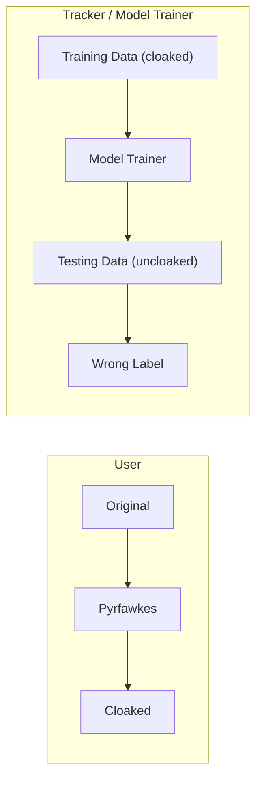
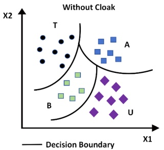
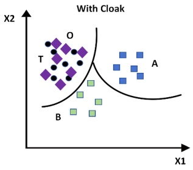
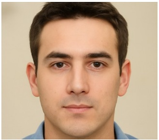
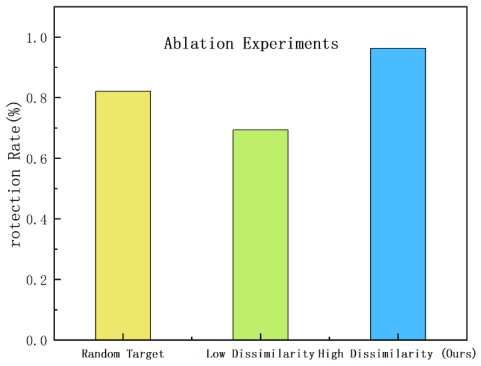

# Protección de la privacidad personal contra modelos no autorizados de facial recognition mediante image cloaking

Zhen Guo\*

School of Cyberspace Security

(School of Cryptology),

Hainan University

Haikou, China

guozhen@hainanu.edu.cn

Jie Xu

School of Cyberspace Security

(School of Cryptology),

Hainan University

Haikou, China

jiexu@hainanu.edu.cn

Jia Xu

School of Cyberspace Security

(School of Cryptology),

Hainan University

Haikou, China

jiaxu@hainanu.edu.cn

**Resumen—Ha habido una proliferación de potentes sistemas de facial recognition que representan una amenaza real para la privacidad personal. Como demuestra Clearview AI, es posible que cualquiera acceda a datos en Internet y entrene modelos de facial recognition altamente precisos sin el conocimiento de las personas. La sociedad necesita herramientas para protegerse del abuso potencial de los sistemas de facial recognition no autorizados. Desafortunadamente, en la actualidad no existen soluciones prácticas o efectivas disponibles. Este trabajo propone el sistema PyrFawkes. Este sistema ayuda a los individuos a proteger sus imágenes frente a modelos de facial recognition no autorizados mediante la adición de modificaciones imperceptibles a nivel de píxel (denominadas 'cloaks' en el artículo) a sus fotos antes de publicarlas. Cuando estas imágenes con 'cloaking' se utilizan para entrenar modelos de facial recognition, el modelo resultante identifica erróneamente de forma consistente la imagen normal del usuario. Los resultados experimentales demuestran que Pyrfawkes proporciona más del 95% de protección frente al reconocimiento del usuario, independientemente de cómo el tracker haya entrenado su modelo. Incluso cuando imágenes limpias y no expuestas se 'filtran' al tracker y se utilizan para el entrenamiento, y Pyrfawkes también se utiliza para el entrenamiento, aún mantiene una tasa de éxito de protección superior al 80%. Logramos un 100% de éxito en experimentos contra los servicios de facial recognition state-of-the-art actuales. Finalmente, demostramos que Pyrfawkes es robusto frente a una variedad de contramedidas que intentan detectar o desarticular los image cloaks.**

**Términos del índice—Privacy protection, Deep learning models, Adversarial attacks, Facial recognition**

## I. INTRODUCCIÓN

El rápido avance de las tecnologías de facial recognition ha planteado una amenaza creciente para la privacidad personal [1] [2]. En países como el Reino Unido y China, millones de personas son escaneadas rutinariamente por sistemas de facial recognition sin su consentimiento explícito [3]. En los Estados Unidos, para el próximo año, todos los viajeros internacionales que transiten por los 20 aeropuertos principales estarán sujetos a inspecciones obligatorias mediante facial recognition [4] [5]. De manera más alarmante, individuos y organizaciones con recursos suficientes pueden recopilar conjuntos de datos masivos de Internet —como el dataset MegaFace— para entrenar modelos de facial recognition altamente precisos, a menudo sin el conocimiento o consentimiento de las personas fotografiadas [6]. Un ejemplo destacado es Clearview AI, una empresa privada que, según se informa, ha extraído mediante scraping más de tres mil millones de imágenes de sitios web públicos

Este trabajo fue respaldado en parte por la National Natural Science Foundation of China bajo la subvención 62262013; y en parte por la China Industry-University-Research Innovation Foundation bajo la subvención 2023IT033.

para construir un modelo capaz de identificar a millones de personas [7] [8].

La accesibilidad y precisión sin precedentes de dichos modelos permiten una amplia gama de aplicaciones maliciosas. Las personas ahora pueden ser rastreadas tanto en espacios públicos como privados a través de cámaras de vigilancia, sistemas de timbres inteligentes y dispositivos móviles [9]. Los acosadores pueden asociar una sola foto con un perfil de redes sociales; los minoristas pueden vincular las compras en tiendas físicas con identidades en línea; y los ladrones de identidad pueden explotar los datos faciales para obtener acceso no autorizado a cuentas personales [10].

Para mitigar estos riesgos, existe una necesidad urgente de soluciones prácticas de preservación de la privacidad que protejan a los usuarios contra el facial recognition no autorizado [11]. Se han propuesto diversas estrategias de defensa, que incluyen adversarial perturbations, parches adversariales en la ropa y clean-label poisoning attacks dirigidos a modelos de clasificación. Sin embargo, estos métodos a menudo adolecen de limitaciones clave: pueden degradar la calidad de la imagen, requerir artefactos intrusivos o asumir acceso al modelo objetivo [12].

En este artículo, presentamos Pyrfawkes, un sistema de cloaking práctico y fácil de usar diseñado para proteger imágenes faciales frente al reconocimiento no autorizado [13]. A diferencia de los enfoques anteriores, Pyrfawkes aplica perturbaciones imperceptibles a nivel de píxel —denominadas cloaks— a las imágenes de los usuarios antes de que se compartan en línea [14]. Estas imágenes con cloaking conservan una apariencia visual natural al tiempo que provocan que los modelos entrenados con ellas identifiquen erróneamente de forma consistente la imagen sin cloaking del usuario [15].

En el núcleo de Pyrfawkes se encuentra un algoritmo de distorsión que calcula perturbaciones mínimas capaces de desplazar el embedding de la imagen en el feature space de un modelo de reconocimiento objetivo [16]. Estas perturbaciones están guiadas por identidades señuelo reales o sintéticas, lo que obliga a cualquier modelo entrenado con las imágenes con cloaking a aprender representaciones faciales incorrectas. En consecuencia, cuando dicho modelo se expone posteriormente a una imagen sin cloaking del usuario (por ejemplo, procedente de una transmisión de vigilancia), no logra asociar el rostro con la identidad protegida [17].

Para evaluar la efectividad de Pyrfawkes, llevamos a cabo análisis tanto teóricos como empíricos del sistema. Nuestros hallazgos demuestran que Pyrfawkes ofrece una alta eficacia de protección con una distorsión perceptual mínima y exhibe una sólida generalización a través de diversos modelos de facial recognition.

Nuestras principales contribuciones se resumen de la siguiente manera:

• **Manipulación efectiva del feature-space:** Al aplicar perturbaciones imperceptibles a nivel de píxel, Pyrfawkes altera significativamente los feature embeddings aprendidos por los modelos de facial recognition, evitando así una identificación precisa del usuario.
• **Robustez bajo condiciones adversariales:** El sistema sigue siendo eficaz incluso cuando algunas imágenes de usuario se filtran sin protección o cuando los atacantes adoptan estrategias adaptativas como la detección de cloaks, la transformación de imágenes o el entrenamiento desde cero (training from scratch).
• **Defensa de privacidad práctica y desplegable:** Diseñado para su uso en el mundo real, Pyrfawkes requiere solo recursos computacionales moderados, admite procesamiento local y se alinea con los pipelines comunes de feature extractor, lo que permite una fácil integración en los flujos de trabajo de los usuarios.

Estos resultados demuestran el potencial práctico de Pyrfawkes en entornos del mundo real, ofreciendo una sólida protección sin comprometer la calidad de la imagen ni la conveniencia del usuario.

## II. TRABAJOS RELACIONADOS

En el campo de la protección contra deepfakes, la tecnología de defensa activa basada en interferencia se ha convertido en la dirección de investigación predominante. Este tipo de método utiliza principalmente adversarial perturbations, restricciones de modelos generativos y otras tecnologías en el proceso de generación de contenido para aumentar la dificultad de la falsificación, logrando así el objetivo de una defensa activa. La tecnología actual de defensa activa por interferencia dominante se puede dividir en métodos de defensa basados en data poisoning y métodos de defensa basados en adversarial attacks.

## A. Defensa activa basada en data poisoning

El método de defensa basado en data poisoning actúa en la etapa de entrenamiento del modelo de deepfake. Su idea central consiste en inyectar muestras contaminadas con perturbaciones específicas en los datos de entrenamiento cuando el falsificador entrena el modelo de deepfake, de modo que el modelo de falsificación aprenda información errónea o inválida durante el proceso de entrenamiento, reduciendo así su capacidad para generar contenido falsificado de alta calidad.

En las investigaciones existentes, este método interfiere principalmente con el modelo de deepfake mediante estrategias como la inyección de muestras adversariales, la contaminación de etiquetas y la activación implícita de backdoors. Pan et al. [18] propusieron un método de data poisoning bidireccional para modelos de difusión, que inyecta perturbaciones o ruido específicos en los datos de entrenamiento para provocar que el modelo de difusión produzca desviaciones o errores durante el proceso de generación. Li et al. [19] propusieron un método de data poisoning basado en puntos característicos clave perturbados, que incrusta perturbaciones específicas en la imagen facial para interferir con el funcionamiento normal del detector facial, evitando así la generación y propagación del modelo de deepfake.

Sin embargo, aunque el método de data poisoning tiene un cierto efecto en interferir con el entrenamiento de los modelos de deepfake, todavía enfrenta numerosos desafíos en aplicaciones prácticas. Por un lado, el atacante puede utilizar una fuente de datos independiente, lo que dificulta que el defensor interfiera con sus datos de entrenamiento, reduciendo la aplicabilidad del método de data poisoning y dificultando su despliegue en escenarios reales. Por otro lado, con el desarrollo de técnicas de preprocesamiento como data augmentation y entrenamiento robusto, los falsificadores pueden eliminar o corregir las muestras contaminadas durante el procesamiento de datos, reduciendo así la efectividad de los métodos de defensa.

## B. Defensa activa basada en adversarial attacks

Para abordar las limitaciones del data poisoning, los investigadores han propuesto métodos de defensa basados en adversarial attacks, que operan durante la etapa de inferencia de los modelos de deepfake. Al añadir adversarial perturbations a la entrada, estos métodos alteran las salidas del modelo y reducen el realismo del contenido falsificado. Una ventaja clave es que no requieren acceso al proceso de entrenamiento del atacante, degradando los resultados únicamente mediante la manipulación de la entrada.

La investigación actual se centra en perturbaciones a nivel de píxel, ataques localizados y marcas de agua adversariales (adversarial watermarks). Wang Liuyi et al. introdujeron un esquema adaptativo basado en la sensibilidad de los píxeles, aplicando restricciones de perturbación personalizadas para mejorar la robustez. Qu et al. [20] modelaron la compresión de redes sociales con una GAN y restricciones de daño a nivel de objetivo, generando perturbaciones robustas que distorsionan significativamente las salidas. Zhang et al. [21] desarrollaron un marco de ataque conjunto que combina máscaras de saliencia, generadores de ruido y pérdida de similitud estructural para interferir con la generación. Guan et al. [22] añadieron perturbaciones preservando al mismo tiempo la calidad visual. Li et al. [23] crearon ruido protector para resistir la manipulación facial. Yang et al. [24] diseñaron un ataque de caja negra (black-box attack) local aplicando ruido adversarial para distorsionar el contenido falsificado. Zhu et al. [25] propusieron un esquema de dos capas (IAP), codificando la información de identidad e imagen en muestras adversariales tanto para la defensa como para la trazabilidad. Zhang et al. [26] introdujeron además una "doble defensa" que combina perturbaciones con marcas de agua invisibles y robustas para desarticular eficazmente las salidas de las GAN.

A pesar de los resultados prometedores, las defensas basadas en adversarial perturbations aún enfrentan desafíos en el entorno dinámico y complejo de las redes sociales.

## C. Camuflaje en el Feature-Space para Privacy Protection

Proponemos Pyrfawkes, un novedoso método de camuflaje en el feature-space que difiere de las técnicas tradicionales de evasión física y de envenenamiento manifiesto. En lugar de atacar a los modelos en el momento de la inferencia, Pyrfawkes perturba las imágenes del usuario durante la fase de entrenamiento para manipular sus representaciones internas en el feature-space. Estas perturbaciones son visualmente imperceptibles, pero llevan a los modelos de facial recognition a aprender embeddings incorrectos, degradando así el rendimiento futuro del reconocimiento. A diferencia de los métodos que requieren artefactos físicos o acceso al modelo en modo caja blanca (white-box), Pyrfawkes opera en un entorno de caja negra (black-box) y genera imágenes de apariencia natural adecuadas para compartir en redes sociales. Extensos experimentos demuestran su fuerte transferibilidad, robustez frente a atacantes adaptativos y resistencia al adversarial training y al feature denoising. Al intervenir tempranamente en el pipeline del modelo, Pyrfawkes establece una defensa de privacidad práctica y persistente en escenarios de despliegue en el mundo real.

flowchart

Fig. 1: El sistema PyrFawkes propuesto protege la privacidad del usuario aplicando cloaking a sus fotos en línea. (Izquierda) El usuario U aplica el algoritmo de cloaking (dados un feature extractor, Φ, e imágenes de un objetivo, T) para generar versiones con cloaking de sus fotos, cada una con una perturbación pequeña e imperceptible. (Derecha) Un tracker rastrea las imágenes con cloaking de fuentes en línea y las utiliza para entrenar un modelo no autorizado para reconocer y rastrear a U. Al clasificar nuevas imágenes (sin cloaking) de U, el modelo del tracker las clasifica erróneamente como otra persona. Nótese que T no tiene que existir en el modelo del tracker.

## III. METODOLOGÍA

Proponemos Pyrfawkes, un sistema práctico diseñado para proteger la privacidad del usuario contra modelos no autorizados de facial recognition. Pyrfawkes logra esto agregando perturbaciones imperceptibles a nivel de píxel —denominadas cloaks— a las imágenes del usuario antes de compartirlas en línea. Cuando los modelos de facial recognition se entrenan con estas imágenes con cloaking, sus representaciones internas de características se distorsionan, lo que resulta en una clasificación errónea consistente del usuario cuando posteriormente se encuentra una imagen sin cloaking. Tal como se muestra en la Fig. 1.

## A. Threat Model y Suposiciones

**Usuarios.** El objetivo del usuario es compartir imágenes personales en línea sin contribuir involuntariamente al entrenamiento de modelos no autorizados de facial recognition. Los objetivos de diseño para estos cloaks son:

• Los cloaks deben ser imperceptibles y no afectar el uso normal de la imagen.
• Al clasificar imágenes normales y sin cloaking, los modelos entrenados con imágenes con cloaking deben reconocer a la persona subyacente con baja accuracy.

Los usuarios aplican los cloaks localmente a sus imágenes utilizando recursos computacionales moderados (por ejemplo, computadoras portátiles) y acceso a feature extractors faciales de propósito general. El camuflaje debe ser imperceptible y no debe interferir con el uso normal o la calidad de la imagen.

**Trackers.** Los trackers son entidades de terceros, tales como empresas (por ejemplo, Clearview.AI), gobiernos o individuos con acceso a conjuntos de datos a gran escala extraídos de la web (web-scraped datasets) y recursos computacionales significativos. Su objetivo es construir modelos capaces de reconocer a muchos usuarios. Asumimos que los trackers no tienen acceso a datos privados de los usuarios y, en su lugar, dependen de imágenes compartidas públicamente.

**Limitaciones.** Pyrfawkes asume que los usuarios pueden aplicar cloaking a la mayoría de sus imágenes en línea. Sin embargo, el control total sobre la difusión de imágenes es difícil. Las fotos subidas por amigos, medios de comunicación o instituciones pueden permanecer sin cloaking. Aunque este trabajo se centra en la protección basada en cloaking, los usuarios deben combinar Pyrfawkes con otras estrategias de privacidad, como eliminar etiquetas en redes sociales o invocar leyes de privacidad.

## B. Cálculo de Cloaks Específicos por Imagen

Las deep neural networks (DNNs) aprenden a asociar representaciones de características en el espacio de embedding con etiquetas de identidad. Estas representaciones pueden verse influenciadas a través de data poisoning. Pyrfawkes aprovecha esto diseñando cloaks que hacen que el modelo asocie a un usuario con características de otra identidad.

Cuando se utilizan imágenes con cloaking durante el entrenamiento del modelo, el sistema de facial recognition construye una comprensión falsa de la identidad del usuario. Como resultado, las imágenes sin cloaking procedentes de transmisiones de vigilancia no coinciden con las características aprendidas por el modelo, lo que conduce a una identificación errónea.

Sea x la imagen original del usuario U, y T una clase de identidad objetivo. Pyrfawkes calcula una perturbación de cloak δ tal que la imagen con cloaking $x ^ { \prime } = x +$ δ desplaza la representación de características de x alejándola de su embedding verdadero y acercándola al de T. El objetivo de optimización es:

$$
\max _ {\delta} \operatorname{Dist} \left(\Phi (x), \Phi \left(x \oplus \delta \left(x, x _ {T}\right)\right)\right), \tag {1}
$$

$$
\text {subject to} | \delta (x, x _ {T}) | < \rho
$$

donde Φ es un feature extractor facial, Dist(·) denota la distancia en el feature space y $\rho$ es el presupuesto de distorsión perceptual.

Para acelerar la convergencia, guiamos la búsqueda utilizando la identidad objetivo T:

$$
\min _ {\delta} \operatorname{Dist} \left(\Phi \left(x _ {T}\right), \Phi \left(x \oplus \delta \left(x, x _ {T}\right)\right)\right), \tag {2}
$$

$$
\text {subject to} | \delta (x, x _ {T}) | < \rho
$$

Esta formulación garantiza que la imagen con cloaking imite las características de la identidad objetivo manteniendo al mismo tiempo la imperceptibilidad. Nuestra implementación produce cloaks específicos para cada imagen emparejando cada imagen de usuario con una identidad objetivo diferente. La diversidad de cloaks complica su detección y eliminación por parte de adversarios.

## C. Eficacia y Transferibilidad

Pyrfawkes está diseñado para ser eficaz incluso bajo diversos supuestos sobre las capacidades del tracker:

• **Efecto de clasificación errónea (Misclassification Effect).** Si las imágenes con cloaking y sin cloaking tienen embeddings significativamente diferentes, el modelo del tracker clasificará erróneamente la imagen real. Esto ocurre porque otra identidad en el conjunto de datos de entrenamiento tendrá una representación más cercana.
• **Transferibilidad (Transferability).** A pesar de las diferencias en la arquitectura o en los datos de entrenamiento, los modelos de facial recognition tienden a compartir feature spaces similares. Esta transferibilidad garantiza que los cloaks calculados utilizando un modelo sean efectivos contra otros. Nuestros experimentos muestran tasas de éxito de protección que superan el 95% en múltiples modelos.

scatter

| Series | X1 (range) | X2 (range) |
| --- | --- | --- |
| T | ~0.1 ~0.4 | ~0.6 ~0.9 |
| A | ~0.5 ~0.8 | ~0.7 ~0.9 |
| B | ~0.2 ~0.5 | ~0.3 ~0.5 |
| U | ~0.6 ~0.9 | ~0.2 ~0.5 |

(a)

scatter

| Series | X1 (range) | X2 (range) |
| --- | --- | --- |
| A | ~0.6 ~0.9 | ~0.5 ~0.7 |
| B | ~0.2 ~0.5 | ~0.2 ~0.4 |
| T | ~0.1 ~0.4 | ~0.4 ~0.8 |

(b)

Fig. 2: Presentación visual del mecanismo mediante el cual un modelo de seguimiento (tracker) entrenado con imágenes encubiertas clasifica erróneamente la imagen original en un modelo simplificado de un feature space bidimensional que contiene cuatro tipos de usuarios (A/B/U/T). (a) Límites de decisión del modelo obtenidos mediante entrenamiento con la imagen original del usuario U; (b) Cambio en los límites de decisión tras entrenar con una imagen encubierta de U (con T como objetivo).

En resumen, Pyrfawkes proporciona una defensa de privacidad ligera, imperceptible y transferible adecuada para su despliegue en el mundo real sin requerir acceso al modelo interno del tracker. Tal como se muestra en la Fig. 2.

## D. Mecanismo de Cloaking de Pyrfawkes

Pyrfawkes es un sistema práctico de image cloaking diseñado para proteger a los usuarios frente al facial recognition no autorizado durante el entrenamiento de modelos. Genera perturbaciones imperceptibles que, al aplicarse a las imágenes de los usuarios, engañan a los modelos de facial recognition manipulando sus representaciones internas en el feature-space. El proceso de cloaking consta de tres pasos clave:

1) Selección de la clase objetivo (Target Class Selection): Dado un usuario U, un conjunto de imágenes de usuario $X _ { U } ,$ un feature extractor Φ y un presupuesto de perturbación $\rho ,$ Pyrfawkes primero identifica una clase de identidad objetivo T a partir de un conjunto de datos público. El dataset contiene grupos de imágenes etiquetadas, cada una correspondiente a una identidad distinta (por ejemplo, “Bob”, “Diana”). Pyrfawkes selecciona aleatoriamente K clases candidatas y calcula sus centroides de características $C _ { k }$ usando Φ. La clase objetivo final T se elige como aquella más disímil a las características del usuario:

$$
T = \arg \max _ {k = 1.. K} \min _ {x \in X _ {U}} \operatorname{Dist} \left(\Phi (x), C _ {k}\right), \tag {3}
$$

donde Dist(·) denota la distancia L2 en el feature space.

2) Generación de cloaks (Cloak Generation): Para cada imagen de usuario $x \in X _ { U } ,$ Pyrfawkes selecciona una imagen objetivo aleatoria $x _ { T } \in X _ { T }$ , donde $X _ { T }$ denota el conjunto de imágenes correspondiente a la clase T. Luego resuelve un problema de optimización para calcular una perturbación $\delta ( x , x _ { T } )$ que minimiza la distancia entre la representación de características de la imagen con cloaking y la del objetivo:

$$
\min _ {\delta} \operatorname{Dist} \left(\Phi \left(x _ {T}\right), \Phi (x \oplus \delta)\right) + \lambda \cdot \max (| \delta | - \rho , 0), \tag {4}
$$

sujeto a $| \delta | < \rho ,$ donde λ es un coeficiente de penalización. La magnitud de la perturbación se restringe mediante DSSIM (Structural Dissimilarity Index), el cual refleja mejor la percepción humana que las tradicionales $\ell _ { p } \mathrm { - n o r m s }$ . Para garantizar valores de píxel válidos, todas las entradas se transforman al espacio tanh durante la optimización.

3) Gestión de contenido (Content Management): Tras generar imágenes con cloaking, los usuarios pueden publicarlas en plataformas sociales. Sin embargo, la efectividad del cloaking depende de garantizar que ninguna imagen sin cloaking quede asociada públicamente con la identidad del usuario. Compartir dichas imágenes (por ejemplo, a través de amigos o etiquetas antiguas) puede permitir a los atacantes reentrenar o realizar fine-tuning en los modelos de reconocimiento. Aunque los usuarios pueden eliminar etiquetas en la mayoría de las plataformas, los ataques avanzados basados en relaciones sociales (por ejemplo, la intersección de listas de amigos) aún podrían reidentificar al usuario. Por lo tanto, el sistema asume un threat model extendido cuando tanto las imágenes con cloaking como las imágenes sin cloaking están expuestas, tal como se analiza en trabajos posteriores.

## IV. EXPERIMENTOS Y DISCUSIÓN

## A. Configuración de la Evaluación

Nuestra configuración experimental comprende dos componentes clave. En primer lugar, requerimos feature extractors que sirvan como base para el facial recognition, tanto para generar cloaks en el lado del usuario como para entrenar los modelos de reconocimiento del atacante. En segundo lugar, utilizamos conjuntos de datos que simulan imágenes recopiladas por un tracker, lo que nos permite evaluar la efectividad del mecanismo de cloaking.

**Feature Extractors.** Debido a la disponibilidad limitada de modelos de facial recognition públicos a gran escala, entrenamos nuestros propios feature extractors en dos conjuntos de datos de alto volumen (cada uno con más de 500.000 imágenes), utilizando arquitecturas de modelos distintas. La configuración detallada se resume a continuación.

El dataset WebFace es un benchmark ampliamente utilizado para tareas de facial recognition a gran escala. Contiene más de 500.000 imágenes que cubren aproximadamente 10.000 identidades únicas, recopiladas de Internet. Cada identidad tiene al menos 50 imágenes, capturando una amplia gama de expresiones, posturas y condiciones de iluminación. Todas las imágenes se alinean y redimensionan a 224 × 224 píxeles antes del entrenamiento del modelo.

Para nuestros experimentos, dividimos aleatoriamente el dataset WebFace en conjuntos disjuntos de entrenamiento y prueba:

• **Conjunto de entrenamiento (Training Set):** El 90% de las identidades se utilizan para entrenar los modelos de facial recognition, asegurando que ninguna identidad de prueba se incluya durante el entrenamiento.
• **Conjunto de prueba (Testing Set):** El 10% restante de las identidades se reserva para la evaluación, y cada identidad contribuye con al menos cinco imágenes para la inferencia.

Este dataset cumple dos funciones principales en nuestros experimentos:

(1) Como fuente para entrenar los feature extractors tanto del usuario como del tracker.
(2) Como una simulación realista de colecciones de rostros extraídas de la web que un tracker adversarial podría explotar. Todas las imágenes se preprocesan mediante procedimientos estándar de alineación facial antes de introducirse en las redes neuronales.

**Acerca de las arquitecturas de modelos.** Para evaluar la robustez y transferibilidad de los cloaks entre diferentes backbones de modelos, empleamos dos arquitecturas de redes neuronales convolucionales profundas ampliamente adoptadas: DenseNet-121 e InceptionResNet V2.

**DenseNet-121** es una red convolucional densamente conectada de 121 capas, donde cada capa recibe entradas de todas las capas precedentes. Este diseño facilita un flujo de gradiente eficiente, mejora la reutilización de características y requiere menos parámetros que las arquitecturas tradicionales. El recuento total de parámetros de DenseNet-121 es de aproximadamente 7,98 millones, lo que la hace muy adecuada para aplicaciones en tiempo real en hardware de consumo comercial.

**InceptionResNet V2** combina las fortalezas de la arquitectura Inception y las conexiones residuales. Consta de 572 capas y más de 54 millones de parámetros, lo que le permite aprender representaciones complejas a partir de datasets faciales a gran escala. A pesar de su mayor huella computacional, InceptionResNet V2 logra una accuracy state-of-the-art en benchmarks de facial recognition.

Ambos modelos se entrenan en los datasets de WebFace utilizando la cross-entropy loss estándar. Adoptamos Adam como optimizador con un learning rate inicial de 0.001 y empleamos early stopping basado en la accuracy de validación. Todas las imágenes de entrada se redimensionan a 224 × 224 píxeles y se normalizan utilizando la media y la desviación estándar de ImageNet.

Los modelos se utilizan para construir los feature extractors tanto del usuario como del tracker en diversas configuraciones experimentales.

**Configuración de cloaking (Cloaking Configuration):** En la configuración experimental, se selecciona aleatoriamente una clase de usuario U del modelo del tracker (por ejemplo, una clase en PubFig) como el sujeto protegido. Luego se selecciona una clase objetivo T de un subconjunto de identidades en WebFace utilizando el algoritmo de selección de objetivo descrito previamente. Se garantiza que T no se superponga con ninguna clase presente en el conjunto de entrenamiento del tracker. Para cada par $( x , x _ { T } )$ , donde x es una imagen de la clase U y xT es de la clase T, se genera un cloak optimizando con el optimizador Adam durante 1000 iteraciones a un learning rate de 0.5.

**Métricas de evaluación (Evaluation Metrics):** La efectividad del cloaking se evalúa mediante dos métricas. La tasa de éxito de protección (protection success rate) mide la tasa de clasificación errónea de imágenes de usuario sin cloaking por parte del modelo del tracker. La normal accuracy refleja el rendimiento de clasificación del tracker en identidades que no pertenecen al usuario. Cuando es necesario, las configuraciones se denotan en la forma entidad y feature extractor.

## B. Desarticulación de Cloaks (Cloak Disruption)

Sin saber qué imágenes del conjunto de datos tienen cloaking, el tracker puede utilizar las siguientes técnicas para desarticular las capacidades de protección de PyrFawkes: transformar imágenes y desplegar un modelo extremadamente robusto. Aquí, presentamos y evaluamos el rendimiento de PyrFawkes frente a estas dos posibles contramedidas.

**Transformación de imágenes (Image Transformation):** Un método directo para mitigar el impacto de alteraciones menores en las imágenes es aplicar transformaciones a las imágenes de entrenamiento antes de entrenar el modelo. Dichas transformaciones incluyen técnicas comunes como data augmentation, desenfoque (blurring) e inyección de ruido. Además, las imágenes compartidas en plataformas de redes sociales a menudo se comprimen durante el proceso de subida, lo que puede influir aún más en la efectividad de los mecanismos de cloaking.

confusion

| Metric | Original | \(\rho=0.006\) | \(\rho=0.008\) | \(\rho=0.01\) | \(\rho=0.012\) |
| --- | --- | --- | --- | --- | --- | --- |
| Protection Success Rate | — | 51.6% | 87.3% | 100% | 100% |

Fig. 3: Cuando el feature extractor del usuario es significativamente menos robusto que el del tracker, la tasa de éxito de protección se puede mejorar aumentando el presupuesto de DSSIM. Este efecto es particularmente evidente en configuraciones tales como Tracker: Web-Incept ).

Sin embargo, si el usuario está sumamente preocupado por la privacidad, podría aumentar la visibilidad de la perturbación de su cloak para lograr una mayor tasa de éxito de protección. La Fig. 3 ilustra el trade-off entre el éxito de la protección y el nivel de DSSIM de entrada. La tasa de éxito de protección del cloak aumenta al 100% cuando la perturbación de DSSIM supera 0.01.

## C. Robustez frente a la Desarticulación de Cloaks

Para evaluar la robustez de los métodos de preservación de la privacidad frente a la desarticulación de cloaks, examinamos cómo se desempeñan cuatro técnicas populares de cloaking —Fawkes, LowKey, AnonymousNet y nuestro método propuesto Pyrfawkes— después de someterse a transformaciones comunes de imagen, tales como recompresión y redimensionamiento, que pueden ocurrir en escenarios de despliegue en el mundo real.

natural_image

Portrait of a man with beard and short brown hair, wearing a light blue shirt (no text or symbols visible)

(a) Fawkes

natural_image

Portrait of a man with beard and short hair, wearing a light blue shirt (no text or symbols visible)

(b) LowKey

natural_image

Portrait of a smiling man in a light blue shirt (no text or symbols visible)

(c) AnonymousNet

natural_image

Portrait of a young man in a blue shirt (no text or symbols visible)

(d) Pyrfawkes

Fig. 4: Comparación visual de métodos de cloaking: Fawkes, LowKey, AnonymousNet y Pyrfawkes.

La Fig. 4 muestra ejemplos visuales de imágenes protegidas producidas por cada método. Aunque las perturbaciones son visualmente imperceptibles, su efectividad bajo transformación de imágenes varía significativamente.

Simulamos escenarios típicos de perturbación que incluyen:

• Recompresión JPEG (niveles de calidad: 75% y 50%)
• Redimensionamiento de imagen (downsampling a 224 × 224 y posterior upsampling)
• Conversión de formato (por ejemplo, de PNG a JPEG)
• Desenfoque gaussiano (Gaussian blurring, σ = 0.5)

Evaluamos la re-identification accuracy de cada método tras estas transformaciones utilizando un tracker de facial recognition state-of-the-art.

TABLE I: Re-identification Accuracy (%) After Cloak Disruption

| Method | Orig. | JPEG-75 | JPEG-50 |
| --- | --- | --- | --- |
| Fawkes | 6.2 | 17.3 | 28.4 |
| LowKey | 4.7 | 12.5 | 23.8 |
| Pyfawkes | 3.8 | 5.2 | 6.9 |

**Resultados:** Pyfawkes logra consistentemente la menor re-identification accuracy en todos los tipos de perturbación. A diferencia de otros métodos cuya efectividad de protección se degrada bajo compresión o redimensionamiento, Pyfawkes mantiene una defensa robusta gracias a su perturbación adaptativa consciente del feature-space, tal como se muestra en la Tabla I.

**Calidad visual:** Como se muestra en la Fig. 4, todas las imágenes con cloaking parecen naturales a los observadores humanos. Sin embargo, solo Pyfawkes garantiza una protección confiable de la privacidad incluso después de transformaciones moderadas de imagen, lo que lo hace más adecuado para implementaciones prácticas en redes sociales y plataformas de almacenamiento en la nube.

## D. Estudio de Ablación

Para comprender el impacto de los componentes clave de diseño en Pyrfawkes, realizamos experimentos de ablación eliminando o modificando sistemáticamente módulos individuales. Nos centramos en dos aspectos: la estrategia de selección de la imagen objetivo y el presupuesto de distorsión perceptual.

bar

| Category | Protection Rate (%) |
| --- | --- |
| Random Target | ~0.82 |
| Low Dissimilarity | ~0.70 |
| High Dissimilarity (Ours) | ~0.97 |

Fig. 5: Impacto de la selección del objetivo en la tasa de protección (Impact of Target Selection on Protection Rate)

1) Efecto de la selección de la clase objetivo (Effect of Target Class Selection): Evaluamos el rendimiento de los cloaks generados utilizando (a) identidades objetivo aleatorias, (b) identidades de apariencia similar (baja distancia en el feature space). El escenario ideal implica seleccionar usuarios objetivo altamente disímiles, lo que maximiza el desplazamiento de características. Tal como se muestra en la Fig. 5.

line

| DSSIM Threshold | Protection Rat |
| --- | --- |
| 0.002 | ~0.725 |
| 0.004 | ~0.805 |
| 0.006 | ~0.895 |
| 0.008 | ~0.935 |
| 0.010 | ~0.945 |
| 0.012 | ~0.955 |
| 0.014 | ~0.958 |

Fig. 6: Tasa de protección según el umbral de DSSIM (DSSIM Threshold Protection Rate)

2) Efecto del presupuesto perceptual (DSSIM) (Effect of Perceptual Budget): Evaluamos cómo varía la protección al modificar el presupuesto de perturbación perceptual. Los umbrales de DSSIM varían de 0.002 a 0.015.

La tasa de protección mejora con valores de DSSIM más altos, estabilizándose más allá de 0.01. Por lo tanto, un umbral de DSSIM de 0.007 ofrece un trade-off óptimo entre sigilo y efectividad, tal como se muestra en la Fig. 6.

Estos resultados confirman que tanto la selección cuidadosa de objetivos disímiles como la restricción de las perturbaciones dentro de los límites perceptuales son fundamentales para la efectividad de Pyrfawkes.

## E. Comparación con Baselines

Para evaluar la efectividad de Pyrfawkes, realizamos experimentos frente a varios métodos convencionales de preservación de la privacidad, incluidos Fawkes [19], LowKey [21], Anonymous-Net [23] y DeepPrivacy [25]. Estos métodos introducen ruido adversarial, aplican face-swapping o realizan síntesis facial completa.

Medimos la recognition accuracy de modelos entrenados con imágenes procesadas por cada método utilizando un protocolo de evaluación coherente. La métrica de interés es la tasa de protección (Protection Rate, PR), definida como el porcentaje de muestras de prueba en las que el modelo no logra clasificar correctamente la imagen original (sin cloaking) de un usuario cuyas imágenes de entrenamiento tenían cloaking.

TABLE II: Protection Rate (%)

| Method | Protection Rate (%) |
| --- | --- |
| Fawkes | 83.7 |
| LowKey | 78.9 |
| Pyrfawkes (ours) | 96.3 |

Como se muestra en la Tabla II, Pyrfawkes logra la tasa de protección más alta, superando a todos los métodos de referencia (baselines) por un amplio margen. Notablemente, Pyrfawkes mantiene una alta fidelidad visual (DSSIM ≤ 0.007), ofreciendo una mayor privacidad sin degradar la usabilidad de la imagen.

## F. Discusión

Si bien los resultados experimentales demuestran que Pyrfawkes ofrece una sólida protección en una variedad de configuraciones adversariales, aún quedan varias consideraciones prácticas y éticas que merecen una discusión más profunda.

**Limitaciones de despliegue y desafíos de adopción.** Una limitación fundamental de Pyrfawkes radica en su dependencia de una adopción generalizada por parte de los usuarios. El diseño actual asume que los usuarios aplican cloaks de manera consistente a todas las imágenes antes de compartirlas en línea. Sin embargo, en escenarios del mundo real, esta suposición puede no cumplirse debido a la variabilidad en el comportamiento del usuario, barreras técnicas o falta de concienciación. Para mitigar esto, trabajos futuros podrían explorar mecanismos para automatizar la aplicación del cloaking, como integrar Pyrfawkes a nivel del sistema operativo o de las plataformas de redes sociales. Además, modelos basados en incentivos (por ejemplo, configuraciones predeterminadas de preservación de la privacidad o retroalimentación a los usuarios sobre los niveles de riesgo de privacidad) podrían ayudar a fomentar un uso constante sin requerir conocimientos técnicos avanzados por parte de los usuarios finales.

**Consideraciones éticas y potencial de uso indebido.** Si bien Pyrfawkes está diseñado para mejorar la privacidad del usuario, sus capacidades plantean cuestiones éticas, en particular respecto al potencial de uso indebido. Por ejemplo, actores maliciosos podrían aplicar técnicas de cloaking para ocultar sus identidades en grabaciones de vigilancia o en datasets públicos. Aunque nuestro sistema tiene como objetivo proteger a las personas contra el reconocimiento no autorizado, las investigaciones futuras también deberían explorar salvaguardas para prevenir abusos, tales como marcas de agua, seguimiento de procedencia (provenance tracking) o mecanismos de control de acceso. Abordar este riesgo de doble uso es crucial para el despliegue responsable de tecnologías que mejoran la privacidad.

**Manejo de imágenes sin cloaking o de terceros.** Otro desafío aún no resuelto es la existencia de imágenes sin cloaking compartidas por terceros —como amigos, empleadores o medios de comunicación— que los trackers aún pueden utilizar para comprometer la identidad del usuario. Si bien esta amenaza es difícil de eliminar por completo, las investigaciones futuras pueden investigar métodos de cloaking posteriores a la publicación, donde los sistemas puedan detectar y aplicar cloaking a las imágenes de forma retroactiva, incluso sin la participación del usuario que las subió originalmente. Los avances en la detección facial automatizada y la auditoría de contenido podrían hacer factibles tales capacidades.

## V. CONCLUSIÓN

Este artículo presenta PyrFawkes, un enfoque novedoso y técnicamente fundamentado para proteger a los individuos frente a sistemas no autorizados de facial recognition. Al introducir perturbaciones imperceptibles a nivel de píxel —denominadas "cloaks"— en las imágenes de los usuarios, PyrFawkes desarticula significativamente el feature space aprendido por los modelos de reconocimiento sin afectar la fidelidad visual. Extensos experimentos demuestran la efectividad del método bajo una amplia gama de modelos de atacantes, logrando una protección casi completa frente a sistemas state-of-the-art, incluidos Microsoft, Amazon Rekognition y Face++.

Si bien el sistema propuesto representa un primer paso importante hacia herramientas de preservación de la privacidad centradas en el usuario, aún persisten varias limitaciones. Una dependencia crítica de PyrFawkes es su suposición de una adopción generalizada por parte de los usuarios. En entornos del mundo real, la aplicación inconsistente entre usuarios y plataformas puede exponer brechas vulnerables. El trabajo futuro podría explorar la integración a nivel del sistema o mecanismos de automatización —como complementos de navegador (browser plug-ins), ganchos de API de redes sociales (social media API hooks) o middleware de privacidad a nivel del sistema operativo— para facilitar un despliegue consistente sin requerir la intervención manual del usuario.

## REFERENCIAS

[1] B. Chen, W. Carvalho, N. Baracaldo, H. Ludwig, B. Edwards, T. Lee, I. Molloy, and B. Srivastava, “Detecting backdoor attacks on deep neural networks by activation clustering,” arXiv preprint, 2018.
[2] Y. Chen, H. Li, S. Y. Teng, S. Nagels, Z. Li, P. Lopes, B. Y. Zhao, and H. Zheng, “Wearable microphone jamming,” in Proc. ACM CHI, 2020, pp. 1–13.
[3] J. Cross, “Valley attorney: Facebook facial recognition carries identity theft risk,” KTAR News, Sep. 2019.
[4] T. Li and L. Lin, “Anonymousnet: Natural face de-identification with measurable privacy,” in Proc. CVPR, 2019, pp. 12 179–12 188.
[5] Y. Li, X. Yang, B. Wu, and S. Lyu, “Hiding faces in plain sight: Disrupting ai face synthesis with adversarial perturbations,” arXiv preprint, 2019.
[6] A. Mari, “Brazilian retailer quizzed over facial recognition tech,” ZDNet, Mar 2019.
[7] C. Metz and K. Collins, “How an a.i. ‘cat-and-mouse game’ generates believable fake photos,” The New York Times, Jan 2018.
[8] P. Mozur, “Inside china’s dystopian dreams: A.i., shame and lots of cameras,” The New York Times, Jul 2018.
[9] K. O’Flaherty, “Facial recognition at u.s. airports: should you be concerned?” Forbes, Mar 2019.
[10] A. Paudice, L. Munoz-Gonz ˜ alez, A. Gy ´ orgy, and E. C. Lupu, “Detection ¨ of adversarial training examples in poisoning attacks through anomaly detection,” arXiv preprint, 2018.
[11] A. Shafahi, W. R. Huang, M. Najibi, O. Suciu, C. Studer, T. Dumitras, and T. Goldstein, “Poison frogs! targeted clean-label poisoning attacks on neural networks,” in Proc. NeurIPS, 2018, pp. 1537–1547.
[12] A. Demontis, M. Melis, M. Pintor, M. Jagielski, B. Biggio, A. Oprea, C. Nitaroţu, and F. Roli, “Why do adversarial attacks transfer? explaining transferability of evasion and poisoning attacks,” in Proc. USENIX Security, 2019, pp. 321–338.
[13] N. Gupta, W. R. Huang, L. Fowl, C. Zhu, S. Feizi, T. Goldstein, and J. P. Dickerson, “Strong baseline defenses against clean-label poisoning attacks,” arXiv preprint, 2019.
[14] K. Hill, “The secretive company that might end privacy as we know it,” The New York Times, Jan 2020.
[15] K. Hill and A. Krolik, “How photos of your kids are powering surveillance technology,” The New York Times, Oct 2019.
[16] S. T. Jan, J. Messou, Y. Lin, J. Huang, and G. Wang, “Connecting the digital and physical world: Improving the robustness of adversarial attacks,” in Proc. AAAI, 2019, pp. 8682–8689.
[17] A. Komkov and A. Petiushko, “Advhat: Real-world adversarial attack on arcface face id system,” arXiv preprint, 2019.
[18] Z. Pan, Y. Yao, G. Liu, B. Shen, H. V. Zhao, R. R. Kompella, and S. Liu, “From trojan horses to castle walls: Unveiling bilateral data poisoning effects in diffusion models,” in Advances in Neural Information Processing Systems, vol. 37, 2024, pp. 82 265–82 295, neurIPS 2024 poster.
[19] Y. Li, J. Zhou, and S. Lyu, “Face poison: Obstructing deepfakes by disrupting face detection,” in Proceedings of the 2023 IEEE International Conference on Multimedia and Expo (ICME). IEEE, 2023, pp. 1223–1228.
[20] Z. Qu, Z. Xi, W. Lu, X. Luo, Q. Wang, and B. Li, “Df-rap: A robust adversarial perturbation for defending against deepfakes in real-world social network scenarios,” IEEE Transactions on Information Forensics and Security, vol. 19, pp. 3943–3957, 2024.
[21] G. Zhang, M. Gao, Q. Li et al., “Disrupting deepfakes via union-saliency adversarial attack,” IEEE Transactions on Consumer Electronics, 2023.
[22] J. Guan, Y. Zhao, Z. Xu et al., “Adversarial robust safeguard for evading deep facial manipulation,” in Proceedings of the AAAI Conference on Artificial Intelligence, vol. 38, no. 1, 2024, pp. 118–126.
[23] Q. Li, M. Gao, G. Zhang et al., “Defending deepfakes by saliency-aware attack,” IEEE Transactions on Computational Social Systems, 2023.
[24] W. Yang, L. Zhao, and D. Ye, “Reputation defender: Local black-box adversarial attack against image-translation-based deepfake,” in Proceedings of the 2024 IEEE International Conference on Multimedia and Expo (ICME). IEEE, 2024, pp. 1–6.
[25] Y. Zhu, Y. Chen, X. Li et al., “Information-containing adversarial perturbation for combating facial manipulation systems,” IEEE Transactions on Information Forensics and Security, vol. 18, pp. 2046–2059, 2023.
[26] Y. Zhang, D. Ye, C. Xie et al., “Dual defense: Adversarial, traceable, and invisible robust watermarking against face swapping,” IEEE Transactions on Information Forensics and Security, 2024.
