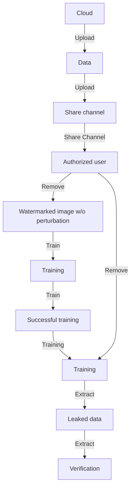
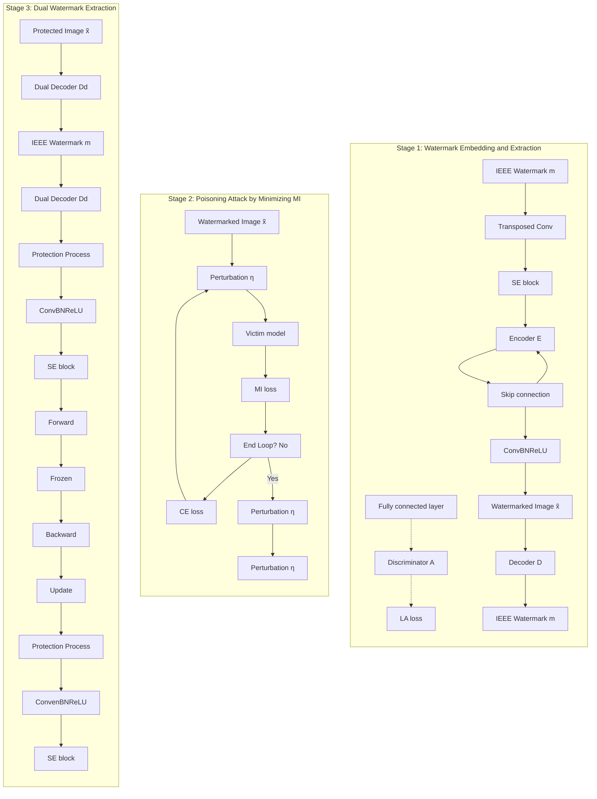
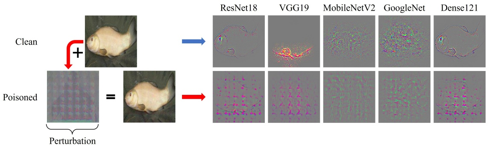
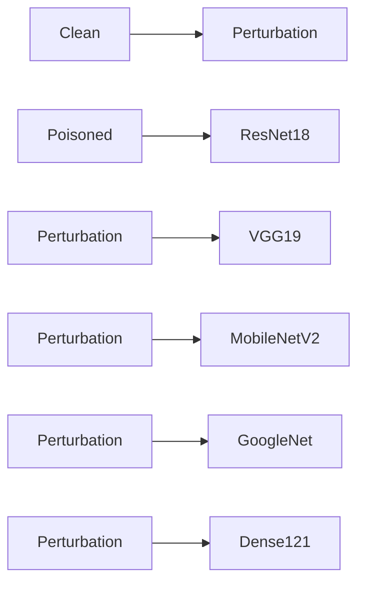
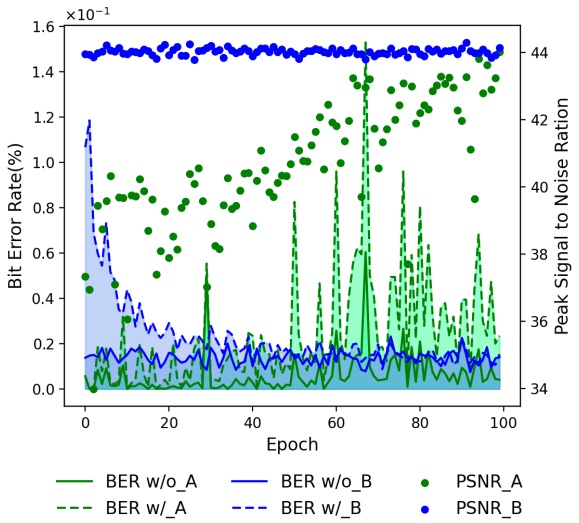
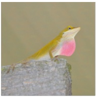
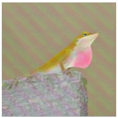

# Reversible Unlearnable Examples: Hacia la Protección de los Derechos de Autor en la Era del Deep Learning

Binze Wang, Jinyu Tian, Member, IEEE, Xingrun Wang,

Xiaochen Yuan, Senior Member, IEEE, Jianqing Li, Senior Member, IEEE

**Resumen—Los avances significativos en deep learning han sido posibles gracias a la utilización de grandes conjuntos de datos, lo que subraya la importancia crítica de la protección de los derechos de autor (copyright protection). Agregar perturbaciones meticulosamente diseñadas a los ejemplos para hacerlos inaprendibles (unlearnable) se ha convertido en un enfoque crucial para salvaguardar los derechos de autor de los datos. Los métodos existentes para crear unlearnable examples pasan por alto el riesgo de fuga de datos (data leakage), lo cual puede amenazar la propiedad de los mismos. De este modo, la copyright protection en deep learning enfrenta dos amenazas principales: el entrenamiento ilegal de modelos y la fuga maliciosa de datos. Investigamos que estas dos amenazas no pueden resolverse combinando directamente los availability attacks existentes y las técnicas de watermarking debido a sus efectos de interacción negativa. Por lo tanto, en este artículo proponemos un mecanismo novedoso de copyright protection para abordar las preocupaciones de seguridad mencionadas. Considerando que la prevención del entrenamiento no autorizado de modelos requiere una potente generalizabilidad de las perturbaciones inaprendibles, generamos perturbaciones para inducir al modelo a aprender características no correlacionadas de las imágenes de entrada. Esto funciona minimizando la información mutua (mutual information) entre la entrada y la salida del modelo. Por otra parte, para eliminar el impacto colateral de las perturbaciones inaprendibles en la extracción de la marca de agua, diseñamos una estrategia de extracción dual mediante el uso de dos watermark extractors distintos. Extensos experimentos en los datasets de imágenes ImageNet, CIFAR10 y Pets demuestran que nuestro método propuesto puede proporcionar una protección integral de derechos de autor a las imágenes. El código está disponible en https://github.com/Yeah21/ReversibleUnlearnableExamples.**

**Términos de índice—Copyright protection, reversible unlearnable examples, watermarking technique.**

## I. INTRODUCCIÓN

La protección de los derechos de autor siempre ha sido uno de los temas fundamentales en el desarrollo de la civilización humana. Al entrar en la era de Internet, el watermarking de imágenes digitales desempeña un papel vital en la protección de los derechos de autor al validar la propiedad de las imágenes frente a manipulaciones no autorizadas generalizadas [1] y fugas en plataformas en línea [2]. Esta técnica opera incrustando información de identificación en las imágenes sin comprometer

<small>Esta investigación fue financiada parcialmente por la National Natural Science Foundation of China (Subvención N.º 62202009), el Macau Science and Technology Development Fund (Subvenciones N.º 0040/2023/ITP1 y 0004/2023/RIB1), y la Basic and Applied Basic Research Foundation of Guangdong Province (Subvención N.º 2024A1515011755). (Autor de correspondencia: Jinyu Tian.)</small>

<small>B. Wang, J. Tian y J. Li pertenecen a la School of Computer Science and Engineering, Faculty of Innovation Engineering, Macau University of Science and Technology, Macao, China (correo electrónico: 3240007529@student.must.edu.mo; jytian@must.edu.mo; jqli@must.edu.mo).</small>
<small>X. Wang pertenece a la School of Computer Science and Artificial Intelligence of FoShan University, FoShan 528225, China (correo electrónico: wangxingrun@fosu.edu.cn).</small>
<small>X. Yuan pertenece a la Faculty of Applied Sciences of the Macao Polytechnic University, Macao, China (correo electrónico: xcyuan@mpu.edu.mo).</small>

<small>Copyright © 2025 IEEE. Se permite el uso personal de este material. Sin embargo, el permiso para utilizar este material para cualquier otro fin debe obtenerse del IEEE enviando un correo electrónico a pubs-permissions@ieee.org.</small>

bar

| Category | w/o perturbation (%) | w/ perturbation (%) |
| --- | --- | --- |
| MBRS(8) | 0.51 | 0.98 |
| HiDDeN(8) | 0.21 | 7.04 |
| MBRS(16) | 0.64 | 2.91 |
| HiDDeN(16) | 0.39 | 7.51 |

Fig. 1. Impacto de las perturbaciones inaprendibles en el rendimiento de extracción de la marca de agua (Bit Error Rate↓). MBRS [8] e HiDDeN [9] son dos métodos de incrustación de marcas de agua. El valor entre corchetes representa el presupuesto (budget) de la perturbación inaprendible.

su usabilidad y permite la **verificación de propiedad (ownership verification)** mediante la extracción de marcas de agua a partir de las imágenes protegidas [3]–[7].

En la era del deep learning, las técnicas de marcas de agua digitales han expandido su aplicabilidad hacia nuevos desafíos emergentes, entre los que se incluyen la salvaguarda de los derechos de autor de modelos [10] y la prevención de la replicación no autorizada de modelos [11]. No obstante, ha surgido un nuevo y formidable reto con la rápida proliferación de las técnicas de deep learning. El riesgo aparece cuando imágenes valiosas pueden ser tomadas por usuarios no autorizados para entrenar modelos comerciales, perjudicando gravemente los derechos de los propietarios de las imágenes [12], [13]. Estas imágenes filtradas, que normalmente permanecen ocultas a la vista del público, presentan una barrera insuperable para las técnicas tradicionales de watermarking orientadas a la verificación de derechos de autor. En consecuencia, proteger los derechos de autor de las imágenes debe ir más allá de simplemente confirmar la propiedad e incluir la preservación de su información semántica intrínseca utilizada para entrenar modelos de deep learning. Por conveniencia, consideramos este segundo tipo de protección de derechos de autor como **protección de información semántica (semantic information protection)**. Un enfoque comúnmente empleado para proteger la información semántica consiste en introducir perturbaciones adversarias imperceptibles en las imágenes protegidas. Esta estrategia frustra eficazmente la capacidad de los modelos para aprender características semánticas valiosas a partir de las imágenes, lo que a menudo se denomina unlearnable examples [14]–[21].

Las dos categorías de problemas de protección de derechos de autor comprenden la verificación de propiedad (ownership verification) y la protección de información semántica (semantic information protection), existiendo soluciones perfectas para cada tipo de problema por separado. Sin embargo, desarrollar un mecanismo integral de copyright protection que aborde eficazmente ambos desafíos es innegablemente complejo. La razón radica en que tanto las marcas de agua digitales como las perturbaciones inaprendibles alteran sutilmente las imágenes y, cuando se combinan ambas técnicas, las perturbaciones inaprendibles complican la extracción de la información de la marca de agua. Por ejemplo, como se muestra en la Fig. 1, cuando se involucran perturbaciones inaprendibles, el rendimiento de la extracción de marcas de agua se degrada significativamente, lo cual se manifiesta en el incremento del Bit Error Rate (BER) de 0.39% a 7.51% (la barra ubicada más a la derecha). Esta observación demuestra que una combinación directa de métodos de watermarking y de unlearnable examples no puede gestionar eficazmente tanto la verificación de propiedad como la protección de la información semántica al mismo tiempo. Por consiguiente, lograr un equilibrio armonioso entre ambos objetivos requiere enfoques innovadores capaces de mitigar su interferencia mutua y alcanzar una coexistencia mutuamente beneficiosa.

flowchart

Fig. 2. Escenario de aplicación que involucra al propietario de los datos (data owner), usuario autorizado (authorized user), usuario no autorizado (unauthorized user) y atacante (attacker).

De hecho, los enfoques actuales han explorado la combinación de información de marcas de agua con perturbaciones inaprendibles, aunque es posible que no aborden directamente el problema de la interferencia entre ambas. El método GEAA [22] aborda el problema incrustando información de marca de agua al tiempo que elimina la perturbación inaprendible para evitar problemas relacionados con la interferencia. Este diseño restringe la extracción de la marca de agua únicamente a los datos recuperados, fallando en verificar la propiedad de las imágenes perturbadas. Adv-watermark [23] utiliza una marca de agua visible como un pequeño elemento de ruido fijo y logra el efecto de un evasion attack ajustando la posición y la transparencia de la marca de agua dentro de la imagen. Sin embargo, las marcas de agua visibles son muy fáciles de atacar [24], lo que provoca el fracaso de la protección, y el evasion attack tiene un rendimiento insatisfactorio en la tarea de availability attack.

En este artículo, presentamos un mecanismo de protección novedoso diseñado para abordar los desafíos emergentes en materia de infracción de derechos de autor en el contexto de la era del deep learning. Nuestro mecanismo propuesto facilita la utilización concurrente de marcas de agua y perturbaciones inaprendibles. Cada componente funciona con normalidad sin comprometer la eficacia del otro. Específicamente, nos enfocamos en un escenario del mundo real ilustrado en la Fig. 2, que involucra cuatro roles clave: el propietario de los datos (data owner), los usuarios autorizados (authorized users), los usuarios no autorizados (unauthorized users) y un atacante potencial (attacker). El propietario de los datos selecciona y prepara un dataset de alta calidad y tiene la intención de hacerlo accesible públicamente, reteniendo al mismo tiempo una propiedad verificable y previniendo la explotación no autorizada. Para este propósito, el propietario de los datos toma medidas preventivas inyectando tanto marcas de agua como perturbaciones imperceptibles (la región cuadrada de la izquierda). Estas perturbaciones hacen que la información semántica dentro de los datos sea inaprendible para los modelos de machine learning, actuando como un mecanismo criptográfico. Posteriormente, estas imágenes protegidas se suben a servicios en la nube como Google Drive, permitiendo el acceso público y su descarga. Las perturbaciones inaprendibles incrustadas desempeñan un papel vital para disuadir eficazmente el mal uso por parte de usuarios no autorizados para el entrenamiento de modelos profundos comerciales, cumpliendo con el objetivo de protección de información semántica (la línea roja continua). Por otra parte, cuando los usuarios autorizados acceden a las imágenes protegidas, pueden entrenar legalmente sus modelos profundos eliminando las perturbaciones adquiridas a través de un canal seguro (la línea verde continua). Esto requiere que las perturbaciones inaprendibles diseñadas sean reversibles. El diseño de perturbaciones class-wise asegura intrínsecamente que las perturbaciones sean dependientes de la etiqueta y se apliquen de manera uniforme a todas las imágenes dentro de una clase, permitiendo una recuperación eficiente. No obstante, un atacante podría robar las claves de descifrado (secret keys) (por ejemplo, mediante canales comprometidos o compras ilícitas) para eliminar las perturbaciones y luego redistribuir los datos limpios, violando tanto los derechos de autor como el control de accesibilidad (la línea negra discontinua). Por lo tanto, la marca de agua debe operar normalmente, independientemente de si existen o no perturbaciones en las imágenes. Nuestro trabajo aborda este problema introduciendo un extractor dual de marcas de agua (dual watermarking extractor), el cual mitiga significativamente la interferencia causada por la perturbación inaprendible y garantiza que podamos extraer exitosamente la misma marca de agua con o sin perturbaciones inaprendibles.

En resumen, nuestro trabajo se concentra en los módulos cruciales del escenario descrito anteriormente y aporta las siguientes novedades y contribuciones:

• Proponemos un framework de copyright protection práctico e integral para datasets de imágenes. Este marco innovador emplea perturbaciones inaprendibles incrustadas dentro de las imágenes protegidas, impidiendo que usuarios no autorizados entrenen un modelo profundo. De manera significativa, este framework también es pionero en un enfoque de verificación de propiedad integral, garantizando que las marcas de agua puedan extraerse exitosamente tanto en presencia como en ausencia de la interferencia de perturbaciones inaprendibles.
• Proponemos una metodología novedosa para generar perturbaciones inaprendibles desde la perspectiva de la información mutua (mutual information). Nuestra motivación se centra en el punto de vista de que una perturbación inaprendible efectiva puede forzar a que la salida de un modelo sea independiente de la entrada de dicho modelo. Naturalmente, el modelo no puede aprender información útil a partir de las imágenes inaprendibles.
• Para mejorar la conveniencia y viabilidad de nuestro framework de copyright protection, en primer lugar desarrollamos una perturbación inaprendible universal a nivel de clase (class-wise universal unlearnable perturbation, lo que significa que las imágenes de la misma clase comparten la misma perturbación inaprendible), permitiendo un proceso de recuperación de bajo costo computacional (low-overhead) para la información semántica en las imágenes. Además, incorporamos la técnica de preprocesamiento de imágenes ampliamente utilizada, la compresión JPEG, en nuestro framework, lo que mejora significativamente la robustez de las marcas de agua y de las perturbaciones inaprendibles.
• Evaluaciones empíricas realizadas en datasets públicos demuestran que nuestro enfoque logra la menor accuracy promedio en el entrenamiento no autorizado de modelos y, simultáneamente, exhibe un rendimiento sobresaliente en la extracción de marcas de agua. Estos resultados experimentales demuestran que el framework propuesto alcanza los dos objetivos predefinidos de la protección de derechos de autor: a saber, la verificación de propiedad (ownership verification) y la protección de información semántica (semantic information protection).

El resto de este artículo está organizado de la siguiente manera: La Sección II revisa los trabajos relacionados sobre perturbaciones inaprendibles y marcas de agua digitales. La Sección III presenta la robustez de las perturbaciones y la verificación de marcas de agua. Los resultados experimentales se presentan en la Sección IV y la Sección V concluye el artículo. Las principales notaciones utilizadas a lo largo de este artículo, junto con sus definiciones, se pueden consultar en la Tabla I.

## II. TRABAJOS RELACIONADOS

## A. Perturbaciones Inaprendibles (Unlearnable Perturbation)

En general, el availability attack sobre los datos implica agregar perturbaciones a los datos de entrenamiento, lo que conduce a que las redes funcionen de manera defectuosa sobre los datos de prueba. Se trata de un problema de optimización bi-nivel [25] al minimizar la pérdida de entropía cruzada (cross-entropy loss) del modelo víctima sobre los datos de entrenamiento, mientras se maximiza su error de clasificación sobre datos de prueba limpios. Aunque la optimización directa de este objetivo es intratable para redes neuronales profundas [26], existen algunas soluciones aproximadas basadas en coincidencia de gradientes (gradient matching) [18], [27], [28] y Neural Tangent Kernels [29]. Para simplificar el problema, se han propuesto objetivos de optimización simples, incluyendo el ruido minimizador de error (error-minimizing noise) [17], [19], [20] y el ruido maximizador de error (error-maximizing noise) [14]. Las primeras perturbaciones se optimizan para reducir la pérdida de entrenamiento a cero, de modo que el modelo objetivo no tenga nada que aprender a partir de los datos. Las segundas demuestran que los ejemplos adversarios comunes son suficientes para generar perturbaciones inaprendibles potentes. TUE [30] investigó ejemplos inaprendibles transferibles (transferable unlearnable examples), mejorando la robustez y la aplicabilidad entre modelos de las perturbaciones a través de un diseño optimizado. Además de la tarea de clasificación, UnSeg [31] es un generador universal de ejemplos inaprendibles diseñado para tareas de segmentación de imágenes.

TABLA I RESUMEN DE NOTACIONES

| Notación | Descripción |
| --- | --- |
| $\boldsymbol{x}_{i}$ | imagen original |
| $\tilde{\boldsymbol{x}}_{i}$ | imagen con marca de agua (watermarked image) |
| $\hat{\boldsymbol{x}}_{i}$ | imagen protegida (imagen con marca de agua y perturbación inaprendible) |
| $\boldsymbol{m}$ | marca de agua (watermark) |
| $E$ | codificador (encoder) |
| $D$ | decodificador (decoder) |
| $\boldsymbol{\eta}_{c}$ | perturbación inaprendible a nivel de clase (class-wise unlearnable perturbation) |
| $C$ | número de clases |
| $\epsilon$ | presupuesto (budget, límite de la perturbación) |
| $f$ | modelo víctima para la generación de perturbaciones |
| $\mathcal{J}$ | compresión JPEG |
| $\mathcal{D}$ | dataset original |
| $\tilde{\mathcal{D}}$ | dataset con marca de agua (watermarked dataset) |

Con el fin de generar perturbaciones con mayor rapidez, [15] propuso un método de generación de perturbaciones mediante un filtro lineal que no requiere ningún proceso de optimización. De manera similar, [16] revela una propiedad de separabilidad lineal del ruido inaprendible y propone el método Synthetic Perturbations para sintetizar directamente perturbaciones como ruido inaprendible efectivo.

## B. Marcas de Agua Digitales (Digital Watermark)

El watermarking de imágenes digitales tiene como objetivo incrustar mensajes secretos en imágenes y luego extraerlos para su verificación. En años recientes, muchos métodos basados en DNN [32], [33] se han aplicado en el ámbito del watermarking para lograr una fuerte robustez. Por ejemplo, HiDDeN [9] emplea un marco basado en encoder-decoder para marcas de agua. StegaStamp [34] se centra en la extracción de marcas de agua resistentes a la captura fotográfica de impresiones (print-shooting), incorporando diversos métodos de ataque diferencial en la capa de ruido. Se propone un framework separable de dos etapas [33] para abordar operaciones no diferenciables en la capa de ruido. La compresión JPEG es un método comúnmente utilizado para reducir el tamaño de archivo de las imágenes, en particular para fines de almacenamiento y transmisión. MBRS [8] apunta específicamente a mejorar la robustez de la marca de agua frente a artefactos de compresión JPEG e introduce una capa de ruido aleatorio que contiene tres tipos diferentes de ruido JPEG en su red. Sun et al. [35] propusieron un método novedoso y robusto de marcas de agua para imágenes en el dominio DCT, adaptado específicamente para incrustar y extraer marcas de agua en imágenes compartidas en redes sociales en línea. Avances recientes exploran aún más la robustez en escenarios de captura fotográfica de pantallas (screen-shooting). WaveRecovery [36] aprovecha la codificación en el dominio wavelet y la decodificación con recuperación de ruido para mejorar la calidad visual y la precisión de extracción, mientras que [37] simula desviaciones de escala de grises dependientes de la perspectiva (GDF) para mejorar la imperceptibilidad.

flowchart

Fig. 3. Pipeline del framework de protección de derechos de autor propuesto.

## III. MÉTODO PROPUESTO

En este artículo, redefinimos los objetivos de la copyright protection para datos en la era del deep learning, incluyendo la **verificación de propiedad (ownership verification)** y la **protección de información semántica (semantic information protection)**. Recordando la descripción de la Fig. 2, en el escenario de aplicación considerado, las imágenes del propietario de los datos se enfrentan a dos aspectos diferentes de infracción de derechos de autor. Por un lado, los usuarios no autorizados buscan emplear estas imágenes para entrenar modelos profundos comerciales, lo que conduce a la vulneración de la información semántica. Por otro lado, el atacante filtra maliciosamente datos no protegidos que carecen de perturbaciones inaprendibles. En este escenario, necesitamos incrustar perturbaciones inaprendibles para prevenir el entrenamiento no autorizado y marcas de agua para verificar la propiedad de las imágenes. Las marcas de agua en las imágenes protegidas deben ser extraíbles tanto antes como después de la eliminación de las perturbaciones. Esta característica única distingue a nuestro framework de copyright protection propuesto de los estudios existentes. A continuación, profundizamos en el pipeline integral de nuestra metodología.

## A. Esquema General del Método Propuesto

El esquema de nuestra metodología de copyright protection sigue el diagrama de la Fig. 3, el cual consta de la incrustación y extracción de la marca de agua (mitad superior), el proceso de generación de perturbaciones inaprendibles (mitad inferior izquierda) y la extracción dual de la marca de agua (mitad inferior derecha). En la parte de incrustación y extracción de la marca de agua, el codificador (encoder) E y el decodificador (decoder) D se entrenan para procesar la marca de agua. Específicamente, el encoder incrusta una marca de agua determinada m en las imágenes originales ${ \pmb x } _ { i }$ y genera sus contrapartes con marca de agua $\tilde { \pmb { x } } _ { i }$. En correspondencia, el decoder extrae la información de la marca de agua m a partir de las imágenes con marca de agua $\tilde { \pmb { x } } _ { i }$. Además, para mejorar la calidad visual de las imágenes con marca de agua, se incorpora un discriminador (discriminator) durante el entrenamiento, lo que permite una optimización adversaria. La generación de perturbaciones inaprendibles es un proceso de optimización iterativo como sigue: En primer lugar, se fijan las perturbaciones y se minimiza la cross-entropy loss para actualizar los parámetros del modelo víctima. En segundo lugar, se fijan los parámetros del modelo víctima y se minimizan los objetivos de información mutua (mutual information) para optimizar las perturbaciones. Estos dos pasos se repiten hasta la convergencia, dando como resultado perturbaciones inaprendibles class-wise. Como enfatizamos anteriormente, nuestro marco propuesto posee la característica única de verificar la propiedad de las imágenes tanto con como sin la interferencia de la perturbación inaprendible. Debemos extraer la marca de agua m tanto de la imagen con marca de agua x˜ como de la imagen protegida xˆ. Nótese que el decodificador D se entrena conjuntamente con el codificador E sobre las imágenes originales ${ \pmb x }$. Por lo general, solo puede extraer la marca de agua de la imagen con marca de agua $\tilde { x } _ { i }$. Por lo tanto, diseñamos un decodificador dual $D _ { d }$ para extraer la marca de agua a partir de la imagen protegida $\hat { x } _ { i }$, la cual contiene una perturbación inaprendible $\eta _ { c }$ como factor de interferencia en comparación con $\tilde { x } _ { i }$. Denominamos a esta estructura diseñada de codificador y decodificador como extracción dual de marcas de agua (dual watermark extraction), ya que dos decodificadores buscan revelar la misma información a partir de un codificador común. En la Fig. 3, destacamos el proceso de obtención de imágenes protegidas con perturbaciones y marcas de agua a partir de imágenes limpias con flechas gruesas amarillas. Específicamente, para cada imagen $x _ { i }$ de la clase c-ésima, obtenemos su versión protegida ${ \hat { x } } _ { i }$ incrustando primero la marca de agua m mediante el codificador E y luego agregando la perturbación de la c-ésima clase $\eta _ { c }$ sobre ella, es decir, $\hat { \pmb { x } } _ { i } = \pmb { E } ( \pmb { x } _ { i } ) + \pmb { \eta } _ { c }$. Cuando se requiere la verificación de propiedad, dada la indetectabilidad de las perturbaciones imperceptibles $\eta _ { c }$, desplegamos extractores duales de marcas de agua que operan en paralelo. El decodificador D procesa la imagen de entrada bajo la suposición de ausencia de perturbación, produciendo la marca de agua extraída $m ^ { \prime }$. El decodificador dual $D _ { d }$ procesa la misma entrada bajo la suposición de presencia de perturbación, emitiendo $m ^ { \prime \prime }$. La propiedad queda establecida si cualquiera de las marcas de agua extraídas coincide con la marca de agua original incrustada m.

Para generar las perturbaciones inaprendibles a nivel de clase $\eta _ { c }$, entrenamos alternadamente un modelo víctima $f$ y buscamos las perturbaciones $\eta _ { c }$. El proceso de entrenamiento es una competencia entre el modelo $f$ que busca aprender información semántica a partir de las imágenes protegidas $\hat { \pmb { x } } _ { i }$ y las perturbaciones inaprendibles $\eta _ { c }$ que pugnan por impedir el proceso de aprendizaje del modelo $f$. El modelo generalmente cumple el proceso de aprendizaje minimizando el error de clasificación, típicamente la entropía cruzada. Para obstaculizar el proceso de aprendizaje del modelo $f$, proponemos un enfoque novedoso denominado **Unlearnable Examples by Minimizing the Mutual Information (MI)** entre la entrada y la salida del modelo. Dado que los modelos no autorizados suelen diferir de los empleados para crear los unlearnable examples, estos ejemplos necesitan contar con una buena transferibilidad. Exploraremos la MI propuesta en la Sección III-C.

Alternamos el entrenamiento de las marcas de agua y de las perturbaciones. En primer lugar, una red incrusta y extrae marcas de agua, generando imágenes con marca de agua. A continuación, aplicamos perturbaciones inaprendibles a la imagen con marca de agua. Finalmente, el extractor dual de marcas de agua se entrena sobre imágenes con perturbación y marca de agua simultáneamente. Ahora, discutimos el proceso de generación de marcas de agua y el proceso de generación de perturbaciones inaprendibles, respectivamente.

El proceso de entrenamiento para generar marcas de agua y perturbaciones inaprendibles comprende varios pasos. Primero, entrenamos una red con un encoder y un decoder para producir imágenes con marca de agua. Luego, aplicamos perturbaciones inaprendibles a estas imágenes con marca de agua utilizando nuestro método propuesto basado en MI. Por último, entrenamos el extractor dual de marcas de agua en imágenes que contienen tanto perturbaciones como marcas de agua. En las siguientes secciones, profundizaremos en los detalles sobre cómo se generan las marcas de agua y las perturbaciones inaprendibles.

## B. Incrustación y Extracción de Marcas de Agua

En la actualidad, el método de marcas de agua digitales basado en redes neuronales comúnmente contiene un encoder y un decoder. El codificador E recibe como entrada la información de la marca de agua m y la imagen original xi, y genera la imagen con marca de agua $\tilde { x } _ { i }$; el decodificador D extrae la información de la marca de agua $m ^ { \prime }$ a partir de ${ \tilde { x } } _ { i }$. El objetivo de optimizar los parámetros de la red consiste en garantizar una alta calidad de imagen y una alta precisión en la extracción de la marca de agua. Para evaluar la calidad de la imagen, una selección directa es el Mean Square Error (MSE) entre la imagen con marca de agua $\tilde { x } _ { i }$ y la imagen original $x _ { i }$. Sin embargo, el trabajo [38] señala que la similitud percibida por el ojo humano no es completamente consistente con el índice de similitud a nivel de píxeles, y resulta más apropiado utilizar la extracción de características semánticas por parte de las redes. Por lo tanto, utilizamos una red discriminadora para asegurar aún más el efecto visual. En cuanto a la extracción de la información de la marca de agua, tratamos esta tarea como un problema de clasificación binaria donde la red de extracción de marcas de agua debe predecir correctamente cada bit de la marca de agua. Esto sugiere medir la diferencia entre las marcas de agua incrustadas y las extraídas mediante Binary Cross Entropy (BCE). En resumen, la pérdida de incrustación de la marca de agua es la siguiente:

$$
\mathcal {L} _ {1} = \operatorname{MSE} \left(\tilde {\boldsymbol {x}} _ {i} - \boldsymbol {x} _ {i}\right) + \log \left(\boldsymbol {A} \left(\tilde {\boldsymbol {x}} _ {i}\right)\right) + \operatorname{BCE} \left(\boldsymbol {m}, \boldsymbol {m} ^ {\prime}\right), \tag {1}
$$

donde

$$
\tilde {\boldsymbol {x}} _ {i} = \boldsymbol {E} \left(\boldsymbol {x} _ {i}, \boldsymbol {m}; \boldsymbol {\theta} _ {\boldsymbol {E}}\right), \boldsymbol {m} ^ {\prime} = \boldsymbol {D} \left(J \left(\tilde {\boldsymbol {x}} _ {i}\right); \boldsymbol {\theta} _ {\boldsymbol {D}}\right), \tag {2}
$$

$\theta _ { E } ,   \theta _ { D }$ son los parámetros del codificador y del decodificador, respectivamente, y A representa el discriminador. Aquí, involucramos un módulo de JPEG diferenciable J [39] para mejorar la robustez de la extracción de marcas de agua frente al preprocesamiento de compresión.

Nuestros módulos de incrustación y extracción de marcas de agua se basan en MBRS [8]. El mensaje se redimensiona y amplifica a través de una capa de convolución de $3 \times 3$, las características se expanden y extraen mediante capas de convolución traspuesta y bloques Squeeze-and-Excitation (SE) [40]. En el proceso de codificación, la imagen portadora (cover image) se somete a una amplificación y extracción de características similares, y las características resultantes tanto del mensaje como de la imagen portadora se concatenan y mapean a través de capas convolucionales para producir la imagen con marca de agua. El proceso de decodificación implica la amplificación de una imagen con marca de agua, la conversión de características por canales (channel-wise) y el redimensionamiento para recuperar el mensaje decodificado. El discriminador consta de cinco bloques convolucionales seguidos de una capa totalmente conectada (fully connected layer). Cada bloque incluye una capa de convolución de $3 \times 3$, Batch normalization y activación ReLU. La capa totalmente conectada tiene una dimensión de salida de 1, empleando una activación sigmoide para predecir si la entrada es una imagen con marca de agua o una imagen original. De este modo, podemos obtener el codificador E y el decodificador D de la marca de agua minimizando la integración de $\mathcal { L } _ { 1 }$. En la Sección III-D se aborda un extractor dual de marcas de agua para extraer mejor las marcas de agua de imágenes con perturbación.

## C. La Generación de Perturbaciones Inaprendibles

Una vez obtenidas las imágenes con marca de agua $\tilde { \pmb { x } } _ { i }$, generamos perturbaciones inaprendibles a nivel de clase $\eta _ { c }$ para obtener las imágenes protegidas $\hat { \pmb { x } } _ { i }$. En nuestro marco propuesto de copyright protection, proponemos un método novedoso de unlearnable examples basado en la teoría de la información. Observamos que los métodos existentes [14]–[18] dependen en gran medida de la información de clasificación del modelo víctima, provocando con ello que los resultados de clasificación se vuelvan inconsistentes con las etiquetas verdaderas. Geométricamente, las perturbaciones desplazan las muestras normales en la dirección normal al límite de decisión (decision boundary), permitiendo que alteraciones mínimas crucen dicho límite [41], [42]. Sin embargo, dado que el límite de decisión varía significativamente entre diferentes modelos [43], [44], esto conduce a una generalización deficiente de las perturbaciones. En consecuencia, las estrategias de maximización del error generan perturbaciones adaptadas exclusivamente a los límites de decisión de un modelo víctima específico bien entrenado.

flowchart

Fig. 4. Visualización CAM del modelo limpio y del modelo envenenado (poisoned model).

Superamos la limitación anterior aprovechando los patrones comunes observados entre modelos durante el entrenamiento. Específicamente, la investigación existente indica que diferentes modelos tienden a extraer características similares a partir del mismo dataset de imágenes [45]–[49]. Como se aprecia en la primera fila de la Fig. 4, nuestras visualizaciones CAM revelan que diversos modelos se basan en características semánticas idénticas (como la textura del pez y la información de contorno). Esto nos inspira a pensar que si una perturbación deliberadamente diseñada agregada a una imagen puede dominar las características extraídas por los modelos, interrumpirá su capacidad para capturar información semántica, dando como resultado un efecto de envenenamiento (poisoning effect) transferible.

Para lograr una intervención efectiva en la dependencia entre la información semántica de la imagen y las etiquetas, se requiere una métrica adecuada que sirva como objetivo de optimización. La información mutua (Mutual Information, MI) es una medida ideal para cuantificar la dependencia estadística entre dos variables aleatorias. Intuitivamente, representa la reducción en la incertidumbre de una variable cuando la otra es conocida. La MI se calcula como

$$
I (X; Y) = H (Y) - H (Y | X), \tag {3}
$$

donde la entropía $H ( Y )$ mide la incertidumbre inherente de la variable $Y$, y la entropía condicional $H ( Y | X )$ captura la incertidumbre remanente en $Y$ dado el conocimiento de X. Una MI $I ( X ; Y )$ menor indica que incluso cuando X es conocida, $Y$ permanece altamente incierta. Esto se alinea perfectamente con nuestro objetivo: pretendemos introducir una perturbación $\eta$ para oscurecer la información semántica en las imágenes $X$, impidiendo que el modelo establezca una asociación confiable entre X y la etiqueta Y. Desde una perspectiva de la teoría de la información, perturbar la imagen a $X + \eta$ incrementa la dificultad para que el modelo determine la etiqueta, lo cual se refleja en un incremento en la entropía condicional: $I ( X + \eta ; Y ) = H ( Y ) - H ( Y | X + \eta ) < H ( Y ) - H ( Y | X ) = I ( X ; Y )$. Por lo tanto, adoptamos una estrategia de minimización de la información mutua para debilitar la dependencia entre las características de la imagen y las etiquetas, forzando a que las características aprendidas no estén correlacionadas con la información semántica de la imagen. La segunda fila de la Fig. 4 demuestra que cuando se agregan perturbaciones (con ResNet18 como modelo víctima), todos los modelos desvían su atención exclusivamente a las regiones perturbadas, alterando fundamentalmente la extracción de características semánticas. Esto evita que cualquier modelo extraiga características correlacionadas con el contenido semántico, convirtiendo los datos en fundamentalmente "inaprendibles" ("unlearnable").

Formalmente, supongamos que hemos obtenido las versiones con marca de agua $\tilde { \pmb { x } } _ { i }$ de todas las imágenes de entrenamiento ${ { x } _ { i } }$. Sea $\eta _ { i }$ la perturbación inaprendible correspondiente a cada ${ \tilde { x } } _ { i }$. Considerando la salida $\hat { \pmb { y } } _ { i }$ del modelo víctima $f$ con respecto a la entrada $\hat { \pmb x } _ { i }$, es decir, $\hat { \pmb y } _ { i } = f ( \hat { \pmb x } _ { i } )$, tenemos el conjunto $\hat { Y }$ de las salidas $\hat { \mathbf { y } _ { i } }$. De acuerdo con la discusión anterior, podemos encontrar perturbaciones inaprendibles $\eta _ { i }$ minimizando la información mutua entre $\hat { X }$ e $\hat { Y }$. Es decir,

$$
\min _ {\boldsymbol {\eta} _ {i}} I (\hat {X}; \hat {Y}), \quad s. t. \quad \| \boldsymbol {\eta} _ {i} \| _ {\infty} <   \epsilon , \tag {4}
$$

donde $\hat { X }$ está parametrizado por las variables de optimización $\eta _ { i }$. Siguiendo la ecuación (9) de la referencia [50], podemos deducir el procedimiento subsecuente. De acuerdo con la definición de información mutua, $I ( \hat { X } ; \hat { Y } ) = H ( \hat { Y } ) - H ( \hat { Y } | \hat { X } )$, donde $H ( \hat { Y } )$ es la entropía de la salida del modelo $\hat { Y }$, y $H ( { \hat { Y } } | { \hat { X } } )$ es la entropía condicional de la salida dada la entrada $\hat { X }$. En modelos deterministas (como las redes neuronales), la salida $\hat { Y }$ se vuelve determinista cuando se proporciona la entrada $\hat { X }$, es decir, $H ( { \hat { Y } } | { \hat { X } } ) = 0$. Por lo tanto, siguiendo a [50], podemos deducir que $I ( \widehat { X } ; \widehat { Y } ) = H ( \hat { Y } )$. El objetivo de optimización se simplifica a

$$
\min _ {\boldsymbol {\eta} _ {i}} H (\hat {Y}), \quad s. t. \quad \| \boldsymbol {\eta} _ {i} \| _ {\infty} <   \epsilon . \tag {5}
$$

$H ( \hat { Y } ) = - \textstyle \sum _ { j } ( p _ { j } \operatorname { l o g } p _ { j } )$, donde $p _ { j }$ es la probabilidad predicha por el modelo para la j-ésima clase. Con base en la deducción anterior, podemos reformular la Ecuación (4) como:

$$
\min _ {\| \boldsymbol {\eta} _ {i} \| _ {\infty} <   \epsilon} \mathbb {E} _ {\tilde {\boldsymbol {x}} _ {i} \in \tilde {\mathcal {D}}} \{- f (J (\tilde {\boldsymbol {x}} _ {i} + \boldsymbol {\eta} _ {i})) \log f (J (\tilde {\boldsymbol {x}} _ {i} + \boldsymbol {\eta} _ {i})) \}. \tag {6}
$$

Aquí también incorporamos un módulo de JPEG diferenciable [39], al igual que en la generación de marcas de agua, para mejorar el rendimiento de las perturbaciones inaprendibles en la práctica. Para resolver el problema (6), adoptamos el método de primer orden como sigue:

$$
\boldsymbol {\eta} _ {i} = - l _ {\eta} \nabla_ {\tilde {\boldsymbol {x}} _ {i}} \mathcal {L} _ {p} \left(\tilde {\boldsymbol {x}} _ {i} + \boldsymbol {\eta} _ {i}\right), \tag {7}
$$

donde $\mathcal { L } _ { p }$ se refiere a la función objetivo en (6). La perturbación obtenida luego se recortará mediante la función CLIP de modo que $\| \eta _ { i } \| _ { \infty } < \epsilon$.

En la práctica, todas las perturbaciones inaprendibles $\eta _ { i }$ se transferirán al usuario autorizado a través de un canal seguro. Para mitigar la sobrecarga de transmisión, adoptamos la perturbación class-wise tomando la expectativa de aquellas $\eta _ { i }$ correspondientes a las imágenes $\tilde { \pmb { x } } _ { i }$ de la misma clase. Así, podemos obtener $C$ perturbaciones de la siguiente manera:

$$
\boldsymbol {\eta} _ {c} = \frac {1}{| \tilde {\mathcal {D}} _ {c} |} \sum_ {\tilde {\boldsymbol {x}} _ {i} \in \tilde {\mathcal {D}} _ {c}} \boldsymbol {\eta} _ {i}, \tag {8}
$$

donde $\tilde { \mathcal { D } } _ { c }$ contiene todas las imágenes con marca de agua de la clase c-ésima.

La generación de perturbaciones inaprendibles utilizando nuestro método propuesto se resume en el Algoritmo 1. Entrenamos el modelo víctima $f$ sobre el dataset protegido minimizando la cross-entropy loss a lo largo de $T$ epochs (líneas 2-5). Una vez que disponemos de un modelo víctima temporal, generamos perturbaciones inaprendibles para cada imagen con marca de agua (líneas 6-10). Estas perturbaciones se promedian de acuerdo con las etiquetas de las imágenes con marca de agua, dando como resultado perturbaciones inaprendibles class-wise $\pmb { \eta } _ { c } \quad ( c = 1 , . . . , C )$ (líneas 11-13). Los procedimientos anteriores se repiten hasta que la precisión de clasificación (classification accuracy) AC del modelo víctima alcanza un criterio de parada e.

Algoritmo 1 Ejemplos Inaprendibles Propuestos

Input: watermarked images $\tilde{\mathcal{D}}$, stop criterion $e$, train step $T$, learning rates $l_{\theta}, l_{\eta}$
Output: class-wise unlearnable perturbation $\boldsymbol{\eta}_{c}$ ($c = 1, ..., C$)
Initialize: $\boldsymbol{\eta}_{c} = \boldsymbol{0}(c = 1, ..., C)$
while $AC &lt; e$ do
    ##### training the victim model $f$ #####
    for $t = 1, ..., T$ do
        update the parameters of the model $f$ over the dataset $\tilde{\mathcal{D}}$ with perturbation $\boldsymbol{\eta}$.
    end for
    ### generating the class-wise perturbation ###
    for $\tilde{\boldsymbol{x}}_{i} \in \tilde{\mathcal{D}}$ do
        calculate $\boldsymbol{\eta}_{i}$ according to equation (7).
        $\boldsymbol{\eta}_{i} = \text{CLIP}(\boldsymbol{\eta}_{i}, -\epsilon, \epsilon)$.
    end for
    for $c = 1, ..., C$ do
        calculate $\boldsymbol{\eta}_{c}$ according to equation (8).
    end for
    calculate the classification accuracy $AC$ over $\tilde{\mathcal{D}}$ with $\boldsymbol{\eta}$.
end while

Nuestra motivación central postula que las perturbaciones de minimización de MI alteran fundamentalmente la extracción de información semántica de las imágenes por parte del modelo. Para validar esto, medimos cuantitativamente la información mutua $I ( { \hat { X } } ; { \hat { Y } } )$ entre las entradas envenenadas $\hat { X }$ y las salidas del modelo $\hat { Y }$ en diversas arquitecturas. Las perturbaciones se generaron mediante la minimización de la información mutua en el dataset ImageNet-100 utilizando ResNet18 como modelo víctima. Tomando como línea base la información mutua de modelos normales sobre datos limpios, la MI se redujo en un 97% para ResNet18, 82% para VGG19, 89% para MobileNet, 83% para GoogleNet y 97% para Dense121, respectivamente. Todos los modelos exhiben una reducción drástica de MI en datos envenenados en comparación con datos limpios. En consecuencia, a pesar de que las perturbaciones se optimizaron únicamente para ResNet18, los valores de MI se mantienen uniformemente bajos en todas las arquitecturas.

## D. Extracción Dual de Marcas de Agua

Debido a la interferencia de la perturbación inaprendible $\eta$, utilizamos un decodificador dual $D _ { d }$, con la misma estructura de red que el decodificador de marcas de agua D, para extraer las mismas marcas de agua de las imágenes que contienen la perturbación inaprendible. La marca de agua extraída por $D _ { d }$ se mide naturalmente mediante

$$
\mathcal {L} _ {2} = \mathrm{BCE} \left(\boldsymbol {m}, \boldsymbol {m} _ {d} ^ {\prime}\right), \boldsymbol {m} _ {d} ^ {\prime} = \boldsymbol {D} _ {d} \left(J \left(\tilde {\boldsymbol {x}} _ {i} + \boldsymbol {\eta} _ {i}\right); \boldsymbol {\theta} _ {\boldsymbol {D} _ {d}}\right), \tag {9}
$$

donde $m _ { d } ^ { \prime }$ es la marca de agua extraída por el decodificador dual $D _ { d }$, $\eta _ { i }$ es la perturbación inaprendible, y $\theta _ { D _ { d } }$ son los parámetros del decodificador dual. Ahora la función de pérdida completa de la marca de agua consta de $\mathcal { L } _ { 1 }$ y ${ \mathcal { L } } _ { 2 }$, habiendo diseñado y comparado diferentes estrategias de optimización en la Sección IV-D.

## E. Reversibilidad del Ejemplo Inaprendible

La perturbación desempeña un papel crucial en la protección de la información semántica. Después de eliminar la perturbación, la imagen solo contiene información de la marca de agua, y el rendimiento del modelo entrenado sobre la imagen con marca de agua es normal. La aprendibilidad (learnability) del dataset es reversible para usuarios autorizados, lo cual se logra mediante el diseño de perturbaciones class-wise. Para cada clase $c \in \{ 1 , . . . , C \}$, se genera una perturbación universal $\eta _ { c }$ y se aplica uniformemente a todas las imágenes con marca de agua $\tilde { x } _ { i }$ pertenecientes a la clase c. Formalmente, la imagen protegida se construye como $\hat { \pmb { x } } _ { i } = \tilde { \pmb { x } } _ { i } + \pmb { \eta } _ { c }$, donde $c = y _ { i }$. Las perturbaciones class-wise $\{ \eta _ { c } \} _ { c = 1 } ^ { C }$ se transmiten a los usuarios autorizados a través de un canal seguro. Los usuarios autorizados que poseen tanto las perturbaciones como las etiquetas de clase correspondientes $y _ { i }$ pueden recuperar las imágenes con marca de agua originales eliminando la perturbación: $\tilde { \pmb { x } } _ { i } = \hat { \pmb { x } } _ { i } - \pmb { \eta } _ { c }$.

## IV. EXPERIMENTOS

Nuestro método propuesto es un mecanismo de copyright protection que puede prevenir eficazmente el entrenamiento no autorizado sobre el dataset de imágenes (es decir, semantic information protection) y, simultáneamente, evitar la fuga de imágenes con o sin perturbación por parte de usuarios autorizados (es decir, ownership verification). Hasta donde llega nuestro conocimiento, nuestro trabajo es el primero en considerar un escenario tan integral de protección de derechos de autor. Seleccionamos dos estudios recientes muy cercanos a nuestro escenario para evaluar la efectividad de nuestra metodología propuesta: GEAA [22] y Adv-watermark [23]. GEAA considera la fuga de datos recuperados ocasionada por usuarios autorizados y Adv-watermark adopta marcas de agua visibles que también funcionan como perturbación inaprendible. La evaluación de nuestro método propuesto para abordar las dos amenazas anteriores se lleva a cabo en el dataset ImageNet-100, que abarca las primeras 100 categorías de ImageNet [51], CIFAR10 [52] y Oxford-IIIT Pets [53].

La generación de datos protegidos en nuestro método incluye tres partes en orden: 1) entrenamiento de la red de watermarking que incluye un encoder y un decoder, generando imágenes con marca de agua de alta calidad; 2) generación de perturbaciones inaprendibles; 3) entrenamiento del decodificador dual para extraer la marca de agua de las imágenes combinando las imágenes con marca de agua y las perturbaciones. El rendimiento de la marca de agua y el estudio de ablación se detallan en las Secciones IV-B y IV-D, y el rendimiento de las perturbaciones inaprendibles junto con el análisis de robustez se presentan en las Secciones IV-A, IV-E y IV-F.

## A. Protección de Información Semántica

Para la tarea de protección de información semántica, entrenamos las diferentes redes sobre el dataset protegido y evaluamos sobre el dataset de prueba limpio. Como se muestra en la Tabla II, podemos observar que la accuracy de los cinco modelos considerados (la sexta fila de las columnas 3-8) se degrada aproximándose estrechamente a la peor accuracy en una tarea de clasificación de 100 clases, el 1%. Además, los valores entre paréntesis corresponden a la accuracy de los modelos entrenados sobre las imágenes tras eliminar las perturbaciones inaprendibles. Estos valores se encuentran muy cercanos a la accuracy ideal de modelos entrenados sobre imágenes limpias. En comparación con la accuracy original, GEAA únicamente exhibió una modesta reducción al 42.35% en promedio y una disminución del 6% durante el entrenamiento autorizado (la cuarta fila de las columnas 3-8). Adv-watermark también tiene un desempeño insatisfactorio al degradar meramente la accuracy original al 58.18% (la quinta fila de las columnas 3-8). Dado que las marcas de agua (o bien las perturbaciones inaprendibles) generadas por Adv-watermark son irreversibles, los resultados del entrenamiento autorizado no se presentan. Cabe señalar que nuestra perturbación inaprendible class-wise es exactamente reversible y la ligera diferencia en accuracy entre el modelo original y el modelo de entrenamiento autorizado se debe a las marcas de agua incrustadas.

TABLA II RENDIMIENTO DEL MECANISMO DE COPYRIGHT PROTECTION PROPUESTO. LOS VALORES ENTRE CORCHETES EN LA COLUMNA DE MÉTODO INDICAN LA INTENSIDAD DE LAS PERTURBACIONES INAPRENDIBLES. LOS RESULTADOS TIENEN EL FORMATO DE UNLEARNABLE ACCURACY (RECOVERY ACCURACY) EN LA PARTE DE PROTECCIÓN DE INFORMACIÓN SEMÁNTICA Y BER(PSNR) EN LA TAREA DE VERIFICACIÓN DE PROPIEDAD. LA NOTACIÓN “– –” INDICA QUE ESTA MÉTRICA NO APLICA A DICHO MÉTODO.

<table><tr><td rowspan="2">Dataset</td><td rowspan="2">Method</td><td colspan="6">Semantic Information Protection (%)</td><td colspan="2">Ownership Verification</td></tr><tr><td>ResNet18</td><td>VGG19</td><td>MobileNetV2</td><td>GoogLeNet</td><td>Dense121</td><td>Avg.</td><td>BER w/</td><td>BER w/o</td></tr><tr><td rowspan="6">ImageNet-100</td><td>Original</td><td>71.39</td><td>65.09</td><td>76.80</td><td>77.13</td><td>73.50</td><td>72.78</td><td>N/A</td><td>N/A</td></tr><tr><td>GEAA [22]</td><td>40.68(67.42)</td><td>41.88(63.30)</td><td>40.32(62.58)</td><td>47.76(71.64)</td><td>41.12(68.38)</td><td>42.35(66.66)</td><td>-- (9.23)</td><td>26.46%(34.77)</td></tr><tr><td>Adv-watermark [23]</td><td>59.94(--)</td><td>46.88(--)</td><td>60.94(--)</td><td>61.84(--)</td><td>61.30(--)</td><td>58.18(--)</td><td>-- (28.44)</td><td>-- (--)</td></tr><tr><td>Ours(4)</td><td>8.96(69.72)</td><td>2.06(65.69)</td><td>6.67(76.32)</td><td>8.50(76.41)</td><td>7.46(73.04)</td><td>6.76(72.23)</td><td>0.16%(41.25)</td><td>0.22%(48.36)</td></tr><tr><td>Ours(8)</td><td>5.46(69.98)</td><td>2.64(66.44)</td><td>1.28(75.38)</td><td>3.00(75.44)</td><td>6.46(72.36)</td><td>3.77(71.92)</td><td>0.27%(35.54)</td><td>0.26%(48.35)</td></tr><tr><td>Ours(16)</td><td>2.03(69.42)</td><td>1.30(65.92)</td><td>1.16(73.12)</td><td>1.52(75.66)</td><td>1.98(72.60)</td><td>1.60(71.34)</td><td>0.32%(30.74)</td><td>0.35%(48.21)</td></tr><tr><td rowspan="2">Pets</td><td>Original</td><td>76.27</td><td>50.37</td><td>70.79</td><td>81.54</td><td>75.73</td><td>70.94</td><td>N/A</td><td>N/A</td></tr><tr><td>Ours(8)</td><td>2.70(73.36)</td><td>2.70(47.48)</td><td>2.70(70.67)</td><td>2.70(78.30)</td><td>2.70(73.02)</td><td>2.70(68.56)</td><td>0.25%(37.07)</td><td>0.08%(48.80)</td></tr><tr><td rowspan="3">CIFAR10</td><td>Original</td><td>94.49</td><td>90.23</td><td>84.86</td><td>87.42</td><td>94.46</td><td>90.29</td><td>N/A</td><td>N/A</td></tr><tr><td>GEAA [22]</td><td>46.39(81.63)</td><td>45.18(77.71)</td><td>41.98(64.98)</td><td>44.66(54.55)</td><td>49.54(72.84)</td><td>45.55(70.34)</td><td>-- (16.21)</td><td>28.86%(36.28)</td></tr><tr><td>Ours(4)</td><td>10.50(94.43)</td><td>11.68(90.10)</td><td>11.50(84.26)</td><td>14.01(86.96)</td><td>11.26(94.05)</td><td>11.79(89.96)</td><td>2.03%(34.69)</td><td>1.29%(38.27)</td></tr></table>

Además, es importante mencionar que los cinco modelos se entrenan utilizando el mismo dataset inaprendible obtenido a partir de ResNet18 y su accuracy se degrada consistentemente. Esto refleja la potente generalizabilidad de nuestro método propuesto, asegurando que podamos proteger con éxito la información semántica de las imágenes en escenarios reales donde los modelos de los usuarios autorizados son generalmente desconocidos.

Las filas 7 y 8 de la Tabla II muestran el rendimiento de la protección de la información semántica utilizando perturbaciones inaprendibles con magnitud $L _ { \infty }$ de 8 píxeles y 16 píxeles, respectivamente. Se puede deducir la misma conclusión que en el caso de la magnitud $L _ { \infty }$ de 4 píxeles, lo que refleja que nuestro método no depende de elecciones específicas de magnitudes de perturbación. En resumen, los resultados en ImageNet-100 respaldan la eficacia de nuestro método para la protección de la información semántica. Asimismo, evaluamos el método propuesto en Pets (filas 9 y 10 de la Tabla II), y los cinco modelos entrenados sobre los datos protegidos de Pets alcanzan una accuracy cercana a la aleatoria del 2.7%. Para los usuarios autorizados, recuperamos el 97% de la accuracy original (68.56% vs. 70.94%). Una conclusión similar puede derivarse en CIFAR10.

En cuanto a los métodos de comparación, GEAA [22] solo se prueba en CIFAR10 en el artículo original, y utilizamos el código de código abierto configurando la misma capacidad de marca de agua que la nuestra para realizar pruebas en ImageNet-100. Las imágenes se redimensionaron a 224 × 224. Entrenamos GEAA durante 15 fases, conteniendo cada fase 30 epochs (batch size=8). Al inicio de cada fase, reiniciamos el learning rate a 0.0001 y lo redujimos a la mitad después de 10 epochs (restricción de límite inferior=10). Para Adv-watermark [23], atacamos ResNet-101 utilizando la insignia de la Universidad de Berkeley (escala=1/4) con una probabilidad de cruce=0.9, iteraciones=3 y tamaño de población=50. Atacamos las 130,000 imágenes y ejecutamos este experimento durante 10 días con una configuración de CPU I9-13900K + GPU 4090. Debido a que la imagen de la marca de agua es demasiado grande, no puede implementarse en CIFAR10. Más detalles sobre el entrenamiento se analizan en la Sección IV-E.

## B. Verificación de Propiedad (Ownership Verification)

Ahora evaluamos la efectividad de nuestro método en la tarea de verificación de propiedad. Utilizamos la métrica Bit Error Rate (BER) para evaluar la eficiencia de extracción de marcas de agua. Nuestro trabajo se centra en dos tipos de verificación de propiedad: la extracción de la marca de agua con perturbaciones inaprendibles (denotada por BER w/) y sin perturbaciones (denotada por BER w/o). Asimismo, evaluamos la calidad de las imágenes protegidas utilizando la relación señal a ruido pico (Peak Signal to Noise Ratio, PSNR). Cabe destacar que la marca de agua se evalúa con compresión JPEG con un factor de calidad ampliamente utilizado de 75 para simular un escenario de aplicación real. Es importante resaltar que no asumimos que el protector sepa si las imágenes con marca de agua tienen perturbaciones inaprendibles. Si cualquiera de los dos extractores puede extraer la información correctamente, logramos la verificación de derechos de autor.

La Tabla II registra el rendimiento de la verificación de propiedad de imágenes en ImageNet-100, donde se incrusta un mensaje aleatorio de 64 bits en cada imagen con una resolución de 256 × 256, respectivamente. Como puede observarse en las dos últimas columnas, nuestro método propuesto alcanza un BER de 0.16% y 0.22% (la sexta fila de las dos últimas columnas) con y sin perturbación inaprendible, respectivamente, manteniendo una alta calidad de imagen. En comparación, GEAA tiene un desempeño insatisfactorio con un BER w/o de 26.46% (la cuarta fila de la última columna). Notablemente, el framework GEAA sacrifica la calidad visual para proteger la información semántica del dataset. Adv-watermark, al ser un método de ataque con marca de agua visible, se evalúa únicamente en función de PSNR. Con la misma configuración, evaluamos la robustez de la marca de agua en Pets. Con perturbaciones presentes, el BER es de 0.25%.

Fig. 5. Imágenes limpias (Arriba) VS. Imágenes con marca de agua y perturbación (Abajo).

TABLA III ACCURACY DE PRUEBA (%) DE MODELOS ENTRENADOS MEDIANTE PLATAFORMAS EASYDL. LA CONFIGURACIÓN DE ENTRENAMIENTO EN LA PLATAFORMA SE ESTABLECIÓ EN “FASTEST TRAINING”.

| Data | CIFAR10 | ImageNet10 | Pets |
| --- | --- | --- | --- |
| Clean | 92.20 | 77.00 | 67.03 |
| Emax [14] | 18.88 | 20.60 | 20.58 |
| Emin [20] | 19.47 | 23.80 | 37.24 |
| Ours | 16.33 | 13.80 | 18.14 |

Sin perturbaciones, el BER mejora al 0.08%. La efectividad de la extracción de marcas de agua también se corrobora mediante los resultados en CIFAR10 (parte inferior de la tabla), donde se incrustó un mensaje de 32 bits en cada imagen de tamaño 32 × 32, respectivamente.

A partir de las dos últimas columnas, podemos observar que las magnitudes de las perturbaciones inaprendibles no afectan el rendimiento de la extracción de marcas de agua, lo que nos brinda una selección flexible de las magnitudes de perturbación. Algunos resultados de visualización se presentan en la Fig. 5. Es evidente que la marca de agua y la perturbación integradas tienen un impacto mínimo en la calidad visual de las imágenes, lo que resalta la practicidad de nuestro método. Existen más resultados de visualización en la Fig. 9, donde las imágenes de izquierda a derecha incluyen imágenes limpias, imágenes con perturbación generadas por Adv-watermark, e imágenes con y sin perturbación mediante GEAA y nuestro método. Se proporcionan los valores de PSNR y SSIM debajo de cada imagen.

## C. Validación en el Mundo Real

Para evaluar la practicidad en escenarios del mundo real, realizamos experimentos en plataformas comerciales de API para el entrenamiento de modelos de deep learning. En este entorno, las arquitecturas de los modelos y las estrategias de entrenamiento son desconocidas, simulando un entorno realista en el que usuarios no autorizados podrían intentar explotar el dataset protegido. Siguiendo la metodología establecida [21], evaluamos la robustez en Baidu EasyDL, una plataforma comercial de deep learning ampliamente utilizada. Empleando configuraciones del modo "fastest training", evaluamos tres datasets protegidos: ImageNet10, CIFAR10 y Pets, cuyos resultados se presentan en la Tabla III. Nuestro método degrada la accuracy a 13.80-18.14%, situándose significativamente por debajo del rendimiento en datos no protegidos.

TABLA IV RENDIMIENTO DE LA MARCA DE AGUA.

| Method | $\epsilon$ | BER w/ | BER w/o | PSNR | SSIM |
| --- | --- | --- | --- | --- | --- |
| single | 8 | 0.98% | 0.50% | 48.99 | 0.9950 |
| dual | 8 | 0.38% | 0.19% | 45.82 | 0.9897 |
| $dual_{f}$ | 8 | 0.51% | 0.33% | 48.21 | 0.9938 |
| single | 16 | 2.90% | 0.64% | 48.99 | 0.9950 |
| dual | 16 | 1.33% | 0.34% | 45.82 | 0.9897 |
| $dual_{f}$ | 16 | 0.81% | 0.34% | 48.21 | 0.9938 |

## D. Estudio de Ablación (Ablation Study)

Para demostrar empíricamente el impacto perjudicial de incrustar perturbaciones inaprendibles en el proceso de extracción de marcas de agua, consideramos tres métodos de incrustación de perturbaciones y marcas de agua y evaluamos sobre el conjunto de validación de ImageNet-100 que contiene 5000 imágenes. El primero, denotado como **single**, es una combinación directa consistente en incrustar la marca de agua seguida de la perturbación inaprendible. El proceso de extracción de la marca de agua antes y después de eliminar la perturbación utiliza el mismo extractor. Tomando la segunda fila de la Tabla IV como ejemplo, podemos ver que el rendimiento de extracción se ve altamente afectado por la perturbación, incrementando el BER de 0.50% a 0.98%. El segundo método considerado es nuestro extractor dual propuesto, denominado **dual**, que involucra dos extractores independientes. En comparación con el diseño **single**, nuestro método propuesto elimina significativamente el impacto de las perturbaciones inaprendibles, donde las perturbaciones aumentan meramente el BER de 0.19% a 0.38% (la tercera fila). Incluso cuando las magnitudes de las perturbaciones se intensifican a 16, el impacto se mantiene relativamente sutil, degradándose de 0.34% a 1.33% (la sexta fila). Observamos que el diseño del extractor dual deteriora moderadamente la calidad de las imágenes. Esto se debe a que el codificador de marcas de agua tiene que incrustar más información en las imágenes para que el otro extractor pueda recuperar con éxito las marcas de agua bajo el impacto de las perturbaciones. Para priorizar una alta calidad visual de la imagen, podemos congelar el módulo preentrenado del codificador de marcas de agua entrenando únicamente el otro extractor para recuperar las marcas de agua a partir de las imágenes con marca de agua y perturbaciones. Denotamos esta estrategia como **dual**f. En comparación con el diseño **dual**, la estrategia **dual**f presenta una mejora en la calidad de la imagen de PSNR 45.82 a 48.21 (la quinta columna de las filas 6 y 7) con un leve costo de degradación de BER de 0.81% a 1.33% (la tercera columna de las filas 6 y 7).

En nuestro método, el mensaje incrustado se genera aleatoriamente para cada batch durante el proceso de entrenamiento, mientras que el método de comparación GEAA solo incrusta 10 tipos de mensajes predefinidos. El epoch de entrenamiento es 100 y el batch size es 32; los mejores parámetros de red son aquellos que brindan una buena calidad de imagen y una sólida robustez de la marca de agua en el conjunto de validación. El proceso de entrenamiento se ilustra en la Fig. 6. El proceso de entrenamiento de **dual** mejora la calidad de la imagen pero degrada la robustez. Por el contrario, **dual**f entrena el decoder bajo la condición de congelar los parámetros del encoder, garantizando una alta calidad de imagen cuando la marca de agua exhibe una fuerte robustez. El método **dual**f extrae con éxito la información de marca de agua dual sin comprometer la calidad de la imagen.

Para demostrar aún más la necesidad y efectividad del método propuesto, consideramos una alternativa directa consistente en colocar la marca de agua y la perturbación en ubicaciones no intersecantes dentro de la imagen. Dividimos las imágenes de CIFAR10 en dos parches iguales e incrustamos las marcas de agua y las perturbaciones en los dos parches por separado. La accuracy promedio de los cinco modelos considerados en nuestro método aumenta de 11.45 a 43.73. La capacidad y robustez de la marca de agua también se reducen. Estos resultados respaldan la efectividad y la necesidad de nuestro método propuesto.

scatter

| Epoch | BER w/o_A (x10^-1) | BER w/o_B (x10^-1) | BER w/_A (x10^-1) | BER w/_B (x10^-1) | PSNR_A | PSNR_B |
| --- | --- | --- | --- | --- | --- | --- | --- |
| 0 | ~0.05 | ~0.15 | ~0.05 | ~0.15 | ~0.5 | ~44 |
| 10 | ~0.05 | ~0.15 | ~0.05 | ~0.3 | ~0.85 | ~44 |
| 20 | ~0.05 | ~0.15 | ~0.05 | ~0.2 | ~0.85 | ~44 |
| 30 | ~0.05 | ~0.15 | ~0.05 | ~0.2 | ~0.95 | ~44 |
| 40 | ~0.05 | ~0.15 | ~0.05 | ~0.2 | ~0.95 | ~44 |
| 50 | ~0.05 | ~0.15 | ~0.05 | ~0.2 | ~1.05 | ~44 |
| 60 | ~0.05 | ~0.15 | ~0.05 | ~0.2 | ~1.2 | ~44 |
| 70 | ~0.05 | ~0.15 | ~0.05 | ~0.2 | ~1.35 | ~44 |
| 80 | ~0.05 | ~0.15 | ~0.05 | ~0.2 | ~1.35 | ~44 |
| 90 | ~0.05 | ~0.15 | ~0.05 | ~0.2 | ~1.35 | ~44 |
| 100 | ~0.05 | ~0.15 | ~0.05 | ~0.2 | ~1.35 | ~44 |

Fig. 6. Comparación de rendimiento (BER↓ y PSNR↑) de dos métodos de extracción dual de marcas de agua. A y B denotan los métodos dual y dualf, respectivamente. BER w/o y BER w/ representan la robustez de la marca de agua en imágenes sin y con perturbación inaprendible. El estilo de línea representa el valor de BER referido al eje y izquierdo y el estilo de puntos representa el PSNR referido al eje y derecho.

Limpia (Clean)

∈ = 4

∈ = 8

Fig. 7. Visualización de imágenes inaprendibles con diferentes ϵ.

## E. Rendimiento de los Ejemplos Inaprendibles Propuestos

Considerando que nuestra tarea de protección de información semántica requiere un availability attack favorable con potente generalizabilidad, proponemos un método novedoso para generar perturbaciones inaprendibles minimizando la MI entre la imagen de entrada y la salida del modelo víctima. En esta sección, analizamos el rendimiento de nuestro método propuesto por sí solo.

En investigaciones adversarias previas, la restricción de ruido comúnmente utilizada $\| \boldsymbol { \eta } _ { i } \| _ { \infty } < \epsilon = 8$ no garantiza la imperceptibilidad para los humanos, tal como se evidencia en nuestros resultados de visualización en la Fig. 7. Por lo tanto, establecemos $\epsilon = 4$ en nuestros experimentos para proporcionar una alta calidad visual de imagen. Para evaluar la transferibilidad del ruido, seleccionamos cinco arquitecturas de red distintas: ResNet18 [54], VGG19 [55], MobileNetV2 [56], GoogLeNet [57] y Dense121 [58]. Utilizamos cross-entropy loss como criterio, empleando SGD con un momentum de 0.9 y un weight decay de 0.0005 como optimizador. En combinación con el planificador de decaimiento CosineAnnealingLR, el learning rate inicial es 0.01 y disminuye gradualmente hasta 0. El batch size es 128 para CIFAR10 y 32 para ImageNet. Los métodos de data augmentation incluyen volteo horizontal y recorte aleatorio. Los epochs de entrenamiento se fijan en 60 para CIFAR10 y 100 para ImageNet-100.

TABLA V DATA AUGMENTATION EN CIFAR10. SIP DENOTA SEMANTIC INFORMATION PROTECTION, Y OV DENOTA OWNERSHIP VERIFICATION. LOS RESULTADOS MARCADOS CON \* SE REFIEREN AL ARTÍCULO ORIGINAL.

<table><tr><td>Task</td><td>Method</td><td>Gaussian noise</td><td>Cutmix</td><td>Cutout</td><td>Mixup</td></tr><tr><td rowspan="6">SIP</td><td>Emax [14]</td><td>10.88±0.35</td><td>12.57±0.58</td><td>11.90±0.33</td><td>17.26±0.71</td></tr><tr><td>Emin [20]</td><td>10.62±0.17</td><td>10.54±0.04</td><td>10.91±0.02</td><td>18.14±0.92</td></tr><tr><td>Tattack [14]</td><td>14.78±1.04</td><td>12.18±0.63</td><td>12.06±2.28</td><td>13.42±1.69</td></tr><tr><td>Linear* [17]</td><td>19.83</td><td>20.72</td><td>26.28</td><td>43.88</td></tr><tr><td>Conv* [17]</td><td>21.28</td><td>18.60</td><td>23.04</td><td>36.97</td></tr><tr><td>Ours</td><td>10.37±0.27</td><td>11.04±1.64</td><td>10.52±0.19</td><td>12.88±0.55</td></tr><tr><td>OV</td><td>Ours</td><td>0.06%</td><td>0.05%</td><td>0.03%</td><td>0.04%</td></tr></table>

Para evaluar la efectividad de nuestro método, lo comparamos con múltiples availability attacks de última generación (SOTA), incluyendo Emax [14], Emin [20], Tattack [14], Linear [17], Conv [17], Autoregressive [15] y Gradient alignment [18]. Como se presenta en la Tabla VI, los resultados experimentales incluyen la media y la desviación estándar de la test accuracy a lo largo de 6 repeticiones. Las mejores puntuaciones se resaltan en negrita. Los resultados revelan que nuestro método alcanza la mejor puntuación promedio en los cinco modelos, superando al segundo mejor en 6 puntos en CIFAR10 (la última columna). Especialmente, la accuracy de los cinco modelos diferentes es bastante consistente, lo que revela la favorable generalizabilidad de nuestro método de ataque propuesto. Tendencias similares se reflejan en los resultados para ImageNet-10 e ImageNet-100. Colectivamente, estos hallazgos subrayan la eficacia de nuestro método para salvaguardar los derechos de autor de los datos.

En la Fig. 8, se muestra el proceso de entrenamiento de diferentes métodos en CIFAR10 con perturbaciones $\epsilon = 4$, donde la sombra indica la desviación estándar y denota la estabilidad del entrenamiento. Notablemente, modelos más débiles con menor accuracy en el entrenamiento con datos originales, tales como MobileNetV2 y GoogLeNet, mostraron ser robustos frente al ruido aleatorio. Las perturbaciones generadas por Tattack [14], Emax [14] y Autoregression [15] demostraron una transferibilidad deficiente en modelos débiles. En comparación con Emin [20], nuestro enfoque produce una menor accuracy y exhibe una mayor estabilidad en el rendimiento.

## F. Análisis de Robustez

Abordamos el problema de la compresión de datos en repositorios basados en la nube y la susceptibilidad de los datos protegidos frente a ataques por parte de ladrones de datos. En consecuencia, resulta crucial evaluar la robustez de los datos protegidos.

1) Compresión JPEG: Para la marca de agua, reportamos los resultados de compresión de imágenes con marca de agua en la Tabla II, y nuestros valores de BER se encuentran todos por debajo del 0.35%. Para la perturbación, nuestros experimentos revelaron la vulnerabilidad de las perturbaciones adversarias universales generadas por métodos SOTA de availability attack cuando se exponen a compresión JPEG. Los resultados se presentan en la Tabla VII. Los modelos entrenados sobre imágenes originales sometidas a compresión JPEG75 mantuvieron niveles de accuracy estables (la segunda fila). Sin embargo, la accuracy de los modelos entrenados sobre unlearnable examples producidos por Emin, Emax, Tattack y nuestro método exhibió una mejora promedio del 38% tras la compresión (filas 3-6 de la última columna). Esto contrarrestó el efecto de los availability attacks originales.

Fig. 8. Training accuracy (↓) de redes sobre el dataset CIFAR10 protegido utilizando diversos métodos de availability attack. Las curvas muestran la accuracy media a lo largo de 6 repeticiones experimentales, donde el sombreado indica la desviación estándar.

TABLA VI COMPARACIÓN DE GENERALIZABILIDAD DE LA PERTURBACIÓN INAPRENDIBLE. LOS RESULTADOS MARCADOS CON \* SE REFIEREN AL ARTÍCULO ORIGINAL.

<table><tr><td>Dataset</td><td>Method</td><td>ResNet18</td><td>VGG19</td><td>MobilenetV2</td><td>GoogLeNet</td><td>Dense121</td><td>Avg.</td></tr><tr><td rowspan="8">CIFAR10</td><td>Clean</td><td>94.49±0.09</td><td>90.23±0.36</td><td>84.86±0.37</td><td>87.42±0.26</td><td>94.46±0.16</td><td>90.29</td></tr><tr><td>Emax [14]</td><td>9.20±0.63</td><td>20.29±3.70</td><td>19.80±0.65</td><td>28.97±1.66</td><td>9.82±0.65</td><td>17.62</td></tr><tr><td>Emin [20]</td><td>16.51±2.39</td><td>18.56±0.81</td><td>16.94±1.16</td><td>21.73±0.75</td><td>15.37±1.72</td><td>17.82</td></tr><tr><td>Tattack [14]</td><td>11.70±1.83</td><td>22.91±7.52</td><td>17.53±3.80</td><td>66.20±16.46</td><td>11.28±0.72</td><td>25.92</td></tr><tr><td>Tattack(sample-wise)* [14]</td><td>23.79±0.27</td><td>28.49±0.65</td><td>20.53±0.02</td><td>23.05±0.16</td><td>20.90±0.22</td><td>23.35</td></tr><tr><td>Autoregressive [15]</td><td>25.98±1.20</td><td>37.52±0.93</td><td>17.88±1.51</td><td>18.58±1.73</td><td>18.12±1.34</td><td>23.56</td></tr><tr><td>Gradient alignment* [18]</td><td>68.15±0.55</td><td>66.58±0.58</td><td>66.71±0.60</td><td>71.02±0.15</td><td>70.12±0.12</td><td>68.52</td></tr><tr><td>Ours</td><td>10.26±0.15</td><td>11.74±0.23</td><td>11.27±0.45</td><td>13.51±0.35</td><td>10.45±0.40</td><td>11.45</td></tr><tr><td rowspan="5">ImageNet-10</td><td>Clean</td><td>72.77±0.93</td><td>67.60±0.60</td><td>72.37±1.02</td><td>74.47±1.56</td><td>73.67±1.47</td><td>72.18</td></tr><tr><td>Emax [14]</td><td>26.37±0.53</td><td>20.93±0.36</td><td>24.20±0.82</td><td>27.30±0.82</td><td>35.90±1.72</td><td>26.94</td></tr><tr><td>Emin [20]</td><td>17.23±0.37</td><td>10.73±0.51</td><td>14.77±0.99</td><td>22.33±1.91</td><td>42.93±2.93</td><td>21.60</td></tr><tr><td>Tattack [14]</td><td>19.93±2.89</td><td>21.07±0.68</td><td>17.50±2.20</td><td>23.97±1.17</td><td>29.93±2.23</td><td>22.48</td></tr><tr><td>Ours</td><td>13.50±0.46</td><td>20.50±1.61</td><td>16.63±2.05</td><td>17.60±1.65</td><td>21.10±2.51</td><td>17.87</td></tr><tr><td rowspan="5">ImageNet-100</td><td>Clean</td><td>71.39±0.31</td><td>65.09±0.35</td><td>76.80±0.39</td><td>77.13±0.07</td><td>73.50±0.33</td><td>72.78</td></tr><tr><td>Emax [14]</td><td>11.37±0.62</td><td>4.19±2.26</td><td>8.65±0.13</td><td>12.15±0.23</td><td>12.30±0.60</td><td>9.73</td></tr><tr><td>Emin [20]</td><td>9.09±0.35</td><td>2.55±2.17</td><td>2.65±1.37</td><td>1.52±0.17</td><td>24.98±1.48</td><td>8.16</td></tr><tr><td>Tattack [14]</td><td>8.45±0.26</td><td>4.90±0.28</td><td>6.61±0.05</td><td>9.59±0.27</td><td>10.75±0.53</td><td>8.06</td></tr><tr><td>Ours</td><td>8.75±0.05</td><td>1.11±0.05</td><td>6.62±0.89</td><td>0.94±0.33</td><td>14.39±0.51</td><td>6.36</td></tr></table>

En la ecuación (6), recurrimos al código de código abierto de [59] para la implementación de los algoritmos de JPEG estándar y JPEG diferenciable. El factor de calidad (Quality Factor, QF) para el JPEG diferenciable en el proceso de optimización de perturbaciones se establece en 75. Evaluamos su transferibilidad utilizando varios QF para el JPEG estándar. Los resultados en la Tabla VII revelan una mejora sustancial en la robustez de nuestro método frente a la compresión JPEG al utilizar JPEG diferenciable. La accuracy se reduce del 63% al 39% (la última columna de las filas 6 y 7). Por otra parte, no se observa una variación significativa en el efecto de diferentes QF o sin compresión (filas 8 y 9).

2) Data Augmentation: En escenarios del mundo real, la data augmentation sirve como una técnica comúnmente empleada para expandir artificialmente los volúmenes de datos. Este enfoque resulta beneficioso para mejorar el rendimiento del modelo al generar ejemplos nuevos y distintivos para los datasets de entrenamiento. No obstante, su utilización podría contrarrestar el impacto de perturbaciones adversarias menores. Para evaluar la robustez, examinamos varios métodos de data augmentation para entrenar un modelo ResNet-18, abarcando ruido gaussiano (Gaussian noise), Cutmix, Cutout y Mixup. En el ataque con ruido gaussiano, cada imagen recibe una capa de ruido adicional con una fuerza aleatoria de $\epsilon = 4$. Todos los experimentos mencionados anteriormente se realizan bajo configuraciones estándar de aumento, incluyendo volteo horizontal y recorte aleatorio. Los resultados presentados en la Tabla V (filas 2-7) demuestran la influencia mínima de las técnicas comunes de data augmentation en nuestro método. También contaminamos las marcas de agua con estos métodos de aumento, y los BER se aproximan a 0 (la última fila).

3) La Robustez de las Perturbaciones Adversarias: En la actualidad, existen diversas defensas frente a los availability attacks, incluyendo el entrenamiento adversario (adversarial training) [19], el aumento adversario (adversarial augmentation) [60] y el entrenamiento con mezcla de datos limpios e inaprendibles. Realizamos adversarial training sobre datos protegidos por nuestro método y por el método comparativo Emin [20]. La Tabla VIII ilustra que Emin resulta ineficaz para el adversarial training, particularmente con una perturbación adversaria $\rho = 2$. En comparación, nuestro método propuesto aún puede degradar eficazmente el rendimiento de los modelos. En cuanto al adversarial augmentation [60], este tiene un impacto limitado en nuestro método, aumentando meramente la accuracy de ResNet18 del 10.26% al 15.54% en CIFAR10. Para un 10% de datos limpios combinados con un 90% de datos inaprendibles, Emin obtiene un 77.18% y nuestro método alcanza un 66.84%. Esto demuestra que nuestro método aún mantiene una ventaja clara.

Fig. 9. Visualización de imágenes con y sin perturbación generadas por diferentes métodos.

TABLA VII EFECTO DE LA COMPRESIÓN JPEG EN LA PROTECCIÓN DE CIFAR10. QF ES EL FACTOR DE CALIDAD JPEG, Y DISTORTION INDICA EL CAMBIO PROMEDIO DE LOS PÍXELES DE LA IMAGEN.

| Method | QF | distortion | ResNet18 | VGG19 | MobilenetV2 | GoogLeNet | Dense121 | Avg. |
| --- | --- | --- | --- | --- | --- | --- | --- | --- |
| Clean | 75 | 5.97 | 92.14±0.15 | 88.61±0.08 | 83.13±0.35 | 85.52±0.16 | 92.28±0.11 | 88.34 |
| Emax [14] | 75 | 6.44 | 46.35±0.25 | 53.07±1.72 | 46.82±1.38 | 75.07±8.43 | 43.26±0.64 | 52.91 |
| Emin [20] | 75 | 6.51 | 56.62±0.69 | 45.12±1.00 | 39.77±0.80 | 51.77±0.93 | 53.41±0.95 | 49.34 |
| Tattack [14] | 75 | 6.46 | 63.12±0.48 | 60.26±22.50 | 71.14±4.90 | 84.26±0.17 | 60.58±0.85 | 67.87 |
| Ours | 75 | 6.62 | 69.24±0.43 | 62.60±0.86 | 53.70±0.80 | 64.87±0.54 | 67.26±1.25 | 63.53 |
| Ours+JPEG | 75 | 6.38 | 35.25±1.06 | 38.80±13.08 | 39.09±0.96 | 50.57±1.13 | 31.88±1.34 | 39.12 |
| Ours+JPEG | 85 | 5.62 | 44.42±0.66 | 39.76±1.17 | 36.09±0.65 | 48.74±0.92 | 38.54±0.80 | 41.51 |
| Ours+JPEG | N/A | 0 | 10.05±0.03 | 12.24±0.77 | 11.06±0.51 | 15.60±1.54 | 10.05±0.02 | 11.80 |

TABLA VIII LA ROBUSTEZ DEL ENTRENAMIENTO ADVERSARIO (ADVERSARIAL TRAINING).

| Method | $\rho$ | ResNet18 | VGG19 | MobileNetV2 | GoogLeNet | Dense121 | Avg |
| --- | --- | --- | --- | --- | --- | --- | --- |
| Emin [20] | 2 | 92.12 | 10.00 | 80.46 | 84.88 | 18.30 | 57.15 |
| Ours | 2 | 16.21 | 10.00 | 16.56 | 14.50 | 18.18 | 15.09 |
| Emin [20] | 4 | 59.36 | 10.00 | 69.59 | 72.81 | 48.97 | 52.15 |
| Ours | 4 | 39.79 | 10.00 | 68.09 | 69.22 | 42.10 | 45.84 |

TABLA IX ROBUSTEZ DE LA MARCA DE AGUA ANTE DISTORSIONES EXTENDIDAS (BER↓)

| Attack | BER (w/) | BER (w/o) |
| --- | --- | --- |
| No attack | 0 | 0 |
| Speckle (var=0.01) | 0.03% | 0.08% |
| Salt&amp;pepper (density=0.005) | 0.49% | 0.33% |
| Salt&amp;pepper (density=0.01) | 1.50% | 1.06% |
| Median filter [3, 3] | 4.27% | 3.26% |
| Gaussian (σ=0.001) | 0.08% | 0.16% |
| JPEG (QF=75) | 0.28% | 0.34% |
| Resize [256-128-256] | 2.81% | 3.04% |
| Resize [256-512-256] | 0.01% | 0.01% |

4) La Robustez de la Marca de Agua: Para evaluar de manera integral la robustez de la marca de agua incrustada bajo diversas distorsiones, llevamos a cabo extensos experimentos siguiendo a [61]. La Tabla IX resume los valores de BER bajo distorsiones extendidas. La marca de agua exhibe una fuerte resiliencia frente a speckle (var=0.01), salt&pepper (density=0.005), Gaussian (σ=0.001), JPEG (QF=75) y resize (256-512-256), con valores de BER consistentemente por debajo del 0.35% incluso en presencia de perturbaciones.

## V. CONCLUSIÓN

En este artículo, hemos propuesto un método de protección de datos que combina unlearnable examples recuperables y watermarking digital, logrando desempeñar simultáneamente el rol de verificación de derechos de autor y protección de la información semántica en datasets. Proponemos un método más efectivo basado en la teoría de la entropía de información para availability attacks y lo validamos en múltiples datasets. En lo que respecta a las marcas de agua digitales, proponemos un método de extracción dual de marcas de agua capaz de extraer mensajes a partir de los dos estados de las imágenes. Este método permite resolver los problemas reales en materia de protección de derechos de autor de datos, a saber: la verificación de derechos de autor frente a datos filtrados y la autorización a partir de datasets protegidos.

## AGRADECIMIENTOS

Este trabajo fue financiado en parte por la National Natural Science Foundation of China (Subvención N.º 62202009) y por el Macau Science and Technology Development Fund (Subvenciones N.º 0040/2023/ITP1, 0004/2023/RIB1).

## REFERENCIAS

[1] J. Chen, X. Liao, Z. Qian, and Z. Qin, “Prest-net: Multi-domain probability estimation network for robust image forgery detection,” ACM Trans. Multimedia Comput. Commun. Appl., vol. 21, no. 3, Mar. 2025.
[2] F. Ernawan and D. Ariatmanto, “A recent survey on image watermarking using scaling factor techniques for copyright protection,” Multimedia Tools and Applications, pp. 1–41, 2023.
[3] X. Xiao, Y. Zhang, Z. Hua, Z. Xia, and J. Weng, “Client-side embedding of screen-shooting resilient image watermarking,” IEEE Transactions on Information Forensics and Security, vol. 19, pp. 5357–5372, 2024.
[4] L. Xiong, X. Han, C.-N. Yang, and Y.-Q. Shi, “Robust reversible watermarking in encrypted image with secure multi-party based on lightweight cryptography,” IEEE Transactions on Circuits and Systems for Video Technology, vol. 32, no. 1, pp. 75–91, 2022.
[5] J. You, Y.-G. Wang, G. Zhu, and S. Kwong, “Truncated robust natural watermarking with hungarian optimization,” IEEE Transactions on Circuits and Systems for Video Technology, vol. 32, no. 2, pp. 483–495, 2022.
[6] X. Wang, X. Li, and Q. Pei, “Independent embedding domain based twostage robust reversible watermarking,” IEEE Transactions on Circuits and Systems for Video Technology, vol. 30, no. 8, pp. 2406–2417, 2020.
[7] Y. Tang, S. Wang, C. Wang, S. Xiang, and Y.-M. Cheung, “A highly robust reversible watermarking scheme using embedding optimization and rounded error compensation,” IEEE Transactions on Circuits and Systems for Video Technology, vol. 33, no. 4, pp. 1593–1609, 2023.
[8] Z. Jia, H. Fang, and W. Zhang, “Mbrs: Enhancing robustness of dnnbased watermarking by mini-batch of real and simulated jpeg compression,” in Proceedings of the 29th ACM International Conference on Multimedia, 2021, pp. 41–49.
[9] J. Zhu, R. Kaplan, J. Johnson, and L. Fei-Fei, “Hidden: Hiding data with deep networks,” in Proceedings of the European Conference on Computer Vision, 2018, pp. 657–672.
[10] J. Chen, J. Wang, T. Peng, Y. Sun, P. Cheng, S. Ji, X. Ma, B. Li, and D. Song, “Copy, right? a testing framework for copyright protection of deep learning models,” in 2022 IEEE Symposium on Security and Privacy (SP), 2022, pp. 824–841.
[11] Y. Gao, Y. Sun, X. Ma, Z. Wu, and Y.-G. Jiang, “Modellock: Locking your model with a spell,” in Proceedings of the 32nd ACM International Conference on Multimedia, 2024, p. 11156–11165.
[12] K. Hill, “The secretive company that might end privacy as we know it,” in Ethics of Data and Analytics. Auerbach Publications, 2022, pp. 170–177.
[13] J. Zhang, J. Sang, X. Zhao, X. Huang, Y. Sun, and Y. Hu, “Adversarial privacy-preserving filter,” in Proceedings of the 28th ACM International Conference on Multimedia, 2020, pp. 1423–1431.
[14] L. Fowl, M. Goldblum, P.-y. Chiang, J. Geiping, W. Czaja, and T. Goldstein, “Adversarial examples make strong poisons,” in Proceedings of Advances in Neural Information Processing Systems, 2021, pp. 30 339–30 351.
[15] P. Sandoval-Segura, V. Singla, J. Geiping, M. Goldblum, T. Goldstein, and D. Jacobs, “Autoregressive perturbations for data poisoning,” in Proceedings of Advances in Neural Information Processing Systems, 2022, pp. 27 374–27 386.
[16] D. Yu, H. Zhang, W. Chen, J. Yin, and T.-Y. Liu, “Availability attacks create shortcuts,” in Proceedings of the 28th ACM SIGKDD Conference on Knowledge Discovery and Data Mining, 2022, pp. 2367–2376.
[17] W. Peng and J. Chen, “Learnability lock: Authorized learnability control through adversarial invertible transformations,” in Proceedings of International Conference on Learning Representations, 2022, pp. 1–12.
[18] L. Fowl, P.-y. Chiang, M. Goldblum, J. Geiping, A. Bansal, W. Czaja, and T. Goldstein, “Preventing unauthorized use of proprietary data: Poisoning for secure dataset release,” in Proceedings of International Conference on Learning Representations Workshop, 2021, pp. 1–10.
[19] S. Fu, F. He, Y. Liu, L. Shen, and D. Tao, “Robust unlearnable examples: Protecting data against adversarial learning,” in Proceedings of International Conference on Learning Representations, 2022, pp. 1–13.
[20] H. Huang, X. Ma, S. M. Erfani, J. Bailey, and Y. Wang, “Unlearnable examples: Making personal data unexploitable,” in Proceedings of International Conference on Learning Representations, 2021, pp. 1–12.
[21] J. Zhang, X. Ma, Q. Yi, J. Sang, Y.-G. Jiang, Y. Wang, and C. Xu, “Unlearnable clusters: Towards label-agnostic unlearnable examples,” in Proceedings of the IEEE/CVF Conference on Computer Vision and Pattern Recognition, 2023, pp. 3984–3993.
[22] M. Zhao, B. Wang, W. Wang, Y. Kong, T. Zheng, and K. Ren, “Guided erasable adversarial attack (geaa) toward shared data protection,” IEEE Transactions on Information Forensics and Security, pp. 2468–2482, 2022.
[23] X. Jia, X. Wei, X. Cao, and X. Han, “Adv-watermark: A novel watermark perturbation for adversarial examples,” in Proceedings of the 28th ACM International Conference on Multimedia, 2020, pp. 1579–1587.
[24] C. Tian, M. Zheng, T. Jiao, W. Zuo, Y. Zhang, and C.-W. Lin, “A self-supervised cnn for image watermark removal,” IEEE Transactions on Circuits and Systems for Video Technology, vol. 34, no. 8, pp. 7566–7576, 2024.
[25] B. Biggio, B. Nelson, and P. Laskov, “Poisoning attacks against support vector machines,” in Proceedings of the International Conference on Machine Learning, 2012, pp. 1467–1474.
[26] L. Munoz-Gonz ˜ alez, B. Biggio, A. Demontis, A. Paudice, V. Wongras- ´ samee, E. C. Lupu, and F. Roli, “Towards poisoning of deep learning algorithms with back-gradient optimization,” in Proceedings of the 10th ACM workshop on artificial intelligence and security, 2017, pp. 27–38.
[27] W. R. Huang, J. Geiping, L. Fowl, G. Taylor, and T. Goldstein, “Metapoison: Practical general-purpose clean-label data poisoning,” in Proceedings of Advances in Neural Information Processing Systems, 2020, pp. 12 080–12 091.
[28] J. Geiping, L. Fowl, W. R. Huang, W. Czaja, G. Taylor, M. Moeller, and T. Goldstein, “Witches’ brew: Industrial scale data poisoning via gradient matching,” in Proceedings of the International Conference on Learning Representations, 2020, pp. 1–13.
[29] C. Yuan and S. Wu, “Neural tangent generalization attacks,” in Proceedings of International Conference on Machine Learning, 2021, pp. 12 230–12 240.
[30] J. Ren, H. Xu, Y. Wan, X. Ma, L. Sun, and J. Tang, “Transferable unlearnable examples,” in International Conference on Learning Representations, 2023, pp. 1–9.
[31] Y. Sun, H. Zhang, T. Zhang, X. Ma, and Y.-G. Jiang, “Unseg: One universal unlearnable example generator is enough against all image segmentation,” in NeurIPS, 2024.
[32] M. Ahmadi, A. Norouzi, N. Karimi, S. Samavi, and A. Emami, “Redmark: Framework for residual diffusion watermarking based on deep networks,” Expert Systems with Applications, vol. 146, p. 113157, 2020.
[33] Y. Liu, M. Guo, J. Zhang, Y. Zhu, and X. Xie, “A novel two-stage separable deep learning framework for practical blind watermarking,” in Proceedings of the 27th ACM International conference on multimedia, 2019, pp. 1509–1517.
[34] M. Tancik, B. Mildenhall, and R. Ng, “Stegastamp: Invisible hyperlinks in physical photographs,” in Proceedings of the IEEE/CVF Conference on Computer Vision and Pattern Recognition, 2020, pp. 2117–2126.
[35] W. Sun, J. Zhou, Y. Li, M. Cheung, and J. She, “Robust highcapacity watermarking over online social network shared images,” IEEE Transactions on Circuits and Systems for Video Technology, vol. 31, no. 3, pp. 1208–1221, 2021.
[36] L. Fu, X. Liao, J. Guo, L. Dong, and Z. Qin, “Waverecovery: Screenshooting watermarking based on wavelet and recovery,” IEEE Transactions on Circuits and Systems for Video Technology, vol. 35, no. 4, pp. 3603–3618, 2025.
[37] Y. Li, X. Liao, and X. Wu, “Screen-shooting resistant watermarking with grayscale deviation simulation,” IEEE Transactions on Multimedia, vol. 26, pp. 10 908–10 923, 2024.
[38] R. Zhang, P. Isola, A. A. Efros, E. Shechtman, and O. Wang, “The unreasonable effectiveness of deep features as a perceptual metric,” in Proceedings of the IEEE/CVF Conference on Computer Vision and Pattern Recognition, 2018, pp. 586–595.
[39] G. K. Wallace, “The jpeg still picture compression standard,” IEEE Transactions on Consumer Electronics, vol. 34, no. 4, pp. 30–44, 1991.
[40] J. Hu, L. Shen, S. Albanie, G. Sun, and E. Wu, “Squeeze-and-excitation networks,” in Proceedings of the IEEE/CVF Conference on Computer Vision and Pattern Recognition, 2017, pp. 7132–7141.
[41] I. J. Goodfellow, J. Shlens, and C. Szegedy, “Explaining and harnessing adversarial examples,” in Proceedings of International Conference on Learning Representations, 2015.
[42] S.-M. Moosavi-Dezfooli, A. Fawzi, and P. Frossard, “Deepfool: a simple and accurate method to fool deep neural networks,” in Proceedings of the IEEE/CVF Conference on Computer Vision and Pattern Recognition, 2016, pp. 2574–2582.
[43] A. Fawzi, S.-M. Moosavi-Dezfooli, and P. Frossard, “The robustness of deep networks: A geometrical perspective,” IEEE Signal Processing Magazine, vol. 34, no. 6, pp. 50–62, 2017.
[44] Y. Liu, X. Chen, C. Liu, and D. Song, “Delving into transferable adversarial examples and black-box attacks,” in Proceedings of 5th International Conference on Learning Representations, 2017.
[45] Y. Bansal, P. Nakkiran, and B. Barak, “Revisiting model stitching to compare neural representations,” in Proceedings of Advances in Neural Information Processing Systems, vol. 34, 2021, pp. 225–236.
[46] F. Ding, J.-S. Denain, and J. Steinhardt, “Grounding representation similarity with statistical testing,” in Proceedings of Advances in Neural Information Processing Systems, 2021, pp. 1–13.
[47] S. Kornblith, M. Norouzi, H. Lee, and G. Hinton, “Similarity of neural network representations revisited,” in International Conference on Machine Learning, 2019, pp. 3519–3529.
[48] A. Morcos, M. Raghu, and S. Bengio, “Insights on representational similarity in neural networks with canonical correlation,” in Proceedings of Advances in Neural Information Processing Systems, vol. 31, 2018, pp. 1–10.
[49] T. Nguyen, M. Raghu, and S. Kornblith, “Do wide and deep networks learn the same things? uncovering how neural network representations vary with width and depth,” in International Conference on Learning Representations, 2021, pp. 1–9.
[50] L. Zhao, T. Liu, X. Peng, and D. Metaxas, “Maximum-entropy adversarial data augmentation for improved generalization and robustness,” in Proceedings of Advances in Neural Information Processing Systems, 2020, pp. 14 435–14 447.
[51] J. Deng, W. Dong, R. Socher, L.-J. Li, K. Li, and L. Fei-Fei, “Imagenet: A large-scale hierarchical image database,” in Proceedings of the IEEE/CVF Conference on Computer Vision and Pattern Recognition, 2009, pp. 248–255.
[52] R. C. Ç alik and M. F. Demirci, “Cifar-10 image classification with convolutional neural networks for embedded systems,” in 2018 IEEE/ACS 15th International Conference on Computer Systems and Applications, 2018, pp. 1–2.
[53] O. M. Parkhi, A. Vedaldi, A. Zisserman, and C. V. Jawahar, “Cats and dogs,” in IEEE Conference on Computer Vision and Pattern Recognition, 2012.
[54] K. He, X. Zhang, S. Ren, and J. Sun, “Deep residual learning for image recognition,” in Proceedings of the IEEE/CVF Conference on Computer Vision and Pattern Recognition, 2016, pp. 770–778.
[55] K. Simonyan and A. Zisserman, “Very deep convolutional networks for large-scale image recognition,” in Proceedings of International Conference on Learning Representations, 2015, pp. 1–10.
[56] M. Sandler, A. Howard, M. Zhu, A. Zhmoginov, and L.-C. Chen, “Mobilenetv2: Inverted residuals and linear bottlenecks,” in Proceedings of the IEEE/CVF Conference on Computer Vision and Pattern Recognition, 2018, pp. 4510–4520.
[57] C. Szegedy, W. Liu, Y. Jia, P. Sermanet, S. Reed, D. Anguelov, D. Erhan, V. Vanhoucke, and A. Rabinovich, “Going deeper with convolutions,” in Proceedings of the IEEE/CVF Conference on Computer Vision and Pattern Recognition, 2015, pp. 1–9.
[58] G. Huang, Z. Liu, L. Van Der Maaten, and K. Q. Weinberger, “Densely connected convolutional networks,” in Proceedings of the IEEE/CVF Conference on Computer Vision and Pattern Recognition, 2017, pp. 4700–4708.
[59] H. Wu, J. Zhou, J. Tian, J. Liu, and Y. Qiao, “Robust image forgery detection against transmission over online social networks,” IEEE Transactions on Information Forensics and Security, pp. 443–456, 2022.
[60] T. Qin, X. Gao, J. Zhao, K. Ye, and C.-Z. Xu, “Learning the unlearnable: Adversarial augmentations suppress unlearnable example attacks,” arXiv preprint arXiv:2303.15127, 2023.
[61] Y. Zhang, D. Ye, C. Xie, L. Tang, X. Liao, Z. Liu, C. Chen, and J. Deng, “Dual defense: Adversarial, traceable, and invisible robust watermarking against face swapping,” IEEE Transactions on Information Forensics and Security, vol. 19, pp. 4628–4641, 2024.

natural_image

Foto de retrato de un hombre joven con camisa negra (sin texto ni símbolos visibles)

**Binze Wang** recibió el título de B.S. en la Chang’an University, Shaanxi, China, en 2021 y el de M.S. en la Chinese Academy of Surveying and Mapping, Beijing, China, en 2024. Actualmente se encuentra cursando los estudios de doctorado (Ph.D.) en inteligencia artificial en la Macau University of Science and Technology, Macao, China. Sus intereses se centran principalmente en los aspectos de seguridad del deep learning, especialmente ataques adversarios y protección de derechos de autor (copyright protection).

natural_image

Foto de retrato de un hombre con gafas y camisa oscura (sin texto ni símbolos visibles)

**Jinyu Tian** (Member, IEEE) recibió los títulos de B.S. y M.S. en matemáticas de la Chongqing University, Chongqing, China, en 2014 y 2017, respectivamente. Obtuvo su título de doctorado (Ph.D.) en ciencias de la computación de la University of Macau, Macao, China, en 2022. Actualmente se desempeña como Assistant Professor en la School of Computer Science and Engineering, Macau University of Science and Technology. Sus intereses de investigación actuales abarcan machine learning adversario, seguridad en deep learning, análisis forense multimedia y aprendizaje en subespacios (subspace learning). Ha publicado en diversas revistas y conferencias internacionales de alto impacto, tales como IEEE TIP, TNNLS, TIFS, TSC, AAAI y CVPR. Asimismo, es revisor activo para numerosas revistas y conferencias de prestigio, entre las que destacan IEEE TIP, TMM, ACM MM, CVPR, NeurIPS, ICML, etc.

**Xingrun Wang** recibió el título de M.S. de la School of Computer Science and Technology, Shandong University en 2019. Obtuvo su título de doctorado (Ph.D.) en la School of Computer Science and Engineering, Macau University of Science and Technology en 2024. Desde 2025, trabaja en la Foshan University. Sus intereses de investigación incluyen seguridad y protección de la información, visión por computadora e inteligencia artificial.

natural_image

Retrato de una mujer con gafas y un blazer oscuro con un cordón naranja (sin texto ni símbolos visibles)

**Xiaochen Yuan** (Senior Member, IEEE) recibió el título de doctorado (Ph.D.) en Ingeniería de Software de la University of Macau en 2013. De 2014 a 2015, fue investigadora postdoctoral en el Department of Computer and Information Science de la University of Macau. De 2016 a 2021, fue Assistant Professor y Associate Professor en la Faculty of Information Technology de la Macau University of Science and Technology. Desde 2021, se incorporó a la Faculty of Applied Sciences de la Macao Polytechnic University, donde actualmente es Associate Professor. Sus intereses de investigación incluyen análisis forense y seguridad multimedia, marcas de agua digitales (digital watermarking), seguridad de modelos de IA, marcas de agua cuánticas, procesamiento de imágenes remotas y técnicas y aplicaciones de deep learning. Ha publicado más de 70 artículos científicos indexados en SCIE en revistas arbitradas, tales como IEEE TIFS, IEEE TII, IEEE TMI, IEEE TIM, IEEE TETC, IEEE JSTARS, etc., y ha ejercido como revisora para revistas de primer nivel en áreas afines, así como miembro de comités de programa, presidenta de sesión y presidenta regional para ICSPS, ICSIP, ICSTE, etc. Es miembro de CCF, miembro de CSIG y miembro senior (Senior Member) de IEEE.

natural_image

Retrato de un hombre con gafas y camisa azul claro contra un fondo texturizado rosa (sin texto ni símbolos visibles)

**Jianqing Li** (Senior Member, IEEE) recibió el título de doctorado (Ph.D.) en ingeniería electrónica de la Beijing University of Posts and Telecommunications, Beijing, China, en 1999. De 2000 a 2002, fue Visiting Professor en la Information and Communications University, Daejeon, Corea del Sur. De 2002 a 2004, fue Research Fellow en la Nanyang Technological University, Singapur. Se incorporó a la Macau University of Science and Technology en agosto de 2004. Actualmente es Profesor. Sus intereses de investigación abarcan redes inalámbricas, IoT, materiales bidimensionales para fotónica y sensores de fibra óptica.
