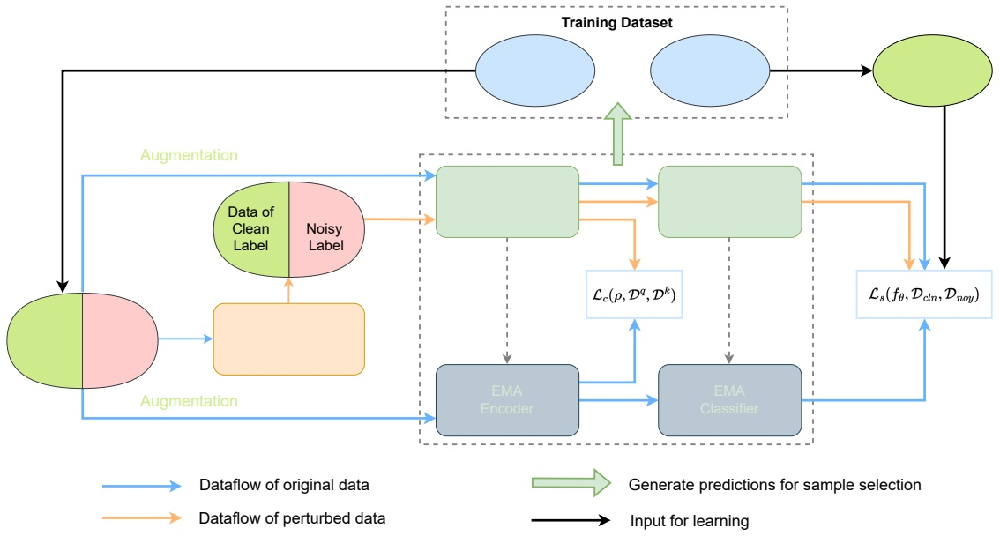

# Robust Learning con Adversarial Perturbations y Label Noise: Un Enfoque de Two-Pronged Defense

Peng-Fei Zhang1, Zi Huang1, Xin Luo2, Pengfei Zhao2

1University of Queensland, 2Shandong University

mima.zpf@gmail.com,huang@itee.uq.edu.au,{luoxin.lxin,lazpf1}@gmail.com

## RESUMEN

A pesar del gran éxito alcanzado, los métodos de deep learning son vulnerables al ruido en el conjunto de datos de entrenamiento, incluyendo adversarial perturbations y ruido de anotación (annotation noise). Estos factores perjudiciales influyen significativamente en el proceso de aprendizaje de los modelos profundos, dando lugar a modelos con menor confianza. Sin embargo, los métodos existentes aún no han estudiado este problema práctico y desafiante.

En este artículo, proponemos un novedoso método de robust learning, denominado Two-Pronged Defense (TPD), el cual es capaz de eliminar los efectos negativos tanto de las perturbaciones en los datos (data perturbations) como del label noise durante el proceso de aprendizaje. Por un lado, para defenderse contra los ejemplos adversarios engañosos (delusive adversarial examples), el método propuesto diseña una estrategia de asymmetric adversarial contrastive learning para generar ejemplos ruidosos en el peor de los casos (worse-case noisy examples) a partir de los datos de entrenamiento originales, y entrenar el modelo para alinear la semántica entre los datos perturbados y los datos originales. En vista de esto, TPD es capaz de mejorar la capacidad de generalización del modelo frente a potenciales ejemplos adversarios. Por otro lado, para combatir las noisy labels, TPD aplica semi-supervised learning identificando y descartando las etiquetas ruidosas mediante un novedoso método de identificación diseñado para tal fin. Extensos experimentos en benchmarks demuestran la incapacidad de los métodos existentes y la efectividad del método propuesto cuando se enfrenta simultáneamente al ruido en los datos y al ruido de etiquetas. Este trabajo representa el primer intento de aprendizaje con ruido tanto en datos como en etiquetas (data and label noise), y esperamos que siente las bases para futuros estudios en campos afines.

## CONCEPTOS CCS

• **Metodologías de computación** → **Supervised learning**.

## PALABRAS CLAVE

Robust Learning; Adversarial Perturbations; Noisy Labels; Supervised Deep Learning

## Formato de Referencia ACM:

Peng-Fei Zhang1, Zi Huang1, Xin Luo2, Pengfei Zhao2. 2022. Robust Learning with Adversarial Perturbations and Label Noise: A Two-Pronged Defense Approach. In ACM Multimedia Asia (MMAsia ’22), December 13–16, 2022, Tokyo, Japan. ACM, New York, NY, USA, 7 pages. [https://doi.org/10.1145/3551626.3564934](https://doi.org/10.1145/3551626.3564934)

El permiso para hacer copias digitales o impresas de parte o la totalidad de este trabajo para uso personal o en el aula se otorga sin cargo, siempre que las copias no se hagan ni se distribuyan con fines de lucro o ventaja comercial y que las copias lleven este aviso y la mención completa en la primera página. Deben respetarse los derechos de autor de componentes de este trabajo que sean propiedad de terceros distintos de ACM. La reproducción con crédito está permitida. Para copiar de otro modo, republicar, publicar en servidores o redistribuir en listas, se requiere autorización previa específica y/o el pago de una tarifa. Solicite autorizaciones a permissions@acm.org.

MMAsia ’22, December 13–16, 2022, Tokyo, Japan

© 2022 Association for Computing Machinery.

ACM ISBN 978-1-4503-9478-9/22/12. . . \$15.00

[https://doi.org/10.1145/3551626.3564934](https://doi.org/10.1145/3551626.3564934)

## 1 INTRODUCCIÓN

Las técnicas de deep learning han atraído recientemente una gran atención en las comunidades de investigación debido a su prominente capacidad para el aprendizaje de características no lineales, como en computer vision [5–7], information retrieval [22, 38, 39, 42, 44], procesamiento del lenguaje natural (natural language processing) [4, 18], etc. Este gran éxito depende en gran medida de conjuntos masivos de datos de entrenamiento de alta calidad. Sin embargo, en aplicaciones del mundo real, los datos no siempre son confiables y pueden contener potenciales adversarial perturbations y ruido de anotación (annotation noise). Por un lado, atacantes maliciosos podrían inyectar un conjunto de perturbaciones en los datos originales, lo cual afectaría adversamente el comportamiento en tiempo de prueba (testing-time behaviours) de los modelos entrenados con dichos datos (también conocido como training-time attack) [10]. Por otro lado, el etiquetado masivo de datos a menudo recurre a la anotación web y al crowdsourcing debido a consideraciones de carga de trabajo y eficiencia, lo que inevitablemente introduce errores de anotación [11, 32, 34]. Estos factores adversos influyen de manera significativa en el rendimiento de los modelos profundos resultantes, haciendo que resulte urgente diseñar estrategias de robust learning frente al ruido de datos y etiquetas (data and label noise).

En la literatura, existen intentos orientados a abordar uno de los problemas anteriores. Por ejemplo, para defenderse contra el training-time attack, Tao et al. [33] realizan adversarial training con datos en el peor de los casos (worse-case data) dentro de una bola de $\infty$-Wasserstein específica para mejorar la robustez del modelo por aprender. Para combatir las noisy labels, múltiples estudios proponen construir la matriz de transición de ruido (noise transition matrix) para medir las probabilidades de que las etiquetas verdaderas sean alteradas a etiquetas ruidosas, y utilizarla para la corrección de la pérdida [12, 24, 27]. Otra línea de trabajo consiste en aprender a identificar y descartar correspondientemente las etiquetas ruidosas en el conjunto de datos, y llevar a cabo semi-supervised learning sobre el conjunto de datos resultante [17, 21, 26]. A pesar de los avances logrados, estos métodos solo se concentran en un único tipo de ruido en el conjunto de datos, es decir, ruido adversarial o ruido de etiquetas, por lo que no resultan aplicables en escenarios complejos donde coexisten ambos ruidos.

En este artículo, proponemos un método de robust learning denominado Two-Pronged Defense (TPD), para tratar simultáneamente las adversarial perturbations y el label noise. Estos dos tipos de ruido se corresponden con la entrada y el objetivo del entrenamiento del modelo, respectivamente. El método propuesto intenta eliminar la influencia de ambos considerando la entrada y la salida. Específicamente, para mejorar la robustez del modelo frente al ruido de entrada, el TPD propuesto procura mejorar la capacidad de generalización del modelo por aprender, de modo que la trayectoria de entrenamiento no se vea influenciada por las adversarial perturbations en los datos. Para lograr esto, el TPD propuesto aprovecha un asymmetric adversarial contrastive learning cuidadosamente diseñado para generar datos de entrenamiento adversarios en el peor de los casos dentro de una bola de $\infty$-Wasserstein específica, y entrena al modelo para mantener la consistencia entre los datos adversarios generados y los datos originales. Además, TPD aprende los datos en el peor de los casos sin la guía de las etiquetas, lo que previene que el método sufra la influencia negativa del label noise. En lo que respecta al label noise, TPD propone filtrar las etiquetas ruidosas mediante una novedosa estrategia de sample selection diseñada a tal fin, y aplica semi-supervised learning sobre el conjunto de datos resultante. A través de esta estrategia en dos frentes (two-pronged strategy), el método propuesto es capaz de mitigar la influencia adversa tanto de las adversarial perturbations como del label noise en los datos de entrenamiento. En consecuencia, se obtiene un modelo confiable. Extensos resultados experimentales en conjuntos de datos de benchmark demuestran la efectividad de TPD para defenderse contra ambos tipos de ruido.

Las principales contribuciones de este trabajo se resumen a continuación:

• Hasta donde llega nuestro conocimiento, este es el primer trabajo que estudia el caso práctico y desafiante en el que coexisten simultáneamente adversarial perturbations y label noise en los datos de entrenamiento. Además, demostramos empíricamente la influencia adversa de ambos tipos de ruido en el conjunto de datos de entrenamiento.
• Se propone un novedoso método en dos frentes (two-pronged method), el cual mejora la robustez del modelo por aprender incrementando su capacidad de generalización frente a los potenciales ruidos y filtrando dinámicamente la supervisión no confiable.
• Se introduce un adversarial training asimétrico basado en contrastive learning para generar eficazmente datos en el peor de los casos (worse-case data), el cual no se ve influenciado por el label noise. Se diseña un novedoso método de sample selection para cribar con confianza las noisy labels. En vista de esto, el TPD propuesto puede combatir de manera efectiva diversos tipos de ruido en los datos de entrenamiento.
• Se llevan a cabo extensos experimentos en dos benchmarks ampliamente utilizados, y los impresionantes resultados demuestran el prometedor rendimiento de TPD.

## 2 TRABAJOS RELACIONADOS

## 2.1 Data poisoning attack y defensa

El data poisoning attack tiene como objetivo manipular el comportamiento de los modelos en tiempo de inferencia inyectando adversarial perturbations en los datos de entrenamiento [1, 36, 41, 43]. Los primeros trabajos se centraron principalmente en métodos no profundos, tales como SVM [25], Naive Bayes [2] y Regresión Lineal [15]. Con el predominio de las redes neuronales profundas, los poisoning attacks contra modelos profundos han recibido considerable atención. Por ejemplo, Koh et al. [19] aprovechan funciones de influencia para medir el impacto de los datos en las predicciones del modelo y, correspondientemente, elaboran adversarial examples para envenenar modelos neuronales profundos. Shafahi et al. [30] proponen un ataque dirigido (targeted attack) para engañar al modelo en una instancia de prueba específica mediante el diseño de un método basado en optimización. Chen et al. [3] generan instancias de puerta trasera (backdoor instances) en el conjunto de datos de entrenamiento, de modo que el modelo que aprende con ellas clasifique erróneamente los datos de prueba de backdoor con una etiqueta objetivo. Estos poisoning attacks se centran únicamente en modificar unas pocas muestras de entrenamiento.

Feng et al. [10] proponen inyectar perturbaciones imperceptibles en la totalidad del conjunto de datos para llevar a cabo el ataque, es decir, training-time attack. Dicho método no altera las etiquetas de los datos. Un modelo que aprende con estos datos adversarios produciría predicciones erróneas en los datos normales (también conocidos como clean data), mientras que proporciona predicciones confiables en los datos con adversarial perturbations. Este tipo de ataque resulta más peligroso, ya que no altera de forma apreciable los comportamientos del modelo sobre los datos adversarios, sino únicamente sobre los datos normales. En consecuencia, resulta difícil de percibir durante el procedimiento de entrenamiento. Desafortunadamente, existen muy pocos trabajos propuestos para abordar este desafiante problema. [33] constituye el primer método de defensa contra el training-time attack por envenenamiento de datos (data poisoning training-time attack), el cual aplica adversarial training para entrenar el modelo con los datos en el peor de los casos generados dentro de una bola de $\infty$-Wasserstein específica.

## 2.2 Learning with noisy labels

El diseño de modelos robustos frente al label noise ha constituido un tema de investigación de larga trayectoria. En la literatura, los métodos previos se han propuesto principalmente para abordar el ruido a nivel de etiqueta (independiente de la instancia), donde la corrupción de etiquetas solo depende de las etiquetas verdaderas. Por lo general, adoptan medidas para estimar la matriz de transición de etiquetas (label transition matrix), la cual indica la probabilidad de que las etiquetas se alteren hacia versiones ruidosas. Por ejemplo, una línea de investigación propone agregar una capa de adaptación al ruido (noise adaptation layer) en la parte superior del modelo original para mimetizar la matriz de transición de etiquetas [12, 32]. Otros consideran diseñar funciones de pérdida robustas (robust loss functions) para minimizar el riesgo en etiquetas limpias no observadas [11, 23, 34, 45]. También existen métodos enfocados en reponderar la importancia de las instancias de datos, intentando reducir la influencia adversa de las noisy labels [16, 29]. Otra estrategia consiste en intentar identificar etiquetas limpias y ruidosas durante el proceso de entrenamiento y hacer que el modelo sea entrenado con etiquetas limpias [8, 13, 17, 21, 26, 31, 37, 40].

En resumen, las adversarial perturbations y el label noise influyen de manera significativa en el entrenamiento de los modelos de deep learning. Los métodos de defensa existentes solo se concentran en un tipo de ruido, lo que limita su aplicación en el mundo real. En este trabajo, nos centramos en estudiar este problema práctico y desafiante, y proponemos un método efectivo de robust learning contra diversos tipos de ruido.

## 3 MÉTODO PROPUESTO

## 3.1 Preliminares

Denotemos el conjunto de datos con $n$ instancias como $\mathcal { D } = \{ ( x _ { i } , y _ { i } ) \} _ { i = 1 } ^ { n } \in \mathcal { X } \times \mathcal { Y },$ donde $x _ { i } \in \mathcal { X } \subseteq \mathbb { R } ^ { d }$ e $y _ { i } \in \mathcal { Y } \subseteq \{ 0 , 1 \} ^ { K }$ son la $i$-ésima imagen y su etiqueta asociada, respectivamente. Para el aprendizaje supervisado en clasificación en el que se concentra nuestro trabajo, los métodos típicos aprenden el modelo de clasificación $f _ { \theta } ( \cdot ) \: ( \theta$ son los parámetros del modelo) minimizando directamente el riesgo empírico como sigue:

$$
\mathcal {L} (f _ {\theta}, \mathcal {D}) = \frac {1}{| \mathcal {D} |} \sum_ {(x, y) \sim \mathcal {D}} \ell (f _ {\theta} (x), y), \tag {1}
$$

donde $\ell$ es una surrogate loss para la clasificación, tal como la Cross-Entropy (CE) loss.

**Training-time attack con adversarial perturbations.** El objetivo del training-time attack es generar adversarial examples agregando perturbaciones imperceptibles a los datos originales, de modo que un modelo que aprenda con estos datos perturbados realice predicciones erróneas sobre los datos de prueba limpios. Formalmente, el proceso se define como sigue:

$$
\begin{array}{l} \max _ {\rho} \mathcal {L} \left(f _ {\theta^ {*}}, \mathcal {D}\right), \\ \text {L} \text {t} \theta^ {*} \text {ormin} f \left(f _ {\theta^ {*}} (\mathcal {D}, \mathcal {D})\right) \end{array} \tag {2}
$$

$$
s. t. \theta^ {*} = \arg \min _ {\theta} \mathcal {L} (f _ {\theta}, \rho (\mathcal {D}, \epsilon)),
$$

donde $\rho : X \to X$ es la función de perturbación, la cual toma una muestra $x \sim \mathcal { D }$ como entrada y produce su contraparte adversaria aprendiendo un patrón de perturbación imperceptible inyectado en $x$. $\epsilon$ es la restricción para limitar la magnitud de las perturbaciones, donde

$$
\forall x \sim \mathcal {D}, \| \rho (x, \epsilon) - x \| _ {\infty} \leq \epsilon . \tag {3}
$$

diagrama de flujo

Este diagrama de flujo ilustra un pipeline de machine learning para la generación de flujo de datos y la generación de predicciones. Muestra cómo los datos originales fluyen a través de augmentation y etiquetado con ruido, los cuales luego se procesan mediante un EMA Encoder y un Clasificador para producir las salidas finales del modelo.

Figura 1: Ilustración del framework TPD. En cada epoch, TPD divide primero el conjunto de datos en un subconjunto limpio y un subconjunto ruidoso de acuerdo con la novedosa estrategia de sample selection diseñada. Tras ello, se realiza semi-supervised learning con los conjuntos de datos resultantes. Al mismo tiempo, se lleva a cabo el asymmetric adversarial contrastive learning propuesto, donde la función de perturbación y el modelo de clasificación se toman mutuamente como adversarios. En particular, la función de perturbación tiene la tarea de producir datos adversarios en el peor de los casos (worse-case adversarial data) mediante contrastive learning, con el objetivo de ampliar la consistencia semántica entre los datos originales y los datos adversarios. Mientras tanto, el modelo de clasificación aprende a producir predicciones correctas y consistentes tanto en los datos originales como en los datos adversarios.

## 3.2 Descripción general

Para combatir las adversarial perturbations y el label noise, proponemos un novedoso framework de Two-Pronged Defense (TPD), cuyo objetivo es mejorar la capacidad de generalización del modelo por aprender contra las adversarial perturbations, y entrenar el modelo con supervisión confiable filtrando las noisy labels. Para lograr esto, TPD utiliza un asymmetric adversarial contrastive learning adecuadamente diseñado para entrenar el modelo con ejemplos adversarios generados dinámicamente, lo cual se espera que mejore la robustez del modelo ante las perturbaciones en los datos. Además, TPD aprovecha una novedosa estrategia de sample selection para identificar etiquetas limpias y ruidosas, y entrena el modelo mediante semi-supervised learning descartando las etiquetas ruidosas.

## 3.3 Asymmetric adversarial contrastive learning para combatir adversarial perturbations

Una intuición para combatir el training-time attack es entrenar el modelo para alinear la consistencia entre los datos originales y los datos perturbados, de modo que el modelo quede dotado de una fuerte capacidad de generalización. Durante la prueba, el modelo proporcionará predicciones confiables sobre datos limpios. El obstáculo en este caso radica en que desconocemos cómo se encuentran perturbados los datos de entrenamiento, lo que nos impide eliminar la influencia del ruido. Para abordar esto, proponemos generar dinámicamente un conjunto de datos adversarios con una amplia brecha semántica respecto a los datos de entrenamiento, y entrenar el modelo para percibirlos correctamente y preservar la consistencia semántica entre ellos y los datos de entrenamiento originales. Mediante esto, se espera que el modelo establezca una sólida robustez frente a potenciales adversarial perturbations. Inspirados por [33], proponemos generar ejemplos adversarios en el peor de los casos dentro de una bola de $\infty$-Wasserstein específica a través de asymmetric adversarial contrastive learning sin la guía de etiquetas. Específicamente, denotemos el modelo por aprender como $f _ { \theta } ,$ el cual consta de un feature encoder $g$ y un clasificador $h$, como se ilustra en la Figura 1. Construimos adicionalmente la contraparte de media móvil exponencial (EMA, exponential moving average) del modelo $f _ { \theta ^ { \prime } }$ como la red clave (key network), la cual se actualiza de la siguiente manera:

$$
\theta_ {t} ^ {\prime} = \alpha \theta_ {t - 1} ^ {\prime} + (1 - \alpha) \theta_ {t}, \tag {4}
$$

donde $\alpha \in [ 0 , 1 )$ es un parámetro de suavizado. Denotamos a $g ^ { \prime }$ y $h ^ { \prime }$ como el feature encoder y el clasificador correspondientes, respectivamente.

Para $\mathcal { D } = \{ ( x _ { i } , y _ { i } ) \} _ { i = 1 } ^ { n } ,$ los transformamos en $\mathcal { D } ^ { q } = \{ ( x _ { i } ^ { \bar { q } } , y _ { i } ) \} _ { i = 1 } ^ { n }$ y $\mathcal { D } ^ { k } = \{ ( x _ { i } ^ { k } , y _ { i } ) \} _ { i = 1 } ^ { n }$ mediante data augmentation. Dada la red codificadora, aprendemos la función de perturbación $\rho$ maximizando la siguiente pérdida:

$$
\begin{array}{l} \mathcal {L} _ {c} (\rho , \mathcal {D} ^ {q}, \mathcal {D} ^ {k}) = \\ - \frac {1}{| \mathcal {D} ^ {q} |} \sum_ {x ^ {q} \sim \mathcal {D} ^ {q}} \log \frac {\exp \left(g \left(\rho \left(\mathbf {x} ^ {q} , \epsilon\right)\right) ^ {T} \cdot g ^ {\prime} \left(\mathbf {x} ^ {k}\right) / \tau\right)}{\sum_ {\mathbf {x} ^ {k} \sim \mathcal {D} ^ {k}} \exp \left(g \left(\rho \left(\mathbf {x} ^ {q} , \epsilon\right)\right) ^ {T} \cdot g ^ {\prime} \left(\mathbf {x} ^ {k}\right) / \tau\right)}, \tag {5} \\ \end{array}
$$

donde $\tau > 0$ es un parámetro de temperatura. Dados los datos adversarios generados, entrenamos el modelo de clasificación para mantener la consistencia semántica entre los datos adversarios y los datos originales mediante semi-supervised learning, tal como se introduce en la siguiente sección. Dado que las dos partes, es decir, la función de perturbación y el modelo de clasificación, adoptan diferentes funciones de pérdida, denominamos a esta estrategia de aprendizaje como asymmetric adversarial contrastive learning. Con dicha estrategia, es posible aprender una función de perturbación capaz de generar ejemplos adversarios sustancialmente disímiles a los originales en el espacio de características. Se espera que utilizar estos datos en el peor de los casos junto con los datos originales para entrenar el modelo mejore su capacidad de generalización, haciéndolo así robusto frente al potencial training-time attack. Otro beneficio reside en que el entrenamiento de la función de perturbación es independiente de las etiquetas originales, por lo que no se verá influenciado por el potencial label noise.

## 3.4 Semi-supervised learning basado en sample selection para combatir noisy labels

Tal como indican trabajos previos [17, 21, 26], los modelos profundos tienden a aprender ejemplos fáciles $(\mathbf {es\:decir,} \text{ etiquetas limpias en el ámbito en el que se enfoca nuestro trabajo})$ antes de ajustarse a los difíciles $(\mathbf {es\:decir,} \text{ etiquetas ruidosas})$. En vista de esto, resulta factible aprovechar el conocimiento adquirido por el modelo en las etapas tempranas de entrenamiento para identificar etiquetas limpias y ruidosas, y proporcionar predicciones que guíen el aprendizaje con noisy labels. Con este fin, calculamos la concordancia entre las predicciones del modelo y las etiquetas, así como la concordancia entre las predicciones del modelo EMA y las etiquetas. Luego, establecemos un umbral para la sample selection midiendo la concordancia promedio entre las predicciones del modelo ensemble y las etiquetas $(\mathbf {es\:decir,} \text{ distribución de la pérdida})$. En particular, el valor promedio de concordancia entre las predicciones del modelo EMA y las etiquetas sobre todo el conjunto de datos se calcula como $\begin{array} { r } { \mu = \frac { 1 } { | \mathcal { D } | } \sum _ { ( x , y ) \sim \mathcal { D } } \ell ( f _ { \theta ^ { \prime } } , y ) } \end{array}$ . Para una muestra $x _ { i } ,$ la concordancia entre la predicción del modelo y su etiqueta es $\ell ( f _ { \theta } ( x _ { i } ) , y _ { i } )$ . Comparamos dicho valor con el umbral para juzgar si la muestra es limpia o no. Si $\ell ( f _ { \theta } ( x _ { i } ) , y _ { i } )$ excede el umbral, se identificará como ruidosa, y viceversa.

Con los resultados identificados, el conjunto de datos se divide adicionalmente en un subconjunto limpio $\mathcal { D } _ { c l n }$ y un subconjunto ruidoso $\mathcal { D } _ { n o y }$ . Aplicamos semi-supervised learning con los conjuntos de datos resultantes para entrenar el modelo. Específicamente, para el subconjunto limpio, utilizamos la Cross-Entropy loss. Mientras tanto, para el subconjunto ruidoso, descartamos las etiquetas originales y utilizamos las predicciones de ambos modelos $(\mathrm {es\:decir,} f _ { \theta } \text{ y } f _ { \theta } ^ { \prime })$ para guiar el aprendizaje de $f _ { \theta }$ mediante el mean squared error. Las pérdidas se definen de la siguiente manera:

$$
\begin{array}{l} \mathcal {L} _ {s} (f _ {\theta}, \mathcal {D} _ {c l n}, \mathcal {D} _ {n o y}) = \\ \mathcal {L} _ {c l n} (f _ {\theta}, \mathcal {D} _ {c l n}) + \beta \cdot \mathcal {L} _ {n s y} (f _ {\theta}, \mathcal {D} _ {n o y}) + \mathcal {L} _ {r e g} (f _ {\theta}, \mathcal {D} _ {c l n} + \mathcal {D} _ {n o y}), \\ s. t. \mathcal {L} _ {c l n} (f _ {\theta}, \mathcal {D} _ {c l n}) = \frac {1}{3 | \mathcal {D} _ {c l n} |} \sum_ {(x, y) \in \mathcal {D} _ {c l n}} (\ell (f _ {\theta} (x), y) \\ + \ell \left(f _ {\theta} (a u g (x)), y\right) + \lambda \cdot \ell \left(f _ {\theta} (\rho (x, \epsilon)), y)\right), \\ \mathcal {L} _ {n s y} (f _ {\theta}, \mathcal {D} _ {n o y}) = \frac {1}{3 | \mathcal {D} _ {n o y} |} \sum_ {x \in \mathcal {D} _ {n o y}} \left(\| f _ {\theta} (x) - M \| _ {2} ^ {2} \right. \\ + \left\| f _ {\theta} (a u g (x)) - M \right\| _ {2} ^ {2} + \lambda \cdot \left\| f _ {\theta} (\rho (x, \epsilon)) - M \right\| _ {2} ^ {2}), \\ \mathcal {L} _ {r e g} (f _ {\theta}, \mathcal {D} _ {c l n} + \mathcal {D} _ {n o y}) = \sum_ {k} \pi_ {k} \log ( \\ \frac {\pi_ {k}}{\frac {1}{\left| \mathcal {D} _ {c l n} + \mathcal {D} _ {n o y} \right|} \sum_ {x \in \mathcal {D} _ {c l n} + \mathcal {D} _ {n o y}} \left(f _ {\theta} (x) + f _ {\theta} (a u g (x)) + f _ {\theta} (\rho (x , \epsilon))\right)}), \tag {6} \\ \end{array}
$$

$$
\begin{array}{l} \mathcal {L} _ {n s y} (f _ {\theta}, \mathcal {D} _ {n o y}) = \frac {1}{3 | \mathcal {D} _ {n o y} |} \sum_ {x \in \mathcal {D} _ {n o y}} \left(\| f _ {\theta} (x) - M \| _ {2} ^ {2} \right. \\ + \left\| f _ {\theta} (a u g (x)) - M \right\| _ {2} ^ {2} + \lambda \cdot \left\| f _ {\theta} (\rho (x, \epsilon)) - M \right\| _ {2} ^ {2}), \\ \end{array}
$$

donde $a u g ( \cdot )$ representa la operación de data augmentation fuerte (hard data augmentation), y $\beta , \lambda > 0$ son parámetros de equilibrio. $\begin{array} { r } { M = \frac { 1 } { 2 } \big ( f _ { \theta } ( x ) + f _ { \theta } ^ { \prime } ( x ) \big ) } \end{array}$ es el promedio de las predicciones del modelo y del modelo ensemble. El tercer término corresponde a la regularización, donde $\begin{array} { r } { \pi _ { k } = \frac { 1 } { K } } \end{array}$ . El semi-supervised learning alinea la semántica entre las predicciones sobre los datos originales y los datos adversarios imponiendo la misma supervisión.

Algoritmo 1: El método Two-Pronged Defense

Require: Training data $\mathcal{D} = \{(x_i, y_i)\}_{i=1}^n$, mini-batch size $m$, iteration times $T_m, T_r$, parameters $\alpha, \beta, \tau, \lambda, \epsilon$;
Require: Randomly initialize $\theta = \theta'$;
// WarmUp;
$\{(x_i^q, x_i^k, y_i)\}_{i=1}^n \leftarrow \{(x_i, y_i)\}_{i=1}^n$ // Data augmentation;
for epoch = 1 → $T_1$ do
    for $t = 1 \rightarrow n/m$ do
        $\mathcal{D}' = \{(x_i^q, x_i^k, y_i)\}_{i=1}^m \sim \mathcal{D}$ // Sample mini-batch;
        Maximize Eq (5) to obtain $\rho$;
        Minimize Eq (1) to obtain $\theta$;
        Update ensemble model following Eq (4);
    end
end
// Formal Training;
$\mathcal{D}_{cln}, \mathcal{D}_{nsy} \leftarrow \{(x_i, y_i)\}_{i=1}^n$ // Identify clean and noisy data;
for epoch = 1 → $T_2$ do
    for $t = 1 \rightarrow iter\_num$ do
        $\mathcal{D}'_{cln} = \{(x_i, y_i)\}_{i=1}^m \sim \mathcal{D}_{cln}$ // Sample mini-batch from the clean subset;
        $\mathcal{D}'_{nsy} = \{x_i\}_{i=1}^m \sim \mathcal{D}_{nsy}$ // Sample mini-batch from the noisy subset;
        $\mathcal{D}'_{cln} = \{(x_i, aug(x_i), y_i)\}_{i=1}^m \leftarrow \{(x_i, y_i)\}_{i=1}^m$ // Data augmentation;
        $\mathcal{D}'_{nsy} = \{(x_i, aug(x_i))\}_{i=1}^m \leftarrow \{x_i\}_{i=1}^m$ // Data augmentation;
        Maximize Eq (5) to obtain $\rho$;
        Minimize Eq (6) to obtain $\theta$;
        Update ensemble model following Eq (4);
    end
end
return $\theta$;

En resumen, para la función de perturbación adoptamos contrastive learning, mientras que para el modelo de clasificación empleamos semi-supervised learning. Denominamos a esto asymmetric adversarial contrastive learning. Su beneficio reside en que previene la potencial influencia adversa de las etiquetas ruidosas en el entrenamiento de la función de perturbación, facilitando los resultados finales. El esquema de optimización se resume en el **Algoritmo 1**.

## 4 EXPERIMENTOS

## 4.1 Conjuntos de datos

Se toman dos conjuntos de datos ampliamente utilizados para tareas de clasificación, es decir, CIFAR-10 y CIFAR-100 [20], para evaluar el rendimiento del método propuesto. Contienen 60,000 imágenes pertenecientes a 10 y 100 conceptos, respectivamente. Se utilizan 50,000 y 10,000 muestras seleccionadas aleatoriamente del conjunto de datos original para el entrenamiento y la prueba. **Corrupción de datos (Data corruption).** En este trabajo, utilizamos el método de [10] para introducir adversarial perturbations en todo el conjunto de datos de entrenamiento. **Corrupción de etiquetas (Label corruption).** Existen tres tipos de label noise: (1) Ruido simétrico (Symmetric noise): las etiquetas correctas originales se conmutan aleatoriamente a otras etiquetas posibles con una probabilidad $\kappa$; (2) Ruido asimétrico (Asymmetric noise): las etiquetas correctas se reemplazan aleatoriamente por otra clase similar con una probabilidad $\kappa$, p. ej., ciervo → caballo, perro → gato; (3) Ruido de etiquetas dependiente de la instancia (Instance-dependent label noise): las etiquetas limpias originales se conmutan en función tanto de las etiquetas originales como de las características. En este trabajo, empleamos el método propuesto en [35] para generar el instance-dependent label noise.

Tabla 1: Precisión de prueba (test accuracies, %) en CIFAR-10 y CIFAR-100 bajo adversarial perturbations y label noise dependiente de la instancia (instance-based). $\mathbf { \ " A T \" }$ está desarrollado para la tarea de aprendizaje con adversarial perturbations, por lo que no reportamos resultados en datos limpios $\mathbf { ( es\:decir, } \mathbf { \nabla } ^ { a } C$ y “LN”). “DAT”, “CORES2” y “DivideMix” están diseñados para la tarea de aprendizaje con noisy labels, por lo que no reportamos resultados en etiquetas limpias $\mathbf { ( es\:decir, } \mathbf { \nabla } ^ { a } C \mathbf { \nabla }$ y “AP”). TPD fue ideado para el caso en que coexisten ambos ruidos, por lo que únicamente reportamos resultados en “AP & $L N ^ { \prime \prime } , \alpha _ { \dagger } \omega$ denota los resultados de los modelos en sus tareas originales. “▼” indica degradación del rendimiento. Los mejores resultados para cada categoría se muestran en negrita.

<table><tr><td rowspan="2">Dataset</td><td rowspan="2">Method</td><td rowspan="2">C</td><td rowspan="2">AP</td><td colspan="3">LN (Inst.)</td><td colspan="3">AP &amp; LN (Inst.)</td></tr><tr><td>κ = 0.2</td><td>κ = 0.4</td><td>κ = 0.6</td><td>κ = 0.2</td><td>κ = 0.4</td><td>κ = 0.6</td></tr><tr><td rowspan="6">CIFAR-10</td><td>CE</td><td>95.20 †</td><td>62.91▼</td><td>87.50▼</td><td>74.85▼</td><td>45.23▼</td><td>40.76▼</td><td>14.90▼</td><td>12.75▼</td></tr><tr><td>AT</td><td>-</td><td>87.50 †</td><td>-</td><td>-</td><td>-</td><td>37.98▼</td><td>13.29▼</td><td>10.36▼</td></tr><tr><td>DAT</td><td>-</td><td>-</td><td>84.22 †</td><td>74.71 †</td><td>31.31 †</td><td>27.78▼</td><td>17.25▼</td><td>10.48▼</td></tr><tr><td>CORES2</td><td>-</td><td>-</td><td>86.32 †</td><td>82.65 †</td><td>78.43 †</td><td>14.18▼</td><td>14.62▼</td><td>14.43▼</td></tr><tr><td>DivideMix</td><td>-</td><td>-</td><td>93.45 †</td><td>94.78 †</td><td>64.14 †</td><td>75.33▼</td><td>16.17▼</td><td>24.74▼</td></tr><tr><td>TPD</td><td>-</td><td>-</td><td>-</td><td>-</td><td>-</td><td>79.06</td><td>42.47</td><td>25.22</td></tr><tr><td rowspan="6">CIFAR-100</td><td>CE</td><td>66.48 †</td><td>25.01▼</td><td>58.88▼</td><td>40.76▼</td><td>25.78▼</td><td>22.51▼</td><td>18.35▼</td><td>7.10▼</td></tr><tr><td>AT</td><td>-</td><td>29.28 †</td><td>-</td><td>-</td><td>-</td><td>16.21▼</td><td>11.05▼</td><td>11.0▼</td></tr><tr><td>DAT</td><td>-</td><td>-</td><td>56.62 †</td><td>39.13 †</td><td>20.66 †</td><td>16.85▼</td><td>11.16▼</td><td>6.18▼</td></tr><tr><td>CORES2</td><td>-</td><td>-</td><td>61.56 †</td><td>48.08 †</td><td>36.34 †</td><td>19.47▼</td><td>14.97▼</td><td>10.66▼</td></tr><tr><td>DivideMix</td><td>-</td><td>-</td><td>77.50 †</td><td>74.57 †</td><td>48.57 †</td><td>48.49▼</td><td>42.65▼</td><td>21.17▼</td></tr><tr><td>TPD</td><td>-</td><td>-</td><td>-</td><td>-</td><td>-</td><td>51.41</td><td>46.06</td><td>24.67</td></tr></table>

## 4.2 Configuración experimental

**Líneas base (Baselines).** El método propuesto es el primer trabajo en defenderse simultáneamente contra adversarial perturbations y label noise, por lo que no existen métodos previos para una comparación directa. Para demostrar la efectividad del TPD propuesto, tomamos como competidores métodos que o bien combaten adversarial perturbations o bien combaten label noise, los cuales podrían tener el potencial de defenderse contra ambos ruidos. Mediante extensos experimentos, demostramos que los métodos existentes propuestos para un único tipo de ruido son incapaces de manejar los escenarios desafiantes en los que coexisten ambos ruidos.

Específicamente, para los ejemplos adversarios, tomamos AT [33] como línea base, el cual constituye el único método propuesto para defenderse contra el training-time attack mediante la inyección de adversarial perturbations en todo el conjunto de datos. Por su parte, para el aprendizaje con noisy labels, elegimos métodos del estado del arte (state-of-the-art), a saber: (1) CE, que entrena el modelo con la CE loss convencional; (2) CORES2 [8], que diseña una estrategia de cribado de muestras con regularización de confianza (confidence regularized sample sieve) para filtrar etiquetas ruidosas; (3) DAT [28], que aprende a modelar alineando la brecha de distribución entre datos limpios y ruidosos; (4) DivideMix [21], que utiliza un modelo de mezcla para identificar datos limpios y ruidosos y entrena el modelo mediante semi-supervised learning.

**Detalles de implementación.** Los códigos fuente de la mayoría de las líneas base fueron gentilmente facilitados por los autores. Ajustamos minuciosamente los parámetros de dichos modelos. Los parámetros de TPD se configuran de la siguiente manera: $\alpha = 0 . 9 9 9 , \tau = 0 . 0 7 , \lambda = 0 . 1$ . La configuración de $\beta$ es idéntica a la de [21]. En CIFAR-10, establecemos $\epsilon = 0.1$ mientras que $\epsilon = 0 . 2$ en CIFAR-100. Se adopta ResNet34 [14] como backbone de todos los métodos. Para TPD, aplicamos SGD para optimizar la red, con un learning rate inicial de $\dot { [ 2 e ^ { - 2 } }$ (reducido por un factor de 10 a las 60 epochs), un momentum de 0.9 y un weight decay de $1 5 e ^ { - 4 }$ . Las epochs para WarmUp y Formal Training se establecen en 10 y 90 para CIFAR-10, y en 30 y 70 para CIFAR-100. Se utilizan dos tipos de aumentación, es decir, data augmentation débil y fuerte (weak and strong data augmentation). La aumentación débil consiste únicamente en la transformación aleatoria de recorte (cropping) y volteo (flipping), mientras que para la aumentación fuerte utilizamos el método introducido en [9]. En particular, en la etapa de WarmUp, solo adoptamos aumentación suave (soft augmentation) sobre los datos de entrenamiento. En cambio, para Formal Training, empleamos la aumentación fuerte (hard augmentation) para la operación $a u g ( \cdot )$, y la suave para las demás. Los datos de entrenamiento se recortan y voltean aleatoriamente antes de ser envenenados.

## 4.3 Resultados y discusiones

Para poner a prueba la efectividad del TPD propuesto, realizamos extensos experimentos en dos conjuntos de datos bajo diferentes condiciones de ruido. Los resultados se reportan en la Tabla 1, Tabla 2 y Tabla 3. En las tablas, “C”, “AP” y “LN” representan el conjunto de datos de entrenamiento con etiquetas y datos limpios, adversarial perturbations y label noise, respectivamente. “Inst.”, “Symm.” y “Asymm.” denotan label noise dependiente de la instancia, simétrico y asimétrico.

A partir de los resultados, se extraen las siguientes observaciones. En primer lugar, se puede observar que el modelo aprendido con la CE loss convencional pierde eficacia ante cualquier tipo de perturbación, ya sean adversarial perturbations o label noise. Esto pone de manifiesto los impactos adversos del ruido y resalta la importancia de proponer métodos de robust learning. En segundo lugar, los métodos propuestos para combatir bien las adversarial perturbations o bien el label noise únicamente logran un buen rendimiento frente a su tipo de ruido asumido. Al enfrentarse a escenarios desafiantes en los que coexisten ambos ruidos, también pierden su capacidad de aprendizaje. En términos de análisis cuantitativo, en CIFAR-10, CE experimenta una degradación del rendimiento del 33.90%, 16.90% y 75.0% ante adversarial perturbations, label noise y en el caso en que coexisten ambos, respectivamente. Por su parte, en CIFAR-100, las caídas son del 62.38%, 39.60% y 56.92%. El método de robust learning contra adversarial perturbations, es decir, AT, logra un buen desempeño ante la presencia de adversarial perturbations. Sin embargo, el label noise puede influir significativamente en su efectividad, provocando caídas promedio de rendimiento del 69.06% y 26.21% en los dos conjuntos de datos. De manera similar, los métodos propuestos para combatir el label noise son asimismo incapaces de lidiar con los casos de presencia combinada de ambos ruidos en el conjunto de entrenamiento. La coexistencia de ejemplos adversarios y label noise ocasiona caídas promedio de rendimiento del 69.74%, 72.15% y 43.68% para DAT, CORES2 y DivideMix, respectivamente. Por el contrario, el TPD propuesto alcanza resultados muy prometedores y supera a las demás líneas base (con una mejora promedio del 20.95%), demostrando su superioridad.

Tabla 2: Precisión de prueba (test accuracies, %) en CIFAR-10 y CIFAR-100 bajo adversarial perturbations y symmetric label noise.

<table><tr><td rowspan="2">Dataset</td><td rowspan="2">Method</td><td rowspan="2">C</td><td rowspan="2">AP</td><td colspan="3">LN (Symm.)</td><td colspan="3">AP &amp; LN (Symm.)</td></tr><tr><td>κ = 0.2</td><td>κ = 0.4</td><td>κ = 0.6</td><td>κ = 0.2</td><td>κ = 0.4</td><td>κ = 0.6</td></tr><tr><td rowspan="6">CIFAR-10</td><td>CE</td><td>95.20 †</td><td>62.91▼</td><td>86.38▼</td><td>81.74▼</td><td>75.03▼</td><td>26.89▼</td><td>18.59▼</td><td>17.79▼</td></tr><tr><td>AT</td><td>-</td><td>87.50 †</td><td>-</td><td>-</td><td>-</td><td>25.75▼</td><td>22.94▼</td><td>10.14▼</td></tr><tr><td>DAT</td><td>-</td><td>-</td><td>83.76 †</td><td>83.18 †</td><td>81.37 †</td><td>29.74▼</td><td>32.13▼</td><td>29.22▼</td></tr><tr><td>CORES2</td><td>-</td><td>-</td><td>90.38 †</td><td>85.15†</td><td>80.27 †</td><td>14.08▼</td><td>14.30▼</td><td>13.15▼</td></tr><tr><td>DivideMix</td><td>-</td><td>-</td><td>93.58 †</td><td>94.99 †</td><td>94.79 †</td><td>72.60▼</td><td>69.86▼</td><td>14.58▼</td></tr><tr><td>TPD</td><td>-</td><td>-</td><td>-</td><td>-</td><td>-</td><td>80.33</td><td>79.0</td><td>71.98</td></tr><tr><td rowspan="6">CIFAR-100</td><td>CE</td><td>66.48 †</td><td>25.01▼</td><td>62.28▼</td><td>49.64▼</td><td>38.31▼</td><td>26.67▼</td><td>20.09▼</td><td>11.73▼</td></tr><tr><td>AT</td><td>-</td><td>29.28 †</td><td>-</td><td>-</td><td>-</td><td>26.84▼</td><td>15.16▼</td><td>11.22▼</td></tr><tr><td>DAT</td><td>-</td><td>-</td><td>56.29 †</td><td>43.84 †</td><td>34.55 †</td><td>13.42▼</td><td>13.62▼</td><td>4.71▼</td></tr><tr><td>CORES2</td><td>-</td><td>-</td><td>60.71 †</td><td>45.52 †</td><td>34.49 †</td><td>23.31▼</td><td>20.19▼</td><td>13.31▼</td></tr><tr><td>DivideMix</td><td>-</td><td>-</td><td>79.58 †</td><td>75.53 †</td><td>48.50 †</td><td>49.52▼</td><td>45.80▼</td><td>33.87▼</td></tr><tr><td>TPD</td><td>-</td><td>-</td><td>-</td><td>-</td><td>-</td><td>54.68</td><td>46.83</td><td>36.18</td></tr></table>

Tabla 3: Precisión de prueba (test accuracies, %) en CIFAR-10 y CIFAR-100 bajo adversarial perturbations y asymmetric label noise.

<table><tr><td rowspan="2">Dataset</td><td rowspan="2">Method</td><td rowspan="2">C</td><td rowspan="2">AP</td><td colspan="3">LN (Asymm.)</td><td colspan="3">AP &amp; LN (Asymm.)</td></tr><tr><td>κ = 0.2</td><td>κ = 0.3</td><td>κ = 0.4</td><td>κ = 0.2</td><td>κ = 0.3</td><td>κ = 0.4</td></tr><tr><td rowspan="6">CIFAR-10</td><td>CE</td><td>95.20 †</td><td>62.91▼</td><td>88.47▼</td><td>87.12▼</td><td>85.1▼</td><td>35.52▼</td><td>23.65▼</td><td>21.64▼</td></tr><tr><td>AT</td><td>-</td><td>87.50 †</td><td>-</td><td>-</td><td>-</td><td>48.05▼</td><td>36.65▼</td><td>30.55▼</td></tr><tr><td>DAT</td><td>-</td><td>-</td><td>86.10 †</td><td>83.86 †</td><td>81.47 †</td><td>27.40▼</td><td>28.09▼</td><td>28.44▼</td></tr><tr><td>CORES2</td><td>-</td><td>-</td><td>90.62 †</td><td>90.53 †</td><td>87.59 †</td><td>14.59▼</td><td>14.39▼</td><td>13.70▼</td></tr><tr><td>DivideMix</td><td>-</td><td>-</td><td>91.98 †</td><td>93.61 †</td><td>87.21 †</td><td>72.50▼</td><td>56.49▼</td><td>27.25▼</td></tr><tr><td>TPD</td><td>-</td><td>-</td><td>-</td><td>-</td><td>-</td><td>76.32</td><td>59.82</td><td>60.32</td></tr><tr><td rowspan="6">CIFAR-100</td><td>CE</td><td>66.48 †</td><td>25.01▼</td><td>59.20▼</td><td>51.40▼</td><td>42.35▼</td><td>31.46▼</td><td>24.73▼</td><td>21.99▼</td></tr><tr><td>AT</td><td>-</td><td>29.28 †</td><td>-</td><td>-</td><td>-</td><td>17.68▼</td><td>14.16▼</td><td>12.01▼</td></tr><tr><td>DAT</td><td>-</td><td>-</td><td>56.86 †</td><td>50.26 †</td><td>42.46 †</td><td>19.21▼</td><td>14.98▼</td><td>11.76▼</td></tr><tr><td>CORES2</td><td>-</td><td>-</td><td>62.72 †</td><td>56.04 †</td><td>45.88 †</td><td>19.36▼</td><td>21.32▼</td><td>18.68▼</td></tr><tr><td>DivideMix</td><td>-</td><td>-</td><td>77.05 †</td><td>76.96 †</td><td>55.10 †</td><td>49.77▼</td><td>45.06▼</td><td>33.85▼</td></tr><tr><td>TPD</td><td>-</td><td>-</td><td>-</td><td>-</td><td>-</td><td>53.12</td><td>47.18</td><td>38.86</td></tr></table>

## 5 CONCLUSIÓN

En este artículo, presentamos un novedoso método de robust learning, denominado Two-Pronged Defense (TPD), para eliminar la influencia adversa de las adversarial perturbations y el label noise en el proceso de aprendizaje.

TPD aprovecha el asymmetric adversarial contrastive learning para mejorar la capacidad de generalización del modelo entrenándolo con ejemplos adversarios generados dinámicamente. Además, TPD adopta semi-supervised learning filtrando las etiquetas ruidosas del conjunto de datos para garantizar que el modelo sea entrenado con etiquetas limpias. En virtud de ello, se espera que el TPD propuesto mejore la robustez del modelo por aprender frente a diversos ruidos en el conjunto de entrenamiento. Extensos experimentos realizados en dos benchmarks demuestran la efectividad del TPD propuesto. Este constituye el primer trabajo orientado a resolver escenarios desafiantes donde coexisten perturbaciones en los datos y label noise en el conjunto de entrenamiento. En trabajos futuros, se podría explorar la mejora de la robustez del modelo bajo una configuración libre de datos (data-free setting), donde el modelo haya sido entrenado previamente con un conjunto de datos ruidoso y los datos originales ya no estén disponibles.

## 6 AGRADECIMIENTOS

Este trabajo fue apoyado parcialmente por el Australian Research Council Discovery Project (ARC DP190102353, CE200100025) y por el China Scholarship Council.

## REFERENCIAS

[1] Scott Alfeld, Xiaojin Zhu, and Paul Barford. 2016. Data poisoning attacks against autoregressive models. In Proceedings of the AAAI Conference on Artificial Intelligence. 480–501.
[2] Battista Biggio, Blaine Nelson, and Pavel Laskov. 2012. Poisoning attacks against support vector machines. In Proceedings of the International Coference on International Conference on Machine Learning. 1467–1474.
[3] Xinyun Chen, Chang Liu, Bo Li, Kimberly Lu, and Dawn Song. 2017. Targeted backdoor attacks on deep learning systems using data poisoning. arXiv preprint arXiv:1712.05526 (2017).
[4] Zhi Chen, Jingjing Li, Yadan Luo, Zi Huang, and Yang Yang. 2020. Canzsl: Cycleconsistent adversarial networks for zero-shot learning from natural language. In Proceedings of the IEEE/CVF Winter Conference on Applications of Computer Vision. 874–883.
[5] Zhi Chen, Yadan Luo, Ruihong Qiu, Sen Wang, Zi Huang, Jingjing Li, and Zheng Zhang. 2021. Semantics disentangling for generalized zero-shot learning. In Proceedings of the IEEE/CVF International Conference on Computer Vision.
[6] Zhi Chen, Yadan Luo, Sen Wang, Ruihong Qiu, Jingjing Li, and Zi Huang. 2021. Mitigating generation shifts for generalized zero-shot learning. In Proceedings of the ACM International Conference on Multimedia.
[7] Zhi Chen, Sen Wang, Jingjing Li, and Zi Huang. 2020. Rethinking generative zeroshot learning: An ensemble learning perspective for recognising visual patches. In Proceedings of the ACM International Conference on Multimedia. 3413–3421.
[8] Hao Cheng, Zhaowei Zhu, Xingyu Li, Yifei Gong, Xing Sun, and Yang Liu. 2020. Learning with instance-dependent label noise: A sample sieve approach. In Proceedings of the International Conference on Learning Representations.
[9] Ekin D Cubuk, Barret Zoph, Dandelion Mane, Vijay Vasudevan, and Quoc V Le. 2018. Autoaugment: Learning augmentation policies from data. arXiv preprint arXiv:1805.09501 (2018).
[10] Ji Feng, Qi-Zhi Cai, and Zhi-Hua Zhou. 2019. Learning to confuse: Generating training time adversarial data with auto-encoder. In Proceedings of the International Conference on Neural Information Processing Systems. 11994–12004.
[11] Aritra Ghosh, Himanshu Kumar, and PS Sastry. 2017. Robust loss functions under label noise for deep neural networks. In Proceedings of the AAAI Conference on Artificial Intelligence. 1919–1925.
[12] Jacob Goldberger and Ehud Ben-Reuven. 2017. Training deep neural-networks using a noise adaptation layer. In Proceedings of the International Conference on Learning Representations.
[13] Bo Han, Quanming Yao, Xingrui Yu, Gang Niu, Miao Xu, Weihua Hu, Ivor W Tsang, and Masashi Sugiyama. 2018. Co-teaching: Robust training of deep neural networks with extremely noisy labels. In Proceedings of the International Conference on Neural Information Processing Systems. 8536–8546.
[14] Kaiming He, Xiangyu Zhang, Shaoqing Ren, and Jian Sun. 2016. Deep residual learning for image recognition. In Proceedings of the IEEE Conference on Computer Vision and Pattern Recognition. 770–778.
[15] Matthew Jagielski, Alina Oprea, Battista Biggio, Chang Liu, Cristina Nita-Rotaru, and Bo Li. 2018. Manipulating machine learning: Poisoning attacks and countermeasures for regression learning. In Proceedings of the IEEE Symposium on Security and Privacy. 19–35.
[16] Lu Jiang, Zhengyuan Zhou, Thomas Leung, Li-Jia Li, and Li Fei-Fei. 2018. Mentornet: Learning data-driven curriculum for very deep neural networks on corrupted labels. In Proceedings of the International Conference on Machine Learning. 2304–2313.
[17] Nazmul Karim, Mamshad Nayeem Rizve, Nazanin Rahnavard, Ajmal Mian, and Mubarak Shah. 2022. UNICON: Combating label noise through uniform selection and contrastive learning. In Proceedings of the IEEE/CVF Conference on Computer Vision and Pattern Recognition. 9676–9686.
[18] Jacob Devlin Ming-Wei Chang Kenton and Lee Kristina Toutanova. 2019. BERT: Pre-training of deep bidirectional transformers for language understanding. In Proceedings of the Conference of the North American Chapter of the Association for Computational Linguistics: Human Language Technologies. 4171–4186.
[19] Pang Wei Koh and Percy Liang. 2017. Understanding black-box predictions via influence functions. In Proceedings of the International Conference on Machine Learning. 1885–1894.
[20] Alex Krizhevsky, Geoffrey Hinton, et al. 2009. Learning multiple layers of features from tiny images. (2009).
[21] Junnan Li, Richard Socher, and Steven CH Hoi. 2020. Dividemix: Learning with noisy labels as semi-supervised learning. In Proceedings of the International Conference on Learning Representations.
[22] Yang Li, Tong Chen, Peng-Fei Zhang, and Hongzhi Yin. 2021. Lightweight self-attentive sequential recommendation. In Proceedings of the ACM International Conference on Information & Knowledge Management. 967–977.
[23] Yang Liu and Hongyi Guo. 2020. Peer loss functions: Learning from noisy labels without knowing noise rates. In Proceedings of the International Conference on
Machine Learning. 6226–6236.
[24] Xingjun Ma, Yisen Wang, Michael E Houle, Shuo Zhou, Sarah Erfani, Shutao Xia, Sudanthi Wijewickrema, and James Bailey. 2018. Dimensionality-driven learning with noisy labels. In Proceedings of the International Conference on Machine Learning. 3355–3364.
[25] Blaine Nelson, Marco Barreno, Fuching Jack Chi, Anthony D Joseph, Benjamin IP Rubinstein, Udam Saini, Charles Sutton, J Doug Tygar, and Kai Xia. 2008. Exploiting machine learning to subvert your spam filter. In Proceedings of the Usenix Workshop on Large-Scale Exploits and Emergent Threats.
[26] Duc Tam Nguyen, Chaithanya Kumar Mummadi, Thi Phuong Nhung Ngo, Thi Hoai Phuong Nguyen, Laura Beggel, and Thomas Brox. 2019. Self: Learning to filter noisy labels with self-ensembling. In Proceedings of the International Conference on Learning Representations.
[27] Giorgio Patrini, Alessandro Rozza, Aditya Krishna Menon, Richard Nock, and Lizhen Qu. 2017. Making deep neural networks robust to label noise: A loss correction approach. In Proceedings of the IEEE Conference on Computer Vision and Pattern Recognition. 1944–1952.
[28] Yuntao Qu, Shasha Mo, and Jianwei Niu. 2021. DAT: Training deep networks robust to label-noise by matching the feature distributions. In Proceedings of the IEEE Conference on Computer Vision and Pattern Recognition. 6821–6829.
[29] Mengye Ren, Wenyuan Zeng, Bin Yang, and Raquel Urtasun. 2018. Learning to reweight examples for robust deep learning. In Proceedings of the International Conference on Machine Learning. 4334–4343.
[30] Ali Shafahi, W Ronny Huang, Mahyar Najibi, Octavian Suciu, Christoph Studer, Tudor Dumitras, and Tom Goldstein. 2019. Poison frogs! targeted clean-label poisoning attacks on neural networks. Advances in Neural Information Processing Systems, 6106–6116.
[31] Yanyao Shen and Sujay Sanghavi. 2019. Learning with bad training data via iterative trimmed loss minimization. In Proceedings of the International Conference on Machine Learning. 5739–5748.
[32] Sainbayar Sukhbaatar, Joan Bruna, Manohar Paluri, Lubomir Bourdev, and Rob Fergus. 2015. Training convolutional networks with noisy labels. In Proceedings of the International Conference on Learning Representations.
[33] Lue Tao, Lei Feng, Jinfeng Yi, Sheng-Jun Huang, and Songcan Chen. 2021. Better safe than sorry: Preventing delusive adversaries with adversarial training. Advances in Neural Information Processing Systems 34 (2021), 16209–16225.
[34] Yisen Wang, Xingjun Ma, Zaiyi Chen, Yuan Luo, Jinfeng Yi, and James Bailey. 2019. Symmetric cross entropy for robust learning with noisy labels. In Proceedings of the IEEE International Conference on Computer Vision. 322–330.
[35] Xiaobo Xia, Tongliang Liu, Bo Han, Nannan Wang, Mingming Gong, Haifeng Liu, Gang Niu, Dacheng Tao, and Masashi Sugiyama. 2020. Part-dependent label noise: Towards instance-dependent label noise. In Proceedings of the International Conference in Neural Information Processing Systems. 7597–7610.
[36] Huang Xiao, Battista Biggio, Gavin Brown, Giorgio Fumera, Claudia Eckert, and Fabio Roli. 2015. Is feature selection secure against training data poisoning?. In Proceedings of the International Conference on Machine Learning. 1689–1698.
[37] Xingrui Yu, Bo Han, Jiangchao Yao, Gang Niu, Ivor Tsang, and Masashi Sugiyama. 2019. How does disagreement help generalization against label corruption?. In Proceedings of the International Conference on Machine Learning. 7164–7173.
[38] Yu-Wei Zhan, Xin Luo, Yongxin Wang, and Xin-Shun Xu. 2020. Supervised hierarchical deep hashing for cross-modal retrieval. In Proceedings of the ACM International Conference on Multimedia. 3386–3394.
[39] Peng-Fei Zhang, Jiasheng Duan, Zi Huang, and Hongzhi Yin. 2021. Joint-teaching: Learning to refine knowledge for resource-constrained unsupervised cross-modal retrieval. In Proceedings of the ACM International Conference on Multimedia. 1517–1525.
[40] Peng-Fei Zhang, Zi Huang, Guangdong Bai, and Xin-Shun Xu. 2022. IDEAL: Highorder-ensemble adaptation network for learning with noisy labels. In Proceedings of the ACM International Conference on Multimedia. 325–333.
[41] Peng-Fei Zhang, Zi Huang, and Xin-Shun Xu. 2021. Proactive privacy-preserving learning for retrieval. In Proceedings of the AAAI Conference on Artificial Intelligence. 3369–3376.
[42] Peng-Fei Zhang, Yang Li, Zi Huang, and Xin-Shun Xu. 2021. Aggregation-based graph convolutional hashing for unsupervised cross-modal retrieval. IEEE Transactions on Multimedia 24 (2021), 466–479.
[43] Peng-Fei Zhang, Yang Li, Zi Huang, and Hongzhi Yin. 2021. Privacy protection in deep multi-modal retrieval. In Proceedings of the International ACM SIGIR Conference on Research and Development in Information Retrieval. 634–643.
[44] Peng-Fei Zhang, Yadan Luo, Zi Huang, Xin-Shun Xu, and Jingkuan Song. 2021. High-order nonlocal hashing for unsupervised cross-modal retrieval. World Wide Web 24 (2021), 563–583.
[45] Zhilu Zhang and Mert R Sabuncu. 2018. Generalized cross entropy loss for training deep neural networks with noisy labels. In Proceedings of the International Conference on Neural Information Processing Systems. 8792–8802.
