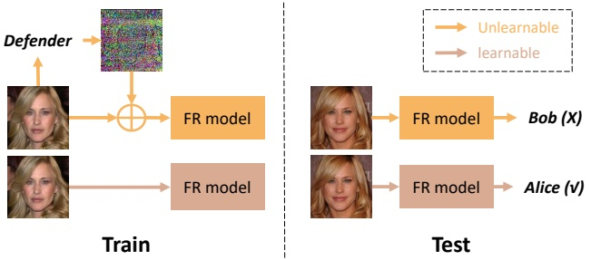
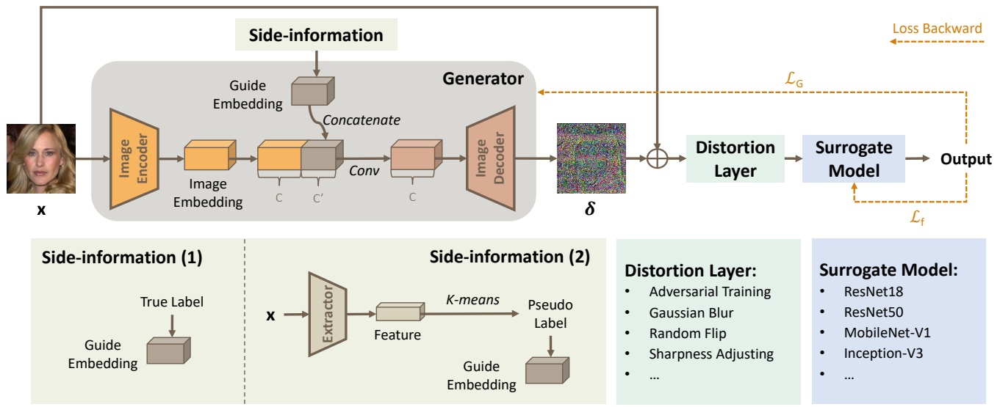
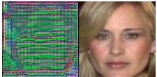

# Segue: Side-information Guided Generative Unlearnable Examples para la protección de la privacidad facial en el mundo real

Zhiling Zhang1, Jie Zhang2†, Kui Zhang1, Wenbo Zhou1†, Weiming Zhang1, Nenghai Yu1 1University of Science and Technology of China 2Nanyang Technological University

{zhilingzhang@mail., zk19@mail., welbeckz@, zhangwm@, ynh@}ustc.edu.cn jie_zhang@ntu.edu.sg

## Resumen

El uso generalizado de la tecnología de face recognition ha suscitado crecientes preocupaciones sobre la privacidad, ya que muchas personas están preocupadas por la recolección y utilización de sus datos faciales. Para abordar estas inquietudes, los investigadores exploran activamente el concepto de "unlearnable examples", añadiendo perturbaciones imperceptibles a los datos en la etapa de entrenamiento del modelo, con el objetivo de impedir que el modelo aprenda características discriminativas del rostro objetivo. No obstante, los métodos actuales son ineficientes y no pueden garantizar la transferabilidad y la robustez simultáneamente, lo que provoca su falta de practicidad en el mundo real. Para remediar esto, proponemos un método novedoso denominado **Segue**: Side-information guided generative unlearnable examples. Específicamente, aprovechamos un modelo de un solo entrenamiento y múltiples usos (once-trained multiple-used) para generar la perturbación deseada en lugar de recurrir al método consumidor de tiempo basado en gradientes. Para mejorar la transferabilidad, introducimos side-information como etiquetas reales (true labels) y pseudoetiquetas (pseudo labels), que son inherentemente consistentes a través de diferentes escenarios. Para el aumento de la robustez, se integra una distortion layer en el pipeline de entrenamiento. Amplios experimentos demuestran que el método propuesto **Segue** es sustancialmente más rápido que los métodos previos (1000×) y logra una efectividad transferible a través de diferentes datasets y arquitecturas de modelos. Además, puede resistir la compresión JPEG, el adversarial training y algunas técnicas estándar de data augmentation.

## 1. Introducción

Debido al auge de plataformas de redes sociales como Twitter y Facebook, se ha producido un incremento notable en la cantidad de datos faciales compartidos públicamente, ya sea con fines de entretenimiento o comerciales. Toda moneda tiene dos caras. Se vuelve conveniente la recolección no autorizada de datos faciales individuales, lo cual constituye una violación de la privacidad pública [10, 16]. Además, dichos datos faciales pueden ser utilizados para entrenar diversos modelos de análisis facial, tales como modelos de face recognition [13, 15, 17, 26], lo que representa una amenaza para aplicaciones de seguridad crítica como los sistemas de autenticación [25, 27]. Por lo tanto, resulta crucial salvaguardar los rostros individuales frente a exploraciones no autorizadas.

Figura 1. Ilustración sobre el aprovechamiento de los unlearnable examples para facial privacy protection.

Trabajos recientes se centran en utilizar unlearnable examples [5, 12, 18] para evitar que los atacantes entrenen modelos de reconocimiento. Como se muestra en la Fig. 1, el defensor añade algunas perturbaciones a la imagen original antes de publicarla, en donde la imagen perturbada se denomina unlearnable example. El atacante solo puede utilizar los unlearnable examples publicados de Alice para entrenar un modelo de facial recognition (FR), el cual falla en la etapa de inferencia (es decir, reconociendo a Alice como Bob). La explicación para tal técnica radica en que las redes neuronales están más inclinadas a aprender atajos (shortcuts) como características discriminativas en tareas de clasificación [6], y la perturbación puede considerarse como un tipo de atajo. En síntesis, podemos aprovechar los unlearnable examples para la facial privacy protection.

Para generar unlearnable facial examples que puedan aplicarse en el mundo real, existen **cinco** requisitos: 1) <u>Efectividad</u>: los unlearnable examples generados deben hacer que el modelo de FR no pueda reconocer los correspondientes ejemplos limpios (clean examples), con una accuracy cercana a una suposición aleatoria (random guessing). 2) <u>Imperceptibilidad</u>: los unlearnable examples deben ser indistinguibles de los clean examples originales; es decir, las perturbaciones añadidas deben ser imperceptibles. 3) <u>Transferabilidad</u>: el unlearnable example generado debe ser lo suficientemente versátil para manejar diversos escenarios, tales como diferentes datasets faciales [1, 15, 26] y diferentes arquitecturas de modelos [9, 11, 22] utilizados por el atacante, incluso en un escenario de caja negra (black-box). 4) <u>Robustez</u>: dado que estas imágenes faciales se compartirán en plataformas sociales, es necesario tener en cuenta las distorsiones causadas por la transmisión (p. ej., compresión JPEG y desenfoque). Además, el atacante puede emplear deliberadamente adversarial training [7] para socavar la efectividad de las perturbaciones inaprendibles. 5) <u>Eficiencia</u>: la velocidad de generación es crucial para su uso práctico; por ejemplo, el procesamiento en línea requiere una generación rápida. No obstante, como se muestra en la Tabla 1, los métodos existentes de unlearnable examples [5, 12, 18] no pueden satisfacer todas las exigencias anteriores, lo que los hace inaplicables para la facial privacy protection en la práctica.

| Methods | Effectiveness | Imperceptibility | Transferability | Robustness | Efficiency |
| --- | --- | --- | --- | --- | --- |
| UE [12] | ● | ● | ○ | ○ | ○ |
| LSP [28] | ○ | ○ | ○ | ○ | ● |
| RUE [5] | ● | ● | ○ | ● | ○ |
| TUE [18] | ○ | ● | ○ | ○ | ○ |
| Ours | ● | ● | ● | ● | ● |

Tabla 1. Comparamos el método propuesto con métodos previos de unlearnable examples con base en cinco requisitos. Usamos #, H#, o para indicar si el método no tiene capacidad, tiene capacidad parcial o total para cada requisito.

Para remediar las limitaciones de los métodos actuales, proponemos **Segue**, un método de side-information guided generative unlearnable examples. Específicamente, adoptamos un modelo autoencoder para generar perturbaciones, el cual es más eficiente que la optimización iterativa por gradiente utilizada por enfoques previos. El generador entrenado puede generar perturbaciones para diversos escenarios sin necesidad de reentrenamiento; es decir, puede ser de un solo entrenamiento y múltiples usos (once-trained multiple-used). Además, aprovechamos la side-information para guiar el proceso de generación y mejorar la transferabilidad. La side-information puede adaptarse a diferentes escenarios de protección basándose en conocimiento previo. Por ejemplo, utilizamos las etiquetas reales de la categoría a proteger como side-information si tenemos acceso a ellas. De lo contrario, aprovechamos el agrupamiento K-means [19] sobre un dataset facial extenso no etiquetado para obtener pseudoetiquetas como side-information. La side-information ayuda a distinguir el rostro objetivo de otros rostros, lo cual es consistente independientemente de los datasets de entrenamiento del atacante y de las arquitecturas de modelo adoptadas. Para mejorar la robustez frente al proceso de transmisión, incorporamos además una distortion layer a nuestro pipeline de entrenamiento, en donde la distortion layer simula posibles pérdidas de canal y ataques potenciales en la realidad, tales como compresión JPEG, desenfoque (blurring) y adversarial training.

Llevamos a cabo extensos experimentos para demostrar que **Segue** puede satisfacer exitosamente los cinco requisitos mencionados anteriormente. Específicamente, nuestro método induce una mayor degradación del rendimiento del modelo del atacante sobre clean examples; p. ej., únicamente un 11.50% de accuracy en VGGFace10, mientras que el mejor resultado entre los otros métodos es del 20.50%. Además, comparamos la transferabilidad a través de 5 arquitecturas de modelos diferentes y 5 datasets faciales diferentes, logrando el método propuesto un rendimiento superior en la mayoría de los casos. En cuanto a la robustez, **Segue** se desempeña mejor en comparación con el robust unlearnable example (RUE) [5] frente a adversarial training y otros preprocesamientos. En términos de eficiencia, **Segue** y los atajos no entrenables (LSP) [28] son mucho más rápidos que otros métodos (1000×). Finalmente, también se realizan algunos estudios de ablación para verificar nuestro diseño.

En resumen, las principales contribuciones de nuestro método se describen a continuación:

• Concluimos cinco requisitos para unlearnable facial examples orientados a la facial privacy protection en el mundo real: efectividad, imperceptibilidad, transferabilidad, robustez y eficiencia. Además, analizamos los métodos actuales y encontramos que no pueden satisfacer todos estos requisitos.
• Proponemos **Segue**, que utiliza un generative model de un solo entrenamiento y múltiples usos (once-trained multiple-used) para generar de manera eficiente unlearnable examples. También se introducen side-information y una distortion layer para mejorar la transferabilidad y la robustez.
• Extensos experimentos demuestran que nuestro enfoque supera a los métodos actuales, especialmente en términos de transferabilidad, robustez y eficiencia.

## 2. Trabajos Relacionados

## 2.1. Facial Privacy Protection

La facial privacy protection tiene como objetivo evitar la divulgación o el uso no autorizado de los datos faciales de las personas, como por ejemplo mediante la tecnología de face recognition [13, 17], que puede identificar a individuos sin su consentimiento. Los métodos de protección existentes frente al reconocimiento facial se pueden clasificar en dos categorías según la etapa de protección: la protección en la etapa de prueba (testing-stage protection) y la protección en la etapa de entrenamiento (training-stage protection). Los métodos de testing-stage protection [2, 20, 24] aplican perturbaciones adversariales (adversarial perturbations) a las imágenes en la etapa de inferencia, logrando que el modelo clasifique erróneamente las imágenes perturbadas. Sin embargo, estos métodos no pueden detener el uso no autorizado de datos privados y no pueden proteger imágenes de prueba limpias (clean test images). Por otro lado, los métodos de training-stage protection [4, 12, 28] añaden perturbaciones a las imágenes de entrenamiento, con el objetivo de degradar el rendimiento del modelo en clean test images. En este artículo, nos centramos en esta última estrategia de protección, que involucra unlearnable examples [5, 12, 18] para interferir con el entrenamiento no autorizado.

## 2.2. Unlearnable Examples

Los adversarial examples [7, 21] se generan mediante una optimización min-max. Siguiendo esta idea, Huang et al. [12] proponen utilizar una estrategia de optimización min-min para generar unlearnable examples (UE). Sin embargo, esta estrategia no es robusta frente al adversarial training y requiere la información de gradiente del modelo objetivo, la cual no es accesible en un entorno de caja negra (black-box). Para abordar el problema de la robustez, Fu et al. [5] proponen los robust unlearnable examples (RUE), que integran el adversarial training en el proceso original de generación de perturbaciones mediante una estrategia de optimización min-min-max. No obstante, esta estrategia es computacionalmente costosa. Yu et al. [28] utilizan varios parches para sintetizar perturbaciones linealmente separables (LSP) sin entrenamiento, lo que constituye un escenario estricto de caja negra. En [18], se proponen los transferable unlearnable examples (TUE), que se centran en la transferabilidad en lugar de la eficiencia y la robustez. Reducen la distancia intraclase y aumentan la distancia interclase de las perturbaciones para hacerlas fácilmente separables incluso mediante un clasificador lineal cuando se añaden a cualquier dataset. Sin embargo, como se muestra en la Tabla 1, ninguno de los métodos actuales puede satisfacer simultáneamente los cinco requisitos para aplicaciones en el mundo real. No obstante, los tomamos como métodos de línea base (baselines) para la comparación posterior.

## 3. Preliminares

## 3.1. Descripción Formalizada

## 3.1.1 Face Recognition

El face recognition es un tipo de clasificación de imágenes con DNNs. Supongamos que disponemos de un dataset limpio $\mathcal { D } = \{ ( x _ { i } , y _ { i } ) \} _ { i = 1 } ^ { n }$ que se puede dividir en un conjunto de entrenamiento $\mathcal { D } _ { t r a i n }$ y un conjunto de prueba $\mathcal { D } _ { t e s t }$. Para tareas de face recognition, comúnmente entrenamos una red neuronal $f$ para ajustarse a la distribución de $\mathcal { D } _ { t r a i n }$. La optimización se puede describir de la siguiente manera:

$$
\arg \min _ {f} \mathbb {E} _ {(x, y) \sim \mathcal {D} _ {t r a i n}} \left[ \mathcal {L} (f (x), y) \right], \tag {1}
$$

donde $\mathcal { L }$ puede ser la Cross-Entropy loss. Tras el entrenamiento, $f$ se puede utilizar para predecir la etiqueta $y$ de la muestra $x$ en $\mathcal { D } _ { t e s t }$, dado que $\mathcal { D } _ { t e s t }$ posee la misma distribución que $\mathcal { D } _ { t r a i n }$.

## 3.1.2 Unlearnable Examples

Huang et al. [12] proponen un objetivo de dos niveles (bi-level objective) para generar perturbaciones destinadas a impedir que el modelo de FR aprenda información a partir de los datos de entrenamiento. Utilizan el siguiente objetivo:

$$
\arg \min _ {f} \mathbb {E} _ {(x, y) \sim \mathcal {D} _ {t r a i n}} \left[ \min _ {\delta} \mathcal {L} (f (x + \delta), y) \right], \tag {2}
$$

donde la imagen modificada $x + \delta$ se denomina unlearnable example y el conjunto de todas estas imágenes constituye el unlearnable dataset. $f$ actúa como un surrogate model para el modelo objetivo. La perturbación $\delta$ está acotada por $\| G ( x ) \| _ { p } \leq \epsilon$ para garantizar que resulte imperceptible para el ojo humano. Se actualizan $\delta$ y $f$ mediante una estrategia de entrenamiento alternado. En cada epoch, $f$ se entrena con los datos perturbados durante unos pocos pasos para reducir la loss. Luego, $\delta$ se optimiza para disminuir aún más la loss. La optimización se detiene cuando la loss sobre los datos perturbados alcanza un umbral determinado, lo que significa que no existe gradiente para que el modelo objetivo actualice sus parámetros.

## 3.2. Modelo de Amenaza

## 3.2.1 Capacidad y Objetivo del Atacante

Siguiendo los métodos actuales, asumimos que el atacante desea entrenar un modelo de face recognition como en la Ec. (1), pero solo tiene acceso al unlearnable dataset. Como resultado, el atacante entrena el modelo de FR con el unlearnable dataset en lugar de $\mathcal { D } _ { t r a i n }$. Para impulsar el rendimiento del modelo, el atacante puede aplicar técnicas de data augmentation, tales como Cutout, Mixup y CutMix. Además, el atacante también puede recurrir al adversarial training, el cual puede eliminar las características no robustas $( i . e .$ , la perturbación añadida como características de atajo o shortcut features) de la entrada y hacer que el modelo aprenda únicamente las características robustas.

## 3.2.2 Capacidad y Objetivo del Defensor

Consideramos un escenario de caja negra (black-box), en el que el defensor no tiene conocimiento alguno del modelo objetivo, incluidos los parámetros y las arquitecturas utilizadas por el atacante. En su lugar, utilizamos un surrogate model $f$ como aproximación. Podemos utilizar las etiquetas del dataset como side-information en caso de disponer de ellas. No obstante, las etiquetas del dataset no son estrictamente necesarias. Solo necesitamos conocer el número de identidades $K$ en el dataset, el cual se utiliza para agrupar (cluster) las características de las imágenes y obtener las pseudoetiquetas (pseudo labels). Describimos este proceso con mayor detalle en la siguiente sección.

Nuestro objetivo es proteger la privacidad facial del usuario. Para lograr esto, optimizamos $\delta$ siguiendo la Ec. (2) y añadimos $\delta$ a $\mathcal { D } _ { t r a i n }$ para evitar que el atacante aprenda información útil a partir de él. Como consecuencia, el modelo de FR entrenado con $\delta + \mathcal { D } _ { t r a i n }$ falla al reconocer las imágenes en $\mathcal { D } _ { t e s t }$, ya que las distribuciones entre ellos han cambiado.

## 3.3. Separabilidad Lineal

La separabilidad lineal significa que las muestras se pueden separar fácilmente mediante modelos lineales simples. Yu et al. [28] demuestran que las perturbaciones de los ataques de disponibilidad en la etapa de entrenamiento (availability attacks) [4, 12] son todas linealmente separables. Resulta más sencillo para los modelos aprender el ruido linealmente separable mientras ignoran la información de la imagen.

Figura 2. Marco general de Segue. El generador consta de un codificador y un decodificador. La imagen y la side-information se fusionan en el espacio de características profundas. La side-information puede ser la etiqueta real en escenarios supervisados o la pseudoetiqueta en escenarios no supervisados. La distortion layer contiene diversos procesamientos para mejorar la robustez de $\delta$. Entrenamos el generador y el surrogate model de forma alternada.

Podemos lograr una fuerte separabilidad lineal añadiendo perturbaciones a nivel de clase (class-wise perturbation) a las muestras. Por ejemplo, podemos añadir $\delta _ { i }$ a todas las muestras pertenecientes a la clase $i$. Huang et al. [12] también señalan que las perturbaciones aleatorias a nivel de clase pueden evitar que el modelo aprenda información útil. Una perturbación aleatoria no contiene ninguna información sobre el dataset o el modelo y se puede aplicar a cualquier dataset o modelo, lo que implica que la separabilidad lineal asegura la transferabilidad de la perturbación. Por lo tanto, podemos incrementar la separabilidad lineal mejorando la transferabilidad de la perturbación.

## 4. Método

## 4.1. Visión General

Esta sección se organiza de la siguiente manera. En primer lugar, demostramos qué es la side-information y cómo aprovecharla. Adicionalmente, describimos nuestro diseño del generador de un solo entrenamiento y múltiples usos (once-trained multiple-used generator) y la distortion layer. Finalmente, se introduce una estrategia de entrenamiento en dos etapas.

## 4.2. Diseño de la Side-information

Como se mencionó anteriormente, debemos incrementar la separabilidad lineal de la perturbación para potenciar su transferabilidad. Una vía simple y directa consiste en utilizar las etiquetas reales del dataset. Asimismo, también abordamos los datos faciales no etiquetados en entornos reales (in the wild). A estos los denominamos escenarios supervisados y no supervisados, respectivamente.

Algoritmo 1: Two-stage Training Strategy

Input: image $x$, side information $\hat{y}$, dataset $D$,
perturbation boundary $\epsilon$, distortion layer $T$,
generator $G$, surrogate model $f$,
optimization steps $maxiter$, learning rate
$\alpha_f$ and $\alpha_G$, epoch $E$
Output: generator $G$
for epoch $\leftarrow 1$ to $E$ do
    if epoch$\%5 = 1$ then
        for $i \leftarrow 1$ to $maxiter$ do
            $(x_i, y_i) \sim \mathcal{D}$
            $\delta_i \leftarrow Clip(G(x_i), -\epsilon, \epsilon)$
            $x'_i \leftarrow x_i + \delta_i$
            $\theta_{f,i+1} \leftarrow \theta_{f,i} - \alpha_f \nabla_{\theta_{f,i}} \mathcal{L}_f(f(x'_i), \hat{y}_i)$
    else
        for $i \leftarrow 1$ to $maxiter$ do
            $(x_i, y_i) \sim \mathcal{D}$
            $\delta \leftarrow Clip(G(x_i), -\epsilon, \epsilon)$
            $x'_i \leftarrow x_i + \delta_i$
            $\theta_{G,i+1} \leftarrow \theta_{G,i} - \alpha_G \nabla_{\theta_{G,i}} \mathcal{L}_G(f(x'_i), \hat{y}_i)$

## 4.2.1 Escenario Supervisado

En el escenario supervisado, utilizamos las etiquetas del dataset como side-information. Inspirados por [8], concatenamos el embedding de la etiqueta con el embedding de la imagen a lo largo del canal en el espacio de características de alto nivel para guiar el proceso de generación (véase la Fig. 2). Luego, utilizamos una capa de convolución adicional para reducir la dimensión de canales $C + C ^ { \prime }$ de regreso a $C$. Específicamente, empleamos un vector binario de 16 bits para codificar el embedding de la etiqueta. Por ejemplo, el embedding de la etiqueta es 0. . . 0101 (13 ceros antes de 101) cuando $y$ es 5. Con un embedding de etiqueta de 16 bits, podemos admitir hasta $2 ^ { 1 6 }$ identidades en el dataset. De este modo, podemos manejar la mayoría de los datasets faciales [1, 15, 26]. Además, la longitud del embedding de la etiqueta es flexible. Podemos ajustarla a cualquier longitud dependiendo del número de clases presentes en el dataset.

## 4.2.2 Escenario No Supervisado

Para abordar el desafío de obtener etiquetas en este escenario, proponemos el uso de pseudoetiquetas (pseudo labels) generadas mediante un enfoque no supervisado [31]. Primero, utilizamos un extractor entrenado en un dataset facial a gran escala, CelebA [15], para extraer características faciales. Luego aplicamos el método de agrupamiento K-means [19] para agrupar las características faciales en $K$ grupos y asignarles pseudoetiquetas. Una vez obtenidas las pseudoetiquetas, podemos concatenarlas con las características de la imagen al igual que en el escenario supervisado. Esto nos libera del etiquetado manual de las imágenes, y todo lo que necesitamos saber es el número de clases $K$ en el dataset. Por otra parte, nuestro método es robusto frente a la precisión del método de clustering K-means. Siempre que esta sea superior al 80%, no habrá impacto en la transferabilidad de las perturbaciones a través de diferentes datasets y modelos.

## 4.3. Generador Once-trained Multiple-used

Como se ilustra en la Fig. 2, el generador $G$ codifica la imagen de entrada en el embedding de la imagen y la decodifica en una perturbación $\delta$. Utilizamos capas convolucionales con tamaño de kernel de (3×3), batch normalization y activación ReLU tanto para el codificador como para el decodificador. El embedding de la imagen se fusiona con el guide embedding en el espacio de características de alto nivel para guiar la generación de $\delta$. A diferencia de los métodos previos [12, 18] que optimizan la perturbación directamente, nosotros optimizamos un generador que produce perturbaciones de acuerdo con las entradas. Este diseño nos permite generar perturbaciones para diferentes datasets con distintos números de clases utilizando un único generador. Por ejemplo, podemos generar perturbaciones para WebFace50 (un dataset con 50 identidades) con el generador entrenado en WebFace10 (un dataset con 10 identidades). Por el contrario, la mayoría de los métodos existentes necesitan reentrenar las perturbaciones para diferentes datasets. En otras palabras, este diseño es sustancialmente más eficiente.

## 4.4. Distortion Layer

Para mejorar la robustez de las perturbaciones inaprendibles frente a posibles distorsiones en la transmisión, empleamos una distortion layer durante el entrenamiento. RUE [5] adopta un esquema min-min-max que introduce adversarial training para aumentar la dificultad de generación de perturbaciones. En realidad, el adversarial training puede considerarse como una forma de data augmentation. Por lo tanto, utilizamos una distortion layer para aumentar los datos con transformaciones comunes que incluyen adversarial training, Gaussian blurring, random flip, etc. (véase la Fig. 2). La distortion layer perturba los datos en el espacio de alta dimensión, forzando al generador $G$ a encontrar una perturbación más robusta, lo que hace que todos los puntos cercanos a la perturbación se vuelvan inaprendibles en el espacio de alta dimensión.

| Sub-dataset | # IDs | Source dataset | $\mathcal{D}_{train}$ | $\mathcal{D}_{test}$ |
| --- | --- | --- | --- | --- |
| WebFace10 | 10 | WebFace | 1300 | 200 |
| WebFace10 † | 10 | WebFace | 1300 | 200 |
| WebFace50 | 50 | WebFace | 6500 | 1300 |
| VGGFace10 | 10 | VGGFace2 | 1300 | 200 |
| CelebA10 | 10 | CelebA | 200 | 100 |

Tabla 2. Detalles de los conjuntos de datos.

## 4.5. Estrategia de Entrenamiento en Dos Etapas

Como se muestra en el Alg. 1, entrenamos alternadamente el surrogate model $f$ y el generador $G$, donde se adopta ResNet18 como el surrogate model $f$ por defecto. En la primera etapa, entrenamos $f$ durante $maxiter$ (iteraciones sobre todo el dataset) restringido por $\mathcal { L } _ { f }$, lo que incentiva a que la imagen perturbada $x + G ( x )$ sea clasificada correctamente (como $\hat{y}$) por $f$:

$$
\mathcal {L} _ {f} = C E (f (x + G (x)), \hat {y}), \tag {3}
$$

donde $\hat { y }$ denota la side-information, incluyendo true-label y pseudo-label, y CE denota la Cross-Entropy loss. En la segunda etapa, actualizamos $G$ durante cuatro epochs. La loss function para $G$ consta de dos términos: específicamente, $\mathcal { L } _ { G 1 }$ intenta reducir la loss de $f$ sobre los unlearnable examples, mientras que $\mathcal { L } _ { G 2 }$ tiene como objetivo restringir la magnitud de la perturbación:

$$
\mathcal {L} _ {G} = \alpha \cdot \mathcal {L} _ {G 1} + \beta \cdot \mathcal {L} _ {G 2}, \tag {4}
$$

$$
\mathcal {L} _ {G 1} = C E (f (x + G (x)), \hat {y}), \tag {5}
$$

$$
\mathcal {L} _ {G 2} = \mathbb {E} _ {x} (\| G (x) \| _ {2}), \tag {6}
$$

donde $\alpha$ y $\beta$ controlan la importancia relativa de cada objetivo. Detenemos todo el entrenamiento después de 20 epochs o cuando la loss de $f$ sobre el unlearnable dataset se sitúa por debajo de 0.001.

## 5. Experimentos

Evaluamos el método propuesto **Segue** en varios aspectos, incluyendo efectividad, imperceptibilidad, transferabilidad, robustez y eficiencia. Comparamos **Segue** con los métodos actuales y mostramos sus ventajas. También llevamos a cabo estudios de ablación para validar nuestras decisiones de diseño.

## 5.1. Configuración Experimental

## 5.1.1 Datasets

Utilizamos tres datasets de imágenes faciales: WebFace [26], VG-GFace2 [1] y CelebA [15]. Para facilitar la implementación en cada dataset, seleccionamos aleatoriamente algunas categorías para construir los sub-datasets finales y redimensionamos todas las imágenes a 224×224. Se pueden encontrar más detalles en la Tabla 2.

clean

UE

RUE

TUE

Ours

Figura 3. Visualización de diferentes unlearnable examples y el residuo correspondiente en comparación con la imagen clean.

## 5.1.2 Métrica

Adoptamos el clean test accuracy, $i . e .$ , el rendimiento del modelo del atacante en datasets limpios (clean datasets), donde el modelo se entrena en unlearnable datasets. Cuanto menor sea el test accuracy, más efectivos son los unlearnable examples. Si el accuracy es cercano a $\frac { 1 0 0 \% } { \# I D s }$, el modelo no aprende nada del unlearnable dataset, comportándose de manera equivalente a una suposición aleatoria (random guessing).

## 5.1.3 Líneas Base (Baselines)

Comparamos nuestro método con tres métodos basados en gradiente: UE [12], RUE [5] y TUE [18]. Además, también se considera para la comparación el método independiente del modelo (model-agnostic) LSP [28]. Seguimos su código oficial para reproducirlos.

## 5.1.4 Detalles de Implementación

Limitamos la perturbación a $\| \delta \| _ { \infty } \leq \epsilon = 8 / 2 5 5$, la cual resulta imperceptible para los humanos. Utilizamos el optimizador Adam con una tasa de aprendizaje inicial de 0.0005 tanto para el surrogate model $\alpha _ { f }$ como para el generador $\alpha _ { G }$. Fijamos $\alpha$ y $\beta$ en la Ec. (4) en 1 y 0.001, respectivamente. Resaltamos los mejores resultados en **negrita**. A menos que se especifique lo contrario, usamos ResNet18 y WebFace10 por defecto, lo que puede considerarse un entorno de caja blanca (white-box setting). Para evaluar la transferabilidad a través de diferentes modelos y datasets, realizamos experimentos de control.

Actualizamos el surrogate model $f$ durante un epoch y luego actualizamos el generador $G$ durante cinco epochs, y repetimos. $maxiter$ representa el número de todas las muestras dividido por el batch size. La distortion layer consta de adversarial training, Gaussian blur, random horizontal flip, random vertical flip y ajuste de nitidez (sharpness adjusting). Para el adversarial training, establecemos $\rho _ { d } = 1 / 2 5 5$ por defecto y lo ajustamos desde $\rho _ { d } = 0 / 2 5 5$ hasta $\rho _ { d } = 4 / 2 5 5$ en el experimento de robustez frente a adversarial training. Para el Gaussian blur, fijamos el tamaño de kernel en (3,3) y sigma en 0.2. Para el sharpness adjusting, fijamos el factor de nitidez en 2. Para random horizontal flip y random vertical flip, establecemos la probabilidad de que la imagen sea volteada en 0.1. Redimensionamos las imágenes a 32×32 en CIFAR10 [14] y a 224×224 en los demás sub-datasets.

## 5.2. Efectividad

La Tabla 3 muestra que nuestro método logra los mejores resultados entre los tres datasets faciales, reduciendo con éxito el accuracy a un valor cercano a $\frac { 1 0 0 \% } { \# I D s }$. Probamos diferentes tamaños de parches para LSP y mostramos el mejor resultado con el tamaño igual a 56×56.

| Methods | WebFace10 | WebFace50 | VGGFace10 |
| --- | --- | --- | --- |
| CLEAN | 75.00 | 80.60 | 83.00 |
| UE [12] | 12.50 | 3.50 | 20.50 |
| LSP [28] | 31.50 | 9.30 | 57.50 |
| RUE [5] | 11.50 | 7.40 | 30.00 |
| TUE [18] | 33.50 | 11.20 | 82.00 |
| Ours | 10.50 | 2.50 | 11.50 |

Tabla 3. Comparación de efectividad (clean test acc % ↓) entre diferentes métodos. Los experimentos se realizan con ResNet18 en tres datasets faciales diferentes.

| Methods | CIFAR10 | ImageNet10 |
| --- | --- | --- |
| CLEAN | 91.67 | 71.00 |
| UE [12] | 19.93 | 30.00 |
| LSP (patchsize=8) [28] | 17.07 | 64.00 |
| LSP (patchsize=56) [28] | \\ | 28.50 |
| RUE [5] | 15.18 | 24.50 |
| TUE [18] | 11.25 | 60.50 |
| Ours | 10.12 | 14.00 |

Tabla 4. Comparación en CIFAR10 e ImageNet10.

Explicamos por qué los resultados varían entre los datasets de la siguiente manera: WebFace50 tiene más categorías, por lo que la dificultad de aprendizaje para el clasificador aumenta y el accuracy es menor. VGGFace10 tiene una mayor calidad de imagen, por lo que el clasificador aprende las características faciales más fácilmente y el accuracy es mayor. Como se muestra en la Tabla 4, **Segue** también logra un rendimiento superior en datasets no faciales tales como CIFAR10 e ImageNet10.

## 5.3. Imperceptibilidad

En la Tabla 7, utilizamos tres métricas para medir la calidad de imagen: PSNR, SSIM y LPIPS. La Fig. 3 también proporciona algunos ejemplos visuales, donde las perturbaciones se magnifican a 30×. UE, TUE y RUE optimizan las perturbaciones a partir de ruidos aleatorios. LSP [28] compone la perturbación con varios parches, pero estos son visibles para el ojo humano. Nosotros utilizamos un generador con estructura encoder-decoder para crear perturbaciones que preserven características faciales distintivas. Por lo tanto, nuestras perturbaciones son más diversas y relevantes para cada muestra en comparación con otros métodos. En general, logramos una imperceptibilidad comparable a la de otros métodos.

| Methods | ResNet18 | ResNet50 | MobileNet-V1 | Inception-V3 | EfficientNet-b1 |
| --- | --- | --- | --- | --- | --- |
| UE [12] | 14.50 | 14.50 | 15.50 | 73.00 | 28.00 |
| LSP [28] | 31.50 | 32.50 | 18.50 | 56.00 | 52.50 |
| RUE [5] | 19.00 | 27.50 | 17.00 | 77.00 | 27.00 |
| TUE [18] | 33.50 | 70.00 | 15.50 | 69.00 | 67.50 |
| Ours | 10.50 | 12.50 | 11.00 | 10.50 | 12.00 |

Tabla 5. Transferabilidad para diferentes modelos (clean test acc % ↓). Los defensores utilizan ResNet18 y los atacantes utilizan cinco modelos.

| Methods | WebFace10 | WebFace10† | WebFace50 | VGGFace10 | CelebA10 |
| --- | --- | --- | --- | --- | --- |
| UE [12] | 12.50 | 14.50 | \\ | 21.50 | 44.00 |
| LSP [28] | 31.50 | 35.00 | 9.30 | 57.50 | 74.00 |
| RUE [5] | 17.00 | 26.50 | \\ | 78.50 | 78.50 |
| TUE [18] | 33.50 | 52.00 | \\ | 53.00 | 59.00 |
| Ours | 10.50 | 11.50 | 13.50 | 13.00 | 17.00 |

Tabla 6. Transferabilidad a través de diferentes datasets (clean test acc $\% \downarrow$). Las perturbaciones se entrenan en WebFace10 y luego se añaden a los otros datasets diferentes. WebFace10† posee 10 categorías no superpuestas con WebFace10.

| Methods | PSNR(↑) | SSIM(↑) | LPIPS(↓) |
| --- | --- | --- | --- |
| UE [12] | 32.37 | 0.754 | 0.205 |
| LSP [28] | 31.53 | 0.968 | 0.049 |
| RUE [5] | 32.45 | 0.763 | 0.188 |
| TUE [18] | 30.18 | 0.651 | 0.310 |
| Ours | 30.54 | 0.673 | 0.159 |

Tabla 7. Comparación de imperceptibilidad en WebFace10.

## 5.4. Transferabilidad

## 5.4.1 Diferentes Modelos

Todos los métodos generan unlearnable examples basados en el surrogate model ResNet18, y el atacante puede adoptar diferentes arquitecturas de modelos para el entrenamiento. Como se muestra en la Tabla 5, realizamos pruebas en cinco arquitecturas: ResNet18, ResNet50 [9], MobileNet-V1 [11], Inception-V3 [22] y EfficientNet-b1 [23], y nuestro método se desempeña adecuadamente en todos los casos. Para redes más profundas como Inception-V3, otros métodos fracasan en la protección de la privacidad. Explicamos que los diferentes tamaños de kernel convolucional de Inception-V3 pueden filtrar sus perturbaciones y capturar características de imagen enriquecidas.

## 5.4.2 Diferentes Datasets

De manera similar, en la Tabla 6, generamos perturbaciones basadas en WebFace10 y llevamos a cabo evaluaciones en diferentes datasets. CelebA10 cuenta con menos muestras en cada clase, lo que requiere una mayor separabilidad lineal de las perturbaciones; sin embargo, nuestro método aún reduce el accuracy al 17%. TUE y UE no pueden transferir las perturbaciones a WebFace50 debido a que deben fijar la forma (shape) de la perturbación antes de optimizarla.

Por lo tanto, solo pueden transferirse a datasets más pequeños, lo que limita su aplicabilidad.

## 5.5. Robustez

## 5.5.1 Adversarial Training

El adversarial training puede eliminar eficazmente el ruido no robusto de la entrada [7]. El atacante emplea adversarial training con $\rho _ { a }$ para remover las perturbaciones de las imágenes, mientras que nosotros utilizamos $\rho _ { d }$ en la distortion layer para mejorar la robustez de las perturbaciones. Cuando $\rho _ { a }$ y $\rho _ { d }$ son 0, significa que ni el atacante ni el defensor utilizan adversarial training. La Tabla 8 muestra que nuestro método todavía puede lograr una buena efectividad con un accuracy en datos limpios de 16.5%, incluso si el atacante utiliza adversarial training con $\rho _ { a } = 4 / 2 5 5$.

## 5.5.2 Compresión JPEG

JPEG comprime las imágenes dividiéndolas en bloques de píxeles de 8×8, transformándolos en componentes frecuenciales y descartando algunos de los menos importantes. Una relación de compresión más alta requiere perturbaciones más robustas. RUE utiliza $\rho _ { d } = 4 / 2 5 5$ como radio de perturbación adversarial. La Fig. 4 (1) muestra que nuestro método puede mantener la efectividad frente a todos los ajustes de calidad, mientras que otros métodos fallan frente a configuraciones de baja calidad.

## 5.5.3 Data Augmentation

Implementamos diferentes augmentations de la siguiente manera: utilizamos un tamaño de kernel de 5 y una desviación estándar de 1.0 para el Gaussian blurring. Para Cutout [3], usamos 2 parches con una longitud de 112, que corresponde a la mitad del tamaño de la imagen de 224. Para Mixup [30], seleccionamos aleatoriamente un par de imágenes para mezclarlas y $\lambda$ toma valores de la distribución beta en el rango de [0,1]. Para CutMix [29], aplicamos Mixup en la región de Cutout con la misma configuración utilizada en Cutout. La Fig. 4 (2) muestra que nuestro método es robusto frente a todas estas data augmentations.

<table><tr><td>Adv. Train.</td><td>Clean</td><td>UE</td><td colspan="5">RUE</td><td colspan="5">Ours</td></tr><tr><td> $\rho_a$ </td><td></td><td></td><td> $\rho_d=0$ </td><td>1/255</td><td>2/255</td><td>3/255</td><td>4/255</td><td> $\rho_d=0$ </td><td>1/255</td><td>2/255</td><td>3/255</td><td>4/255</td></tr><tr><td>0</td><td>75.00</td><td>12.50</td><td>11.50</td><td>13.50</td><td>13.00</td><td>12.50</td><td>14.50</td><td>10.50</td><td>12.50</td><td>12.50</td><td>12.50</td><td>13.50</td></tr><tr><td>1/255</td><td>68.00</td><td>18.00</td><td>17.50</td><td>17.00</td><td>15.50</td><td>18.00</td><td>17.50</td><td>13.50</td><td>13.50</td><td>11.50</td><td>11.00</td><td>12.50</td></tr><tr><td>2/255</td><td>65.00</td><td>69.00</td><td>26.00</td><td>24.50</td><td>19.50</td><td>23.50</td><td>22.50</td><td>15.50</td><td>14.50</td><td>15.00</td><td>13.50</td><td>12.50</td></tr><tr><td>3/255</td><td>63.50</td><td>74.50</td><td>69.50</td><td>68.50</td><td>61.50</td><td>53.50</td><td>58.00</td><td>29.00</td><td>27.00</td><td>16.00</td><td>16.50</td><td>14.50</td></tr><tr><td>4/255</td><td>65.50</td><td>69.50</td><td>71.00</td><td>66.50</td><td>62.00</td><td>63.50</td><td>63.00</td><td>34.00</td><td>35.50</td><td>21.00</td><td>19.50</td><td>16.50</td></tr></table>

Tabla 8. Robustez frente a adversarial training (clean test acc $\% \downarrow$). El presupuesto de perturbación utilizado en el adversarial training por el atacante es $\rho _ { a }$, mientras que el presupuesto de perturbación utilizado por el defensor es $\rho _ { d }.$

Figura 4. De izquierda a derecha: (1) Robustez frente a compresión JPEG. Una menor calidad indica una mayor relación de compresión. (2) Robustez frente a diferentes data augmentations. (3) La influencia de la side-information en la transferabilidad. (4) La influencia de la side-information en la loss de entrenamiento del surrogate model. Para todos los resultados, cuanto menor sea el valor numérico, mejor.

| Methods | Time (s) |
| --- | --- |
| UE [12] | $\sim 2.1$k |
| LSP [28] | 4.5 |
| RUE [5] | $\sim 6.7$k |
| TUE [18] | $\sim 7.4$k |
| Ours | 2.2 |

Tabla 9. Comparación de eficiencia en WebFace10.

## 5.6. Eficiencia

Utilizamos un servidor con una única GPU A6000 y una CPU Intel Xeon Gold 6130. Nuestros métodos solo necesitan una inferencia de un solo paso con un generador entrenado. LSP genera perturbaciones sin entrenamiento. UE ejecuta 100 actualizaciones SGD para el problema exterior y 20 actualizaciones SGD para cada ejemplo objetivo en el problema interior, como en la Ec. (2). TUE entrena los parámetros del modelo durante 50 actualizaciones SGD y optimiza las perturbaciones durante una actualización SGD mediante PGD-20 después de cada 1/4 de actualización. Como se muestra en la Tabla 9, nuestro método puede generar unlearnable examples para todo el dataset WebFace10 de manera mucho más rápida que otros métodos que dependen de la optimización por gradiente, logrando una aceleración de más de 1000×.

## 5.7. Estudio de Ablación

La Fig. 4 (3) muestra que la side-information mejora la transferabilidad de las perturbaciones, y la etiqueta real es sustancialmente mejor que la pseudoetiqueta. Además, también analizamos la influencia de la side-information en la convergencia del entrenamiento. Como se observa en la Fig. 4 (4), sin side-information, la función de optimización del generador presenta dificultades para converger y la loss de entrenamiento del surrogate model fluctúa. Explicamos que la side-information actúa como un prior para acotar el espacio de búsqueda del generador, lo que acelera la convergencia del entrenamiento y proporciona una guía más precisa.

## 6. Conclusión

En este artículo, presentamos un método novedoso denominado **Segue** para la facial privacy protection mediante unlearnable examples, el cual satisface cinco requisitos: efectividad, imperceptibilidad, transferabilidad, robustez y eficiencia. El método propuesto utiliza generative models con side-information para crear unlearnable examples que son difíciles de reconocer por modelos de face recognition. Hemos demostrado que nuestro método se transfiere eficazmente a través de diferentes datasets y modelos, y puede resistir diversos ataques y distorsiones. Además, nuestro método puede generar unlearnable examples mucho más rápido que la mayoría de los métodos existentes, alcanzando una aceleración de hasta 1000×. Consideramos que nuestro trabajo puede proporcionar una nueva perspectiva y una solución práctica para la facial privacy protection en el mundo real.

## Referencias

[1] Qiong Cao, Li Shen, Weidi Xie, Omkar M. Parkhi, and Andrew Zisserman. Vggface2: A dataset for recognising faces across pose and age. 2018 13th IEEE International Conference on Automatic Face & Gesture Recognition (FG 2018), pages 67–74, 2017. 2, 5
[2] Valeriia Cherepanova, Micah Goldblum, Harrison Foley, Shiyuan Duan, John P Dickerson, Gavin Taylor, and Tom Goldstein. Lowkey: Leveraging adversarial attacks to protect social media users from facial recognition. In International Conference on Learning Representations, 2020. 2
[3] Terrance DeVries and Graham W Taylor. Improved regularization of convolutional neural networks with cutout. arXiv preprint arXiv:1708.04552, 2017. 7
[4] Ji Feng, Qi-Zhi Cai, and Zhi-Hua Zhou. Learning to confuse: Generating training time adversarial data with auto-encoder. In Neural Information Processing Systems, 2019. 3, 4
[5] Shaopeng Fu, Fengxiang He, Yang Liu, Li Shen, and Dacheng Tao. Robust unlearnable examples: Protecting data against adversarial learning. In International Conference on Learning Representations, 2022. 1, 2, 3, 5, 6, 7, 8
[6] Robert Geirhos, Jorn-Henrik Jacobsen, Claudio Michaelis, ¨ Richard S. Zemel, Wieland Brendel, Matthias Bethge, and Felix Wichmann. Shortcut learning in deep neural networks. Nature Machine Intelligence, 2020. 1
[7] Ian J. Goodfellow, Jonathon Shlens, and Christian Szegedy. Explaining and harnessing adversarial examples. CoRR, abs/1412.6572, 2014. 2, 3, 7
[8] Jiangfan Han, Xiaoyi Dong, Ruimao Zhang, Dongdong Chen, Weiming Zhang, Nenghai Yu, Ping Luo, and Xiaogang Wang. Once a man: Towards multi-target attack via learning multi-target adversarial network once. 2019 IEEE/CVF International Conference on Computer Vision (ICCV), pages 5157–5166, 2019. 4
[9] Kaiming He, X. Zhang, Shaoqing Ren, and Jian Sun. Deep residual learning for image recognition. IEEE Conference on Computer Vision and Pattern Recognition (CVPR), pages 770–778, 2015. 2, 7
[10] Kashmir Hill. The secretive company that might end privacy as we know it. In Ethics of Data and Analytics, pages 170–177. Auerbach Publications, 2022. 1
[11] Andrew G Howard, Menglong Zhu, Bo Chen, Dmitry Kalenichenko, Weijun Wang, Tobias Weyand, Marco Andreetto, and Hartwig Adam. Mobilenets: Efficient convolutional neural networks for mobile vision applications. arXiv preprint arXiv:1704.04861, 2017. 2, 7
[12] Hanxun Huang, Xingjun Ma, Sarah Monazam Erfani, James Bailey, and Yisen Wang. Unlearnable examples: Making personal data unexploitable. In ICLR, 2021. 1, 2, 3, 4, 5, 6, 7, 8
[13] Huaizu Jiang and Erik G. Learned-Miller. Face detection with the faster r-cnn. 2017 12th IEEE International Conference on Automatic Face & Gesture Recognition (FG 2017), pages 650–657, 2016. 1, 2
[14] Alex Krizhevsky. Learning multiple layers of features from tiny images. In Technical report, University of Toronto, 2009. 6
[15] Ziwei Liu, Ping Luo, Xiaogang Wang, and Xiaoou Tang. Deep learning face attributes in the wild. In Proceedings of the IEEE international conference on computer vision, pages 3730–3738, 2015. 1, 2, 5
[16] Vinay Uday Prabhu and Abeba Birhane. Large image datasets: A pyrrhic win for computer vision? 2021 IEEE Winter Conference on Applications of Computer Vision (WACV), pages 1536–1546, 2020. 1
[17] Rajeev Ranjan, Swami Sankaranarayanan, Carlos Domingo Castillo, and Rama Chellappa. An all-in-one convolutional neural network for face analysis. 2017 12th IEEE International Conference on Automatic Face & Gesture Recognition (FG 2017), pages 17–24, 2016. 1, 2
[18] Jie Ren, Han Xu, Yuxuan Wan, Xingjun Ma, Lichao Sun, and Jiliang Tang. Transferable unlearnable examples. In The Eleventh International Conference on Learning Representations, 2023. 1, 2, 3, 5, 6, 7, 8
[19] Shokri Z. Selim and M. A. Ismail. K-means-type algorithms: A generalized convergence theorem and characterization of local optimality. IEEE Transactions on Pattern Analysis and Machine Intelligence, PAMI-6:81–87, 1984. 2, 5
[20] Shawn Shan, Emily Wenger, Jiayun Zhang, Huiying Li, Haitao Zheng, and Ben Y. Zhao. Fawkes: Protecting privacy against unauthorized deep learning models. In USENIX Security Symposium, 2020. 2
[21] Christian Szegedy, Wojciech Zaremba, Ilya Sutskever, Joan Bruna, D. Erhan, Ian J. Goodfellow, and Rob Fergus. Intriguing properties of neural networks. CoRR, abs/1312.6199, 2013. 3
[22] Christian Szegedy, Vincent Vanhoucke, Sergey Ioffe, Jonathon Shlens, and Zbigniew Wojna. Rethinking the inception architecture for computer vision. IEEE Conference on Computer Vision and Pattern Recognition (CVPR), pages 2818–2826, 2015. 2, 7
[23] Mingxing Tan and Quoc Le. Efficientnet: Rethinking model scaling for convolutional neural networks. In International conference on machine learning, pages 6105–6114. PMLR, 2019. 7
[24] Xiao Yang, Yinpeng Dong, Tianyu Pang, Jun Zhu, and Hang Su. Towards privacy protection by generating adversarial identity masks. In Proceedings of the IEEE/CVF International Conference on Computer Vision, pages 3897–3907, 2021. 2
[25] Xiao Yang, Chang Liu, Longlong Xu, Yikai Wang, Yinpeng Dong, Ning Chen, Hang Su, and Jun Zhu. Towards effective adversarial textured 3d meshes on physical face recognition. In Proceedings of the IEEE/CVF Conference on Computer Vision and Pattern Recognition, pages 4119–4128, 2023. 1
[26] Dong Yi, Zhen Lei, Shengcai Liao, and Stan Z Li. Learning face representation from scratch. arXiv preprint arXiv:1411.7923, 2014. 1, 2, 5
[27] Bangjie Yin, Wenxuan Wang, Taiping Yao, Junfeng Guo, Zelun Kong, Shouhong Ding, Jilin Li, and Cong Liu. Advmakeup: A new imperceptible and transferable attack on face recognition. In International Joint Conference on Artificial Intelligence, 2021. 1
[28] Da Yu, Huishuai Zhang, Wei Chen, Jian Yin, and Tie-Yan Liu. Availability attacks create shortcuts. Proceedings of the 28th ACM SIGKDD Conference on Knowledge Discovery and Data Mining, 2021. 2, 3, 6, 7, 8
[29] Sangdoo Yun, Dongyoon Han, Seong Joon Oh, Sanghyuk Chun, Junsuk Choe, and Young Joon Yoo. Cutmix: Regularization strategy to train strong classifiers with localizable features. 2019 IEEE/CVF International Conference on Computer Vision (ICCV), pages 6022–6031, 2019. 8
[30] Hongyi Zhang, Moustapha Cisse, Yann N Dauphin, and David Lopez-Paz. mixup: Beyond empirical risk minimization. arXiv preprint arXiv:1710.09412, 2017. 7
[31] Jiaming Zhang, Xingjun Ma, Qi Yi, Jitao Sang, Yu gang Jiang, Yaowei Wang, and Changsheng Xu. Unlearnable clusters: Towards label-agnostic unlearnable examples. In Proceedings of the IEEE/CVF Conference on Computer Vision and Pattern Recognition, 2023. 5
