# Stable Unlearnable Example: Mejora de la Robustness de Unlearnable Examples mediante Stable Error-Minimizing Noise

**Yixin Liu** 1**, Kaidi Xu** 2**, Xun Chen** 3**, Lichao Sun**1,

1 Lehigh University, Bethlehem, Pennsylvania, EE. UU.

2 Drexel University, Filadelfia, Pensilvania, EE. UU.

3 Samsung Research America, Mountain View, California, EE. UU.

{yila22, lis221}@lehigh.edu, kx46@drexel.edu, Xun.chen@samsung.com

## Resumen

La apertura de grandes cantidades de datos de imágenes promueve el desarrollo de técnicas de deep learning. Paralelamente a esto, surge el riesgo de privacidad de que estos conjuntos de datos de imágenes sean explotados por terceros no autorizados para entrenar modelos de deep learning con fines comerciales o ilegales. Para evitar el abuso de los datos, se ha propuesto una técnica basada en envenenamiento, los "unlearnable examples", con el objetivo de degradar significativamente el rendimiento de generalización de los modelos agregando ruido imperceptible a los datos. Para mejorar aún más su robustness frente al adversarial training, los trabajos existentes aprovechan el adversarial training iterativo tanto en el ruido defensivo como en el surrogate model. Sin embargo, aún se desconoce si la robustness de los unlearnable examples proviene principalmente del efecto de la mejora en el surrogate model o en el ruido defensivo. Al observar que el simple hecho de eliminar el ruido adversarial en el proceso de entrenamiento del ruido defensivo puede mejorar el rendimiento de los robust unlearnable examples, identificamos que únicamente la robustness del surrogate model contribuye al rendimiento. Además, descubrimos que existe una correlación negativa entre la robustness del ruido defensivo y el rendimiento de protección, lo que indica un problema de inestabilidad en el ruido defensivo. Motivados por esto, para potenciar aún más los robust unlearnable examples, introducimos el Stable Error-Minimizing noise (SEM), que entrena el ruido defensivo frente a perturbaciones aleatorias (random perturbation) en lugar de las costosas adversarial perturbations para mejorar la estabilidad del ruido defensivo. Mediante experimentos exhaustivos, demostramos que SEM logra un nuevo rendimiento state-of-the-art (SOTA) en CIFAR-10, CIFAR-100 y en un ImageNet Subset tanto en efectividad como en eficiencia. El código está disponible en <u>https://github.com/liuyixin-louis/Stable-Unlearnable-Example</u>

## Introducción

La proliferación de conjuntos de datos de código abierto y a gran escala en Internet ha impulsado de forma significativa las técnicas de deep learning en diversos campos, incluyendo la visión por computadora (He et al. 2016; Dosovitskiy et al. 2020; Cao et al. 2023), el procesamiento de lenguaje natural (Devlin et al. 2019; Vaswani et al. 2017; Zhou et al. 2023) y el análisis de datos de grafos (Wang et al. 2018; Kipf and Welling 2016; Sun et al. 2022a). No obstante, esta emergencia también plantea graves amenazas para la privacidad, dado que estos conjuntos de datos pueden ser explotados por terceros no autorizados para entrenar redes neuronales profundas (DNNs) con fines comerciales o incluso ilegales. Por ejemplo, Hill y Krolik (2019) informaron que una empresa tecnológica recopiló una gran cantidad de datos faciales sin consentimiento para desarrollar modelos comerciales de reconocimiento facial.

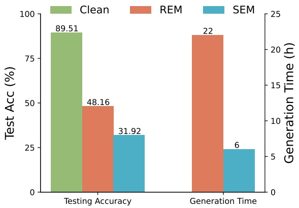

bar

| Category | Clean (Test Acc %) | REM (Generation Time h) | SEM (Generation Time h) |
| --- | --- | --- | --- |
| Testing Accuracy | 89.51 | 48.16 | 31.92 |
| Generation Time | — | 22 | 6 |

Figura 1: Comparación del rendimiento en CIFAR-10 entre el método SoTA actual, el robust error-minimizing noise (REM) (Fu et al. 2022), y nuestro stable error-minimizing noise (SEM) propuesto. Nuestro SEM supera a REM tanto en términos de efectividad como de eficiencia de generación.

Para abordar este problema, trabajos recientes han introducido los Unlearnable Examples (Fowl et al. 2021b; Huang et al. 2020; Fowl et al. 2021a), cuyo propósito es hacer que los datos de entrenamiento sean "inaprendibles" (unlearnable) para los modelos de deep learning mediante la adición de un tipo de ruido invisible. Este ruido añadido induce a error al modelo de aprendizaje llevándolo a adoptar patrones de atajo (shortcut patterns) carentes de significado a partir de los datos, en lugar de extraer conocimiento informativo (Yu et al. 2022). Sin embargo, dicha capacidad de inaprendizaje conferida es vulnerable al adversarial training (Huang et al. 2020). En respuesta, el concepto de robust error-minimizing noise (REM) fue propuesto en (Fu et al. 2022) para potenciar la eficacia del error-minimizing noise bajo adversarial training, protegiendo así los datos de aprendices adversariales al minimizar la loss de adversarial training. Específicamente, se emplea una estrategia de optimización min-min-max para entrenar el generador de robust error-minimizing noise, el cual a su vez produce robust error-minimizing noise. Para mejorar la estabilidad frente a la transformación de datos, REM aprovecha la Expectativa de Transformación (Expectation of Transformation, EOT) (Athalye et al. 2018) durante el entrenamiento del generador. El ruido resultante demuestra un rendimiento superior en entrenamientos avanzados que involucran tanto adversarial training como transformación de datos.

<small>Copyright © 2024, Association for the Advancement of Artificial Intelligence (www.aaai.org). All rights reserved.</small>

Sin embargo, una desventaja primordial de REM es su elevado costo computacional. Específicamente, en el conjunto de datos CIFAR-10, tomaría casi un día completo generar los unlearnable examples, lo cual resulta sumamente ineficiente. Por consiguiente, mejorar la eficiencia de REM es vital, especialmente al escalar hacia conjuntos de datos del mundo real más grandes como ImageNet (Russakovsky et al. 2015). Para mejorar la eficiencia de los algoritmos de generación de robust unlearnable examples, en este artículo examinamos más de cerca el costoso proceso de adversarial training tanto en el surrogate model como en el ruido defensivo. Como se demuestra empíricamente en la Tabla 1, podemos observar que el rendimiento del robust unlearnable example proviene principalmente del efecto del adversarial training sobre el surrogate model y no de la parte del ruido defensivo. Sorprendentemente, la presencia de perturbación adversarial en la elaboración del ruido defensivo conduce incluso a una degradación del rendimiento, lo que indica que necesitamos un mejor método de optimización en esta parte.

Para esclarecer este intrigante fenómeno y mejorar la robustness de los unlearnable examples, comenzamos definiendo la robustness tanto del surrogate model como del ruido defensivo. Posteriormente, nuestro análisis de correlación revela que la robustness del surrogate model es el factor contribuyente principal. Por el contrario, observamos una correlación negativa entre la robustness del ruido defensivo y el rendimiento de protección de los datos. Hipotetizamos que el ruido defensivo sufre de overfitting ante perturbaciones adversariales monótonas, lo que conduce a su inestabilidad. Para abordar este problema, introducimos un novedoso tipo de ruido, stable error-minimizing noise (SEM). Nuestro SEM se entrena contra perturbaciones aleatorias (random perturbations), en lugar de las perturbaciones adversariales que consumen más tiempo, para mejorar la estabilidad. Resumimos nuestras contribuciones de la siguiente manera:

• Establecemos que la robustness de los unlearnable examples es atribuible en gran medida a la robustness del surrogate model, en lugar de a la del ruido defensivo. Además, descubrimos que potenciar adversarialmente el ruido defensivo puede en realidad degradar su rendimiento de protección.
• Para mitigar dicho problema de inestabilidad, introducimos stable error-minimizing noise (SEM), que entrena el ruido defensivo frente a random perturbations en lugar de las costosas perturbaciones adversariales, mejorando así la estabilidad del ruido defensivo.
• Experimentos exhaustivos demuestran empíricamente que SEM alcanza un rendimiento SoTA en CIFAR-10, CIFAR-100 y en un ImageNet Subset respecto tanto a efectividad como a eficiencia. Notablemente, SEM logra una aceleración de 3.91× y un aumento de aproximadamente el 17% en la testing accuracy para el rendimiento de protección en CIFAR-10 bajo adversarial training con $\epsilon = 4 / 2 5 5$.

## Preliminares

**Configuración.** Consideramos una tarea de clasificación con pares de entrada-etiqueta procedentes de un conjunto de datos de K clases $\mathcal { T } = \left( x _ { i } , y _ { i } \right) _ { i = 1 } ^ { n } \subseteq \mathcal { X } \mathbin { \widetilde { \times } } \mathcal { Y }$, donde $\mathcal { T }$ se construye muestreando a partir de una distribución subyacente ${ \mathcal { D } } ( x , y )$ de manera $i . i . d .$, y $x \in \mathbb { R } ^ { d }$ representa las características (features) de una muestra. Sea $f _ { \theta } : \mathbb { R } ^ { d } \to \Delta$ un modelo de red neuronal que produce un símplex de probabilidad, p. ej., a través de una capa softmax. En la mayoría de los algoritmos de aprendizaje, empleamos la minimización del riesgo empírico (ERM, empirical risk minimization), cuyo objetivo es entrenar el modelo $f _ { \theta }$ minimizando una función de pérdida (loss function) ${ \mathcal { L } } ( f ( x ) , y )$ sobre el conjunto de entrenamiento limpio. Esto se logra resolviendo la siguiente optimización:

Tabla 1: Comparación entre variantes de REM y SEM en el conjunto de datos CIFAR-10. El símbolo $\checkmark$ indica que el método correspondiente se utiliza en el proceso de entrenamiento. $\delta ^ { r }$ indica el ruido defensivo entrenado frente a random perturbation.

<table><tr><td rowspan="2">Method</td><td colspan="2">Adv. Train</td><td rowspan="2"> $\delta^{r}$ </td><td rowspan="2">Time</td><td rowspan="2">Test Acc. (%) ↓</td></tr><tr><td> $\theta$ </td><td> $\delta^{u}$ </td></tr><tr><td>REM</td><td>✓</td><td>✓</td><td></td><td>22h</td><td>46.72</td></tr><tr><td>REM- $\delta^{u}$ </td><td></td><td>✓</td><td></td><td>15h</td><td>88.28</td></tr><tr><td>REM- $\theta$ </td><td>✓</td><td></td><td></td><td>6h</td><td>37.90</td></tr><tr><td>SEM</td><td>✓</td><td></td><td>✓</td><td>6h</td><td>30.26</td></tr></table>

$$
\min _ {\theta} \frac {1}{n} \sum_ {i = 1} ^ {n} \mathcal {L} \left(f _ {\theta} \left(x _ {i}\right), y _ {i}\right). \tag {1}
$$

**Adversarial Training.** El adversarial training tiene como objetivo mejorar la robustness de los modelos frente a ejemplos perturbados adversarialmente (Madry et al. 2018). Específicamente, la robustness adversarial requiere que $f _ { \theta }$ tenga un buen desempeño no solo en $\mathcal{D}$, sino también en la distribución perturbada del peor caso cercana a $\mathcal { D } ,$ dentro de un presupuesto de perturbación adversarial dado. En este artículo, nos centramos en la robustness adversarial de norma $\ell _ { \infty }$: es decir, para un $\epsilon > 0$ pequeño, nuestro objetivo es entrenar un clasificador $f _ { \theta }$ que clasifique correctamente $( x + \delta , y )$ para cualquier $\| \delta \| _ { \infty } \leq { \rho _ { a } } ^ { 1 }$, donde $( x , y ) \sim { \mathcal { D } } .$ Típicamente, los métodos de adversarial training formalizan el entrenamiento de $f _ { \theta }$ como una optimización min-max con respecto a $\theta$ y $\delta$, es decir:

$$
\min _ {\theta} \frac {1}{n} \sum_ {i = 1} ^ {n} \max _ {\| \delta_ {i} \| \leq \rho_ {a}} \mathcal {L} \left(f _ {\theta} \left(x _ {i} + \delta_ {i}\right), y _ {i}\right). \tag {2}
$$

**Unlearnable Example.** Los unlearnable examples (Huang et al. 2020) aprovechan técnicas de clean-label data poisoning para engañar a los modelos de deep learning de modo que aprendan una cantidad mínima de conocimiento útil a partir de los datos, logrando así el objetivo de protección de datos. Al añadir ruido defensivo imperceptible a los datos, esta técnica introduce patrones de atajo (shortcut patterns) engañosos en el proceso de entrenamiento, impidiendo con ello que los modelos adquieran conocimiento informativo. Los modelos entrenados con estos conjuntos de datos perturbados exhiben una pobre capacidad de generalización. Formalmente, esta tarea puede formularse en la siguiente optimización bi-nivel (bi-level optimization):

$$
\begin{array}{l} \max _ {\left\| \delta_ {i} ^ {u} \right\| \leq \rho_ {a}} \underset {(x, y) \sim \mathcal {D}} {\mathbb {E}} \left[ \mathcal {L} \left(f _ {\theta^ {*}} (x), y\right) \right], \\ \text {s.t.} \theta^ {*} = \arg \min _ {\theta} \sum_ {\left(x _ {i}, y _ {i}\right) \in \mathcal {T}} \left[ \mathcal {L} \left(f _ {\theta} \left(x _ {i} + \delta_ {i} ^ {u}\right), y _ {i}\right) \right]. \tag {3} \\ \end{array}
$$

Aquí, nuestro objetivo es maximizar el riesgo empírico de los modelos entrenados aplicando la perturbación defensiva generada $\mathcal { P } ^ { u }   =   \{ \check { \delta _ { i } ^ { u } } \} _ { i = 1 } ^ { \check { n } ^ { \mathbf { T } } }$ en el conjunto de entrenamiento original $\mathcal{T}$. Debido a la complejidad de resolver directamente el problema de optimización bi-nivel esbozado en la Ec. 3, se han propuesto diversos métodos aproximados. Estos enfoques incluyen métodos basados en reglas (Yu et al. 2022), basados en heurísticas (Huang et al. 2020) y basados en optimización (Feng, Cai, and Zhou 2019), logrando todos ellos un rendimiento satisfactorio al resolver la Ec. 3.

<small>1∥·∥ in subsequent sections omits the subscript "∞" for brevity.</small>

flowchart

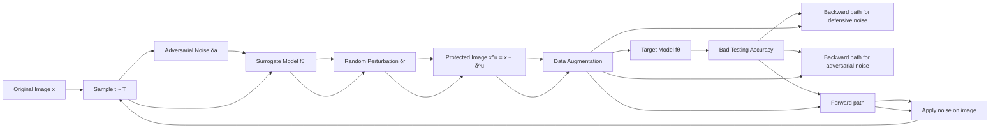

Figura 2: Marco general de nuestro enfoque. Nuestro enfoque consta de dos fases: entrenamiento de ruido y entrenamiento del generador. Durante la fase de entrenamiento de ruido, entrenamos el ruido defensivo, denotado como $\delta ^ { u }$, para contrarrestar random perturbations. En la subsecuente fase de entrenamiento del generador, las imágenes originales, representadas como $x$, se transforman en $x _ { \mathrm { i n p u t } } = t ( x + \delta ^ { u } ) + \delta ^ { a }$ antes de ingresarse a la red. Aquí, t representa una transformación derivada de la distribución $T$, y $\dot { \delta } ^ { a }$ representa la perturbación adversarial producida mediante PGD. El generador de ruido, $f _ { \theta } ^ { \prime }$, actualiza los parámetros de la red, $\theta$, minimizando la loss adversarial. Al aplicar nuestro ruido defensivo, los modelos entrenados en los datos protegidos aprenden información mínima y exhiben un rendimiento deficiente en datos limpios.

**Robust Unlearnable Example.** Sin embargo, estudios recientes (Fu et al. 2022; Huang et al. 2020; Tao et al. 2021) han demostrado que la efectividad de los unlearnable examples puede verse comprometida al emplear adversarial training. Para abordar más a fondo este problema, se propone el siguiente problema de generación de robust unlearnable examples, el cual puede ilustrarse como un juego de dos jugadores compuesto por un defensor U y un usuario no autorizado A. El defensor $U$ busca proteger la privacidad de los datos añadiendo la perturbación $\mathcal { P } ^ { u }$ a los datos, disminuyendo con ello la test accuracy del modelo entrenado, mientras que el usuario no autorizado A intenta utilizar adversarial training y transformación de datos para anular la perturbación agregada y "recuperar" la test accuracy original. Basándonos en (Fu et al. 2022), asumimos que el defensor U tiene acceso completo a los datos que pretende proteger y no puede interferir con el proceso de entrenamiento del usuario una vez que las imágenes protegidas han sido publicadas. Además, asumimos, conforme a (Fu et al. 2022), que el radio del ruido defensivo $\rho _ { u }$ excede al del radio de adversarial training $\rho _ { a }$, asegurando la viabilidad del problema. Dada una distribución $T$ sobre transformaciones $t : { \mathcal { X } } \to { \mathcal { X } }$, tenemos

$$
\begin{array}{c} \mathcal {P} ^ {u} = \underset {\forall i, \left| \delta_ {i} ^ {u} \right| \mid \leq \rho_ {u}} {\arg \max} \underset {(x, y) \sim \mathcal {D}} {\mathbb {E}} \left[ \mathcal {L} \left(f _ {\theta^ {*}} (x), y\right) \right], \\ \text {s.t.} \theta^ {*} = \underset {\theta} {\arg \min} \sum_ {\left(x _ {i}, y _ {i}\right) \in \mathcal {T}} \underset {t \sim T \mid \left| \delta_ {i} ^ {a} \right| \mid \leq \rho_ {a}} {\mathbb {E}} \max \mathcal {L} \left(f _ {\theta} \left(x _ {i} ^ {\prime}\right), y _ {i}\right), \end{array} \tag {4}
$$

donde $x _ { i } ^ { \prime }   =   t ( x _ { i }   +   \delta _ { i } ^ { u } )   +   \delta _ { i } ^ { a }$ representa los datos transformados, siendo $\delta _ { i } ^ { a }$ la perturbación adversarial elaborada mediante Projected Gradient Descent (PGD) y $\delta _ { i } ^ { u }$ denotando el ruido defensivo. Tras aplicar $\mathcal { P } ^ { u }$, se obtiene el conjunto de datos protegido $\mathcal { T } ^ { u } = ( x _ { i } + \delta i ^ { u } , y _ { i } ) _ { i = 1 } ^ { n }$.

## Metodología

## Entrenamiento Iterativo del Generador y del Ruido Defensivo

Para abordar el problema presentado en la Ec. 4, REM introduce un método de optimización iterativa entre ruido robusto y modelo surrogate, donde un modelo surrogate generador de ruido, denotado como $\theta$, y el ruido defensivo, $\delta ^ { u }$, se optimizan alternadamente. Desde la perspectiva del modelo, el surrogate model $\theta$ se entrena con datos envenenados perturbados iterativamente, creados agregando ruido defensivo y adversarial a los datos de entrenamiento originales, a saber, $x _ { \mathsf { p e r t u r b } } ^ { u } = t ( x + \delta ^ { u } ) + \delta ^ { a }$. El surrogate model se entrena para minimizar la siguiente loss con el fin de potenciar su adversarial robustness:

$$
\theta^ {\prime} \leftarrow \theta - \eta^ {\theta} \nabla_ {\theta} \mathcal {L} \left(f _ {\theta} \left(t \left(x + \delta^ {u}\right) + \delta^ {a}\right), y\right). \tag {5}
$$

donde $\eta ^ { ( \cdot ) }$ representa el learning rate, t es una transformación muestreada de $T$, y $\delta _ { a }$ es la perturbación adversarial elaborada mediante PGD, diseñada para maximizar la loss. Por el contrario, el ruido defensivo $\overline { { \delta } } ^ { u }$ se entrena para contrarrestar la perturbación adversarial del peor caso mediante PGD basado en $\theta$. La idea central es que el ruido defensivo robusto debe mantener su efectividad incluso bajo perturbaciones adversariales. Específicamente, el ruido defensivo se actualiza minimizando la loss,

$$
\delta^ {u} \leftarrow \delta^ {u} - \eta^ {u} \nabla_ {\delta^ {u}} \mathcal {L} \left(f _ {\theta} \left(t \left(x + \delta^ {u}\right) + \delta^ {a}\right), y\right). \tag {6}
$$

Durante la optimización del surrogate model $\theta$, el ruido defensivo $\delta ^ { u }$ se mantiene fijo. A la inversa, al optimizar el ruido defensivo $\delta ^ { u }$, el surrogate model $\theta$ permanece fijo. Repetimos estos pasos de manera iterativa hasta alcanzar el número máximo de pasos de entrenamiento. El ruido defensivo final se genera mediante:

$$
\delta^ {u} = \underset {\| \delta^ {u} \| \leq \rho_ {u}} {\arg \min} \mathbb {E} _ {t \sim T} \max _ {\| \delta^ {a} \| \leq \rho_ {a}} \mathcal {L} \left(f _ {\theta} \left(t \left(x + \delta^ {u}\right) + \delta^ {a}\right), y\right). \tag {7}
$$

Algoritmo 1: Entrenamiento del Generador de Ruido para el enfoque SEM

Require: Training data set T, Training steps M, defense PGD parameters  $\rho_{u}$ ,  $\alpha_{u}$  and  $K_{u}$ , attack PGD parameters  $\rho_{a}$ ,  $\alpha_{a}$  and  $K_{a}$ , transformation distribution T, the sampling number J for gradient approximation

Ensure: Robust noise generator $f _ { \theta } ^ { \prime } .$

for $i$ in $1, \cdots, M$ do
    Sample minibatch $(x, y) \sim \mathcal{T}$, randomly initialize $\delta^u$.
    for $k$ in $1, \cdots, K_u$ do
        for $j$ in $1, \cdots, J$ do
            Sample noise and transformation $\delta_j^r \sim \mathcal{P}$, $t_j \sim T$.
        end for
        $g_k \leftarrow \frac{1}{J} \sum_{j=1}^J \frac{\partial}{\partial \delta^u} \ell(f_\theta'(t_j(x + \delta^u) + \delta_j^r), y)$
        $\delta^u \leftarrow \prod_{\|\delta\| \leq \rho_u} (\delta^u - \alpha_u \cdot \text{sign}(g_k))$
    end for
    Sample a transformation function $t \sim T$.
    $\delta^a \leftarrow \text{PGD}(t(x + \delta^u), y, f_\theta', \rho_a, \alpha_a, K_a)$
    Update source model $f_\theta'$ based on minibatch $(t(x + \delta^u) + \delta^a, y)$
end for

## Mejora de la Estabilidad del Ruido Defensivo

La perturbación adversarial, denotada como $\delta ^ { a }$, está incorporada en los procesos de optimización tanto del surrogate model $\theta$ como del ruido defensivo $\delta ^ { u }$ (consúltense la Ec. 5 y la Ec. 6). No obstante, como lo indican los resultados en la Tabla 1, parece que únicamente la perturbación adversarial $\delta ^ { a }$ en la optimización del surrogate model $\theta$ contribuye a la mejora del rendimiento. Sorprendentemente, la perturbación adversarial en la optimización del ruido defensivo $\delta ^ { u }$ (véase la Ec. 6) genera una degradación del rendimiento. Para dilucidar estos fascinantes hallazgos, procedemos con un análisis de correlación según se describe a continuación. Definimos inicialmente el rendimiento de protección mediante $F = 1 - \mathtt { A c c }$, donde Acc representa la testing accuracy del modelo entrenado. Luego, proponemos la siguiente definición para cuantificar la robustness tanto del surrogate model como del ruido defensivo.

**Definición 1** (Robustness del surrogate model). Dado un surrogate model fijo, denotado como $\theta$, definimos su robustness como la resistencia del modelo ante perturbaciones adversariales, donde la perturbación $\delta ^ { u }$ es actualizable:

$$
\mathcal {R} _ {\theta} = - \max _ {\| \delta^ {a} \| \leq \rho_ {a}} \min _ {\| \delta^ {u} \| \leq \rho_ {u}} \mathcal {L} \left(f _ {\theta} \left(t \left(x + \delta^ {u}\right) + \delta^ {a}\right), y\right). \tag {8}
$$

**Definición 2** (Robustness del ruido defensivo). Para un ruido defensivo fijo dado, $\delta ^ { u }$, definimos su robustness como la resistencia del ruido ante perturbaciones adversariales, donde el parámetro del modelo $\theta$ es actualizable:

$$
\mathcal {R} _ {\delta^ {u}} = - \max _ {\| \delta^ {a} \| \leq \rho_ {a}} \min _ {\theta} \mathcal {L} \left(f _ {\theta} \left(t \left(x + \delta^ {u}\right) + \delta^ {a}\right), y\right). \tag {9}
$$

Para explorar la correlación entre los dos términos de robustness formulados, $\mathcal { R } ,$ y el rendimiento de protección, $F ,$ seguimos el procedimiento estándar de entrenamiento de ruido defensivo descrito en (Fu et al. 2022) y guardamos el surrogate model, $\theta _ { t } ,$ y el ruido defensivo, $\delta _ { t } ^ { u }$, en diversos pasos de entrenamiento denotados por t. Posteriormente, para el modelo o ruido obtenido, fijamos uno mientras inicializamos aleatoriamente el otro, y luego resolvimos la Ec. 8 y la Ec. 9 mediante un proceso de entrenamiento iterativo. A partir de la Fig. 3,

Figura 3: Exploración de la contribución de la robustness del ruido defensivo, denotada como $\mathcal { R } _ { \theta } ,$ y del surrogate model, representada por $\mathcal { R } _ { \delta ^ { u } }$, al rendimiento de protección F. Los coeficientes de correlación de Pearson (r) cuantifican la fuerza de estas relaciones. Las pruebas se llevaron a cabo en el conjunto de datos CIFAR-10 con las configuraciones $\rho _ { a } = 4 / 2 5 5$ y $\rho _ { u } = 8 / 2 5 5$.

encontramos que $\mathcal { R } _ { \theta }$ demuestra una fuerte correlación positiva con el rendimiento de protección, mientras que $\mathcal { R } _ { \delta _ { u } }$ muestra una correlación negativa moderada con el rendimiento de protección.

Esto sugiere que el rendimiento de protección del ruido defensivo se ve influenciado principal y positivamente por la robustness del surrogate model, $\mathcal { R } _ { \theta }$. Por el contrario, potenciar la robustness del ruido defensivo paradójicamente puede deteriorar su rendimiento de protección. Planteamos la hipótesis de que la inestabilidad del ruido defensivo $\delta ^ { u }$, entrenado siguiendo la Ec. 6, se origina en la naturaleza monótona de la perturbación del peor caso $\delta ^ { a }$. Para mejorar su estabilidad, proponemos un objetivo de entrenamiento alternativo para el ruido defensivo:

$$
\delta^ {u} \leftarrow \delta^ {u} - \eta^ {u} \nabla_ {\delta^ {u}} \mathcal {L} \left(f _ {\theta} \left(t \left(x + \delta^ {u}\right) + \delta^ {r}\right), y\right), \tag {10}
$$

donde $\delta ^ { r }$ representa una random perturbation muestreada de la distribución uniforme $\mathcal { U } ( - \rho _ { r } , \rho _ { r } )$. El radio de la random perturbation, $\rho _ { r } ,$ se establece de modo que coincida con el de la perturbación adversarial, $\rho _ { a }$. Sustituir $\delta ^ { a }$ en la Ec. 6 por $\delta ^ { r }$ permite que el ruido defensivo elaborado experimente perturbaciones más diversas durante el entrenamiento. Denominamos al ruido defensivo obtenido como stable error-minimizing noise (SEM). El marco y procedimiento generales se describen en la Fig. 2 y en el Alg. 1.

## Experimentos

## Configuración Experimental

**Conjunto de datos.** Realizamos amplios experimentos en tres conjuntos de datos benchmark de visión ampliamente reconocidos, incluidos CIFAR-10, CIFAR-100 (Krizhevsky et al. 2009) y un subconjunto del conjunto de datos ImageNet (Russakovsky et al. 2015), que comprende las primeras 100 clases del ImageNet original.

Tabla 2: Test accuracy (%) de modelos entrenados con datos protegidos por diferentes ruidos defensivos bajo adversarial training con varios radios de perturbación. El radio de perturbación defensiva $\rho _ { u }$ se fija globalmente en 8/255, mientras que el radio de perturbación adversarial $\rho _ { a }$ de REM varía. Cuanto menor sea la test accuracy, mejor será la efectividad de la protección.

<table><tr><td>Datasets→</td><td colspan="5">CIFAR-10</td><td colspan="5">CIFAR-100</td><td colspan="5">ImageNet Subset</td></tr><tr><td>Methods↓</td><td>ρa=0</td><td>1/255</td><td>2/255</td><td>3/255</td><td>4/255</td><td>0</td><td>1/255</td><td>2/255</td><td>3/255</td><td>4/255</td><td>0</td><td>1/255</td><td>2/255</td><td>3/255</td><td>4/255</td></tr><tr><td>Clean Data</td><td>94.66</td><td>93.74</td><td>92.37</td><td>90.90</td><td>89.51</td><td>76.27</td><td>71.90</td><td>68.91</td><td>66.45</td><td>64.50</td><td>80.66</td><td>76.20</td><td>72.52</td><td>69.68</td><td>66.62</td></tr><tr><td>EM</td><td>13.20</td><td>22.08</td><td>71.43</td><td>87.71</td><td>88.62</td><td>1.60</td><td>71.47</td><td>68.49</td><td>65.66</td><td>63.43</td><td>1.26</td><td>74.88</td><td>71.74</td><td>66.90</td><td>63.40</td></tr><tr><td>TAP</td><td>22.51</td><td>92.16</td><td>90.53</td><td>89.55</td><td>88.02</td><td>13.75</td><td>70.03</td><td>66.91</td><td>64.30</td><td>62.39</td><td>9.10</td><td>75.14</td><td>70.56</td><td>67.64</td><td>63.56</td></tr><tr><td>NTGA</td><td>16.27</td><td>41.53</td><td>85.13</td><td>89.41</td><td>88.96</td><td>3.22</td><td>65.74</td><td>66.53</td><td>64.80</td><td>62.44</td><td>8.42</td><td>63.28</td><td>66.96</td><td>65.98</td><td>63.06</td></tr><tr><td>SC</td><td>11.63</td><td>91.71</td><td>90.42</td><td>86.84</td><td>87.26</td><td>1.51</td><td>70.62</td><td>67.95</td><td>65.81</td><td>63.30</td><td>11.0</td><td>75.06</td><td>71.26</td><td>67.14</td><td>62.58</td></tr><tr><td>REM</td><td>15.18</td><td>14.28</td><td>25.41</td><td>30.85</td><td>48.16</td><td>1.89</td><td>4.47</td><td>7.03</td><td>17.55</td><td>27.10</td><td>13.74</td><td>21.58</td><td>29.40</td><td>35.76</td><td>41.66</td></tr><tr><td>SEM</td><td>13.0</td><td>12.16</td><td>11.49</td><td>20.91</td><td>31.92</td><td>1.95</td><td>3.26</td><td>4.35</td><td>9.07</td><td>20.25</td><td>4.1</td><td>10.34</td><td>13.76</td><td>23.58</td><td>37.82</td></tr></table>

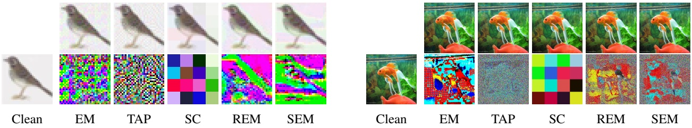

(a) CIFAR-10

(b) ImageNet Subset

Figura 4: Visualización de diversos ruidos y ejemplos elaborados para los conjuntos de datos CIFAR-10 e ImageNet Subset. El ruido incluye EM (Error-Minimizing noise), TAP (Targeted Adversarial Poisoning noise), NTGA (Neural Tangent Generalization Attack noise), SC (Shortcut noise), REM (Robust Error-Minimizing noise) y SEM (nuestro Stable Error-Minimizing noise propuesto).

En consonancia con (Fu et al. 2022), utilizamos random cropping y horizontal flipping para las data augmentations.

**Arquitectura del Modelo y Adversarial Training.** Evaluamos el método propuesto y las líneas base a través de diversas tareas de visión utilizando cinco arquitecturas de red populares: VGG-16 (Simonyan and Zisserman 2015), ResNet18/50 (He et al. 2016), DenseNet121 (Huang et al. 2017) y Wide ResNet-34-10 (Zagoruyko and Komodakis 2016). ResNet-18 se selecciona como el target model predeterminado en nuestros experimentos. Por defecto, el radio de ruido defensivo $\rho _ { u }$ se establece en 8/255, y el radio de adversarial training $\rho _ { a }$ se fija en 4/255 para cada conjunto de datos. Además, la configuración para el radio de adversarial training sigue las directrices de REM (Fu et al. 2022), asegurando que $\rho _ { a } \leq \rho _ { u }$.

**Baselines.** Comparamos nuestro stable error-minimizing noise (**SEM**) con los métodos SoTA existentes, incluidos targeted adversarial poisoning noise (**TAP**) (Fowl et al. 2021a), error-minimizing noise (**EM**) (Huang et al. 2021), robust error-minimizing noise (**REM**) (Fu et al. 2022), synthesized shortcut noise (**SC**) (Yu et al. 2022) y neural tangent generalization attack noise (**NTGA**) (Yuan and Wu 2021).

## Análisis de Rendimiento

**Diferentes Radios de Adversarial Training.** Nuestra evaluación inicial se centra en el rendimiento de protección de varios unlearnable examples bajo diferentes radios de adversarial training. El radio de perturbación defensiva se establece en $\rho _ { u } = 8 / 2 5 5$, con ResNet-18 sirviendo tanto de source model como de target model. Como se muestra en la Tabla 2, SC se desempeña mejor bajo configuraciones de entrenamiento estándar $(\rho _ { a } = 0)$. Sin embargo, con un incremento en el radio de perturbación de adversarial training, la test accuracy de SC también se eleva de manera significativa. De igual modo, las otras dos líneas base, EM y TAP, experimentan un incremento sustancial en la test accuracy con un adversarial training intensificado. Por el contrario, REM y SEM, diseñados para una mejor robustness frente a perturbaciones adversariales, no aumentan notablemente la test accuracy incluso con radios más grandes. Al compararlo con REM, los resultados indican que nuestro SEM supera sistemáticamente a esta línea base en todas las configuraciones de adversarial training $\textstyle { \overset { \rightharpoonup } { ( \rho _ { a } } } \in [ { \frac { 1 } { 2 5 5 } } , { \frac { 4 } { 2 5 5 } } ] )$, demostrando la efectividad superior de nuestro método propuesto en la generación de robust unlearnable examples.

Tabla 3: Test accuracy (%) de diferentes tipos de modelos en los conjuntos de datos CIFAR-10 y CIFAR-100. El radio de perturbación de adversarial training se establece en 4/255. El radio de perturbación defensiva $\rho _ { u }$ de cada tipo de ruido defensivo se establece en $8 / 2 5 5$.

<table><tr><td>Dataset</td><td>Model</td><td>Clean</td><td>EM</td><td>TAP</td><td>NTGA</td><td>REM</td><td>SEM</td></tr><tr><td rowspan="5">CIFAR-10</td><td>VGG-16</td><td>87.51</td><td>86.48</td><td>86.27</td><td>86.65</td><td>65.23</td><td>44.37</td></tr><tr><td>RN-18</td><td>89.51</td><td>88.62</td><td>88.02</td><td>88.96</td><td>48.16</td><td>31.92</td></tr><tr><td>RN-50</td><td>89.79</td><td>89.28</td><td>88.45</td><td>88.79</td><td>40.65</td><td>28.89</td></tr><tr><td>DN-121</td><td>83.27</td><td>82.44</td><td>81.72</td><td>80.73</td><td>81.48</td><td>77.85</td></tr><tr><td>WRN-34-10</td><td>91.21</td><td>90.05</td><td>90.23</td><td>89.95</td><td>48.39</td><td>31.42</td></tr><tr><td rowspan="5">CIFAR-100</td><td>VGG-16</td><td>57.14</td><td>56.94</td><td>55.24</td><td>55.81</td><td>48.85</td><td>57.11</td></tr><tr><td>RN-18</td><td>63.43</td><td>64.17</td><td>62.39</td><td>62.44</td><td>27.10</td><td>20.25</td></tr><tr><td>RN-50</td><td>66.93</td><td>66.43</td><td>64.44</td><td>64.91</td><td>26.03</td><td>20.99</td></tr><tr><td>DN-121</td><td>53.73</td><td>53.52</td><td>52.93</td><td>52.40</td><td>54.48</td><td>55.36</td></tr><tr><td>WRN-34-10</td><td>68.64</td><td>68.27</td><td>65.80</td><td>67.41</td><td>25.04</td><td>18.90</td></tr></table>

Tabla 4: Test accuracy (%) de diferentes tipos de modelos entrenados en CIFAR-10 y CIFAR-100 procesados por diferentes filtros pasa-bajas (low-pass filters). El radio de perturbación defensiva $\rho _ { u }$ de cada ruido defensivo se establece en $1 6 / 2 5 5$.

<table><tr><td>Dataset</td><td>Filter</td><td>Clean</td><td>EM</td><td>TAP</td><td>NTGA</td><td>REM</td><td>SEM</td></tr><tr><td rowspan="3">CIFAR-10</td><td>Mean</td><td>84.25</td><td>34.87</td><td>82.53</td><td>40.26</td><td>28.60</td><td>23.93</td></tr><tr><td>Median</td><td>87.04</td><td>31.86</td><td>85.10</td><td>30.87</td><td>27.36</td><td>22.00</td></tr><tr><td>Gaussian</td><td>86.78</td><td>29.71</td><td>85.44</td><td>41.85</td><td>28.70</td><td>21.77</td></tr><tr><td rowspan="3">CIFAR-100</td><td>Mean</td><td>52.42</td><td>53.07</td><td>51.30</td><td>26.49</td><td>13.89</td><td>8.81</td></tr><tr><td>Median</td><td>57.69</td><td>56.35</td><td>55.22</td><td>18.14</td><td>14.08</td><td>9.02</td></tr><tr><td>Gaussian</td><td>56.64</td><td>56.49</td><td>55.19</td><td>29.05</td><td>13.74</td><td>8.10</td></tr></table>

**Diferentes Arquitecturas.** Para investigar la transferibilidad (transferability) de diferentes ruidos a través de arquitecturas de redes neuronales, seleccionamos ResNet-18 como source model. Luego examinamos el impacto del ruido generado sobre varios target models, incluyendo VGG-16, ResNet-50, DenseNet-121 y Wide ResNet-34-10. Todos los experimentos de transferibilidad se llevaron a cabo utilizando los conjuntos de datos CIFAR-10 y CIFAR-100, como se muestra en la Tabla 3. Los resultados demuestran que los unlearnable examples generados mediante el método SEM son generalmente más efectivos a través de las distintas configuraciones de arquitecturas que REM, indicando una mayor transferibilidad.

## Análisis de Sensibilidad

**Resistencia al Filtrado Pasa-Bajas (Low-Pass Filtering).** A continuación, analizamos cómo los diversos ruidos defensivos resisten el filtrado pasa-bajas. Este enfoque está motivado por la posibilidad de que filtrar la imagen pueda eliminar el ruido defensivo añadido. Conforme a (Fu et al. 2022), empleamos tres filtros pasa-bajas: Mean, Median y Gaussian (Young and Van Vliet 1995), cada uno con un tamaño de ventana de $3 \times 3$. Establecemos el radio de perturbación de adversarial training en $2 / 2 5 5$. Los resultados en la Tabla 4 muestran que la test accuracy de los modelos entrenados con los datos protegidos aumenta tras aplicar filtros pasa-bajas, lo que implica que dicho filtrado degrada parcialmente el ruido defensivo añadido. Sin embargo, SEM supera el rendimiento en ambos escenarios, con y sin la aplicación de filtrado pasa-bajas en el adversarial training.

**Resistencia al Early Stopping y al Envenenamiento Parcial (Partial Poisoning).** Uno podría preguntarse cómo la técnica de early stopping influye en el rendimiento de protección de nuestros unlearnable examples. Para abordar esto, realizamos experimentos en CIFAR-10 y CIFAR-100, variando los pasos de paciencia (patience steps) del early-stopping. Designamos el 10% de los unlearnable examples para el conjunto de validación, con la paciencia de early-stopping $S _ { e s }$ configurada en un rango de 3k a 20k pasos. Para examinar el envenenamiento parcial, variamos la proporción de imágenes limpias en el conjunto de validación del 10% al 70%. Los resultados se detallan en la Tabla 5. Las observaciones a partir del envenenamiento total (proporción limpia igual a 0%) muestran que fijar $S _ { e s }$ en 1500 aumenta la test accuracy en un $4 \%$, lo que implica un impacto mínimo del early stopping en los unlearnable examples. Sin embargo, este efecto no es sustancial y hace necesario explorar el hiperparámetro de paciencia de early-stopping para su mitigación. El aumento de la proporción limpia en el conjunto de validación restablece aún más la test accuracy al 57.48%, aunque permanece por debajo del nivel original de 89.51%. Estos resultados subrayan la resistencia de nuestros unlearnable examples frente al early stopping.

**Efecto del Paso de Entrenamiento** M **y el Tamaño de Muestreo** J. Evaluamos el impacto del paso de entrenamiento M y del tamaño de muestreo J durante la generación de ruido, considerando valores de M de 500 a 5000 y J variando de 1 a 6. Los resultados, ilustrados en

Tabla 5: Efecto de early stop con diferentes pasos de paciencia $S _ { e s }$

<table><tr><td>Before</td><td>Clean Ratio (%)</td><td> $S_{es} = 3000$ </td><td>25000</td><td>10000</td><td>20000</td></tr><tr><td rowspan="5">31.92</td><td>0</td><td>35.80</td><td>29.34</td><td>31.30</td><td>30.87</td></tr><tr><td>10</td><td>31.89</td><td>47.22</td><td>32.02</td><td>32.02</td></tr><tr><td>30</td><td>31.89</td><td>32.02</td><td>31.67</td><td>32.02</td></tr><tr><td>50</td><td>57.48</td><td>47.22</td><td>57.48</td><td>57.48</td></tr><tr><td>70</td><td>57.48</td><td>47.22</td><td>57.48</td><td>31.89</td></tr></table>

Figura 5: Efecto de los pasos de entrenamiento de ruido y del tamaño del paso de muestreo sobre la testing accuracy del modelo entrenado.

la Fig. 5, indican que un aumento en los pasos de entrenamiento mejora el rendimiento. Esta mejora podría atribuirse a que el generador de ruido aprende patrones de ruido más robustos a lo largo de pasos de entrenamiento extendidos. En lo que respecta al tamaño de muestreo J, se encontró que un incremento en J redujo la testing accuracy en casi un 8%, subrayando su importancia en la protección de datos.

**Efecto del Radio de Perturbación Aleatoria (Random Perturbation Radius).** El radio de la random perturbation representa un hiperparámetro crucial en nuestro enfoque. Para explorar su correlación con el rendimiento de protección, llevamos a cabo experimentos en CIFAR-10 y CIFAR-100 utilizando varios radios de random perturbation y adversarial training. Los resultados se detallan en la Tabla 6. Los resultados indican que el mejor rendimiento de protección de datos se logra generalmente cuando el radio de random perturbation $\rho _ { r }$ se establece igual al radio de adversarial training $\rho _ { a }$, a través de distintos radios de adversarial training. No obstante, cuando estos dos radios no coinciden, el rendimiento de protección disminuye ligeramente, lo que indica la importancia de conocer el radio de adversarial training para la efectividad de la protección.

## Estudio de Ablación

Llevamos a cabo un estudio de ablación para comprender el impacto de diversos componentes en nuestro método, centrándonos específicamente en el ruido adversarial utilizado para actualizar el generador de ruido y en el ruido aleatorio utilizado para actualizar el ruido defensivo. Los resultados, mostrados en la Tabla 7, revelan que el ruido adversarial $\delta ^ { a }$, utilizado al actualizar el generador de ruido $\theta$, es un factor crítico para el rendimiento de protección. Su eliminación resulta en una disminución aproximada del 60% en la accuracy. Adicionalmente, la eliminación de la random perturbation al actualizar el ruido defensivo conlleva una reducción en el rendimiento de protección de aproximadamente el 8%. Por otra parte, utilizar puramente ruido adversarial para actualizar el ruido defensivo conduce a un rendimiento de protección deteriorado, poniendo en relieve los efectos adversos de las perturbaciones adversariales.

Tabla 6: Efecto de diferentes radios de perturbación aleatoria (random perturbation).

| Adv. Train. $\rho_{a}$ | $\rho_{r} = 0$ | 1/255 | 2/255 | 3/255 | 4/255 |
| --- | --- | --- | --- | --- | --- |
| 0 | 15.87 | 11.41 | 10.42 | 16.83 | 10.52 |
| 1/255 | 16.59 | 12.11 | 15.80 | 17.92 | 12.16 |
| 2/255 | 64.24 | 13.44 | 11.49 | 19.13 | 21.68 |
| 3/255 | 89.18 | 28.6 | 21.88 | 20.91 | 23.43 |
| 4/255 | 89.30 | 67.52 | 35.63 | 62.09 | 31.92 |

Tabla 7: Estudio de ablación del método propuesto.

| $\frac{\delta^{u*}}{\delta^{r}}$ | $\frac{\delta^{a}}{\delta^{r}}$ | $\frac{\theta^{*}}{\delta^{a}}$ | Test Acc. (%) | Acc. Increase (%) |
| --- | --- | --- | --- | --- |
| ✓ |  | ✓ | 30.03 | - |
|  |  | ✓ | 37.91 | +7.88 |
|  | ✓ | ✓ | 46.72 | +16.69 |
| ✓ |  |  | 89.22 | +59.19 |
|  |  |  | 89.15 | +59.13 |

Tabla 8: Evaluación en un conjunto de datos de reconocimiento facial del mundo real.

| Methods | $\rho_{a} = 0$ | 1/255 | 2/255 | 3/255 | 4/255 |
| --- | --- | --- | --- | --- | --- |
| Clean Data | 68.89 | 63.33 | 61.11 | 53.33 | 50.56 |
| EM | 8.89 | 18.06 | 18.61 | 16.39 | 19.72 |
| TAP | 9.72 | 20.74 | 26.48 | 32.22 | 36.39 |
| SC | 66.11 | 66.67 | 64.72 | 57.5 | 59.44 |
| REM | 10.89 | 7.89 | 11.67 | 12.22 | 11.48 |
| SEM | 10.56 | 7.04 | 9.44 | 10.28 | 11.11 |

## Estudio de caso: Reconocimiento Facial

Para evaluar la efectividad de nuestro método propuesto en el reconocimiento facial del mundo real, llevamos a cabo experimentos utilizando el conjunto de datos Facescrub (Ng and Winkler 2014). Específicamente, seleccionamos al azar diez clases, constando cada clase de 120 imágenes. Asignamos el 15% de los datos como conjunto de prueba, resultando en 1020 imágenes para entrenamiento y 180 para prueba. Los resultados presentados en la Tabla 8 indican que los métodos robustos, a saber, REM y SEM, superan a otros métodos no robustos en términos de protección de datos bajo adversarial training. En particular, la test accuracy de los modelos entrenados con datos protegidos por SEM cayó a alrededor del 9%, a través de diversos radios de adversarial training, marcando una caída significativa en la accuracy de aproximadamente 40% a 50%. Además, observamos a partir de la Fig. 6 que los métodos robustos dan como resultado imágenes protegidas más nítidas. Por ejemplo, SC crea imágenes de tipo mosaico, mientras que EM y TAP reducen sustancialmente la luminosidad, perjudicando el reconocimiento facial. Por el contrario, las perturbaciones de REM y SEM se concentran en los bordes, manteniendo la similitud visual.

## Trabajos Relacionados

**Data Poisoning.** Los ataques de data poisoning tienen como objetivo manipular el rendimiento de un modelo de machine learning en ejemplos limpios modificando los ejemplos de entrenamiento. Investigaciones recientes han demostrado la vulnerabilidad tanto de las DNNs (Muñoz-González et al. 2017) como de los métodos clásicos de machine learning, tales como SVM (Biggio, Nelson, and Laskov 2012), frente a los ataques de poisoning (Shafahi et al. 2018). Avances recientes utilizan técnicas de gradient matching y meta-learning para abordar el problema de elaboración de ruido (Geiping et al. 2020). Los backdoor attacks son tipos de data poisoning que intentan inyectar muestras de entrenamiento etiquetadas falsamente con un disparador (trigger) encubierto (Gu, Dolan-Gavitt, and Garg 2017). Los unlearnable examples, considerados como un enfoque backdoor clean-label y sin trigger (Gan et al. 2022; Souri et al. 2022; Zeng et al. 2023; Xian et al. 2023; Li et al. 2022; Liu, Yang, and Mirzasoleiman 2022), perturban las características (features) para perjudicar la capacidad de generalización del modelo.

text_image

Clean
EM
TAP
SC
REM
SEM

Figura 6: Visualización de diferentes tipos de ruido defensivo y unlearnable examples elaborados en el subconjunto Facescrub.

**Unlearnable Example.** Huang et al. (2020) introdujeron el error-minimizing noise para crear "unlearnable examples", provocando que los modelos de deep learning aprendan características irrelevantes y generalicen de manera ineficaz. Los unlearnable examples han sido adaptados para la protección de datos en diversos dominios y aplicaciones (Liu et al. 2023c,d,b,a; Sun et al. 2022b; Zhang et al. 2023; Li et al. 2023; He, Zha, and Katabi 2022; Zhao and Lao 2022; Salman et al. 2023; Guo et al. 2023). A pesar de su efectividad, se ha comprobado que dicha capacidad de inaprendizaje conferida es frágil frente al adversarial training (Madry et al. 2018) y a las transformaciones de datos (Athalye et al. 2018). Estudios recientes (Tao et al. 2021) demuestran que aplicar adversarial training con un radio adecuado puede contrarrestar el ruido añadido, restaurando así el rendimiento del modelo y haciendo que los datos vuelvan a ser "aprendibles" (learnable). Para hacer frente a esto, Fu et al. (2022) propusieron un enfoque de optimización min-min-max para crear unlearnable examples más robustos mediante el aprendizaje de un generador de ruido y el desarrollo de robust error-minimizing noise. Sin embargo, este método enfrenta desafíos de ineficiencia y rendimiento de protección subóptimo, principalmente debido a la inestabilidad del ruido defensivo. Para superar estas limitaciones, nuestro enfoque ofrece un método más eficiente y efectivo para entrenar un ruido defensivo mejorado.

## Conclusión

En este trabajo, introdujimos el Stable Error-Minimizing (SEM), un método novedoso para generar unlearnable examples que logran un mejor rendimiento de protección y eficiencia de generación bajo adversarial training. Nuestra investigación descubre un fenómeno intrigante: la efectividad de los unlearnable examples para proteger datos se deriva predominantemente de la robustness del surrogate model. Motivados por esto, SEM emplea un surrogate model para crear robust error-minimizing noise, contrarrestando eficazmente las perturbaciones aleatorias. Evaluaciones experimentales exhaustivas confirman que SEM supera el SoTA previo en términos tanto de efectividad como de eficiencia.

## Agradecimientos

Este trabajo fue realizado conjuntamente en Samsung Research America y Lehigh University, con apoyo parcial de la National Science Foundation bajo las subvenciones CRII-2246067 y CCF-2319242. Agradecemos a Jeff Heflin y Maryann DiEdwardo por sus valiosos comentarios iniciales sobre el manuscrito; a Shaopeng Fu por sus apreciaciones respecto al código base de REM; y a Weiran Huang por las enriquecedoras discusiones y sus perspectivas únicas. También agradecemos a nuestros revisores y metarrevisores de la AAAI por sus constructivas sugerencias.

## Referencias

- Athalye, A.; Engstrom, L.; Ilyas, A.; and Kwok, K. 2018. Synthesizing robust adversarial examples. In International conference on machine learning, 284–293. PMLR.
- Biggio, B.; Nelson, B.; and Laskov, P. 2012. Poisoning attacks against support vector machines. In ICML.
- Cao, Y.; Li, S.; Liu, Y.; Yan, Z.; Dai, Y.; Yu, P. S.; and Sun, L. 2023. A comprehensive survey of ai-generated content (aigc): A history of generative ai from gan to chatgpt. arXiv preprint arXiv:2303.04226.
- Devlin, J.; Chang, M.-W.; Lee, K.; and Toutanova, K. 2019. Bert: Pre-training of deep bidirectional transformers for language understanding.
- Dosovitskiy, A.; Beyer, L.; Kolesnikov, A.; Weissenborn, D.; Zhai, X.; Unterthiner, T.; Dehghani, M.; Minderer, M.; Heigold, G.; Gelly, S.; et al. 2020. An Image is Worth 16x16 Words: Transformers for Image Recognition at Scale. In International Conference on Learning Representations.
- Feng, J.; Cai, Q.-Z.; and Zhou, Z.-H. 2019. Learning to confuse: generating training time adversarial data with autoencoder. In NeurIPS.
- Fowl, L.; Chiang, P.-y.; Goldblum, M.; Geiping, J.; Bansal, A.; Czaja, W.; and Goldstein, T. 2021a. Preventing unauthorized use of proprietary data: Poisoning for secure dataset release. arXiv preprint arXiv:2103.02683.
- Fowl, L.; Goldblum, M.; Chiang, P.-y.; Geiping, J.; Czaja, W.; and Goldstein, T. 2021b. Adversarial Examples Make Strong Poisons. In NeurIPS.
- Fu, S.; He, F.; Liu, Y.; Shen, L.; and Tao, D. 2022. Robust Unlearnable Examples: Protecting Data Privacy Against Adversarial Learning. In International Conference on Learning Representations.
- Gan, L.; Li, J.; Zhang, T.; Li, X.; Meng, Y.; Wu, F.; Yang, Y.; Guo, S.; and Fan, C. 2022. Triggerless Backdoor Attack for NLP Tasks with Clean Labels. In Proceedings of the 2022 Conference of the North American Chapter of the Association for Computational Linguistics: Human Language Technologies, 2942–2952.
- Geiping, J.; Fowl, L. H.; Huang, W. R.; Czaja, W.; Taylor, G.; Moeller, M.; and Goldstein, T. 2020. Witches’ Brew: Industrial Scale Data Poisoning via Gradient Matching. In International Conference on Learning Representations.
- Gu, T.; Dolan-Gavitt, B.; and Garg, S. 2017. Badnets: Identifying vulnerabilities in the machine learning model supply chain. arXiv preprint arXiv:1708.06733.
- Guo, J.; Li, Y.; Wang, L.; Xia, S.-T.; Huang, H.; Liu, C.; and Li, B. 2023. Domain Watermark: Effective and Harmless Dataset Copyright Protection is Closed at Hand. In Thirty-seventh Conference on Neural Information Processing Systems.
- He, H.; Zha, K.; and Katabi, D. 2022. Indiscriminate Poisoning Attacks on Unsupervised Contrastive Learning. In The Eleventh International Conference on Learning Representations.
- He, K.; Zhang, X.; Ren, S.; and Sun, J. 2016. Deep residual learning for image recognition. In CVPR.
- Hill, K.; and Krolik, A. 2019. How photos of your kids are powering surveillance technology. The New York Times.
- Huang, G.; Liu, Z.; Van Der Maaten, L.; and Weinberger, K. Q. 2017. Densely connected convolutional networks. In CVPR.
- Huang, H.; Ma, X.; Erfani, S. M.; Bailey, J.; and Wang, Y. 2020. Unlearnable Examples: Making Personal Data Unexploitable. In International Conference on Learning Representations.
- Huang, H.; Wang, Y.; Erfani, S. M.; Gu, Q.; Bailey, J.; and Ma, X. 2021. Exploring Architectural Ingredients of Adversarially Robust Deep Neural Networks. In NeurIPS.
- Kipf, T. N.; and Welling, M. 2016. Semi-supervised classification with graph convolutional networks. arXiv preprint arXiv:1609.02907.
- Krizhevsky, A.; et al. 2009. Learning multiple layers of features from tiny images.
- Li, Y.; Bai, Y.; Jiang, Y.; Yang, Y.; Xia, S.-T.; and Li, B. 2022. Untargeted backdoor watermark: Towards harmless and stealthy dataset copyright protection. Advances in Neural Information Processing Systems, 35: 13238–13250.
- Li, Z.; Yu, N.; Salem, A.; Backes, M.; Fritz, M.; and Zhang, Y. 2023. {UnGANable}: Defending Against {GAN-based} Face Manipulation. In 32nd USENIX Security Symposium (USENIX Security 23), 7213–7230.
- Liu, T. Y.; Yang, Y.; and Mirzasoleiman, B. 2022. Friendly noise against adversarial noise: a powerful defense against data poisoning attack. Advances in Neural Information Processing Systems, 35: 11947–11959.
- Liu, Y.; Fan, C.; Chen, X.; Zhou, P.; and Sun, L. 2023a. GraphCloak: Safeguarding Task-specific Knowledge within Graph-structured Data from Unauthorized Exploitation. arXiv preprint arXiv:2310.07100.
- Liu, Y.; Fan, C.; Dai, Y.; Chen, X.; Zhou, P.; and Sun, L. 2023b. Toward Robust Imperceptible Perturbation against Unauthorized Text-to-image Diffusion-based Synthesis. arXiv preprint arXiv:2311.13127.
- Liu, Y.; Fan, C.; Zhou, P.; and Sun, L. 2023c. Unlearnable Graph: Protecting Graphs from Unauthorized Exploitation. arXiv preprint arXiv:2303.02568.
- Liu, Y.; Ye, H.; Zhang, K.; and Sun, L. 2023d. Securing Biomedical Images from Unauthorized Training with Anti-Learning Perturbation. arXiv preprint arXiv:2303.02559.
- Madry, A.; Makelov, A.; Schmidt, L.; Tsipras, D.; and Vladu, A. 2018. Towards Deep Learning Models Resistant to Adversarial Attacks. In ICLR.
- Muñoz-González, L.; Biggio, B.; Demontis, A.; Paudice, A.; Wongrassamee, V.; Lupu, E. C.; and Roli, F. 2017. Towards poisoning of deep learning algorithms with back-gradient optimization. In ACM Workshop on Artificial Intelligence and Security.
- Ng, H.-W.; and Winkler, S. 2014. A data-driven approach to cleaning large face datasets. In 2014 IEEE International Conference on Image Processing (ICIP), 343–347.
- Russakovsky, O.; Deng, J.; Su, H.; Krause, J.; Satheesh, S.; Ma, S.; Huang, Z.; Karpathy, A.; Khosla, A.; Bernstein, M.; et al. 2015. Imagenet large scale visual recognition challenge. International journal of computer vision, 115(3): 211–252.
- Salman, H.; Khaddaj, A.; Leclerc, G.; Ilyas, A.; and Madry, A. 2023. Raising the cost of malicious ai-powered image editing. arXiv preprint arXiv:2302.06588.
- Shafahi, A.; Huang, W. R.; Najibi, M.; Suciu, O.; Studer, C.; Dumitras, T.; and Goldstein, T. 2018. Poison frogs! targeted clean-label poisoning attacks on neural networks. In NeurIPS.
- Simonyan, K.; and Zisserman, A. 2015. Very deep convolutional networks for large-scale image recognition. In ICLR.
- Souri, H.; Fowl, L.; Chellappa, R.; Goldblum, M.; and Goldstein, T. 2022. Sleeper agent: Scalable hidden trigger backdoors for neural networks trained from scratch. Advances in Neural Information Processing Systems, 35: 19165–19178.
- Sun, L.; Dou, Y.; Yang, C.; Zhang, K.; Wang, J.; Philip, S. Y.; He, L.; and Li, B. 2022a. Adversarial attack and defense on graph data: A survey. IEEE Transactions on Knowledge and Data Engineering.
- Sun, Z.; Du, X.; Song, F.; Ni, M.; and Li, L. 2022b. Coprotector: Protect open-source code against unauthorized training usage with data poisoning. In Proceedings of the ACM Web Conference 2022, 652–660.
- Tao, L.; Feng, L.; Yi, J.; Huang, S.-J.; and Chen, S. 2021. Better safe than sorry: Preventing delusive adversaries with adversarial training. Advances in Neural Information Processing Systems, 34: 16209–16225.
- Vaswani, A.; Shazeer, N.; Parmar, N.; Uszkoreit, J.; Jones, L.; Gomez, A. N.; Kaiser, Ł.; and Polosukhin, I. 2017. Attention is all you need. Advances in neural information processing systems, 30.
- Wang, X.; Girshick, R.; Gupta, A.; and He, K. 2018. Non-local neural networks. In Proceedings of the IEEE conference on computer vision and pattern recognition, 7794–7803.
- Xian, X.; Wang, G.; Srinivasa, J.; Kundu, A.; Bi, X.; Hong, M.; and Ding, J. 2023. Understanding Backdoor Attacks through the Adaptability Hypothesis. In Proc. International Conference on Machine Learning.
- Young, I. T.; and Van Vliet, L. J. 1995. Recursive implementation of the Gaussian filter. Signal processing, 44(2): 139–151.
- Yu, D.; Zhang, H.; Chen, W.; Yin, J.; and Liu, T.-Y. 2022. Availability Attacks Create Shortcuts. arXiv:2111.00898.
- Yuan, C.-H.; and Wu, S.-H. 2021. Neural Tangent Generalization Attacks. In ICML.
- Zagoruyko, S.; and Komodakis, N. 2016. Wide Residual Networks. In Procedings of the British Machine Vision Conference 2016. British Machine Vision Association.
- Zeng, Y.; Pan, M.; Just, H. A.; Lyu, L.; Qiu, M.; and Jia, R. 2023. Narcissus: A practical clean-label backdoor attack with limited information. In Proceedings of the 2023 ACM SIGSAC Conference on Computer and Communications Security, 771–785.
- Zhang, J.; Ma, X.; Yi, Q.; Sang, J.; Jiang, Y.-G.; Wang, Y.; and Xu, C. 2023. Unlearnable clusters: Towards label-agnostic unlearnable examples. In Proceedings of the IEEE/CVF Conference on Computer Vision and Pattern Recognition, 3984–3993.
- Zhao, B.; and Lao, Y. 2022. CLPA: Clean-label poisoning availability attacks using generative adversarial nets. In Proceedings of the AAAI Conference on Artificial Intelligence, volume 36, 9162–9170.
- Zhou, C.; Li, Q.; Li, C.; Yu, J.; Liu, Y.; Wang, G.; Zhang, K.; Ji, C.; Yan, Q.; He, L.; et al. 2023. A comprehensive survey on pretrained foundation models: A history from bert to chatgpt. arXiv preprint arXiv:2302.09419.

**Justificación del Supuesto** $\rho _ { u } \geq \rho _ { a }$

**Teorema 3.** Dado un clasificador $f : \mathcal { X } \to \mathcal { Y } ,$ radio de protección $\rho _ { u } ,$ radio de adversarial training $\rho _ { a } ,$ conjunto de datos limpio $\mathcal { T } ^ { c } = \{ x _ { i } , y _ { i } \} _ { i = 1 \cdots N } ,$ conjunto de datos protegido $\mathcal { T } ^ { u } = \{ ( x _ { i } +$ $\left. \begin{array} { l l } { \left. \delta _ { i } ^ { u } , y _ { i } \right) \right| \left\| \hat { \delta } ^ { u } { } _ { i } \right\| _ { p } \leq } & { \rho _ { u } \} _ { i = 1 \cdots N } } \\ \end{array}$. Cuando $\rho _ { a } \: \geq \: \rho _ { u } ,$ realizar adversarial training en el conjunto de datos protegido $\mathcal { T } ^ { u }$ es equivalente a minimizar el límite superior de la loss de entrenamiento en el conjunto de datos limpio original $\mathcal { T } ^ { c }$, lo que asegurará que pueda recuperar la test accuracy en el conjunto de datos limpio original y hará inviable la protección de datos.

Demostración. Denotemos la loss natural en el conjunto de datos $\mathcal { T }$ para el clasificador $f$ como $\begin{array} { r c l } { \mathcal { R } _ { \mathrm { n a t } } \left( f , \mathcal { T } \right) } & { = } & { \mathbb { E } _ { \left( x , y \right) \sim \mathcal { T } } \left[ \ell \left( f \left( x \right) , y \right) \right] } \\ \end{array}$ y la loss de adversarial training en el conjunto de datos $\mathcal { T }$ para el clasificador $f$ con radio adversarial $r _ { - } = \epsilon$ como $\mathcal { R } _ { \mathrm { a d v } } \left( f , \mathcal { T } , \epsilon \right) ~ =$ $\begin{array} { l } { \mathbb { E } _ { \left( x , y \right) \sim \mathcal { T } } \left[ \operatorname* { m a x } _ { \left\| \delta \right\| _ { p } \leq \epsilon } \ell \left( f \left( x + \delta \right) , y \right) \right] } \\ \end{array}$. Realizar adversarial training en el conjunto de datos protegido $\mathcal { T } ^ { u }$ con radio adversarial $\rho _ { a }$ tiene el siguiente objetivo:

$$
\begin{array}{l} \mathcal {R} _ {\mathrm{adv}} \left(f, \mathcal {T} ^ {u}, \rho_ {a}\right) = \mathbb {E} _ {(x, y) \sim \mathcal {T} ^ {u}} \max _ {| | \delta^ {a} | | _ {p} \leq \rho_ {a}} \ell \left(f \left(x + \delta^ {a}\right), y\right) \\ = \mathbb {E} _ {(x, y) \sim \mathcal {T} ^ {c}} \max _ {\| \delta^ {a} \| _ {p} \leq \rho_ {a}} \ell \left(f \left(x + \delta^ {u} + \delta^ {a}\right), y\right) \\ \geq \mathbb {E} _ {(x, y) \sim \mathcal {T} ^ {c}} \left[ \ell \left(f \left(x + \delta^ {u} - \delta^ {u}\right), y\right) \right] \\ = \mathbb {E} _ {(x, y) \sim \mathcal {T} ^ {c}} \left[ \ell \left(f (x), y\right) \right] \\ = \mathcal {R} _ {\mathrm{nat}} \left(f, \mathcal {T} ^ {c}\right) \\ \end{array}
$$

La primera desigualdad se cumple ya que $\begin{array} { r } { \left\| \delta ^ { u } \right\| _ { p } \leq \rho _ { u } \leq \rho _ { a } } \end{array}$, por lo que para cada término sumando dentro de la esperanza tenemos:

$$
\begin{array}{l} \max _ {\| \delta^ {a} \| _ {p} \leq \rho_ {a}} \ell \left(f \left(x + \delta^ {u} + \delta^ {a}\right), y\right) \geq \ell \left(f \left(x + \delta^ {u} - \delta^ {u}\right), y\right) \\ = \ell (f (x), y) \\ \end{array}
$$

## Implementación de Líneas Base

**Error-minimizing noise (Huang et al. 2020).** Entrenamos el generador de error-minimizing noise resolviendo la Ec. 11. El error-minimizing noise se genera entonces con el generador de ruido entrenado. El modelo ResNet-18 se utiliza como source model $\bar { f } ^ { \prime }$. Se emplea el método PGD para resolver el problema de minimización interno en la Ec. (11), donde las configuraciones de PGD se presentan en la Tabla 9.

$$
\min _ {\theta} \frac {1}{n} \sum_ {i = 1} ^ {n} \min _ {\| \delta_ {i} \| \leq \rho_ {u}} \ell \left(f _ {\theta} ^ {\prime} \left(x _ {i} + \delta_ {i}\right), y _ {i}\right) \tag {11}
$$

**Targeted adversarial poisoning noise (Fowl et al. 2021b).** Este tipo de ruido se genera llevando a cabo un targeted adversarial attack sobre el modelo entrenado con datos limpios, en el cual la perturbación adversarial generada se utiliza como el ruido de envenenamiento adversarial (adversarial poisoning noise). Específicamente, dado un modelo fijo $f _ { 0 }$ y una muestra $( x , y )$, el targeted adversarial attack generará ruido resolviendo el problema $\operatorname{argmax} _ { \| \delta _ { u } \| \leq \rho _ { u } } \ell ( f _ { 0 } ( x + \delta _ { u } ) , g ( y ) )$, donde $g$ es una función de permutación sobre el espacio de etiquetas Y. Establecemos $\bar{g(y)} = \bar{(y + 1)}\%|Y|$. Los hiperparámetros para PGD se presentan en la Tabla 9.

**Neural tangent generalization attack noise (Yuan and Wu 2021).** Este tipo de ruido protector tiene como objetivo debilitar la capacidad de generalización del modelo entrenado con los datos modificados. Para ello, se modela un ensamble de redes neuronales basado en un neural tangent kernel (NTK), y el ruido NTGA se genera sobre dicho modelo ensamble. Como resultado, el ruido NTGA disfruta de una notable transferibilidad (transferability). Utilizamos el código oficial de $\mathbf { \dot { N } } \mathbf { \dot { T } } \mathbf { G } \mathbf { A } ^ { \mathrm { ~ 2 ~ } }$ para generar este tipo de ruido. Específicamente, empleamos el modelo FNN de Yuan y Wu (2021) como modelo ensamble. Para CIFAR-10 y CIFAR-100, el tamaño de bloque para aproximar el NTK se fija en 4,000. Para el ImageNet Subset, el tamaño de bloque se fija en 100. Los hiperparámetros para PGD se proporcionan en la Tabla 9. Consúltese (Yuan and Wu 2021) según corresponda para otras configuraciones.

**Robust Error-minimizing Noise (Fu et al. 2022).** REM es un método de robust error-minimizing noise que tiene como objetivo mejorar aún más la robustness de los unlearnable examples frente al adversarial training y a la transformación de datos. El surrogate model se entrena resolviendo la optimización min-min-max de la Ec. 12, y el ruido se obtiene mediante la Ec. 7:

$$
\min _ {\theta} \frac {1}{n} \sum_ {i = 1} ^ {n} \min _ {\left\| \delta_ {i} ^ {u} \right\| \leq \rho_ {u}} \mathbb {E} _ {t \sim T} \max _ {\left\| \delta_ {i} ^ {a} \right\| \leq \rho_ {a}} \ell \left(f _ {\theta} ^ {\prime} \left(t \left(x _ {i} + \delta_ {i} ^ {u}\right) + \delta_ {i} ^ {a}\right), y _ {i}\right) \tag {12}
$$

**Linearly-separable Synthesized Shortcut Noise (Yu et al. 2022).** Este tipo de ruido busca introducir patrones de alta frecuencia linealmente separables agregando parches ruidosos repetidos hechos a mano a nivel de clase (class-wise handcrafted repeated noisy patches). Específicamente, este método sintetiza algunos puntos de datos simples para un problema de clasificación de N clases, donde se incluyen tres etapas: generación de puntos iniciales por clase, duplicación para correlación local y reescalado de magnitud final. Para el tamaño del marco de ruido (noise frame size), lo establecemos en 8 por defecto; para el tamaño de la norma, lo establecemos en 8/255 por defecto. Para otras configuraciones, consúltese el artículo original según corresponda para más detalles.

Algoritmo 2: Cálculo de la robustness del surrogate model $\mathcal { R } _ { \theta }$

**Require:** Trained defensive noise $\delta ^ { u }$ , Training data set $\mathcal { T } ,$ Training steps $M ,$ attack PGD parameters $\rho _ { a } ,   \alpha _ { a }$ and $K _ { a } ,$ transformation distribution $\bar { T }$

**Ensure:** The robustness of surrogate model $\mathcal { R } _ { \theta }$

$\mathcal{R}_{\theta} \leftarrow 0$
for $i$ in $1, \cdots, M$ do
    Sample a minibatch $(x, y) \sim \mathcal{T}$,
    Sample a transformation function $t \sim T$.
    $\delta^{a} \leftarrow \text{PGD}(t(x + \delta^{u}), y, f_{\theta}^{\prime}, \rho_{a}, \alpha_{a}, K_{a})$
    Update source model $f_{\theta}^{\prime}$ based on minibatch $(t(x + \delta^{u}) + \delta^{a}, y)$
    $\mathcal{R}_{\theta} \leftarrow \mathcal{R}_{\theta} + \ell(f_{\theta}^{\prime}(t(x + \delta^{u}) + \delta^{a}), y)$
end for

<small>2El código oficial de NTGA está disponible en https://github.com/lionelmessi6410/ntga.</small>

Algoritmo 3: Cálculo de la robustness del ruido defensivo $\mathcal { R } _ { \delta ^ { u } }$

Require: Trained surrogate model  $\theta$ , Training data set T, Training steps M, defense PGD parameters  $\rho_{u}$ ,  $\alpha_{u}$  and  $K_{u}$ , attack PGD parameters  $\rho_{a}$ ,  $\alpha_{a}$  and  $K_{a}$ , transformation distribution T, the sampling number J for gradient approximation

Ensure: The robustness of defensive noise $\mathcal { R } _ { \delta ^ { u } }$

$\mathcal{R}_{\delta^{u}} \leftarrow 0$
for $i$ in $1, \cdots, M$ do
    Sample a minibatch $(x, y) \sim \mathcal{T}$
    Randomly initialize $\delta^{u}$.
    for $k$ in $1, \cdots, K_{u}$ do
        for $j$ in $1, \cdots, J$ do
            $\delta_{j}^{a} \leftarrow \text{PGD}(t_{j}(x + \delta^{u}), y, f_{\theta}^{\prime}, \rho_{a}, \alpha_{a}, K_{a})$
            Sample a transformation function $t_{j} \sim T$.
        end for
        $g_{k} \leftarrow \frac{1}{J} \sum_{j=1}^{J} \frac{\partial}{\partial \delta^{u}} \ell(f_{\theta}^{\prime}(t_{j}(x + \delta^{u}) + \delta_{j}^{a}), y)$
        $\delta^{u} \leftarrow \prod_{\|\delta\| \leq \rho_{u}} (\delta^{u} - \alpha_{u} \cdot \text{sign}(g_{k}))$
    end for
    Sample a transformation function $t \sim T$.
    $\delta^{a} \leftarrow \text{PGD}(t(x + \delta^{u}), y, f_{\theta}^{\prime}, \rho_{a}, \alpha_{a}, K_{a})$
    $\mathcal{R}_{\delta^{u}} \leftarrow \mathcal{R}_{\delta^{u}} + \ell(f_{\theta}^{\prime}(t(x + \delta^{u}) + \delta^{a}), y)$
end for

## Detalles de Implementación

## Detalles de Hardware y Software

Los experimentos se llevaron a cabo en un entorno Ubuntu 20.04.6 LTS (focal) con 503GB de RAM. Y los experimentos en CIFAR-10 y CIFAR-100 se realizan en 1 GPU (NVIDIA® RTX® A5000 24GB) y 32 núcleos de CPU (Intel® Xeon® Silver 4314 CPU @ 2.40GHz). Para ImageNet, los experimentos se realizan en 2 GPU (NVIDIA® RTX® A5000 24GB) y con la misma configuración de CPU. Se utilizan Python 3.10.12 y Pytorch 2.0.1 para todas las implementaciones.

## Detalles del Método

**Regeneración de Ruido.** Siguiendo las prácticas existentes, tras entrenar un generador de ruido siguiendo el Alg. 1, aprovechamos el generador para llevar a cabo una ronda final de generación de ruido defensivo a través del Alg. 4. Descubrimos que este truco puede potenciar en cierta medida el rendimiento de protección en comparación con el uso del ruido defensivo generado en la ronda anterior o una versión de suma ponderada.

**Data Augmentation.** Siguiendo a (Fu et al. 2022), utilizamos diferentes data augmentations para los distintos conjuntos de datos durante el entrenamiento. Para CIFAR-10 y CIFAR-100, aplicamos las siguientes data augmentations: random flipping, padding en cada lado con 4 píxeles, random cropping de la imagen a 32×32, y luego reescalado por píxel a [−0.5, 0.5] para cada imagen. Para el ImageNet Subset, la data augmentation se realiza mediante la operación RandomResizedCrop a 224 × 224, random flipping, y luego reescalado de la imagen en el rango [−0.5, 0.5].

**Adversarial Training.** Nos centramos en ruido acotado por $L _ { \infty }$ $\left\| \rho _ { a } \right\| _ { \infty } \; \leq \; \rho _ { a }$ en el adversarial training. Cabe señalar que el radio del ruido defensivo $\rho _ { u }$ se fija en 8/255, y el radio de adversarial training $\rho _ { a }$ se fija en 4/255 para cada conjunto de datos por defecto. Y para la regla de configuración del radio de adversarial training, seguimos la configuración de REM (Fu et al. 2022) con $\rho _ { a } \leq \rho _ { u } .$ La configuración detallada de parámetros se presenta en la Tabla 9, donde $\alpha _ { d } , \alpha _ { a }$ denotan el tamaño de paso de PGD para la generación de ruido defensivo y adversarial, y K· denota el correspondiente número de pasos de PGD.

Algoritmo 4: Generación de Ruido Defensivo del enfoque SEM

Require: Noise generator  $f_{\theta}^{\prime}$ , Training data set T, defense PGD parameters  $\rho_{u}$ ,  $\alpha_{u}$ , attack PGD parameters  $\rho_{a}$ ,  $\alpha_{a}$ , transformation distribution T, the sampling number J for gradient approximation

Ensure: Robust unlearnable example $\mathcal { T } ^ { \prime } = \{ ( x _ { i } ^ { \prime } , y _ { i } ) \} _ { i = 1 } ^ { n }$ 1 for $( x _ { i } , y _ { i } )$ in $\mathcal { T }$ do

Randomly initialize $\delta_i^u$.
for $k$ in $1, \cdots, K_u$ do
    for $j$ in $1, \cdots, J$ do
        Random sample noise $\delta_j^r \sim \mathcal{P}$.
        Sample a transformation function $t_j \sim T$.
    end for
    $g_k \leftarrow \frac{1}{J} \sum_{j=1}^{J} \frac{\partial}{\partial \delta^u} \ell(f_\theta'(t_j(x + \delta^u) + \delta_j^r), y)$
    $\delta_i^u \leftarrow \prod_{\|\delta_i^u\| \leq \rho_u} (\delta_i^u - \alpha_u \cdot \text{sign}(g_k))$
end for
$x_i' \leftarrow x_i + \delta_i^u$
end for

Tabla 9: Configuraciones de PGD para las generaciones de ruido de diferentes métodos. $\rho _ { u }$ denota el radio de perturbación defensiva de diferentes tipos de ruido, mientras que $\rho _ { a }$ denota el radio de perturbación adversarial de REM y SEM.

<table><tr><td>Datasets</td><td>Noise Type</td><td> $\alpha_d$ </td><td> $K_d$ </td><td> $\alpha_a$ </td><td> $K_a$ </td></tr><tr><td>CIFAR-10</td><td>EM</td><td> $\rho_u/5$ </td><td>10</td><td>-</td><td>-</td></tr><tr><td>CIFAR-100</td><td>TAP</td><td> $\rho_u/125$ </td><td>250</td><td>-</td><td>-</td></tr><tr><td>Facescrub</td><td>REM &amp; SEM(Ours)</td><td> $\rho_u/5$ </td><td>10</td><td> $\rho_a/5$ </td><td>10</td></tr><tr><td rowspan="3">ImageNet Subset</td><td>EM</td><td> $\rho_u/5$ </td><td>7</td><td>-</td><td>-</td></tr><tr><td>TAP</td><td> $\rho_u/50$ </td><td>100</td><td>-</td><td>-</td></tr><tr><td>REM &amp; SEM(Ours)</td><td> $\rho_u/4$ </td><td>7</td><td> $\rho_a/5$ </td><td>10</td></tr></table>

**Métricas.** Utilizamos la test accuracy en la fase de evaluación para medir la capacidad de protección de datos del ruido defensivo. Una baja test accuracy sugiere que el modelo es engañado por el ruido defensivo para poseer una pobre capacidad de generalización. Por ende, aprendió poca información a partir de los datos protegidos, lo cual implica una mejor efectividad de protección de datos del ruido. Utilizamos el tiempo de generación del ruido defensivo para evaluar la eficiencia. Para excluir el error aleatorio, todos los resultados se repiten tres veces con diferentes semillas aleatorias (random seeds) $s \in \{ 0 , 6 1 7 8 , \bar { 4 2 } \}$.

Tabla 10: Correlación del rendimiento de protección y dos términos de robustness bajo tres métricas distintas.

|  | Pearson | Spearman | Kendall |
| --- | --- | --- | --- |
| $\mathcal{R}_{\theta}$ | 0.9551 | 0.8422 | 0.6921 |
| $\mathcal{R}_{\delta_{u}}$ | -0.5851 | -0.7003 | -0.5407 |

## Más Resultados

Visualizamos más ruido defensivo y las correspondientes imágenes inaprendibles (unlearnable images) en la Fig. 8, Fig. 9, Fig. 10 y Fig. 11. Para la tabla principal que compara diferentes métodos bajo varios radios de adversarial training, presentamos una versión extendida de la Tabla 2 con desviación estándar en la Tabla 12 y la Tabla 13.

**Efectividad bajo envenenamiento parcial (partial poisoning).** Bajo un escenario de aprendizaje realista más desafiante en el que solo una porción de los datos puede ser protegida por el ruido defensivo, también estudiamos el efecto de diferentes tasas de envenenamiento (poisoning ratios) sobre la test accuracy de los modelos entrenados en el conjunto de datos envenenado. A partir de la Tabla 11, podemos observar que nuestro método supera a otras líneas base cuando la tasa de envenenamiento es igual o superior al $8 0 \% ,$ y la test accuracy de los modelos entrenados en el conjunto de datos envenenado disminuye a medida que aumenta la proporción de envenenamiento. Sin embargo, bajo configuraciones con tasas de envenenamiento más bajas, donde el modelo podría aprender a partir de ejemplos limpios, todos los tipos de ruido existentes no logran degradar el rendimiento del modelo de manera significativa. Este resultado indica una limitación común de los métodos inaprendibles existentes, lo que invita a futuros estudios que investiguen este desafiante escenario.

**Términos de robustness** $\mathcal { R } _ { \theta }$ **y** $\mathcal { R } _ { \delta ^ { u } }$ . Para resolver la Ec. 8 y la Ec. 9, realizamos un entrenamiento iterativo siguiendo el Alg. 2 y el Alg. 3 con el modelo entrenado o el ruido defensivo. Por otra parte, presentamos tres métricas (Pearson, Spearman y Kendall) en la Tabla 10 para cuantificar la correlación entre los dos términos de robustness y el rendimiento de protección. Estas métricas, cada una única a su manera, proporcionan diversas perspectivas sobre las correlaciones, ya sean relaciones lineales o asociaciones basadas en rangos. Los resultados muestran que $\mathcal { R } _ { \theta }$ exhibe una fuerte correlación positiva con el rendimiento de protección a través de las tres métricas. Esto sugiere que a medida que $\bar { \mathcal { R } _ { \theta } }$ aumenta, el rendimiento de protección también aumenta. $\mathcal { R } _ { \delta _ { u } }$ , por otra parte, muestra una correlación negativa moderada con el rendimiento de protección a través de las tres métricas.

**Efecto de los algoritmos de ataque** $\ell _ { \infty }$. Proporcionamos resultados adicionales sobre REM con diferentes algoritmos de ataque adversarial de norma $\ell _ { \infty }$, incluyendo FGSM, TPGD y APGD (de torchattacks). Como se muestra en la Tabla 14, los resultados sugieren que todavía son inferiores a SEM, lo que indica que la limitación radica en la raíz de la optimización de REM.

Tabla 14: REM con diferentes algoritmos de ataque $\ell _ { \infty }$.

| Methods | SEM | REM+PGD | REM+FGSM | REM+TPGD | REM+APGD |
| --- | --- | --- | --- | --- | --- |
| Test Acc. (↓) | 29.53 | 48.16 | 40.95 | 33.19 | 80.87 |

**Tiempo de generación.** Presentamos el costo de tiempo de generación del ruido defensivo utilizando REM y SEM. Los resultados en la Tabla 15 sugieren que SEM es ∼ 4 veces más rápido que el enfoque REM.

Tabla 15: Comparación de costos de tiempo para la generación de ruido defensivo entre REM y SEM.

| Dataset | REM | SEM(Ours) | Reduce (↓) | Speedup (×) |
| --- | --- | --- | --- | --- |
| CIFAR-10/100 | 22.6h | 5.78h | -16.82h | 3.91 |
| ImageNet Subset | 5.2h | 1.33h | -3.87h | 3.90 |

## Comprensión del Ruido SEM mediante Proyección 2D de UMAP

En esta sección, descubrimos más perspectivas sobre la efectividad del stable error-minimizing noise mediante el método de Proyección 2D de UMAP. Nuestro término de "estabilidad" del ruido se refiere principalmente a su resistencia frente a perturbaciones más diversas durante la fase de evaluación. Basándonos en nuestra observación empírica, las perturbaciones adversariales en la optimización de REM resultan ser monótonas y no están alineadas con las perturbaciones más diversas durante la evaluación. Este fenómeno podría deberse a una dinámica de entrenamiento desalineada, dado que, durante la fase de entrenamiento de ruido, el ruido defensivo puede ser actualizado mientras que permanece fijo durante la evaluación. Denominamos a nuestro método error-minimizing "estable" ya que aprovechamos perturbaciones aleatorias más diversas para entrenar el ruido defensivo, basándonos en nuestra intuición de que la perturbación real durante la fase de evaluación está más alineada con la perturbación aleatoria. Con base en la Ec. 9, definimos aún más la estabilidad de la siguiente manera:

**Definición 4** (Poder engañoso del ruido / Delusiveness of noise). Dado el ruido defensivo $\delta ^ { \mathbf { u } }$, definimos su poder engañoso $\mathcal { R } _ { D } ( \delta ^ { \mathbf { u } } )$ como la loss de prueba del modelo $f _ { \theta ^ { * } }$ entrenado con transformaciones de datos:

$$
D \left(\delta^ {\mathbf {u}}\right) = \underset {(x, y) \sim \mathcal {D}} {\mathbb {E}} \left[ \mathcal {L} \left(f _ {\theta^ {*}} (x), y\right) \right], \tag {13}
$$

$$
\text {s.t.} \theta^ {*} = \arg \min _ {\theta} \sum_ {\left(x _ {i}, y _ {i}\right) \in \mathcal {T}} \underset {t \sim T} {\mathbb {E}} \mathcal {L} \left(f _ {\theta} \left(t \left(x _ {i} + \delta_ {i} ^ {u}\right)\right), y _ {i}\right). \tag {14}
$$

**Definición 5** (Estabilidad del ruido / Stability of noise). Dado $\delta ^ { \mathbf { u } }$ y la perturbación adversarial $\delta ^ { \mathbf { a } }$ con radio $\rho _ { a } ,$ su estabilidad $\mathcal { S } ( \delta ^ { \mathbf { u } } , \rho _ { a } )$ es opuesta a su delusiveness del peor caso bajo perturbación:

$$
\mathcal {S} \left(\delta^ {\mathbf {u}}, \rho_ {a}\right) = \min _ {\left| \left| \delta_ {i} ^ {a} \right| \right| _ {p} \leq \rho_ {a}} \mathcal {R} _ {D} \left(\delta^ {\mathbf {u}} + \delta^ {\mathbf {a}}\right). \tag {15}
$$

flowchart

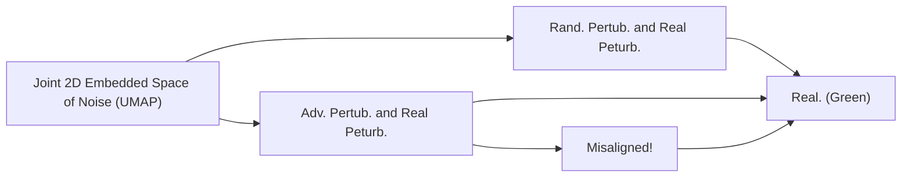

Figura 7: Comprensión de la superioridad de SEM en comparación con REM mediante la visualización de ruido con UMAP.

Para validar nuestras afirmaciones, llevamos a cabo la visualización con UMAP de la perturbación aleatoria y la perturbación adversarial en el entrenamiento de REM y en la fase de evaluación real. Como se muestra en la Fig. 7, las perturbaciones adversariales en REM resultan ser monótonas y, por lo tanto, el ruido defensivo inducido no es "estable" cuando la perturbación real cae fuera de la región específica. Por el contrario, la random perturbation en SEM está más alineada con la perturbación real durante la evaluación.

Tabla 11: Test accuracy (%) en CIFAR-10 con diferentes porcentajes de protección de datos. Establecemos el radio de perturbación defensiva $\rho _ { w }$ en 8/255. Para REM y SEM, establecemos $\rho _ { a }$ y $\rho _ { a }$ en 4/255.

<table><tr><td rowspan="3">Adv. Train. $\rho_a$ </td><td rowspan="3">Noise Type</td><td colspan="10">Data Protection Percentage</td></tr><tr><td rowspan="2">0%</td><td colspan="2">20%</td><td colspan="2">40%</td><td colspan="2">60%</td><td colspan="2">80%</td><td rowspan="2">100%</td></tr><tr><td>Mixed</td><td>Clean</td><td>Mixed</td><td>Clean</td><td>Mixed</td><td>Clean</td><td>Mixed</td><td>Clean</td></tr><tr><td rowspan="6">2/255</td><td>EM</td><td rowspan="6">92.37</td><td>92.26</td><td></td><td>91.94</td><td></td><td>91.81</td><td></td><td>91.14</td><td></td><td>71.43</td></tr><tr><td>TAP</td><td>92.17</td><td></td><td>91.62</td><td></td><td>91.32</td><td></td><td>91.48</td><td></td><td>90.53</td></tr><tr><td>NTGA</td><td>92.41</td><td>91.30</td><td>92.19</td><td>90.31</td><td>92.23</td><td>88.65</td><td>91.74</td><td>83.37</td><td>85.13</td></tr><tr><td>SC</td><td>92.3</td><td></td><td>91.98</td><td></td><td>90.17</td><td></td><td>87.58</td><td></td><td>47.66</td></tr><tr><td>REM</td><td>92.36</td><td></td><td>90.22</td><td></td><td>88.45</td><td></td><td>84.82</td><td></td><td>30.69</td></tr><tr><td>SEM</td><td>91.94</td><td></td><td>90.89</td><td></td><td>88.90</td><td></td><td>82.98</td><td></td><td>11.32</td></tr><tr><td rowspan="6">4/255</td><td>EM</td><td rowspan="6">89.51</td><td>89.60</td><td></td><td>89.40</td><td></td><td>89.49</td><td></td><td>89.10</td><td></td><td>88.62</td></tr><tr><td>TAP</td><td>89.01</td><td></td><td>88.66</td><td></td><td>88.40</td><td></td><td>88.04</td><td></td><td>88.02</td></tr><tr><td>NTGA</td><td>89.56</td><td>88.17</td><td>89.35</td><td>86.76</td><td>89.22</td><td>85.07</td><td>89.17</td><td>79.41</td><td>88.96</td></tr><tr><td>SC</td><td>89.4</td><td></td><td>89.14</td><td></td><td>89.23</td><td></td><td>89.02</td><td></td><td>84.43</td></tr><tr><td>REM</td><td>89.60</td><td></td><td>89.34</td><td></td><td>89.61</td><td></td><td>88.09</td><td></td><td>48.16</td></tr><tr><td>SEM</td><td>89.82</td><td></td><td>89.65</td><td></td><td>88.66</td><td></td><td>85.19</td><td></td><td>31.29</td></tr></table>

Tabla 12: Test accuracy (%) de modelos entrenados con datos protegidos por diferentes ruidos defensivos mediante adversarial training con diferentes radios de perturbación. El radio de perturbación defensiva $\rho _ { u }$ se fija en 8/255 para cada tipo de ruido, mientras que el radio de perturbación adversarial $\rho _ { a }$ del ruido REM y del ruido SEM toman varios valores.

<table><tr><td rowspan="2">Dataset</td><td rowspan="2">Adv. Train. $\rho_{a}$ </td><td rowspan="2">Clean</td><td rowspan="2">EM</td><td rowspan="2">TAP</td><td rowspan="2">NTGA</td><td colspan="5">REM</td><td colspan="5">SEM</td></tr><tr><td> $\rho_{a}=0$ </td><td>1/255</td><td>2/255</td><td>3/255</td><td>4/255</td><td> $\rho_{a}=0$ </td><td>1/255</td><td>2/255</td><td>3/255</td><td>4/255</td></tr><tr><td rowspan="5">CIFAR-10</td><td>0</td><td>94.66</td><td>13.20</td><td>22.51</td><td>16.27</td><td>15.18</td><td>13.05</td><td>20.60</td><td>20.67</td><td>27.09</td><td>15.87 ± 0.50</td><td>11.41 ± 0.31</td><td>10.42 ± 0.36</td><td>16.83 ± 1.76</td><td>10.52 ± 1.41</td></tr><tr><td>1/255</td><td>93.74</td><td>22.08</td><td>92.16</td><td>41.53</td><td>27.20</td><td>14.28</td><td>22.60</td><td>25.11</td><td>28.21</td><td>16.59 ± 0.14</td><td>12.11 ± 0.07</td><td>15.80 ± 0.21</td><td>17.92 ± 0.49</td><td>12.16 ± 1.30</td></tr><tr><td>2/255</td><td>92.37</td><td>71.43</td><td>90.53</td><td>85.13</td><td>75.42</td><td>29.78</td><td>25.41</td><td>27.29</td><td>30.69</td><td>64.24 ± 1.45</td><td>13.44 ± 0.21</td><td>11.49 ± 0.10</td><td>19.13 ± 1.11</td><td>21.68 ± 1.32</td></tr><tr><td>3/255</td><td>90.90</td><td>87.71</td><td>89.55</td><td>89.41</td><td>88.08</td><td>73.08</td><td>46.18</td><td>30.85</td><td>35.80</td><td>89.18 ± 0.19</td><td>28.6 ± 1.06</td><td>21.88 ± 0.62</td><td>20.91 ± 0.54</td><td>23.43 ± 1.44</td></tr><tr><td>4/255</td><td>89.51</td><td>88.62</td><td>88.02</td><td>88.96</td><td>89.15</td><td>86.34</td><td>75.14</td><td>47.51</td><td>48.16</td><td>89.30 ± 0.08</td><td>67.52 ± 1.62</td><td>35.63 ± 3.30</td><td>62.09 ± 0.93</td><td>31.92 ± 1.53</td></tr><tr><td rowspan="5">CIFAR-100</td><td>0</td><td>76.27</td><td>1.60</td><td>13.75</td><td>3.22</td><td>1.89</td><td>3.72</td><td>3.03</td><td>8.31</td><td>10.14</td><td>1.69 ± 0.03</td><td>1.95 ± 0.09</td><td>3.71 ± 0.19</td><td>3.57 ± 0.29</td><td>7.27 ± 0.44</td></tr><tr><td>1/255</td><td>71.90</td><td>71.47</td><td>70.03</td><td>65.74</td><td>9.45</td><td>4.47</td><td>5.68</td><td>9.86</td><td>11.99</td><td>9.68 ± 0.52</td><td>2.51 ± 0.13</td><td>4.17 ± 0.03</td><td>5.31 ± 0.32</td><td>10.07 ± 0.21</td></tr><tr><td>2/255</td><td>68.91</td><td>68.49</td><td>66.91</td><td>66.53</td><td>52.46</td><td>13.36</td><td>7.03</td><td>11.32</td><td>14.15</td><td>48.25 ± 0.51</td><td>10.45 ± 0.37</td><td>4.92 ± 0.16</td><td>6.06 ± 0.19</td><td>10.95 ± 0.36</td></tr><tr><td>3/255</td><td>66.45</td><td>65.66</td><td>64.30</td><td>64.80</td><td>66.27</td><td>44.93</td><td>27.29</td><td>17.55</td><td>17.74</td><td>63.53 ± 0.21</td><td>42.20 ± 0.35</td><td>23.85 ± 0.14</td><td>7.74 ± 0.17</td><td>12.04 ± 0.35</td></tr><tr><td>4/255</td><td>64.50</td><td>63.43</td><td>62.39</td><td>62.44</td><td>64.17</td><td>61.70</td><td>61.88</td><td>41.43</td><td>27.10</td><td>64.35 ± 0.18</td><td>58.57 ± 0.43</td><td>53.68 ± 0.92</td><td>28.61 ± 0.43</td><td>19.77 ± 0.62</td></tr></table>

Tabla 13: Test accuracy (%) de modelos entrenados con datos protegidos por diferentes ruidos defensivos mediante adversarial training con diferentes radios de perturbación. El radio de perturbación defensiva $\rho _ { u }$ se fija en 16/255 para cada tipo de ruido, mientras que el radio de perturbación adversarial $\rho _ { a }$ del ruido REM y del ruido SEM toman varios valores.

<table><tr><td rowspan="2">Dataset</td><td rowspan="2">Adv. Train. $\rho_{a}$ </td><td rowspan="2">Clean</td><td rowspan="2">EM</td><td rowspan="2">TAP</td><td rowspan="2">NTGA</td><td colspan="5">REM</td><td colspan="5">SEM</td></tr><tr><td> $\rho_{a}=0$ </td><td>2/255</td><td>4/255</td><td>6/255</td><td>8/255</td><td> $\rho_{a}=0$ </td><td>2/255</td><td>4/255</td><td>6/255</td><td>8/255</td></tr><tr><td rowspan="5">CIFAR-10</td><td>0</td><td>94.66</td><td>16.84</td><td>11.29</td><td>10.91</td><td>13.69</td><td>13.15</td><td>19.51</td><td>24.54</td><td>24.08</td><td>15.12 ± 0.32</td><td>14.49 ± 0.13</td><td>12.64 ± 1.66</td><td>13.52 ± 2.58</td><td>17.96 ± 1.99</td></tr><tr><td>2/255</td><td>92.37</td><td>22.46</td><td>78.01</td><td>19.96</td><td>21.17</td><td>17.73</td><td>20.46</td><td>21.89</td><td>26.30</td><td>24.58 ± 0.43</td><td>15.80 ± 0.14</td><td>13.82 ± 0.61</td><td>17.81 ± 1.48</td><td>19.59 ± 1.63</td></tr><tr><td>4/255</td><td>89.51</td><td>41.95</td><td>87.60</td><td>32.80</td><td>45.87</td><td>31.18</td><td>23.52</td><td>26.11</td><td>28.31</td><td>63.91 ± 1.04</td><td>18.25 ± 0.32</td><td>15.45 ± 0.35</td><td>17.36 ± 0.63</td><td>21.15 ± 4.53</td></tr><tr><td>6/255</td><td>86.90</td><td>52.13</td><td>85.44</td><td>60.64</td><td>66.82</td><td>58.37</td><td>40.25</td><td>30.93</td><td>31.50</td><td>80.07 ± 0.28</td><td>31.88 ± 0.91</td><td>18.14 ± 0.43</td><td>22.59 ± 1.18</td><td>22.47 ± 2.43</td></tr><tr><td>8/255</td><td>84.79</td><td>64.71</td><td>82.56</td><td>74.50</td><td>77.08</td><td>72.87</td><td>63.49</td><td>46.92</td><td>36.37</td><td>83.12 ± 0.43</td><td>58.10 ± 0.99</td><td>40.58 ± 1.03</td><td>33.24 ± 1.38</td><td>31.57 ± 1.61</td></tr><tr><td rowspan="5">CIFAR-100</td><td>0</td><td>76.27</td><td>1.44</td><td>4.84</td><td>1.54</td><td>2.14</td><td>4.16</td><td>4.27</td><td>5.86</td><td>11.16</td><td>1.22 ± 0.04</td><td>1.30 ± 0.06</td><td>1.94 ± 0.29</td><td>3.45 ± 0.94</td><td>5.12 ± 0.42</td></tr><tr><td>2/255</td><td>68.91</td><td>5.21</td><td>64.59</td><td>5.21</td><td>6.68</td><td>5.04</td><td>4.83</td><td>7.86</td><td>13.42</td><td>3.71 ± 0.16</td><td>1.70 ± 0.08</td><td>1.59 ± 0.05</td><td>6.69 ± 0.38</td><td>9.17 ± 0.22</td></tr><tr><td>4/255</td><td>64.50</td><td>35.65</td><td>61.48</td><td>18.43</td><td>28.27</td><td>9.80</td><td>6.87</td><td>9.06</td><td>14.46</td><td>26.87 ± 0.39</td><td>4.83 ± 0.16</td><td>1.81 ± 0.21</td><td>7.48 ± 0.08</td><td>10.29 ± 0.25</td></tr><tr><td>6/255</td><td>60.86</td><td>56.73</td><td>57.66</td><td>46.30</td><td>47.08</td><td>35.25</td><td>30.16</td><td>14.41</td><td>17.67</td><td>46.88 ± 0.27</td><td>25.14 ± 0.44</td><td>6.91 ± 0.22</td><td>8.12 ± 0.36</td><td>12.22 ± 0.28</td></tr><tr><td>8/255</td><td>58.27</td><td>56.66</td><td>55.30</td><td>50.81</td><td>54.23</td><td>49.82</td><td>54.55</td><td>33.86</td><td>23.29</td><td>53.01 ± 0.54</td><td>41.34 ± 0.43</td><td>26.04 ± 0.34</td><td>25.46 ± 0.23</td><td>14.24 ± 0.16</td></tr></table>

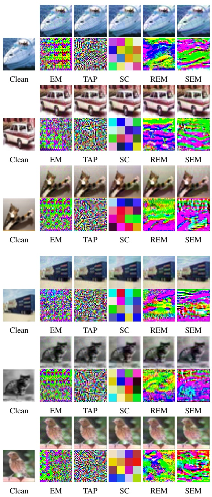

Figura 8: Más resultados de visualización en CIFAR-10. Ejemplos de datos protegidos por error-minimizing noise (EM), targeted adversarial poisoning noise (TAP), shortcut noise (SC), robust error-minimizing noise (REM) y stable error-minimizing noise (SEM). Téngase en cuenta que $\rho _ { u }$ se establece en 8/255, y el radio de perturbación adversarial $\rho _ { a }$ se fija en 4/255.

Figura 9: Más resultados de visualización en CIFAR-100. Ejemplos de datos protegidos por error-minimizing noise (EM), targeted adversarial poisoning noise (TAP), shortcut noise $( \mathrm { S C } ) ,$ robust error-minimizing noise (REM) y stable error-minimizing noise (SEM). Téngase en cuenta que $\rho _ { u }$ se establece en 8/255 y el radio de perturbación adversarial $\rho _ { a }$ se fija en $4 / 2 \dot { 5 } \bar { 5 }$.

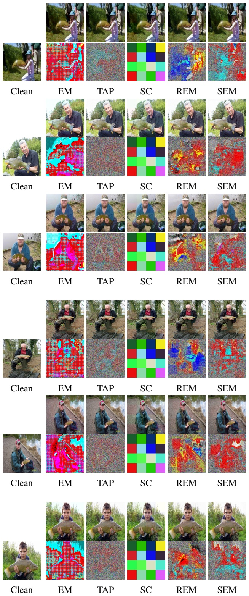

natural_image

Sequence of six portrait photos showing a smiling man in formal attire, with a pixelated green and magenta abstract overlay (no text or symbols)

Clean

EM

TAP

SC

REM

SEM

Clean

EM

TAP

SC

REM

SEM

Clean

EM

TAP

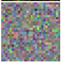

SC

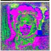

REM

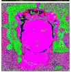

SEM

Figura 10: Más resultados de visualización en ImageNet Subset. Ejemplos de datos protegidos por error-minimizing noise (EM), targeted adversarial poisoning noise (TAP), shortcut noise (SC), robust error-minimizing noise (REM) y stable error-minimizing noise (SEM). Téngase en cuenta que $\rho _ { w }$ se establece en 8/255, y el radio de perturbación adversarial $\rho _ { a }$ se fija en 4/255.

Clean

EM

TAP

REM

SEM

Clean

EM

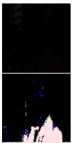

TAP

SC

REM

SEM

Clean

EM

TAP

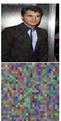

SC

REM

SEM

Figura 11: Más resultados de visualización en el conjunto de datos Facescrub. Ejemplos de datos protegidos por error-minimizing noise (EM), targeted adversarial poisoning noise (TAP), shortcut noise (SC), robust error-minimizing noise (REM) y stable error-minimizing noise (SEM). Téngase en cuenta que $\rho _ { u }$ se establece en 8/255, y el radio de perturbación adversarial $\rho _ { a }$ se fija en 4/255.
