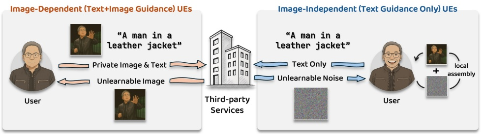
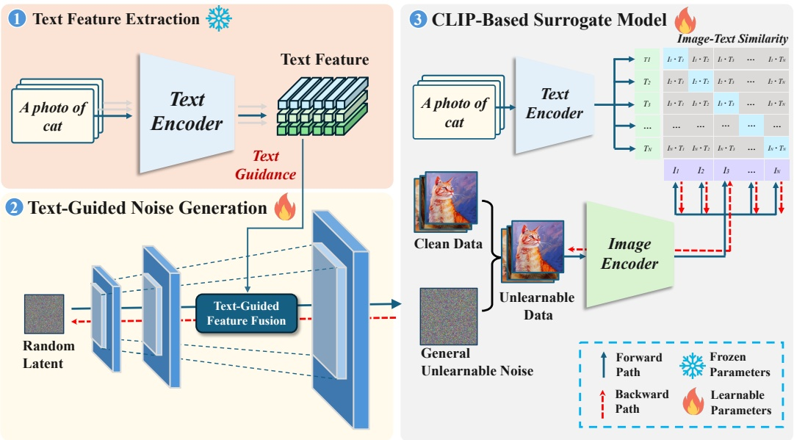
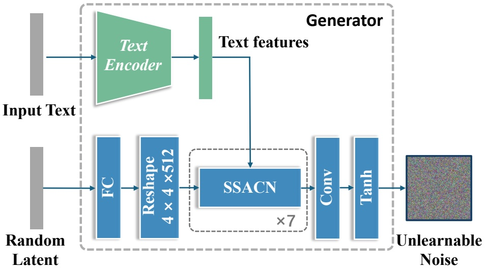
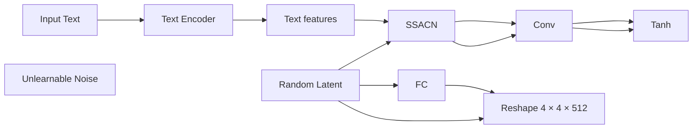
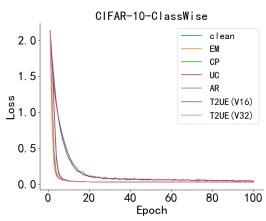
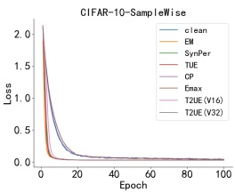
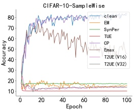
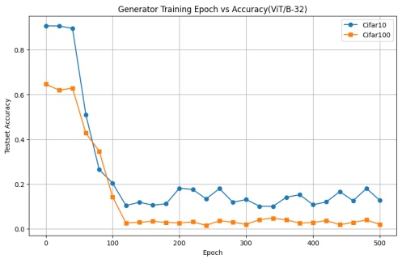

# T2UE: Generating Unlearnable Examples from Text Descriptions

## Xingjun Ma

Fudan University

Shanghai, China

xingjunma@fudan.edu.cn

## Hanxun Huang

The University of Melbourne

Melbourne, Australia

hanxun@unimelb.edu.au

## Tianwei Song

Fudan University

Shanghai, China

22210240266@m.fudan.edu.cn

## Ye Sun

Fudan University

Shanghai, China

yesun23@m.fudan.edu.cn

## Yifeng Gao

Fudan University

Shanghai, China

yifenggao23@m.fudan.edu.cn

## Yu-Gang Jiang<sup>∗</sup>

Fudan University

Shanghai, China

ygj@fudan.edu.cn

## Resumen

Los marcos de pre-training a gran escala como CLIP han revolucionado el aprendizaje multimodal; sin embargo, su dependencia de conjuntos de datos extraídos de la web (web-scraped datasets) —que con frecuencia contienen datos privados de los usuarios— suscita serias preocupaciones sobre su uso indebido. Los Unlearnable Examples (UEs) han surgido como una contramedida prometedora frente al entrenamiento no autorizado de modelos, empleando unlearnable noise meticulosamente diseñado para desbaratar el aprendizaje de representaciones significativas a partir de los datos protegidos. Los enfoques actuales suelen generar UEs optimizando conjuntamente el unlearnable noise tanto para las imágenes como para sus text descriptions (o etiquetas) asociadas. No obstante, este proceso de optimización suele ser computacionalmente prohibitivo para su ejecución en dispositivos locales (on-device), obligando a depender de servicios externos de terceros. Esto crea una paradoja fundamental de privacidad: los usuarios deben exponer inicialmente sus datos a estos mismos servicios para lograr la protección, comprometiendo así la privacidad en el proceso. Dicha contradicción ha obstaculizado gravemente el desarrollo de soluciones de protección de datos prácticas y escalables. Para resolver esta paradoja, presentamos **Text-to-Unlearnable Example (T2UE)**, un marco novedoso que permite a los usuarios generar UEs utilizando únicamente text descriptions. T2UE elude la necesidad de disponer de los datos de imagen originales empleando un modelo text-to-image (T2I) para mapear las text descriptions al espacio de imagen (ruido), en combinación con un marco de error-minimization para producir unlearnable noise efectivo. Experimentos exhaustivos demuestran que los datos protegidos con T2UE degradan sustancialmente el rendimiento en downstream tasks (p. ej., recuperación cross-modal) para modelos state-of-the-art. Notablemente, el efecto protector se generaliza a través de diversas arquitecturas e incluso a entornos de supervised learning. Nuestro trabajo demuestra la viabilidad de la "zero-contact data protection", donde los datos personales pueden salvaguardarse basándose únicamente en sus descripciones textuales, eliminando la necesidad de una exposición directa de los datos.



<details>
<summary>flowchart</summary>

```mermaid
graph LR
  subgraph Image_Dependent_Image_Dependent_Text_Image_Guidance_UEs["Image-Dependent[\"Image-Dependent (Text+Image Guidance) UEs\"]"]
  User["User"] -->|"A man in a leather jacket"| ThirdParty["Third-party Services"]
  UnlearnableImage["Unlearnable Image"] --> ThirdParty
    User <-->|"Private Image & Text"| ThirdParty
  ThirdParty -->|"A man in a leather jacket"| User
  end

  subgraph Image_Independent_Image_Independent_Text_Guidance_Only_UEs["Image-Independent[\"Image-Independent (Text Guidance Only) UEs\"]"]
    User <-->|"Text Only"| ThirdParty
  ThirdParty -->|"Unlearnable Noise"| User
    User <-->|"Local Assembly"| User
  end
```
</details>

Figura 1: Ilustración de nuestro enfoque de protección de datos T2UE. Los métodos dependientes de la imagen existentes requieren acceso tanto a las imágenes sensibles como a su texto correspondiente para la generación de UEs por parte de terceros, introduciendo un riesgo de fuga de datos. En contraste, T2UE, al ser independiente de la imagen (image-independent), comparte únicamente descripciones textuales con el tercero, garantizando un contacto cero (zero contact) con la imagen sensible.

## 1 Introducción

La llegada de modelos multimodales a gran escala, tales como CLIP [30] y ALIGN [18], ha avanzado significativamente el pre-training multimodal al demostrar capacidades formidables para conectar visión y lenguaje. Estos modelos obtienen su potencia a partir del pre-training sobre conjuntos de datos masivos y no depurados extraídos de la web (web-scraped datasets), que a menudo comprenden miles de millones de pares imagen-texto [35, 36, 9, 45]. Una creciente preocupación radica en que varios conjuntos de datos a gran escala han sido recopilados sin el consentimiento de los usuarios y posteriormente utilizados para entrenar modelos comerciales [1, 14, 27]. El potencial de explotación no autorizada de tales datos para el entrenamiento de modelos subraya la urgente necesidad de métodos eficaces de protección de datos.

Los Unlearnable Examples (UEs) han surgido como una prometedora estrategia proactiva para la prevención del uso indebido de datos [16, 8, 31, 53, 32, 43, 26, 41, 48, 10, 28]. Mediante la introducción de perturbaciones meticulosamente elaboradas y a menudo imperceptibles en los datos, los UEs buscan desbaratar el proceso de entrenamiento, inutilizando los datos para un aprendizaje efectivo del modelo. El mecanismo subyacente implica a menudo la creación de características engañosas que el modelo aprende fácilmente en lugar de las verdaderas características de los datos [34]. Si bien se desarrollaron inicialmente para tareas unimodales como la clasificación de imágenes [16, 7] y posteriormente se extendieron a áreas como la segmentación [38], 3D point clouds [43], time series [19] y el aprendizaje neuronal de código (neural code learning) [17], adaptar los UEs al dominio multimodal y proteger frente al pre-training a gran escala presenta desafíos singulares, ya que exige desbaratar el alineamiento aprendido entre características de imagen continuas y una semántica textual diversa, en lugar de limitarse a asociar perturbaciones con etiquetas de clase discretas [16].

El enfoque existente para multi-modal unlearnable examples (MUEs), ejemplificado por la minimización del error en múltiples pasos (multi-step error minimization, MEM) [25], propone optimizar conjuntamente perturbaciones de imagen junto con "triggers" textuales específicos añadidos a las leyendas originales. No obstante, esta estrategia presenta limitaciones significativas que obstaculizan su adopción práctica. En primer lugar, su dependencia de triggers textuales discretos vuelve frágil el efecto inaprendible (unlearnable effect), pudiendo anularse fácilmente si los triggers son alterados, parafraseados o eliminados mediante procesamiento de texto habitual, lo que socava la robustez. La optimización de estos triggers también resulta computacionalmente ineficiente. En segundo lugar, y de manera más crítica, tanto MEM como la mayoría de los métodos de UE existentes requieren acceso a la imagen original del usuario para computar las perturbaciones. Este proceso suele ser computacionalmente intensivo y puede depender de hardware o recursos que no están al alcance directo de los usuarios finales, haciendo necesario recurrir a servicios de terceros. Como se ilustra en la Figura 1, esto crea una paradoja fundamental: para salvaguardar los datos, los usuarios deben exponer en primer lugar sus datos potencialmente sensibles (p. ej., subiéndolos a un servicio externo), creando riesgos inherentes de robo, interceptación, uso indebido o filtración durante el propio proceso de protección.

En este trabajo, presentamos **Text-to-Unlearnable Example (T2UE)**, un paradigma novedoso que desacopla por completo la generación de unlearnable examples (UEs) de los datos de las imágenes de origen. Como se ilustra en la Figura 1, nuestra innovación clave radica en aprender un mapeo desde el espacio semántico textual hacia el espacio de perturbaciones inaprendibles, permitiendo la creación de perturbaciones protectoras efectivas guiadas únicamente por text descriptions. Este enfoque elimina la necesidad de acceder a la imagen original durante la fase de protección, reduciendo el riesgo de exposición de los datos. Las perturbaciones producidas por T2UE están vinculadas semánticamente al texto y están diseñadas específicamente para perturbar el objetivo de alineamiento contrastivo central en el pre-training multimodal, con independencia del contenido de la imagen. Además, T2UE mejora la transferibilidad entre tareas (task transferability), una limitación conocida de los métodos de UE previos. Al aprovechar un modelo CLIP pre-entrenado como surrogate model para simular la optimización externa en el marco de error-minimization [16], demostramos que los UEs generados por T2UE se generalizan más allá del contrastive learning para afectar a tareas supervisadas. En conjunto, estas contribuciones marcan un paso significativo hacia una protección práctica contra el uso indebido de datos en el pre-training multimodal a gran escala.

Tabla 1: Resumen de los métodos existentes de generación de UE. Las propiedades totalmente satisfechas (✓) y no satisfechas (✗) se indican para cada método.

| Method | Image-Independent | Text-Independent | Transferability | Robustness | Imperceptibility | Efficiency |
| --- | --- | --- | --- | --- | --- | --- |
| UEs [16] | ✗ | ✓ | ✗ | ✗ | ✓ | ✗ |
| RUEs [8] | ✗ | ✓ | ✗ | ✓ | ✗ | ✗ |
| TUEs [31] | ✗ | ✓ | ✓ | ✗ | ✓ | ✗ |
| SynPer [50] | ✓ | ✓ | ✗ | ✗ | ✗ | ✓ |
| MEM [25] | ✗ | ✗ | ✗ | ✗ | ✓ | ✗ |
| T2UE (Ours) | ✓ | ✓ | ✓ | ✓ | ✓ | ✓ |

En resumen, nuestras principales contribuciones son:

• Proponemos T2UE, un novedoso marco de generación de UEs que opera exclusivamente sobre entradas textuales, superando la limitación crítica de dependencia de la imagen de los enfoques existentes.
• Presentamos un enfoque simple pero potente para lograr T2UE. Utilizamos un modelo generador inaprendible guiado por texto para aprender un mapeo desde el espacio semántico del texto hacia el espacio de perturbaciones inaprendibles, aprovechando los codificadores de CLIP como surrogate model.
• Realizamos evaluaciones exhaustivas que demuestran que T2UE previene eficazmente el uso indebido de datos en el contrastive pre-training, exhibe una sólida transferibilidad de protección a través de diversas arquitecturas y tareas multimodales, y es robusto frente a diferentes escenarios.

## 2 Trabajos Relacionados

**Unlearnable Examples.** Los Unlearnable Examples (UEs) representan una técnica proactiva de preservación de la privacidad que previene el aprendizaje efectivo por parte de modelos de machine learning mediante la inyección de ruido imperceptible y cuidadosamente diseñado en los datos de entrenamiento [16]. Investigaciones posteriores dilucidaron su mecanismo como la creación de atajos ("shortcuts") de entrada-salida fácilmente aprendibles que extravían el entrenamiento del modelo [34, 33]. La búsqueda de una mayor aplicabilidad práctica ha impulsado esfuerzos para mejorar la robustez de los UEs frente a defensas como el adversarial training [46, 26] y potenciar la transferibilidad entre paradigmas de aprendizaje y tareas [16]. Notablemente, las aplicaciones de los UEs se han expandido más allá de la clasificación hacia tareas de grano más fino como la segmentación de imágenes (p. ej., UnSeg [38]) y están emergiendo para otras modalidades como 3D point clouds [43]. Sin embargo, extender los UEs a modelos multimodales como CLIP resulta desafiante; los métodos existentes a menudo optimizan conjuntamente las perturbaciones de imagen y texto [25], enfrentándose a dificultades en la optimización del texto y a los riesgos de privacidad inherentes al requerir acceso a las imágenes originales. De hecho, como se resume en la Tabla 1, este requisito crítico de acceso a las imágenes es común a la mayoría de las técnicas de UE previas y al método de MUE existente MEM, contrastando drásticamente con el enfoque independiente de la imagen (image-independent) de nuestro T2UE propuesto. A diferencia de los trabajos anteriores, nuestro método genera ruido protector empleando exclusivamente información textual. Este enfoque basado únicamente en texto elude las limitaciones de las estrategias de MUE precedentes, ofreciendo una vía más segura, robusta y práctica para la privacidad de datos multimodales.

**Conditional GAN.** La Conditional GAN (CGAN) fue propuesta inicialmente por Mirza y Osindero [29] con la idea central de posibilitar una generación controlada de imágenes en las GANs, en lugar de una síntesis aleatoria. Específicamente, CGAN incorpora información condicional tanto en las entradas del generador como en las del discriminador. Las imágenes generadas no solo deben parecer realistas, sino también alinearse con las condiciones dadas para ser aceptadas por el discriminador. Este trabajo ha inspirado un cuerpo sustancial de investigaciones posteriores. Por ejemplo, Radford et al. propusieron DCGAN [44], que integró estructuras convolucionales con CGAN para mejorar la calidad visual de las imágenes generadas, mientras que StackGAN [51] logró la generación text-to-image de alta resolución mediante un marco CGAN de dos etapas. En tareas cross-modal, modelos como pix2pix aprovecharon adicionalmente datos emparejados para aprender un mapeo image-to-image, donde la información condicional se proporciona en forma de imágenes de entrada. Posteriormente, la aplicación de la generación condicional se expandió a diversos escenarios como la predicción de video (p. ej., VGAN [40]) y la síntesis de imágenes médicas (p. ej., MedGAN [11]). El estudio reciente SSGAN [22] propuso un módulo consciente del espacio semántico (semantic-spatial aware module) para lograr un alineamiento text-to-image de grano fino, mejorando significativamente la calidad de las imágenes generadas.



Figura 2: Visión general de nuestro marco T2UE propuesto, el cual aprovecha el embedding de la text description como guía (etapa 1) para orientar la generación de unlearnable noise general (etapa 2). El generador de ruido se entrena con un surrogate model CLIP para minimizar la similitud imagen-texto (etapa 3).

## 3 Text-to-Unlearnable Examples

Comenzamos presentando nuestro modelo de amenazas (threat model), seguido de una descripción general del marco global de T2UE. Los componentes detallados de T2UE se describen en las subsecciones 3.1 y 3.2.

**Threat Model.** Consideramos un escenario que involucra dos roles principales: el **protector de datos** (p. ej., un usuario individual o una plataforma) y el **hacker de datos** (p. ej., una entidad que extrae datos para el entrenamiento no autorizado de modelos). El protector busca salvaguardar de manera proactiva sus datos multimodales (pares imagen-texto) antes de una posible exposición, como su carga en plataformas públicas o almacenamiento en la nube. Con este fin, el protector utiliza un mecanismo de generación de perturbaciones (que potencialmente aprovecha un modelo generador pre-entrenado) para transformar sus datos originales en Unlearnable Examples (UEs). Por el contrario, el hacker recopila estos UEs públicamente disponibles, aunque ostensiblemente protegidos, para entrenar sus propios modelos. Asumimos que el hacker puede emplear paradigmas de entrenamiento prevalentes, incluidos CLIP [30] o el supervised learning estándar para tareas posteriores específicas. El objetivo del hacker es lograr un alto rendimiento del modelo a pesar de entrenar sobre el conjunto de datos protegido. Surge una vulnerabilidad crítica con los métodos de generación de UE previos [25] sobre datos multimodales, los cuales exigen que el protector acceda y procese los datos de imagen originales y sensibles para calcular la perturbación protectora. Como se destacó en nuestra Figura 1, este flujo de trabajo hace necesario manipular o transmitir los mismos datos que se pretenden proteger, creando riesgos significativos tales como el robo o la filtración de datos durante este proceso. Por lo tanto, nuestro threat model se centra en un protector que busca un enfoque más seguro: la capacidad de generar UEs efectivos sin requerir acceso a los datos de imagen originales, idealmente aprovechando solo información asociada fácilmente disponible y menos sensible, como las descripciones textuales. El objetivo final permanece inalterado: los UEs generados deben perturbar eficazmente el entrenamiento del modelo del hacker en ambos paradigmas de aprendizaje previstos (CLIP y supervised learning).

**Framework Overview.** El marco T2UE, ilustrado en la Figura 2, está diseñado para entrenar un generador que mapee la semántica del texto a perturbaciones inaprendibles efectivas. El proceso involucra tres etapas clave. En primer lugar, la **Extracción de Características de Texto** (Text Feature Extraction) utiliza un text encoder pre-entrenado y congelado (frozen) (p. ej., del text encoder de CLIP) para obtener un embedding semántico a partir del texto de entrada. En segundo lugar, la **Generación de Ruido Guiada por Texto** (Text-Guided Noise Generation) emplea la red generadora aprendible, que toma el embedding de texto y un vector latente aleatorio para sintetizar la perturbación inaprendible.

En tercer lugar, el **Surrogate Model Basado en CLIP** (CLIP-Based Surrogate Model) guía la optimización del generador. En esta etapa, la perturbación inaprendible se añade a la imagen original para producir una imagen protegida (UE), mientras que las text descriptions correspondientes permanecen sin cambios. Adoptamos la loss contrastiva estándar InfoNCE y utilizamos codificadores pre-entrenados como modelos sustitutos (surrogate models) debido a sus sólidas capacidades de generalización.



<details>
<summary>flowchart</summary>


</details>

Figura 3: Arquitectura del modelo de generación de T2UE.

## 3.1 Arquitectura del Generador de T2UE

Para lograr el mapeo desde la semántica del texto hacia el unlearnable noise, instanciamos el generador $G$ adaptando la arquitectura del generador de la Semantic-Space-Aware GAN (SSA-GAN) [23], la cual fue diseñada originalmente para la síntesis text-to-image de alta fidelidad. La seleccionamos frente a alternativas como los modelos de difusión grandes principalmente por su equilibrio entre la efectividad para condicionar la generación en la semántica del texto y su eficiencia computacional comparativamente favorable (menor número de parámetros, menor huella de memoria y menor tiempo de entrenamiento), lo cual resulta crucial para entrenar el generador dentro de nuestro marco de optimización. El generador ${ \dot { G } } ,$ parametrizado por $\theta _ { G } ,$ , acepta dos entradas: el text embedding embt $\in$ $\mathbb { R } ^ { d _ { t } }$ derivado del text encoder congelado y un vector latente aleatorio $\boldsymbol { z } \in \mathbb { R } ^ { d _ { z } }$ muestreado de una distribución normal estándar, $z \sim \mathcal { N } ( 0 , I )$ . El unlearnable noise es generado por G de la siguiente manera:

$$
\delta^ {u} = G \left(\operatorname{emb} _ {t}, z; \theta_ {G}\right) \quad \text {s.t.} \quad \| \delta^ {u} \| _ {\infty} \leq \epsilon . \tag {1}
$$

La estructura central de G comprende una secuencia de bloques Semantic-Space-Aware Convolutional Network (SSACN) [23]. Estos bloques refinan y realizan un upsampling progresivo de las representaciones de características espaciales, comenzando con un mapa de características inicial derivado del vector latente $z .$ El componente clave que permite un control textual de grano fino dentro de cada bloque SSACN es la Semantic-Space Conditional Batch Normalization (SSCBN). En lugar de utilizar una normalización por lotes estándar (batch normalization), SSCBN predice parámetros afines específicos del texto (escala $\gamma$ y desplazamiento $\bar { \beta } )$ basándose en el text embedding de entrada emb<sub>t</sub>. Estos parámetros modulan dinámicamente la normalización de los mapas de características intermedios h:

$$
\mathrm{SSCBN} (h, \mathrm{emb} _ {t}) = \gamma (\mathrm{emb} _ {t}) \odot \left(\frac {h - \mu (h)}{\sqrt {\sigma^ {2} (h) + \epsilon_ {b n}}}\right) + \beta (\mathrm{emb} _ {t}) \tag {2}
$$

donde $\mu ( h )$ y $\sigma ^ { 2 } ( h )$ son la media y la varianza de h a lo largo del lote y de las dimensiones espaciales, $\epsilon _ { b n }$ es una constante pequeña para la estabilidad numérica, $\gamma ( \cdot ) , \beta ( \cdot )$ son pequeñas redes neuronales $( \mathbf { e . g . }$ , capas lineales o MLPs) que mapean em $\mathbf { b } _ { t }$ a los parámetros de escala y desplazamiento a nivel de canal, y ⊙ representa la multiplicación elemento a elemento. Al condicionar las estadísticas de características sobre el embedding de texto en múltiples niveles jerárquicos dentro del generador, SSCBN permite a G sintetizar patrones de unlearnable noise $\delta ^ { u }$ cuyas características están correlacionadas semánticamente con el texto de entrada $T .$ Esta correlación semántica es vital para establecer la característica protectora destinada a confundir a CLIP. A través de la aplicación secuencial de estos bloques SSACN, incorporando conexiones residuales y operaciones de upsampling, el generador sintetiza la perturbación de ruido final $\delta \in \mathbb { R } ^ { H \times W \times C }$ , típicamente igualando la resolución de la imagen original.

Tabla 2: Resultados principales del impacto adversarial de T2UE sobre el modelo CLIP (con ResNet50 como backbone visual) en tareas de recuperación tanto text-to-image (T2I) como image-to-text (I2T). La evaluación cubre tres conjuntos de datos de benchmark: el conjunto de validación de Flickr8k, Flickr30k y el conjunto de validación de Tiny-MSCOCO. T2UE demuestra una reducción significativa en el rendimiento de prueba del modelo CLIP en todos los conjuntos de datos. Los mejores resultados de protección se resaltan en negrita.

<table><tr><td rowspan="3">Method</td><td rowspan="3">Zero Contact</td><td colspan="4">Flick8k</td><td colspan="4">Flick30k</td><td colspan="4">Tiny-MSCOCO</td></tr><tr><td colspan="2">Image → Text</td><td colspan="2">Text → Image</td><td colspan="2">Image → Text</td><td colspan="2">Text → Image</td><td colspan="2">Image → Text</td><td colspan="2">Text → Image</td></tr><tr><td>Hit@10</td><td>Medr</td><td>Hit@10</td><td>Medr</td><td>Hit@10</td><td>Medr</td><td>Hit@10</td><td>Medr</td><td>Hit@10</td><td>Medr</td><td>Hit@10</td><td>Medr</td></tr><tr><td>Random Guess</td><td>-</td><td>1.2</td><td>727</td><td>0.9</td><td>490</td><td>1.0</td><td>711</td><td>1.0</td><td>498</td><td>0.2</td><td>3419</td><td>0.2</td><td>2491</td></tr><tr><td>No Protection</td><td>-</td><td>17.7</td><td>91</td><td>18.6</td><td>78</td><td>49.3</td><td>11</td><td>44.1</td><td>15</td><td>33.3</td><td>26</td><td>15.5</td><td>247</td></tr><tr><td>EM</td><td>✗</td><td>7.9</td><td>223</td><td>8.9</td><td>154</td><td>5.5</td><td>315</td><td>6.1</td><td>190</td><td>3.7</td><td>402</td><td>3.9</td><td>344</td></tr><tr><td>TAP</td><td>✗</td><td>14.3</td><td>120</td><td>12.8</td><td>92</td><td>39.7</td><td>19</td><td>37.2</td><td>23</td><td>7.4</td><td>194</td><td>6.0</td><td>289</td></tr><tr><td>MEM-3</td><td>✗</td><td>15.9</td><td>92</td><td>17.5</td><td>78</td><td>47.6</td><td>12</td><td>43.5</td><td>16</td><td>28.5</td><td>31</td><td>15.5</td><td>236</td></tr><tr><td>MEM-5</td><td>✗</td><td>17.6</td><td>92</td><td>17.7</td><td>77</td><td>47.1</td><td>13</td><td>43.3</td><td>16</td><td>29.2</td><td>30</td><td>15.4</td><td>246</td></tr><tr><td>T2UE (Ours)</td><td>✓</td><td>11.6(6.1↓)</td><td>155(68↓)</td><td>8.02(10.56↓)</td><td>194(116↓)</td><td>18.2(31.1↓)</td><td>78(67↓)</td><td>15.62(28.48↓)</td><td>106(91↓)</td><td>7.4(25.9↓)</td><td>220(194↓)</td><td>5.14(10.38↓)</td><td>331(84↓)</td></tr></table>

Tabla 3: Comparación de rendimiento de métodos state-of-the-art en supervised learning. Los experimentos se llevan a cabo en CIFAR-10 y CIFAR-100 utilizando ResNet-18 como modelo objetivo. T2UE (ViT/B-16) denota que el generador se alinea con el modelo ViT-B/16 de CLIP, mientras que T2UE (ViT/B-32) indica alineamiento con el ViT-B/32 de CLIP. T2UE logra un rendimiento competitivo con el mejor método de referencia manteniendo al mismo tiempo zero-contact con las imágenes originales.

<table><tr><td rowspan="2">Method</td><td rowspan="2">Zero Contact</td><td colspan="2">CIFAR-10</td><td colspan="2">CIFAR-100</td></tr><tr><td>Class-wise</td><td>Sample-wise</td><td>Class-wise</td><td>Sample-wise</td></tr><tr><td>No Protection</td><td>✓</td><td>90.34</td><td>90.34</td><td>65.98</td><td>65.98</td></tr><tr><td>EM</td><td>✗</td><td>11.57</td><td>15.37</td><td>1.07</td><td>3.21</td></tr><tr><td>Emax</td><td>✗</td><td>-</td><td>45.39</td><td>-</td><td>47.69</td></tr><tr><td>TUE</td><td>✗</td><td>-</td><td>10.06</td><td>-</td><td>1.05</td></tr><tr><td>UC</td><td>✗</td><td>79.41</td><td>-</td><td>41.38</td><td>-</td></tr><tr><td>AR</td><td>✓</td><td>10.41</td><td>-</td><td>5.11</td><td>-</td></tr><tr><td>SynPer</td><td>✓</td><td>-</td><td>17.00</td><td>-</td><td>1.89</td></tr><tr><td>TAP</td><td>✗</td><td>-</td><td>10.78</td><td>-</td><td>60.60</td></tr><tr><td>CP</td><td>✗</td><td>10.12</td><td>83.15</td><td>1.31</td><td>49.91</td></tr><tr><td>T2UE(ViT/B-16)</td><td>✓</td><td>10.02(80.32↓)</td><td>13.76(76.58↓)</td><td>1.08(64.81↓)</td><td>1.82(64.16↓)</td></tr><tr><td>T2UE(ViT/B-32)</td><td>✓</td><td>12.17(78.17↓)</td><td>13.89(76.45↓)</td><td>1.42(64.56↓)</td><td>1.85(64.13↓)</td></tr></table>

## 3.2 Entrenamiento del Generador de T2UE

El objetivo de T2UE es entrenar el generador guiado por texto G, de modo que produzca perturbaciones de imagen $\delta ^ { u }$ que hagan ineficaz el entrenamiento del atacante de datos. Logramos esto optimizando $\bar { G }$ utilizando un modelo CLIP pre-entrenado y congelado $( f _ { I } , f _ { T } )$ como surrogate model para simular la posible explotación de datos, como se ilustra en la Figura 2. Formalmente, dada una distribución de datos de entrenamiento D de pares imagen-texto $( I , T )$ , el objetivo del contrastive learning multimodal estándar es entrenar codificadores de imagen $( f _ { I } )$ y de texto $( f _ { T } ^ { \dot { } } )$ para alinear las representaciones de los pares correspondientes mientras se distinguen los pares no correspondientes dentro de un espacio de embedding compartido. Este alineamiento se logra comúnmente minimizando una loss contrastiva sobre lotes de N pares, como la symmetric InfoNCE loss:

$$
\min _ {\theta_ {I}, \theta_ {T}} \mathbb {E} _ {\left\{\left(I _ {i}, T _ {i}\right) \right\} _ {i = 1} ^ {N} \sim \mathcal {D}} \left[ \mathcal {L} _ {\text {InfoNCE}} \left(\left\{f _ {I} \left(I _ {i}; \theta_ {I}\right) \right\} _ {i = 1} ^ {N}, \left\{f _ {T} \left(T _ {i}; \theta_ {T}\right) \right\} _ {i = 1} ^ {N}\right) \right]. \tag {3}
$$

Nuestro T2UE busca establecer características protectoras sólidas entre el texto de entrada $T$ y el $\delta ^ { u }$ generado, desbaratando así la capacidad del modelo para aprender la verdadera relación entre las imágenes originales I y los textos ${ \dot { T } } .$ Por lo tanto, el objetivo de optimización consiste en encontrar los parámetros óptimos del generador $\theta _ { G } ^ { * }$ minimizando la loss de alineamiento esperada calculada por el surrogate model sobre los datos protegidos:

$$
\theta_ {G} ^ {*} = \arg \min _ {\theta_ {G}} \mathbb {E} _ {(I, T) \sim \mathcal {D}} \left[ \mathcal {L} _ {\text {InfoNCE}} \left(\left\{f _ {I} \left(I + \delta^ {u}\right) \right\}, \left\{f _ {T} (T) \right\}\right) \right]. \tag {4}
$$

Minimizar este objetivo (Ec. 4) obliga al generador G a sintetizar perturbaciones $\delta ^ { u }$ que, al añadirse a cualquier imagen $I ,$ provocan que la característica resultante de la imagen $f _ { I } ( I + \delta ^ { \prime } )$ se alinee fuertemente con la característica $f _ { T } ( T )$ correspondiente al texto condicionante T. En consecuencia, los modelos entrenados posteriormente en conjuntos de datos $\{ ( I + \delta ^ { \prime } , T ) \}$ aprenden esta característica fácilmente predecible en lugar de las relaciones significativas imagen-texto, logrando de este modo el efecto inaprendible.

Tabla 4: Evaluación de transferibilidad de UE a través de diferentes arquitecturas de modelos. El ruido para todos los métodos de referencia se genera utilizando el modelo ResNet-50 y se evalúa en varias arquitecturas de red (ResNet-18/50[13], VGG-11/13[37], GoogLeNet[39], DenseNet-121[15]) en los conjuntos de datos CIFAR-10 y CIFAR-100. T2UE demuestra una transferibilidad superior a través de diferentes backbones de modelos.

<table><tr><td rowspan="2">Method</td><td colspan="2">CIFAR-10</td><td colspan="2">CIFAR-100</td><td colspan="2">CIFAR-10</td><td colspan="2">CIFAR-100</td></tr><tr><td>Class-wise</td><td>Sample-wise</td><td>Class-wise</td><td>Sample-wise</td><td>Class-wise</td><td>Sample-wise</td><td>Class-wise</td><td>Sample-wise</td></tr><tr><td>Target Model</td><td colspan="4">Resnet18</td><td colspan="4">Resnet50</td></tr><tr><td>No Protection</td><td>90.34</td><td>90.34</td><td>65.98</td><td>65.98</td><td>85.56</td><td>85.56</td><td>47.44</td><td>47.44</td></tr><tr><td>EM</td><td>11.57</td><td>15.37</td><td>1.07</td><td>3.21</td><td>12.81</td><td>11.40</td><td>0.88</td><td>3.10</td></tr><tr><td>Emax</td><td>-</td><td>45.39</td><td>-</td><td>47.69</td><td>-</td><td>38.67</td><td>-</td><td>41.76</td></tr><tr><td>TUE</td><td>-</td><td>10.06</td><td>-</td><td>1.05</td><td>-</td><td>10.18</td><td>-</td><td>0.85</td></tr><tr><td>UC</td><td>79.41</td><td>-</td><td>41.38</td><td>-</td><td>79.18</td><td>-</td><td>37.28</td><td></td></tr><tr><td>AR</td><td>10.41</td><td>-</td><td>5.11</td><td>-</td><td>10.92</td><td>-</td><td>2.18</td><td></td></tr><tr><td>SynPer</td><td>-</td><td>17.00</td><td>-</td><td>1.89</td><td>-</td><td>13.06</td><td>-</td><td>1.79</td></tr><tr><td>TAP</td><td>-</td><td>10.78</td><td>-</td><td>60.6</td><td>-</td><td>22.80</td><td>-</td><td>43.55</td></tr><tr><td>CP</td><td>10.12</td><td>83.15</td><td>1.31</td><td>49.91</td><td>10.27</td><td>84.42</td><td>1.05</td><td>42.61</td></tr><tr><td>T2UE(ViT/B-16)</td><td>10.02(80.32↓)</td><td>13.76(76.58↓)</td><td>1.08(64.81↓)</td><td>1.82(64.16↓)</td><td>10.04(75.52↓)</td><td>10.97(75.59↓)</td><td>1.07(46.37↓)</td><td>1.36(46.08↓)</td></tr><tr><td>T2UE(ViT/B-32)</td><td>12.17(78.17↓)</td><td>13.89(76.45↓)</td><td>1.42(64.56↓)</td><td>1.85(64.13↓)</td><td>10.41(75.15↓)</td><td>10.41(75.15↓)</td><td>1.18(46.26↓)</td><td>1.21(46.23↓)</td></tr><tr><td>Target Model</td><td colspan="4">VGG11</td><td colspan="4">VGG13</td></tr><tr><td>No Protection</td><td>84.65</td><td>84.65</td><td>57.78</td><td>57.78</td><td>86.30</td><td>86.30</td><td>61.50</td><td>61.50</td></tr><tr><td>EM</td><td>15.31</td><td>12.90</td><td>1.07</td><td>3.63</td><td>13.40</td><td>12.03</td><td>1.00</td><td>3.60</td></tr><tr><td>Emax</td><td>-</td><td>80.36</td><td>-</td><td>57.39</td><td>-</td><td>80.58</td><td>-</td><td>58.17</td></tr><tr><td>TUE</td><td>-</td><td>13.53</td><td>-</td><td>1.76</td><td>-</td><td>12.06</td><td>-</td><td>1.56</td></tr><tr><td>UC</td><td>82.31</td><td>-</td><td>56.94</td><td>-</td><td>85.43</td><td>-</td><td>56.83</td><td>-</td></tr><tr><td>AR</td><td>29.55</td><td>-</td><td>50.18</td><td>-</td><td>10.32</td><td>-</td><td>28.46</td><td>-</td></tr><tr><td>SynPer</td><td>-</td><td>18.94</td><td>-</td><td>4.19</td><td>-</td><td>15.68</td><td>-</td><td>3.43</td></tr><tr><td>TAP</td><td>-</td><td>50.46</td><td>-</td><td>57.39</td><td>-</td><td>40.55</td><td>-</td><td>43.15</td></tr><tr><td>CP</td><td>11.13</td><td>83.31</td><td>2.45</td><td>57.50</td><td>11.11</td><td>86.29</td><td>1.84</td><td>58.69</td></tr><tr><td>T2UE(ViT/B-16)</td><td>10.96(73.69↓)</td><td>28.43(56.22↓)</td><td>3.58(54.20↓)</td><td>9.55(48.23↓)</td><td>11.93(74.37↓)</td><td>19.73(66.57↓)</td><td>1.21(46.37↓)</td><td>6.32(55.18↓)</td></tr><tr><td>T2UE(ViT/B-32)</td><td>15.65(69.06↓)</td><td>24.58(59.98↓)</td><td>2.89(54.89↓)</td><td>15.08(42.70↓)</td><td>10.44(75.86↓)</td><td>18.42(67.88↓)</td><td>1.24(60.26↓)</td><td>16.13(45.37↓)</td></tr><tr><td>Target Model</td><td colspan="4">GoogLeNet</td><td colspan="4">DenseNet121</td></tr><tr><td>No Protection</td><td>89.89</td><td>89.89</td><td>69.74</td><td>69.74</td><td>87.81</td><td>87.81</td><td>70.29</td><td>70.29</td></tr><tr><td>EM</td><td>11.93</td><td>17.75</td><td>1.00</td><td>3.40</td><td>12.86</td><td>13.86</td><td>1.14</td><td>3.42</td></tr><tr><td>Emax</td><td>-</td><td>25.61</td><td>-</td><td>67.88</td><td>-</td><td>41.85</td><td>-</td><td>64.33</td></tr><tr><td>TUE</td><td>-</td><td>11.94</td><td>-</td><td>1.00</td><td>-</td><td>12.07</td><td>-</td><td>1.05</td></tr><tr><td>UC</td><td>80.29</td><td>-</td><td>40.38</td><td>-</td><td>85.99</td><td>-</td><td>66.52</td><td>-</td></tr><tr><td>AR</td><td>11.76</td><td>-</td><td>4.91</td><td>-</td><td>12.27</td><td>-</td><td>4.68</td><td>-</td></tr><tr><td>SynPer</td><td>-</td><td>17.81</td><td>-</td><td>10.00</td><td>-</td><td>13.42</td><td>-</td><td>2.12</td></tr><tr><td>TAP</td><td>-</td><td>23.01</td><td>-</td><td>65.86</td><td>-</td><td>19.97</td><td>-</td><td>66.66</td></tr><tr><td>CP</td><td>11.67</td><td>55.85</td><td>1.24</td><td>67.99</td><td>10.51</td><td>86.69</td><td>1.69</td><td>67.87</td></tr><tr><td>T2UE(ViT/B-16)</td><td>9.44(80.45↓)</td><td>11.44(78.45↓)</td><td>1.06(68.68↓)</td><td>1.94(67.8↓)</td><td>10.02(77.79↓)</td><td>13.21(74.6↓)</td><td>1.11(69.18↓)</td><td>3.06(67.23↓)</td></tr><tr><td>T2UE(ViT/B-32)</td><td>10.35(79.54↓)</td><td>11.29(78.6↓)</td><td>1.37(68.37↓)</td><td>2.82(66.92↓)</td><td>12.12(75.69↓)</td><td>17.08(70.73↓)</td><td>1.57(68.72↓)</td><td>3.02(67.27↓)</td></tr></table>

Tabla 5: Evaluación de robustez ante envenenamiento mixto (Mixed Poisoning) en CIFAR-10/100 con ResNet-50 (0% limpio a 100% envenenado).

<table><tr><td>Dataset</td><td colspan="2">CIFAR-10</td><td colspan="2">CIFAR-100</td><td colspan="2">CIFAR-10</td><td colspan="2">CIFAR-100</td></tr><tr><td>T2UE Version</td><td colspan="2">T2UE(ViT/B-16)</td><td colspan="2">T2UE(ViT/B-32)</td><td colspan="2">T2UE(ViT/B-16)</td><td colspan="2">T2UE(ViT/B-32)</td></tr><tr><td>Method</td><td>Class-wise</td><td>Sample-wise</td><td>Class-wise</td><td>Sample-wise</td><td>Class-wise</td><td>Sample-wise</td><td>Class-wise</td><td>Sample-wise</td></tr><tr><td>No Protection</td><td>90.34</td><td>90.34</td><td>65.98</td><td>65.98</td><td>90.34</td><td>90.34</td><td>65.98</td><td>65.98</td></tr><tr><td>20%</td><td>79.46</td><td>82.65</td><td>52.68</td><td>49.90</td><td>81.22</td><td>82.37</td><td>47.3</td><td>46.87</td></tr><tr><td>40%</td><td>78.01</td><td>81.00</td><td>45.33</td><td>46.15</td><td>79.11</td><td>78.64</td><td>43.11</td><td>41.27</td></tr><tr><td>60%</td><td>74.46</td><td>77.88</td><td>34.76</td><td>41.16</td><td>74.24</td><td>74.25</td><td>35.56</td><td>33.63</td></tr><tr><td>80%</td><td>68.44</td><td>70.37</td><td>26.27</td><td>28.82</td><td>64.57</td><td>64.65</td><td>24.22</td><td>26.72</td></tr><tr><td>100%</td><td>10.02</td><td>13.76</td><td>1.08</td><td>1.82</td><td>12.17</td><td>13.89</td><td>1.42</td><td>1.41</td></tr></table>

**Zero-Contact Data Protection.** Una vez entrenado, el generador produce unlearnable noise $\delta ^ { u }$ basándose únicamente en un prompt de texto $T$ y un vector aleatorio $z ,$ sin requerir acceso a la imagen objetivo. Este ruido puede aplicarse posteriormente a cualquier imagen para tareas posteriores. Para clasificación, se pueden generar patrones de ruido específicos según sea necesario —por ejemplo, patrones class-wise utilizando plantillas fijas y z, o patrones sample-wise utilizando plantillas y z variados—, demostrando la flexibilidad del enfoque guiado por texto.

## 4 Experimentos

**Datasets and Target Models.** Nuestro generador T2UE fue entrenado en el conjunto de datos MSCOCO [24]. Evaluamos su eficacia para perturbar modelos de tipo CLIP (utilizando backbones de imagen ResNet50 [13] o ViT-B/32 [6]) desde cero en versiones protegidas de Flickr8k [49], Flickr30k [49] y Tiny-MSCOCO [2]. La transferibilidad a supervised learning se evaluó entrenando backbones de clasificación estándar (ResNet18/50/101 [13], ViT-B/16/32 [6]) sobre CIFAR-10/-100 [21] y STL-10 [3] protegidos.

Tabla 6: Test accuracy (%) de ResNet50 entrenado utilizando diferentes métodos de defensa sobre CIFAR-10 y CIFAR-100 inaprendibles generados por T2UE.

<table><tr><td>Dataset</td><td colspan="4">CIFAR-10</td><td colspan="4">CIFAR-100</td></tr><tr><td>Defense</td><td>None</td><td>CutOut</td><td>MixUp</td><td>AutoAug</td><td>None</td><td>CutOut</td><td>MixUp</td><td>AutoAug</td></tr><tr><td>No Protection</td><td>83.91</td><td>83.14</td><td>86.17</td><td>83.53</td><td>65.98</td><td>56.59</td><td>49.88</td><td>53.78</td></tr><tr><td>T2UE(ViT/B-16)-C</td><td>10.02</td><td>9.99</td><td>11.44</td><td>10.02</td><td>1.08</td><td>1.62</td><td>1.51</td><td>1.03</td></tr><tr><td>T2UE(ViT/B-16)-S</td><td>13.76</td><td>10.97</td><td>10.33</td><td>14.35</td><td>1.82</td><td>1.64</td><td>2.06</td><td>1.81</td></tr><tr><td>T2UE(ViT/B-32)-C</td><td>12.17</td><td>11.21</td><td>9.98</td><td>11.97</td><td>1.42</td><td>1.15</td><td>0.98</td><td>1.57</td></tr><tr><td>T2UE(ViT/B-32)-S</td><td>13.89</td><td>12.30</td><td>10.56</td><td>11.03</td><td>1.41</td><td>1.77</td><td>1.46</td><td>1.64</td></tr></table>



<details>
<summary>line</summary>

| Epoch | clean | EM | GP | UC | AR | T2UE (V16) | T2UE (V32) |
| --- | --- | --- | --- | --- | --- | --- | --- | --- |
| 0 | ~2.1 | ~2.1 | ~2.1 | ~2.1 | ~2.1 | ~2.1 | ~2.1 |
| 10 | ~0.5 | ~0.1 | ~0.1 | ~0.1 | ~0.1 | ~0.1 | ~0.1 |
| 20 | ~0.2 | ~0.05 | ~0.05 | ~0.05 | ~0.05 | ~0.05 | ~0.05 |
| 40 | ~0.1 | ~0.05 | ~0.05 | ~0.05 | ~0.05 | ~0.05 | ~0.05 |
| 60 | ~0.1 | ~0.05 | ~0.05 | ~0.05 | ~0.05 | ~0.05 | ~0.05 |
| 80 | ~0.1 | ~0.05 | ~0.05 | ~0.05 | ~0.05 | ~0.05 | ~0.05 |
| 100 | ~0.1 | ~0.05 | ~0.05 | ~0.05 | ~0.05 | ~0.05 | ~0.05 |
</details>

(a) Class-wise $\Delta _ { c }$ Loss


<details>
<summary>line</summary>

| Epoch | clean | EM | CP | UC | AR | T2UE (V16) | T2UE (V32) |
| --- | --- | --- | --- | --- | --- | --- | --- | --- |
| 0 | ~12 | ~12 | ~12 | ~12 | ~12 | ~12 | ~12 |
| 10 | ~70 | ~13 | ~12 | ~12 | ~12 | ~12 | ~12 |
| 20 | ~75 | ~13 | ~12 | ~12 | ~12 | ~12 | ~12 |
| 30 | ~80 | ~13 | ~12 | ~12 | ~12 | ~12 | ~12 |
| 40 | ~80 | ~13 | ~12 | ~12 | ~12 | ~12 | ~12 |
| 50 | ~80 | ~13 | ~12 | ~12 | ~12 | ~12 | ~12 |
| 60 | ~80 | ~13 | ~12 | ~12 | ~12 | ~12 | ~12 |
| 70 | ~80 | ~13 | ~12 | ~12 | ~12 | ~12 | ~12 |
| 80 | ~80 | ~13 | ~12 | ~12 | ~12 | ~12 | ~12 |
| 90 | ~80 | ~13 | ~12 | ~12 | ~12 | ~12 | ~12 |
| 100 | ~80 | ~13 | ~12 | ~12 | ~12 | ~12 | ~12 |
</details>

(b) Class-wise $\triangle _ { c }$ Accuracy



<details>
<summary>line</summary>

| Epoch | clean | EM | SynPer | TUE | CP | Emax | T2UE (V16) | T2UE (V32) |
| --- | --- | --- | --- | --- | --- | --- | --- | --- | --- |
| 0 | ~2.1 | ~2.1 | ~2.1 | ~2.1 | ~2.1 | ~2.1 | ~2.1 | ~2.1 |
| 10 | ~0.3 | ~0.1 | ~0.1 | ~0.1 | ~0.1 | ~0.1 | ~0.1 | ~0.1 |
| 20 | ~0.1 | ~0.05 | ~0.05 | ~0.05 | ~0.05 | ~0.05 | ~0.05 | ~0.05 |
| 40 | ~0.05 | ~0.02 | ~0.02 | ~0.02 | ~0.02 | ~0.02 | ~0.02 | ~0.02 |
| 60 | ~0.03 | ~0.01 | ~0.01 | ~0.01 | ~0.01 | ~0.01 | ~0.01 | ~0.01 |
| 80 | ~0.02 | ~0.01 | ~0.01 | ~0.01 | ~0.01 | ~0.01 | ~0.01 | ~0.01 |
| 100 | ~0.01 | ~0.01 | ~0.01 | ~0.01 | ~0.01 | ~0.01 | ~0.01 | ~0.01 |
</details>

(c) Sample-wise $\Delta _ { s }$ Loss



<details>
<summary>line</summary>

| Epoch | clean | EM | SynPer | TUE | DP | tEmix | T2UE (V16) | T2UE (V32) |
| --- | --- | --- | --- | --- | --- | --- | --- | --- | --- |
| 0 | ~25 | ~25 | ~25 | ~25 | ~25 | ~25 | ~25 | ~25 |
| 100 | ~85 | ~15 | ~15 | ~10 | ~15 | ~15 | ~15 | ~15 |
</details>

(d) Sample-wise $\Delta _ { s }$ Accuracy

Figura 4: (a-b): Para ruido class-wise, curvas de aprendizaje de ResNet50 en el conjunto de datos CIFAR-10 con diferentes tipos de datos de entrenamiento: 1) Curva de Loss, 2) Curva de Accuracy de prueba. (c-d): Para ruido sample-wise, curvas de aprendizaje de ResNet50 en el conjunto de datos CIFAR-10.

MSCOCO [2]. La transferibilidad a supervised learning se evaluó entrenando backbones de clasificación estándar (ResNet18/50/101 [13], ViT-B/16/32 [6]) sobre CIFAR-10/-100 [21] y STL-10 [3] protegidos.

**Implementation Details.** El generador T2UE aprovecha un modelo de alineamiento CLIP ViT-B/32 [30] y se entrenó durante 500 epochs (variante ViT-B/16: 300 epochs). Para la etapa de entrenamiento del generador, siguiendo la configuración de entrenamiento del modelo generador en [22], elegimos un batch size de 128 y empleamos un optimizador Adam con una tasa de aprendizaje inicial de 0.0001 y regularización por decoupled weight decay, mientras que la tasa de aprendizaje decae mediante un planificador coseno (cosine scheduler). Entrenamos estos modelos desde cero en 1 GPU A100 durante 32 epochs. El unlearnable noise generado $\delta ^ { u }$ se restringió con $\| \delta \| _ \infty \leq 8 / 255$. Los modelos supervisados objetivo se entrenaron durante 100 epochs. Siguiendo los parámetros de [16], utilizamos SGD con una tasa de aprendizaje de 0.1, momentum (0.9) y weight decay ($5.0 \times 10^{-4}$), junto con un planificador de recocido coseno (cosine annealing scheduling) de la tasa de aprendizaje. Para una comparación justa, las arquitecturas de los modelos objetivo y las configuraciones de entrenamiento se mantuvieron consistentes en todos los métodos comparados dentro de cada experimento.

**Baselines.** En el entorno de CLIP, comparamos T2UE con tres líneas base aplicables: **EM** [16], **TAP** [7] y **MEM** [25]. Como nuestra configuración simula la aplicación del lado del usuario, adaptamos MEM utilizando únicamente su ruido de imagen (MEM-3/MEM-5 denotan variantes que omiten los triggers de 3/5 tokens). En el entorno supervisado, comparamos contra métodos consolidados de UE incluyendo **EM** [53], **Emax** [20], **AR** [33], **TUE** [31], **UC** [53], **SynPer** [50], **TAP** [7], **CP** [12], utilizando ResNet18 como surrogate model cuando fue necesario.

**Evaluation Metrics.** Para MCL, medimos la degradación del rendimiento de recuperación zero-shot utilizando Hit@10 (Recall@10) y Rango Mediano (MedR) para las tareas I2T y T2I [46, 47]; un menor Hit@10 y un mayor MedR indican una mejor protección. Para supervised learning, reportamos la Top-1 accuracy en conjuntos de prueba limpios; una menor accuracy indica una mejor protección.

El Apéndice A.1 presenta un estudio de ablación sobre el generador, mientras que el Apéndice A.2 ofrece un análisis de costo computacional, demostrando que T2UE logra significativas ventajas de eficiencia.

## 4.1 Resultados Principales

**Effectiveness on CLIP.** Evaluamos la efectividad de T2UE contra CLIP utilizando métricas de recuperación zero-shot (Hit@10/Medr) en Flickr8k, Flickr30k y Tiny-MSCOCO tras pre-entrenar un modelo CLIP basado en ResNet50 (Tabla 2). De forma crítica, el método MEM [25], cuando se aplica utilizando únicamente su ruido de imagen (MEM-3/MEM-5, simulando un escenario de usuario realista sin modificación de triggers de texto), muestra un efecto protector insignificante en comparación con la línea base de "sin protección" (no protection), lo que resalta su dependencia de triggers textuales frágiles. TAP [7] proporciona cierta protección pero resulta inconsistente, degradándose notablemente en el conjunto de datos más grande Flickr30k. Si bien el método EM dependiente de la imagen [16] degrada severamente el rendimiento, requiere acceso a la imagen, violando nuestra restricción fundamental de privacidad. En contraste, T2UE ofrece consistentemente la protección más fuerte entre los métodos agnósticos a la imagen en todos los conjuntos de datos. Por ejemplo, en Flickr30k, T2UE reduce drásticamente el Hit@10 de I2T a 18.2, superando con creces a TAP (39.7) y MEM-5 (47.1). Esto demuestra que T2UE logra una disrupción sustancial del entrenamiento de CLIP por completo sin acceso a imágenes, cumpliendo eficazmente con el requisito de **"zero-contact"** a la vez que proporciona una protección significativamente superior a la de las líneas base comparables.

**Effectiveness of Transferring to Supervised Learning.** Evaluamos la transferibilidad del ruido protector de T2UE hacia tareas estándar de clasificación supervisada. Específicamente, aplicamos directamente el generador T2UE a escenarios de supervised learning en CIFAR-10 y CIFAR-100. La Tabla 3 presenta la Top-1 accuracy lograda por un modelo ResNet-18 entrenado durante 100 epochs sobre datos perturbados por T2UE y diversas líneas base. T2UE(ViT/B-16) y T2UE(ViT/B-32) se refieren a variantes generadas utilizando los modelos CLIP ViT-B/16 y ViT-B/32, respectivamente. Los resultados demuestran con claridad la efectividad de T2UE en el entorno supervisado. En CIFAR-10, T2UE(ViT/B-16) reduce la accuracy del modelo al 10.02%, igualando el rendimiento de los mejores métodos class-wise como CP (10.12%) y métodos sample-wise líderes como TUE (10.06%). En CIFAR-100, T2UE(ViT/B-16) logra una accuracy del 1.08%, alineándose estrechamente con la línea base class-wise más fuerte EM (1.07%) y la línea base sample-wise TUE (1.05%). Notablemente, T2UE alcanza este rendimiento altamente competitivo sin ningún acceso a las imágenes de CIFAR durante la generación de ruido, dependiendo únicamente de la guía del texto. Más importante aún, este resultado subraya la fuerte transferibilidad del unlearnable noise de T2UE, que permanece efectivo incluso fuera de su marco de entrenamiento objetivo. La transferibilidad a diferentes tareas constituía un cuello de botella crítico en trabajos anteriores [16].

**Effectiveness of Transferring to Different Architectures.** La Tabla 4 presenta los resultados de experimentos de ataque por transferencia utilizando diferentes modelos. Como se muestra, T2UE mantiene de manera consistente el efecto de inaprendibilidad a través de varios modelos. Notablemente, el ruido a nivel de muestra (sample-level noise) exhibe una mayor dependencia del modelo que el ruido a nivel de clase (class-level noise). Para el ruido a nivel de muestra, la accuracy de clasificación sobre datos inaprendibles permanece relativamente estable con independencia del modelo de entrenamiento. En contraste, el ruido a nivel de clase tiende a mostrar una mayor accuracy del modelo cuando se transfiere a diferentes arquitecturas. Estos resultados demuestran que T2UE puede lograr simultáneamente transferibilidad del unlearnable noise entre tareas y entre modelos, todo ello manteniendo un "zero-contact" completo con los datos originales.

## 4.2 Evaluaciones de Robustez

En esta subsección, realizamos una evaluación estándar de UE examinando: (1) el impacto de variar las proporciones de datos inaprendibles en el conjunto de entrenamiento, y (2) su robustez frente al data augmentation.

**Different proportion of unlearnable data in the training set.** La Tabla 5 presenta los efectos de envenenamiento del ruido de T2UE sobre ResNet-18. Los experimentos se realizaron en CIFAR-10/100 con tasas de envenenamiento que oscilaron entre el 20% y el 100%. Los resultados demuestran que tasas de envenenamiento más altas conducen a efectos más pronunciados. Por ejemplo, la accuracy en CIFAR-10 cae del 79.46% con un 20% de envenenamiento al 10.02% con un 100% de envenenamiento, indicando que incluso un envenenamiento parcial puede degradar efectivamente el rendimiento del modelo.

**Robustness against data augmentation.** Siguiendo trabajos previos [16, 53], realizamos una evaluación de robustez utilizando técnicas de data augmentation comúnmente adoptadas, incluyendo CutOut [5], MixUp [52] y AutoAugment (AutoAug) [4]. La Tabla 6 presenta el rendimiento de T2UE cuando estos aumentos se aplican durante el proceso de entrenamiento. T2UE preserva de manera consistente el efecto de inaprendibilidad a través de diversos escenarios de data augmentation, demostrando su robustez para evadir una variedad de estrategias de aumento y evitar que el modelo aprenda representaciones de datos significativas.

**Training curves under supervised learning.** La Figura 6 ilustra la loss de entrenamiento y la test accuracy a lo largo de los epochs para el modelo ResNet18. La curva "clean" representa el entrenamiento sobre datos inalterados, mientras que las otras corresponden a diversos conjuntos de datos envenenados. Con excepción de UC, todos los métodos convergen hacia una test accuracy cercana a la conjetura aleatoria (random guessing, 10%) hacia el epoch 100. Aunque UC logra una mayor accuracy, su loss de entrenamiento refleja estrechamente la del entrenamiento limpio, lo que indica un fallo para inducir una verdadera inaprendibilidad.

En contraste, nuestro método T2UE propuesto, junto con otras líneas base inaprendibles, demuestra una rápida convergencia en la loss de entrenamiento mientras mantiene una test accuracy consistentemente baja —evidencia de un envenenamiento efectivo—. Notablemente, T2UE mantiene una baja accuracy de inferencia incluso en las etapas iniciales del entrenamiento, superando a métodos como AR, que son susceptibles a estrategias de early stopping. Además, T2UE preserva una fuerte inaprendibilidad a nivel de muestra.

**Varying text descriptions.** En la práctica, diferentes usuarios pueden centrarse en distintos aspectos de una misma imagen, por lo que las descripciones textuales que construyen pueden diferir significativamente. Para alinearnos mejor con los escenarios del mundo real, exploramos si nuestro T2UE aún puede ser efectivo bajo tales configuraciones. Específicamente, este estudio utiliza el modelo GIT [42] publicado por Microsoft para generar diversas descripciones textuales para cada imagen en el conjunto de datos, ampliando y enriqueciendo así los datos de entrenamiento originales. Para mejorar aún más la diversidad de las descripciones generadas, se aplican una serie de técnicas de aumento de imagen —incluyendo random cropping, horizontal flipping, random rotation y otros métodos comunes— a cada imagen, mejorando la adaptabilidad del modelo a diversos escenarios. Los resultados experimentales se presentan en la Tabla 7. Demuestran que T2UE es robusto ante variaciones en las descripciones de texto, proporcionando consistentemente una protección efectiva bajo estas condiciones.

**Additional Ablation Studies.** En el Apéndice A, proporcionamos estudios de ablación adicionales sobre el efecto de la duración del entrenamiento del generador, junto con un análisis de eficiencia. Los resultados muestran que (1) el generador mejora progresivamente y alcanza un rendimiento sólido dado un entrenamiento inicial suficiente, y (2) nuestro T2UE es notablemente más eficiente que los enfoques existentes.

Tabla 7: Resultados de evaluación variando diferentes descripciones de texto. Un menor Hit / un mayor MedR indican una mejor protección.

<table><tr><td></td><td></td><td colspan="4">Image → Text</td><td colspan="4">Text → Image</td></tr><tr><td>Dataset</td><td>Method</td><td>Hit@1</td><td>Hit@5</td><td>Hit@10</td><td>Medr</td><td>Hit@1</td><td>Hit@5</td><td>Hit@10</td><td>Medr</td></tr><tr><td rowspan="2">Flickr8K</td><td>Clean</td><td>1.0</td><td>3.6</td><td>5.4</td><td>226</td><td>0.54</td><td>2.7</td><td>5.2</td><td>258</td></tr><tr><td>T2UE</td><td>0.3</td><td>2.9</td><td>5.6</td><td>249</td><td>0.48</td><td>2.32</td><td>4.92</td><td>267</td></tr><tr><td rowspan="2">Flickr30K</td><td>Clean</td><td>1.2</td><td>5.4</td><td>8.1</td><td>224</td><td>0.82</td><td>3.24</td><td>5.7</td><td>265</td></tr><tr><td>T2UE</td><td>0.6</td><td>2.3</td><td>3.0</td><td>465</td><td>0.76</td><td>3.08</td><td>4.94</td><td>291</td></tr><tr><td rowspan="2">Tiny-MSCOCO</td><td>Clean</td><td>0.7</td><td>3.1</td><td>4.9</td><td>301</td><td>0.46</td><td>2.00</td><td>3.46</td><td>373</td></tr><tr><td>T2UE</td><td>0.6</td><td>1.9</td><td>2.8</td><td>427</td><td>0.36</td><td>1.66</td><td>2.92</td><td>392</td></tr></table>

## 4.3 Visualización

En la Figura 5, presentamos visualizaciones de diferentes métodos de unlearnable examples (UE), incluyendo EM [16], TUE [31] y nuestro T2UE propuesto. Notablemente, T2UE produce patrones de ruido distintivos que son visualmente diferentes de los generados por otros métodos.

## 5 Limitaciones y Conclusión

En este artículo, presentamos Text-to-Unlearnable-Example (T2UE), un novedoso marco independiente de la imagen que genera fuertes perturbaciones protectoras sin requerir acceso a la imagen original, logrando con ello zero-contact data protection. Al aprender un mapeo desde la semántica del texto hacia el espacio de perturbaciones, T2UE desacopla eficazmente la generación de ruido del contenido visual sensible. Demostramos que T2UE puede desbaratar efectivamente a CLIP, superando a las líneas base multimodales de unlearnable examples existentes. Su efecto protector también se transfiere notablemente bien a tareas de clasificación supervisada, logrando un rendimiento comparable al de sólidos métodos dependientes de la imagen —todo ello sin acceder a las imágenes en sí—. Además, T2UE proporciona ganancias sustanciales de eficiencia computacional. Al abordar la limitación fundamental de la dependencia de la imagen, T2UE presenta una solución práctica, segura y efectiva para la protección centrada en el usuario contra el aprendizaje multimodal no autorizado, allanando el camino hacia una protección de datos multimodal más confiable.

Si bien T2UE ofrece un enfoque prometedor e independiente de la imagen para generar unlearnable examples, aún persisten varias limitaciones. Su efectividad puede ser sensible a la calidad y consistencia de las descripciones de texto de entrada: prompts mal construidos o ambiguos pueden debilitar el efecto protector.


<details>
<summary>heatmap</summary>

| Category | X-axis Range | Y-axis Range | Description |
| --- | --- | --- | --- |
| Clean Image | 0~300 | 0~50 | Image with color-coded overlays |
| EM Noise | 0~300 | 0~50 | Heatmap visualization showing noise intensity across categories |
| EM Image | 0~300 | 0~100 | Image with color-coded overlays |
| TUE Noise | 0~300 | 0~100 | Heatmap visualization showing noise intensity across categories |
| TUE Image | 0~300 | 0~150 | Image with color-coded overlays |
| T2UE Noise | 0~300 | 0~200 | Heatmap visualization showing noise intensity across categories |
| T2UE Image | 0~300 | 0~200 | Image with color-coded overlays |
</details>

Figura 5: Visualización de diferentes UEs y su ruido protector correspondiente generado en CIFAR-10. Los patrones de ruido han sido normalizados con fines de visualización.

Adicionalmente, aunque T2UE logra un rendimiento comparable al de los métodos de unlearnable examples dependientes de la imagen, aún no los supera. Consideramos que esta brecha puede reducirse o incluso revertirse escalando los datos de entrenamiento utilizados para el generador y mejorando aún más la capacidad y generalización del modelo.

## Agradecimientos

Este trabajo está respaldado en parte por el Programa Nacional Clave de I+D de China (Beca No. 2021ZD0112804) y la Fundación Nacional de Ciencias Naturales de China (Beca No. 62276067). Los cálculos en esta investigación se realizaron utilizando la plataforma CFFF de la Universidad de Fudan.

## Referencias

[1] Abeba Birhane and Vinay Uday Prabhu. Large image datasets: A pyrrhic win for computer vision? In WACV, 2021.
[2] Xinlei Chen, Hao Fang, Tsung-Yi Lin, Ramakrishna Vedantam, Saurabh Gupta, Piotr Dollár, and C Lawrence Zitnick. Microsoft coco captions: Data collection and evaluation server. arXiv preprint arXiv:1504.00325, 2015.
[3] Adam Coates, Andrew Ng, and Honglak Lee. An analysis of single-layer networks in unsupervised feature learning. In Proceedings of the fourteenth international conference on artificial intelligence and statistics, 2011.
[4] Ekin D. Cubuk, Barret Zoph, Dandelion Mané, Vijay Vasudevan, and Quoc V. Le. Autoaugment: Learning augmentation strategies from data. In CVPR, 2019.
[5] Terrance DeVries and Graham W Taylor. Improved regularization of convolutional neural networks with cutout. arXiv preprint arXiv:1708.04552, 2017.
[6] Alexey Dosovitskiy, Lucas Beyer, Alexander Kolesnikov, Dirk Weissenborn, Xiaohua Zhai, Thomas Unterthiner, Mostafa Dehghani, Matthias Minderer, Georg Heigold, Sylvain Gelly, Jakob Uszkoreit, and Neil Houlsby. An image is worth 16x16 words: Transformers for image recognition at scale. ICLR, 2021.
[7] Liam Fowl, Micah Goldblum, Ping-yeh Chiang, Jonas Geiping, Wojciech Czaja, and Tom Goldstein. Adversarial examples make strong poisons. NeurIPS, 2021.
[8] Shaopeng Fu, Fengxiang He, Yang Liu, Li Shen, and Dacheng Tao. Robust unlearnable examples: Protecting data against adversarial learning. In ICLR, 2022.
[9] Samir Yitzhak Gadre, Gabriel Ilharco, Alex Fang, Jonathan Hayase, Georgios Smyrnis, Thao Nguyen, Ryan Marten, Mitchell Wortsman, Dhruba Ghosh, Jieyu Zhang, et al. Datacomp: In search of the next generation of multimodal datasets. In NeurIPS, 2023.
[10] Xueluan Gong, Yuji Wang, Yanjiao Chen, Haocheng Dong, Yiming Li, Mengyuan Sun, Shuaike Li, Qian Wang, and Chen Chen. Armor: Shielding unlearnable examples against data augmentation. arXiv preprint arXiv:2501.08862, 2025.
[11] Kehua Guo, Jie Chen, Tian Qiu, Shaojun Guo, Tao Luo, Tianyu Chen, and Sheng Ren. Medgan: An adaptive gan approach for medical image generation. Computers in Biology and Medicine, 163:107119, 2023.
[12] Hao He, Kaiwen Zha, and Dina Katabi. Indiscriminate poisoning attacks on unsupervised contrastive learning. In ICLR, 2023.
[13] Kaiming He, Xiangyu Zhang, Shaoqing Ren, and Jian Sun. Deep residual learning for image recognition. In CVPR, 2016.
[14] Kashmir Hill. The secretive company that might end privacy as we know it. In Ethics of Data and Analytics, pages 170–177. Auerbach Publications, 2022.
[15] Gao Huang, Zhuang Liu, Laurens Van Der Maaten, and Kilian Q Weinberger. Densely connected convolutional networks. In Proceedings of the IEEE conference on computer vision and pattern recognition, pages 4700–4708, 2017.
[16] Hanxun Huang, Xingjun Ma, Sarah Monazam Erfani, James Bailey, and Yisen Wang. Unlearnable examples: Making personal data unexploitable. In ICLR, 2021.
[17] Zhenlan Ji, Pingchuan Ma, and Shuai Wang. Unlearnable examples: Protecting open-source software from unauthorized neural code learning. In SEKE, 2022.
[18] Chao Jia, Yinfei Yang, Ye Xia, Yi-Ting Chen, Zarana Parekh, Hieu Pham, Quoc Le, Yun-Hsuan Sung, Zhen Li, and Tom Duerig. Scaling up visual and vision-language representation learning with noisy text supervision. In ICML, 2021.
[19] Yujing Jiang, Xingjun Ma, Sarah Monazam Erfani, and James Bailey. Unlearnable examples for time series. In PAKDD, 2024.
[20] Pang Wei Koh and Percy Liang. Understanding black-box predictions via influence functions. In ICML. PMLR, 2017.
[21] Alex Krizhevsky. Learning multiple layers of features from tiny images. 2009.
[22] Wentong Liao, Kai Hu, Michael Ying Yang, and Bodo Rosenhahn. Text to image generation with semantic-spatial aware gan. arXiv preprint arXiv:2104.00567, 2021.
[23] Wentong Liao, Kai Hu, Michael Ying Yang, and Bodo Rosenhahn. Text to image generation with semantic-spatial aware gan. In CVPR, 2022.
[24] Tsung-Yi Lin, Michael Maire, Serge Belongie, James Hays, Pietro Perona, Deva Ramanan, Piotr Dollár, and C Lawrence Zitnick. Microsoft coco: Common objects in context. In ECCV, 2014.
[25] Xinwei Liu, Xiaojun Jia, Yuan Xun, Siyuan Liang, and Xiaochun Cao. Multimodal unlearnable examples: Protecting data against multimodal contrastive learning. In MM, 2024.
[26] Yixin Liu, Kaidi Xu, Xun Chen, and Lichao Sun. Stable unlearnable example: Enhancing the robustness of unlearnable examples via stable error-minimizing noise. In AAAI, volume 38, pages 3783–3791, 2024.
[27] Shayne Longpre, Robert Mahari, Anthony Chen, Naana Obeng-Marnu, Damien Sileo, William Brannon, Niklas Muennighoff, Nathan Khazam, Jad Kabbara, Kartik Perisetla, et al. The data provenance initiative: A large scale audit of dataset licensing & attribution in ai. Nature Machine Intelligence, 2023.
[28] Xingjun Ma, Yifeng Gao, Yixu Wang, Ruofan Wang, Xin Wang, Ye Sun, Yifan Ding, Hengyuan Xu, Yunhao Chen, Yunhan Zhao, et al. Safety at scale: A comprehensive survey of large model safety. arXiv preprint arXiv:2502.05206, 2025.
[29] Mehdi Mirza and Simon Osindero. Conditional generative adversarial nets. Computer Science, pages 2672–2680, 2014.
[30] Alec Radford, Jong Wook Kim, Chris Hallacy, Aditya Ramesh, Gabriel Goh, Sandhini Agarwal, Girish Sastry, Amanda Askell, Pamela Mishkin, Jack Clark, et al. Learning transferable visual models from natural language supervision. In ICML, 2021.
[31] Jie Ren, Han Xu, Yuxuan Wan, Xingjun Ma, Lichao Sun, and Jiliang Tang. Transferable unlearnable examples. arXiv preprint arXiv:2210.10114, 2022.
[32] Vinu Sankar Sadasivan, Mahdi Soltanolkotabi, and Soheil Feizi. Cuda: Convolution-based unlearnable datasets. In CVPR, 2023.
[33] Pedro Sandoval-Segura, Vasu Singla, Jonas Geiping, Micah Goldblum, Tom Goldstein, and David Jacobs. Autoregressive perturbations for data poisoning. NeurIPS, 2022.
[34] Pedro Sandoval-Segura, Vasu Singla, Jonas Geiping, Micah Goldblum, and Tom Goldstein. What can we learn from unlearnable datasets? NeurIPS, 2023.
[35] Christoph Schuhmann, Richard Vencu, Romain Beaumont, Robert Kaczmarczyk, Clayton Mullis, Aarush Katta, Theo Coombes, Jenia Jitsev, and Aran Komatsuzaki. Laion-400m: Open dataset of clip-filtered 400 million image-text pairs. arXiv preprint arXiv:2111.02114, 2021.
[36] Christoph Schuhmann, Romain Beaumont, Richard Vencu, Cade Gordon, Ross Wightman, Mehdi Cherti, Theo Coombes, Aarush Katta, Clayton Mullis, Mitchell Wortsman, et al. Laion-5b: An open large-scale dataset for training next generation image-text models. NeurIPS, 2022.
[37] Karen Simonyan and Andrew Zisserman. Very deep convolutional networks for large-scale image recognition. arXiv preprint arXiv:1409.1556, 2014.
[38] Ye Sun, Hao Zhang, Tiehua Zhang, Xingjun Ma, and Yu-Gang Jiang. Unseg: One universal unlearnable example generator is enough against all image segmentation. In NeurIPS, 2024.
[39] Christian Szegedy, Wei Liu, Yangqing Jia, Pierre Sermanet, Scott Reed, Dragomir Anguelov, Dumitru Erhan, Vincent Vanhoucke, and Andrew Rabinovich. Going deeper with convolutions. In CVPR, 2015.
[40] Carl Vondrick, Hamed Pirsiavash, and Antonio Torralba. Generating videos with scene dynamics. NeurIPS, 29, 2016.
[41] Derui Wang, Minhui Xue, Bo Li, Seyit Camtepe, and Liming Zhu. Provably unlearnable data examples. arXiv preprint arXiv:2405.03316, 2024.
[42] Jianfeng Wang, Zhengyuan Yang, Xiaowei Hu, Linjie Li, Kevin Lin, Zhe Gan, Zicheng Liu, Ce Liu, and Lijuan Wang. Git: A generative image-to-text transformer for vision and language. arXiv preprint arXiv:2205.14100, 2022.
[43] Xianlong Wang, Minghui Li, Wei Liu, Hangtao Zhang, Shengshan Hu, Yechao Zhang, Ziqi Zhou, and Hai Jin. Unlearnable 3d point clouds: Class-wise transformation is all you need. In NeurIPS, 2024.
[44] Qiufeng Wu, Yiping Chen, and Jun Meng. Dcgan-based data augmentation for tomato leaf disease identification. IEEE access, 8:98716–98728, 2020.
[45] Hu Xu, Saining Xie, Xiaoqing Tan, Po-Yao Huang, Russell Howes, Vasu Sharma, Shang-Wen Li, Gargi Ghosh, Luke Zettlemoyer, and Christoph Feichtenhofer. Demystifying clip data. In ICLR, 2024.
[46] Wenhan Yang, Jingdong Gao, and Baharan Mirzasoleiman. Robust contrastive language-image pretraining against data poisoning and backdoor attacks. NeurIPS, 2024.
[47] Ziqing Yang, Xinlei He, Zheng Li, Michael Backes, Mathias Humbert, Pascal Berrang, and Yang Zhang. Data poisoning attacks against multimodal encoders. In ICML. PMLR, 2023.
[48] Kai Ye, Liangcai Su, and Chenxiong Qian. How far are we from true unlearnability? In ICLR, 2025.
[49] Peter Young, Alice Lai, Micah Hodosh, and Julia Hockenmaier. From image descriptions to visual denotations: New similarity metrics for semantic inference over event descriptions. Transactions of the Association for Computational Linguistics, 2:67–78, 2014.
[50] Da Yu, Huishuai Zhang, Wei Chen, Jian Yin, and Tie-Yan Liu. Availability attacks create shortcuts. In SIGKDD, 2022.
[51] Han Zhang, Tao Xu, Hongsheng Li, Shaoting Zhang, Xiaogang Wang, Xiaolei Huang, and Dimitris N Metaxas. Stackgan: Text to photo-realistic image synthesis with stacked generative adversarial networks. In ICCV, 2017.
[52] Hongyi Zhang. mixup: Beyond empirical risk minimization. arXiv preprint arXiv:1710.09412, 2017.
[53] Jiaming Zhang, Xingjun Ma, Qi Yi, Jitao Sang, Yu-Gang Jiang, Yaowei Wang, and Changsheng Xu. Unlearnable clusters: Towards label-agnostic unlearnable examples. In CVPR, 2023.

## A Más Resultados de Ablación

## A.1 Impacto de la Duración del Entrenamiento del Generador


<details>
<summary>line</summary>

| Epoch | Cifar10 | Cifar100 |
| --- | --- | --- |
| 0 | ~0.87 | ~0.58 |
| 50 | ~0.43 | ~0.38 |
| 100 | ~0.19 | ~0.10 |
| 150 | ~0.13 | ~0.05 |
| 200 | ~0.18 | ~0.05 |
| 250 | ~0.11 | ~0.03 |
| 300 | ~0.21 | ~0.02 |
</details>

(a) ViT-B/16



<details>
<summary>line</summary>

| Epoch | Cifar10 (Accuracy) | Cifar100 (Accuracy) |
| --- | --- | --- |
| 0 | ~0.92 | ~0.65 |
| 25 | ~0.92 | ~0.62 |
| 50 | ~0.90 | ~0.63 |
| 75 | ~0.51 | ~0.43 |
| 100 | ~0.27 | ~0.35 |
| 125 | ~0.20 | ~0.14 |
| 150 | ~0.10 | ~0.02 |
| 175 | ~0.12 | ~0.03 |
| 200 | ~0.10 | ~0.03 |
| 225 | ~0.11 | ~0.03 |
| 250 | ~0.18 | ~0.03 |
| 275 | ~0.18 | ~0.03 |
| 300 | ~0.13 | ~0.02 |
| 325 | ~0.18 | ~0.03 |
| 350 | ~0.12 | ~0.03 |
| 375 | ~0.13 | ~0.03 |
| 400 | ~0.10 | ~0.04 |
| 425 | ~0.10 | ~0.05 |
| 450 | ~0.14 | ~0.04 |
| 475 | ~0.15 | ~0.03 |
| 500 | ~0.11 | ~0.03 |
| 525 | ~0.12 | ~0.04 |
| 550 | ~0.16 | ~0.03 |
| 575 | ~0.13 | ~0.02 |
| 600 | ~0.18 | ~0.04 |
| 625 | ~0.13 | ~0.02 |
</details>

(b) ViT-B/32

Figura 6: Acc a través del conjunto de prueba con los epochs de entrenamiento del generador en CLIP (a) ViT-B/16 y (b) ViT-B/32

Investigamos cómo la duración del entrenamiento del generador de T2UE influye en la potencia del ruido generado. Las Figuras 6a y 6b grafican la test accuracy posterior de ResNet18 en CIFAR-10/100 utilizando ruido generado en diferentes epochs de checkpoint de los generadores basados en ViT-B/16 (entrenado 300 epochs) y ViT-B/32 (entrenado 500 epochs), respectivamente. Se observa una clara relación inversa: a medida que el generador se entrena durante más epochs, el ruido resultante se vuelve significativamente más eficaz para desbaratar la clasificación posterior, lo que conduce a una degradación sustancial de la accuracy en ambos conjuntos de datos de CIFAR. La caída más significativa en el rendimiento ocurre de manera relativamente temprana durante el entrenamiento del generador. Por ejemplo, con el generador ViT-B/32 (Figura 6b), la accuracy posterior se desploma dentro de los primeros 120 epochs antes de estabilizarse en gran medida en niveles cercanos a cero. Esto indica que el generador aprende progresivamente el mapeo desde la semántica del texto hacia perturbaciones inaprendibles potentes, alcanzando una sólida eficacia tras un entrenamiento inicial suficiente.

## A.2 Análisis de Eficiencia

Evaluamos la eficiencia computacional midiendo el tiempo requerido para generar las perturbaciones inaprendibles para los conjuntos de datos utilizados en nuestros experimentos de la Sección 4.1. Los resultados se reportan en la Tabla 8, que resalta una ventaja significativa para T2UE. Por ejemplo, generar ruido para la totalidad del conjunto de datos Flickr8k toma apenas 0.3 horas con T2UE. Esto contrasta marcadamente con la sobrecarga de tiempo de los métodos de referencia: 1.1 horas para EM [16], 4.4 horas para MEM-3 [25], 10.2 horas para MEM-5 [25] y el costo combinado para TAP [7], que incluye la generación de ruido más una fase de entrenamiento de modelo prerrequisito (4.1 horas en total). Se observan ganancias de eficiencia similares para T2UE en Flickr30k y MSCOCO. Esta disparidad proviene de la naturaleza computacionalmente intensiva de las líneas base: EM involucra bucles de optimización anidados, MEM requiere una compleja optimización conjunta a través de modalidades y TAP necesita un costoso entrenamiento previo. T2UE elude estos procedimientos intensivos aprovechando su generador pre-entrenado de texto a perturbación para la síntesis directa de ruido. Por consiguiente, T2UE ofrece un enfoque mucho más practical, alcanzando una sólida efectividad de protección (como se demostró anteriormente) con un costo computacional significativamente reducido.

Tabla 8: Costo de tiempo para generar UEs (en horas). Nótese que el método TAP requiere el entrenamiento adicional de un modelo separado, lo que conlleva una sobrecarga de tiempo significativamente mayor. En contraste, nuestro método propuesto T2UE construye UEs eficientemente con el costo de tiempo más bajo entre todos los métodos comparados.

<table><tr><td rowspan="2">Method</td><td colspan="3">RN50</td><td colspan="3">ViTB/32</td></tr><tr><td>Flickr8K</td><td>Flickr30K</td><td>MSCOCO</td><td>Flickr8K</td><td>Flickr30K</td><td>MSCOCO</td></tr><tr><td>EM [16]</td><td>1.1</td><td>4.4</td><td>2.7</td><td>1.1</td><td>5.5</td><td>2.3</td></tr><tr><td>MEM3 [25]</td><td>4.4</td><td>36.2</td><td>20.4</td><td>8.0</td><td>33.3</td><td>18.1</td></tr><tr><td>MEM5 [25]</td><td>10.2</td><td>42.4</td><td>21.2</td><td>36.2</td><td>37.2</td><td>21.2</td></tr><tr><td>TAP [7]</td><td>4.1</td><td>8.1</td><td>5.5</td><td>4.0</td><td>8.4</td><td>5.0</td></tr><tr><td>T2UE</td><td>0.3</td><td>1.8</td><td>0.7</td><td>0.3</td><td>1.8</td><td>0.7</td></tr></table>
