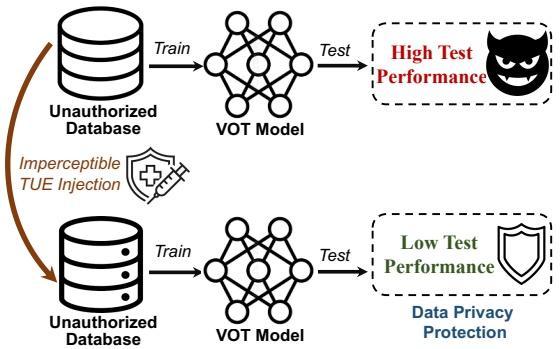
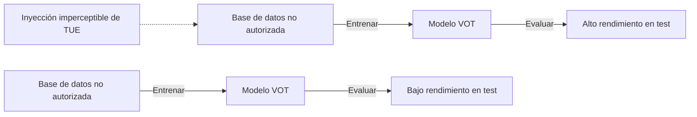
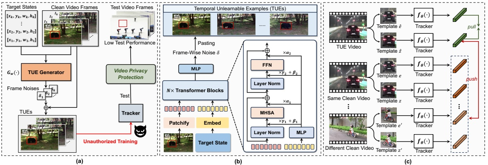
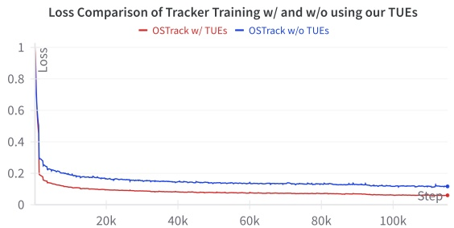
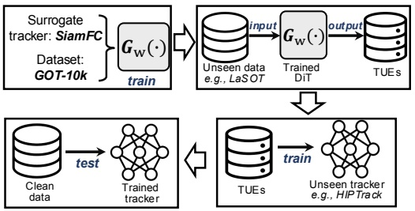
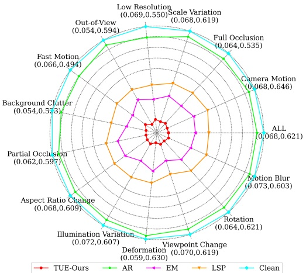

# Temporal Unlearnable Examples: Previniendo la Explotación No Autorizada de Datos de Video Personales mediante Object Tracking

Qiangqiang Wu<sup>1\*</sup> Yi Yu<sup>2\*</sup> Chenqi Kong<sup>2†</sup> Ziquan Liu<sup>3</sup> Jia Wan<sup>4</sup>

Haoliang Li<sup>1</sup> Alex C. Kot<sup>2</sup> Antoni B. Chan<sup>1</sup>

<sup>1</sup>City University of Hong Kong <sup>2</sup>ROSE Lab, Nanyang Technological University

<sup>3</sup>Queen Mary University of London <sup>4</sup>Harbin Institute of Technology, Shenzhen

qiangqwu2-c@my.cityu.edu.hk, {yuyi0010, chenqi.kong, eackot}@ntu.edu.sg, ziquan.liu@qmul.ac.uk, jiawan1998@gmail.com, {haoliang.li, abchan}@cityu.edu.hk

## Resumen

Con el auge de las redes sociales, se utilizan enormes cantidades de videos subidos por usuarios (por ejemplo, YouTube) como datos de entrenamiento para Visual Object Tracking (VOT). Sin embargo, la comunidad de VOT ha pasado por alto en gran medida los problemas de privacidad de video data, puesto que muchos videos privados han sido recopilados y utilizados para entrenar modelos comerciales sin autorización. Para mitigar estos problemas, este artículo presenta la primera investigación sobre la prevención de la explotación no autorizada de video data personal por parte de deep trackers. Los métodos existentes para prevenir el uso no autorizado de datos se centran principalmente en tareas basadas en imágenes (por ejemplo, clasificación de imágenes); aplicarlos directamente a videos revela diversas limitaciones, tales como ineficiencia, efectividad limitada y escasa generalizabilidad. Para abordar estos problemas, proponemos un novedoso framework generativo para generar Temporal Unlearnable Examples (TUEs), cuyo cálculo eficiente lo hace escalable para su uso en datasets de video a gran escala. Los trackers entrenados con TUEs dependen en gran medida de ruidos inaprendibles (unlearnable noises) para el temporal matching, ignorando la estructura de datos original y garantizando así la privacidad de los datos de video de entrenamiento. Para mejorar la efectividad de los TUEs, introducimos una temporal contrastive loss, la cual corrompe aún más el aprendizaje de los trackers existentes al utilizar nuestros TUEs para el entrenamiento. Amplios experimentos demuestran que nuestro enfoque logra un rendimiento state-of-the-art (SOTA) en la protección de la privacidad de video data, con una fuerte transferibilidad entre modelos de VOT, datasets y tareas de temporal matching.

## 1 Introducción

Visual Object Tracking (VOT) estima las bounding boxes del objetivo en cada fotograma de video basándose en el estado inicial del objetivo, desempeñando un papel clave en aplicaciones como la videovigilancia inteligente y la conducción autónoma. Los avances recientes en deep trackers, impulsados por videos de entrenamiento a gran escala provenientes de Internet, han mejorado significativamente el rendimiento de VOT. Sin embargo, las preocupaciones sobre la explotación no autorizada de datos por parte de Deep Neural Networks (DNNs) están creciendo. Por ejemplo, los videos personales subidos a redes sociales (por ejemplo, YouTube) pueden utilizarse para el entrenamiento de VOT sin consentimiento, lo que plantea problemas de privacidad y derechos de autor. Los datasets de VOT a gran escala como TrackingNet [55], LaSOT [19, 20] y GOT-10k [32] se componen principalmente de dichos videos subidos por usuarios. Proteger trayectorias sensibles —como las de individuos, vehículos y activos militares— requiere prevenir el uso no autorizado de los datos de seguimiento. Por consiguiente, salvaguardar la video data frente a la explotación en el entrenamiento de VOT resulta esencial.



<details>
<summary>flowchart</summary>


</details>

Figura 1. Ilustración de nuestros TUEs para prevenir la explotación no autorizada de video data por parte de modelos profundos de VOT. Añadir TUEs imperceptibles a los videos de entrenamiento limita a los modelos profundos de VOT a aprender únicamente información de atajos (shortcuts), lo que da como resultado una generalización deficiente y un rendimiento degradado en test.

En el contexto de las imágenes 2D, los Unlearnable Examples (UEs) [23, 31, 90, 93] constituyen una solución típica para proteger datos privados contra la explotación no autorizada por parte de DNNs. Los métodos de UEs añaden perturbaciones imperceptibles (es decir, bounded noises) a las imágenes de entrenamiento para impedir que los modelos extraigan información útil a partir de los datos de entrenamiento envenenados (poisoned data), provocando así un rendimiento deficiente en test. Extender los UEs de tareas de imagen a videos sigue estando poco explorado. Si bien las perturbaciones uniformes a lo largo de los fotogramas pueden adaptar eficazmente los UEs de tareas de imagen para tareas de clasificación de video como el reconocimiento de acciones, presentan dificultades con tareas de temporal matching tales como VOT y Video Object Segmentation (VOS). Nuestro artículo se centra en el aprendizaje de UEs para temporal matching, tomando a VOT como tarea fundamental. Proteger VOT es crucial para salvaguardar trayectorias sensibles (por ejemplo, misiles, vehículos e individuos). Optimizar UEs para la tarea básica de VOT también podría mejorar su transferibilidad hacia tareas avanzadas de temporal matching como VOS y el seguimiento de puntos a largo plazo (long-term point tracking).

<small><span class="docvortex-page-footnote" data-block-type="page_footnote" style="color:#6b7280">\*Contribución equitativa. †Autor de correspondencia.</span></small>

Extender los UEs de tareas de imagen a tareas de temporal matching presenta varios desafíos: (1) La video data posee una mayor resolución y más fotogramas, lo que hace que la generación de UEs sea computacionalmente intensiva; (2) A diferencia de la clasificación de imágenes, VOT depende del temporal matching entre fotogramas, con objetos objetivo que cambian de escala, lo que complica el diseño de UEs compatibles con el emparejamiento invariante a la escala; (3) Los UEs existentes presentan dificultades para transferirse entre diferentes modelos de seguimiento, datasets y tareas de emparejamiento, lo que limita su efectividad para la privacidad de datos en VOT.

Para abordar los desafíos anteriores, introducimos los Temporal Unlearnable Examples (TUEs) para video data (véase la Fig. 1). Al inyectar TUEs imperceptibles, los modelos profundos de VOT solo aprenden información limitada a partir del conjunto de entrenamiento, lo que resulta en una pobre generalización y un rendimiento degradado en test. Proponemos un novedoso framework generativo en el cual se entrena un generador para producir TUEs que perturban el temporal matching en modelos de VOT. Estas perturbaciones permanecen imperceptibles para el ojo humano y no comprometen la utilidad de los datos para el consumo humano. En comparación con el enfoque iterativo tradicional de EM [31] utilizado para los UEs de imágenes, nuestro framework mejora significativamente la eficiencia —logrando una velocidad de entrenamiento $4\times$ más rápida y una eficiencia de parámetros $28\times$ superior en el dataset GOT-10k [32]—, lo que lo hace altamente escalable para datasets de video de gran tamaño. Además, introducimos una temporal contrastive loss (TCL) para alentar a los trackers a depender en mayor medida de los TUEs generados para el temporal matching, reforzando aún más la protección de la privacidad.

Evaluamos la transferibilidad de nuestros TUEs mediante experimentos a través de diversos modelos y datasets de VOT. Los TUEs entrenados sobre el tracker simple SiamFC [4] pueden degradar de forma efectiva el rendimiento de deep trackers state-of-the-art con arquitecturas complejas, tales como ViT [18, 96] y ResNet [27]. Por añadidura, un generador entrenado en un dataset fuente como GOT-10k [32] puede emplearse para la generación zero-shot de TUEs en datasets de video no vistos, sin necesidad de reentrenamiento. Finalmente, demostramos que nuestros TUEs son transferibles entre tareas y se desempeñan adecuadamente en otras tareas de temporal matching, tales como la segmentación de objetos en video (video object segmentation).

En resumen, las principales contribuciones de nuestro trabajo son:

• Hasta donde llega nuestro conocimiento, somos los primeros en investigar la prevención de la explotación no autorizada de videos para VOT. Dado que no existe ninguno, aplicamos UEs estándar de tareas de imagen a videos como baselines para VOT con diseños específicos, lo cual revela diversas limitaciones, por ejemplo, ineficiencia, efectividad limitada y baja generalizabilidad.

• Proponemos un nuevo framework generativo para generar Temporal Unlearnable Examples (TUEs), que pueden corromper de manera efectiva el aprendizaje de temporal matching de los modelos de VOT. Nuestro método logra un rendimiento state-of-the-art en la protección de la privacidad de video data y muestra una fuerte transferibilidad entre diversos trackers, datasets y tareas de emparejamiento.

• Introducimos una Temporal Contrastive Loss (TCL) que incentiva a los trackers a depender más de los TUEs generados para el aprendizaje de temporal matching, lo que degrada aún más el rendimiento de seguimiento al tiempo que preserva la privacidad de los datos de entrenamiento.
## 2 Trabajos relacionados

**Visual Object Tracking (VOT)** predice las bounding boxes del objetivo en cada fotograma basándose en el estado inicial del objetivo. Los primeros trackers de filtro de correlación (correlation-filter, CF) [3, 14, 17, 24, 28, 52] tuvieron éxito debido a su rendimiento y velocidad. Con el auge del deep learning [27, 35], los trackers CF [13, 15, 16, 46, 50, 67, 68, 73, 74] comenzaron a incorporar características profundas (deep features) para VOT. SiamFC [4] y SINT [66] introdujeron redes siamesas profundas (deep Siamese networks) para VOT de extremo a extremo (end-to-end), propiciando mejoras en transformer tracking [12, 81, 87, 88], diseño de memoria en línea (online memory) [86, 95], diseño arquitectónico [8, 25, 29, 36, 37, 76] y nuevos paradigmas de aprendizaje [2, 5, 9, 71, 72, 75, 80]. Estos trackers se basan en datasets a gran escala como GOT-10k [32] y LaSOT [19, 20], a menudo recopilados a partir de videos subidos por usuarios a redes sociales. Sin embargo, las preocupaciones sobre la privacidad en VOT siguen siendo ampliamente ignoradas y requieren una atención urgente. Recientemente, diversos adversarial attacks se han dirigido a deep trackers [7, 26, 33, 45, 65, 78, 85], tales como la generación de perturbaciones temporalmente transferibles [56] y la introducción de adversarial loss para reducir las regiones activas en heatmaps [83]. Asimismo, se ha destacado la vulnerabilidad de los modelos de VOT ante backdoor attacks [30, 44]. No obstante, estos métodos frecuentemente requieren acceso tanto a los datos de entrenamiento como a los de prueba, o bien a los parámetros del modelo, lo que puede resultar poco práctico. Por el contrario, nuestro enfoque se centra en proteger los datos de video de entrenamiento contra el uso no autorizado, requiriendo acceso únicamente a los datos de entrenamiento, lo que lo hace más viable.

**Unlearnable Examples (UEs).** La privacidad de datos en imágenes 2D ha sido ampliamente estudiada, donde los métodos tradicionales se han enfocado en evitar que los modelos filtren información sensible [1, 38–43, 47, 49, 58, 61–63]. Recientemente han surgido los UEs [21, 31, 48, 54, 91], en los que se añaden perturbaciones acotadas $( e . g . , \; \| \pmb { \delta } \| _ { \infty }   \stackrel { \cdot } { \leq }   \frac { \ast } { 2 5 5 } )$ a los datos de entrenamiento, preservando las etiquetas mientras se degrada el rendimiento del modelo. Este método de envenenamiento perturbativo (perturbative poisoning) [51] muestra un gran potencial para la protección de datos, provocando que los modelos entrenados con dichos datos tengan un desempeño casi aleatorio sobre datos de prueba limpios (clean test data). Técnicas como EM [31], NTGA [94], TAP [22], REM [23], LSP [89] y OPS [77] ofrecen diversas estrategias para generar perturbaciones protectoras. Si bien los UEs se han explorado en tareas como clasificación de imágenes, segmentación y clasificación de nubes de puntos [64, 70], su aplicación en tareas de emparejamiento como VOT sigue inexplorada. Nuestro objetivo es cerrar esta brecha mediante la exploración de UEs eficaces para el template matching a lo largo de fotogramas de video.

## 3 Metodología

En primer lugar, revisamos los preliminares en el §3.1 e introducimos los baselines de UE en el §3.2. Para superar las limitaciones de los UE, proponemos un framework generativo para Temporal Unlearnable Examples (TUEs) en el §3.3. Presentamos además el Aprendizaje Contrastivo Temporal (Temporal Contrastive Learning) para potenciar los TUEs en el §3.4. Por último, resumimos el pipeline global en el §3.5.

## 3.1 Preliminares

Presentamos brevemente los algoritmos tradicionales de UEs y el pipeline de temporal matching en VOT.

**Error-Minimizing (EM) Learning.** Dado un dataset de imágenes limpias $\mathcal { D } _ { c } \: = \: \{ ( \mathbf { I } _ { i } , y _ { i } ) \} _ { i = 1 } ^ { m }$ con m imágenes limpias, EM [31] busca aprender UEs por muestra (sample-wise) sobre $\mathcal { D } _ { c }$ que degraden a un clasificador $F _ { \theta }$ en el conjunto de prueba:

$$
\min _ {\theta} \mathbb {E} _ {(\mathbf {I}, y) \sim \mathcal {D} _ {c}} \left[ \min _ {\boldsymbol {\delta} \in \boldsymbol {\Delta}} \mathcal {L} _ {c} \left(F _ {\theta} (\mathbf {I} + \boldsymbol {\delta}), y\right) \right], \tag {1}
$$

donde $\mathcal { L } _ { c }$ es la pérdida de entropía cruzada (cross-entropy loss), $y$ es la etiqueta de clase de $\mathbf { I } \in \mathbb { R } ^ { \tilde { H } \times W \times C } , \mathbf { \delta } \in \mathbf { \Delta } \subset \mathbb { R } ^ { \tilde { H } \times W \times C }$ son los ruidos imperceptibles y $\mathbf { \Delta }$ es la región factible. Típicamente, el ruido δ está acotado por norma $L _ { p }$, es decir, $\pmb { \Delta }   =   \{ \pmb { \delta } | | | \pmb { \delta } | | _ { p }   \leq   \sigma \}$, donde $\sigma$ es pequeño, de modo que el ruido resulta imperceptible. El objetivo consiste en que el ruido $\delta$ convierta la imagen original I en inaprendible; así, $\hat { \mathbf { I } } = \mathbf { I } + \boldsymbol { \delta }$ se denomina UE. La formulación en (1) involucra procesos de optimización tanto internos como externos. La optimización externa fija las perturbaciones y actualiza los parámetros θ del clasificador $F _ { \theta }$ minimizando la pérdida $\mathcal { L } _ { c }$. En la optimización interna, el clasificador se mantiene fijo mientras que las perturbaciones δ se actualizan para minimizar también la pérdida (haciendo que cada muestra de entrenamiento sea «más fácil» para el clasificador). Estas optimizaciones se llevan a cabo de manera alternada durante el entrenamiento. En cada optimización interna, EM utiliza el Descenso de Gradiente Proyectado (Projected Gradient Descent, PGD) [53] para actualizar iterativamente las perturbaciones δ a lo largo de T pasos. Nótese que existe una perturbación δ distinta optimizada para cada I muestreada del dataset $\mathcal { D } _ { c }$.

**Temporal Matching Learning en VOT**. Supongamos que el dataset de entrenamiento de video limpio consta de n videos de entrenamiento limpios, es decir, $\mathcal { D } _ { v }   =   \{ ( V _ { i } , B _ { i } ) \} _ { i = 1 } ^ { n }$, donde $V _ { i }   =   \{ \mathbf { I } _ { j } \} _ { j = 1 } ^ { k }$ denota el i-ésimo video limpio que contiene k fotogramas de video, y $B _ { i } = \{ \mathbf { b } _ { j } \} _ { j = 1 } ^ { k }$ representa las correspondientes anotaciones de bounding box. En cada fotograma, la anotación $\mathbf { b } _ { j } \in \mathbb { R } ^ { 4 }$ especifica las coordenadas superiores izquierdas, el ancho y la altura del objetivo. Típicamente, el deep tracker SiamFC [4] se entrena para realizar template matching en pares de fotogramas muestreados aleatoriamente dentro de un video de entrenamiento:

$$
\min _ {\theta} \mathbb {E} _ {(\mathbf {z}, \mathbf {x}) \sim \mathcal {D} _ {v}} \mathcal {L} (f _ {\theta} (\mathbf {z}) * f _ {\theta} (\mathbf {x}), y), \tag {2}
$$

donde $f _ { \theta }$ es el backbone en SiamFC parametrizado con θ. z y x son las imágenes de plantilla (template) y de búsqueda (search) recortadas en dos fotogramas muestreados aleatoriamente $\mathbf { I } _ { i }$ e $\mathbf { I } _ { j }$ de un video de entrenamiento V. ∗ denota la operación de correlación cruzada (cross-correlation) e y es el mapa de respuesta ground-truth que indica la ubicación del objetivo en x. $\mathcal { L } ( \cdot , \cdot )$ representa la binary-cross entropy loss.

## 3.2 Baselines: UEs para VOT

A pesar de los avances de los UEs para la clasificación de imágenes, la aplicación de UEs a la tarea de VOT permanece inexplorada. Para cerrar esta brecha, construimos nuevos baselines aplicando EM [31] estándar a VOT [4]. Específicamente, el objetivo es crear perturbaciones que reduzcan la función de pérdida del tracking, explotando así un emparejamiento de «atajo» (shortcut matching) dentro del tracker:

$$
\min _ {\boldsymbol {\theta}} \mathbb {E} _ {(\mathbf {z}, \mathbf {x}) \sim \mathcal {D} _ {v}} \left[ \min _ {\boldsymbol {\delta} _ {t} \in \boldsymbol {\Delta}} \mathcal {L} \left(f _ {\boldsymbol {\theta}} (\hat {\mathbf {z}}) * f _ {\boldsymbol {\theta}} (\hat {\mathbf {x}}), y\right) \right],
$$

$$
\text {s.t.} \hat {\mathbf {z}} = \Phi (\mathbf {z}, \phi (\boldsymbol {\delta} _ {t}, \mathbf {b} _ {i}), \mathbf {b} _ {i}), \hat {\mathbf {x}} = \Phi (\mathbf {x}, \phi (\boldsymbol {\delta} _ {t}, \mathbf {b} _ {j}), \mathbf {b} _ {j}), \tag {3}
$$

donde ẑ y xˆ son los TUEs para las imágenes de plantilla y búsqueda. Los TUEs se generan interpolando la perturbación del objetivo $\delta _ { t }$ al mismo tamaño que la bounding box y pegándola sobre la imagen de plantilla/búsqueda. Específicamente, $\phi ( \mathbf { \delta } _ { t } , \mathbf { b } )$ es la función de interpolación bilineal (Bilinear interpolation), que interpola $\delta _ { t }$ al mismo tamaño que la bounding box b, y $\Phi ( \mathbf { x } , \hat { \delta } _ { t } , \mathbf { b } )$ es la función de pegado que superpone $\hat { \delta } _ { t }$ sobre la región objetivo b de la imagen x mediante la operación de adición. Dado que cada video solo contiene una instancia rastreada, se define una única $\delta _ { t }$ para cada video, es decir, compartida entre los fotogramas del mismo video.

En (3), la optimización externa actualiza el tracker $\theta ,$ mientras que la optimización interna optimiza el ruido $\delta _ { t }$ manteniendo el tracker fijo. Estos pasos se alternan durante el entrenamiento, actualizándose el ruido de perturbación $\delta _ { t }$ de forma iterativa durante $T$ pasos mediante el método PGD [53]. El aprendizaje anterior de los TUEs ẑ y xˆ provoca que el tracker dependa del ruido de perturbación para el temporal matching, haciendo que los videos de entrenamiento resulten inexplotables. Finalmente, se obtiene el conjunto de ruidos optimizados $\{ \delta _ { t } ^ { i } \} _ { i = 1 } ^ { n }$ para cada uno de los n videos en $\mathcal { D } _ { v }$.



<details>
<summary>flowchart</summary>

```mermaid
graph TD
  subgraph Panel_a [Target States]
  A1["x1, y1, w1, h1"] --> B1["TUE Generator"]
  B1 --> C1["Frame Noises"]
  C1 --> D1["TUEs"]
  D1 --> E1["Unauthorized Training"]
  E1 --> F1["Video Privacy Protection"]
  F1 --> G1["Low Test Performance"]
  end

  subgraph Panel_b [Temporal Unlearnable Examples (TUEs)]
  H1["TUE Video"] --> I1["Template 1"]
  I1 --> J1["Template 2"]
  J1 --> K1["Template 3"]
  K1 --> L1["Template 4"]
  L1 --> M1["Template 5"]
  M1 --> N1["Template 6"]
  N1 --> O1["Template 7"]
  O1 --> P1["Template 8"]
  P1 --> Q1["Template 9"]
  Q1 --> R1["Template 10"]
  R1 --> S1["Template 11"]
  S1 --> T1["Template 12"]
  T1 --> U1["Template 13"]
  U1 --> V1["Template 14"]
  V1 --> W1["Template 15"]
  W1 --> X1["Template 16"]
  X1 --> Y1["Template 17"]
  Y1 --> Z1["Template 18"]
  Z1 --> AA1["Template 19"]
  AA1 --> AB1["Template 20"]
  AB1 --> AC1["Template 21"]
  AC1 --> AD1["Template 22"]
  AD1 --> AE1["Template 23"]
  AE1 --> AF1["Template 24"]
  AF1 --> AG1["Template 25"]
  AG1 --> AH1["Template 26"]
  AH1 --> AI1["Template 27"]
  AI1 --> AJ1["Template 28"]
  AJ1 --> AK1["Template 29"]
  AK1 --> AL1["Template 30"]
  AL1 --> AM1["Template 31"]
  AM1 --> AN1["Template 32"]
  AN1 --> AO1["Template 33"]
  AO1 --> AP1["Template 34"]
  AP1 --> AQ1["Template 35"]
  AQ1 --> AR1["Template 36"]
  AR1 --> AS1["Template 37"]
  AS1 --> AT1["Template 38"]
  AT1 --> AU1["Template 39"]
  AU1 --> AV1["Template 40"]
  AV1 --> AW1["Template 41"]
  AW1 --> AX1["Template 42"]
  AX1 --> AY1["Template 43"]
  AY1 --> AS2["Template 44"]
  AS2 --> AT2["Template 45"]
  AT2 --> AU2["Template 46"]
  AU2 --> AS3["Template 47"]
  AS3 --> AT3["Template 48"]
  AT3 --> AU3["Template 49"]
  AU3 --> AS4["Template 50"]
  AS4 --> AT4["Template 51"]
  AT4 --> AU4["Template 52"]
  AU4 --> AS5["Template 53"]
  AS5 --> AT5["Template 54"]
  AT5 --> AU5["Template 55"]
  AU5 --> AS6["Template 56"]
  AS6 --> AT6["Template 57"]
  AT6 --> AU6["Template 58"]
  AU6 --> AS7["Template 59"]
  AS7 --> AT7["Template 60"]
  AT7 --> AU7["Template 61"]
  AU7 --> AS8["Template 62"]
  AS8 --> AT8["Template 63"]
  AT8 --> AU8["Template 64"]
  AU8 --> AS9["Template 65"]
  AS9 --> AT9["Template 66"]
  AT9 --> AU9["Template 67"]
  AU9 --> AS10["Template 68"]
  AS10 --> AT10["Template 69"]
  AT10 --> AU10["Template 70"]
  AU10 --> AS11["Template 71"]
  AS11 --> AT11["Template 72"]
  AT11 --> AU11["Template 73"]
  AU11 --> AS12["Template 74"]
  AS12 --> AT12["Template 75"]
  AT12 --> AU12["Template 76"]
  AU12 --> AS13["Template 77"]
  AS13 --> AT13["Template 78"]
  AT13 --> AU13["Template 79"]
  AU13 --> AS14["Template 80"]
  AS14 --> AT14["Template 81"]
  AT14 --> AU14["Template 82"]
  AU14 --> AS15["Template 83"]
  AS15 --> AT15["Template 84"]
  AT15 --> AU15["Template 85"]
  AU15 --> AS16["Template 86"]
  AS16 --> AT16["Template 87"]
  AT16 --> AU16["Template 88"]
  AU16 --> AS17["Template 89"]
  AS17 --> AT17["Template 90"]
  AT17 --> AU17["Template 91"]
  AU17 --> AS18["Template 92"]
  AS18 --> AT18["Template 93"]
  AT18 --> AU18["Template 94"]
  AU18 --> AS19["Template 95"]
  AS19 --> AT19["Template 96"]
  AT19 --> AU19["Template 97"]
  AU19 --> AS20["Template 98"]
  AS20 --> AT20["Template 99"]
  AT20 --> AU20["Template 100"]
  end

  subgraph Panel_c [CCTC]
  C1["Template 1"] --> C2["Template 2"]
  C2 --> C3["Template 3"]
  C3 --> C4["Template 4"]
  C4 --> C5["Template 5"]
  C5 --> C6["Template 6"]
  C6 --> C7["Template 7"]
  C7 --> C8["Template 8"]
  C8 --> C9["Template 9"]
  C9 --> C10["Template 10"]
  C10 --> C11["Template 11"]
  C11 --> C12["Template 12"]
  C12 --> C13["Template 13"]
  C13 --> C14["Template 14"]
  C14 --> C15["Template 15"]
  C15 --> C16["Template 16"]
  C16 --> C17["Template 17"]
  C17 --> C18["Template 18"]
  C18 --> C19["Template 19"]
  C19 --> C20["Template 20"]
  C20 --> C21["Template 21"]
  C21 --> C22["Template 22"]
  C22 --> C23["Template 23"]
  C23 --> C24["Template 24"]
  C24 --> C25["Template 25"]
  C25 --> C26["Template 26"]
  C26 --> C27["Template 27"]
  C27 --> C28["Template 28"]
  C28 --> C29["Template 29"]
  C29 --> C30["Template 30"]
  C30 --> C31["Template 31"]
  C31 --> C32["Template 32"]
  C32 --> C33["Template 33"]
  C33 --> C34["Template 34"]
  C34 --> C35["Template 35"]
  C35 --> C36["Template 36"]
  C36 --> C37["Template 37"]
  C37 --> C38["Template 38"]
  C38 --> C39["Template 39"]
  C39 --> C40["Template 40"]
  C40 --> C41["Template 41"]
  C41 --> C42["Template 42"]
  C42 --> C43["Template 43"]
  C43 --> C44["Template 44"]
  C44 --> C45["Template 45"]
  C45 --> C46["Template 46"]
  C46 --> C47["Template 47"]
  C47 --> C48["Template 48"]
  C48 --> C49["Template 49"]
  C49 --> C50["Template 50"]
  C50 --> C51["Template 51"]
  C51 --> C52["Template 52"]
  C52 --> C53["Template 53"]
  C53 --> C54["Template 54"]
  C54 --> C55["Template 55"]
  C55 --> C56["Template 56"]
  C56 --> C57["Template 57"]
  C57 --> C58["Template 58"]
  C58 --> C59["Template 59"]
  C59 --> C60["Template 60"]
  C60 --> C61["Template 61"]
  C61 --> C62["Template 62"]
  C62 --> C63["Template 63"]
  C63 --> C64["Template 64"]
  C64 --> C65["Template 65"]
  C65 --> C66["Template 66"]
  C66 --> C67["Template 67"]
  C67 --> C68["Template 68"]
  C68 --> C69["Template 69"]
  C69 --> C70["Template 70"]
  C70 --> C71["Template 71"]
  C71 --> C72["Template 72"]
  C72 --> C73["Template 73"]
  C73 --> C74["Template 74"]
  C74 --> C75["Template 75"]
  C75 --> C76["Template 76"]
  C76 --> C77["Template 77"]
  C77 --> C78["Template 78"]
  C78 --> C79["Template 79"]
  C79 --> C80["Template 80"]
  C80 --> C81["Template 81"]
  C81 --> C82["Template 82"]
  C82 --> C83["Template 83"]
  C83 --> C84["Template 84"]
  C84 --> C85["Template 85"]
  C85 --> C86["Template 86"]
  C86 --> C87["Template 87"]
  C87 --> C88["Template 88"]
  C88 --> C89["Template 89"]
  C89 --> C90["Template 90"]
  C90 --> C91["Template 91"]
  C91 --> C92["Template 92"]
  C92 --> C93["Template 93"]
  C93 --> C94["Template 94"]
  C94 --> C95["Template 95"]
  C95 --> C96["Template 96"]
  C96 --> C97["Template 97"]
  C97 --> C98["Template 98"]
  C98 --> C99["Template 99"]
  C99 --> AT10["Output"]
  end
```
</details>

Figura 2. (a) Representación de nuestros TUEs; (b) Arquitectura del generador de TUE; (c) Esquema de aprendizaje contrastivo temporal (temporal contrastive learning).

**Context-Aware UEs.** Los trackers existentes [4, 75, 88] incorporan tanto el objetivo central como las regiones de contexto circundantes como la plantilla z para mejorar el rendimiento de seguimiento. Inspirados por esto, también consideramos las regiones de contexto al generar UEs para lograr una protección de la privacidad de datos más eficaz. Nuestro enfoque sigue el mismo procedimiento de aprendizaje antes mencionado, pero ahora introduce el ruido de contexto $\delta _ { c }$ durante la optimización. Se proporcionan más detalles en el Material Suplementario.

**Entrenamiento de Trackers con UEs.** Tras obtener las perturbaciones del objetivo y del contexto $\{ \delta _ { t } ^ { i } , \delta _ { c } ^ { i } \} _ { i = 1 } ^ { n }$, interpolamos el ruido del objetivo $\delta _ { t } ^ { i }$ y el ruido del contexto $\delta _ { c } ^ { i }$ para que coincidan con los tamaños del objetivo y del contexto en cada fotograma original de un video dado $V _ { i }.$ Luego, estos ruidos se pegan en las regiones correspondientes en cada fotograma, lo que da como resultado un nuevo dataset inaprendible $\mathcal { D } _ { u }$, que se utiliza para entrenar trackers estándar [9, 75, 88] siguiendo los protocolos de entrenamiento oficiales.
## 3.3 Framework Generativo para TUE

Los baselines anteriores se basan en el enfoque de EM aplicado a imágenes, el cual presenta diversas limitaciones al aplicarse a videos: 1) la optimización iterativa de ẑ y xˆ consume mucho tiempo, requiriendo cada optimización T iteraciones; 2) los ruidos $\delta _ { t }$ y $\delta _ { c }$ están predefinidos con formas fijas, que deben interpolarse a varias escalas de objetivo en cada fotograma de un video; 3) los ruidos generados $\{ \delta _ { t } ^ { i } , \delta _ { c } ^ { i } \} _ { i = 1 } ^ { n }$ son específicos de cada video, por lo que no pueden generalizarse a otros datasets de video no vistos.

Para abordar las limitaciones anteriores, en contraste con los métodos basados en imágenes donde los UEs se optimizan directamente, proponemos un nuevo framework generativo para la generación de nuestros TUEs. La Fig. 2 (a) describe el pipeline general del proceso propuesto de generación de TUE. Nuestra generación de TUE se formula de la siguiente manera:

$$
\begin{array}{l} \min _ {\boldsymbol {\theta}} \mathbb {E} _ {(\mathbf {z}, \mathbf {x}) \sim \mathcal {D} _ {v}} \left[ \min _ {\mathbf {w}} \mathcal {L} \left(f _ {\boldsymbol {\theta}} (\hat {\mathbf {z}}) * f _ {\boldsymbol {\theta}} (\hat {\mathbf {x}}), y\right) \right], \\ \text {s.t.} \hat {\mathbf {z}} = \mathbf {z} + G _ {\mathbf {w}} \left(\mathbf {z}, \widetilde {\mathbf {b}} _ {i}\right), \hat {\mathbf {x}} = \Phi \left(\mathbf {x}, G _ {\mathbf {w}} \left(c \left(\mathbf {x}, \mathbf {b} _ {j}\right), \widetilde {\mathbf {b}} _ {j}\right), \mathbf {b} _ {j}\right), \tag {4} \\ \end{array}
$$

donde ẑ y $\hat { \bf x }$ son los TUEs generados para las imágenes de plantilla y de búsqueda. Estos TUEs se obtienen generando ruidos de perturbación conscientes del objetivo (target-aware), para luego pegarlos sobre las regiones del objetivo correspondientes en los fotogramas del video. Específicamente, $G _ { \mathbf { w } } ( \cdot )$ es nuestro generador de TUEs parametrizado con w, el cual toma un parche del objetivo z y una bounding box normalizada $\widetilde { \mathbf { b } } _ { i }$ como entrada, y genera una perturbación de ruido $G _ { \mathbf { w } } ( \mathbf { z } , \widetilde { \mathbf { b } } _ { i } )$ que se añade de nuevo a z. Para la imagen de búsqueda x, el objetivo se recorta usando la función de recorte $c ( \mathbf { x } , \mathbf { b } _ { j } )$ mediante la anotación de caja dada $\mathbf { b } _ { j }$, y luego se pasa al generador de TUE con su correspondiente bounding box normalizada $\widetilde { \mathbf { b } } _ { j }$ para generar la perturbación $G _ { \mathbf { w } } ( c ( \mathbf { x } , \mathbf { b } _ { j } ) , \widetilde { \mathbf { b } } _ { j } )$. Esta perturbación se pega de nuevo sobre el objetivo en la imagen de búsqueda a través de la función de pegado $\Phi ( \cdot )$. Nótese que $\widetilde { \mathbf { b } } _ { i } , \widetilde { \mathbf { b } } _ { j } \in \mathbb { R } ^ { 4 }$ son los estados normalizados del objetivo (es decir, contienen las coordenadas superiores izquierdas, el ancho y la altura normalizados) de los correspondientes parches z y $c ( \mathbf { x } , \mathbf { b } _ { j } )$, respectivamente.

Empleamos una arquitectura de difusión, es decir, DiT [57], como generador de TUE, la cual toma la etiqueta de clase y el paso temporal (time step) como condición para la generación de imágenes en múltiples pasos. Aquí la adaptamos para generar TUEs conscientes del objetivo en un único paso feed-forward con la condición del objetivo normalizada, lo cual resulta más eficiente. La arquitectura se ilustra en la Fig. 2 (b).

<strong><u>Ventajas:</u></strong> Nuestro framework generativo de TUE propuesto es más eficiente que el baseline de EM, tanto en escalabilidad del entrenamiento como en inferencia, y además se transfiere satisfactoriamente a videos no vistos. Específicamente: 1) **Alta eficiencia de entrenamiento**: puesto que $G _ { \mathbf { w } } ( \cdot )$ es ligero y puede actualizarse directamente a través de retropropagación de gradiente en cada optimización interna, el entrenamiento de $G _ { \mathbf { w } } ( \cdot )$ es eficiente, p. ej., $4 \times$ más rápido que el baseline de EM como se ilustra en la Tabla 2; 2) **Menor número de parámetros aprendibles**: El baseline de EM optimiza tanto los ruidos del objetivo como los de contexto para cada video (tamaño $1 2 7 { \times } 1 2 7 { \times } 3 $), lo que genera un gran número de parámetros en los benchmarks de tracking populares (por ejemplo, 3.4GB para GOT-10k [32]). Por el contrario, nuestro enfoque optimiza un modelo ligero $G _ { \mathbf { w } } ( \cdot )$ con un número fijo de parámetros (124MB), el cual es independiente del tamaño del dataset; 3) **Aplicable a videos no vistos**: El baseline de EM requiere optimizar UEs para cada dataset, lo que significa que debe reentrenarse para generar UEs sobre datasets no vistos. Como se muestra en la Tabla 5, nuestro enfoque TUE puede generar UEs para datasets no vistos directamente mediante la inferencia del modelo, sin necesidad de reentrenamiento.

Algoritmo 1: Optimización del generador de TUE

<div class="docvortex-algorithm" style="white-space: pre-wrap; font-family:monospace;">
Input : Surrogate model $f_{\theta}$, TUE generator $G_{\mathbf{w}}$, learning rates $\alpha_s$ and $\alpha_g$, number of epochs $ep$, clean dataset $\mathcal{D}_v = \{(V_i, B_i)\}_{i=1}^n$
Output: Optimized TUE generator $G_{\mathbf{w}}$
for $i \leftarrow 1$ to $ep$ do
    for $(\mathbf{z}, \mathbf{x}) \in \mathcal{D}_v$ do
        # Generar perturbaciones
        $\hat{\mathbf{z}} = \mathbf{z} + G_{\mathbf{w}}(\mathbf{z}, \tilde{\mathbf{b}}_i)$,
        $\hat{\mathbf{x}} = \Phi_c(\mathbf{x}, G_{\mathbf{w}}(c(\mathbf{x}, \mathbf{b}_j), \tilde{\mathbf{b}}_j), \mathbf{b}_j)$;
        # Optimizar perturbadores $G_{\mathbf{w}}$ usando $\alpha_s$
        $\hat{\mathbf{e}} = c(\mathbf{x}, \mathbf{b}_j) + G_{\mathbf{w}}(c(\mathbf{x}, \mathbf{b}_j), \tilde{\mathbf{b}}_j)$,
        $\mathcal{L}_f =$
        $\mathcal{L}(f_{\theta}(\hat{\mathbf{z}}) * f_{\theta}(\hat{\mathbf{x}}), y) + \lambda \mathcal{L}_{cl}(f_{\theta}(\hat{\mathbf{z}}), f_{\theta}(\hat{\mathbf{e}}))$,
        Optimizar $G_{\mathbf{w}}$ vía Adam para minimizar $\mathcal{L}_f$;
        # Optimizar el modelo sustituto $f_{\theta}$ usando $\alpha_g$
        $\mathcal{L}_f = \mathcal{L}(f_{\theta}(\hat{\mathbf{z}}) * f_{\theta}(\hat{\mathbf{x}}), y)$,
        Optimizar $f_{\theta}$ vía Adam para minimizar $\mathcal{L}_f$;
    end
end
</div>



<details>
<summary>line</summary>

| Step | OSTrack w/ TUEs (Loss) | OSTrack w/o TUEs (Loss) |
| --- | --- | --- |
| 0 | ~0.85 | ~0.85 |
| 20k | ~0.10 | ~0.18 |
| 40k | ~0.09 | ~0.15 |
| 60k | ~0.08 | ~0.14 |
| 80k | ~0.07 | ~0.13 |
| 100k | ~0.06 | ~0.12 |
| 110k | ~0.06 | ~0.12 |
</details>

Figura 3. Training loss de OSTracker con y sin nuestros TUEs.

## 3.4 Temporal Contrastive Learning

Proponemos además una Temporal Contrastive Loss (TCL) para alentar al tracker a depender más de los TUEs generados para el temporal matching, degradando de este modo aún más el rendimiento de seguimiento del modelo en videos de prueba limpios. La Fig. 2 (c) ilustra los detalles del esquema propuesto de Temporal Contrastive Learning. Específicamente, el TUE de plantilla ẑ se utiliza como ejemplar, tratando al TUE ê (en la región de búsqueda x) dentro del mismo video como la muestra positiva. Las plantillas limpias en el mismo video (es decir, z y $\mathbf { e }   =   c ( \mathbf { x } , \mathbf { b } _ { j } )$) y los demás videos (es decir, $\textbf { z } ^ { \prime }$ y $\mathbf { e } ^ { \prime }$) dentro del mismo batch se consideran como muestras negativas respecto a ẑ. La formulación resultante es:



<details>
<summary>flowchart</summary>


</details>

Figura 4. Flujo de trabajo general de nuestros TUEs propuestos.

$$
\min _ {\mathbf {w}} \left[ \mathcal {L} \left(f _ {\theta} (\hat {\mathbf {z}}) * f _ {\theta} (\hat {\mathbf {x}}), y\right) + \lambda \mathcal {L} _ {c l} \left(f _ {\theta} (\hat {\mathbf {z}}), f _ {\theta} (\hat {\mathbf {e}})\right) \right], \tag {5}
$$

donde ê es el TUE en la región de búsqueda x, y $\mathcal { L } _ { c l } ( \cdot )$ es la contrastive loss [6]. Téngase en cuenta que empleamos el objetivo anterior para realizar la optimización interna, mientras que se emplea la pérdida del tracker $\mathcal { L } ( \cdot )$ para la optimización externa con el fin de mantener la coherencia con el proceso de entrenamiento original del tracker. El proceso global de optimización del generador de TUE se describe en el Alg. 1. En cada iteración, optimizamos primero el generador, seguido de la optimización del surrogate model. Se presentan más detalles sobre el temporal contrastive learning propuesto en el suplementario.

**Entrenamiento de trackers con TUEs.** Con el generador aprendido $G _ { \mathbf { w } } ( \cdot )$, generamos perturbaciones para los datasets de seguimiento existentes y las aplicamos a las bounding boxes para crear TUEs. Estos TUEs se utilizan luego para entrenar diversos trackers siguiendo sus configuraciones oficiales. Como se muestra en la Fig. 3, OSTrack entrenado con TUEs exhibe una menor pérdida de entrenamiento (training loss), ya que aprende un «atajo» (shortcut), dependiendo de las perturbaciones para el temporal matching mientras ignora la estructura de datos original, preservando de esta manera la privacidad de los datos de entrenamiento.

## 3.5 Pipeline de Aplicación Práctica

La Fig. 4 ilustra nuestro pipeline de aplicación en cuatro etapas. En la Etapa 1, entrenamos el generador de TUE $G _ { \mathbf { w } }$ utilizando el surrogate tracker SiamFC sobre un dataset de tracking estándar (por ejemplo, GOT-10k) bajo la supervisión de la Ec. 5. En la Etapa 2, el $G _ { \mathbf { w } }$ entrenado genera TUEs para proteger la video data de los usuarios. La Etapa 3 implica el entrenamiento de un tracker no autorizado sobre los datos protegidos. Por último, en la Etapa 4, el tracker entrenado se despliega sobre datos limpios para evaluar el rendimiento de protección de la privacidad. Todos los resultados experimentales proceden de la Etapa 4. Llevamos a cabo experimentos en múltiples aplicaciones de tracking, incluyendo VOT, VOS y long-term point tracking, demostrando que los videos protegidos previenen de forma efectiva la explotación no autorizada por parte de estas aplicaciones.

<table><tr><td rowspan="2">Trackers</td><td rowspan="2">Variantes</td><td colspan="2">OTB [79]</td><td colspan="3">GOT-10k [32]</td></tr><tr><td>AUC</td><td>Prec.</td><td>AO</td><td>SR0.5</td><td>SR0.75</td></tr><tr><td rowspan="6">SiamFC</td><td>Clean</td><td>58.6</td><td>79.2</td><td>35.5</td><td>39.0</td><td>11.8</td></tr><tr><td rowspan="2">EM [31] Baseline+Context</td><td>39.6</td><td>54.7</td><td>27.0</td><td>25.7</td><td>5.8</td></tr><tr><td>29.5</td><td>37.4</td><td>21.4</td><td>18.2</td><td>4.3</td></tr><tr><td rowspan="3">Generador TUE- Condi.+ TCL</td><td>17.6</td><td>19.9</td><td>16.1</td><td>10.4</td><td>1.5</td></tr><tr><td>19.7</td><td>22.4</td><td>22.5</td><td>19.4</td><td>4.6</td></tr><tr><td>11.4</td><td>13.5</td><td>12.1</td><td>9.0</td><td>1.9</td></tr><tr><td rowspan="3">OSTrack</td><td>Clean</td><td>67.4</td><td>89.4</td><td>71.0</td><td>80.4</td><td>68.2</td></tr><tr><td rowspan="2">Generador TUE+ TCL</td><td>45.3</td><td>60.6</td><td>41.6</td><td>47.3</td><td>30.3</td></tr><tr><td>30.5</td><td>45.8</td><td>18.0</td><td>15.1</td><td>4.6</td></tr></table>

Tabla 1. Resultados de SiamFC y OSTrack entrenados en GOT-10k con videos limpios (Clean); videos modificados con el baseline de EM y mejorados adicionalmente al incluir la optimización de contexto («+Context»); y videos modificados con nuestro TUE propuesto («Ours»), y con temporal contrastive learning («+TCL»).
## 4 Experimentos

## 4.1 Detalles de Implementación

Nuestro generador de TUE $G _ { \mathbf { w } } ( \cdot )$ se implementa como un modelo ligero DiT-S/8 [57] con 12 capas, 6 cabezales de atención (attention heads) y un tamaño de estado oculto (hidden state size) de 384. Una capa totalmente conectada mapea el estado del objetivo al espacio oculto para una generación controlable de TUE. El generador se entrena conjuntamente con el tracker básico SiamFC [4] utilizando Adam [34] durante 50 epochs con un learning rate de $5   \times   1 0 ^ { - 6 }$ y un batch size de 16 (Algoritmo 1). Fijamos $\lambda$ en 0.05. Siguiendo a [4], el generador procesa parches de plantilla recortados por razones de eficiencia. Se utiliza GOT-10k [32] como dataset de entrenamiento fuente. Se elige SiamFC como tracker base por dos razones: 1) su entrenamiento eficiente permite un aprendizaje eficaz del generador de TUE, requiriendo solo 7 horas en una única GPU NVIDIA 4090; 2) el generador entrenado generaliza satisfactoriamente a trackers y datasets más complejos, evitando optimizaciones intensivas en tiempo con modelos más grandes. Una vez entrenado, el generador produce TUEs de forma offline para entrenar diversos trackers.

**Evaluación.** Los modelos entrenados se evalúan en benchmarks de tracking ampliamente utilizados, incluyendo GOT-10k [32], LaSOT [19], OTB [79], DAVIS-17 [59] y YTVOS-19 [82], utilizando sus métricas de evaluación estándar. Un menor rendimiento indica una mayor protección de la privacidad.

## 4.2 Estudios de Ablación

**El efecto de TCL.** Como se ilustra en la Tab. 1, el uso de nuestra TCL produce una mayor degradación del rendimiento tanto en SiamFC como en OSTrack. Esto se debe a que TCL genera una mayor brecha de distribución entre las muestras limpias y los TUEs, lo que dificulta la generalización de los trackers a datos de prueba limpios, garantizando así la privacidad de los datos de entrenamiento.

**Incorporación del ruido de contexto para la optimización.** En la Tab. 1, encontramos que nuestro baseline de EM que solo optimiza el ruido de perturbación del objetivo tiene un efecto limitado. La incorporación del ruido de contexto para la optimización conduce a caídas de rendimiento más pronunciadas tanto en los datasets de prueba OTB como en GOT-10k. Esto indica que corromper únicamente la región objetivo no es suficientemente efectivo para SiamFC, es decir, los trackers pueden aprender el temporal matching a partir de las regiones de contexto.


<details>
<summary>line</summary>

| Proporción de videos utilizados para el generador TUE | AUC Score (%) | Prec. de distancia (%) |
| --- | --- | --- |
| 0.0 | ~59 | ~80 |
| 0.25 | ~20 | ~25 |
| 0.5 | ~16 | ~20 |
| 1.0 | ~11 | ~13 |
</details>

Figura 5. Estudio de ablación sobre la proporción de datos en GOT-10k [32] utilizados para entrenar el generador de TUE.

| Método | Tiempo de entrenamiento | Tamaño de parámetros aprendibles |
| --- | --- | --- |
| EM + Context | 33 Horas | 3.4GB |
| Generador TUE | 7 Horas | 124MB |

Tabla 2. Complejidad del modelo de nuestro TUE y del baseline de EM.

| Variantes | Epochs de entren. SeqTrack | AO | GOT-10k SR0.5 | SR0.75 |
| --- | --- | --- | --- | --- |
| Clean | 500 | 74.7 | 84.7 | 71.8 |
| Generador TUE | 100 | 9.7 (65.0 ↓) | 4.1 (80.6 ↓) | 0.5 (71.3 ↓) |
| Generador TUE | 200 | 2.1 (72.6 ↓) | 0.9 (83.8 ↓) | 0.1 (71.7 ↓) |
| Generador TUE | 300 | 2.2 (72.5 ↓) | 1.2 (83.5 ↓) | 0.2 (71.6 ↓) |
| Generador TUE | 400 | 3.8 (70.9 ↓) | 1.2 (83.5 ↓) | 0.1 (71.7 ↓) |
| Generador TUE | 500 | 2.3 (72.4 ↓) | 0.7 (84.0 ↓) | 0.0 (71.8 ↓) |

Tabla 3. Entrenamiento de SeqTrack [9] con TUEs generados por nuestro generador de TUE en GOT-10k para varios epochs de entrenamiento.

**El uso de la condición del estado del objetivo.** En la Ec. 4, eliminamos la condición del estado del objetivo $\widetilde{\mathbf{b}}_i$ («- Condi.») y solo utilizamos la imagen de entrada para la generación de TUE. Esta variante ignora el estado del objetivo, logrando un rendimiento de protección inferior, lo cual demuestra que adaptarse dinámicamente al estado del objetivo resulta beneficioso para el aprendizaje de TUE.

**Proporción de datos para el entrenamiento del generador de TUE.** Como se muestra en la Fig. 5, entrenamos nuestro generador de TUE utilizando diferentes proporciones de videos de GOT-10k [32]. Específicamente, entrenamos el generador sobre un subconjunto de videos seleccionados aleatoriamente y luego lo utilizamos para generar TUEs para todo el dataset, los cuales se emplean para realizar fine-tuning a un tracker SiamFC. Los resultados muestran que el generador de TUE puede aprenderse eficazmente con solo el 25% de los videos de GOT-10k (alrededor de 2.300 videos) y generar TUEs efectivos en videos no vistos.

**Complejidad del modelo.** Como se muestra en la Tab. 2, entrenar el generador de TUE toma 7 horas en una sola RTX4090, significativamente más rápido que la optimización iterativa basada en EM. Además, nuestro enfoque utiliza menos parámetros de modelo aprendibles, lo que redunda en un entrenamiento más eficiente.

**Epochs de entrenamiento vs. caída de rendimiento.** En la Tab. 3, entrenamos SeqTrack-256 [9] sobre TUE-GOT10k para investigar el impacto de los epochs de entrenamiento. Entrenar durante solo 200 epochs con TUEs degrada eficazmente su rendimiento. Cabe señalar que SeqTrack-256 utiliza originalmente 500 epochs, lo que demuestra que los TUEs pueden corromper eficazmente el entrenamiento del tracker con menos epochs de entrenamiento.

<table><tr><td rowspan="2">Método VOT</td><td rowspan="2">Método UE</td><td colspan="3">GOT-10k [32]</td><td colspan="2">OTB-100 [79]</td><td colspan="3">LaSOT [19]</td></tr><tr><td>AO</td><td>SR0.5</td><td>SR0.75</td><td>AUC</td><td>P</td><td>AUC</td><td>PNorm</td><td>P</td></tr><tr><td rowspan="6">SiamFC [4]</td><td>Clean</td><td>35.5</td><td>39.0</td><td>11.8</td><td>58.6</td><td>79.2</td><td>34.0</td><td>39.9</td><td>33.0</td></tr><tr><td>TAP [22]</td><td>32.9</td><td>35.0</td><td>9.5</td><td>56.7</td><td>76.5</td><td>31.4</td><td>36.7</td><td>29.8</td></tr><tr><td>LSP [89]</td><td>28.1</td><td>29.3</td><td>7.9</td><td>50.0</td><td>67.9</td><td>26.6</td><td>30.9</td><td>24.2</td></tr><tr><td>AR [60]</td><td>34.1</td><td>37.2</td><td>11.5</td><td>56.9</td><td>76.7</td><td>33.6</td><td>38.9</td><td>32.3</td></tr><tr><td>EM [31]</td><td>21.4</td><td>18.2</td><td>4.3</td><td>29.5</td><td>37.4</td><td>17.6</td><td>19.6</td><td>14.5</td></tr><tr><td>TUE (Ours)</td><td>12.1 (23.4↓)</td><td>9.0 (30.0↓)</td><td>1.9 (9.9↓)</td><td>11.4 (47.2↓)</td><td>13.5 (65.7↓)</td><td>9.5 (24.5↓)</td><td>9.5 (30.4↓)</td><td>6.4 (26.6↓)</td></tr><tr><td rowspan="6">OSTrack-256 [88]</td><td>Clean</td><td>71.0</td><td>80.4</td><td>68.2</td><td>67.4</td><td>89.4</td><td>62.3</td><td>70.2</td><td>66.0</td></tr><tr><td>TAP [22]</td><td>17.0</td><td>17.3</td><td>10.2</td><td>44.9</td><td>61.7</td><td>26.8</td><td>32.2</td><td>29.1</td></tr><tr><td>LSP [89]</td><td>27.8</td><td>29.7</td><td>16.4</td><td>48.2</td><td>66.1</td><td>28.3</td><td>33.3</td><td>30.2</td></tr><tr><td>AR [60]</td><td>67.0</td><td>75.9</td><td>62.4</td><td>63.8</td><td>85.1</td><td>59.2</td><td>67.0</td><td>62.0</td></tr><tr><td>EM [31]</td><td>26.3</td><td>24.0</td><td>10.2</td><td>48.8</td><td>69.6</td><td>29.9</td><td>36.2</td><td>31.8</td></tr><tr><td>TUE (Ours)</td><td>18.0 (53.0↓)</td><td>15.1 (65.3↓)</td><td>4.6 (63.6↓)</td><td>30.5 (36.9↓)</td><td>45.8 (43.6↓)</td><td>22.0 (40.3↓)</td><td>27.7 (42.5↓)</td><td>23.1 (42.9↓)</td></tr><tr><td rowspan="6">DropTrack-384 [75]</td><td>Clean</td><td>75.9</td><td>86.8</td><td>72.0</td><td>69.4</td><td>91.3</td><td>66.5</td><td>75.2</td><td>71.5</td></tr><tr><td>TAP [22]</td><td>51.7</td><td>57.9</td><td>41.8</td><td>51.4</td><td>70.6</td><td>39.2</td><td>45.9</td><td>40.4</td></tr><tr><td>LSP [89]</td><td>27.8</td><td>29.3</td><td>20.3</td><td>66.5</td><td>87.7</td><td>38.3</td><td>44.4</td><td>39.8</td></tr><tr><td>AR [60]</td><td>66.9</td><td>75.5</td><td>61.9</td><td>66.4</td><td>87.6</td><td>60.4</td><td>68.4</td><td>63.7</td></tr><tr><td>EM [31]</td><td>21.6</td><td>18.7</td><td>7.0</td><td>48.7</td><td>72.2</td><td>33.3</td><td>40.9</td><td>36.4</td></tr><tr><td>TUE (Ours)</td><td>17.1 (58.8↓)</td><td>12.9 (73.9↓)</td><td>2.7 (69.3↓)</td><td>36.7 (32.7↓)</td><td>57.7 (33.6↓)</td><td>25.2 (41.3↓)</td><td>32.2 (43.0↓)</td><td>28.3 (43.2↓)</td></tr><tr><td rowspan="6">SeqTrack-256 [9]</td><td>Clean</td><td>74.7</td><td>84.7</td><td>71.8</td><td>68.1</td><td>89.9</td><td>63.6</td><td>72.4</td><td>67.9</td></tr><tr><td>TAP [22]</td><td>8.1</td><td>8.6</td><td>4.4</td><td>39.4</td><td>57.0</td><td>18.1</td><td>23.1</td><td>21.6</td></tr><tr><td>LSP [89]</td><td>13.5</td><td>14.3</td><td>6.8</td><td>44.5</td><td>63.8</td><td>25.0</td><td>31.4</td><td>28.1</td></tr><tr><td>AR [60]</td><td>64.3</td><td>73.1</td><td>59.1</td><td>64.5</td><td>85.7</td><td>56.0</td><td>64.3</td><td>58.7</td></tr><tr><td>EM [31]</td><td>8.1</td><td>6.0</td><td>1.1</td><td>34.7</td><td>55.2</td><td>15.3</td><td>21.3</td><td>19.9</td></tr><tr><td>TUE (Ours)</td><td>2.1 (72.6↓)</td><td>0.9 (83.8↓)</td><td>0.1 (71.7↓)</td><td>7.0 (61.1↓)</td><td>14.3 (75.6↓)</td><td>3.4 (60.2↓)</td><td>5.4 (67.0↓)</td><td>6.3 (61.6↓)</td></tr><tr><td rowspan="6">MixFormer-CvT [12]</td><td>Clean</td><td>70.7</td><td>80.0</td><td>67.8</td><td>66.1</td><td>88.6</td><td>62.1</td><td>69.9</td><td>65.6</td></tr><tr><td>TAP [22]</td><td>12.4</td><td>11.0</td><td>4.6</td><td>40.4</td><td>53.9</td><td>27.7</td><td>31.8</td><td>27.7</td></tr><tr><td>LSP [89]</td><td>20.9</td><td>21.9</td><td>10.9</td><td>44.7</td><td>60.8</td><td>31.2</td><td>36.0</td><td>31.2</td></tr><tr><td>AR [60]</td><td>51.4</td><td>57.9</td><td>43.9</td><td>62.0</td><td>81.6</td><td>57.2</td><td>64.7</td><td>58.6</td></tr><tr><td>EM [31]</td><td>7.0</td><td>6.8</td><td>2.7</td><td>45.1</td><td>62.0</td><td>24.5</td><td>30.6</td><td>27.7</td></tr><tr><td>TUE (Ours)</td><td>1.9 (68.8↓)</td><td>0.1 (79.9↓)</td><td>0.2 (67.6↓)</td><td>14.7 (51.4↓)</td><td>22.9 (65.7↓)</td><td>8.1 (54.0↓)</td><td>10.7 (59.2↓)</td><td>11.4 (54.2↓)</td></tr><tr><td rowspan="6">STARK-S50 [84]</td><td>Clean</td><td>67.2</td><td>76.1</td><td>61.2</td><td>64.1</td><td>84.7</td><td>58.2</td><td>65.7</td><td>59.5</td></tr><tr><td>TAP [22]</td><td>18.6</td><td>15.6</td><td>6.6</td><td>18.7</td><td>21.7</td><td>18.3</td><td>10.8</td><td>6.0</td></tr><tr><td>LSP [89]</td><td>8.7</td><td>5.0</td><td>1.5</td><td>22.7</td><td>29.4</td><td>11.4</td><td>8.1</td><td>2.2</td></tr><tr><td>AR [60]</td><td>51.7</td><td>51.9</td><td>41.8</td><td>52.9</td><td>69.5</td><td>46.7</td><td>44.6</td><td>35.5</td></tr><tr><td>EM [31]</td><td>14.8</td><td>15.1</td><td>8.3</td><td>43.4</td><td>56.3</td><td>28.3</td><td>31.3</td><td>26.7</td></tr><tr><td>TUE (Ours)</td><td>2.6 (64.6↓)</td><td>1.1 (75.0↓)</td><td>0.2 (61.0↓)</td><td>13.9 (50.2↓)</td><td>17.2 (67.5↓)</td><td>8.9 (49.3↓)</td><td>8.9 (56.8↓)</td><td>7.3 (52.2↓)</td></tr><tr><td rowspan="3">AQATrack-256 [81]</td><td>Clean</td><td>73.2</td><td>82.6</td><td>71.5</td><td>69.1</td><td>91.5</td><td>64.3</td><td>72.7</td><td>69.0</td></tr><tr><td>EM [31]</td><td>19.4</td><td>16.2</td><td>4.9</td><td>47.1</td><td>65.3</td><td>31.1</td><td>37.2</td><td>31.8</td></tr><tr><td>TUE (Ours)</td><td>16.2 (57.0↓)</td><td>10.6 (72.0↓)</td><td>1.7 (69.8↓)</td><td>20.8 (48.3↓)</td><td>28.9 (62.6↓)</td><td>17.4 (46.9↓)</td><td>20.3 (52.4↓)</td><td>16.7 (52.3↓)</td></tr><tr><td rowspan="3">HIPTrack [5]</td><td>Clean</td><td>77.4</td><td>88.0</td><td>74.5</td><td>68.8</td><td>90.3</td><td>66.8</td><td>75.1</td><td>72.0</td></tr><tr><td>EM [31]</td><td>63.0</td><td>71.9</td><td>52.7</td><td>66.9</td><td>88.9</td><td>55.5</td><td>64.0</td><td>59.3</td></tr><tr><td>TUE (Ours)</td><td>43.2 (34.2↓)</td><td>43.9 (44.1↓)</td><td>20.0 (54.5↓)</td><td>56.9 (11.9↓)</td><td>78.6 (11.7↓)</td><td>38.7 (28.1↓)</td><td>48.5 (26.6↓)</td><td>42.7 (29.3↓)</td></tr></table>

Tabla 4. Transferencia de metodología en diversos trackers. Utilizamos TUEs, optimizados específicamente con SiamFC en el conjunto de entrenamiento de GOT-10k, para entrenar deep trackers SOTA. Los trackers entrenados se evalúan en los conjuntos de prueba limpios de GOT-10k, OTB-100 y LaSOT. Las caídas de rendimiento de nuestro método se muestran entre paréntesis. Los mejores resultados se muestran en negrita.

<table><tr><td rowspan="2">Dataset de Entrenamiento</td><td rowspan="2">Método UE</td><td colspan="3">GOT-10k [32]</td><td colspan="2">OTB-100 [69]</td><td colspan="3">LaSOT [20]</td></tr><tr><td>AO</td><td>SR0.5</td><td>SR0.75</td><td>AUC</td><td>P</td><td>AUC</td><td>PNorm</td><td>P</td></tr><tr><td rowspan="5">LaSOT</td><td>Clean</td><td>55.6</td><td>62.1</td><td>44.6</td><td>49.2</td><td>64.0</td><td>58.2</td><td>65.7</td><td>59.5</td></tr><tr><td>AR [60]</td><td>52.3</td><td>57.9</td><td>40.1</td><td>45.3</td><td>58.5</td><td>52.4</td><td>59.6</td><td>53.3</td></tr><tr><td>LSP [89]</td><td>15.8</td><td>12.8</td><td>5.0</td><td>23.5</td><td>31.0</td><td>18.1</td><td>20.3</td><td>17.0</td></tr><tr><td>EM [31]</td><td>11.4</td><td>9.9</td><td>7.9</td><td>21.9</td><td>29.8</td><td>18.9</td><td>22.0</td><td>19.9</td></tr><tr><td>TUE (Ours)</td><td>4.1 (51.5↓)</td><td>3.0 (59.1↓)</td><td>0.8 (43.8↓)</td><td>9.5 (39.7↓)</td><td>15.7 (48.3↓)</td><td>5.7 (52.5↓)</td><td>7.6 (58.1↓)</td><td>7.6 (51.9↓)</td></tr><tr><td rowspan="5">LaSOT+GOT-10k</td><td>Clean</td><td>66.2</td><td>76.1</td><td>59.7</td><td>64.6</td><td>85.4</td><td>62.1</td><td>70.9</td><td>65.1</td></tr><tr><td>AR [60]</td><td>61.2</td><td>70.0</td><td>53.9</td><td>60.9</td><td>80.5</td><td>58.2</td><td>66.1</td><td>59.3</td></tr><tr><td>LSP [89]</td><td>27.0</td><td>25.8</td><td>11.6</td><td>36.6</td><td>47.5</td><td>30.2</td><td>31.6</td><td>25.9</td></tr><tr><td>EM [31]</td><td>20.6</td><td>20.5</td><td>11.3</td><td>27.2</td><td>35.7</td><td>22.4</td><td>24.5</td><td>20.6</td></tr><tr><td>TUE (Ours)</td><td>4.0 (62.2↓)</td><td>2.1 (74.0↓)</td><td>0.6 (59.1↓)</td><td>11.0 (53.6↓)</td><td>16.9 (68.5↓)</td><td>6.8 (55.3↓)</td><td>8.4 (62.5↓)</td><td>7.8 (57.3↓)</td></tr></table>

Tabla 5. Transferencia a datasets no vistos. Utilizamos nuestro generador de TUE, optimizado específicamente con SiamFC en el conjunto de entrenamiento de GOT-10k, para realizar la generación zero-shot de TUEs en el conjunto de entrenamiento no visto de LaSOT. El dataset LaSOT perturbado con TUE obtenido y las diferentes combinaciones (es decir, LaSOT perturbado con TUE + GOT-10k) se utilizan para entrenar el tracker base STARK-S50 [84].

**Dependencia de la bounding box (Bbox dependency).** Nuestro generador de TUE requiere la bounding box del objetivo como entrada para la generación de TUEs conscientes del objetivo. En aplicaciones prácticas, los usuarios pueden anotar clips de video cortos manualmente o emplear trackers disponibles off-the-shelf para generar pseudo bboxes confiables, de manera similar a las anotaciones utilizadas en TrackingNet [55]. Además, también validamos que nuestros TUEs pueden generarse automáticamente (utilizando el método no supervisado simple EdgeBox para generar propuestas de bbox) en la Tab. R3 del Material Suplementario, eliminando la necesidad de intervención del usuario.


<details>
<summary>radar</summary>

| Dimensión | TUE-Ours | AR | EM | LSP | Clean |
| --- | --- | --- | --- | --- | --- |
| Low Resolution | ~0.005 | ~0.068 | ~0.015 | ~0.035 | ~0.075 |
| Scale Variation | ~0.005 | ~0.068 | ~0.015 | ~0.035 | ~0.075 |
| Full Occlusion | ~0.005 | ~0.068 | ~0.015 | ~0.035 | ~0.075 |
| Camera Motion | ~0.005 | ~0.068 | ~0.015 | ~0.035 | ~0.075 |
| ALL | ~0.005 | ~0.068 | ~0.015 | ~0.035 | ~0.075 |
| Motion Blur | ~0.005 | ~0.068 | ~0.015 | ~0.035 | ~0.075 |
| Rotation | ~0.005 | ~0.068 | ~0.015 | ~0.035 | ~0.075 |
| Viewpoint Change | ~0.005 | ~0.068 | ~0.015 | ~0.035 | ~0.075 |
| Deformation | ~0.005 | ~0.068 | ~0.015 | ~0.035 | ~0.075 |
| Illumination Variation | ~0.005 | ~0.068 | ~0.015 | ~0.035 | ~0.075 |
| Aspect Ratio Change | ~0.005 | ~0.068 | ~0.015 | ~0.035 | ~0.075 |
| Partial Occlusion | ~0.005 | ~0.068 | ~0.015 | ~0.035 | ~0.075 |
| Background Clutter | ~0.005 | ~0.068 | ~0.015 | ~0.035 | ~0.075 |
| Fast Motion | ~0.005 | ~0.068 | ~0.015 | ~0.035 | ~0.075 |
| Out-of-View | ~0.005 | ~0.068 | ~0.015 | ~0.035 | ~0.075 |
</details>

Figura 6. Puntuaciones AUC de diferentes atributos en LaSOT [19]. Utilizamos STARK-S50 [84] como tracker base, el cual se entrena con datasets perturbados (es decir, LaSOT + GOT-10k [32]) generados por AR, EM, LSP y nuestro TUE. Mejor visualizado en color.

## 4.3 Experimentos de Transferencia

La transferibilidad es crucial en aplicaciones del mundo real [92, 93]. Evaluamos la transferibilidad de nuestro método hacia diversos trackers, datasets y la tarea de dense temporal matching.

**Transferencia a Trackers State-of-the-art.** Entrenamos nuestro generador de TUE con el tracker simple SiamFC sobre GOT-10k [32] y utilizamos el generador aprendido para producir GOT-10k perturbado con TUE (TUE-GOT10k). Para evaluar la transferibilidad, entrenamos trackers state-of-the-art, incluyendo OSTrack-256 [88], DropTrack-384 [75], SeqTrack-256 [9], MixFormer-CvT [12], STARK-S50 [84], AQATrack-256 [81] y HIPTrack [5], sobre TUE-GOT10k, siguiendo sus configuraciones de entrenamiento originales. Para los otros métodos de UE: (1) EM [31] y TAP [22] son enfoques basados en optimización optimizados específicamente con SiamFC sobre GOT-10k; (2) LSP [89] y AR [60] son UEs por clase (class-wise). Para adaptarlos, muestreamos aleatoriamente un ruido de UE por clase para cada video, creando videos perturbados. Se proporcionan más detalles en el Material Suplementario.

La Tab. 4 muestra que nuestro TUE supera a otros métodos de UE en la protección de la privacidad a través de diversas arquitecturas de seguimiento, incluyendo CNNs (SiamFC, Stark), ViTs (OSTrack, DropTrack) y Decoders (HIPTrack, AQA-Track). HIPTrack exhibe una menor degradación del rendimiento debido a que utiliza DropTrack como el tracker base congelado (frozen base tracker), lo cual limita su capacidad para aprender características de atajo (shortcut features). Notablemente, nuestros TUEs, entrenados con un modelo básico SiamFC en aproximadamente siete horas en una sola GPU NVIDIA 4090, se transfieren eficazmente a trackers SOTA, eliminando la necesidad de optimizaciones costosas con modelos de seguimiento complejos.

**Transferencia a Datasets no Vistos.** Para garantizar la escalabilidad en datasets de video a gran escala, realizamos una generación zero-shot de TUEs en datasets no vistos. Específicamente, tras entrenar el generador de TUE sobre GOT-10k con SiamFC, lo utilizamos para generar TUEs para LaSOT (TUE-LaSOT) sin entrenamiento adicional. Luego entrenamos STARK-S50 [84] sobre TUE-LaSOT para su evaluación. Como se muestra en la Tab. 5, el método EM basado en optimización tiene dificultades para generalizar más allá de GOT-10k, requiriendo UEs a nivel de video muestreados de GOT-10k para LaSOT. Por el contrario, nuestro TUE logra caídas significativas de rendimiento en los tres datasets. Entrenar STARK-S50 tanto en TUE-LaSOT como en TUE-GOT10k amplifica aún más la degradación del rendimiento. En general, nuestro método genera eficazmente TUEs a gran escala mediante inferencia del modelo sin necesidad de reentrenamiento.


<details>
<summary>natural_image</summary>

Cuadrícula de ocho paneles de imágenes que muestra a una persona caminando en un campo de hierba con un vehículo en el fondo, y varios mapas de calor y bounding boxes que resaltan características específicas (sin texto ni símbolos legibles)
</details>

Figura 7. Visualización de la atención de plantilla a búsqueda (template-to-search attention) de TUE-DropTrack en videos limpios (arriba) y videos perturbados con TUE (abajo). Los rectángulos rojos y amarillos corresponden a las bounding boxes de ground truth y predichas en las regiones de búsqueda, respectivamente.

**Transferencia a Segmentación de Objetos en Video (VOS).** VOS es una tarea de dense temporal matching que segmenta objetivos en cada fotograma a partir de anotaciones de máscara iniciales. Evaluamos nuestros TUEs en este contexto generando primero bounding boxes alrededor de las anotaciones de máscara y luego utilizando un generador entrenado en VOT para crear datasets de VOS inaprendibles: TUE-DAVIS17 y TUE-YTVOS19. Estos datasets se emplean para entrenar métodos de VOS existentes siguiendo protocolos estándar. Como se observa en la Tab. 6, a pesar de las diferencias entre VOT y VOS, nuestros TUEs causan una degradación significativa del rendimiento en diversos métodos y datasets de VOS, destacando su eficacia para desarticular el temporal matching y proteger la privacidad de la video data. La transferibilidad adicional al seguimiento de puntos a largo plazo (long-term point tracking) se demuestra en el suplementario.

**Análisis de Atributos.** La Fig. 6 presenta los AUC scores para diversos atributos en LaSOT [19]. En primer lugar, aplicamos los métodos AR, EM, LSP y nuestro TUE al dataset de VOT (es decir, LaSOT [19] + GOT-10k [32]) para generar datasets inaprendibles. A continuación, utilizamos STARK-S50 [84] como tracker base, entrenándolo en los datasets inaprendibles producidos por estos algoritmos de protección de la privacidad de datos. Nuestro método muestra la mayor caída de rendimiento en todos los atributos.

**Visualización.** La Fig. 7 visualiza los pesos de atención de plantilla a búsqueda (template-to-search attention weights) de la última capa de ViT en TUE-DropTrack. TUE-DropTrack, entrenado con TUEs, depende fuertemente de ellos para el temporal matching. Para videos limpios, TUE-DropTrack genera mapas de atención inexactos debido al sobreajuste (overfitting) en los TUEs. El suplementario proporciona visualizaciones adicionales que demuestran que las perturbaciones son imperceptibles manteniendo una alta calidad en los fotogramas perturbados, junto con más visualizaciones de los pesos de atención, perturbaciones y TUEs.

<table><tr><td rowspan="2">Método VOS</td><td rowspan="2">Dataset de Entrenamiento</td><td rowspan="2">Método UE</td><td colspan="3">DAVIS-17 Val [59]</td><td colspan="3">YTVOS-19 Val [82]</td></tr><tr><td>J&amp;F</td><td>J</td><td>F</td><td>J&amp;F</td><td>Jseen</td><td>Unseen</td></tr><tr><td rowspan="7">STCN [11]</td><td rowspan="2">DAVIS-17</td><td>Clean</td><td>71.2</td><td>67.3</td><td>72.7</td><td>63.3</td><td>66.3</td><td>56.1</td></tr><tr><td>TUE (Ours)</td><td>50.1 (21.1↓)</td><td>46.8 (20.5↓)</td><td>53.4 (19.3↓)</td><td>42.4 (20.9↓)</td><td>42.7 (23.6↓)</td><td>36.9 (19.2↓)</td></tr><tr><td rowspan="5">DAVIS-17+YTVOS-19</td><td>Clean</td><td>82.5</td><td>79.3</td><td>85.7</td><td>82.7</td><td>81.1</td><td>78.2</td></tr><tr><td>AR [60]</td><td>80.1</td><td>77.1</td><td>83.2</td><td>80.6</td><td>79.9</td><td>75.0</td></tr><tr><td>LSP [89]</td><td>75.9</td><td>73.0</td><td>78.7</td><td>77.7</td><td>77.0</td><td>73.0</td></tr><tr><td>EM [31]</td><td>71.5</td><td>68.4</td><td>74.6</td><td>76.0</td><td>74.8</td><td>72.4</td></tr><tr><td>TUE (Ours)</td><td>63.6 (18.9↓)</td><td>59.9 (19.4↓)</td><td>67.4 (18.3↓)</td><td>65.7 (17.0↓)</td><td>62.6 (18.5↓)</td><td>62.2 (16.0↓)</td></tr><tr><td rowspan="5">XMEM [10]</td><td rowspan="5">DAVIS-17+YTVOS-19</td><td>Clean</td><td>84.5</td><td>81.4</td><td>87.6</td><td>84.2</td><td>83.8</td><td>78.1</td></tr><tr><td>AR [60]</td><td>82.1</td><td>78.7</td><td>83.9</td><td>81.8</td><td>81.9</td><td>75.3</td></tr><tr><td>LSP [89]</td><td>81.7</td><td>78.6</td><td>84.7</td><td>82.0</td><td>80.9</td><td>76.9</td></tr><tr><td>EM [31]</td><td>78.9</td><td>75.7</td><td>82.1</td><td>80.5</td><td>78.3</td><td>76.6</td></tr><tr><td>TUE (Ours)</td><td>64.2 (20.3↓)</td><td>60.5 (20.9↓)</td><td>67.9 (19.7↓)</td><td>61.3 (22.9↓)</td><td>58.4 (25.4↓)</td><td>58.1 (20.0↓)</td></tr></table>

Tabla 6. Transferencia a la tarea de dense temporal matching, es decir, Video Object Segmentation (VOS). Aplicamos nuestro generador de TUE, entrenado con SiamFC en GOT-10k para la tarea de VOT, para realizar la generación zero-shot de TUEs en los conjuntos de entrenamiento de DAVIS-17 y YTVOS-19. Las anotaciones de máscara se convierten primero en anotaciones de bounding box. Un menor rendimiento indica una mayor protección de la privacidad de los datos de entrenamiento.

## Conclusión

Este artículo presentó el primer esfuerzo para abordar las preocupaciones de privacidad sobre la explotación no autorizada de datos en VOT. Construimos un benchmark exhaustivo para evaluar los métodos de UE existentes, revelando las limitaciones de los métodos previos en cuanto a eficiencia, efectividad y generalizabilidad. Para superar estos inconvenientes, introdujimos los Temporal Unlearnable Examples (TUEs) junto con un framework generativo ligero, el cual se condiciona en los estados del objetivo para producir perturbaciones de ruido conscientes del objetivo (target-aware). Además, diseñamos una temporal contrastive loss para incentivar a los trackers a depender de los TUEs durante el entrenamiento, fortaleciendo aún más la protección de la privacidad. Extensos experimentos demuestran que los TUEs se transfieren con éxito a través de trackers, datasets y tareas de temporal matching. Los estudios de ablación validaron la eficacia y eficiencia de nuestro framework generativo. Los resultados cualitativos confirman que las perturbaciones generadas son imperceptibles y protegen eficazmente los videos de VOT contra el uso no autorizado. Esperamos que nuestro TUE impulse la privacidad de datos en la comunidad de tracking.

## Agradecimientos

Este trabajo fue financiado por una subvención del Research Grants Council de la Región Administrativa Especial de Hong Kong, China (CityU 11211624). Este trabajo fue respaldado por la National Natural Science Foundation of China bajo el Proyecto 62406090. Este trabajo se llevó a cabo en el Rapid-Rich Object Search (ROSE) Lab, School of Electrical & Electronic Engineering, Nanyang Technological University (NTU), Singapur. La investigación cuenta con el apoyo de la National Research Foundation, Singapur y la Infocomm Media Development Authority bajo su Trust Tech Funding Initiative. Las opiniones, hallazgos y conclusiones o recomendaciones expresadas en este material pertenecen a los autores y no reflejan necesariamente las opiniones de la National Research Foundation, Singapur, ni de la Infocomm Media Development Authority.

## Referencias

[1] Martin Abadi, Andy Chu, Ian Goodfellow, H Brendan McMahan, Ilya Mironov, Kunal Talwar, and Li Zhang. Deep learning with differential privacy. In Proceedings of the 2016 ACM SIGSAC conference on computer and communications security, pages 308–318, 2016. 3
[2] Yifan Bai, Zeyang Zhao, Yihong Gong, and Xing Wei. Artrackv2: Prompting autoregressive tracker where to look and how to describe. In Proceedings of the IEEE/CVF Conference on Computer Vision and Pattern Recognition (CVPR), 2024. 2
[3] L. Bertinetto, J. Valmadre, S. Golodetz, O. Miksik, and P. Torr. Staple: Complementary learners for real-time tracking. In CVPR, pages 1401–1409, 2016. 2
[4] L. Bertinetto, J. Valmadre, J.F. Henriques, A. Vedaldi, and P.H.S. Vedaldi. Fully-convolutional siamese networks for object tracking. In ECCV Workshop, pages 850–865, 2016. 2, 3, 4, 6, 7
[5] Wenrui Cai, Qingjie Liu, and Yunhong Wang. Hiptrack: Visual tracking with historical prompts. In Proceedings of the IEEE/CVF Conference on Computer Vision and Pattern Recognition, 2024. 2, 7, 8
[6] T. Chen, S. Kornblith, and M. Norouzi. A simple framework for contrastive learning of visual representations. In International Conference on Machine Learning, 2020. 5
[7] Xuesong Chen, Xiyu Yan, Feng Zheng, Yong Jiang, Shu-Tao Xia, Yong Zhao, and Rongrong Ji. One-shot adversarial attacks on visual tracking with dual attention. In Proceedings of the IEEE/CVF conference on computer vision and pattern recognition, pages 10176–10185, 2020. 2
[8] X. Chen, B. Yan, J. Zhu, D. Wang, X. Yang, and H. Lu. Transformer tracking. In CVPR, pages 8126–8135, 2021. 2
[9] Xin Chen, Houwen Peng, Dong Wang, Huchuan Lu, and Han Hu. Seqtrack: Sequence to sequence learning for visual object tracking. In Proceedings of the IEEE/CVF conference on computer vision and pattern recognition, pages 14572–14581, 2023. 2, 4, 6, 7, 8
[10] H. K. Cheng and A G. Schwing. Xmem: Longterm video object segmentation with an atkinson-shiffrin memory model. In ECCV, 2022. 9
[11] H. K. Cheng, Y. W. Tai, and C. K. Tang. Rethinking space-time networks with improved memory coverage for efficient video object segmentation. In NeurIPS, pages 11781–11794, 2021. 9
[12] Yutao Cui, Cheng Jiang, Limin Wang, and Gangshan Wu. Mixformer: End-to-end tracking with iterative mixed attention. In CVPR, 2022. 2, 7, 8
[13] M. Danelljan, G. Hager, F. S. Khan, and M. Felsberg. Convolutional features for correlation filter based visual tracking. In ICCVW, pages 58–66, 2015. 2
[14] M. Danelljan, G. Hager, F. S. Khan, and M. Felsberg. Learning spatially regularized correlation filters for visual tracking. In ICCV, pages 4310–4318, 2015. 2
[15] M. Danelljan, A. Robinson, F. S. Khan, and M. Felsberg. Beyond correlation filters: learning continuous convolution operators for visual tracking. In ECCV, pages 472–488, 2016. 2
[16] M. Danelljan, G. Bhat, F. S. Khan, and M. Felsberg. Eco: Efficient convolution operators for tracking. In CVPR, pages 21–26, 2017. 2
[17] M. Danelljan, G. Hager, F. S. Khan, and M. Felsberg. Discriminative scale space tracking. IEEE Transactions on Pattern Analysis and Machine Intelligence, 39(8): 1561–1575, 2017. 2
[18] A. Dosovitskiy, L. Beyer, and A. Kolesnikov. An image is worth 16x16 words: Transformers for image recognition at scale. In ICLR, 2021. 2
[19] H. Fan, L. Lin, and F. Yang. Lasot: A high-quality benchmark for large-scale single object tracking. In CVPR, pages 5374–5383, 2019. 1, 2, 6, 7, 8
[20] H. Fan, H. Bai, L. Lin, F. Yang, P. Chu, G. Deng, S. Yu, M. Huang, J. Liu, and Y. Xu. Lasot: A high-quality largescale single object tracking benchmark. In IJCV, 2021. 1, 2, 7
[21] Ji Feng, Qi-Zhi Cai, and Zhi-Hua Zhou. Learning to confuse: generating training time adversarial data with autoencoder. NeurIPS, 32, 2019. 3
[22] Liam Fowl, Micah Goldblum, Ping-yeh Chiang, Jonas Geiping, Wojciech Czaja, and Tom Goldstein. Adversarial examples make strong poisons. NeurIPS, 34:30339–30351, 2021. 3, 7, 8
[23] Shaopeng Fu, Fengxiang He, Yang Liu, Li Shen, and Dacheng Tao. Robust unlearnable examples: Protecting data privacy against adversarial learning. In ICLR, 2022. 1, 3
[24] H. Galoogahi, A. Fagg, and S. Lucey. Learning background-aware correlation filters for visual tracking. In ICCV, 2017. 2
[25] Shenyuan Gao, Chunluan Zhou, and Jun Zhang. Generalized relation modeling for transformer tracking. In Proceedings of the IEEE/CVF Conference on Computer Vision and Pattern Recognition, pages 18686–18695, 2023. 2
[26] Qing Guo, Xiaofei Xie, Felix Juefei-Xu, Lei Ma, Zhongguo Li, Wanli Xue, Wei Feng, and Yang Liu. Spark: Spatial-aware online incremental attack against visual tracking. In European conference on computer vision, pages 202–219. Springer, 2020. 2
[27] Kaiming He, Xiangyu Zhang, Shaoqing Ren, and Jian Sun. Deep residual learning for image recognition. In CVPR, pages 770–778, 2016. 2
[28] J. F. Henriques, R. Caseiro, P. Martins, and J. Batista. High-speed tracking with kernelized correlation filters. IEEE Transactions on Pattern Analysis and Machine Intelligence, 37(3):583–596, 2015. 2
[29] Lingyi Hong, Shilin Yan, Renrui Zhang, Wanyun Li, Xinyu Zhou, Pinxue Guo, Kaixun Jiang, Yiting Chen, Jinglun Li, and Zhaoyu Chen. Onetracker: Unifying visual object tracking with foundation models and efficient tuning. In Proceedings of the IEEE/CVF Conference on Computer Vision and Pattern Recognition, 2024. 2
[30] Bin Huang, Jiaqian Yu, Yiwei Chen, Siyang Pan, Qiang Wang, and Zhi Wang. Badtrack: a poison-only backdoor attack on visual object tracking. Advances in Neural Information Processing Systems, 36, 2024. 2
[31] Hanxun Huang, Xingjun Ma, Sarah Monazam Erfani, James Bailey, and Yisen Wang. Unlearnable examples: Making personal data unexploitable. In ICLR, 2021. 1, 2, 3, 6, 7, 8, 9
[32] L. Huang, X. Zhao, and K. Huang. Got-10k: A large high-diversity benchmark for generic object tracking in the wild. IEEE Transactions on Pattern Analysis and Machine Intelligence, 2019. 1, 2, 4, 6, 7, 8
[33] Shuai Jia, Chao Ma, Yibing Song, and Xiaokang Yang. Robust tracking against adversarial attacks. In Computer Vision–ECCV 2020: 16th European Conference, Glasgow, UK, August 23–28, 2020, Proceedings, Part XIX 16, pages 69–84. Springer, 2020. 2
[34] Diederik P. Kingma and Jimmy Lei Ba. Adam: A method for stochastic optimization. In arXiv:1412.6980, 2014. 6
[35] A. Krizhevsky, S. Ilya, and G. Hinton. Imagenet classification with deep convolutional neural networks. In Communications of the ACM, pages 84–90, 2017. 2
[36] B. Li, W. Wu, Z. Zhu, and J. Yan. High performance visual tracking with siamese region proposal network. In Proceedings of the CVPR, pages 8971–8980, 2018. 2
[37] B. Li, W. Wu, Q. Wang, F. Zhang, J. Xing, and J. Yan. Siamrpn++: Evolution of siamese visual tracking with very deep networks. In CVPR, 2019. 2
[38] Jiahao Li, Yiqiang Chen, and Yunbing Xing. Memory mechanism for unsupervised anomaly detection. In Uncertainty in Artificial Intelligence, pages 1219–1229. PMLR, 2023. 3
[39] Jiahao Li, Yiqiang Chen, Yunbing Xing, Yang Gu, and Xiangyuan Lan. Cascade memory for unsupervised anomaly detection. In ECAI, pages 2854–2861. IOS Press, 2024.
[40] Jiahao Li, Yiqiang Chen, Yunbing Xing, Yang Gu, and Xiangyuan Lan. Contrast memory for unsupervised anomaly detection. In IEEE International Conference on Acoustics, Speech and Signal Processing, pages 1–5. IEEE, 2025.
[41] Jiahao Li, Yiqiang Chen, Yunbing Xing, Yang Gu, and Xiangyuan Lan. Hyman: Hybrid memory and attention network for unsupervised anomaly detection. In IEEE International Conference on Acoustics, Speech and Signal Processing, pages 1–5. IEEE, 2025.
[42] Jiahao Li, Yiqiang Chen, Yunbing Xing, Yang Gu, and Xiangyuan Lan. K-space bispectrum steganography for robust unlearnable data. In Proceedings of the 33rd ACM International Conference on Multimedia. Association for Computing Machinery, 2025.
[43] Jiahao Li, Yiqiang Chen, Yunbing Xing, Yang Gu, and Xiangyuan Lan. A survey on unlearnable data, 2025. 3
[44] Yiming Li, Haoxiang Zhong, Xingjun Ma, Yong Jiang, and Shu-Tao Xia. Few-shot backdoor attacks on visual object tracking. arXiv preprint arXiv:2201.13178, 2022. 2
[45] Siyuan Liang, Xingxing Wei, Siyuan Yao, and Xiaochun Cao. Efficient adversarial attacks for visual object tracking. In ECCV, pages 34–50, 2020. 2
[46] Y. Liang, Q. Wu, Y. Liu, Y. Yan, and H. Wang. Deep correlation filter tracking with shepherded instance-aware proposals. In IEEE Transactions on Intelligent Transportation Systems, 2021. 2
[47] Xun Lin, Wenzhong Tang, Haoran Wang, Yizhong Liu, Yakun Ju, Shuai Wang, and Zitong Yu. Exposing image splicing traces in scientific publications via uncertaintyguided refinement. Patterns, 5(9):101038, 2024. 3
[48] Xun Lin, Yi Yu, Song Xia, Jue Jiang, Haoran Wang, Zitong Yu, Yizhong Liu, Ying Fu, Shuai Wang, Wenzhong Tang, et al. Safeguarding medical image segmentation datasets against unauthorized training via contour-and texture-aware perturbations. arXiv preprint arXiv:2403.14250, 2024. 3
[49] Xun Lin, Yi Yu, Zitong Yu, Ruohan Meng, Jiale Zhou, Ajian Liu, Yizhong Liu, Shuai Wang, Wenzhong Tang, Zhen Lei, et al. Hidemia: Hidden wavelet mining for privacy-enhancing medical image analysis. In ACM MM, pages 8110–8119, 2024. 3
[50] Yi Liu, Yanjie Liang, Qiangqiang Wu, Liming Zhang, and Hanzi Wang. A new framework for multiple deep correlation filters based object tracking. In IEEE International Conference on Acoustics, Speech and Signal Processing, pages 1670–1674, 2022. 2
[51] Zhuoran Liu, Zhengyu Zhao, and Martha Larson. Image shortcut squeezing: Countering perturbative availability poisons with compression. International Conference on Machine Learning, 2023. 3
[52] A. Lukezic and T. Vojir. Discriminative correlation filter woth channel and spatial reliability. In CVPR, 2017. 2
[53] Aleksander Madry, Aleksandar Makelov, Ludwig Schmidt, Dimitris Tsipras, and Adrian Vladu. Towards deep learning models resistant to adversarial attacks. In ICLR, 2018. 3
[54] Ruohan Meng, Chenyu Yi, Yi Yu, Siyuan Yang, Bingquan Shen, and Alex C Kot. Semantic deep hiding for robust unlearnable examples. IEEE Transactions on Information Forensics and Security, 2024. 3
[55] M. Muller, A. Bibi, and Giancola S. Trackingnet: A large-scale dataset and benchmark for object tracking in the wild. In ECCV, pages 300–317, 2018. 1, 7
[56] Krishna Kanth Nakka and Mathieu Salzmann. Temporally-transferable perturbations: Efficient, one-shot adversarial attacks for online visual object trackers. arXiv preprint arXiv:2012.15183, 2020. 2
[57] William Peebles and Saining Xie. Scalable diffusion models with transformers. In Proceedings of the IEEE/CVF International Conference on Computer Vision, pages 4195–4205, 2023. 4, 6
[58] NhatHai Phan, Yue Wang, Xintao Wu, and Dejing Dou. Differential privacy preservation for deep auto-encoders: an application of human behavior prediction. In Proceedings of the AAAI Conference on Artificial Intelligence, 2016. 3
[59] J. Pont-Tuset, F. Perazzi, S. Caelles, P. Arbelaez, A. Sorkine-Hornung, and L. Van Gool. The 2017 davis challenge on video object segmentation. In arXiv:1704.00675, 2017. 6, 9
[60] Pedro Sandoval-Segura, Vasu Singla, Jonas Geiping, Micah Goldblum, Tom Goldstein, and David Jacobs. Autoregressive perturbations for data poisoning. NeurIPS, 35:27374–27386, 2022. 7, 8, 9
[61] Shawn Shan, Emily Wenger, Jiayun Zhang, Huiying Li, Haitao Zheng, and Ben Y Zhao. Fawkes: Protecting privacy against unauthorized deep learning models. In 29th USENIX security symposium (USENIX Security 20), pages 1589–1604, 2020. 3
[62] Reza Shokri and Vitaly Shmatikov. Privacy-preserving deep learning. In Proceedings of the 22nd ACM SIGSAC conference on computer and communications security, pages 1310–1321, 2015.
[63] Reza Shokri, Marco Stronati, Congzheng Song, and Vitaly Shmatikov. Membership inference attacks against machine learning models. In 2017 IEEE symposium on security and privacy (SP), pages 3–18. IEEE, 2017. 3
[64] Ye Sun, Hao Zhang, Tiehua Zhang, Xingjun Ma, and Yu-Gang Jiang. Unseg: One universal unlearnable example generator is enough against all image segmentation. arXiv preprint arXiv:2410.09909, 2024. 3
[65] Zhihong Sun, Jun Chen, Liang Chao, Weijian Ruan, and Mithun Mukherjee. A survey of multiple pedestrian tracking based on tracking-by-detection framework. IEEE Transactions on Circuits and Systems for Video Technology, 31(5):1819–1833, 2021. 2
[66] R. Tao, E. Gavves, and A. W.M. Smeulders. Siamese instance search for tracking. In CVPR, pages 1420–1429, 2016. 2
[67] J. Valmadre, L. Bertinetto, J. Henriques, A. Vedaldi, and P. H. S. Torr. End-to-end representation learning for correlation filter based tracking. In CVPR, pages 5000–5008, 2017. 2
[68] Q. Wang, J. Gao, and J. Xing. Dcfnet: Discriminant correlation filters network for visual tracking. In arXiv:1704.04057, 2017. 2
[69] X. Wang, X. Shu, Z. Zhang, B. Jiang, Y. Wang, Y. Tian, and F. Wu. Towards more flexible and accurate object tracking with natural language: Algorithms and benchmark. In CVPR, 2021. 7
[70] Xianlong Wang, Minghui Li, Wei Liu, Hangtao Zhang, Shengshan Hu, Yechao Zhang, Ziqi Zhou, and Hai Jin. Unlearnable 3d point clouds: Class-wise transformation is all you need. arXiv preprint arXiv:2410.03644, 2024. 3
[71] Xing Wei, Yifan Bai, Yongchao Zheng, Dahu Shi, and Yihong Gong. Autoregressive visual tracking. In Proceedings of the IEEE/CVF Conference on Computer Vision and Pattern Recognition (CVPR), 2023. 2
[72] Qiangqiang Wu and Antoni B Chan. Meta-graph adaptation for visual object tracking. In 2021 IEEE International Conference on Multimedia and Expo (ICME), pages 1–6, 2021. 2
[73] Q. Wu, Y. Yan, Y. Liang, Y. Liu, and H. Wang. Dsnet: Deep and shallow feature learning for efficient visual tracking. In ACCV, pages 119–134, 2018. 2
[74] Qiangqiang Wu, Yan Yan, Yanjie Liang, Yi Liu, and Hanzi Wang. Dsnet: Deep and shallow feature learning for efficient visual tracking. In Asian Conference on Computer Vision, pages 119–134, 2019. 2
[75] Qiangqiang Wu, Tianyu Yang, Ziquan Liu, Baoyuan Wu, Ying Shan, and Antoni B. Chan. Dropmae: Masked autoencoders with spatial-attention dropout for tracking tasks. In Proceedings of the IEEE/CVF Conference on Computer Vision and Pattern Recognition (CVPR), pages 14561–14571, 2023. 2, 4, 7, 8
[76] Qiangqiang Wu, Tianyu Yang, Wei Wu, and Antoni B Chan. Scalable video object segmentation with simplified framework. In Proceedings of the IEEE/CVF international conference on computer vision, pages 13879–13889, 2023. 2
[77] Shutong Wu, Sizhe Chen, Cihang Xie, and Xiaolin Huang. One-pixel shortcut: On the learning preference of deep neural networks. In ICLR, 2023. 3
[78] Xugang Wu, Xiaoping Wang, Xu Zhou, and Songlei Jian. Sta: Adversarial attacks on siamese trackers. arXiv preprint arXiv:1909.03413, 2019. 2
[79] Y. Wu, J. Lim, and M.-H. Yang. Object tracking benchmark. IEEE Transactions on Pattern Analysis and Machine Intelligence, 37(9):1834–1848, 2015. 6, 7
[80] Fei Xie, Zhongdao Wang, and Chao Ma. Diffusiontrack: Point set diffusion model for visual object tracking. In Proceedings of the IEEE/CVF Conference on Computer Vision and Pattern Recognition (CVPR), 2024. 2
[81] Jinxia Xie, Bineng Zhong, Zhiyi Mo, Shengping Zhang, Liangtao Shi, Shuxiang Song, and Rongrong Ji. Autoregressive queries for adaptive tracking with spatiotemporal transformers. In Proceedings of the IEEE/CVF Conference on Computer Vision and Pattern Recognition, pages 19300–19309, 2024. 2, 7, 8
[82] N. Xu, L. Yang, Y. Fan, D. Yue, Y. Liang, J. Yang, and T. Huang. Youtube-vos: A large-scale video object segmentation benchmark. In arXiv:1809.03327, 2018. 6, 9
[83] Bin Yan, Dong Wang, Huchuan Lu, and Xiaoyun Yang. Cooling-shrinking attack: Blinding the tracker with imperceptible noises. In Proceedings of the IEEE/CVF conference on computer vision and pattern recognition, pages 990–999, 2020. 2
[84] B. Yan, H. Peng, J. Fu, D. Wang, and H. Lu. Learning spatio-temporal transformer for visual tracking. In ICCV, pages 10448–10457, 2021. 7, 8
[85] Xiyu Yan, Xuesong Chen, Yong Jiang, Shu-Tao Xia, Yong Zhao, and Feng Zheng. Hijacking tracker: A powerful adversarial attack on visual tracking. In ICASSP, pages 2897–2901, 2020. 2
[86] T. Yang and A. B. Chan. Learning dynamic memory networks for object tracking. In ECCV, pages 152–167, 2018. 2
[87] T. Yang, P. Xu, and R. Hu. Roam: Recurrently optimizing tracking model. In CVPR, pages 6718–6727, 2020. 2
[88] B. Ye, H. Chang, B. Ma, and S. Shan. Joint feature learning and relation modeling for tracking: A one-stream framework. In ECCV, pages 341–357, 2022. 2, 4, 7, 8
[89] Da Yu, Huishuai Zhang, Wei Chen, Jian Yin, and Tie-Yan Liu. Availability attacks create shortcuts. In Proceedings of the 28th ACM SIGKDD Conference on Knowledge Discovery and Data Mining, pages 2367–2376, 2022. 3, 7, 8, 9
[90] Yi Yu, Yufei Wang, Song Xia, Wenhan Yang, Shijian Lu, Yap-Peng Tan, and Alex C Kot. Purify unlearnable examples via rate-constrained variational autoencoders. In International Conference on Machine Learning, ICML 2024, 2024. 1
[91] Yi Yu, Qichen Zheng, Siyuan Yang, Wenhan Yang, Jun Liu, Shijian Lu, Yap-Peng Tan, Kwok-Yan Lam, and Alex Kot. Unlearnable examples detection via iterative filtering. In International Conference on Artificial Neural Networks, pages 241–256. Springer, 2024. 3
[92] Yi Yu, Song Xia, Xun Lin, Chenqi Kong, Wenhan Yang, Shijian Lu, Yap-Peng Tan, and Alex C Kot. Towards model resistant to transferable adversarial examples via trigger activation. IEEE Transactions on Information Forensics and Security, 2025. 8
[93] Yi Yu, Song Xia, Siyuan Yang, Chenqi Kong, Wenhan Yang, Shijian Lu, Yap-Peng Tan, and Alex Kot. Mtlue: Learning to learn nothing for multi-task learning. In International Conference on Machine Learning. PMLR, 2025. 1, 8
[94] Chia-Hung Yuan and Shan-Hung Wu. Neural tangent generalization attacks. In International Conference on Machine Learning, pages 12230–12240. PMLR, 2021. 3
[95] L. Zhang, A. Gonzalez-Garcia, J. Weijer, M. Danelljan, and F. Khan. Learning the model update for siamese trackers. In ICCV, 2019. 2
[96] Xiaosong Zhang, Yunjie Tian, Wei Huang, Qixiang Ye, Qi Dai, Lingxi Xie, and Qi Tian. Hivit: Hierarchical vision transformer meets masked image modeling. arXiv preprint arXiv:2205.14949, 2022. 2
