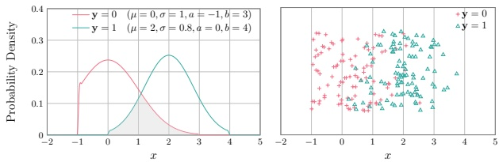
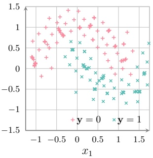
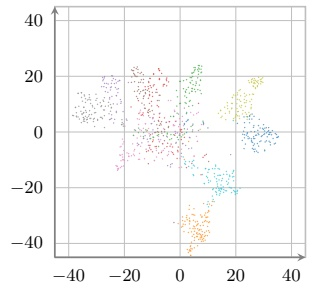
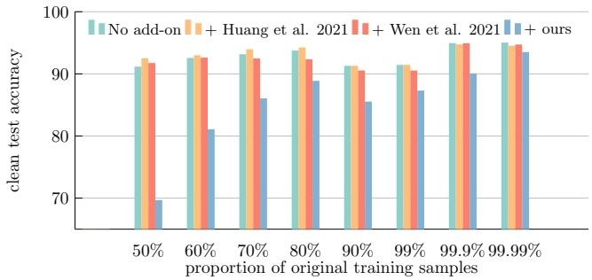

# Hacia provably unlearnable examples mediante Bayes error optimization

**Ruihan Zhang, Jun Sun, Ee-Peng Lim, Peixin Zhang**

1Singapore Management University 81 Victoria St, Singapore, Singapore 188065 pxzhang@smu.edu.sg

## Resumen

El éxito reciente de los modelos de machine learning, especialmente de los clasificadores a gran escala y los modelos de lenguaje, depende en gran medida del entrenamiento con datos masivos. Estos datos se recopilan frecuentemente de fuentes en línea. Esto suscita serias preocupaciones sobre la protección de los datos de los usuarios, ya que las personas pueden no haber otorgado su consentimiento para que sus datos se utilicen en el entrenamiento. Para abordar esta preocupación, estudios recientes introducen el concepto de unlearnable examples, es decir, instancias de datos que parecen naturales pero que se modifican intencionadamente para evitar que los modelos aprendan eficazmente de ellas. Si bien los métodos existentes demuestran efectividad empírica, típicamente se basan en ensayos heurísticos y carecen de garantías formales (formal guarantees). Además, cuando los unlearnable examples se mezclan con clean data, como suele ocurrir en la práctica, su unlearnability desaparece. En este trabajo, proponemos un enfoque novedoso para construir unlearnable examples maximizando sistemáticamente el Bayes error, una medida del error de clasificación irreducible. Desarrollamos un enfoque basado en optimización y proporcionamos una solución eficiente mediante projected gradient ascent. Nuestro método incrementa de forma demostrable (provably) el Bayes error y se mantiene efectivo cuando los unlearnable examples se mezclan con muestras limpias (clean samples). Los resultados experimentales a través de múltiples datasets y arquitecturas de modelos son consistentes con nuestro análisis teórico y demuestran que nuestro enfoque puede restringir la learnability de los datos de manera efectiva en la práctica.

## 1 Introducción

En los últimos años, los modelos de machine learning han demostrado un rendimiento notable en una amplia gama de tareas, impulsados por datasets a gran escala y potentes recursos computacionales (Kaplan et al. 2020; He et al. 2016). Sin embargo, este mecanismo centrado en los datos también suscita serias preocupaciones respecto a la propiedad intelectual y al control sobre el uso de los datos (Yeom et al. 2018; Huang et al. 2021). Una vez que los datos se comparten o recopilan, a menudo sin el pleno conocimiento de los usuarios, resulta sumamente difícil restringir su uso posterior o evitar que sean explotados por terceros no autorizados. Por ejemplo, los usuarios de redes sociales comparten gustosamente fotos personales en blogs, pero aun así desean evitar que terceros no autorizados utilicen estas imágenes para el entrenamiento de modelos.

Motivados por la necesidad de protección de datos en el origen, estudios recientes han introducido el concepto de unlearnable examples, un mecanismo de defensa proactivo que aplica perturbaciones imperceptibles a los clean data, volviéndolos unlearnable para los modelos de machine learning (Huang et al. 2021). Retomando el ejemplo anterior, un usuario puede aplicar perturbaciones sutiles e imperceptibles para el ser humano a sus fotos antes de compartirlas, asegurando así que cualquier modelo entrenado con estas imágenes perturbadas tenga un desempeño deficiente al intentar reconocer o analizar el rostro de la persona en imágenes no alteradas (Wen et al. 2023). Esta técnica no solo permite a los propietarios de los datos recuperar el control sobre su información, sino que también introduce una perspectiva novedosa en machine learning al diseñar datos que resisten activamente el aprendizaje.

Los trabajos previos para crear unlearnable examples siguen dos direcciones principales. Una línea de investigación perturba los datos para incrementar la training loss, con el objetivo de obstaculizar que el modelo extraiga patrones útiles (Fowl et al. 2021). Otra línea fomenta el overfitting minimizando el error de entrenamiento, lo que provoca que los modelos incurran en overfitting sobre características no generalizables (Fu et al. 2022). Aunque los métodos existentes muestran efectividad empírica, típicamente requieren alterar la totalidad del training set. En la práctica, sin embargo, los unlearnable examples se mezclan con clean data procedentes de diversas fuentes (Liu, Peng, and Tang 2023; Nakashima et al. 2022; Seddik and Tamaazousti 2022). En tales casos, por ejemplo, entrenar un modelo con unlearnable examples (CIFAR-10 (Krizhevsky, Hinton et al. 2009)) puede producir una test accuracy del 20.50%. Pero cuando estos unlearnable examples se mezclan con el mismo número de ejemplos limpios para el entrenamiento, la test accuracy puede elevarse hasta el 92.51%. Esto limita enormemente la efectividad de los métodos existentes (Huang et al. 2021).

Además, las garantías formales están subestimadas en los métodos existentes, es decir, estas estrategias son heurísticas en lugar de proceder de una derivación sistemática de la unlearnability. Esta ausencia de fundamentación teórica plantea riesgos para la interpretabilidad y la fiabilidad, especialmente en entornos críticos para la seguridad (Wu et al. 2018). Por lo tanto, existe una necesidad apremiante de un marco claro que no solo proporcione theoretical guarantees para la unlearnability, sino que también se mantenga eficaz bajo condiciones realistas donde coexisten clean data y unlearnable data.

En este trabajo, partimos del concepto de aprendizaje estadístico de Bayes error, que es la tasa de error de clasificación de la regla Maximum A Posteriori (Fukunaga 1990). En esencia, el Bayes error cuantifica la dificultad inherente de la clasificación para una distribución de datos dada. Aquí, aprovechamos el Bayes error como una medida eficaz de la unlearnability de los datos, es decir, un mayor Bayes error significa que los datos son más difíciles de aprender (more unlearnable). Por consiguiente, al incrementar sistemáticamente el Bayes error mediante perturbaciones acotadas, podemos asegurar que los ejemplos perturbados se vuelvan demostrablemente más difíciles de aprender (provably harder to learn from), independientemente del algoritmo de entrenamiento. Además, este método sigue siendo eficaz incluso cuando los unlearnable examples se mezclan con clean samples.

<small>\*Autor de correspondencia. Copyright © 2026, Association for the Advancement of Artificial Intelligence (www.aaai.org). Todos los derechos reservados.</small>

Para incrementar el Bayes error, formulamos un problema de optimización para maximizar el Bayes error estimado bajo restricciones acotadas por normas (para preservar la calidad de los datos). Al resolver este problema de optimización, presentamos una solución eficiente mediante projected gradient ascent (Bertsekas 2003). Demostramos mediante un análisis teórico que se garantiza el incremento del Bayes error. Posteriormente, evaluamos nuestro método e implementación a través de exhaustivos estudios empíricos. Los resultados experimentales demuestran que nuestro enfoque conduce sistemáticamente a una caída en la test accuracy. Por ejemplo, en un training set de CIFAR-10 con 50% de ejemplos limpios y 50% de unlearnable examples, entrenar únicamente sobre la mitad limpia proporciona una test accuracy del 91.16%. Agregar unlearnable examples de métodos existentes incrementa la accuracy al 92.51%, lo cual frustra el propósito de ser unlearnable. En contraste, el uso de nuestro método la reduce al 69.68%. Esto demuestra que nuestro método produce eficazmente unlearnable examples. Nuestro código está disponible (Anonymous 2025).

## 2 Preliminares y definición del problema

Primero describimos el contexto de machine learning, incluyendo distribuciones, algoritmos de aprendizaje y el concepto de unlearnable examples. Luego, definimos nuestro problema de investigación.

**Notaciones en machine learning** Sea D una distribución de probabilidad conjunta para variables aleatorias $\mathbf { x } \in \mathbb { X }$ e $\mathbf { y } \in \mathbb { Y }$ , tal que para algún entero positivo n, una muestra de D se captura mediante $\{ ( x _ { 1 } , \tilde { y _ { 1 } } ) , ( x _ { 2 } , y _ { 2 } ) , \tilde { \ldots } , ( x _ { n } , y _ { n } ) \}$ o ${ \{ ( x _ { i } , y _ { i } ) \} _ { i = 1 } ^ { n } } { \sim D }$ , donde n es el tamaño muestral.

En lo que respecta al machine learning relativo a $D ,$ consideramos a X un espacio de características de entrada y a Y un espacio de etiquetas. Además, denotamos una función de modelo (aprendiz) $h : \mathbb { X } \to \mathbb { Y }$ que predice salidas $h ( x ) \in \mathbb { Y }$ basándose en un punto de entrada (posiblemente de alta dimensión) $\dot { x } \in \mathbb { X }$ . La calidad de un modelo puede medirse mediante $\operatorname { E } _ { \mathbf { x } , \mathbf { y } \sim D } \left[ \ell ( h , \mathbf { x } , \mathbf { y } ) \right]$ con una loss function dependiente del problema $\ell ( \tilde { h } , x , y )$ (Zhang 2004).

**Unlearnable examples** En este trabajo, exploramos un escenario en el que parte de los datos de entrenamiento necesita ser protegida para evitar que el modelo aprenda de ella. Un defensor puede leer el dataset de entrenamiento original $\{ ( x _ { i } , y _ { i } ) \} _ { i = 1 } ^ { n } \sim D$ , y puede aplicar pequeñas perturbaciones $\Delta x _ { i }$ a estas muestras. Típicamente, tenemos $\left\| \Delta x _ { i } \right\| _ { p } \leq \epsilon \; ( \epsilon   >   0$ limita el rango de perturbación dentro de una norma Lp) de modo que la calidad de los datos no se vea afectada para la percepción humana. Esto resulta en el dataset $\{ ( x _ { i } ^ { \prime } , y _ { i } ) \} _ { i = 1 } ^ { n }$ , donde $\forall i   \in   \widetilde { 1 , \ldots , n , x _ { i } ^ { \prime } }   =   x _ { i }   +   \Delta x _ { i }$ . El objetivo es que cuando un modelo arbitrario se entrene sobre $\{ ( x _ { i } ^ { \prime } , y _ { i } ) \} _ { i = 1 } ^ { n }$ (y posiblemente con datos adicionales distintos de $\{ ( x _ { i } , y _ { i } ) \} _ { i = 1 } ^ { n }$ ), el modelo resultante tenga un desempeño deficiente en testing (o al menos peor que un modelo entrenado sin los ejemplos perturbados). Formalmente, sea h un modelo seleccionado por un algoritmo de aprendizaje arbitrario $\overline { { \Gamma } } ( \cdot )$ tal que $h = \Gamma ( x _ { 1 } + \dot { \Delta x _ { 1 } } , y _ { 1 } , \dot { \ldots } , x _ { n } + \dot { \Delta x _ { n } } , y _ { n } )$ , y este objetivo podría expresarse como

$$
\max \min _ {h \in \mathbb {H}} \mathrm{E} _ {\mathbf {x}, \mathbf {y} \sim D} [ \ell (h, \mathbf {x}, \mathbf {y}) ], \tag {1}
$$

$$
\mathrm{s.t.} \quad \forall i \in 1, 2, \dots , n, \quad \| \Delta x _ {i} \| _ {p} \leq \epsilon
$$

donde H es el espacio de posibles modelos que pueden seleccionarse. El problema de optimización (1) representa una formulación de optimización binivel (bilevel optimisation), es decir, la minimización aquí entrena $h ,$ y la maximización manipula $\Delta x _ { i }$ para evitar que el h entrenado tenga un buen rendimiento en testing.

En la práctica, en lugar de resolver el problema de optimización (1), se abordan dos problemas de optimización alternativos, como se muestra en el problema de optimización (2) y el problema de optimización (3).

$$
\max _ {\Delta x _ {i}} \min _ {h \in \{\mathbb {X} \rightarrow \mathbb {Y} \}} \frac {1}{n} \sum_ {i = 1} ^ {n} \ell_ {\text {train}} \left(h, x _ {i} + \Delta x _ {i}, y _ {i}\right) \tag {2}
$$

$$
\min _ {\Delta x _ {i}} \min _ {h \in \{\mathbb {X} \rightarrow \mathbb {Y} \}} \frac {1}{n} \sum_ {i = 1} ^ {n} \ell_ {\text {train}} \left(h, x _ {i} + \Delta x _ {i}, y _ {i}\right) \tag {3}
$$

La intuición detrás del problema de optimización (2) es que si la training loss se mantiene alta y el modelo no logra ajustarse a los datos de entrenamiento, entonces naturalmente no se ha transferido mucha información al modelo. Por el contrario, para el problema de optimización (3), la idea es que si la training loss es muy baja y el modelo incurre en overfitting sobre los datos de entrenamiento, entonces lo que se ha aprendido podría no generalizar adecuadamente.

## Definición del problema

A continuación, definimos nuestro problema. Aunque se ha demostrado que los métodos existentes son relativamente efectivos en algunas configuraciones, sufren de dos deficiencias principales. Primero, y más importante, solo funcionan si todo el dataset de entrenamiento está compuesto por unlearnable examples, lo cual difícilmente resulta práctico. Segundo, estas estrategias no vienen acompañadas de una garantía formal (formal guarantee) para el incremento de la unlearnability. Para abordar las deficiencias mencionadas anteriormente, nuestro objetivo es desarrollar un método con fundamentación teórica tal que funcione incluso si solo una pequeña porción de los datos se perturba para volverse unlearnable.

## 3 Construcción de unlearnable examples

Proponemos un enfoque novedoso para construir unlearnable examples. Comenzamos formalizando la unlearnability de los datos en función del Bayes error, y luego introducimos una estimación diferenciable a partir de muestras. Además, diseñamos un método para incrementar de forma demostrable el Bayes error con el fin de obstaculizar el aprendizaje, y discutimos si dicho enfoque funciona en el escenario práctico donde coexisten datos limpios (clean data) y datos no aprendibles (unlearnable data).

## 3.1 Bayes error como medida de unlearnability

Nos enfocamos en el problema de clasificación en este trabajo. En dicho escenario, el Bayes error representa el error mínimo inevitable de cualquier clasificador. Se define como la probabilidad de error esperada de la regla maximum a posteriori. Formalmente, dada una distribución D sobre $\mathbb { X } \times \mathbb { Y }$ , el Bayes error (rate) de $D$ puede expresarse (Fukunaga 1990; Garber and Djouadi 1988) como:

$$
\mathrm{E} _ {\mathbf {x} \sim D _ {\mathbf {x}}} \left[ 1 - \max _ {c} p (\mathbf {y} = c | \mathbf {x}) \right] \tag {4}
$$

Como se muestra en el problema de optimización (1), un modelo intenta aprender de los datos minimizando el error de predicción, que es el objetivo que el defensor busca contrarrestar incrementando dicho error. Dado que el Bayes error representa el error mínimo inevitable de cualquier clasificador, proporciona una cota superior fundamental sobre el desempeño del modelo en el mundo real. Por lo tanto, al incrementar el Bayes error, el defensor reduce efectivamente la cota superior del desempeño del modelo, lo que equivale a incrementar la unlearnability de los datos, mejorando consecuentemente dicha unlearnability.

## 3.2 Incremento del Bayes error dadas muestras finitas.

Si bien el cálculo del Bayes error es directo cuando se conoce la distribución (Ec. (4)), no resulta evidente cómo calcular el Bayes error a partir de muestras. Con este propósito, primero presentamos cómo aproximar el Bayes error a partir de muestras, y luego proponemos un método para incrementar sistemáticamente el Bayes error.

**Estimación del Bayes error mediante promediado posterior local** Dados únicamente datos muestreados $\{ ( x _ { i } , y _ { i } ) \} _ { i = 1 } ^ { n } \stackrel { \small { } } { \sim } D$ , en lugar de la distribución D, no tenemos acceso a la distribución a posteriori verdadera $p _ { D } ( \mathbf { y } \mid \mathbf { x } )$ . El posterior puede parecer cuantificable a través de la siguiente expresión:

$$
\hat {p} _ {D} (\mathbf {y} \mid \mathbf {x} = x) = \frac {\sum_ {j} \llbracket (x _ {i} = x) \wedge (\mathbf {y} = y _ {j}) \rrbracket}{\sum_ {i} \llbracket x _ {i} = x \rrbracket} \tag {5}
$$

La Ec. (5) mide la frecuencia de cada resultado. Sin embargo, es probable que algunos resultados nunca se observen, p. ej., cuando el espacio X es continuo, haciendo que la Ec. (5) quede indefinida. Para resolver este inconveniente, presentamos el Algoritmo 1 para estimar el Bayes error, donde la función de similitud s puede definirse de acuerdo con el patrón de la distribución conjunta, p. ej., una función de kernel gaussiano

$$
s (x _ {1}, x _ {2}) = \exp (- \| x _ {1} - x _ {2} \| ^ {2} / 2 \sigma^ {2}). \tag {6}
$$

## Algoritmo 1: Local posterior averaging

**Requerimientos:** Datos muestreados $\{ ( x _ { i } , y _ { i } ) \} _ { i = 1 } ^ { n } ,   \mathbb { Y }$ espacio, función de similitud $s \stackrel { \cdot } { : } \mathbb { X } \times \mathbb { X } \to \stackrel { \cdot } { \mathbb { R } } \stackrel { \cdot \cdot \cdot } { \scriptstyle > 0 }$

**Salida:** Valores a posteriori $\{ \hat { p } _ { D } ^ { - } ( \mathbf { y } \mid \mathbf { x } = x _ { i } ) \} _ { i = 1 } ^ { n }$

1: **para** $i \gets 1 , 2 , \ldots , n$ **hacer**
2: **para** $c \in \mathbb { Y }$ **hacer**
3: $\begin{array} { l } { \hat { \mathbf { \mathit { v } } } \in \mathbf { \mathit { x } } \; \mathbf { \mathit { a s } } } \\ { \hat { p } _ { D } ( \mathbf { \mathit { y } } = c \mid \mathbf { x } = x _ { i } ) \leftarrow \frac { \sum _ { j = 1 , j \neq i } ^ { n } [ y _ { i } = c ] \cdot s ( x _ { j } , x _ { i } ) } { \sum _ { k = 1 , k \neq i } ^ { n } s ( x _ { k } , x _ { i } ) } } \\ \end{array}$
4: **fin para**
5: **fin para**

En esencia, el Algoritmo 1 toma como entrada datos muestreados y para cada x muestreado, proporciona el posterior en dicho x. Esto proporciona entonces los valores a posteriori muestreados y, por ende, los máximos a posteriori muestreados. El Bayes error puede estimarse por tanto como

$$
\hat {\beta} _ {D} = 1 - \frac {1}{n} \sum_ {i} ^ {n} \max _ {c} \hat {p} _ {D} (\mathbf {y} = c \mid \mathbf {x} = x _ {i}), \tag {7}
$$

la cual es la forma de muestra fija de la Ec. (4).

Figura 1: Distribución conjunta de dos distribuciones normales truncadas. (Izquierda) Función de densidad de esta distribución. El área sombreada en gris representa el Bayes error. (Derecha) Muestra extraída de esta distribución. Nótese que las muestras están ubicadas aleatoriamente en la dirección vertical.

Ejemplo 1. Considérese un problema de clasificación binaria en R con dos distribuciones normales truncadas, como se ilustra en la Figura 1. El Bayes error de dicha distribución es 0.1427, el cual puede calcularse analíticamente a partir de la función de densidad de probabilidad (PDF) de distribuciones normales truncadas. La Figura 1 (Derecha) ilustra los datos muestreados extraídos de esta distribución. Al estimar el Bayes error a partir de muestras, una estimación ingenua como la Ec. (5) produce un Bayes error indefinido, debido a que no hay resultados muestreados superpuestos. En contraste, al aplicar el Algoritmo 1 y adoptar la función de base radial (Chang et al. 2010) como similitud, obtenemos 0.1426 como estimación del Bayes error, lo cual se encuentra dentro de un rango de ±0.1% respecto al resultado analítico.

A continuación, establecemos que la estimación del Bayes error presentada mediante promediado posterior local aproxima adecuadamente el resultado analítico.

**Lema 3.1.** Sea s una función de similitud simétrica y no negativa que satisface las siguientes condiciones:

$$
\begin{array}{l} \forall x ^ {\prime}. \quad \int s (x, x ^ {\prime}) d x = 1, \\ \forall \alpha > 0. \quad \int_ {\| x - x ^ {\prime} \| > \alpha} s \left(x, x ^ {\prime}\right) d x \rightarrow 0 \quad a s n \rightarrow \infty , \tag {8} \\ \exists \kappa > 0. \quad \forall x, x ^ {\prime}, n. \quad 0 \leq s (x, x ^ {\prime}) \leq \kappa . \\ \end{array}
$$

La estimación a posteriori del Algoritmo 1 converge a la distribución a posteriori verdadera, es decir,

$$
\mathrm{E} [ | \hat {p} (\mathbf {y} = c \mid \mathbf {x}) - p (\mathbf {y} = c \mid \mathbf {x}) | ] \leq C _ {2} \cdot \sigma^ {2} + \frac {C _ {1}}{\sqrt {n} \sigma^ {d / 2}}. \tag {9}
$$

donde $C _ { 1 }$ y $C _ { 2 }$ son constantes.

La demostración del Teorema 3.1, que aprovecha la derivación del sesgo y la varianza para el estimador de Nadaraya-Watson (Nadaraya 1964; Watson 1964), se proporciona en el material suplementario.

**Teorema 3.2.** Con la estimación a posteriori del Algoritmo 1, la estimación del Bayes error converge al verdadero Bayes error a una tasa de $\begin{array} { r } { 2 \cdot C _ { 2 } \cdot \left| \mathbb { Y } \right| \sigma ^ { 2 } + \frac { 2 \cdot C _ { 1 } \cdot \left| \stackrel { \circ } { \mathbb { Y } } \right| } { \sqrt { n \sigma ^ { d } } } } \end{array}$

Demostración. A partir de la Ec. (4), el exceso de error de clasificación puede expresarse como

$$
\begin{array}{l} \mathrm{E} _ {\mathbf {x}} \left[ 1 - \max _ {c} \hat {p} (\mathbf {y} = c | \mathbf {x}) \right] - \mathrm{E} _ {\mathbf {x}} \left[ 1 - \max _ {c} p (\mathbf {y} = c | \mathbf {x}) \right] \\ \leq 2 \cdot \mathrm{E} _ {\mathbf {x}} \left[ \sum_ {c} | p (\mathbf {y} = c | \mathbf {x}) - \hat {p} (\mathbf {y} = c | \mathbf {x}) | \right] \tag {10} \\ \end{array}
$$

Aplicando ahora la cota del error de estimación a posteriori $\scriptstyle C _ { 2 } \sigma ^ { 2 } + { \frac { \dot { C } _ { 1 } } { \sqrt { n \sigma ^ { d } } } }$ del Teorema $3 . 1$ , donde $C _ { 1 }$ y $C _ { 2 }$ son constantes. Entonces, obtenemos $\begin{array} { l } { \left| \hat { \beta } _ { D } - \beta _ { D } \right| \leq 2 \cdot C _ { 2 } \cdot \left| \mathbb { Y } \right| \sigma ^ { 2 } + \frac { 2 \cdot C _ { 1 } \cdot \left| \mathbb { Y } \right| } { \sqrt { n \sigma ^ { d } } } } \\ \end{array}$ , todavía dentro del mismo orden asintótico. □

**Maximización del Bayes error bajo restricción de perturbación de norma** $L ^ { p } .$ Dados los datos muestreados $\{ ( x _ { i } , y _ { i } ) \} _ { i = 1 } ^ { \bar { n \; } } \; \sim \; D$ , quisiéramos encontrar una distribución $D ^ { \prime }$ cercana a $D$ tal que tengamos $\hat { \beta } _ { D ^ { \prime } }   >   \hat { \beta } _ { D }$ . Específicamente, sea $\{ ( x _ { i } ^ { \prime } , y _ { i } ^ { \prime } ) \} _ { i = 1 } ^ { n }   \sim   D ^ { \prime }$ datos muestreados de $D ^ { \prime }$ , y una restricción de cercanía $L ^ { p }$ entre $D ^ { \prime }$ y $D$ puede expresarse como

$$
\forall i \in [ 1, n ] \cap \mathbb {N}. \quad (y _ {i} ^ {\prime} = y _ {i}) \land \left(\left\| x _ {i} ^ {\prime} - x _ {i} \right\| _ {p} \leq \epsilon\right) \tag {11}
$$

donde $\epsilon > 0$ es el rango de perturbación de $x$ . Dado que $y _ { i } ^ { \prime }$ siempre es igual a $y _ { i }$ para todo $i ,$ usamos $y _ { i }$ siempre que se requiera $y _ { i } ^ { \prime }$ . Aplicando la Ec. (7), podemos estimar el Bayes error de $D ^ { \prime }$ como

$$
\widehat {\beta} _ {D ^ {\prime}} = \frac {1}{n} \sum_ {i = 1} ^ {n} \left(1 - \max _ {c} \hat {p} _ {D ^ {\prime}} \left(\mathbf {y} = c \mid \mathbf {x} = x _ {i} ^ {\prime}\right)\right). \tag {12}
$$

Ahora estamos listos para definir nuestro problema de optimización con restricciones para encontrar $\dot{D}'$ como sigue. En esencia, pretendemos encontrar $x _ { 1 } , \ldots , x _ { n }$ que maximicen la estimación del Bayes error, sujeto a una restricción de norma $L ^ { p }$ .

$$
\begin{array}{l} \max _ {\{x _ {i} \} _ {i = 1} ^ {n}} \quad \frac {1}{n} \sum_ {i = 1} ^ {n} \left(1 - \max _ {c} \frac {\sum_ {j = 1 , j \neq i} ^ {n} \llbracket y _ {i} = c \rrbracket \cdot s (x _ {j} ^ {\prime} , x _ {i} ^ {\prime})}{\sum_ {k = 1 , k \neq i} ^ {n} s (x _ {k} ^ {\prime} , x _ {i} ^ {\prime})}\right) \\ \text {s.t.} \quad \| x _ {i} ^ {\prime} - x _ {i} \| _ {p} \leq \epsilon , \quad \forall i = 1, 2, \dots , n \tag {13} \\ \end{array}
$$

Nótese que la función objetivo en la Ec. (13) es una forma expandida de la Ec. (12) utilizando el Algoritmo 1, y por ende plenamente explícita dados los datos originales $x _ { i } , y _ { i }$ y la función de similitud s. Esta función objetivo también es computacionalmente tratable y diferenciable en casi todas partes.

A continuación, presentamos la solución al problema de optimización anterior. El ascenso de gradiente directo no es aplicable en entornos restringidos, ya que no garantiza que la variable en cada iteración permanezca dentro del conjunto factible. Para solucionar esto, empleamos projected gradient ascent (PGA), un método iterativo de primer orden que impone la factibilidad mediante proyección. El PGA opera realizando un paso estándar de gradiente ascendente seguido de una proyección sobre el conjunto restringido. Los detalles de nuestro enfoque se muestran en el Algoritmo 2.

En esencia, cada iteración del algoritmo de ascenso de gradiente requiere calcular los gradientes de la función objetivo (estimación del Bayes error) con respecto a todas las variables de entrada $\overline { { x _ { i } ^ { \prime } } }$ (línea 4). Luego, utilizamos este gradiente para desplazar el $x _ { i } ^ { \prime }$ actual hacia la dirección donde crece el Bayes error (línea 5). Después de eso, proyectamos el desplazamiento sobre la restricción $\dot { L } ^ { p }$ para obtener un $x _ { i } ^ { \prime }$ factible para el siguiente paso (línea 6). La línea 6 en el Algoritmo 2 da una expresión de forma general para la proyección, y para la norma $L ^ { \infty }$ , una proyección en forma cerrada puede expresarse como $\operatorname* { m a x } ( - \epsilon , \operatorname* { m i n } ( \bar { \mathbf { \delta } } _ { i } ^ { ( t + 1 ) } , \epsilon ) )$ .

Algoritmo 2: Projected gradient ascent para Bayes error

Requerimientos: Datos muestreados $\{ ( x _ { i } , y _ { i } ) \} _ { i = 1 } ^ { n } ,   \mathbb { Y }$ espacio, función de similitud $s : \mathbb { X } \times \mathbb { X } \to \mathbb { R } _ { \geq 0 } ,$ , tamaño de paso $\eta   >   0 ,$ parámetro de restricción $L ^ { p }$ ϵ, iteraciones máximas $T$

Ensure: $\{(x_i^{\prime(T)}, y_i)\}_{i=1}^n$
Initialize $x_i^{\prime(0)} \leftarrow \mathbf{0}, \forall i \in 1, 2, \ldots, n$
for $t \leftarrow 0, 1, \ldots, T-1$ do
    for $i = 1 \ldots n$ do
        $\boldsymbol{g}_i^{(t)} \leftarrow -\nabla_{x_i'} \left( \sum_{i=1}^n \frac{\max_c \hat{p}_{D'} (c|x_i')}n \right) \bigg|_{\forall j.x_j' = x_j'^{(t)}}$
        $\boldsymbol{\delta}_i^{(t+1)} \leftarrow x_i'^{(t)} + \eta \cdot \boldsymbol{g}_i^{(t)} - x_i$
        $\boldsymbol{\delta}_i^{(t+1)} \leftarrow \arg \min_{\boldsymbol{\delta}', \|\boldsymbol{\delta}'\|_p \leq \epsilon} \left\| \boldsymbol{\delta}' - \boldsymbol{\delta}_i^{(t+1)} \right\|_2^2$
        $x_i'^{(t+1)} \leftarrow \boldsymbol{\delta}_i^{(t+1)} + x_i$
    end for
end for

diagrama de flujo

Este diagrama ilustra un grafo dirigido con nodos que representan valores positivos (y=0) y negativos (y=1), mostrando el flujo direccional entre ellos.

Figura 2: Perturbación de puntos bidimensionales.

Nótese que el cómputo del gradiente (Línea 4 en el Algoritmo 2) es un paso fundamental para que funcione el PGA. La Ec. (16) a continuación muestra la derivada parcial de la función objetivo en la Ec. (13) con respecto a cada $x _ { i }$ .

Ejemplo 2. Para ilustrar el efecto de las perturbaciones, presentamos un ejemplo en la Figura 2. Dados datos muestreados de Moons (un dataset de prueba simple de Scikit-learn para visualizar clasificación (Pedregosa et al. 2011; Chen et al. 2023)), nuestro objetivo es perturbar cada punto dentro de una norma $L ^ { \infty }$ , $\mathtt { p .   e j . } , \left\| \Delta x _ { i } \right\| _ { \infty } < 0 . 1 5$ en este ejemplo. A continuación, aplicamos el procedimiento de PGA descrito anteriormente para obtener perturbaciones $\delta _ { i } ^ { * }$ para cada muestra, restringidas por $\| \pmb { \delta } _ { i } \| _ { 2 } \leq \epsilon ,$ con $\epsilon = 0 . 1 5$ . Luego, de acuerdo con el Algoritmo 2, obtenemos los puntos perturbados. La Figura 2 ilustra la perturbación, así como los puntos perturbados. Posteriormente podemos usar el Algoritmo 1 para hallar que el nuevo valor del Bayes error es 0.1832, un 28% superior al original. Aparte del crecimiento del Bayes error, podemos observar que aunque generalmente el movimiento de cada punto es hacia la otra clase (incrementando la incertidumbre de clasificación), la distancia recorrida no es necesariamente igual a la restricción de perturbación, es decir, 0.15 en este caso. Esto sugiere que, en algunos casos, un desplazamiento mayor no es necesariamente más óptimo.

A continuación, establecemos que la aplicación del Algoritmo 2 puede conducir a un incremento garantizado en el Bayes error.

**Lema 3.3.** Sea $f : \mathbb { R } ^ { d } \to \mathbb { R }$ una función diferenciable con un gradiente continuo κ-Lipschitz. Sea $\mathbb { C }   \subseteq   \mathbb { R } ^ { d }$ un conjunto cerrado y convexo. Sea la actualización de PGA definida como

$$
x ^ {(k + 1)} = \Pi_ {\mathbb {C}} \left(x ^ {(k)} + \eta \nabla f (x ^ {(k)})\right) \tag {14}
$$

con $x ^ { ( 0 ) } \in \mathbb { C } _ { i }$ , y tamaño de paso $\eta \in \left( 0 , \textstyle { \frac { 2 } { \kappa } } \right)$ . Entonces, para todo $k \geq 0 ,$

$$
f (x ^ {(k)}) \geq f (x ^ {(0)}). \tag {15}
$$

La demostración del Teorema 3.3 se encuentra en los materiales suplementarios. A continuación, establecemos que nuestra función objetivo satisface la condición κ-Lipschitz.

**Teorema 3.4.** Existe una constante κ tal que para todo $\eta \in ( 0 , \textstyle { \frac { 2 } { \kappa } } )$ , se cumple que para cualquier $\{ ( x _ { i } ^ { \prime } , y _ { i } ^ { \prime } ) \} _ { i = 1 } ^ { n }$ obtenido del Algoritmo 2, está garantizado que $\hat { \beta } _ { D ^ { \prime } } \geq \hat { \beta } _ { D }$ .

Demostración. Consideramos la función objetivo en la Ec. (13) como una función $f _ { 1 } : \mathbb { X } ^ { n } \times \mathbb { Y } ^ { n } \to \mathring { \mathbb { R } }$ , y el rango de perturbación como un conjunto $\mathbb { C } \subseteq \dot { \mathbb { X } } ^ { n }$ . Primero, demostramos que esta función objetivo es una función diferenciable con un gradiente continuo κ-Lipschitz. Específicamente, la derivada parcial (de $f _ { 1 } )$ con respecto a cada variable puede expresarse como en la Ec. (16).

$$
\begin{array}{l} \nabla_ {x _ {i} ^ {\prime}} \left(\frac {1}{n} \sum_ {i = 1} ^ {n} \left(1 - \max _ {c} \frac {\sum_ {j = 1 , j \neq i} ^ {n} \llbracket y _ {i} = c \rrbracket \cdot s (x _ {j} ^ {\prime} , x _ {i} ^ {\prime})}{\sum_ {k = 1 , k \neq i} ^ {n} s (x _ {k} ^ {\prime} , x _ {i} ^ {\prime})}\right)\right) \\ = - \frac {1}{n} \sum_ {j = 1, j \neq i} ^ {n} \left(\frac {1}{(\sum_ {k} s (x _ {i} ^ {\prime} , x _ {k} ^ {\prime})) ^ {2}} \cdot \max _ {c} \sum_ {k} ([ y _ {j} = c ] - \right. \\ [ [ y _ {k} = c ]) ] s (x _ {i}, x _ {k}) + \max _ {c} \sum_ {k} ([ [ y _ {i} = c ] ] - \\ \llbracket y _ {k} = c \rrbracket) \left. \frac {1}{\left(\sum_ {k} s \left(x _ {j} ^ {\prime} , x _ {k} ^ {\prime}\right)\right) ^ {2}} \cdot s \left(x _ {j}, x _ {k}\right)\right) \nabla_ {x _ {i} ^ {\prime}} s \left(x _ {i} ^ {\prime}, x _ {j} ^ {\prime}\right) \tag {16} \\ \end{array}
$$

Obsérvese que la función s satisface $\exists \kappa _ { 1 } > 0 . \quad \forall x , x ^ { \prime } . \quad 0 \leq$ $s ( x , x ^ { \prime } ) ~ \leq ~ \kappa _ { 1 }$ . Por tanto, siempre que no ocurra que $\forall i , j , s ( x _ { i } , x _ { j } ) = 0$ , entonces obtenemos que

$$
\left(\exists \kappa_ {2}. \left\| \nabla_ {x _ {i} ^ {\prime}} s \left(x _ {i} ^ {\prime}, x _ {j} ^ {\prime}\right)\right\| \leq \kappa_ {3}\right)\rightarrow \left(\exists \kappa_ {3}. \left\| \nabla_ {x _ {i} ^ {\prime}} f _ {1} \right\| \leq \kappa_ {3}\right). \tag {17}
$$

Es decir, si la función de similitud es κ2-Lipschitz, entonces la función objetivo de la Ec. (16) es κ3-Lipschitz. A continuación, demostramos que el rango de perturbación C es un conjunto cerrado y convexo. A saber, para todos los órdenes mayores que 0, la norma $L ^ { p }$ es cerrada, y para todos los órdenes mayores o iguales a 1, la norma $L ^ { p }$ es convexa. Por consiguiente, aplicando el Teorema 3.3, demostramos que para todo $k \geq 0 ;$

$$
f _ {1} (x _ {1} ^ {(k)}, \dots x _ {n} ^ {(k)}, y _ {1}, \dots) \geq f _ {1} (x _ {1} ^ {(0)}, \dots x _ {n} ^ {(0)}, y _ {1}, \dots). \tag {18}
$$

**Tratamiento de entradas incrustadas (embedded inputs)** La discusión anterior se basa en una representación discreta de las muestras cuya distancia es fácil de medir. En cuanto a entradas complejas, p. ej., imágenes en color, primero podríamos calcular su vector de incrustación (embedding vector) y luego resolver el problema de maximización del Bayes error. Específicamente, sea $m : \mathbb { X } _ { \mathrm { o r i } } \rightarrow \mathbb { X } _ { \mathrm { e m b } }$ la función de incrustación (embedding function) desde el espacio de entrada original $\mathbb { X } _ { \mathrm { o r i } }$ hacia el espacio de incrustación $\mathbb { X } _ { \mathrm { e m b } } .$ En este caso, su similitud se mide en el espacio de incrustación, y la restricción aún se aplica al espacio de entrada original, es decir, la Ec. (13) se convierte en la Ec. (19) y m necesita ser conocida.

$$
\begin{array}{l} \min _ {\{x _ {i} \} _ {i = 1} ^ {n}} \sum_ {i = 1} ^ {n} \left(\max _ {c} \frac {\sum_ {j = 1 , j \neq i} ^ {n} \left[ \left[ y _ {i} = c \right] \right] \cdot s (m (x _ {j} ^ {\prime}) , m (x _ {i} ^ {\prime}))}{\sum_ {k = 1 , k \neq i} ^ {n} s (m (x _ {k} ^ {\prime}) , m (x _ {i} ^ {\prime}))}\right) \\ \text {s.t.} \| x _ {i} ^ {\prime} - x _ {i} \| _ {p} \leq \epsilon , \quad \forall i = 1, 2, \dots , n \tag {19} \\ \end{array}
$$

## 3.3 Mezcla de ejemplos limpios y unlearnable examples

En la práctica, es poco probable que los modelos se entrenen exclusivamente con datos no aprendibles perturbados. Para modelar esta situación, ajustamos la Ec. (13) permitiendo que algunas perturbaciones sean 0. Es decir, para algunos (pero no todos) i en $1 , 2 , \ldots , n ,$ se restringe que $x _ { i } ^ { \prime } = x _ { i } .$ Intuitivamente, este podría ser un caso en el que el adversario podría aprovechar datos disponibles públicamente para aumentar el entrenamiento, mientras que el defensor no puede modificar todos los datos públicos. A continuación, demostramos en el Corolario 3.5 que el Algoritmo 2 aún puede incrementar eficazmente el Bayes error.

**Corolario 3.5.** Dado $\{ ( x _ { i } , y _ { i } ) \} _ { i = 1 } ^ { n } , \mathit { s e a }   \mathbb { I } _ { n } \subset \mathbb { N } \cap [ 1 , n ] , \mathbb { I } _ { n } \neq \emptyset$ un subconjunto de todos los índices. Supóngase que para todos los índices j en $\mathbb{I}_n$, se restringe que $\Delta x _ { j }   =   0 .$ Se deduce que las perturbaciones restantes pueden incrementar el Bayes error, es decir, se satisface la siguiente condición:

$$
(\forall j \in \mathbb {I} _ {n}. \Delta x _ {j} = 0) \land
$$

$$
\left(1 - \frac {1}{n} \sum_ {i} ^ {n} \max _ {c} \hat {p} _ {D} \left(\mathbf {y} = c \mid \mathbf {x} = x _ {i} ^ {\prime}\right) \geq \right. \tag {20}
$$

$$
\left. 1 - \frac {1}{n} \sum_ {i} ^ {n} \max _ {c} \hat {p} _ {D} (\mathbf {y} = c \mid \mathbf {x} = x _ {i})\right)
$$

La demostración del Teorema 3.5 se encuentra en los materiales suplementarios.

## 4 Experimentos

Llevamos a cabo experimentos para evaluar la efectividad empírica del método propuesto, con el objetivo de responder a las siguientes preguntas de investigación (RQs):

1. ¿Cómo afecta la perturbación propuesta al Bayes error?
2. ¿Conduce el entrenamiento con nuestros unlearnable examples a una menor test accuracy? ¿Qué sucede cuando solo un subconjunto de los datos de entrenamiento se vuelve unlearnable?
3. ¿Cómo se desempeña nuestro método frente a ataques adaptativos como el adversarial training?

**Configuración experimental** Seguimos las configuraciones experimentales estándar establecidas en trabajos previos (Huang et al. 2021; Wen et al. 2023), y evaluamos nuestro método en tres benchmarks de clasificación de imágenes: CIFAR-10, CIFAR-100 (Krizhevsky, Hinton et al. 2009) y Tiny ImageNet (Le and Yang 2015). Las perturbaciones están limitadas dentro de una cota de norma $L ^ { \infty }$ de $\epsilon = 8 / 2 5 5$ por imagen. Para la extracción de características (feature extraction), adoptamos el modelo ResNet-18 comúnmente utilizado (He et al. 2016; Robey et al. 2022; Zhang et al. 2019; Wang et al. 2020). Todos los modelos se entrenan durante 100 epochs utilizando stochastic gradient descent (Robbins and Monro 1951) con una learning rate de 0.1, momentum de 0.9, weight decay de $5 \times 1 0 ^ { - 4 }$ y un esquema de learning rate con cosine annealing (Loshchilov and Hutter 2017). Para nuestra implementación de optimización, formulamos un objetivo de Bayes error autodiferenciable en PyTorch (Paszke et al. 2019), permitiendo el cómputo de gradientes en el espacio de entrada a través de back propagation. Se proporcionan detalles experimentales adicionales en las subsecciones correspondientes.

dispersión

| Serie | x1 (rango) | x2 (rango) |
| --- | --- | --- |
| y = 0 | -1.0~1.2 | 0.0~1.2 |
| y = 1 | -0.1~1.7 | -0.7~0.6 |

(a) Moons (βˆ = 0.1434)

dispersión

| Serie | x1 (rango) | Y (rango) |
| --- | --- | --- |
| y = 0 | -1.2~1.4 | -0.2~1.4 |
| y = 1 | -0.2~1.7 | -0.9~0.7 |

(b) Moons (βˆ = 0.1888)

dispersión

| Serie | X (rango) | Y (rango) |
| --- | --- | --- |
| Azul | -5~5 | 35~45 |
| Verde | -10~0 | 5~20 |
| Amarillo | 15~25 | 15~25 |
| Morado | -20~-10 | 5~10 |
| Rosa | -10~0 | -10~0 |
| Naranja | 10~20 | -40~-35 |
| Cian | 30~40 | -10~-5 |
| Gris | -40~-30 | -5~5 |
| Rojo oscuro | -20~-10 | -20~-10 |

(c) CIFAR-10 $( \hat { \beta } = 0 . 0 5 6 5 )$

dispersión

| Serie | X (rango) | Y (rango) |
| --- | --- | --- |
| Gris oscuro | -40~-20 | 0~15 |
| Morado | -25~-15 | -15~20 |
| Rojo | -15~-5 | -10~20 |
| Verde | 0~10 | 0~25 |
| Amarillo | 15~30 | 0~20 |
| Azul | 20~35 | -10~0 |
| Cian | 5~20 | -30~-10 |
| Naranja | 0~10 | -45~-30 |

(d) CIFAR-10 $( \hat { \beta } = 0 . 2 4 5 3 )$

Figura 3: Ejemplos antes y después de la perturbación

gráfico de barras

| Proporción de muestras originales de entrenamiento | No add-on | + Huang et al. 2021 | + Wen et al. 2021 | + nuestro |
| --- | --- | --- | --- | --- |
| 50% | ~91 | ~92.5 | ~91.5 | ~70 |
| 60% | ~92.5 | ~93 | ~92.5 | ~81 |
| 70% | ~93 | ~94 | ~92.5 | ~86 |
| 80% | ~94 | ~94 | ~92.5 | ~89 |
| 90% | ~91 | ~91 | ~90.5 | ~85.5 |
| 99% | ~91 | ~91 | ~90.5 | ~87.5 |
| 99.9% | ~95 | ~95 | ~95 | ~90 |
| 99.99% | ~95 | ~94.5 | ~94.5 | ~93.5 |

Figura 4: Test accuracy en cada configuración. “No add-on” significa entrenar únicamente en parte del training set original.

## 4.1 RQ1: El cambio en el Bayes error

Estudiamos empíricamente cómo cambia el Bayes error tras perturbar las entradas de datos mediante nuestro método. Como ilustración intuitiva, realizamos primero el experimento sobre Moons (un dataset de prueba simple para visualizar clasificación (Pedregosa et al. 2011; Chen et al. 2023)), que consta de dos semicírculos entrelazados. En la Figura 3a se muestra una muestra de 200 puntos. Luego aplicamos el Algoritmo 2 con ϵ = 0.25 para construir unlearnable examples, lo que resulta en la distribución mostrada en la Figura 3b. Los ejemplos perturbados aparecen más dispersos dentro de cada clase, y los ejemplos de diferentes clases se aproximan entre sí. Esto reduce la separación interclase, conduciendo a un incremento del 24.3% en el Bayes error, de 0.1434 (original) a 0.1888 (unlearnable).

A continuación, extendemos nuestro experimento a datos de imágenes de alta dimensión. Como se muestra en la Figura 3c, la visualización t-SNE del training set original de CIFAR-10 exhibe características de clase bien separadas. Tras aplicar el Algoritmo 2, el dataset no aprendible resultante (visualizado en la Figura 3d) muestra un solapamiento significativo de características entre clases, lo que hace que los datos sean intuitivamente menos aprendibles. En correspondencia, el Bayes error se incrementa significativamente de 0.0565 a 0.2453, lo que representa un aumento superior a 3.3x. Estos resultados confirman que nuestro método incrementa efectivamente el Bayes error.

## 4.2 RQ2: Efectividad de los unlearnable examples

Para evaluar la efectividad de nuestros unlearnable examples, los utilizamos para el entrenamiento y posteriormente medimos la test accuracy. La test accuracy es una medida empírica de la unlearnability. Intuitivamente, si la test accuracy se mantiene alta, es posible que los datos de entrenamiento no sean suficientemente no aprendibles. Como referencia, entrenar en el conjunto original completo de CIFAR-10 (entrenamiento) arroja una test accuracy del 95.12%.

Primero entrenamos sobre nuestro conjunto completo no aprendible y observamos una test accuracy del 28.12% en CIFAR-10, lo que evidencia una caída de accuracy de más del 70% respecto al 95.12%. Luego, exploramos configuraciones de datos mixtos, p. ej., reemplazar la mitad de las muestras de entrenamiento originales con muestras no aprendibles da como resultado una test accuracy del 69.68%, con una caída del 27% respecto al 95.12%. Para aislar aún más el efecto de los unlearnable examples, entrenamos únicamente sobre la mitad original sin ningún añadido de datos no aprendibles, logrando una accuracy del 91.16%, más de un 30% superior al 69.68%. Esto sugiere que incluir unlearnable examples degrada el desempeño del modelo.

Ajustamos iterativamente la proporción de datos originales/no aprendibles en la mezcla para reflejar escenarios realistas donde los datos protegidos constituyen una minoría. Como se muestra en la Figura 4, reportamos la test accuracy bajo proporciones variables de muestras originales conservadas (razón de # original / # original y no aprendible). Incluimos dos métodos de referencia representativos, uno minimizando la training loss y el otro maximizando la training loss. Específicamente, Huang et al. (2021) introducen ruido correlacionado con la etiqueta para crear características atajo (shortcut features) que obstaculizan el aprendizaje significativo. En contraste, Wen et al. (2023) identifican el centro de incrustación de cada clase y alejan las instancias individuales de este, reduciendo la coherencia intraclase.

En comparación con los métodos de referencia, nuestro método induce sistemáticamente mayores caídas de accuracy, en promedio, un 8% más que Huang et al. (2021) y un 9% más que Wen et al. (2023). Más importante aún, nuestros ejemplos causan una disminución constante de la accuracy en todas las configuraciones. En contraste, los métodos previos pueden actuar ocasionalmente como datos de entrenamiento adicionales e incluso mejorar la accuracy cuando se mezclan (p. ej., al 50% (Huang et al. 2021)). Estos resultados demuestran que nuestros unlearnable examples no solo son efectivos en escenarios de entrenamiento completo, sino que también degradan más el rendimiento cuando se utilizan únicamente como una parte.

gráfico de barras

| Proporción de muestras originales de entrenamiento | No add-on (CIFAR-100) | + nuestro (CIFAR-100) | No add-on (Tiny ImageNet) | + nuestro (Tiny ImageNet) |
| --- | --- | --- | --- | --- |
| 0% | — | ~23 | — | ~1 |
| 50% | ~66 | ~42 | ~62 | ~33 |
| 60% | ~67 | ~45 | ~63 | ~41 |
| 70% | ~69 | ~56 | ~65 | ~46 |
| 80% | ~69 | ~62 | ~66 | ~48 |
| 90% | ~71 | ~66 | ~67 | ~58 |
| 99% | ~71 | ~68 | ~68 | ~60 |
| 99.9% | ~71 | ~68 | ~68 | ~60 |
| 99.99% | ~71 | ~68 | ~68 | ~61 |

Figura 5: Test accuracy para datasets complejos

| Arquitectura del modelo | clean | nuestro |
| --- | --- | --- |
| ResNet-18 | 95.04 | 28.12 |
| ResNet-34 | 95.12 | 29.86 |
| VGG-19 | 91.70 | 18.14 |
| DenseNet-121 | 95.06 | 25.89 |
| MobileNet v2 | 93.30 | 30.54 |

Tabla 1: Test accuracy cuando se utilizan unlearnable examples en el entrenamiento con diversas arquitecturas

**Efectividad en datasets complejos** La Figura 5 ilustra los resultados experimentales en datasets más complejos, CIFAR-100 y Tiny ImageNet. En todas las proporciones de mezcla, incluyendo el caso en que se entrena completamente con unlearnable examples, nuestros ejemplos construidos causan sistemáticamente una caída notable en la test accuracy. Estos resultados confirman aún más la efectividad general de nuestro método en datasets más grandes y desafiantes.

**Transferibilidad a arquitecturas de modelos no vistas** Para transformar los datos de imágenes en un espacio de incrustación, utilizamos un feature extractor ResNet-18 (He et al. 2016). Una pregunta natural es si los unlearnable examples construidos siguen siendo efectivos cuando se utiliza una arquitectura de modelo diferente para el entrenamiento. Para investigar esto, seguimos a Wen et al. (2023) y evaluamos cuatro arquitecturas alternativas, cuyos resultados se resumen en la Tabla 1. En todas las arquitecturas, entrenar con nuestros unlearnable examples de CIFAR-10 produce de manera consistente una menor accuracy en comparación con el entrenamiento con clean data. La caída promedio de accuracy es del 68% (±10%), coincidiendo estrechamente con la caída observada con ResNet-18 (28.12%, ±5%), lo que sugiere que la efectividad de nuestros ejemplos generaliza adecuadamente a través de diferentes arquitecturas de modelos.

## 4.3 RQ3: Resistencia al adversarial training

Debido a su potencial publicación abierta, una vez construidos, los unlearnable examples ya no son modificables por el defensor. Esto puede colocarlos en desventaja, especialmente cuando se sabe que los datos han sido perturbados intencionadamente. En tales casos, se pueden aplicar contramedidas como el adversarial training para extraer forzosamente información de estos ejemplos. Para evaluar la efectividad de nuestro enfoque en este escenario, realizamos experimentos utilizando adversarial training basado en PGD (Madry et al. 2018; Wen et al. 2023), una estrategia adaptativa comúnmente adoptada, sobre nuestros unlearnable examples construidos. La Figura 6 presenta el rendimiento del modelo a lo largo de las iteraciones de entrenamiento. En comparación con el entrenamiento estándar sobre clean data, nuestros unlearnable examples conducen consistentemente a una menor accuracy. Notablemente, bajo adversarial training, el modelo alcanza solo un 74.5% de test accuracy, lo cual es un 21.5% inferior a la del entrenamiento con ejemplos originales. Esta caída sustancial hace que el modelo resultante sea en gran medida inutilizable en la práctica.

gráfico de líneas

| epochs | Entrenamiento con clean | Entrenamiento con unlearnable | Adversarial training con unlearnable |
| --- | --- | --- | --- |
| 0 | 0 | 0 | 0 |
| 10 | ~83 | ~18 | ~48 |
| 20 | ~79 | ~20 | ~55 |
| 30 | ~87 | ~21 | ~58 |
| 40 | ~88 | ~22 | ~60 |
| 50 | ~91 | ~22 | ~64 |
| 60 | ~92 | ~23 | ~66 |
| 70 | ~91 | ~25 | ~68 |
| 80 | ~94 | ~28 | ~71 |
| 90 | ~93 | ~28 | ~73 |
| 100 | ~95 | ~28 | ~74 |

Figura 6: Test accuracy en cada iteración

## 5 Trabajos relacionados

La idea de proteger los datos en el origen ha cobrado una atención creciente debido a las crecientes preocupaciones sobre el uso no autorizado de datos. Huang et al. (2021) y Ren et al. (2022) introdujeron el concepto de unlearnable examples, donde se aplican perturbaciones imperceptibles para hacer que los datos sean intrínsecamente difíciles de aprender. Los enfoques para construir unlearnable examples han seguido típicamente dos heurísticas: (1) maximizar la training loss para evitar que los modelos ajusten características útiles (Wen et al. 2023; Fowl et al. 2021), y (2) minimizarla para fomentar el overfitting en patrones no generalizables (Huang et al. 2021; Fu et al. 2022). También existen otros enfoques (Liu, Wang, and Gao 2024; Liu et al. 2024; Liu, Peng, and Tang 2023; Mu and Lim 2025), que incluyen optimizar directamente las perturbaciones para parámetros de modelo específicos (Lu, Kamath, and Yu 2023) o escenarios de reentrenamiento objetivo utilizando técnicas conscientes de la agudeza (sharpness-aware techniques) (He et al. 2023). Se ha descubierto que tales unlearnable examples creados funcionan de manera ineficaz cuando se mezclan con clean data y carecen de garantías formales (formal guarantees). Por tanto, este trabajo tiene como objetivo abordar el problema de garantizar la unlearnability incluso en la situación de datos mixtos.

La estimación del Bayes error de una distribución de datos dada ha sido durante mucho tiempo un tema de interés (Fukunaga and Hostetler 1975). Los métodos relacionados incluyen estimar sus cotas inferior o superior, p. ej., la distancia de Bhattacharyya (Fukunaga 1990) o la divergencia de Henze-Penrose (Berisha et al. 2016; Sekeh, Oselio, and Hero 2020). Alternativamente, existen intentos de estimar el Bayes error utilizando modelos generativos (Kingma and Dhariwal 2018; Theisen et al. 2021) o anotaciones humanas del mundo real (Renggli et al. 2021). La estimación indirecta del Bayes error también se ha adoptado mediante la sustitución de cantidades, p. ej., de accuracy a robustez (Zhang and Sun 2024a,b). En comparación con estas estimaciones, nuestra estimación del Bayes error es más fácil de calcular, con el fin de modelar y mejorar la unlearnability.

## 6 Conclusión

Proponemos un objetivo formal para incrementar la unlearnability mediante el aumento del Bayes error, y una estrategia de projected gradient ascent para asegurar su crecimiento en la práctica. Los experimentos confirman que nuestro método reduce sistemáticamente la test accuracy, incluso si los datos de entrenamiento son una mezcla de ejemplos limpios y no aprendibles. En general, ofrece un enfoque eficaz para la protección de datos de los usuarios. En el futuro, una dirección interesante es extender nuestro marco para proteger datos frente a modelos generativos, tales como las redes generativas antagónicas (generative adversarial networks).

## Agradecimientos

Esta investigación cuenta con el apoyo del Ministry of Education, Singapore bajo su Academic Research Fund Tier 3 (Award ID: MOET32020-0004).

## Referencias

- Anonymous. 2025. Unlearnable Examples (GitHub repository). https://github.com/cat-claws/unlearnable. Accessed: 2025-11-11.
- Berisha, V.; Wisler, A.; Hero, A. O.; and Spanias, A. 2016. Empirically Estimable Classification Bounds Based on a Non-parametric Divergence Measure. IEEE Transactions on Sig nal Processing, 64(3): 580–591.
- Bertsekas, D. P. 2003. On the Goldstein-Levitin-Polyak gradient projection method. IEEE Transactions on automatic control, 21(2): 174–184.
- Chang, Y.-W.; Hsieh, C.-J.; Chang, K.-W.; Lin, C.-J.; et al. 2010. Training and testing low-degree polynomial data mappings via linear svm. Journal of Machine Learning Research, 11(4).
- Chen, Q.; Cao, F.; Xing, Y.; and Liang, J. 2023. Evaluating Classification Model Against Bayes Error Rate. IEEE Transactions on Pattern Analysis and Machine Intelligence, 45(8): 9639–9653.
- Fowl, L.; Goldblum, M.; Chiang, P.-y.; Geiping, J.; Czaja, W.; and Goldstein, T. 2021. Adversarial examples make strong poisons. Advances in Neural Information Processing Systems, 34: 30339–30351.
- Fu, S.; He, F.; Liu, Y.; Shen, L.; and Tao, D. 2022. Robust unlearnable examples: Protecting data against adversarial learning. arXiv preprint arXiv:2203.14533.
- Fukunaga, K. 1990. Introduction to Statistical Pattern Recognition (2nd Ed.). USA: Academic Press Professional, Inc. ISBN 0122698517.
- Fukunaga, K.; and Hostetler, L. 1975. k-nearest-neighbor Bayes-risk estimation. IEEE Transactions on Information Theory, 21(3): 285–293.
- Garber, F.; and Djouadi, A. 1988. Bounds on the Bayes classification error based on pairwise risk functions. IEEE Transactions on Pattern Analysis and Machine Intelligence, 10(2): 281–288.
- He, K.; Zhang, X.; Ren, S.; and Sun, J. 2016. Deep Residual Learning for Image Recognition. In 2016 IEEE Conference on Computer Vision and Pattern Recognition (CVPR), 770–778.
- He, P.; Xu, H.; Ren, J.; Cui, Y.; Liu, H.; Aggarwal, C. C.; and Tang, J. 2023. Sharpness-aware data poisoning attack. arXiv preprint arXiv:2305.14851.
- Huang, H.; Ma, X.; Erfani, S. M.; Bailey, J.; and Wang, Y. 2021. Unlearnable Examples: Making Personal Data Unexploitable. In International Conference on Learning Representations.
- Kaplan, J.; McCandlish, S.; Henighan, T.; Brown, T. B.; Chess, B.; Child, R.; Gray, S.; Radford, A.; Wu, J.; and Amodei, D. 2020. Scaling Laws for Neural Language Models. CoRR, abs/2001.08361.
- Kingma, D. P.; and Dhariwal, P. 2018. Glow: Generative Flow with Invertible 1x1 Convolutions. In Bengio, S.; Wallach, H.; Larochelle, H.; Grauman, K.; Cesa-Bianchi, N.; and Garnett, R., eds., Advances in Neural Information Processing Systems, volume 31. Curran Associates, Inc.
- Krizhevsky, A.; Hinton, G.; et al. 2009. Learning multiple layers of features from tiny images.
- Le, Y.; and Yang, X. 2015. Tiny imagenet visual recognition challenge. CS 231N, 7(7): 3.
- Liu, S.; Peng, F.; and Tang, K. 2023. Reliable robustness evaluation via automatically constructed attack ensembles. In Proceedings of the AAAI Conference on Artificial Intelligence, volume 37, 8852–8860.
- Liu, S.; Wang, Y.; and Gao, X.-S. 2024. Game-theoretic unlearnable example generator. In Proceedings of the AAAI Conference on Artificial Intelligence, volume 38, 21349–21358.
- Liu, Y.; Xu, K.; Chen, X.; and Sun, L. 2024. Stable unlearnable example: Enhancing the robustness of unlearnable examples via stable error-minimizing noise. In Proceedings of the AAAI Conference on Artificial Intelligence, volume 38, 3783–3791.
- Loshchilov, I.; and Hutter, F. 2017. SGDR: Stochastic Gradient Descent with Warm Restarts. In International Conference on Learning Representations.
- Lu, Y.; Kamath, G.; and Yu, Y. 2023. Exploring the limits of model-targeted indiscriminate data poisoning attacks. In International Conference on Machine Learning, 22856–22879. PMLR.
- Madry, A.; Makelov, A.; Schmidt, L.; Tsipras, D.; and Vladu, A. 2018. Towards Deep Learning Models Resistant to Adversarial Attacks. In 6th International Conference on Learning Representations, ICLR 2018, Vancouver, BC, Canada, April 30 - May 3, 2018, Conference Track Proceedings. OpenReview.net.
- Mu, W.; and Lim, K. H. 2025. Bayesian Privacy Guarantee for User History in Sequential Recommendation Using Randomised Response. In Proceedings of the 34th ACM International Conference on Information and Knowledge Management, CIKM ’25, 5041–5046. New York, NY, USA: Association for Computing Machinery. ISBN 9798400720406. Nadaraya, E. A. 1964. On estimating regression. Theory of Probability & Its Applications, 9(1): 141–142.
- Nakashima, K.; Kataoka, H.; Matsumoto, A.; Iwata, K.; In oue, N.; and Satoh, Y. 2022. Can vision transformers learn without natural images? In Proceedings of the AAAI conference on artificial intelligence, volume 36, 1990–1998.
- Paszke, A.; Gross, S.; Massa, F.; Lerer, A.; Bradbury, J.; Chanan, G.; Killeen, T.; Lin, Z.; Gimelshein, N.; Antiga, L.; Desmaison, A.; Kopf, A.; Yang, E.; DeVito, Z.; Raison, M.; Tejani, A.; Chilamkurthy, S.; Steiner, B.; Fang, L.; Bai, J.; and Chintala, S. 2019. PyTorch: An Imperative Style, High-Performance Deep Learning Library. In Wallach, H.; Larochelle, H.; Beygelzimer, A.; d'Alche-Buc, F.; Fox, E.; ´ and Garnett, R., eds., Advances in Neural Information Processing Systems 32, volume 32, 8024–8035. Curran Associates, Inc.
- Pedregosa, F.; Varoquaux, G.; Gramfort, A.; Michel, V.; Thirion, B.; Grisel, O.; Blondel, M.; Prettenhofer, P.; Weiss, R.; Dubourg, V.; Vanderplas, J.; Passos, A.; Cournapeau, D.; Brucher, M.; Perrot, M.; and Duchesnay, E. 2011. Scikit learn: Machine Learning in Python. Journal of Machine Learning Research, 12: 2825–2830.
- Ren, J.; Xu, H.; Wan, Y.; Ma, X.; Sun, L.; and Tang, J. 2022. Transferable unlearnable examples. arXiv preprint arXiv:2210.10114.
- Renggli, C.; Rimanic, L.; Hollenstein, N.; and Zhang, C. 2021. Evaluating Bayes Error Estimators on Real-World Datasets with FeeBee. In Vanschoren, J.; and Yeung, S., eds., Proceedings of the Neural Information Processing Systems Track on Datasets and Benchmarks 1, NeurIPS Datasets and Benchmarks 2021, December 2021, virtual.
- Robbins, H.; and Monro, S. 1951. A stochastic approximation method. The annals of mathematical statistics, 400–407.
- Robey, A.; Chamon, L.; Pappas, G. J.; and Hassani, H. 2022. Probabilistically Robust Learning: Balancing Average and Worst-case Performance. In Chaudhuri, K.;骨Jegelka, S.; Song, L.; Szepesvari, C.; Niu, G.; and Sabato, S., eds., Proceedings of the 39th International Conference on Machine Learning, volume 162 of Proceedings of Machine Learning Research, 18667–18686. PMLR.
- Seddik, M. E. A.; and Tamaazousti, M. 2022. Neural networks classify through the class-wise means of their representations. In Proceedings of the AAAI Conference on Artificial Intelligence, volume 36, 8204–8211.
- Sekeh, S. Y.; Oselio, B.; and Hero, A. O. 2020. Learning to Bound the Multi-Class Bayes Error. IEEE Transactions on Signal Processing, 68: 3793–3807.
- Theisen, R.; Wang, H.; Varshney, L. R.; Xiong, C.; and Socher, R. 2021. Evaluating State-of-the-Art Classification Models Against Bayes Optimality. In Ranzato, M.; Beygelzimer, A.; Dauphin, Y.; Liang, P.; and Vaughan, J. W., eds., Advances in Neural Information Processing Systems, volume 34, 9367–9377. Curran Associates, Inc.
- Wang, Y.; Zou, D.; Yi, J.; Bailey, J.; Ma, X.; and Gu, Q. 2020. Improving Adversarial Robustness Requires Revisiting Misclassified Examples. In International Conference on Learning Representations.
- Watson, G. S. 1964. Smooth regression analysis. Sankhya:¯ The Indian Journal of Statistics, Series A, 359–372.
- Wen, R.; Zhao, Z.; Liu, Z.; Backes, M.; Wang, T.; and Zhang, Y. 2023. Is Adversarial Training Really a Silver Bullet for Mitigating Data Poisoning? In The Eleventh International Conference on Learning Representations.

Wu, M.; Hughes, M.; Parbhoo, S.; Zazzi, M.; Roth, V.; and Doshi-Velez, F. 2018. Beyond Sparsity: Tree Regularization of Deep Models for Interpretability. Proceedings of the AAAI Conference on Artificial Intelligence, 32(1).

Yeom, S.; Giacomelli, I.; Fredrikson, M.; and Jha, S. 2018. Privacy risk in machine learning: Analyzing the connection to overfitting. In 2018 IEEE 31st computer security foundations symposium (CSF), 268–282. IEEE.

Zhang, H.; Yu, Y.; Jiao, J.; Xing, E.; Ghaoui, L. E.; and Jordan, M. 2019. Theoretically Principled Trade-off between Robustness and Accuracy. In Chaudhuri, K.; and Salakhutdinov, R., eds., Proceedings of the 36th International Conference on Machine Learning, volume 97 of Proceedings of Machine Learning Research, 7472–7482. PMLR.

Zhang, R.; and Sun, J. 2024a. Certified Robust Accuracy of Neural Networks Are Bounded Due to Bayes Errors. In Gurfinkel, A.; and Ganesh, V., eds., Computer Aided Verification, 352–376. Cham: Springer Nature Switzerland. ISBN 978-3-031-65630-9.

Zhang, R.; and Sun, J. 2024b. How Does Bayes Error Limit Probabilistic Robust Accuracy. arXiv preprint arXiv:2405.14923.

Zhang, T. 2004. Statistical behavior and consistency of classification methods based on convex risk minimization. The Annals of Statistics, 32(1): 56 – 85.
