# Unlearnable Clusters: Hacia Unlearnable Examples Label-Agnostic

Jiaming Zhang1 Xingjun Ma2\* Qi Yi1Jitao Sang1,4\* Yu-Gang Jiang2 Yaowei Wang4 Changsheng Xu3,4

1Beijing Jiaotong University 2Fudan University 3Chinese Academy of Sciences 4Peng Cheng Lab

## Resumen

Existe un creciente interés en desarrollar unlearnable examples (UEs) contra las filtraciones de privacidad visual en Internet. Los UEs son muestras de entrenamiento a las que se les añade ruido invisible pero unlearnable, las cuales se ha descubierto que pueden prevenir el entrenamiento no autorizado de modelos de machine learning. Típicamente, los UEs se generan mediante un marco de optimización bilevel con un surrogate model para eliminar (minimizar) errores de las muestras originales, y luego se aplican para proteger los datos frente a target models desconocidos. Sin embargo, los métodos existentes de generación de UEs se basan en una suposición ideal denominada **label-consistency**, en la cual se asume que los atacantes (hackers) y los protectores poseen la misma etiqueta para una muestra dada. En este trabajo, proponemos y promovemos un escenario **label-agnostic** más práctico, donde los hackers pueden explotar los datos protegidos de manera bastante diferente a los protectores. Por ejemplo, un dataset unlearnable de $m$ clases en posesión del protector puede ser explotado por el hacker como un dataset de $n$ clases. Los métodos existentes de generación de UEs resultan ineficaces en este desafiante escenario. Para abordar este reto, presentamos una técnica novedosa denominada **Unlearnable Clusters** (UCs) para generar unlearnable examples label-agnostic con perturbaciones cluster-wise. Además, proponemos aprovechar Vision-and-Language Pre-trained Models (VLPMs) como CLIP en calidad de surrogate model para mejorar la transferability de los UCs generados hacia diversos dominios. Verificamos empíricamente la efectividad de nuestro enfoque propuesto bajo una variedad de configuraciones con diferentes datasets, target models e incluso plataformas comerciales como Microsoft Azure y Baidu PaddlePaddle. El código está disponible en [https://github.com/jiamingzhang94/Unlearnable-Clusters](https://github.com/jiamingzhang94/Unlearnable-Clusters).

## 1. Introducción

Si bien la enorme cantidad de datos «gratuitos» disponibles en Internet ha sido clave para el éxito del deep learning y la visión por computadora, esto también ha suscitado preocupaciones públicas sobre la explotación no autorizada de datos personales subidos a

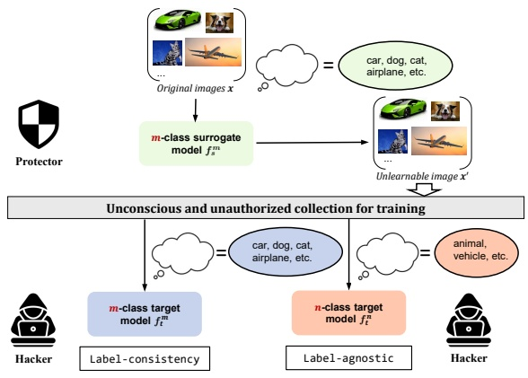

flowchart

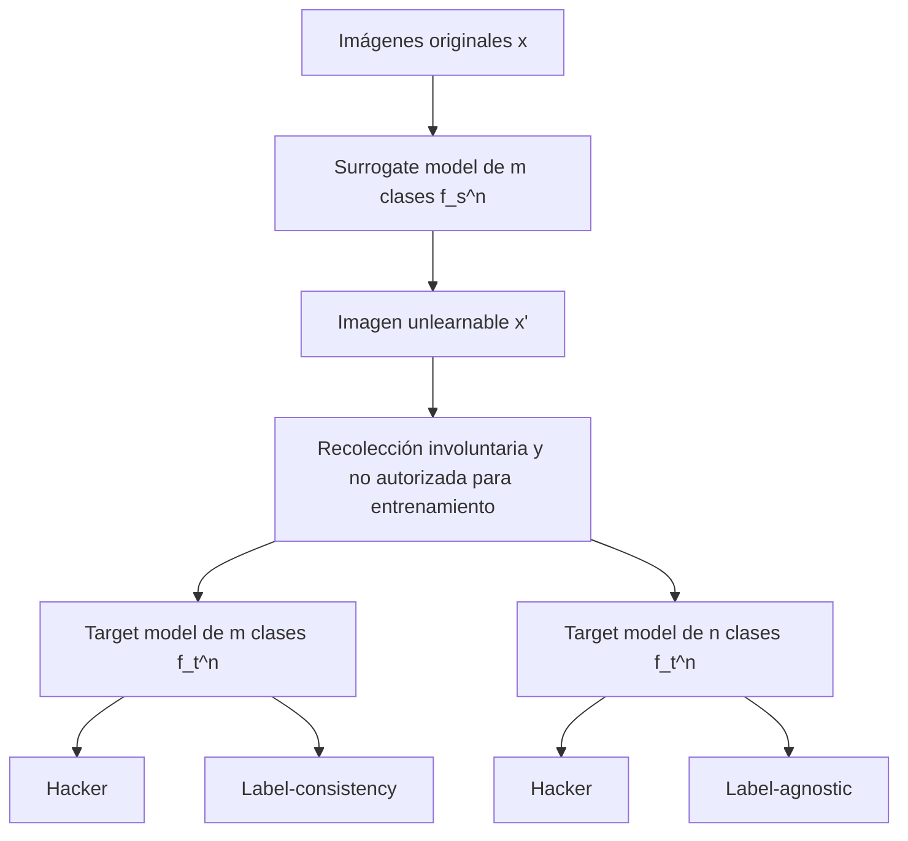

Figura 1. Ilustración de dos suposiciones diferentes de protección de datos: label-consistency vs. label-agnostic, donde el hacker explota los datos protegidos de diferentes maneras.

Internet para entrenar modelos comerciales o incluso maliciosos [16]. Por ejemplo, se descubrió que una empresa llamada Clearview AI extrajo mediante scraping miles de millones de imágenes personales de Facebook, YouTube, Venmo y millones de otros sitios web para construir una aplicación comercial de reconocimiento facial [44]. Esto ha motivado la propuesta de los **Unlearnable Examples** (UEs) [17] para hacer que los datos sean **unlearnable** (o inutilizables) para modelos/servicios de machine learning. Técnicas similares también se conocen en la literatura como availability attacks [2, 41] o poisoning attacks indiscriminados [14]. Estas técnicas permiten a los usuarios añadir activamente ruido protector a sus datos privados para evitar la explotación no autorizada, en lugar de depositar nuestra confianza en manos de grandes corporaciones.

El método original de generación de UEs genera error-minimizing noise mediante un marco de optimización bilevel min-min con un surrogate model [17]. Dicho ruido puede añadirse posteriormente a las muestras de un conjunto de entrenamiento de forma sample-wise o class-wise para hacer que todo el dataset sea unlearnable para diferentes DNNs. Se ha comprobado que este método no puede subsistir al adversarial training, una limitación que fue abordada por un método reciente [11]. En este trabajo, identificamos una suposición común adoptada por los métodos existentes de UEs: **label-consistency**, donde los hackers explotarán el dataset protegido de la misma manera que el protector, incluidas las etiquetas.

<small>\*Autores de correspondencia</small>

Esto significa que, para una misma imagen, el hacker y el protector poseen la misma etiqueta. Sostenemos que esta suposición es excesivamente idealista y que es posible que los hackers recopilen las muestras protegidas (unlearnable) en un dataset para una tarea diferente y etiqueten dicho dataset con un número distinto de clases. Como se ilustra en la Figura 1, una imagen puede ser etiquetada con diferentes etiquetas anotadas (gato o animal), lo que demuestra que un dataset unlearnable de $m$ clases (p. ej., de 10 clases) puede ser explotado por el hacker como un dataset de $n$ clases (p. ej., de 5 clases o de 20 clases) en función de sus necesidades reales. Denominamos a esta suposición más genérica como **label-agnostic** y proponemos un método novedoso, **Unlearnable Clusters** (UCs), para generar unlearnable examples más efectivos y transferibles bajo este riguroso escenario.

En la Figura 2 (a), mostramos que este escenario label-agnostic más genérico plantea un desafío único de transferability para el ruido generado por métodos existentes como Error-Minimizing Noise (EMinN) [17], Adversarial Poisoning (AdvPoison) [10], Synthetic Perturbations (SynPer) [41] y DeepConfuse [9]. Esto indica que el ruido protector generado por dichos métodos es dependiente de las etiquetas y queda inhabilitado cuando se enfrenta a un número diferente de clases. Por consiguiente, requerimos enfoques más fundamentales para hacer que un dataset sea unlearnable independientemente de las anotaciones. Con este fin, comenzamos analizando el mecanismo de funcionamiento de los UEs generados por EMinN y AdvPoison, dado que son sumamente representativos bajo el escenario de label-consistency. A través de un conjunto de análisis visuales, descubrimos que la razón principal por la que logran vulnerar a los aprendices supervisados radica en que el ruido generado tiende a perturbar la uniformidad distribucional y la discrepancia en el espacio de representación profunda. La uniformidad se refiere a la propiedad de que la variedad (manifold) de los UEs en el espacio de representación profunda no se desvíe significativamente de la de los ejemplos clean, mientras que la discrepancia alude a la propiedad de que los ejemplos pertenecientes a una misma clase exhiban una rica diversidad en el espacio de representación. Inspirándonos en la observación anterior, proponemos un enfoque novedoso denominado **Unlearnable Clusters** (UCs) para generar UEs label-agnostic mediante perturbaciones cluster-wise (en lugar de class-wise). Esto nos permite lograr una disrupción simultánea de la uniformidad y de la discrepancia sin requerir conocimiento alguno de la información de las etiquetas.

Ciertamente, la elección de un surrogate model adecuado también desempeña un papel crucial en la generación de UEs eficaces. Los métodos anteriores generan UEs atacando directamente un surrogate model para luego transferir los UEs generados con el fin de combatir un conjunto diverso de target models [10, 17]. Esto puede ser alcanzable con facilidad bajo el escenario de label-consistency, pero puede fallar de forma estrepitosa bajo el escenario label-agnostic. No obstante, incluso bajo el supuesto de label-consistency, escasos trabajos han estudiado el impacto del surrogate model sobre el rendimiento unlearnable final. Para generar UEs efectivos y, lo que es aún más importante, transferibles bajo el escenario label-agnostic, es necesario explorar estrategias de selección de surrogate models más genéricas, en especial aquellas que puedan adaptarse a una gama más amplia de target models desconocidos. Intuitivamente, el surrogate model debería ser una DNN de clasificación que contenga tantas clases como sea posible a fin de facilitar el reconocimiento y la protección de miles de millones de imágenes en Internet. En este artículo, proponemos aprovechar los Vision-and-Language Pre-trained Models (VLPMs) a gran escala [22, 23, 30] como CLIP [30] en calidad de surrogate model. Preentrenado sobre más de 400 millones de pares de texto a imagen, CLIP posee la capacidad de extraer representaciones de una semántica sumamente diversa. Al mismo tiempo, los VLPMs son preentrenados con una descripción textual en lugar de una etiqueta one-hot para alinearse con la imagen, lo que los hace incurrir en menor overfitting hacia las «etiquetas» de clase reales. En este trabajo, aprovechamos el encoder de imágenes de CLIP para extraer los embeddings de las imágenes de entrada y luego empleamos dichos embeddings para generar UCs más transferibles.

Evaluamos nuestro enfoque de UC con diversos backbones y datasets, todos en una configuración de caja negra (black-box) donde el protector desconoce la arquitectura de red del atacante o las etiquetas de clase. El ruido unlearnable cluster-wise también puede prevenir la explotación no supervisada frente a contrastive learning hasta cierto punto, demostrando su superioridad frente a los UEs existentes. Asimismo, comparamos UC con los métodos existentes de UEs frente a dos plataformas comerciales de machine learning: Microsoft Azure1 y Baidu PaddlePaddle2. Hasta donde sabemos, este constituye el primer ataque en el mundo físico contra APIs comerciales en esta línea de investigación. Nuestras contribuciones principales se resumen de la siguiente manera:

• Promovemos una suposición de protección de datos más genérica denominada **label-agnostic**, la cual permite a los hackers explotar el dataset protegido de forma diferente (en términos de las etiquetas de clase anotadas) a la del protector. Esto abre un escenario más práctico y desafiante contra el entrenamiento no autorizado de modelos de machine learning.
• Revelamos el mecanismo de funcionamiento de los métodos existentes de generación de UEs: todos perturban la uniformidad distribucional y la discrepancia en el espacio de representación profunda.
• Proponemos un enfoque novedoso denominado **Unlearnable Clusters** (UCs) para generar UEs label-agnostic con perturbaciones cluster-wise sin conocer la información de las etiquetas. Asimismo, aprovechamos VLPMs como CLIP en calidad de surrogate model para confeccionar UCs más transferibles.
• Verificamos empíricamente la efectividad de nuestro enfoque propuesto con diferentes backbones sobre diversos datasets. También demostramos su eficacia al proteger datos privados frente a plataformas comerciales de machine learning como Azure y PaddlePaddle.

## 2. Trabajos Relacionados

Los unlearnable examples (UEs) pueden considerarse un tipo especial de data poisoning attacks [1, 2] cuyo objetivo es hacer que el entrenamiento del modelo fracase por completo en el dataset envenenado (protegido). Los UEs deben diferenciarse de otros dos ataques bien conocidos contra modelos de deep learning: los backdoor attacks [5, 13, 24] y los adversarial attacks [12, 37]. Los backdoor attacks constituyen el otro tipo especial de data poisoning attacks que no degradan el rendimiento del modelo sobre datos clean, lo cual contrasta fuertemente con los UEs. Los adversarial attacks son un tipo de ataques en tiempo de prueba (test-time attacks) que evaden la predicción del modelo añadiendo ruido adversarial pequeño e imperceptible a las entradas.

<small>1[https://portal.azure.com/](https://portal.azure.com/)</small>

<small>2[https://www.paddlepaddle.org.cn/en/](https://www.paddlepaddle.org.cn/en/)</small>

Los UEs pueden generarse mediante un marco de optimización bilevel min-min con un surrogate model [17], de manera similar a la generación de venenos de datos potentes mediante optimización bilevel [18, 34, 36, 45]. El ruido generado se denomina Error-Minimizing Noise (EMinN), ya que elimina progresivamente los errores de los datos de entrenamiento para engañar al target model haciéndole creer que no hay nada que aprender [17]. Utilizamos EMinN para denotar el método original de generación de UEs. Además de EMinN, también existen métodos de generación de UEs que emplean ruido adversarial, tales como Error-Maximizing Noise (EMaxN) [19], DeepConfuse [9] y Adversarial Poisoning (AdvPoison) [10]. Recientemente, Yu et al. [41] revelaron una propiedad de separabilidad lineal del ruido unlearnable y propusieron el método Synthetic Perturbations (SynPer) para sintetizar directamente perturbaciones linealmente separables como ruido unlearnable eficaz.

El método original de UEs, EMinN, presenta ciertas limitaciones. En primer lugar, el ruido unlearnable generado puede eliminarse en gran medida mediante adversarial training [26], aunque esto también disminuye el rendimiento del modelo en una magnitud considerable [17]. Esto fue resuelto posteriormente por un trabajo reciente publicado en ICLR 2022 [11]. La idea consiste en optimizar la función de pérdida de adversarial training en lugar de la pérdida de entrenamiento estándar para producir un error-minimizing noise más robusto. La otra limitación radica en su transferability hacia diferentes esquemas de entrenamiento, target models (los modelos contra los cuales se busca protección) o datasets. Por ejemplo, se ha comprobado que el ruido unlearnable generado de manera supervisada no logra proteger el dataset frente al contrastive learning no supervisado [14]. Posteriormente se propuso un método de generación de UEs no supervisado para elaborar UEs que resulten unlearnable ante el contrastive learning no supervisado. Sin embargo, un trabajo muy reciente de Ren et al. [32] demuestra que, sorprendentemente, los UEs no supervisados no pueden proteger el dataset de una explotación supervisada. Todos los métodos de UEs mencionados anteriormente se fundamentan en la suposición ideal de label-consistency, es decir, que los mismos protectores y hackers emplearán las mismas etiquetas (o ninguna) para los datos protegidos. En este artículo, promovemos un escenario label-agnostic más práctico en el que los hackers pueden utilizar diferentes etiquetas para sus propios propósitos.

Además de los UEs, también se han propuesto ataques adversariales rigurosos para proteger datos personales frente a sistemas maliciosos de reconocimiento facial, tales como LowKey [6] y APF [44]. Estos se diferencian de los UEs en que hacen que un modelo entrenado normalmente sea incapaz de reconocer las imágenes protegidas, en lugar de impedir el entrenamiento adecuado de cualquier modelo de machine learning sobre dichas imágenes. En este trabajo, nos centramos en los UEs en lugar de otras técnicas de protección de datos, las cuales consideramos de interés independiente.

## 3. Método Propuesto

**Threat Model.** Presentamos dos partes: el **protector** y el **hacker**. Los protectores aprovechan un surrogate model para generar UEs para sus datos privados antes de publicarlos en Internet. Por ejemplo, las empresas de redes sociales en línea (o los usuarios) podrían convertir sus fotos a sus versiones de UE antes de publicarlas en la red. Estas imágenes «protegidas» son luego recopiladas, sin el consentimiento de los protectores, por un hacker en un dataset para entrenar un modelo comercial o malicioso. El objetivo de los protectores es hacer que el dataset recopilado sea unlearnable, es decir, que no pueda utilizarse para el entrenamiento de modelos, mientras que el objetivo de los hackers es entrenar modelos precisos sobre el dataset unlearnable (protegido). Siguiendo trabajos previos [11, 17, 25], asumimos que el dataset publicado está protegido al 100%, es decir, que todas las muestras son perturbadas para ser unlearnable. Si bien esta suposición parece ser ideal, si la técnica de protección es confiable, no hay razón para no emplearla a fin de obtener mayor protección y privacidad. Por lo tanto, en este trabajo decidimos enfocarnos en la técnica unlearnable en sí misma en lugar de modificar la configuración de los protectores. Siguiendo nuestro escenario label-agnostic, también asumimos que los hackers podrían explotar el dataset unlearnable con diferentes etiquetas. Por ejemplo, un dataset de $m$ clases podría ser explotado por el hacker como un dataset de $n$ clases.

A continuación, proporcionamos un ejemplo de dicho escenario label-agnostic con una empresa de medios sociales en línea que se esfuerza por proteger los contenidos creados por todos sus usuarios. La empresa podría aprovechar técnicas unlearnable para desarrollar un esquema de protección sistemático contra exploradores de datos no autorizados. En este caso, podemos asumir que todas las imágenes subidas por los usuarios están protegidas (por la empresa). Potenciales hackers como Clearview AI pueden rastrear las imágenes de la plataforma en línea sin el consentimiento de los usuarios hacia uno o un conjunto de datasets para sus propios fines. Por consiguiente, no se puede garantizar que los datasets recopilados tengan las mismas etiquetas que sus versiones originales. El protector necesita entonces confeccionar unlearnable examples más potentes y transferibles para hacer que los datos resulten inexplotables frente a diferentes estrategias de etiquetado.

## 3.1. Formulación del Problema

En este artículo nos centramos en tareas de clasificación de imágenes. Dado un dataset de entrenamiento clean de $m$ clases $\mathcal { D } _ { c } ^ { m } = \{ ( \pmb { x } _ { i } , \pmb { y } _ { i } ) \} _ { i = 1 } ^ { k }$ compuesto por $k$ imágenes de entrenamiento clean $\pmb { x } \in \mathcal { X } \subset \mathbb { R } ^ { d }$ y sus etiquetas $\pmb { y } \in \mathcal { Y }$, en un escenario unlearnable estándar [17], el protector entrena un surrogate model de $m$ clases $f _ { s } ^ { m }$ sobre $\mathcal { D } _ { c } ^ { m }$. El protector puede entonces generar una versión unlearnable del dataset como $\mathcal { D } _ { u } ^ { m } = \{ ( \pmb { x } _ { i } ^ { \prime } , \pmb { y } _ { i } ^ { \prime } ) \} _ { i = 1 } ^ { k }$, basándose en el dataset clean $\mathcal { D } _ { c } ^ { m }$ y en el surrogate model $f _ { s } ^ { m }$. Las imágenes unlearnable se denotan como $\pmb { x } ^ { \prime } = \pmb { x } + \pmb { \delta } \; ( \pmb { x } \in \mathcal { D } _ { c } ^ { m })$ con las mismas etiquetas $\pmb { y } \in \mathcal { Y }$ que sus versiones originales y $\delta \in \Delta \subset \mathbb { R } ^ { d }$ representa el ruido unlearnable generado, el cual a menudo se regulariza para ser imperceptible. Se asume que el dataset unlearnable $\mathcal { D } _ { u } ^ { m }$ es el dataset recopilado por los hackers, y será explotado para entrenar un target model de $m$ clases comercial o malicioso $f _ { t } ^ { m }$ sin el consentimiento de los protectores.

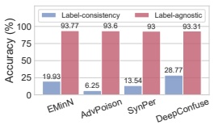

bar

| Modelo | Label-consistency (%) | Label-agnostic (%) |
| :--- | :--- | :--- |
| EMinN | 19.93 | 93.77 |
| AdvPoison | 6.25 | 93.6 |
| SynPer | 13.54 | 93 |
| DeepConfuse | 28.77 | 93.31 |

(a)

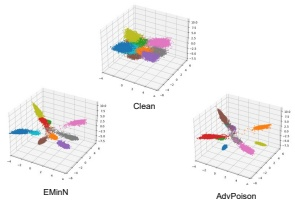

scatter_3d

| Categoría | X (rango) | Y (rango) | Z (rango) |
| --- | --- | --- | --- |
| Clean | -10~10 | -10~10 | 0~20 |
| EMnN | -10~10 | -10~10 | 0~20 |
| AdvPoison | -10~10 | -10~10 | 0~20 |

(b)

Figura 2. (a) Los métodos actuales de UEs resultan ineficaces en el escenario label-agnostic. (b) Visualización de características 3D de ejemplos clean de CIFAR-10 y de los UEs derivados mediante EMinN y AdvPoison. Los puntos con el mismo color denotan muestras de la misma clase.

**Label-consistency vs. Label-agnostic.** La formulación anterior sigue la suposición estándar de label-consistency de los trabajos previos [11, 17], donde los hackers recopilan, anotan y explotan el dataset unlearnable $\mathcal { D } _ { u } ^ { m }$ exactamente de la misma manera en que fue publicado inicialmente por los protectores. Bajo una suposición label-agnostic más general y práctica, los hackers podrían anotar el dataset recopilado $\mathcal { D } _ { u } ^ { m }$ de manera diferente, p. ej., asignándole un número distinto de clases. En este caso, los hackers pueden explotar el dataset como un dataset de clasificación de $n$ clases $( n \neq m )$ $\mathcal { D } _ { c } ^ { n } = \{ ( \pmb { x } _ { i } ^ { \prime } , \pmb { y } _ { i } ^ { \prime } ) \} _ { i = 1 } ^ { k }$ para entrenar un target model de $n$ clases $f _ { t } ^ { n }$. Nótese que los protectores no tienen conocimiento del número de clases objetivo $n$ ni de las etiquetas objetivo $\boldsymbol { y } _ { i } ^ { \prime }.$ Podría argumentarse que los hackers incluso podrían explotar el dataset como un dataset de detección de objetos en lugar de un dataset de clasificación. Exploraremos dicha suposición task-agnostic más desafiante en nuestro trabajo futuro y nos enfocaremos en el escenario label-agnostic en el presente trabajo.

## 3.2. El Desafío Label-Agnostic

**Los métodos existentes no son robustos ante la explotación label-agnostic.** Evaluamos la efectividad de los métodos unlearnable existentes desarrollados bajo el escenario de label-consistency frente a hackers label-agnostic. Aquí consideramos los métodos unlearnable actuales, incluidos Error-Minimizing Noise (EMinN) [17], Adversarial Poisoning (AdvPoison) [10], Synthetic Perturbations (SynPer) [41] y DeepConfuse [9], sobre el dataset CIFAR-10 [21]. Se emplean modelos ResNet-18 [15] tanto para el surrogate model como para el target model. Como se muestra en la Figura 2 (a), estos métodos son sumamente efectivos para prevenir el entrenamiento de modelos de machine learning sobre el dataset unlearnable con las mismas etiquetas. No obstante, si el dataset unlearnable se confecciona utilizando un surrogate model de ImageNet con las etiquetas predichas de ImageNet (es decir, etiquetas predichas por el surrogate model), no logra prevenir el entrenamiento del modelo con las etiquetas originales de CIFAR-10. Esto indica un desafío singular del escenario label-agnostic: los ruidos unlearnable generados para prevenir un conjunto de etiquetas no son transferibles para prevenir otras estrategias de etiquetado.

**El mecanismo de funcionamiento de los UEs existentes bajo el escenario de label-consistency.** Aquí investigamos las representaciones aprendidas por el target model sobre ejemplos clean vs. unlearnable, con el propósito de obtener una mayor comprensión del mecanismo unlearnable. En la Figura 2 (b), visualizamos las proyecciones tridimensionales de PCA [39] de las representaciones originales aprendidas por el target model ResNet-18 para a) muestras de entrenamiento clean de CIFAR-10, b) ejemplos unlearnable de CIFAR-10 generados mediante el método EMinN, y c) ejemplos unlearnable (envenenados) de CIFAR-10 generados mediante AdvPoison. La Figura 2 (b) muestra que los ejemplos unlearnable confeccionados por EMinN y AdvPoison tienden a reducir significativamente la varianza en ciertas dimensiones. Asimismo, existen clases que colapsan en clusters más pequeños, como la clase verde. Esto indica que el ruido altera la discrepancia distribucional en el espacio de representación para hacer que los datos sean «unlearnable». La otra observación clave es que el ruido desvía considerablemente los puntos fuera de la variedad (manifold) de datos normal, provocando una dispersión innecesaria a lo largo de una dirección determinada. Esto demuestra que el ruido también rompe la uniformidad distribucional de los datos. En general, es evidente que el ruido unlearnable generado por EMinN y AdvPoison inutiliza el proceso de aprendizaje al distorsionar tanto la discrepancia como la uniformidad de la distribución de los datos en el espacio de representación profunda.

**Los unlearnable examples pueden sufrir overfitting hacia las etiquetas.** Al examinar más de cerca las visualizaciones de la Figura 2 (b), se puede notar que los efectos unlearnable ocurren únicamente dentro de las clases. Es decir, los UEs han sufrido overfitting hacia las etiquetas de clase. Esto no resulta del todo sorprendente, ya que los ruidos unlearnable se generan a través de una función de pérdida (loss function) supervisada (es decir, cross-entropy) definida por las etiquetas. Por tanto, el ruido se optimiza para frustrar la información más predictiva respecto a las etiquetas de clase. Sin embargo, esto provoca el problema de overfitting y no funciona si las etiquetas cambian. Intuitivamente, si pudiéramos eliminar la dependencia respecto a las etiquetas de clase y recurrir a la explotación de los clusters que surgen naturalmente durante el proceso de aprendizaje, podríamos lograr que el ruido unlearnable sea más robusto frente a distintas anotaciones.

## 3.3. Unlearnable Clusters (UCs)

**Visión general.** Motivados por las observaciones anteriores, en este trabajo proponemos generar UEs explotando los clusters aprendidos por un surrogate model y haciendo que dichos clusters sean unlearnable en lugar de las clases etiquetadas. Denominamos a este enfoque **Unlearnable Clusters (UCs)** e ilustramos su flujo de trabajo en la Figura 3. Los componentes clave de UC son un modelo generador $\mathcal { G }$ y un surrogate model $f _ { s }.$ A un alto nivel, UC primero emplea un surrogate model $f _ { s }$ para extraer las representaciones $\pmb{E}$ de todas las muestras en el dataset clean $\mathcal { D } _ { c }.$ Luego utiliza el método de clustering K-means [35] para derivar $p$ clusters a partir de las representaciones $\pmb{E}.$ Posteriormente, para cada cluster, genera una perturbación cluster-wise $\delta _ { i }$ empleando el generador $\mathcal { G }.$ El ruido se genera y se aplica para elaborar el UE de cada muestra en $\mathcal { D } _ { c },$ de modo que a las muestras que pertenecen al mismo cluster se les añade el mismo ruido cluster-wise $\delta _ { i }.$ Los UEs elaborados de esta manera pueden impedir que el target model aprenda clusters significativos en lugar de predicciones de clases, siendo por lo tanto más generales frente a distintos tipos de explotación de etiquetas. A continuación, presentamos los detalles de UCs.

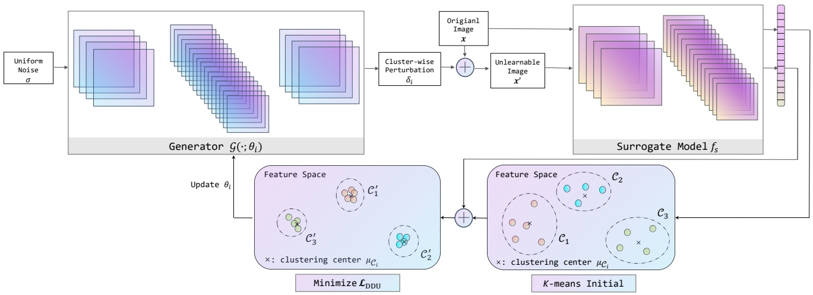

flowchart

Este diagrama de flujo ilustra una arquitectura de machine learning para clustering y modelado del espacio de características, mostrando el proceso desde la generación de ruido a través de la reducción del espacio de características, el clustering y el entrenamiento del surrogate model para producir la salida final.

Figura 3. El pipeline de Unlearnable Clusters. Todo el dataset se divide en $p$ clusters mediante clustering $\mathbf { K }$-means, donde cada cluster corresponde a un generador específico con parámetros $\theta _ { i }$ y una perturbación cluster-wise $\delta _ { i }$.

**Perturbaciones Cluster-wise.** En nuestro marco de UC, se utiliza una red generadora encoder-decoder [29] para generar las perturbaciones cluster-wise, donde cada generador se reinicializa para cada cluster. Por ende, primero necesitamos extraer los clusters. Aquí aprovechamos el método de clustering más clásico, K-means [35], para detectar clusters a partir de las representaciones profundas. En particular, el dataset clean $\mathcal { D } _ { c }$ se introduce en el surrogate model $f _ { s }$ para extraer la matriz de representación previa a la capa de clasificación $\pmb { E } = [ \pmb { e } _ { 1 } , \cdots , \pmb { e } _ { k } ]$. Luego se aplica clustering K-means sobre la matriz de representación para detectar $p$ clusters $\mathcal { C }   =   \{ \mathcal { C } _ { 1 } , \cdots , \mathcal { C } _ { p } \}$, donde $\mathcal { C } _ { i } = \{ \mathbf { \mathbf { \mathbf { \mathbf { x } } } } _ { i j } \} _ { j = 1 } ^ { \tau ( i ) } = \{ \mathbf { \mathbf { \mathbf { \mathbf { x } } } } _ { i 1 } , \cdots , \mathbf { \mathbf { \mathbf { \mathbf { x } } } } _ { i \tau ( i ) } \}$ y $\textstyle \sum _ { i = 1 } ^ { p } \tau ( i ) = k$. Los centros correspondientes de los clusters son $\mu _ { \mathcal { C } } \; = \;$ $\{ \mu _ { \mathcal { C } _ { 1 } } , \cdots , \mu _ { \mathcal { C } _ { p } } \}$.

Con los clusters detectados ${ \mathcal { C } },$ ahora podemos proponer el siguiente método para generar el ruido unlearnable para cada cluster. Intuitivamente, para el cluster $\mathcal { C } _ { i },$ esperamos que el ruido unlearnable $\delta _ { i }$ desplace todas las muestras del cluster hacia el centro de un cluster erróneo, con el fin de obligar al modelo a olvidar los clusters correctos. Esto se realiza mediante el siguiente marco de minimización:

$$
\begin{array}{l} \theta_ {i} = \underset {\theta_ {i}} {\arg \min} \mathcal {L} _ {\mathrm{DDU}} \left(\mathcal {C} _ {i}, g \left(\mu_ {\mathcal {C} _ {i}}\right), \theta_ {i}\right) \\ = \arg \min _ {\theta_ {i}} \sum_ {\boldsymbol {x} _ {i j} \in \mathcal {C} _ {i}} d \left(f _ {s} \left(\boldsymbol {x} _ {i j} + \mathcal {G} \left(\sigma ; \theta_ {i}\right)\right), g \left(\mu_ {\mathcal {C} _ {i}}\right)\right), \tag {1} \\ \end{array}
$$

donde $\mathcal { L } _ { \mathrm { D D U } }$ es nuestra función de pérdida propuesta Disrupting Discrepancy and Uniformity (DDU), que define la distancia $( d ( \cdot ) )$ de las muestras en $\mathcal { C } _ { i }$ hacia el centro de un cluster permutado (erróneo) mediante una función de permutación $g ( \mu _ { \mathcal { C } _ { i } } ) ; \theta _ { i }$ son los parámetros de la red generadora $\mathcal { G } ; \mathcal { G } ( \sigma ; \theta _ { i } )$ genera el ruido unlearnable para todas las muestras en $\mathcal { C } _ { i } ( \mathrm { e s \; d e c i r , } x _ { i j } \in \mathcal { C } _ { i } )$. Cabe señalar que el problema anterior debe resolverse $p$ veces para obtener el ruido unlearnable cluster-wise para los $p$ clusters, y para cada cluster, el generador $\mathcal { G }$ se reinicializa con nuevos parámetros $\theta _ { i }.$ El procedimiento completo se describe en el Algoritmo 1.

Algoritmo 1 Generación de Unlearnable Clusters

Input: surrogate model $f_s$, distance metric $d$, uniform noise $\sigma$, number of clusters $p$, random permutation $g$, $L_\infty$-norm restriction $\epsilon$, clean images $\boldsymbol{x} \in D_c$, initialized generator $\mathcal{G}$ with parameters $\theta$
Output: cluster-wise perturbations $\boldsymbol{\delta} = \{\boldsymbol{\delta}_1, \cdots, \boldsymbol{\delta}_p\}$
feature matrix $\boldsymbol{E} = f_s(\boldsymbol{x})$
clusters and cluster centers $\{\mathcal{C}, \mu_{\mathcal{C}}\} = \text{K-means}(\boldsymbol{E}, p)$
for $i$ in $1 \cdots p$ do
    Initialize $\theta_i$
    $\boldsymbol{\delta}_i = \mathcal{G}(\sigma; \theta_i)$
    $\boldsymbol{\delta}_i = \text{Clamp}(\boldsymbol{\delta}_i, -\epsilon, \epsilon)$
    for $\boldsymbol{x}_{ij}$ in $\mathcal{C}_i$ do
        $\boldsymbol{x}_{ij}' = \text{Clamp}(\boldsymbol{x}_{ij} + \boldsymbol{\delta}_i, 0, 1)$
        $\theta_i \leftarrow \text{Optimize}(\boldsymbol{x}_{ij}', f_s, g(\mu_{\mathcal{C}_i}), d)$
    end for
    $\boldsymbol{\delta}_i = \mathcal{G}(\sigma; \theta_i)$
    $\boldsymbol{\delta}_i = \text{Clamp}(\boldsymbol{\delta}_i, -\epsilon, \epsilon)$
end for

**Surrogate Model CLIP.** Cómo elegir un surrogate model sigue siendo un desafío independiente para generar ruido unlearnable cluster-wise eficaz. Como se demostró en trabajos anteriores, este desempeña un papel central para facilitar la transferability de los UEs generados hacia diferentes datasets o target models [17]. En el escenario tradicional de label-consistency, el surrogate model puede ser un modelo entrenado directamente sobre el dataset original (no protegido), el cual puede tener una arquitectura de modelo diferente (y plausiblemente mejor o más compleja). También podría ser un modelo entrenado en un dataset más grande con más clases, p. ej., modelos entrenados en ImageNet [10, 17]. Por lo tanto, adoptamos una ResNet-50 preentrenada en ImageNet como el surrogate model por defecto de nuestro UC.

De manera análoga a los surrogate models de clasificación utilizados para generar UEs tradicionales, los surrogate models ideales para unlearnable clusters podrían ser aquellos potentes feature extractors que puedan conducir a una detección precisa de clusters a partir de un dataset de imágenes. Por consiguiente, proponemos aprovechar también un vision-and-language pre-trained model (VLPM) a gran escala [22, 23], CLIP [30], como nuestro surrogate model. Preentrenado sobre más de 400 millones de pares de texto a imagen, CLIP posee la capacidad de extraer representaciones de una semántica sumamente diversa. Además, CLIP fue preentrenado con una descripción textual en lugar de una etiqueta one-hot para alinearse con la imagen, incurriendo de este modo en menor overfitting hacia las etiquetas de clase reales. Concretamente, empleamos el image encoder de CLIP para extraer la matriz de características del dataset clean, la cual se utiliza posteriormente para calcular los clusters y los centros de los clusters. Denotamos a la versión de UC equipada con el surrogate model CLIP como UC-CLIP.

## 4. Experimentos

En esta sección, evaluamos nuestros métodos de UC sobre diferentes datasets frente a diferentes target models, con el fin de simular tantos casos desconocidos como sea posible. También examinamos la robustez de los UCs frente a diversas defensas avanzadas. Finalmente, demostramos su efectividad al atacar plataformas comerciales de machine learning como Azure y PaddlePaddle.

## 4.1. Configuración Experimental

**Datasets y Modelos.** Llevamos a cabo nuestro estudio sobre 6 datasets de visión de alta resolución y escala industrial para simular aplicaciones del mundo real tan diversas como sea posible, incluidos Pets [28], Cars [20], Flowers [27], Food [3], SUN397 [40] e ImageNet [33]. Para ImageNet, solo utilizamos sus primeras 100 clases, lo cual se denota como ImageNet\*. Para los surrogate models, consideramos ResNet-50 entrenada sobre ImageNet-1k como el valor por defecto, a menos que se indique explícitamente lo contrario. Para los target models, empleamos ResNet-18 [15], EfficientNet-B1 [38] y RegNetX-1.6GF [31] inicializadas aleatoriamente. Nótese que entrenamos los target models con data augmentations (redimensionamiento, random crop, random horizontal flip y normalización).

Para cada $\delta_i$, repetimos $p$ veces el entrenamiento del generador $\mathcal{G}$ durante 10 epochs para todo ImageNet\* y 50 epochs para los demás datasets completos. Para la permutación aleatoria $g(\cdot)$, simplemente elegimos $i \rightarrow i + 1$ para construir un ciclo cerrado. Consideramos la restricción de norma $L_\infty$ en este trabajo, es decir, $\| \pmb { \delta } \| _ { \infty } < \epsilon = 16/255$.

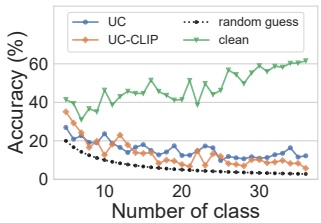

line

| Número de clases | UC (%) | UC-CLIP (%) | random guess (%) | clean (%) |
| --- | --- | --- | --- | --- |
| 3 | ~28 | ~30 | ~21 | ~42 |
| 5 | ~24 | ~26 | ~16 | ~38 |
| 7 | ~19 | ~19 | ~13 | ~37 |
| 9 | ~24 | ~20 | ~10 | ~46 |
| 11 | ~16 | ~23 | ~9 | ~45 |
| 13 | ~15 | ~16 | ~8 | ~45 |
| 15 | ~17 | ~14 | ~7 | ~51 |
| 17 | ~15 | ~11 | ~6 | ~44 |
| 19 | ~18 | ~9 | ~5 | ~40 |
| 21 | ~14 | ~16 | ~5 | ~51 |
| 23 | ~17 | ~11 | ~4 | ~45 |
| 25 | ~12 | ~12 | ~4 | ~57 |
| 27 | ~11 | ~10 | ~4 | ~50 |
| 29 | ~12 | ~10 | ~4 | ~58 |
| 31 | ~13 | ~9 | ~3 | ~59 |
| 33 | ~15 | ~10 | ~3 | ~60 |
| 35 | ~17 | ~9 | ~3 | ~61 |
| 37 | ~13 | ~5 | ~3 | ~62 |

(a) Diferentes etiquetados

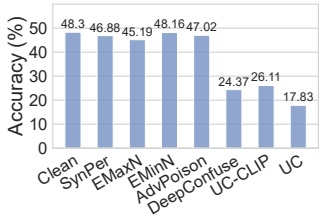

bar

| Categoría | Accuracy (%) |
| --- | --- |
| Clean | 48.3 |
| SynPer | 46.88 |
| EMaxN | 45.19 |
| EMinN | 48.16 |
| AdvPoison | 47.02 |
| DeepConfuse | 24.37 |
| UC-CLIP | 26.11 |
| UC | 17.83 |

(b) Explotación no supervisada

Figura 4. (a) La accuracy de los target models ResNet-18 entrenados sobre el dataset unlearnable Pets pero con sus etiquetas reetiquetadas por el hacker en 5 a 35 clases. (b) Comparación de nuestro enfoque con los baselines en el dataset Pets frente a un target model ResNet-18 entrenado mediante SimCLR autosupervisado.

El número de clusters $p$ se fija en 10, proporcionándose un análisis al respecto en la Sección 4.5.

**Baselines.** Comparamos nuestros métodos UC y UC-CLIP con 5 métodos de referencia (baselines), incluidos DeepConfuse [9], Synthetic Perturbations (SynPer) [41], Error-minimizing Noise (EMinN) [17], Error-maximizing Noise (EMaxN) [19] y Adversarial Poisoning (AdvPoison) [10].

**Configuración Label-agnostic.** Téngase en cuenta que llevamos a cabo todos nuestros experimentos bajo el escenario label-agnostic propuesto. Los UCs (y los UEs que suministran) se generan en su totalidad con las etiquetas predichas por los surrogate models. Las etiquetas predichas pueden coincidir con las etiquetas ground truth hasta cierto punto, pero son sumamente inconsistentes con las etiquetas originales. Reportamos la test accuracy de los target models sobre los respectivos conjuntos de prueba clean.

## 4.2. Resultados Principales

**Efectividad frente a diferentes target models.** En primer lugar, comparamos nuestros métodos UC y UC-CLIP con los 5 baselines frente a diferentes target models. La Tabla 1 muestra los resultados frente a ResNet-18, EfficientNet-B1 y RegNetX-1.6GF. Obtenemos los siguientes hallazgos principales: **(1)** Nuestros métodos superan a los baselines por un amplio margen de manera consistente a través de diferentes datasets y target models. Esto demuestra la superioridad de nuestros métodos respecto a los baselines. **(2)** Nuestro UC-CLIP logra un mejor rendimiento que UC y, en la mayoría de los casos, por un margen considerable. Esto prueba el gran potencial de utilizar CLIP como surrogate model para proteger datos personales frente a explotaciones no autorizadas.

**Efectividad frente a diferentes etiquetados.** Un escenario label-agnostic aún más desafiante ocurre cuando el hacker puede explotar el dataset unlearnable empleando diferentes estrategias de etiquetado en lugar de una sola. Por tanto, una pregunta natural es qué sucede si el número de clases etiquetadas del dataset unlearnable es menor que nuestro número de clusters $p = 10$. En este caso, tomamos como ejemplo el dataset Pets de 37 clases y exploramos el impacto de que el hacker reetiquete la versión unlearnable del dataset como un dataset de 5 a 36 clases. Una estrategia de etiquetado posible consiste en que el hacker extraiga primero los embeddings de las etiquetas de texto originales utilizando el modelo BERT [8] y luego agrupe dichos embeddings en 5 a 37 clases mediante K-means, a fin de construir un mapeo desde las etiquetas antiguas hacia las nuevas. Como se ilustra en la Figura 4 (a), tanto nuestro UC como UC-CLIP pueden reducir la test accuracy del target model a un nivel cercano a la adivinación aleatoria (random guess, la curva negra). Esto comprueba que nuestros métodos pueden elaborar UEs más genéricos frente a las explotaciones label-agnostic más severas.

Tabla 1. La test accuracy (%) de diferentes target models entrenados sobre los datasets unlearnable generados por nuestros métodos UC/UC-CLIP y los 5 métodos baseline, bajo el escenario label-agnostic. Los 2 mejores resultados están resaltados en negrita.

<table><tr><td rowspan="2">MÉTODOS</td><td colspan="6">RESNET-18</td><td colspan="6">EFFICIENTNET-B1</td><td colspan="6">REGNETX-1.6GF</td></tr><tr><td>PETS</td><td>CARS</td><td>FLOWERS</td><td>FOOD</td><td>SUN397</td><td>IMAGENET*</td><td>PETS</td><td>CARS</td><td>FLOWERS</td><td>FOOD</td><td>SUN397</td><td>IMAGENET*</td><td>PETS</td><td>CARS</td><td>FLOWERS</td><td>FOOD</td><td>SUN397</td><td>IMAGENET*</td></tr><tr><td>CLEAN</td><td>62.31</td><td>67.18</td><td>67.18</td><td>78.97</td><td>43.08</td><td>77.76</td><td>48.68</td><td>72.33</td><td>52.46</td><td>80.29</td><td>42.84</td><td>78.04</td><td>44.86</td><td>63.84</td><td>52.69</td><td>84.02</td><td>43.27</td><td>80.78</td></tr><tr><td>SYNPER</td><td>52.60</td><td>53.50</td><td>52.74</td><td>74.80</td><td>38.26</td><td>74.69</td><td>28.02</td><td>58.34</td><td>42.93</td><td>74.99</td><td>35.92</td><td>72.94</td><td>34.51</td><td>45.54</td><td>47.16</td><td>77.65</td><td>37.78</td><td>60.38</td></tr><tr><td>EMAXN</td><td>54.70</td><td>52.95</td><td>51.70</td><td>73.77</td><td>37.57</td><td>73.82</td><td>33.71</td><td>55.64</td><td>42.66</td><td>74.40</td><td>37.30</td><td>73.72</td><td>34.26</td><td>43.40</td><td>46.25</td><td>78.76</td><td>37.82</td><td>76.72</td></tr><tr><td>EMINN</td><td>52.96</td><td>54.43</td><td>50.58</td><td>75.47</td><td>38.48</td><td>74.20</td><td>36.88</td><td>54.23</td><td>44.06</td><td>75.54</td><td>37.20</td><td>72.20</td><td>37.04</td><td>39.67</td><td>47.34</td><td>79.43</td><td>36.82</td><td>74.86</td></tr><tr><td>ADVPOISON</td><td>50.86</td><td>51.91</td><td>50.64</td><td>75.07</td><td>38.51</td><td>73.76</td><td>37.99</td><td>50.08</td><td>41.65</td><td>74.88</td><td>36.44</td><td>72.54</td><td>34.29</td><td>46.06</td><td>47.41</td><td>78.64</td><td>36.42</td><td>76.32</td></tr><tr><td>DEEPCONFUSE</td><td>53.72</td><td>51.11</td><td>50.94</td><td>73.13</td><td>34.41</td><td>55.12</td><td>35.54</td><td>47.15</td><td>43.28</td><td>72.91</td><td>35.22</td><td>45.74</td><td>33.71</td><td>41.15</td><td>46.01</td><td>77.26</td><td>33.52</td><td>49.88</td></tr><tr><td>UC (NUESTRO)</td><td>12.21</td><td>33.57</td><td>35.55</td><td>55.29</td><td>20.38</td><td>54.80</td><td>17.06</td><td>13.92</td><td>42.28</td><td>53.45</td><td>22.97</td><td>32.30</td><td>4.28</td><td>29.46</td><td>33.79</td><td>64.48</td><td>22.28</td><td>56.10</td></tr><tr><td>UC-CLIP (NUESTRO)</td><td>4.69</td><td>4.74</td><td>10.07</td><td>19.07</td><td>3.89</td><td>39.78</td><td>6.49</td><td>15.33</td><td>14.13</td><td>17.44</td><td>12.95</td><td>31.82</td><td>3.87</td><td>4.18</td><td>8.12</td><td>26.76</td><td>6.04</td><td>41.66</td></tr></table>

Tabla 2. La test accuracy (%) de los modelos entrenados por las plataformas Azure y PaddlePaddle sobre el dataset unlearnable Cars generado mediante diferentes métodos. La configuración de entrenamiento en la plataforma se fijó en «fastest training».

| MÉTODOS | Azure | PaddlePaddle |
| --- | --- | --- |
| CLEAN | 48.45 | 83.74 |
| SYNPER | 42.38 | 47.59 |
| EMAXN | 42.83 | 42.99 |
| EMINN | 44.06 | 44.40 |
| ADVPOISON | 43.97 | 43.38 |
| DEEPCONFUSE | 39.47 | 41.88 |
| UC (RN50) | 36.40 | 30.96 |
| UC-CLIP (RN50) | 26.97 | 25.79 |
| UC-CLIP (ViTB32) | 22.47 | 11.49 |

**Robustez frente a la explotación no supervisada.** Asimismo, comparamos nuestros métodos con los baselines bajo un escenario de contrastive learning no supervisado frente a SimCLR [4]. Aunque nuestros métodos de UC no están diseñados específicamente para este escenario no supervisado, la Figura 4 (b) muestra que el ruido unlearnable cluster-wise también puede prevenir la explotación no supervisada frente a SimCLR.

## 4.3. Prevención Frente a Plataformas Comerciales

Aquí aplicamos nuestros métodos de UC para prevenir dos plataformas comerciales de machine learning: Microsoft Azure y

Tabla 3. La test accuracy (%) de ResNet-18 entrenada utilizando diferentes defensas contra nuestros métodos en el dataset Pets.

| MÉTODOS | SIN DEFENSA | MIXUP | GAUSSIAN | CUTMIX | CUTOUT |
| --- | --- | --- | --- | --- | --- |
| UC | 12.21 | 14.34 | 24.26 | 14.50 | 12.35 |
| UC-CLIP | 4.69 | 11.96 | 18.59 | 6.21 | 12.29 |

Baidu PaddlePaddle. En ambas plataformas, los detalles de entrenamiento nos son completamente desconocidos (agnósticos), incluyendo la arquitectura del modelo, el learning rate, el batch size, la epoch, el data augmentation, la división del conjunto de validación, etc. Considerando que los ViT pueden emplearse en plataformas comerciales debido a su reciente popularidad, mejoramos nuestro método UC-CLIP reemplazando el surrogate model ResNet-50 (RN50) por un surrogate model ViT-B-32 (ViTB32). Los resultados se presentan en la Tabla 2, los cuales son consistentes con los de la Tabla 1. Es decir, ambos métodos nuestros pueden proteger los datos subidos a las dos plataformas frente a sus algoritmos de entrenamiento. Como era de esperar, el método UC-CLIP impulsado por ViTB32 logra el mejor rendimiento de protección al inducir la test accuracy más baja. Esto sugiere la efectividad de nuestros métodos incluso contra plataformas comerciales.

## 4.4. Resistencia Frente a Posibles Defensas

En esta sección, evaluamos la robustez de nuestros métodos de UC frente a varias defensas basadas en data augmentation, incluidas Mixup [43], Gaussian smoothing, Cutmix [42] y Cutout [7]. Como puede observarse en la Tabla 3, las 4 defensas por data augmentation tienen un impacto mínimo sobre nuestros métodos UC y UC-CLIP. En particular, Gaussian smoothing parece ser la defensa más efectiva, pero la accuracy continúa situándose por debajo del 25%.

## 4.5. Estudio de Ablación

Aquí analizamos la sensibilidad de nuestros métodos respecto al número de clusters $p$, el cual se ha establecido en $p = 10$ por defecto. Tomamos como ejemplo el dataset Pets de 37 clases y evaluamos nuestros métodos UC y UC-CLIP bajo diferentes valores de $p \in [5, 40]$. Como se aprecia en la Figura 5, nuestros métodos son bastante estables ante variaciones del hiperparámetro $p$ para $p \geq 10$. Esto indica que, mientras los clusters logren abarcar la mayor parte de los conceptos en un dataset, el ruido unlearnable generado puede impedir eficazmente que el modelo aprenda el contenido real del dataset. A medida que el número de clusters se incrementa, el ruido tiende a volverse más efectivo, aunque se observa una ligera variación en 35. Cabe resaltar que, incluso en el peor de los casos con $p = 5$, nuestros métodos siguen superando a los baselines.

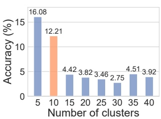

bar

| Número de clusters | Accuracy (%) |
| --- | --- |
| 5 | 16.08 |
| 10 | 12.21 |
| 15 | 4.42 |
| 20 | 3.82 |
| 25 | 3.46 |
| 30 | 2.75 |
| 35 | 4.51 |
| 40 | 3.92 |

(a) Efecto de p sobre UC

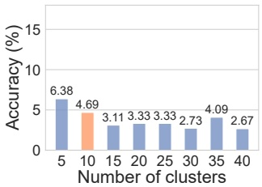

bar

| Número de clusters | Accuracy (%) |
| --- | --- |
| 5 | 6.38 |
| 10 | 4.69 |
| 15 | 3.11 |
| 20 | 3.33 |
| 25 | 3.33 |
| 30 | 2.73 |
| 35 | 4.09 |
| 40 | 2.67 |

(b) Efecto de p sobre UC-CLIP

Figura 5. Análisis del efecto del número de clusters $p$ sobre el dataset Pets.

## 4.6. Mezcla de Datos Clean y Unlearnable

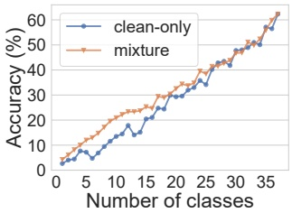

line

| Número de clases | clean-only (%) | mixture (%) |
| --- | --- | --- |
| 1 | ~3 | ~5 |
| 2 | ~4 | ~6 |
| 3 | ~5 | ~8 |
| 4 | ~8 | ~10 |
| 5 | ~7 | ~12 |
| 6 | ~5 | ~14 |
| 7 | ~6 | ~16 |
| 8 | ~9 | ~18 |
| 9 | ~11 | ~20 |
| 10 | ~13 | ~21 |
| 11 | ~14 | ~22 |
| 12 | ~18 | ~23 |
| 13 | ~14 | ~24 |
| 14 | ~15 | ~25 |
| 15 | ~21 | ~26 |
| 16 | ~22 | ~30 |
| 17 | ~25 | ~31 |
| 18 | ~25 | ~32 |
| 19 | ~30 | ~33 |
| 20 | ~30 | ~34 |
| 21 | ~31 | ~35 |
| 22 | ~32 | ~36 |
| 23 | ~33 | ~39 |
| 24 | ~35 | ~40 |
| 25 | ~34 | ~42 |
| 26 | ~42 | ~43 |
| 27 | ~43 | ~44 |
| 28 | ~42 | ~45 |
| 29 | ~48 | ~47 |
| 30 | ~49 | ~49 |
| 31 | ~50 | ~51 |
| 32 | ~51 | ~50 |
| 33 | ~57 | ~54 |
| 34 | ~58 | ~57 |
| 35 | ~63 | ~63 |

(a) Mezcla vs. Clean-only

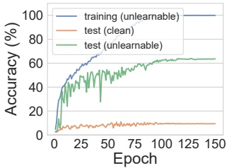

line

| Epoch | training (unlearnable) (%) | test (clean) (%) | test (unlearnable) (%) |
| --- | --- | --- | --- |
| 0 | 0 | 0 | 0 |
| 25 | ~50 | ~8 | ~45 |
| 50 | ~65 | ~9 | ~50 |
| 75 | ~95 | ~10 | ~55 |
| 100 | ~100 | ~10 | ~62 |
| 125 | ~100 | ~10 | ~64 |
| 150 | ~100 | ~10 | ~64 |

(b) Tendencias de accuracy

Figura 6. (a) La test accuracy (%) de ResNet-18 entrenada sobre datos mezclados unlearnable-clean vs. solo clean; y (b) las tendencias de accuracy sobre ejemplos clean vs. unlearnable. Los ejemplos unlearnable se elaboraron utilizando nuestro método UC sobre el dataset Pets.

Todos los experimentos anteriores se llevan a cabo bajo la suposición de que todas las muestras del dataset están protegidas, una suposición adoptada habitualmente en la literatura [10, 17, 41]. Esta configuración es razonable cuando los protectores tienen acceso a la totalidad del dataset, p. ej., cuando una empresa de medios sociales en línea adopta la técnica para proteger los contenidos creados por todos sus usuarios. Un caso más general consiste en que solo una determinada proporción de los usuarios proteja sus datos mientras que otros no lo hacen. Esto da lugar a un dataset mixto que contiene tanto muestras clean como unlearnable. En este apartado evaluamos nuestro método UC bajo este escenario y mostramos la variación de la test accuracy con respecto al número de clases clean en la Figura 6 (a). Es decir, para el dataset mixto, el resto de las clases se hacen unlearnable mediante UC. Se puede inferir que las clases unlearnable casi no contribuyen al entrenamiento del modelo, una conclusión similar a la obtenida en trabajos anteriores [10, 17, 41]. Esto implica que solo aquellos usuarios que adopten la técnica resultarán protegidos.

## 4.7. Mayor Comprensión

¿Por qué nuestros UCs son más potentes que los UEs estándar frente a la explotación label-agnostic? Como explicamos en la Sección 3.1, la idea de los UCs se inspira en la efectividad de perturbar la uniformidad y la discrepancia para impedir que el modelo aprenda información útil. Sin embargo, esto también plantea otra interrogante: ¿qué aprende exactamente el target model? Para responder a estas dos preguntas, analizamos aquí las curvas de aprendizaje del target model sobre los ejemplos clean vs. unlearnable por separado. Como se muestra en la Figura 6 (b), a medida que avanza el entrenamiento, la training accuracy sobre las muestras de entrenamiento unlearnable mejora de forma constante hasta alcanzar el 100%. Sin embargo, casi no se observa mejora en la clean test accuracy sobre las muestras de prueba clean. Esto es consistente con los resultados experimentales anteriores en cuanto a que el target model no ha adquirido la capacidad de percibir muestras normales. Sorprendentemente, no obstante, la accuracy del modelo sobre las muestras de prueba perturbadas es bastante alta (> 60%), considerando que la ResNet-18 entrenada normalmente solo alcanza una test accuracy del 62.31% sobre el dataset Pets clean. Esto implica que la distribución del ruido unlearnable contenida en los UCs ha ocultado eficazmente la distribución real de los datos.

## 5. Conclusión

Los unlearnable examples (UEs) han demostrado un gran potencial para evitar que los hackers utilicen datos privados de los usuarios para entrenar modelos comerciales o maliciosos. Se han propuesto diversos métodos para mejorar la transferability y robustez de los UEs frente a diferentes datasets, target models y paradigmas de entrenamiento. En este trabajo, identificamos una limitación de los métodos existentes de UEs: su suposición de label-consistency. Para superar esta limitación, propusimos un escenario más general donde los hackers pueden explotar los datos protegidos con diferentes conjuntos de etiquetas. Denominamos a este escenario más desafiante como label-agnostic y propusimos la técnica Unlearnable Clusters (UCs) con modelos generadores condicionados, clustering K-means y el modelo de preentrenamiento de visión y lenguaje a gran escala CLIP, para confeccionar UEs eficaces frente a una amplia gama de datasets y target models. Asimismo, demostramos su efectividad frente a las plataformas comerciales Microsoft Azure y Baidu PaddlePaddle.

## 6. Agradecimientos

Este trabajo contó con el apoyo del National Key R&D Program of China (N.º 2021ZD0112804), la Beijing Natural Science Foundation (N.º JQ20023), la Science and Technology Commission of Shanghai Municipality (N.º 22511106102), la National Natural Science Foundation of China (N.º U1934220, 61832002, 62172094, 62276067) y la Tianjin Natural Science Foundation (N.º 20JCZDJC00400).

## Referencias

[1] Battista Biggio, Blaine Nelson, and Pavel Laskov. Poisoning attacks against support vector machines. arXiv preprint arXiv:1206.6389, 2012. 2
[2] Battista Biggio and Fabio Roli. Wild patterns: Ten years after the rise of adversarial machine learning. Pattern Recognition, 84:317–331, 2018. 1, 2
[3] Lukas Bossard, Matthieu Guillaumin, and Luc Van Gool. Food-101–mining discriminative components with random forests. In European conference on computer vision, pages 446–461. Springer, 2014. 6
[4] Ting Chen, Simon Kornblith, Mohammad Norouzi, and Geoffrey Hinton. A simple framework for contrastive learning of visual representations. In International conference on machine learning, pages 1597–1607. PMLR, 2020. 7
[5] Xinyun Chen, Chang Liu, Bo Li, Kimberly Lu, and Dawn Song. Targeted backdoor attacks on deep learning systems using data poisoning. arXiv preprint arXiv:1712.05526, 2017. 3
[6] Valeriia Cherepanova, Micah Goldblum, Harrison Foley, Shiyuan Duan, John Dickerson, Gavin Taylor, and Tom Goldstein. Lowkey: Leveraging adversarial attacks to protect social media users from facial recognition. arXiv preprint arXiv:2101.07922, 2021. 3
[7] Ekin D Cubuk, Barret Zoph, Dandelion Mane, Vijay Vasudevan, and Quoc V Le. Autoaugment: Learning augmentation policies from data. arXiv preprint arXiv:1805.09501, 2018. 7
[8] Jacob Devlin, Ming-Wei Chang, Kenton Lee, and Kristina Toutanova. Bert: Pre-training of deep bidirectional transformers for language understanding. arXiv preprint arXiv:1810.04805, 2018. 7
[9] Ji Feng, Qi-Zhi Cai, and Zhi-Hua Zhou. Learning to confuse: generating training time adversarial data with auto-encoder. Advances in Neural Information Processing Systems, 32, 2019. 2, 3, 4, 6
[10] Liam Fowl, Micah Goldblum, Ping-yeh Chiang, Jonas Geip ing, Wojciech Czaja, and Tom Goldstein. Adversarial examples make strong poisons. Advances in Neural Information Processing Systems, 34:30339–30351, 2021. 2, 3, 4, 6, 8
[11] Shaopeng Fu, Fengxiang He, Yang Liu, Li Shen, and Dacheng Tao. Robust unlearnable examples: Protecting data against adversarial learning. In International Conference on Learning Representations, 2022. 1, 3, 4
[12] Ian J Goodfellow, Jonathon Shlens, and Christian Szegedy. Explaining and harnessing adversarial examples. arXiv preprint arXiv:1412.6572, 2014. 3
[13] Tianyu Gu, Brendan Dolan-Gavitt, and Siddharth Garg. Badnets: Identifying vulnerabilities in the machine learning model supply chain. arXiv preprint arXiv:1708.06733, 2017. 3
[14] Hao He, Kaiwen Zha, and Dina Katabi. Indiscriminate poisoning attacks on unsupervised contrastive learning. arXiv preprint arXiv:2202.11202, 2022. 1, 3
[15] Kaiming He, Xiangyu Zhang, Shaoqing Ren, and Jian Sun. Deep residual learning for image recognition. In Proceedings of the IEEE conference on computer vision and pattern recognition, pages 770–778, 2016. 4, 6
[16] Kashmir Hill. The secretive company that might end privacy as we know it. In Ethics of Data and Analytics, pages 170–177. Auerbach Publications, 2020. 1
[17] Hanxun Huang, Xingjun Ma, Sarah Monazam Erfani, James Bailey, and Yisen Wang. Unlearnable examples: Making personal data unexploitable. In International Conference on Learning Representations, 2021. 1, 2, 3, 4, 6, 8
[18] W Ronny Huang, Jonas Geiping, Liam Fowl, Gavin Taylor, and Tom Goldstein. Metapoison: Practical general-purpose clean-label data poisoning. Advances in Neural Information Processing Systems, 33:12080–12091, 2020. 3
[19] Pang Wei Koh and Percy Liang. Understanding black-box predictions via influence functions. In International conference on machine learning, pages 1885–1894. PMLR, 2017. 3, 6
[20] Jonathan Krause, Michael Stark, Jia Deng, and Li Fei-Fei. 3d object representations for fine-grained categorization. In Proceedings of the IEEE international conference on computer vision workshops, pages 554–561, 2013. 6
[21] Alex Krizhevsky, Geoffrey Hinton, et al. Learning multiple layers of features from tiny images. 2009. 4
[22] Junnan Li, Ramprasaath Selvaraju, Akhilesh Gotmare, Shafiq Joty, Caiming Xiong, and Steven Chu Hong Hoi. Align before fuse: Vision and language representation learning with momentum distillation. Advances in neural information processing systems, 34:9694–9705, 2021. 2, 6
[23] Liunian Harold Li, Mark Yatskar, Da Yin, Cho-Jui Hsieh, and Kai-Wei Chang. Visualbert: A simple and performant baseline for vision and language. arXiv preprint arXiv:1908.03557, 2019. 2, 6
[24] Yunfei Liu, Xingjun Ma, James Bailey, and Feng Lu. Reflection backdoor: A natural backdoor attack on deep neural networks. In European Conference on Computer Vision, pages 182–199. Springer, 2020. 3
[25] Zhuoran Liu, Zhengyu Zhao, Alex Kolmus, Tijn Berns, Twan van Laarhoven, Tom Heskes, and Martha Larson. Going grayscale: The road to understanding and improving unlearnable examples. arXiv preprint arXiv:2111.13244, 2021. 3
[26] Aleksander Madry, Aleksandar Makelov, Ludwig Schmidt, Dimitris Tsipras, and Adrian Vladu. Towards deep learning models resistant to adversarial attacks. arXiv preprint arXiv:1706.06083, 2017. 3
[27] Maria-Elena Nilsback and Andrew Zisserman. Automated flower classification over a large number of classes. In 2008 Sixth Indian Conference on Computer Vision, Graphics & Image Processing, pages 722–729. IEEE, 2008. 6
[28] Omkar M Parkhi, Andrea Vedaldi, Andrew Zisserman, and CV Jawahar. Cats and dogs. In 2012 IEEE conference on computer vision and pattern recognition, pages 3498–3505. IEEE, 2012. 6
[29] Omid Poursaeed, Isay Katsman, Bicheng Gao, and Serge Belongie. Generative adversarial perturbations. In Proceedings of the IEEE Conference on Computer Vision and Pattern Recognition, pages 4422–4431, 2018. 5
[30] Alec Radford, Jong Wook Kim, Chris Hallacy, Aditya Ramesh, Gabriel Goh, Sandhini Agarwal, Girish Sastry, Amanda Askell, Pamela Mishkin, Jack Clark, et al. Learning transferable visual models from natural language supervision. In International Conference on Machine Learning, pages 8748–8763. PMLR, 2021. 2, 6
[31] Ilija Radosavovic, Raj Prateek Kosaraju, Ross Girshick, Kaiming He, and Piotr Dollar. Designing network design spaces. In Proceedings of the IEEE/CVF conference on computer vision and pattern recognition, pages 10428–10436, 2020. 6
[32] Jie Ren, Han Xu, Yuxuan Wan, Xingjun Ma, Lichao Sun, and Jiliang Tang. Transferable unlearnable examples. arXiv preprint arXiv:2210.10114, 2022. 3
[33] Olga Russakovsky, Jia Deng, Hao Su, Jonathan Krause, Sanjeev Satheesh, Sean Ma, Zhiheng Huang, Andrej Karpathy, Aditya Khosla, Michael Bernstein, et al. Imagenet large scale visual recognition challenge. International journal of computer vision, 115(3):211–252, 2015. 6
[34] Avi Schwarzschild, Micah Goldblum, Arjun Gupta, John P Dickerson, and Tom Goldstein. Just how toxic is data poisoning? a unified benchmark for backdoor and data poisoning attacks. In International Conference on Machine Learning, pages 9389–9398. PMLR, 2021. 3
[35] Shokri Z Selim and Mohamed A Ismail. K-means-type algorithms: A generalized convergence theorem and characterization of local optimality. IEEE Transactions on pattern analysis and machine intelligence, (1):81–87, 1984. 4, 5
[36] Ali Shafahi, W Ronny Huang, Mahyar Najibi, Octavian Suciu, Christoph Studer, Tudor Dumitras, and Tom Goldstein. Poison frogs! targeted clean-label poisoning attacks on neural networks. Advances in neural information processing systems, 31, 2018. 3
[37] Christian Szegedy, Wojciech Zaremba, Ilya Sutskever, Joan Bruna, Dumitru Erhan, Ian Goodfellow, and Rob Fergus. Intriguing properties of neural networks. arXiv preprint arXiv:1312.6199, 2013. 3
[38] Mingxing Tan and Quoc Le. Efficientnet: Rethinking model scaling for convolutional neural networks. In International conference on machine learning, pages 6105–6114. PMLR, 2019. 6
[39] Svante Wold, Kim Esbensen, and Paul Geladi. Principal component analysis. Chemometrics and intelligent laboratory systems, 2(1-3):37–52, 1987. 4
[40] Jianxiong Xiao, James Hays, Krista A Ehinger, Aude Oliva, and Antonio Torralba. Sun database: Large-scale scene recognition from abbey to zoo. In 2010 IEEE computer society conference on computer vision and pattern recognition, pages 3485–3492. IEEE, 2010. 6
[41] Da Yu, Huishuai Zhang, Wei Chen, Jian Yin, and Tie-Yan Liu. Availability attacks create shortcuts. In Proceedings of the 28th ACM SIGKDD Conference on Knowledge Discovery and Data Mining, pages 2367–2376, 2022. 1, 2, 3, 4, 6, 8
[42] Sangdoo Yun, Dongyoon Han, Seong Joon Oh, Sanghyuk Chun, Junsuk Choe, and Youngjoon Yoo. Cutmix: Regularization strategy to train strong classifiers with localizable features. In Proceedings of the IEEE/CVF international conference on computer vision, pages 6023–6032, 2019. 7
[43] Hongyi Zhang, Moustapha Cisse, Yann N Dauphin, and David Lopez-Paz. mixup: Beyond empirical risk minimization. arXiv preprint arXiv:1710.09412, 2017. 7
[44] Jiaming Zhang, Jitao Sang, Xian Zhao, Xiaowen Huang, Yanfeng Sun, and Yongli Hu. Adversarial privacy-preserving filter. In Proceedings of the 28th ACM International Conference on Multimedia, pages 1423–1431, 2020. 1, 3
[45] Chen Zhu, W Ronny Huang, Hengduo Li, Gavin Taylor, Christoph Studer, and Tom Goldstein. Transferable cleanlabel poisoning attacks on deep neural nets. In International Conference on Machine Learning, pages 7614–7623. PMLR, 2019. 3
