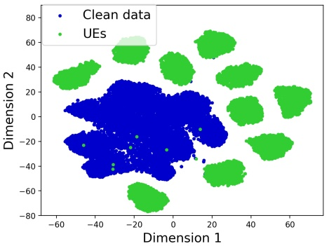

# Detección de Unlearnable Examples mediante Iterative Filtering

Yi Yu1⋆, Qichen Zheng1⋆, Siyuan Yang1⋆⋆, Wenhan Yang2, Jun Liu3, Shijian Lu1, Yap-Peng Tan1, Kwok-Yan Lam1 y Alex Kot1

1 Nanyang Technological University, Singapur

2 PengCheng Laboratory, Shenzhen, China

3 Lancaster University, Reino Unido

{yuyi0010, qichen001, siyuan.yang, Shijian.Lu, eyptan, kwokyan.lam, eackot}@ntu.edu.sg, yangwh@pcl.ac.cn, j.liu81@lancaster.ac.uk

Resumen. Se ha demostrado que las redes neuronales profundas son vulnerables a los data poisoning attacks. Recientemente, un tipo específico de data poisoning attack conocido como availability attacks ha provocado el fracaso en la utilización de datos para el aprendizaje de modelos mediante la adición de perturbaciones imperceptibles a las imágenes. Por consiguiente, resulta sumamente beneficioso y desafiante detectar muestras envenenadas, también conocidas como Unlearnable Examples (UEs), a partir de un dataset mixto. En respuesta a esto, proponemos un enfoque de Iterative Filtering para la identificación de UEs. Este método aprovecha la distinción entre las reglas de mapeo semántico inherentes y los shortcuts, sin necesidad de información adicional alguna. Verificamos que, al entrenar un clasificador en un dataset mixto que contiene tanto UEs como datos limpios, el modelo tiende a adaptarse rápidamente a los UEs en comparación con los datos limpios. Debido a las brechas de accuracy entre el entrenamiento con muestras limpias y envenenadas, empleamos un modelo para clasificar erróneamente las muestras limpias mientras identifica correctamente las envenenadas. La incorporación de clases adicionales y el refinamiento iterativo mejoran la capacidad del modelo para diferenciar entre muestras limpias y envenenadas. Experimentos exhaustivos demuestran la superioridad de nuestro método sobre los enfoques de detección state-of-the-art frente a diversos ataques, datasets y poison ratios, reduciendo significativamente la Half Total Error Rate (HTER) en comparación con los métodos existentes.

Palabras clave: Unlearnable Examples, Detección.

## 1 Introducción

El énfasis reciente en la data-centric AI [46] subraya la importancia y eficacia de mejorar el rendimiento del modelo desde la perspectiva de la optimización del preprocesamiento de datos en lugar de centrarse únicamente en el diseño del modelo. Se vuelve fundamental abordar los desafíos vinculados a estas problemáticas centradas en los datos, incluyendo la recolección de datos, el preprocesamiento de datos, el mantenimiento de la calidad de los datos, etc., para los métodos basados en aprendizaje. De hecho, una proporción considerable del proceso de machine learning se ha dedicado a la problemática de los datos [39]. Estos esfuerzos han guiado gradualmente a los investigadores hacia un consenso: los datos de alta calidad son fundamentales para permitir que los algoritmos de machine learning más avanzados alcancen su máximo potencial, lo que sitúa a los datos a la par del enfoque en sí mismo. No obstante, persisten desafíos prevalentes, dado que muchos datasets del mundo real son de tamaño limitado, están sucios [10], sesgados [34] y, en algunos casos, incluso contaminados con intenciones maliciosas [32].

<small>⋆contribución equitativa</small>

<small>⋆⋆ Autor de correspondencia</small>

Junto con el impresionante rendimiento de las redes neuronales profundas, han surgido muchas preocupaciones sobre las cuestiones de seguridad de la IA relacionadas [45,37,41,44]. Los data poisoning attacks [17,5,22] intensifican aún más estas dificultades y revelan la necesidad urgente de atención por parte de la comunidad de gestión de datos. La trascendencia de este problema radica en las acciones deliberadas de atacantes que manipulan maliciosamente los datos para socavar la accuracy de las aplicaciones de IA. En comparación con la degradación natural de las señales o los desplazamientos en las características, estas contaminaciones son más insidiosas y pueden ocasionar daños mayores, provocando una caída de rendimiento más evidente. En este trabajo, nos centramos en un tipo específico de data poisoning attack denominado unlearnable examples (UEs) [42,40,20,43,27,38]. Estos ataques añaden perturbaciones casi invisibles a los datos de entrenamiento, lo que hace que los modelos entrenados no logren obtener conocimiento útil para alcanzar un rendimiento razonable.

Los motores de búsqueda de datasets ampliamente empleados [2] han incrementado los riesgos de amenazas potenciales y uso indebido. Proveedores de datasets maliciosos podrían publicar metadatos para el público, los cuales pueden ser descubiertos y propagados automáticamente a través de los motores de búsqueda. Los UEs, al introducir perturbaciones invisibles en la imagen original, presentan un desafío considerable para distinguir entre muestras limpias y envenenadas. El propietario malicioso del dataset podría incluso crear datos mixtos envenenando solo porciones de los datos, lo que dificulta aún más la detección. Investigaciones [16,31] demuestran que incorporar incluso una pequeña proporción de muestras limpias en un dataset inaprendible conduce a un incremento en la test accuracy. En consecuencia, resulta difícil para los usuarios de datos determinar si el dataset es normal porque el modelo entrenado parece tener un rendimiento razonable. Entrenar sobre estos UEs puede no aprovechar plenamente el potencial del modelo, comprometiendo el rendimiento en pruebas y desperdiciando recursos computacionales y tiempo.

En este artículo, presentamos Iterative Filtering (IF), una técnica de detección eficaz diseñada para detectar una amplia gama de UEs visualmente imperceptibles. Nuestro análisis revela un hallazgo crítico: cuando un clasificador se entrena en un dataset que combina UEs con datos limpios, el modelo tiende a adaptarse más rápidamente a los UEs que a los datos limpios. Esto sugiere que cuando el modelo se evalúa sobre UEs no observados previamente, a menudo demuestra una accuracy superior en comparación con su rendimiento en muestras limpias. Explotando las disparidades de accuracy entre el entrenamiento con muestras limpias y envenenadas, diseñamos un modelo para clasificar erróneamente las muestras limpias mientras identifica con precisión las envenenadas, facilitando la detección de datos contaminados. Además, nuestros hallazgos nos conducen a la formulación del algoritmo Iterative Filtering. Con clases adicionales y refinamiento iterativo, el enfoque propuesto logra un rendimiento mejorado en la distinción de estos dos tipos de muestras. Nuestras contribuciones pueden resumirse como:

– En este artículo, abordamos un problema crítico en la era del deep learning: cómo identificar y filtrar datos unlearnable perjudiciales, discriminando aquellas muestras a partir de las cuales no se puede aprender. En consecuencia, presentamos Iterative Filtering (IF), el primer método de detección dirigido a identificar UEs visualmente imperceptibles.
– IF aprovecha la observación de que los modelos entrenados en datasets que mezclan UEs con datos limpios tienden a ajustarse con mayor rapidez a los UEs, lo que genera un diferencial de accuracy perceptible que posibilita la identificación de los UEs. Específicamente, IF integra clases adicionales y se somete a un refinamiento iterativo, mejorando su discriminación entre muestras limpias y envenenadas.
– Experimentos exhaustivos muestran el rendimiento superior de nuestro método sobre los enfoques de detección SOTA frente a diversos tipos de ataques, datasets y poison ratios. Al emplear una estrategia de detección-purificación, los resultados enfatizan aún más la robustez del método para fortalecer las defensas contra los UEs.

## 2 Trabajo Relacionado

## 2.1 Data poisoning

El data poisoning [1,15,17,18] es un desafío cada vez más reconocido en el ecosistema moderno del machine learning. Esencialmente, implica la modificación maliciosa de los datos de entrenamiento (a menudo de forma pasiva) para distorsionar deliberadamente el comportamiento de un modelo de machine learning. Estos data poisoning attacks se manifiestan en múltiples formas, que van desde ataques dirigidos a categorías particulares hasta UEs que buscan socavar la test accuracy general. Por ejemplo, los backdoor attacks [5,7,12,28] se caracterizan por la manipulación de instancias de datos de entrenamiento. Esto permite a los atacantes controlar la salida del modelo objetivo utilizando un trigger predeterminado.

Si bien la mayor parte de la literatura se centra en el uso malicioso de los poisoning attacks, los UEs se emplean como una medida de protección contra el entrenamiento no autorizado de modelos. Por ejemplo, los venenos Error-Minimizing (EM) [16] introducen ruido de minimización de errores (error-minimizing noise) para evitar que los modelos de deep learning absorban conocimiento. Targeted Adversarial Poisoning (TAP) [9] utiliza adversarial examples dirigidos de modelos preentrenados para UEs. Robust Error-Minimizing (REM) [11] introduce entrenamiento adversarial basado en el método EM para generar UEs robustos. Self-ensemble protection (SEP) [4] utiliza los gradientes de múltiples checkpoints del modelo para generar veneno de forma autoensamblada (self-ensemble). Linear separable Synthetic Perturbation (LSP) [42] revela que las perturbaciones de varios UEs existentes son (casi) linealmente separables y propone utilizar shortcuts sintéticos para llevar a cabo availability attacks. Recientemente, One Pixel Shortcut (OPS) [40] profundiza en la susceptibilidad del modelo a venenos dispersos (sparse poisons) y aumenta su resistencia al entrenamiento adversarial.

## 2.2 Defensas Existentes contra UEs

Las defensas contra los UEs pueden clasificarse principalmente en dos categorías distintas: defensas de preprocesamiento y defensas en la fase de entrenamiento. El método basado en preprocesamiento elimina el veneno añadido por el atacante preprocesando los datos antes del entrenamiento. Recientemente, [23] propone purificar los datos envenenados mediante transformación a escala de grises y compresión JPEG [26]. [8] demuestra la eficacia de los diffusion models [14] para eliminar perturbaciones de protección de datos. Los métodos de defensa en la fase de entrenamiento se caracterizan por alteraciones en el procedimiento de entrenamiento para habilitar la robustez del modelo, incluso al estar expuesto a datos envenenados. Los trabajos existentes tienden a adoptar el adversarial training [25] como contramedida. Sin embargo, este enfoque no está exento de inconvenientes: la sustancial sobrecarga computacional y la prolongada duración del entrenamiento a menudo superan sus beneficios, y existe un riesgo tangible de comprometer el rendimiento de los modelos entrenados en datasets limpios. Recientemente, las adversarial augmentations [30] introducen una técnica innovadora de aplicación de un espectro de augmentations.

## 2.3 Detección de Backdoor attacks

Una tarea similar pero diferente en comparación con la detección de availability attacks es la detección de backdoor attacks. Hasta la fecha, se han propuesto algunos métodos defensivos para detectar y mitigar los backdoor attacks. [33] revela una defensa general contra los poisoning attacks, aprovechando técnicas de detección de valores atípicos o anomalías. Sin embargo, una limitación significativa de su enfoque es el requisito previo de un dataset limpio y confiable para entrenar eficazmente el detector de valores atípicos. Al abordar esta limitación, [3] introduce una metodología pionera capaz de detectar backdoors venenosos sin necesidad de un dataset verificado y confiable. Este enfoque implica analizar las activaciones de la red neuronal asociadas con los datos de entrenamiento. Evalúa si los datos están envenenados e identifica los puntos de datos específicos que se ven afectados si se detecta envenenamiento. [35] propone una defensa de Spectral Signature que elimina los datos con el autovalor superior $\epsilon$. [36] propone una defensa de Neural Cleanse que primero aplica ingeniería inversa a un trigger buscando parches que causen una fuerte clasificación errónea, y luego poda las neuronas con activaciones elevadas. [29] aprovecha la observación de que los adversarial examples exhiben distribuciones de características distintas en capas superiores de una red neuronal en comparación con sus contrapartes limpias. Introducen un mecanismo de defensa directo pero notablemente eficaz denominado Deep k-NN, diseñado para detectar y eliminar muestras envenenadas aprovechando estas diferencias en las distribuciones de características. Recientemente, [21] introduce $\mathrm{TeCo},$ una técnica anclada en la consistencia de corrupción de muestras para la detección precisa de muestras con trigger durante las pruebas.

## 3 Preliminares

Unlearnable Examples. En la era del big data, internet y los motores de búsqueda aportan volúmenes masivos de datos que pueden utilizarse para entrenar modelos profundos. Sin embargo, existe la posibilidad de contaminación de datos causada por unlearnable examples. Es decir, con pequeñas perturbaciones imperceptibles, los datos aún parecen normales en su aspecto visual, pero provocan el fracaso del entrenamiento de redes profundas con una testing accuracy insatisfactoria. En este contexto, estas muestras perturbadas se denominan ‘unlearnable examples’ (UEs). Dado un dataset limpio $\mathcal { D } _ { c } = \{ ( x _ { i } , y _ { i } ) \} _ { i = 1 } ^ { N }$ que comprende $N$ muestras de entrenamiento, donde $x \in \mathcal { X } \subset R ^ { d }$ representa la imagen e $y \in \mathcal { Y } = \{ 0 , \cdots , C - 1 \}$ representa sus etiquetas. Consideramos un escenario en el que se entrena un clasificador sobre los datos unlearnable, representado como $f _ { \theta } : { \mathcal { X } } \to { \mathcal { Y }}$. Para corromper el entrenamiento del modelo, los métodos existentes introducen perturbaciones en las imágenes limpias, dando como resultado un dataset unlearnable definido como:

$$
\mathcal {D} _ {u} = \{(x _ {i} + \delta_ {i}, y _ {i}) \} _ {i = 1} ^ {N}, \tag {1}
$$

donde $\delta _ { i } \in \varDelta _ { \mathcal { D } } \subset R ^ { d }$, con $\varDelta _ { \mathcal { D } }$ representando el conjunto de perturbaciones para $\mathcal { D } _ { c }$. El objetivo de la inaprendibilidad (unlearnability) es asegurar que un clasificador $f _ { \theta }$ entrenado sobre $\mathcal { D } _ { u }$ exhiba un rendimiento deficiente en los datasets de prueba al utilizar $\mathcal { D } _ { u }$ en la etapa de inferencia.

Detección de UEs. Dado un dataset mixto $\mathcal { D } = \mathcal { D } _ { u } \cup \mathcal { D } _ { c }$, donde $\mathcal { D } _ { u } = \{ ( x _ { i } + \delta _ { i } , y _ { i } ) \} _ { i = 1 } ^ { N _ { u } }$ consiste en $N _ { u }$ UEs y $\mathcal { D } _ { c } = \{ ( x _ { i } , y _ { i } ) \} _ { i = 1 } ^ { N _ { c } }$ incluye $N _ { c }$ muestras limpias, la detección de UEs dentro del dataset mixto $\mathcal{D}$ se orienta a aprender un mapeo $f$ adecuado para un problema de clasificación binaria, en relación con la poison ratio $\hat { p } = \frac { N _ { u } } { N _ { u } + N _ { c } }$. Matemáticamente, el problema puede formularse como:

$$
\min _ {f (x) \in \{0, 1 \}} \sum_ {i = 1} ^ {N _ {u} + N _ {c}} | f (x) - I \{x \in \mathcal {D} _ {u} \} |. \tag {2}
$$

## 4 Metodología

## 4.1 Intuición Clave

Los UEs hacen aprendices más rápidos. Investigaciones recientes indican que los UEs ofrecen características fácilmente aprendibles que están estrechamente vinculadas a las etiquetas, comúnmente reconocidas como shortcuts [42,31]. Una observación notable es que, al entrenar un clasificador en un dataset que fusiona UEs y datos limpios, el modelo se adapta a los UEs con mayor rapidez que a los datos limpios [16,9,42]. Básicamente, al entrenar un clasificador $F ( \cdot | \theta )$ en $\mathcal { D } = \mathcal { D } _ { u } \cup \mathcal { D } _ { c }$, el proceso de optimización (con respecto a la pérdida $\mathcal { L })$ está dado por

$$
\theta = \arg \min _ {\theta} \sum_ {i = 1} ^ {N _ {u}} \mathcal {L} \left(F \left(x _ {i} + \delta_ {i} \mid \theta\right), y _ {i}\right) + \sum_ {i = 1} ^ {N _ {c}} \mathcal {L} \left(F \left(x _ {i} \mid \theta\right), y _ {i}\right). \tag {3}
$$

Dado que $\delta _ { i }$ actúa como un shortcut, el proceso de optimización priorizará minimizar la pérdida sobre los UEs frente a los datos limpios. Esto indica que cuando se evalúa sobre UEs no observados previamente, que típicamente siguen una distribución similar a la de los UEs en el conjunto de entrenamiento [23,42,40], el modelo a menudo muestra una accuracy superior en comparación con su rendimiento sobre datos limpios.

Para validar este fenómeno, consideramos un dataset mixto $\mathcal{D}$ que incluye un número igual de UEs y datos limpios. Posteriormente, muestreamos aleatoriamente el 50% de los datos de $\mathcal{D}$ para el entrenamiento del clasificador y evaluamos sobre los datos restantes. La Figura 1 ilustra la testing accuracy tanto para los UEs no observados como para los datos limpios a lo largo de cada epoch. Notablemente, para EM [16] y OPS [40], la accuracy para los UEs se incrementa cerca del 100% en unas pocas epochs, mientras que la mejora de accuracy para los datos limpios es relativamente lenta.

Fig. 1. Test accuracy (%) sobre los datos unlearnable no observados y los datos limpios al entrenar un clasificador en un dataset mixto.

Fig. 2. Test accuracy (%) sobre los datos unlearnable no observados y los datos limpios al entrenar un clasificador en un dataset mixto más datos limpios adicionales con la etiqueta establecida en $y + C .$

Esta observación sugiere que aprovechar la distinción en aprendibilidad entre los UEs y los datos limpios, especialmente mediante la introducción de un early stopping durante el entrenamiento, puede ayudar a filtrar posibles imprecisiones etiquetadas como datos limpios. En cada iteración, seleccionamos aleatoriamente datos de entrenamiento del dataset mixto y evaluamos sobre los datos restantes. Mediante este proceso iterativo, podemos distinguir progresivamente los datos limpios del resto. No obstante, cuando los datos limpios forman parte del proceso de optimización como se describe en la Ec. 4, la accuracy para dichos datos podría no permanecer necesariamente en un valor bajo. En consecuencia, si no existe una brecha significativa en la accuracy entre los UEs y los datos limpios, el enfoque de detección basado en filtrado puede no lograr obtener los resultados deseados.

Es más simple distinguir entre UEs y datos limpios. Para abordar el problema mencionado anteriormente, revelamos una intuición clave: se demuestra que distinguir entre muestras limpias y envenenadas es menos desafiante que guiar al modelo a clasificar erróneamente las muestras limpias mientras clasifica con precisión las envenenadas. En el algoritmo basado en filtrado descrito anteriormente, los datos limpios, una vez filtrados, se excluyen del entrenamiento del modelo en iteraciones subsiguientes. Además, nuestros estudios proporcionan evidencia que sugiere que estos datos limpios excluidos pueden mejorar considerablemente la efectividad de la detección.

Considerando un dataset de entrenamiento mixto que comprende 50% de UEs y 50% de datos limpios, cada uno con sus etiquetas verdaderas $y$. Adicionalmente, disponemos de los datos limpios excluidos, pero en este caso, modificamos sus etiquetas a $y + C \in \{ C , \cdots , 2 C - 1 \}$, donde $C$ representa el número de clases en el dataset. Estos datos recién etiquetados se fusionan luego con el dataset mixto para conformar el dataset de la siguiente iteración. La versión mejorada del proceso de optimización es la siguiente:

Algoritmo 1: Iterative Filtering (IF)

Entrada: Un dataset mixto $\mathcal{D}$ con $C$ clases, Clasificador $F(\cdot|C_F)$ con $C_F$ clases,
Porcentaje $p$, Umbral $N_{thre}$.
Salida: Datos unlearnable $\widehat{\mathcal{D}}_u$, Datos limpios $\widehat{\mathcal{D}}_c$
Inicializar: $it = 0$, retrieved = False;
while $N_{update} &gt; N_{thre}$ do
    # filtrar datos limpios
    Dividir aleatoriamente $\mathcal{D}$ en dos subconjuntos: $\mathcal{D}_{train}^{(it)}$ y $\mathcal{D}_{val}^{(it)}$, donde
    $\frac{|\mathcal{D}_{train}^{(it)}|}{|\mathcal{D}|} = p$;
    Inicializar aleatoriamente y entrenar un clasificador $F(\cdot|2C)$ utilizando $\mathcal{D}_{train}^{(it)}$ con early
    stopping;
    Evaluar $F(\cdot|2C)$ en $\mathcal{D}_{val}^{(it)}$, actualizar $y_i \in \mathcal{D}_{val}^{(it)}$ mediante
    $y_i = y_i + C \cdot I\{(\hat{y}_i = y_i) \ \&amp; \ (y_i \in [0, C - 1])\}$;
    Registrar el número de $y_i$ actualizados como $N_{update}$;
    # recuperar datos unlearnable
    if $N_{update} &gt; N_{thre}$ &amp; retrieved = False then
        $\mathcal{D}_{val}^{(it)} = \{(x, y) \mid (x, y) \in \mathcal{D}, y \in [C, 2C - 1]\}$;
        $\mathcal{D}_{train}^{(it)} = \mathcal{D} \backslash \mathcal{D}_{val}^{(it)}$;
        Inicializar aleatoriamente y entrenar un clasificador $F(\cdot|C)$ utilizando $\mathcal{D}_{train}^{(it)}$ con
        early stopping;
        Evaluar $F(\cdot|C)$ en $\mathcal{D}_{val}^{(it)}$, actualizar $y_i \in \mathcal{D}_{val}^{(it)}$ mediante
        $y_i = y_i - C \cdot I\{\hat{y}_i = y_i - C\}$;
        retrieved = True;
        $N_{update} = 0$;
    end
    $it = it + 1$;
end
Retornar $\widehat{\mathcal{D}}_u = \{(x, y)|y \in [0, C - 1]\}$, $\widehat{\mathcal{D}}_c = \{(x, y)|y \in [C, 2C - 1]\}$

$$
\theta = \arg \min _ {\theta} \sum_ {i = 1} ^ {N _ {u}} \mathcal {L} (F (x _ {i} + \delta_ {i} | \theta), y _ {i}) + \sum_ {i = 1} ^ {N _ {c}} \mathcal {L} (F (x _ {i} | \theta), y _ {i}) + \sum_ {i = 1} ^ {N _ {c} ^ {\prime}} \mathcal {L} (F (x _ {i} | \theta), y _ {i} + C). \tag{4}
$$

Posteriormente, seleccionamos aleatoriamente el 50% de los datos para el entrenamiento, utilizamos el espacio de etiquetas ampliado $\{0, \cdots, 2C - 1\}$, y evaluamos los datos restantes con las etiquetas originales $y \in \{0, \cdots, C - 1\}$. Como se ilustra en la Figura 2, se observa una disminución notable en la accuracy de los datos limpios en comparación con los experimentos anteriores. Este resultado es intuitivo, ya que introducir datos limpios con etiquetas de clase adicionales puede provocar que estos puntos de datos limpios se clasifiquen erróneamente como $y + C$, amplificando así la diferencia entre los UEs y los datos limpios. Además, a medida que aumenta el número de iteraciones, se espera que aumente el porcentaje de datos limpios con etiquetas modificadas, lo que probablemente resultará en más clasificaciones erróneas como $y + C$, expandiendo aún más la brecha entre los UEs y los datos limpios.

## 4.2 Iterative Filtering (IF) para la Detección de UEs

El Iterative Filtering, tal como se describe en el Algoritmo 1, está diseñado para distinguir entre UEs y muestras limpias, empleando un subconjunto para el entrenamiento y el otro para las pruebas y la clasificación. Específicamente, si una muestra se identifica incorrectamente durante las pruebas, su etiqueta de clase se ajusta a $y + C$, expandiendo el espacio de etiquetas para la totalidad del dataset a $\{ 0 , \cdots , 2 C - 1 \}$. En consecuencia, introducimos $C$ clases adicionales al clasificador original.

Fig. 3. Rendimiento vs. iteraciones en la detección de EM con una poison ratio del 80%.

En esencia, nuestro enfoque aprovecha las respuestas inherentes de los modelos cuando se encuentran con UEs. A través del entrenamiento y las pruebas iterativas, y al categorizar las muestras en función de las capacidades de predicción del modelo, podemos distinguir eficazmente los UEs y las muestras limpias dentro del dataset. Durante el proceso de filtrado iterativo, las muestras envenenadas tienden a agruparse dentro de las $C$ categorías iniciales, mientras que las muestras limpias se categorizan principalmente dentro de las $C$ clases subsiguientes. Sin embargo, en las primeras iteraciones, dada una proporción relativamente baja de UEs en los datos de entrenamiento, existe la posibilidad de que algunos UEs puedan identificarse incorrectamente como datos limpios durante las pruebas. Como se ilustra en la Figura 3, a medida que aumentan las iteraciones, se produce un aumento correspondiente en la FRR, lo que indica un número creciente de muestras envenenadas que se clasifican erróneamente en cada iteración subsiguiente. Para abordar esto, proponemos la idea de llevar a cabo una recuperación (retrieval) una vez transcurridas varias iteraciones. Además, establecemos un criterio de parada basado en el número de datos limpios correctamente clasificados durante cada iteración. Convencionalmente, fijamos el umbral $N _ { \mathrm { t h r e } }$ en el 2% del número total del dataset completo, y $p$ en el 50% para la división en cada iteración.

## 5 Experimentos

## 5.1 Configuración Experimental

Datasets y modelos. Empleamos tres datasets de clasificación de imágenes: CIFAR-10 [19], CIFAR-100 [19] y un subconjunto de 100 clases de ImageNet [6] en nuestros experimentos. Implementamos ResNet-18 [13] como el modelo de clasificación de imágenes.

Métodos para Generar UEs. Exploramos varios métodos representativos para generar UEs: EM [16], REM [11] con un límite de perturbación de $\ell _ { \infty } = \textstyle { \frac { 8 } { 2 5 5 } }$, AR [31], LSP [42] restringido por $\ell _ { 2 } = 1 . 0$, y OPS [40] restringido por $\ell _ { 0 } = 1$. Nos apegamos a los artículos originales para determinar estos límites en varias normas, asegurando que todas las perturbaciones introducidas mantengan niveles de ruido uniformes.

Poison Ratio (R). Seleccionamos el ratio de {20, 40, 60, 80}% para demostrar la efectividad de nuestros métodos en diferentes poisoning ratios.

Métodos de Comparación. Dado que nuestro IF propuesto es el primer método de detección de UEs sin baselines previos, reimplementamos varias técnicas defensivas state-of-the-art procedentes de backdoor attacks para su comparación. TeCo [21] es un método innovador de detección de muestras envenenadas en tiempo de prueba diseñado para backdoor attacks. Evalúa la consistencia de la robustez en tiempo de prueba midiendo el grado de desviación de severidad, lo que desencadena cambios en las predicciones a través de diferentes corrupciones. Deep k-NN [29] es una detección directa pero altamente efectiva contra clean-label backdoor attacks, y aprovecha la propiedad de que los adversarial examples tienen distribuciones de características diferentes a las de sus contrapartes limpias en capas más profundas de la red. Además, estas características adversariales están típicamente alineadas de forma estrecha con la distribución de la clase objetivo.

Tabla 1. Rendimiento de detección (%) en el dataset CIFAR-10.

<table><tr><td rowspan="2">R(%)</td><td rowspan="2">UEs</td><td colspan="4">Deep k-NN [29]</td><td colspan="4">TeCo [21]</td><td colspan="4">Nuestro Método</td></tr><tr><td>Acc. ↑</td><td>FAR ↓</td><td>FRR ↓</td><td>HTER ↓</td><td>Acc. ↑</td><td>FAR ↓</td><td>FRR ↓</td><td>HTER ↓</td><td>Acc. ↑</td><td>FAR ↓</td><td>FRR ↓</td><td>HTER ↓</td></tr><tr><td rowspan="5">20</td><td>EM</td><td>47.7</td><td>3.8</td><td>73.4</td><td>38.6</td><td>49.6</td><td>19.5</td><td>79.6</td><td>49.5</td><td>83.3</td><td>5.7</td><td>17.1</td><td>11.4</td></tr><tr><td>OPS</td><td>46.3</td><td>2.3</td><td>73.4</td><td>37.8</td><td>51.5</td><td>19.9</td><td>79.9</td><td>49.9</td><td>91.1</td><td>4.7</td><td>9.5</td><td>7.1</td></tr><tr><td>LSP</td><td>38.0</td><td>16.5</td><td>78.3</td><td>47.4</td><td>49.5</td><td>19.6</td><td>79.7</td><td>49.6</td><td>79.3</td><td>60.7</td><td>19.3</td><td>40.0</td></tr><tr><td>REM</td><td>38.2</td><td>16.3</td><td>78.4</td><td>47.4</td><td>48.5</td><td>20.2</td><td>80.2</td><td>50.2</td><td>79.4</td><td>72.6</td><td>19.9</td><td>46.2</td></tr><tr><td>AR</td><td>38.6</td><td>19.3</td><td>79.6</td><td>49.5</td><td>51.4</td><td>19.7</td><td>79.6</td><td>49.7</td><td>78.7</td><td>78.0</td><td>20.0</td><td>49.0</td></tr><tr><td rowspan="5">40</td><td>EM</td><td>69.9</td><td>3.3</td><td>42.9</td><td>23.1</td><td>49.5</td><td>40.3</td><td>60.2</td><td>50.3</td><td>88.9</td><td>0.1</td><td>15.6</td><td>7.9</td></tr><tr><td>OPS</td><td>61.0</td><td>21.5</td><td>49.4</td><td>35.4</td><td>48.5</td><td>40.5</td><td>60.4</td><td>50.5</td><td>92.9</td><td>0.6</td><td>10.0</td><td>5.4</td></tr><tr><td>LSP</td><td>64.2</td><td>12.1</td><td>46.7</td><td>29.9</td><td>49.7</td><td>39.5</td><td>59.6</td><td>49.6</td><td>80.2</td><td>3.0</td><td>24.4</td><td>13.7</td></tr><tr><td>REM</td><td>57.2</td><td>27.0</td><td>52.3</td><td>39.7</td><td>49.5</td><td>39.9</td><td>59.9</td><td>49.9</td><td>82.2</td><td>4.6</td><td>22.1</td><td>13.3</td></tr><tr><td>AR</td><td>48.1</td><td>36.8</td><td>58.3</td><td>47.6</td><td>48.8</td><td>40.1</td><td>60.1</td><td>50.1</td><td>60.0</td><td>43.0</td><td>40.0</td><td>41.5</td></tr><tr><td rowspan="5">60</td><td>EM</td><td>74.4</td><td>29.5</td><td>23.3</td><td>26.4</td><td>51.1</td><td>59.6</td><td>39.7</td><td>49.7</td><td>95.9</td><td>4.1</td><td>3.9</td><td>4.0</td></tr><tr><td>OPS</td><td>70.8</td><td>32.4</td><td>6.2</td><td>19.3</td><td>50.3</td><td>60.0</td><td>40.0</td><td>50.0</td><td>95.3</td><td>2.4</td><td>8.0</td><td>5.2</td></tr><tr><td>LSP</td><td>60.0</td><td>50.4</td><td>30.6</td><td>40.5</td><td>49.7</td><td>61.4</td><td>41.1</td><td>51.2</td><td>94.0</td><td>4.3</td><td>8.5</td><td>6.4</td></tr><tr><td>REM</td><td>68.8</td><td>35.9</td><td>29.1</td><td>32.5</td><td>49.5</td><td>60.6</td><td>40.6</td><td>50.6</td><td>85.0</td><td>16.0</td><td>13.0</td><td>14.5</td></tr><tr><td>AR</td><td>40.5</td><td>59.5</td><td>39.8</td><td>49.6</td><td>50.3</td><td>60.1</td><td>40.1</td><td>50.1</td><td>40.8</td><td>14.1</td><td>59.7</td><td>36.9</td></tr><tr><td rowspan="5">80</td><td>EM</td><td>43.2</td><td>78.7</td><td>17.6</td><td>48.1</td><td>51.2</td><td>79.8</td><td>19.8</td><td>49.8</td><td>98.1</td><td>2.1</td><td>0.9</td><td>1.5</td></tr><tr><td>OPS</td><td>70.5</td><td>35.6</td><td>25.9</td><td>30.7</td><td>50.1</td><td>80.4</td><td>20.4</td><td>50.4</td><td>96.0</td><td>0.1</td><td>16.5</td><td>8.3</td></tr><tr><td>LSP</td><td>75.6</td><td>57.0</td><td>10.1</td><td>33.5</td><td>52.7</td><td>81.0</td><td>20.8</td><td>50.9</td><td>96.1</td><td>3.2</td><td>7.0</td><td>5.1</td></tr><tr><td>REM</td><td>58.8</td><td>72.5</td><td>13.2</td><td>42.9</td><td>56.6</td><td>79.9</td><td>20.0</td><td>50.0</td><td>90.5</td><td>8.8</td><td>13.4</td><td>11.1</td></tr><tr><td>AR</td><td>49.7</td><td>79.8</td><td>19.9</td><td>49.9</td><td>49.4</td><td>80.7</td><td>20.7</td><td>50.7</td><td>82.4</td><td>17.2</td><td>26.2</td><td>21.7</td></tr><tr><td colspan="2">Promedio</td><td>56.1</td><td>34.5</td><td>42.4</td><td>38.5</td><td>50.4</td><td>50.1</td><td>50.1</td><td>50.1</td><td>84.5</td><td>17.3</td><td>17.8</td><td>17.5</td></tr></table>

Métricas. Para evaluar el rendimiento de la detección de UEs, adoptamos la Half Total Error Rate (HTER) y la accuracy (Acc.) como métricas. La HTER, la False Rejection Rate (FRR) y la False Acceptance Rate (FAR) están dadas por:

$$
\mathrm{HTER} = \frac {\mathrm{FRR} + \mathrm{FAR}}{2}, \mathrm{FAR} = \frac {\mathrm{FP}}{\mathrm{FP} + \mathrm{TN}}, \mathrm{FRR} = \frac {\mathrm{FN}}{\mathrm{FN} + \mathrm{TP}}. \tag {5}
$$

La HTER integra tanto la FRR como la FAR para proporcionar una visión holística.

## 5.2 Resultados Experimentales

Resultados en el dataset CIFAR-10. Evaluamos exhaustivamente el rendimiento de IF en diferentes métodos de UEs. Los resultados en la Tabla 1 demuestran que IF puede identificar con éxito los UEs, particularmente cuando la poison ratio supera el 20%, como lo confirma el hecho de que la mayoría de los valores de HTER se sitúan por debajo del 10%. Sin embargo, con solo una poison ratio del 20%, las muestras envenenadas representan una minoría, y experimentos adicionales revelan que un porcentaje marginal de UEs no afecta significativamente el rendimiento en pruebas. Por lo tanto, la efectividad de la detección se vuelve más crítica cuando se trata de poison ratios más elevadas. Notablemente, en CIFAR-10, IF logra una HTER promedio de 0.175, un F1 score de 0.845, una FAR de 0.173 y una FRR de 0.178. Estos resultados demuestran la superioridad de IF, superando al segundo lugar en aproximadamente un 20% en HTER, 30% en Acc., 17% en FAR y 25% en FRR. Ciertamente, existen escenarios en los que IF puede no lograr el éxito, particularmente al enfrentarse a AR. AR utiliza perturbaciones autorregresivas, lo que las hace más complejas y no linealmente separables [31]. Esta complejidad puede hacerlas más desafiantes de detectar, especialmente cuando las poison ratios son bajas. La Figura 3 ilustra el rendimiento en cada iteración. Es perceptible que, una vez integrada la recuperación (retrieval) y continuando el proceso de filtrado a lo largo de varias iteraciones, el método demuestra un rendimiento de convergencia mejorado en comparación con los resultados que preceden a la recuperación. En resumen, nuestro trabajo ofrece una eficacia consistente a través de varios tipos de UEs sin utilizar conocimiento adicional.

Tabla 2. Rendimiento (%) en el dataset CIFAR-100.

<table><tr><td rowspan="2">R(%)</td><td rowspan="2">UEs</td><td colspan="4">Deep k-NN [29]</td><td colspan="4">TeCo [21]</td><td colspan="4">Nuestro Método</td></tr><tr><td>Acc. ↑</td><td>FAR ↓</td><td>FRR ↓</td><td>HTER ↓</td><td>Acc. ↑</td><td>FAR ↓</td><td>FRR ↓</td><td>HTER ↓</td><td>Acc. ↑</td><td>FAR ↓</td><td>FRR ↓</td><td>HTER ↓</td></tr><tr><td rowspan="3">20</td><td>EM</td><td>52.1</td><td>10.8</td><td>73.5</td><td>42.2</td><td>45.8</td><td>19.9</td><td>80.0</td><td>50.0</td><td>81.3</td><td>37.9</td><td>17.6</td><td>27.7</td></tr><tr><td>OPS</td><td>50.8</td><td>10.2</td><td>73.6</td><td>41.9</td><td>48.1</td><td>19.9</td><td>79.9</td><td>49.9</td><td>80.9</td><td>37.8</td><td>18.4</td><td>28.1</td></tr><tr><td>LSP</td><td>45.5</td><td>17.8</td><td>78.4</td><td>48.1</td><td>47.7</td><td>19.9</td><td>79.9</td><td>49.9</td><td>79.2</td><td>79.7</td><td>20.0</td><td>49.8</td></tr><tr><td rowspan="3">40</td><td>EM</td><td>73.1</td><td>2.0</td><td>40.0</td><td>21.0</td><td>48.3</td><td>40.5</td><td>60.4</td><td>50.5</td><td>93.0</td><td>4.2</td><td>8.5</td><td>6.4</td></tr><tr><td>OPS</td><td>69.7</td><td>5.5</td><td>42.7</td><td>24.1</td><td>48.9</td><td>40.9</td><td>60.8</td><td>50.8</td><td>90.4</td><td>2.9</td><td>12.7</td><td>7.8</td></tr><tr><td>LSP</td><td>66.9</td><td>8.3</td><td>44.7</td><td>26.5</td><td>45.9</td><td>42.6</td><td>61.8</td><td>52.2</td><td>78.6</td><td>11.7</td><td>24.5</td><td>18.1</td></tr><tr><td rowspan="3">60</td><td>EM</td><td>90.3</td><td>2.9</td><td>12.9</td><td>7.9</td><td>50.8</td><td>59.9</td><td>39.9</td><td>49.9</td><td>96.9</td><td>4.0</td><td>1.7</td><td>2.9</td></tr><tr><td>OPS</td><td>68.8</td><td>3.7</td><td>43.6</td><td>23.7</td><td>49.7</td><td>61.0</td><td>40.9</td><td>50.9</td><td>92.1</td><td>1.7</td><td>15.2</td><td>8.5</td></tr><tr><td>LSP</td><td>85.3</td><td>7.4</td><td>17.8</td><td>12.6</td><td>50.6</td><td>60.3</td><td>40.2</td><td>50.3</td><td>92.8</td><td>6.3</td><td>8.6</td><td>7.4</td></tr><tr><td rowspan="3">80</td><td>EM</td><td>42.3</td><td>75.7</td><td>9.0</td><td>42.3</td><td>57.0</td><td>81.0</td><td>20.6</td><td>50.8</td><td>97.5</td><td>2.6</td><td>1.8</td><td>2.2</td></tr><tr><td>OPS</td><td>71.2</td><td>60.3</td><td>5.2</td><td>32.8</td><td>49.5</td><td>81.0</td><td>20.9</td><td>50.9</td><td>96.1</td><td>2.0</td><td>11.4</td><td>6.7</td></tr><tr><td>LSP</td><td>71.8</td><td>59.4</td><td>4.8</td><td>32.1</td><td>56.8</td><td>77.4</td><td>18.1</td><td>47.7</td><td>97.1</td><td>1.6</td><td>8.1</td><td>4.9</td></tr><tr><td colspan="2">Promedio</td><td>59.2</td><td>33.2</td><td>41.5</td><td>37.4</td><td>52.2</td><td>47.5</td><td>50.2</td><td>49.3</td><td>93.7</td><td>11.5</td><td>4.1</td><td>7.9</td></tr></table>

Tabla 3. Rendimiento (%) en el subconjunto de 100 clases de ImageNet.

<table><tr><td rowspan="2">R(%)</td><td rowspan="2">UEs</td><td colspan="4">Deep k-NN [29]</td><td colspan="4">TeCo [21]</td><td colspan="4">Nuestro Método</td></tr><tr><td>Acc. ↑</td><td>FAR ↓</td><td>FRR ↓</td><td>HTER ↓</td><td>Acc. ↑</td><td>FAR ↓</td><td>FRR ↓</td><td>HTER ↓</td><td>Acc. ↑</td><td>FAR ↓</td><td>FRR ↓</td><td>HTER ↓</td></tr><tr><td rowspan="3">20</td><td>EM</td><td>41.4</td><td>19.9</td><td>80.1</td><td>50.0</td><td>49.8</td><td>20.3</td><td>80.2</td><td>50.2</td><td>93.0</td><td>23.6</td><td>1.5</td><td>12.6</td></tr><tr><td>OPS</td><td>42.3</td><td>18.2</td><td>79.1</td><td>48.6</td><td>50.3</td><td>20.8</td><td>80.1</td><td>50.9</td><td>90.1</td><td>26.6</td><td>5.3</td><td>16.0</td></tr><tr><td>LSP</td><td>49.9</td><td>6.6</td><td>73.0</td><td>39.8</td><td>50.2</td><td>17.9</td><td>78.1</td><td>48.0</td><td>88.8</td><td>22.8</td><td>9.0</td><td>15.9</td></tr><tr><td rowspan="3">40</td><td>EM</td><td>47.1</td><td>40.3</td><td>59.9</td><td>50.1</td><td>48.6</td><td>40.9</td><td>60.8</td><td>50.8</td><td>94.0</td><td>11.4</td><td>1.7</td><td>6.5</td></tr><tr><td>OPS</td><td>60.2</td><td>18.0</td><td>49.9</td><td>33.9</td><td>49.0</td><td>41.1</td><td>61.1</td><td>51.1</td><td>91.7</td><td>12.7</td><td>5.0</td><td>8.8</td></tr><tr><td>LSP</td><td>68.6</td><td>4.2</td><td>43.6</td><td>23.9</td><td>55.1</td><td>34.5</td><td>54.8</td><td>44.6</td><td>92.0</td><td>15.4</td><td>1.6</td><td>8.5</td></tr><tr><td rowspan="3">60</td><td>EM</td><td>52.9</td><td>60.3</td><td>39.8</td><td>50.1</td><td>48.9</td><td>62.0</td><td>41.7</td><td>51.9</td><td>95.8</td><td>6.3</td><td>0.1</td><td>3.4</td></tr><tr><td>OPS</td><td>77.9</td><td>23.2</td><td>21.5</td><td>23.4</td><td>48.5</td><td>61.2</td><td>41.3</td><td>51.3</td><td>94.6</td><td>4.8</td><td>6.2</td><td>5.5</td></tr><tr><td>LSP</td><td>85.9</td><td>3.9</td><td>18.1</td><td>11.0</td><td>56.7</td><td>54.0</td><td>35.8</td><td>44.9</td><td>95.7</td><td>4.8</td><td>3.5</td><td>4.1</td></tr><tr><td rowspan="3">80</td><td>EM</td><td>58.8</td><td>79.7</td><td>19.7</td><td>49.7</td><td>49.3</td><td>81.0</td><td>21.0</td><td>51.0</td><td>97.2</td><td>3.1</td><td>1.0</td><td>2.1</td></tr><tr><td>OPS</td><td>80.4</td><td>49.2</td><td>5.6</td><td>27.4</td><td>49.5</td><td>80.7</td><td>20.7</td><td>50.7</td><td>94.7</td><td>4.6</td><td>8.3</td><td>6.5</td></tr><tr><td>LSP</td><td>44.9</td><td>74.9</td><td>7.2</td><td>41.0</td><td>57.7</td><td>76.0</td><td>17.0</td><td>46.5</td><td>96.2</td><td>3.2</td><td>6.1</td><td>4.7</td></tr><tr><td colspan="2">Promedio</td><td>59.2</td><td>33.2</td><td>41.5</td><td>37.4</td><td>52.2</td><td>47.5</td><td>50.2</td><td>49.3</td><td>93.7</td><td>11.5</td><td>4.1</td><td>7.9</td></tr></table>

Tabla 4. Estudio de ablación de IF en CIFAR-10. ES representa el uso de early stopping, y AC representa el uso de clases adicionales.

<table><tr><td rowspan="2">UEs</td><td rowspan="2">Métodos</td><td colspan="2">40%</td><td colspan="2">60%</td><td colspan="2">80%</td><td colspan="2">Promedio</td></tr><tr><td>Acc. ↑</td><td>HTER ↓</td><td>Acc. ↑</td><td>HTER ↓</td><td>Acc. ↑</td><td>HTER ↓</td><td>Acc. ↑</td><td>HTER ↓</td></tr><tr><td rowspan="4">EM</td><td>w/o ES</td><td>96.5</td><td>3.9</td><td>88.9</td><td>5.8</td><td>90.5</td><td>4.8</td><td>92.0</td><td>4.8</td></tr><tr><td>w/o retrieve</td><td>94.5</td><td>5.2</td><td>91.4</td><td>8.9</td><td>97.1</td><td>5.1</td><td>94.3</td><td>6.4</td></tr><tr><td>w/o AC</td><td>82.9</td><td>15.7</td><td>78.5</td><td>13.5</td><td>94.6</td><td>4.0</td><td>85.3</td><td>11.1</td></tr><tr><td>Nuestro</td><td>88.9</td><td>7.9</td><td>96.0</td><td>4.0</td><td>98.1</td><td>1.5</td><td>94.3</td><td>4.5</td></tr><tr><td rowspan="4">OPS</td><td>w/o ES</td><td>94.0</td><td>6.4</td><td>92.3</td><td>6.7</td><td>93.2</td><td>8.9</td><td>93.2</td><td>7.3</td></tr><tr><td>w/o retrieve</td><td>94.3</td><td>4.8</td><td>94.5</td><td>5.9</td><td>94.8</td><td>10.0</td><td>94.5</td><td>6.9</td></tr><tr><td>w/o AC</td><td>83.9</td><td>15.9</td><td>87.8</td><td>10.7</td><td>92.3</td><td>9.6</td><td>88.0</td><td>12.1</td></tr><tr><td>Nuestro</td><td>93.0</td><td>5.4</td><td>95.3</td><td>5.2</td><td>96.0</td><td>8.3</td><td>94.8</td><td>6.3</td></tr></table>

También existen algunos hallazgos interesantes sobre las baselines. TeCo, aunque altamente efectivo en la detección de muestras envenenadas para backdoor attacks, parece fallar por completo cuando se enfrenta a UEs. Esta divergencia en el rendimiento podría atribuirse a los diferentes objetivos de los backdoor attacks y los UEs. Los backdoor attacks buscan manipular las predicciones, desplazándolas de la clase de origen a la clase objetivo tras la integración de triggers. Por otro lado, los UEs no requieren necesariamente un desplazamiento de predicción tras la introducción de las perturbaciones. Esta diferencia en los objetivos ilustra el rendimiento variable de TeCo en estas diversas situaciones. Deep k-NN parece ser eficaz cuando el número de UEs y datos limpios está bien equilibrado. Sin embargo, parece fallar al enfrentarse a un escenario crítico donde los UEs superan significativamente en número a los datos limpios. Esto indica que la eficiencia de Deep k-NN está estrechamente ligada a la distribución de los datos, particularmente cuando existe un desequilibrio significativo entre los UEs y los datos limpios.

Resultados en el dataset CIFAR-100 y en el subconjunto de 100 clases de ImageNet. En nuestros experimentos en ambos datasets de 100 clases, seleccionamos las tres metodologías de unlearnable examples más representativas. Como se muestra en los resultados experimentales de la Tabla 2 y la Tabla 3, nuestra estrategia IF supera consistentemente a los métodos en competencia en términos de detección y defensa contra UEs.

## 5.3 Estudio de Ablación

Llevamos a cabo experimentos para demostrar la efectividad del iterative filtering propuesto, comparándolo con el método sin early stopping, sin el proceso de recuperación (retrieval) y sin la introducción de clases adicionales. Los resultados experimentales se muestran en la Tabla 4. Los resultados indican que todos los módulos introducidos en IF contribuyen a la mejora del rendimiento de detección, medido por las métricas promedio. Entre estas estrategias, la introducción de clases adicionales ha demostrado ser la más eficaz. Si bien el early stopping puede impactar ligeramente el rendimiento con una poison ratio baja, es altamente eficiente, requiere menor computación y se desempeña bien con poison ratios elevadas. En particular, el proceso de recuperación ha demostrado ser efectivo, sobre todo preservando una alta accuracy mientras mejora ligeramente la HTER.

scatter

| Series | Dimension 1 (range) | Dimension 2 (range) |
| --- | --- | --- |
| Clean data | -70~70 | -60~65 |
| UEs | -70~70 | -60~70 |

(a) w/o additional clean data

scatter

| Series | Dimension 1 (range) | Dimension 2 (range) |
| --- | --- | --- |
| Clean data | -60~30 | -50~30 |
| UEs | -60~70 | -80~60 |

(b) w/ additional clean data

Fig. 4. Visualizaciones t-SNE [24] en CIFAR-10, comparando modelos entrenados sin y con datos limpios adicionales, donde las etiquetas para los datos limpios adicionales se actualizan a $y \in [ C , 2 C - 1 ]$. Nótese que los UEs son generados mediante EM, y los datos de entrenamiento compartidos consisten en un 50% de UEs y un 50% de datos limpios.

Tabla 5. Test Accuracy (%) de modelos entrenados en CIFAR-10 con diversos métodos defensivos. Dp denota Diffpure [8].

<table><tr><td>Ratio (%)</td><td>Defensive method</td><td>EM</td><td>OPS</td><td>LSP</td><td>REM</td><td>AR</td><td>Mean</td></tr><tr><td rowspan="3">60</td><td>w/o</td><td>91.86</td><td>91.76</td><td>91.89</td><td>91.71</td><td>91.68</td><td>91.78</td></tr><tr><td>Dp on all samples</td><td>89.45</td><td>69.55</td><td>89.80</td><td>90.02</td><td>89.39</td><td>85.64</td></tr><tr><td>Dp on detected samples</td><td>92.90</td><td>91.83</td><td>92.83</td><td>91.51</td><td>91.79</td><td>92.17</td></tr><tr><td rowspan="3">80</td><td>w/o</td><td>87.94</td><td>87.17</td><td>88.19</td><td>86.58</td><td>87.51</td><td>87.47</td></tr><tr><td>Dp on all samples</td><td>89.86</td><td>70.39</td><td>89.73</td><td>89.87</td><td>89.70</td><td>85.91</td></tr><tr><td>Dp on detected samples</td><td>91.48</td><td>89.87</td><td>90.22</td><td>91.52</td><td>89.97</td><td>90.61</td></tr></table>

Además, mediante t-SNE [24], ilustramos la distribución de características del modelo, comparando los escenarios de entrenamiento sin y con los datos limpios adicionales (con etiquetas actualizadas $y \in [ C , 2 C - 1 ])$, tal como se muestra en la Figura 4. Es evidente que los datos limpios adicionales sirven para separar los datos limpios de los UEs en el espacio latente, mejorando en consecuencia el rendimiento de detección.

## 5.4 Detección para la Purificación

En esta sección, demostramos la efectividad de nuestro enfoque llevando a cabo experimentos dedicados a defender contra los UEs mientras nos apegamos a los principios de detección-defensa. Vale la pena señalar que seleccionamos Diffpure [8], que utiliza un modelo de difusión para la purificación, como el método de defensa en estos experimentos. Como se evidencia en la Tabla 5, nuestros métodos de detección propuestos demuestran ser altamente efectivos para mejorar el rendimiento defensivo, particularmente en escenarios con poison ratios significativas. Todos los experimentos se llevaron a cabo en el dataset CIFAR-10.

## 6 Conclusión

En este artículo, presentamos Iterative Filtering (IF), una técnica de detección robusta y eficiente diseñada para identificar una amplia gama de UEs visualmente imperceptibles. Nuestro enfoque aprovecha una propiedad crítica: los UEs tienden a ser adquiridos por el clasificador con mayor rapidez que los datos limpios cuando se entrena en un dataset parcialmente envenenado. Esta diferencia nos inspira a introducir un algoritmo iterativo para la separación de datos. Además, destacamos que distinguir entre muestras limpias y envenenadas es más eficaz. Mediante la introducción de las clases adicionales y la adopción del refinamiento iterativo, nuestro enfoque propuesto logra una eficacia mejorada en la clasificación de estos dos tipos de muestras. Experimentos exhaustivos demuestran de manera concluyente que nuestro método supera a los enfoques de detección state-of-the-art cuando se enfrenta a diversos tipos de ataques, datasets y poison ratios.

Agradecimientos. Este trabajo fue realizado en el Rapid-Rich Object Search (ROSE) Lab, School of Electrical & Electronic Engineering, Nanyang Technological University. Esta investigación está respaldada en parte por el NTU-PKU Joint Research Institute y los DSO National Laboratories, Singapur, bajo el acuerdo de proyecto n.º DSOCL22332.

## Referencias

1. Biggio, B., Nelson, B., Laskov, P.: Poisoning attacks against support vector machines. In: Proc. Int’l Conf. Machine Learning (2012)
2. Brickley, D., Burgess, M., Noy, N.: Google dataset search: Building a search engine for datasets in an open web ecosystem. In: The world wide web conference (2019)
3. Chen, B., Carvalho, W., Baracaldo, N., Ludwig, H., Edwards, B., Lee, T., Molloy, I., Srivastava, B.: Detecting backdoor attacks on deep neural networks by activation clustering. arXiv preprint arXiv:1811.03728 (2018)
4. Chen, S., Yuan, G., Cheng, X., Gong, Y., Qin, M., Wang, Y., Huang, X.: Self-ensemble protection: Training checkpoints are good data protectors. In: Proc. Int’l Conf. Learning Representations (2023)
5. Chen, X., Liu, C., Li, B., Lu, K., Song, D.: Targeted backdoor attacks on deep learning systems using data poisoning. arXiv preprint arXiv:1712.05526 (2017)
6. Deng, J., Dong, W., Socher, R., Li, L.J., Li, K., Fei-Fei, L.: Imagenet: A largescale hierarchical image database. In: Proc. IEEE Int’l Conf. Computer Vision and Pattern Recognition. pp. 248–255 (2009)
7. Doan, K., Lao, Y., Zhao, W., Li, P.: Lira: Learnable, imperceptible and robust backdoor attacks. In: Proc. IEEE Int’l Conf. Computer Vision. pp. 11966–11976 (2021)
8. Dolatabadi, H.M., Erfani, S., Leckie, C.: The devil’s advocate: Shattering the illusion of unexploitable data using diffusion models. arXiv preprint arXiv:2303.08500 (2023)
9. Fowl, L., Goldblum, M., Chiang, P.y., Geiping, J., Czaja, W., Goldstein, T.: Adversarial examples make strong poisons. In: Proc. Annual Conf. Neural Information Processing Systems. vol. 34, pp. 30339–30351 (2021)
10. Frénay, B., Verleysen, M.: Classification in the presence of label noise: a survey. IEEE Trans. on Neural Networks and Learning Systems 25(5), 845–869 (2013)
11. Fu, S., He, F., Liu, Y., Shen, L., Tao, D.: Robust unlearnable examples: Protecting data privacy against adversarial learning. In: Proc. Int’l Conf. Learning Representations (2022)
12. Gu, T., Liu, K., Dolan-Gavitt, B., Garg, S.: Badnets: Evaluating backdooring attacks on deep neural networks. IEEE Access 7, 47230–47244 (2019)
13. He, K., Zhang, X., Ren, S., Sun, J.: Deep residual learning for image recognition. In: Proc. IEEE Int’l Conf. Computer Vision and Pattern Recognition. pp. 770–778 (2016)
14. Ho, J., Jain, A., Abbeel, P.: Denoising diffusion probabilistic models. In: Proc. Annual Conf. Neural Information Processing Systems. pp. 6840–6851 (2020)
15. Hong, S., Chandrasekaran, V., Kaya, Y., Dumitraş, T., Papernot, N.: On the effectiveness of mitigating data poisoning attacks with gradient shaping. arXiv preprint arXiv:2002.11497 (2020)
16. Huang, H., Ma, X., Erfani, S.M., Bailey, J., Wang, Y.: Unlearnable examples: Making personal data unexploitable. In: Proc. Int’l Conf. Learning Representations (2021)
17. Huang, W.R., Geiping, J., Fowl, L., Taylor, G., Goldstein, T.: Metapoison: Practical general-purpose clean-label data poisoning. In: Proc. Annual Conf. Neural Information Processing Systems. vol. 33, pp. 12080–12091 (2020)
18. Koh, P.W., Steinhardt, J., Liang, P.: Stronger data poisoning attacks break data sanitization defenses. Machine Learning pp. 1–47 (2022)
19. Krizhevsky, A., Hinton, G., et al.: Learning multiple layers of features from tiny images (2009)
20. Lin, X., Yu, Y., Xia, S., Jiang, J., Wang, H., Yu, Z., Liu, Y., Fu, Y., Wang, S., Tang, W., et al.: Safeguarding medical image segmentation datasets against unauthorized training via contour-and texture-aware perturbations. arXiv preprint arXiv:2403.14250 (2024)
21. Liu, X., Li, M., Wang, H., Hu, S., Ye, D., Jin, H., Wu, L., Xiao, C.: Detecting backdoors during the inference stage based on corruption robustness consistency. In: Proc. IEEE Int’l Conf. Computer Vision and Pattern Recognition. pp. 16363–16372 (2023)
22. Liu, Y., Ma, X., Bailey, J., Lu, F.: Reflection backdoor: A natural backdoor attack on deep neural networks. In: Proc. IEEE European Conf. Computer Vision. pp. 182–199 (2020)
23. Liu, Z., Zhao, Z., Larson, M.: Image shortcut squeezing: Countering perturbative availability poisons with compression. In: Proc. Int’l Conf. Machine Learning (2023)
24. Van der Maaten, L., Hinton, G.: Visualizing data using t-sne. Journal of machine learning research 9(11) (2008)
25. Madry, A., Makelov, A., Schmidt, L., Tsipras, D., Vladu, A.: Towards deep learning models resistant to adversarial attacks. In: Proc. Int’l Conf. Learning Representations (2018)
26. Marcellin, M.W., Gormish, M.J., Bilgin, A., Boliek, M.P.: An overview of jpeg-2000. In: Proceedings DCC 2000. Data Compression Conference. pp. 523–541. IEEE (2000)
27. Meng, R., Yi, C., Yu, Y., Yang, S., Shen, B., Kot, A.C.: Semantic deep hiding for robust unlearnable examples. IEEE Trans. on Information Forensics and Security (2024)
28. Nguyen, A., Tran, A.: Wanet–imperceptible warping-based backdoor attack. In: Proc. Int’l Conf. Learning Representations (2021)
29. Peri, N., Gupta, N., Huang, W.R., Fowl, L., Zhu, C., Feizi, S., Goldstein, T., Dickerson, J.P.: Deep k-nn defense against clean-label data poisoning attacks. In: Proc. IEEE European Conf. Computer Vision. pp. 55–70 (2020)
30. Qin, T., Gao, X., Zhao, J., Ye, K., Xu, C.Z.: Learning the unlearnable: Adversarial augmentations suppress unlearnable example attacks. arXiv preprint arXiv:2303.15127 (2023)
31. Sandoval-Segura, P., Singla, V., Geiping, J., Goldblum, M., Goldstein, T., Jacobs, D.: Autoregressive perturbations for data poisoning. In: Proc. Annual Conf. Neural Information Processing Systems. vol. 35, pp. 27374–27386 (2022)
32. Shafahi, A., Huang, W.R., Najibi, M., Suciu, O., Studer, C., Dumitras, T., Goldstein, T.: Poison frogs! targeted clean-label poisoning attacks on neural networks. In: Proc. Annual Conf. Neural Information Processing Systems (2018)
33. Steinhardt, J., Koh, P.W.W., Liang, P.S.: Certified defenses for data poisoning attacks. In: Proc. Annual Conf. Neural Information Processing Systems. vol. 30 (2017)
34. Tommasi, T., Patricia, N., Caputo, B., Tuytelaars, T.: A deeper look at dataset bias. Domain adaptation in computer vision applications pp. 37–55 (2017)
35. Tran, B., Li, J., Madry, A.: Spectral signatures in backdoor attacks. In: Proc. Annual Conf. Neural Information Processing Systems. vol. 31 (2018)
36. Wang, B., Yao, Y., Shan, S., Li, H., Viswanath, B., Zheng, H., Zhao, B.Y.: Neural cleanse: Identifying and mitigating backdoor attacks in neural networks. In: 2019 IEEE Symposium on Security and Privacy (SP). pp. 707–723. IEEE (2019)
37. Wang, C., Yu, Y., Guo, L., Wen, B.: Benchmarking adversarial robustness of image shadow removal with shadow-adaptive attacks. In: Proc. IEEE Int’l Conf. Acoustics, Speech, and Signal Processing. pp. 13126–13130. IEEE (2024)
38. Wang, X., Hu, S., Zhang, Y., Zhou, Z., Zhang, L.Y., Xu, P., Wan, W., Jin, H.: Eclipse: Expunging clean-label indiscriminate poisons via sparse diffusion purification. arXiv preprint arXiv:2406.15093 (2024)
39. Whang, S.E., Roh, Y., Song, H., Lee, J.G.: Data collection and quality challenges in deep learning: A data-centric ai perspective. The VLDB Journal (2023)
40. Wu, S., Chen, S., Xie, C., Huang, X.: One-pixel shortcut: on the learning preference of deep neural networks. In: Proc. Int’l Conf. Learning Representations (2023)
41. Xia, S., Yu, Y., Jiang, X., Ding, H.: Mitigating the curse of dimensionality for certified robustness via dual randomized smoothing. In: The Twelfth International Conference on Learning Representations (2024)
42. Yu, D., Zhang, H., Chen, W., Yin, J., Liu, T.Y.: Availability attacks create shortcuts. In: Proceedings of the 28th ACM SIGKDD Conference on Knowledge Discovery and Data Mining. pp. 2367–2376 (2022)
43. Yu, Y., Wang, Y., Xia, S., Yang, W., Lu, S., Tan, Y.P., Kot, A.C.: Purify unlearnable examples via rate-constrained variational autoencoders. In: International Conference on Machine Learning, ICML 2024 (2024)
44. Yu, Y., Wang, Y., Yang, W., Lu, S., Tan, Y.P., Kot, A.C.: Backdoor attacks against deep image compression via adaptive frequency trigger. In: Proc. IEEE Int’l Conf. Computer Vision and Pattern Recognition. pp. 12250–12259 (June 2023)
45. Yu, Y., Yang, W., Tan, Y.P., Kot, A.C.: Towards robust rain removal against adversarial attacks: A comprehensive benchmark analysis and beyond. In: Proc. IEEE Int’l Conf. Computer Vision and Pattern Recognition. pp. 6013–6022 (June 2022)
46. Zha, D., Bhat, Z.P., Lai, K.H., Yang, F., Jiang, Z., Zhong, S., Hu, X.: Data-centric artificial intelligence: A survey. arXiv preprint arXiv:2303.10158 (2023)
