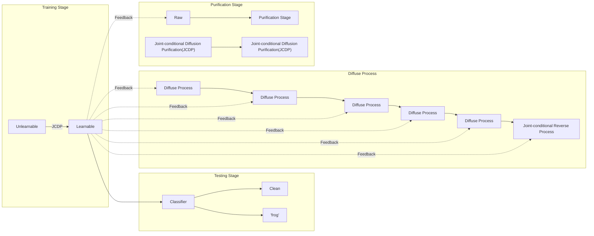

# Los unlearnable examples proporcionan un false sense of security: atravesando unexploitable data con learnable examples

Wan Jiang∗ Hefei University of Technology Hefei, China

Jianxin Sun Chinese Academy of Science Beijing, China

Yunfeng Diao∗† Hefei University of Technology Hefei, China

Meng Wang Hefei University of Technology Hefei, China

He Wang† University College London London, United Kingdom

Richang Hong Hefei University of Technology Hefei, China

## RESUMEN

Salvaguardar los datos contra la explotación no autorizada es vital para la privacidad y la seguridad, especialmente ante el auge reciente de investigaciones sobre vulneraciones de seguridad tales como los ataques adversariales o de pertenencia (adversarial/membership attacks). Con este fin, recientemente se han propuesto los unlearnable examples (UEs) como una protección convincente, agregando perturbaciones imperceptibles a los datos de modo que los modelos entrenados con ellos no puedan clasificarlos con precisión sobre la distribución limpia original. Desafortunadamente, descubrimos que los UEs proporcionan un false sense of security, dado que no pueden impedir que usuarios no autorizados utilicen otros datos desprotegidos para eliminar la protección, convirtiendo los unlearnable data en learnable nuevamente. Motivados por esta observación, definimos formalmente una nueva amenaza introduciendo los learnable unauthorized examples (LEs), que son UEs a los cuales se les ha eliminado su protección. El núcleo de este enfoque es un novedoso proceso de purificación que proyecta los UEs sobre el manifold de los LEs. Esto se materializa mediante un nuevo joint-conditional diffusion model que elimina el ruido de los UEs condicionado a la similitud a nivel de píxel y perceptual entre los UEs y los LEs. Experimentos exhaustivos demuestran que LE ofrece un rendimiento de contraataque state-of-the-art (SOTA) tanto frente a supervised UEs como frente a unsupervised UEs en diversos escenarios, constituyendo la primera contramedida generalizable contra UEs a través de supervised learning y unsupervised learning. Nuestro código está disponible en [https://github.com/jiangw-0/LE\_JCDP.](https://github.com/jiangw-0/LE_JCDP)

## CONCEPTOS CCS

• **Seguridad y privacidad** → **Aspectos humanos y sociales de la seguridad y privacidad**; • **Metodologías de computación** → **Machine learning**.

## PALABRAS CLAVE

Unlearnable Examples, Protección de Datos, Deep Neural Network

<small>∗Ambos autores contribuyeron por igual a esta investigación.</small>

<small>†Autores de correspondencia. Correos electrónicos: diaoyunfeng@hfut.edu.cn, he\_wang@ucl.ac.uk</small>

<small>Permission to make digital or hard copies of all or part of this work for personal or classroom use is granted without fee provided that copies are not made or distributed for profit or commercial advantage and that copies bear this notice and the full citation on the first page. Copyrights for components of this work owned by others than the author(s) must be honored. Abstracting with credit is permitted. To copy otherwise, or republish, to post on servers or to redistribute to lists, requires prior specific permission and/or a fee. Request permissions from permissions@acm.org.</small>

<small>MM ’23, October 29–November 3, 2023, Ottawa, ON, Canada.</small>

<small>© 2023 Copyright held by the owner/author(s). Publication rights licensed to ACM.</small>

<small>ACM ISBN 979-8-4007-0108-5/23/10. . . \$15.00</small>

<small>[https://doi.org/10.1145/3581783.3611833](https://doi.org/10.1145/3581783.3611833)</small>

## Formato de referencia ACM:

Wan Jiang, Yunfeng Diao, He Wang, Jianxin Sun, Meng Wang, and Richang Hong. 2023. Unlearnable Examples Give a False Sense of Security: Piercing through Unexploitable Data with Learnable Examples. In Proceedings of the 31st ACM International Conference on Multimedia (MM ’23), October 29– November 3, 2023, Ottawa, ON, Canada. ACM, New York, NY, USA, 10 pages. [https://doi.org/10.1145/3581783.3611833](https://doi.org/10.1145/3581783.3611833)

## 1 INTRODUCCIÓN

La abundancia de datos "libremente" accesibles en la Web ha sido fundamental para el éxito del deep learning moderno, como lo demuestran ImageNet [37] y Ms-celeb-1m [15]. No obstante, estos conjuntos de datos pueden incluir datos personales recopilados sin consentimiento mutuo [2], lo que ha suscitado preocupación pública respecto a que los datos privados puedan ser utilizados para crear modelos comerciales sin la autorización del propietario [19]. Para abordar tales preocupaciones, se han llevado a cabo crecientes esfuerzos [11, 21, 47] para agregar protección a los datos con el fin de evitar su uso no autorizado haciéndolos inexplotables (unexploitable data). Estos métodos agregan un ruido de tipo "atajo" (shortcut noise) imperceptible a las imágenes de manera que los modelos de deep learning no aprendan semánticas útiles, sino correspondencias espurias entre el ruido y las etiquetas [12]. Por consiguiente, los modelos entrenados sobre unexploitable data fracasan al clasificar datos limpios (clean data), salvaguardando así la privacidad de los usuarios. Dichos métodos de envenenamiento se denominan protección mediante unlearnable example (UE) [21] o availability attack [47].

Si bien la creciente investigación se centra en cómo hacer que los datos sean inexplotables [10, 16, 35, 38, 43, 51], nuestro objetivo es desafiar este paradigma exponiendo una vulnerabilidad clave en esta protección: la protección es meramente efectiva si los unexploitable data son lo único accesible. Desafortunadamente, este no suele ser el caso. Los protectores de datos solo pueden agregar las perturbaciones "unlearnable" a sus propios datos, pero no pueden evitar que usuarios no autorizados accedan a datos similares y desprotegidos procedentes de otras fuentes. Como resultado, es posible estudiar la distribución subyacente de los ejemplos protegidos mediante el estudio de datos similares recién recopilados (desprotegidos). Tomando el reconocimiento facial como ejemplo, aunque los unlearnable examples no pueden utilizarse directamente para entrenar clasificadores, resulta sencillo recopilar nuevos datos faciales desprotegidos. Siempre que exista suficiente similitud entre los datos recién recopilados (desprotegidos) y los datos limpios originales, todavía es posible entrenar un clasificador capaz de clasificar con éxito los datos limpios originales. En otras palabras, los usuarios no autorizados pueden eludir fácilmente la protección de datos para aprender la representación original de los datos a partir de datos desprotegidos recién recopilados, incluso si estos datos poseen una escala reducida, difieren de los datos limpios, carecen de anotaciones de etiquetas y por sí solos no son ideales para entrenar un clasificador [42, 53].

Para demostrar la existencia de la vulnerabilidad antes mencionada, diseñamos un nuevo enfoque capaz de transformar unlearnable examples en ejemplos aprendibles (learnable). Una solución directa consistiría en diseñar un esquema de entrenamiento específico que pueda entrenar sobre unexploitable data [24, 25, 33]. Esto resulta menos ideal, ya que meramente clasifica unexploitable data sin revelar demasiado sobre los datos limpios subyacentes, es decir, la versión desprotegida de los unlearnable data. Sostenemos que una contramedida definitiva consiste en inferir/exponer los datos limpios subyacentes volviendo a hacer que los UEs sean learnable, lo cual puede permitir una posterior explotación no autorizada, como el entrenamiento estándar (standard training) o el aprendizaje de representaciones (representation learning) [16, 35]. Por lo tanto, los datos no autorizados learnable deben ser independientes del esquema de entrenamiento y pueden utilizarse normalmente al igual que los datos de entrenamiento originales. Denominamos a los ejemplos en los datos no autorizados learnable como learnable examples (LEs). La idea clave detrás de la obtención de learnable examples consiste en aprender un manifold de datos learnable a partir de otros datos similares y luego proyectar los unlearnable examples sobre este manifold.

Inspirándonos en la capacidad de los diffusion models para la purificación de ruido [30] y la generación de imágenes [6], proponemos un novedoso método de purificación basado en diffusion models, denominado purificación por difusión con condición conjunta (Joint-conditional Diffusion Purification, JCDP), para capturar el mapeo desde los unlearnable examples hacia sus muestras limpias correspondientes. En primer lugar, inyectamos progresivamente cantidades controladas de ruido gaussiano en las imágenes unlearnable, hasta que sus perturbaciones unlearnable queden sumergidas por el ruido gaussiano. A continuación, dotamos al proceso de eliminación de ruido (denoising process) de una nueva condición conjunta que acelera la eliminación del ruido mientras preserva la semántica de la imagen. La condición conjunta está parametrizada tanto por la distancia a nivel de píxel como por la distancia de percepción neuronal entre la muestra unlearnable y su correspondiente versión denoised. Esto se fundamenta en la observación de que los unlearnable examples exhiben típicamente pequeñas diferencias en la distancia de píxeles respecto a las muestras limpias, y dichas diferencias son imperceptibles para la visión humana. Por lo tanto, las imágenes denoised deben parecerse estrechamente a las muestras originales al minimizar la diferencia visual respecto al unlearnable example.

Evaluamos exhaustivamente nuestro enfoque tanto en supervised UEs como en unsupervised UEs a través de una serie de benchmark datasets, y lo comparamos con los métodos de contramedida existentes. Los resultados demuestran que LE supera sustancialmente a las contramedidas existentes y es la única que mantiene su efectividad tanto bajo supervised learning como bajo unsupervised learning. Más importante aún, a diferencia de las contramedidas existentes que están ligadas a esquemas de entrenamiento específicos, nuestros learnable examples son independientes de estos y pueden utilizarse normalmente como los datos de entrenamiento limpios originales. Sorprendentemente, descubrimos que nuestro enfoque aún conserva su efectividad incluso cuando existe una gran diferencia distribucional entre los datos recién recopilados (utilizados para entrenar el manifold de datos learnable) y los datos limpios. En otras palabras, las distribuciones entre los datos de entrenamiento y los datos crudos recopilados pueden ser diferentes y aún así podemos transformar los unlearnable examples en learnable. Esto, sin duda, profundiza aún más nuestras preocupaciones sobre la vulnerabilidad de los unexploitable data, ya que no requiere que los datos crudos recopilados sean sumamente similares a la versión desprotegida de los unlearnable examples.

En resumen, nuestras principales contribuciones son: 1) Identificamos y demostramos una vulnerabilidad inherente de la protección por UEs, definiendo formalmente una amenaza definitiva contra los UEs llamada learnable examples, la cual puede convertir unlearnable examples en ejemplos aprendibles (learnable). 2) Proponemos una novedosa estrategia de purificación para producir learnable examples, denominada Joint-conditional Diffusion Purification (JCDP), la cual purifica los UEs con un diffusion model condicionado simultáneamente a la similitud a nivel de píxel y perceptual. 3) Demostramos que LE supera a las contramedidas state-of-the-art existentes tanto frente a supervised UEs como frente a unsupervised UEs. LE constituye la primera contramedida generalizable a través de supervised learning y unsupervised learning. 4) Demostramos empíricamente que el joint-conditional diffusion model aún puede purificar UEs incluso cuando la densidad aprendida no coincide con la distribución limpia, exponiendo la fragilidad de la protección conferida por los UEs.

## 2 TRABAJOS RELACIONADOS

## 2.1 Unlearnable Examples

Los unlearnable examples (UEs) constituyen un tipo de métodos de envenenamiento (poisoning methods) [34], pero orientados a defenderse contra la explotación no autorizada de datos [21, 27]. Los UEs estándar (vanilla UEs) definen un objetivo de optimización bi-nivel, el cual hace que la solución óptima sobre los UEs tenga una pérdida máxima sobre los datos limpios [9, 21, 48]. Dada su efectividad y eficiencia, se han propuesto numerosas variantes de UEs, tales como UEs robustos [11, 44], UEs diseñados manualmente [38, 47], UEs basados en clustering [51] y UEs dispersos (sparse UEs) [46]. Inspirados por la efectividad de los UEs en el aprendizaje supervisado (supervised learning), He et al. [8] y Ren et al. [35] investigan el impacto de los UEs en el aprendizaje no supervisado (unsupervised learning).

Las contramedidas contra los UEs solo se han intentado muy recientemente [7, 24, 33]. Se ha demostrado que el Adversarial Training (AT) [21] resiste parcialmente a la protección por UEs, pero los robust UEs pronto lograron vulnerar esta contramedida [11, 44]. Se ha propuesto además el adversarial augmentation [33], que combina diversas políticas de data augmentation con adversarial training, para mejorar la generalización del modelo no autorizado. Liu et al. [24] sugieren emplear la transformación a escala de grises para contrarrestar la protección por UEs. Sin embargo, estos métodos están asociados a esquemas de entrenamiento específicos, lo que limita el uso de los datos no autorizados para otros esquemas y tareas de entrenamiento. El reciente artículo de arXiv [7] aplica diffusion models para contrarrestar UEs. Las principales diferencias con nuestro enfoque radican en que proponemos un nuevo joint-conditional diffusion model en lugar de una aplicación ingenua del diffusion model, abordando el trade-off entre la purificación de perturbaciones y la preservación de la semántica de la imagen. Además, todas las contramedidas previas [7, 21, 24, 33] están diseñadas para supervised learning, pero no se sabe mucho acerca de la fragilidad de los unsupervised UEs.

## 2.2 Diffusion Models

Los diffusion models [20, 39] han superado a las Generative Adversarial Networks (GANs) [13] en el campo de la generación de imágenes y han alcanzado resultados impresionantes con condiciones tales como texto, mapas semánticos o imágenes de referencia [1, 32, 36]. Un diffusion model típico consta de dos procesos: un proceso hacia adelante (forward process) y un proceso de eliminación de ruido (denoising process). El primero se aproxima gradualmente al ruido gaussiano agregando ruido iterativamente a imágenes limpias, mientras que el segundo obtiene imágenes reales a partir del ruido en forma de cadenas de Markov. Dado que un proceso de denoising cuidadosamente diseñado puede desactivar las repercusiones de las perturbaciones en los datos, trabajos recientes [7, 26, 30, 41] aprovechan el poder de los diffusion models para la purificación de ruido, tal como la purificación adversarial (adversarial purification). Sin embargo, la diferencia clave entre la purificación de ruido existente y nuestro trabajo radica en la accesibilidad a los datos de entrenamiento. Los métodos de purificación existentes [7, 30] asumen que los datos de entrenamiento (la versión desprotegida de los unlearnable examples) están disponibles para el entrenamiento, lo que permite a los diffusion models aprender la distribución de datos original con anticipación. Sin embargo, los UE hacen que los datos de entrenamiento sean inexplotables (unexploitable). Cómo entrenar un diffusion model (y de manera más general, aprender un manifold de datos similar) sin acceso a los datos de entrenamiento plantea un desafío crucial para eliminar la protección por UE. Los métodos de purificación existentes aún no han explorado este aspecto.

## 3 METODOLOGÍA

## 3.1 Planteamiento del Problema

En esta subsección, primero proporcionamos la definición de $\operatorname { U E } _ { } { s } ,$ y luego definimos las contramedidas típicas contra la protección por UE.

3.1.1 Protector de Datos. Supongamos que los protectores de datos tienen acceso al conjunto de datos original y este se denota como $\mathcal { D } _ { c } = \{ ( \pmb { x } ^ { ( i ) } , y ^ { ( i ) } ) \} _ { i = 1 } ^ { N }$ con $N$ muestras limpias, en el cual los pares de entrada-etiqueta i.i.d. $( \pmb { x } ^ { ( i ) } , y ^ { ( i ) } )$ se extraen de la distribución conjunta de datos $p _ { d } ( \pmb { x } , y )$ . El objetivo de los protectores es resguardar los datos contra el entrenamiento no autorizado después de su publicación. Con este propósito, publican un conjunto de datos unlearnable $\widetilde { \mathcal { D } _ { u } } = \{ ( \tilde { x } ^ { ( i ) } , y ^ { ( i ) } ) \} _ { i = 1 } ^ { N }$ para los usuarios no autorizados. El protector tiene como objetivo hacer que un clasificador $f _ { \theta } : { \mathcal { X } } \to { \mathcal { Y } }$ entrenado sobre el conjunto de datos unlearnable tenga un rendimiento deficiente sobre la distribución original de datos limpios $p _ { d } ( \pmb { x } , y )$

$$
\boldsymbol {\theta} ^ {*} = \underset {\boldsymbol {\theta}} {\arg \min} \mathbb {E} _ {(\tilde {\boldsymbol {x}}, y) \in \mathcal {D} _ {u}} [ \mathcal {L} (f _ {\boldsymbol {\theta}} (\tilde {\boldsymbol {x}}), y) ] \tag {1}
$$

$$
\text {s.t.} p _ {\boldsymbol {\theta} ^ {*}} (y | \boldsymbol {x}) \neq p _ {d} (y | \boldsymbol {x})
$$

donde $\mathcal { L } ( \cdot )$ es la cross-entropy loss. Puesto que las perturbaciones unlearnable no deberían afectar la utilidad normal de los datos, se asume que $\tilde { \pmb { x } }   =   \pmb { x } + \pmb { \delta } ,$ donde $\boldsymbol{\delta}$ son las perturbaciones unlearnable "invisibles" acotadas por $| | \delta | | _ { p } \leq \varepsilon .$

3.1.2 Explotador No Autorizado de Datos. Asumimos que las partes no autorizadas solo tienen acceso a los datos protegidos, es decir, al conjunto de unlearnable examples $\mathcal { D } _ { u }$ . Su objetivo es entrenar modelos sobre $\mathcal { D } _ { u }$ y lograr que generalicen adecuadamente sobre la distribución original de datos limpios. Con este fin, las contramedidas existentes [21, 24, 33] han intentado diseñar un esquema de entrenamiento especial que pueda entrenar clasificadores sobre unexploitable data. Se ha demostrado que el adversarial training (AT) [25] puede utilizarse para prevenir la protección por UE hasta cierto punto [21], lo cual se formula de la siguiente manera:

$$
\underset {\boldsymbol {\theta}} {\arg \min} \mathbb {E} _ {(\tilde {\boldsymbol {x}}, y) \in \mathcal {D} _ {u}} \left[ \max _ {| | \boldsymbol {\delta} _ {a d v} | | _ {p} \leq \varepsilon} \mathcal {L} \left(f _ {\boldsymbol {\theta}} \left(\tilde {\boldsymbol {x}} + \boldsymbol {\delta} _ {a d v}\right), y\right) \right] \tag {2}
$$

Inspirado en $\mathrm { A T } ,$ recientemente se ha propuesto además el adversarial augmentations (AA) [33]. Específicamente, combinan políticas de data augmentation con adversarial training:

$$
\underset {\boldsymbol {\theta}} {\arg \min} \mathbb {E} _ {(\tilde {\boldsymbol {x}}, y) \in \mathcal {D} _ {u}} \left[ \max _ {\mathcal {T} \sim \mathcal {A}} \mathcal {L} \left(f _ {\boldsymbol {\theta}} \left(\mathcal {T} (\tilde {\boldsymbol {x}}), y\right) \right] \right. \tag {3}
$$

donde $\mathcal { T } ( \cdot )$ es la combinación de políticas de aumento de imágenes provenientes de un conjunto de todas las posibles data augmentations $\mathcal { R } .$ Sin embargo, los métodos basados en $\mathrm { A T }$ sufren una degradación significativa del rendimiento cuando se entrenan sobre datos inexplotables robustos (robust unexploitable data) [11]. Además, AT modifica los esquemas de entrenamiento, dejando los datos no autorizados en sí mismos todavía como inexplotables. Esto obliga a que los datos de entrenamiento queden ligados al adversarial training, lo que restringe el uso de los datos para otros esquemas y tareas de entrenamiento, tales como el entrenamiento estándar y el aprendizaje de representaciones (standard training y representation learning). Por último, pero no menos importante, utilizar AT para entrenar un modelo de gran escala sobre conjuntos de datos inexplotables a gran escala no resulta deseable, dada la complejidad computacional que conlleva [45].

## 3.2 Learnable Examples

Las contramedidas existentes dependen de esquemas de entrenamiento específicos. Sin embargo, sostenemos que una amenaza definitiva contra los UEs debería convertir los datos inexplotables $\mathcal { D } _ { u }$ en un conjunto de datos aprendible (learnable dataset) $\mathcal { D } _ { l } .   \mathcal { D } _ { l }$ puede utilizarse con normalidad al igual que los datos de entrenamiento limpios originales, permitiendo una posterior explotación no autorizada como el entrenamiento estándar y el aprendizaje de representaciones. Aquí consideramos como ejemplo el escenario estándar en el aprendizaje supervisado (supervised learning): un modelo entrenado sobre $\mathcal { D } _ { l }$ puede generalizar fácilmente y de forma óptima sobre la distribución original de datos limpios $p _ { d } ( \pmb { x } , y ) ;$

$$
\boldsymbol {\theta} ^ {*} = \underset {\boldsymbol {\theta}} {\arg \min} \mathbb {E} _ {(\boldsymbol {x}, y) \in \mathcal {D} _ {l}} [ \mathcal {L} (f _ {\boldsymbol {\theta}} (\boldsymbol {x}), y) ] \tag {4}
$$

$$
\text {s.t.} \mathcal {D} _ {l} = \operatorname{denoise} (\mathcal {D} _ {u}); p _ {\boldsymbol {\theta} ^ {*}} (y | \boldsymbol {x}) = p _ {d} (y | \boldsymbol {x})
$$

Nos referimos a los ejemplos protegidos transformados en learnable en $\mathcal { D } _ { l }$ como learnable examples (LEs). Nótese que los LEs son independientes de los esquemas de entrenamiento; por lo tanto, también pueden utilizarse para el aprendizaje no supervisado (unsupervised learning) no autorizado. Dado un buen eliminador de ruido $\operatorname{denoise}$, podemos proyectar los unlearnable examples de regreso al manifold de datos learnable para obtener los LEs correspondientes. Un buen eliminador de ruido se logra frecuentemente mediante el aprendizaje de un modelo generativo $G$ [30]. Sin embargo, cómo entrenar un generador sin tener acceso a los datos de entrenamiento originales constituye un desafío complejo. Nuestra observación clave es que, aunque los datos de entrenamiento originales $\mathcal { D } _ { c }$ no son accesibles, se pueden recopilar fácilmente en el entorno real (in the wild) datos crudos (desprotegidos) a pequeña escala sin etiquetas anotadas $\mathcal { D } _ { r }$ [18]. Siempre que exista suficiente similitud entre $\mathcal { D } _ { r }$ y ${ \mathcal { D } } _ { u } ,$ podemos aprender un generador incondicional $G$ a partir de $\mathcal { D } _ { r }$ y utilizarlo para proyectar los UEs sobre el manifold de los LEs. Considerando que los diffusion models [20, 39] pueden lograr una alta calidad de muestreo [6, 40] y un excelente rendimiento en la purificación de ruido [30], empleamos un diffusion model para el denoising. No obstante, una aplicación ingenua del diffusion model se verá afectada por el trade-off entre la purificación de ruido y la preservación de la semántica de la imagen. Para resolver este problema, proponemos una nueva purificación por difusión con condición conjunta (Joint-conditional Diffusion Purification), condicionada a la medición simultánea de la similitud a nivel de píxel y perceptual entre los UEs y las correspondientes versiones denoised. En la Fig. 1 se muestra una ilustración general. A continuación, detallamos el proceso de purificación.

## 3.3 Joint-conditional Diffusion Purification

3.3.1 DDPM para la Purificación de Datos. El diffusion model define una cadena de Markov de pasos de difusión para agregar gradualmente ruido gaussiano a los datos y luego aprender la reversión del proceso de difusión para construir las muestras de datos deseadas a partir del ruido. Dado un punto de datos limpio $\boldsymbol{x} _ { 0 }$ extraído de una distribución de datos $q ( \boldsymbol{x} _ { 0 } )$ , los Denoising Diffusion Probabilistic Models (DDPM) [20] definen un proceso forward o de difusión que sigue una cadena de Markov para agregar gradualmente ruido gaussiano a $\boldsymbol{x} _ { 0 }$ en $T$ pasos con un programa de varianza predefinido $\beta _ { 1 : T } \in ( 0 , 1 ) ^ { T }$

$$
q \left(\boldsymbol {x} _ {1: T} \mid \boldsymbol {x} _ {0}\right) = \prod_ {t = 1} ^ {T} q \left(\boldsymbol {x} _ {t} \mid \boldsymbol {x} _ {t - 1}\right) \tag {5}
$$

$$
q (\boldsymbol {x} _ {t} | \boldsymbol {x} _ {t - 1}) = \mathcal {N} (\boldsymbol {x} _ {t}; \sqrt {1 - \beta_ {t}} \boldsymbol {x} _ {t - 1}, \beta_ {t} \boldsymbol {I})
$$

flowchart

Figura 1: Ilustración de la producción de learnable examples mediante purificación por difusión con condición conjunta (JCDP). El clasificador entrenado con datos unlearnable no generaliza adecuadamente sobre la distribución limpia. Para eliminar dicha protección de datos, proponemos JCDP, que proyecta los datos unlearnable sobre un manifold de datos learnable, el cual se aprende a partir de datos crudos (desprotegidos) recién recopilados.

Si definimos $\alpha _ { t }   =   1   -   \beta _ { t } , \overline { { \alpha } } _ { t }   =   \textstyle \prod _ { s = 1 } ^ { t } \alpha _ { s }$ , podemos reformular el proceso de difusión mediante un solo paso:

$$
q (\boldsymbol {x} _ {t} | \boldsymbol {x} _ {0}) = \mathcal {N} (\boldsymbol {x} _ {t}; \sqrt {\overline {{\alpha}} _ {t}} \boldsymbol {x} _ {0}, (1 - \overline {{\alpha}} _ {t}) \boldsymbol {I}) \tag {6}
$$

El proceso inverso (reverse process) también es un proceso de Markov que aprende un modelo $p _ { \varphi }$ para estimar estas probabilidades condicionales $q ( \pmb { x } _ { t - 1 } | \pmb { x } _ { t } )$

$$
p _ {\varphi} (\boldsymbol {x} _ {0: T}) = p (\boldsymbol {x} _ {T}) \prod_ {t = 1} ^ {T} p _ {\varphi} (\boldsymbol {x} _ {t - 1} | \boldsymbol {x} _ {t}) \tag {7}
$$

$$
p _ {\varphi} (\boldsymbol {x} _ {t - 1} | \boldsymbol {x} _ {t}) = \mathcal {N} (\boldsymbol {x} _ {t - 1}; \boldsymbol {\mu} _ {\varphi} (\boldsymbol {x} _ {t}, t), \boldsymbol {\sigma} _ {t} ^ {2} \boldsymbol {I})
$$

donde el proceso inverso se inicia a partir de $p ( \pmb { x } _ { T } ) = \mathcal { N } ( \pmb { x } _ { T } ; \pmb { 0 } , \pmb { I } )$ . La media $\boldsymbol { \mu } _ { \varphi } ( \boldsymbol { x } _ { t } , t )$ es una red neuronal parametrizada por $\varphi ,$ mientras que la varianza $\sigma _ { t } ^ { 2 }$ puede ser aprendida mediante una red neuronal [29] o configurarse como un conjunto de constantes dependientes del tiempo [20].

Ahora introducimos el proceso de purificación mediante el uso de DDPM. Asumimos que hemos entrenado un modelo DDPM sobre los datos crudos recopilados $\mathcal { D } _ { r }$ . Suponiendo que el unlearnable example es $\tilde { \pmb { x } } _ { 0 } = \pmb { x } _ { 0 } + \pmb { \delta } ,$ primero difundimos la imagen unlearnable durante $T _ { p }$ pasos agregando ruido gaussiano para sumergir la perturbación unlearnable:

$$
\tilde {\boldsymbol {x}} _ {T _ {p}} = \sqrt {\overline {{\alpha}} _ {T _ {p}}} \boldsymbol {x} _ {0} + \sqrt {\overline {{\alpha}} _ {T _ {p}}} \boldsymbol {\delta} + \sqrt {1 - \overline {{\alpha}} _ {T _ {p}}} \boldsymbol {\epsilon} \tag {8}
$$

donde $\boldsymbol{\epsilon}$ es un ruido gaussiano estándar. El proceso inverso tiene como objetivo mitigar simultáneamente el ruido gaussiano añadido y la perturbación unlearnable residual en $\tilde { \boldsymbol{x} } _ { T _ { p } }$:

$$
\tilde {\boldsymbol {x}} _ {t - 1} ^ {*} = \frac {1}{\sqrt {\alpha_ {t}}} \left(\tilde {\boldsymbol {x}} _ {t} ^ {*} - \frac {1 - \alpha_ {t}}{\sqrt {1 - \overline {{\alpha_ {t}}}}} \boldsymbol {\epsilon} _ {\varphi} \left(\tilde {\boldsymbol {x}} _ {t} ^ {*}, t\right)\right) + \boldsymbol {\sigma} _ {t} \boldsymbol {\epsilon} _ {t} \tag {9}
$$

donde $\tilde { \pmb { x } } _ { T _ { p } } ^ { * } = \tilde { \pmb { x } } _ { T _ { p } }$ . Durante el proceso de purificación descrito anteriormente, la selección del paso óptimo de purificación $T _ { p }$ es crucial. Si $T _ { p }$ es demasiado pequeño, el término de perturbación unlearnable $\sqrt { \overline{\alpha} _ { T _ { p } } }   \pmb { \delta }$ no puede sumergirse completamente en el ruido gaussiano, mientras que elegir un $T _ { p }$ excesivamente grande provocará una pérdida de información semántica original. En nuestros experimentos preliminares, descubrimos que purificar iterativamente las imágenes unlearnable múltiples veces puede mitigar este problema hasta cierto punto. Elegir un $T _ { p }$ relativamente pequeño para realizar múltiples iteraciones de purificación resulta más efectivo que purificar una sola vez con un $T _ { p }$ grande. El proceso detallado de iteración se detalla en el Algoritmo 1.

3.3.2 Joint-conditional Diffusion Model. Para eliminar aún más el trade-off entre la fuerza de purificación y la retención del contenido semántico, proponemos un novedoso proceso de purificación basado en el modelo de difusión, denominado Purificación por Difusión con Condición Conjunta (Joint-conditional Diffusion Purification, JCDP). JCDP aprovecha la guía conjunta de distancia de píxeles y de percepción para permitir un control coordinado sobre la similitud semántica de bajo nivel y de alto nivel entre la imagen purificada y la limpia original. Desde la perspectiva de las partes no autorizadas, los datos de entrenamiento limpios originales no se conocen a priori; por lo tanto, recurrimos a preservar la consistencia entre la imagen purificada y la unlearnable durante el proceso inverso. Esta aproximación es razonable debido a que un unlearnable example, por definición, resulta imperceptible para los humanos, y su perturbación unlearnable está restringida a una pequeña bola $\epsilon$ según la distancia de píxeles. En consecuencia, la imagen purificada se asemejará estrechamente a su muestra limpia original al obligarla a estar visualmente próxima al unlearnable example.

La distancia de píxeles se puede calcular fácilmente mediante el error cuadrático medio (MSE). Sin embargo, la verdadera distancia de percepción no puede calcularse directamente para datos de imagen. Considerando que la similitud perceptual puede vincularse intuitivamente con representaciones visuales profundas [52], proponemos utilizar la distancia de percepción neuronal LPIPS [52] para aproximar la verdadera distancia de percepción. Introducimos una red neuronal adicional $h ( \cdot )$ y denotamos sus embeddings de características generados como $\Phi ( { \pmb x } )$ . A continuación, al condicionar este proceso inverso $p _ { \varphi } ( \pmb { x } _ { t - 1 } | \pmb { x } _ { t } )$ de la Ec. (7) sobre $\tilde { \boldsymbol{x} } _ { t }$ y $\Phi ( \tilde { \pmb { x } } _ { t } )$ , podemos obtener la muestra learnable con eliminación de ruido a partir de la distribución condicional conjunta $p _ { \varphi } ( \tilde { \boldsymbol{x} } _ { 0 : T _ { p } } ^ { * } | \tilde { \pmb { x } } , \Phi ( \tilde { \pmb { x } } ) )$

$$
p _ {\varphi} \left(\tilde {\boldsymbol {x}} _ {0: T _ {p}} ^ {*} \mid \tilde {\boldsymbol {x}}, \Phi (\tilde {\boldsymbol {x}})\right) = p \left(\tilde {\boldsymbol {x}} _ {T _ {p}} ^ {*}\right) \prod_ {t = 1} ^ {T} p _ {\varphi} \left(\tilde {\boldsymbol {x}} _ {t - 1} ^ {*} \mid \tilde {\boldsymbol {x}} _ {t} ^ {*}, \tilde {\boldsymbol {x}} _ {t}, \Phi (\tilde {\boldsymbol {x}} _ {t})\right) \tag {10}
$$

donde $\tilde { \boldsymbol{x} } _ { t }$ es la versión con ruido de $\tilde { \boldsymbol{x} } _ { 0 }$ mediante la difusión de $t$ pasos. Utilizando la regla de Bayes, podemos derivar el proceso inverso condicional conjunto:

$$
\begin{array}{l} p _ {\varphi} (\tilde {\boldsymbol {x}} _ {t - 1} ^ {*} | \tilde {\boldsymbol {x}} _ {t} ^ {*}, \tilde {\boldsymbol {x}} _ {t}, \Phi (\tilde {\boldsymbol {x}} _ {t})) \\ = \frac {p \left(\Phi \left(\tilde {\boldsymbol {x}} _ {t}\right) \mid \tilde {\boldsymbol {x}} _ {t - 1} ^ {*} , \tilde {\boldsymbol {x}} _ {t} ^ {*} , \tilde {\boldsymbol {x}} _ {t}\right) p _ {\varphi} \left(\tilde {\boldsymbol {x}} _ {t - 1} ^ {*} \mid \boldsymbol {x} _ {t} ^ {*} , \tilde {\boldsymbol {x}} _ {t}\right)}{p \left(\Phi \left(\tilde {\boldsymbol {x}} _ {t}\right) \mid \tilde {\boldsymbol {x}} _ {t} ^ {*} , \tilde {\boldsymbol {x}} _ {t}\right)} \tag {11} \\ = p (\tilde {\boldsymbol {x}} _ {t} ^ {*} | \tilde {\boldsymbol {x}} _ {t - 1} ^ {*}, \tilde {\boldsymbol {x}} _ {t}, \Phi (\tilde {\boldsymbol {x}} _ {t})) \frac {p (\Phi (\tilde {\boldsymbol {x}} _ {t}) | \tilde {\boldsymbol {x}} _ {t - 1} ^ {*} , \tilde {\boldsymbol {x}} _ {t})}{p (\tilde {\boldsymbol {x}} _ {t} ^ {*} | \tilde {\boldsymbol {x}} _ {t - 1} ^ {*} , \tilde {\boldsymbol {x}} _ {t})} \frac {p _ {\varphi} (\tilde {\boldsymbol {x}} _ {t - 1} ^ {*} | \tilde {\boldsymbol {x}} _ {t} ^ {*} , \tilde {\boldsymbol {x}} _ {t})}{p (\Phi (\tilde {\boldsymbol {x}} _ {t}) | \tilde {\boldsymbol {x}} _ {t} ^ {*} , \tilde {\boldsymbol {x}} _ {t})} \\ \end{array}
$$

Dado que el proceso de difusión de DDPM es un proceso de Markov, tenemos:

$$
p _ {\varphi} \left(\tilde {\boldsymbol {x}} _ {t - 1} ^ {*} \mid \tilde {\boldsymbol {x}} _ {t} ^ {*}, \tilde {\boldsymbol {x}} _ {t}, \Phi \left(\tilde {\boldsymbol {x}} _ {t}\right)\right) = \frac {p \left(\Phi \left(\tilde {\boldsymbol {x}} _ {t}\right) \mid \tilde {\boldsymbol {x}} _ {t - 1} ^ {*} , \tilde {\boldsymbol {x}} _ {t}\right) p _ {\varphi} \left(\tilde {\boldsymbol {x}} _ {t - 1} ^ {*} \mid \tilde {\boldsymbol {x}} _ {t} ^ {*} , \tilde {\boldsymbol {x}} _ {t}\right)}{p \left(\Phi \left(\tilde {\boldsymbol {x}} _ {t}\right) \mid \tilde {\boldsymbol {x}} _ {t} ^ {*} , \tilde {\boldsymbol {x}} _ {t}\right)} \tag {12}
$$

luego tomamos el logaritmo en ambos lados:

$$
\begin{array}{l} \log p _ {\varphi} \left(\tilde {\boldsymbol {x}} _ {t - 1} ^ {*} \mid \tilde {\boldsymbol {x}} _ {t} ^ {*}, \tilde {\boldsymbol {x}} _ {t}, \Phi (\tilde {\boldsymbol {x}} _ {t})\right) = \log p \left(\Phi (\tilde {\boldsymbol {x}} _ {t}) \mid \tilde {\boldsymbol {x}} _ {t - 1} ^ {*}, \tilde {\boldsymbol {x}} _ {t}\right) \tag {13} \\ + \log p _ {\varphi} \left(\tilde {\boldsymbol {x}} _ {t - 1} ^ {*} \mid \tilde {\boldsymbol {x}} _ {t} ^ {*}, \tilde {\boldsymbol {x}} _ {t}\right) - \log p \left(\Phi \left(\tilde {\boldsymbol {x}} _ {t}\right) \mid \tilde {\boldsymbol {x}} _ {t} ^ {*}, \tilde {\boldsymbol {x}} _ {t}\right) \\ \end{array}
$$

Podemos aproximar $\log p ( \Phi ( \tilde { \boldsymbol { x } } _ { t } ) | \tilde { \boldsymbol { x } } _ { t } ^ { * } , \tilde { \boldsymbol { x } } _ { t } )$ mediante una expansión de Taylor alrededor de $\tilde { \boldsymbol { x } } _ { t } ^ { * } = \tilde { \boldsymbol { x } } _ { t - 1 } ^ { * } .$ Esto produce:

$$
\log p _ {\varphi} (\tilde {\boldsymbol {x}} _ {t - 1} ^ {*} | \tilde {\boldsymbol {x}} _ {t} ^ {*}, \tilde {\boldsymbol {x}} _ {t}, \Phi (\tilde {\boldsymbol {x}} _ {t}))
$$

$$
\begin{array}{l} \text {SIP} \varphi \left(\tilde {x} _ {t - 1} + \tilde {x} _ {t}\right) = \left(\tilde {x} _ {t} - \tilde {x} _ {t}\right) \\ \approx \left(\tilde {\boldsymbol {x}} _ {t - 1} ^ {*} - \tilde {\boldsymbol {x}} _ {t} ^ {*}\right) \nabla_ {\tilde {\boldsymbol {x}} _ {t} ^ {*}} \log p \left(\Phi \left(\tilde {\boldsymbol {x}} _ {t}\right) \mid \tilde {\boldsymbol {x}} _ {t} ^ {*}, \tilde {\boldsymbol {x}} _ {t}\right) + \log p _ {\varphi} \left(\tilde {\boldsymbol {x}} _ {t - 1} ^ {*} \mid \tilde {\boldsymbol {x}} _ {t} ^ {*}, \tilde {\boldsymbol {x}} _ {t}\right) \end{array} \tag {14}
$$

De acuerdo con los trabajos [39] y [6], se demuestra que:

$$
\begin{array}{l} \begin{array}{r l} p _ {\varphi} \left(\tilde {\boldsymbol {x}} _ {t - 1} ^ {*} \mid \tilde {\boldsymbol {x}} _ {t} ^ {*}, \tilde {\boldsymbol {x}} _ {t}\right) \\ & \quad \text {令} \left(\tilde {\boldsymbol {x}} _ {t - 1} ^ {*} \mid \tilde {\boldsymbol {x}} _ {t} ^ {*}, \tilde {\boldsymbol {x}} _ {t}\right) \end{array} \tag {15} \\ \approx \mathcal {N} (\tilde {\boldsymbol {x}} _ {t - 1} ^ {*}; \boldsymbol {\mu} _ {\varphi} (\tilde {\boldsymbol {x}} _ {t} ^ {*}, t) + \boldsymbol {\sigma} _ {t} ^ {2} \nabla_ {\tilde {\boldsymbol {x}} _ {t} ^ {*}} \log p (\tilde {\boldsymbol {x}} _ {t} | \tilde {\boldsymbol {x}} _ {t} ^ {*}), \boldsymbol {\sigma} _ {t} ^ {2} \boldsymbol {I}) \\ \end{array}
$$

entonces podemos demostrar que:

$$
\begin{array}{l} p _ {\varphi} (\tilde {\boldsymbol {x}} _ {t - 1} ^ {*} | \tilde {\boldsymbol {x}} _ {t} ^ {*}, \tilde {\boldsymbol {x}} _ {t}, \Phi (\tilde {\boldsymbol {x}} _ {t})) \\ \approx \mathcal {N} \left(\tilde {\boldsymbol {x}} _ {t - 1} ^ {*}; \boldsymbol {\mu} _ {\varphi} \left(\tilde {\boldsymbol {x}} _ {t} ^ {*}, t\right) + \boldsymbol {\sigma} _ {t} ^ {2} \left(\boldsymbol {d} _ {1} + \boldsymbol {d} _ {2}\right), \boldsymbol {\sigma} _ {t} ^ {2} \boldsymbol {I}\right) \tag {16} \\ \end{array}
$$

$$
\boldsymbol {d} _ {1} = \nabla_ {\tilde {\boldsymbol {x}} _ {t} ^ {*}} \log p (\tilde {\boldsymbol {x}} _ {t} | \tilde {\boldsymbol {x}} _ {t} ^ {*}), \boldsymbol {d} _ {2} = \nabla_ {\tilde {\boldsymbol {x}} _ {t} ^ {*}} \log p (\Phi (\tilde {\boldsymbol {x}} _ {t}) | \tilde {\boldsymbol {x}} _ {t} ^ {*}, \tilde {\boldsymbol {x}} _ {t})
$$

En la ecuación anterior, $p ( \tilde { \boldsymbol { x } } _ { t } | \tilde { \boldsymbol { x } } _ { t } ^ { * } )$ y $p ( \Phi ( \tilde { \boldsymbol { x } } _ { t } ) | \tilde { \boldsymbol { x } } _ { t } ^ { * } , \tilde { \boldsymbol { x } } _ { t } )$ representan qué tan probable es que $\tilde { \boldsymbol{x} } _ { t } ^ { * }$ esté próxima a $\tilde { \boldsymbol{x} } _ { t }$ bajo el espacio de datos y el espacio de características latentes en el proceso inverso. Siguiendo a [41], podemos utilizar MSE como la métrica de distancia $\mathcal { D } _ { m }$ para aproximar $p ( \tilde { \pmb { x } } _ { t } | \tilde { \pmb { x } } _ { t } ^ { * } )$ :

$$
p \left(\tilde {\boldsymbol {x}} _ {t} \mid \tilde {\boldsymbol {x}} _ {t} ^ {*}\right) = \frac {1}{Z} \exp \left(\lambda_ {1} \mathcal {D} _ {\boldsymbol {m}} \left(\tilde {\boldsymbol {x}} _ {t} ^ {*}, \tilde {\boldsymbol {x}} _ {t}\right)\right) \tag {17}
$$

donde $Z$ es un factor de normalización y $\lambda _ { 1 }$ es un factor de escala que modula la fuerza de la guía. A partir de la Ec. (17) tenemos:

$$
\boldsymbol {d} _ {1} = \nabla_ {\tilde {\boldsymbol {x}} _ {t} ^ {*}} \log p \left(\tilde {\boldsymbol {x}} _ {t} \mid \tilde {\boldsymbol {x}} _ {t} ^ {*}\right) = - \lambda_ {1} \nabla_ {\tilde {\boldsymbol {x}} _ {t} ^ {*}} \mathcal {D} _ {\boldsymbol {m}} \left(\tilde {\boldsymbol {x}} _ {t} ^ {*}, \tilde {\boldsymbol {x}} _ {t}\right) \tag {18}
$$

De manera similar, cuantificamos $p ( \Phi ( \tilde { \boldsymbol { x } } _ { t } ) | \boldsymbol { x } _ { t } )$ adaptando LPIPS como la métrica de distancia de percepción ${ \mathcal { D } } _ { P } ;$

$$
p \left(\Phi \left(\tilde {\boldsymbol {x}} _ {t}\right) \mid \tilde {\boldsymbol {x}} _ {t} ^ {*}, \tilde {\boldsymbol {x}} _ {t}\right) = \frac {1}{Z} \exp \left(\lambda_ {2} \mathcal {D} _ {\boldsymbol {p}} \left(\tilde {\boldsymbol {x}} _ {t} ^ {*}, \tilde {\boldsymbol {x}} _ {t}\right)\right) \tag {19}
$$

$$
\mathcal {D} _ {\boldsymbol {p}} (\tilde {\boldsymbol {x}} _ {t} ^ {*}, \tilde {\boldsymbol {x}} _ {t}) = | | \Phi (\tilde {\boldsymbol {x}} _ {t} ^ {*}) - \Phi (\tilde {\boldsymbol {x}} _ {t}) | | _ {2}
$$

A continuación, podemos calcular su gradiente:

$$
\boldsymbol {d} _ {2} = \nabla_ {\tilde {\boldsymbol {x}} _ {t} ^ {*}} \log p (\Phi (\tilde {\boldsymbol {x}} _ {t}) | \tilde {\boldsymbol {x}} _ {t} ^ {*}, \tilde {\boldsymbol {x}} _ {t}) = - \lambda_ {2} \nabla_ {\tilde {\boldsymbol {x}} _ {t} ^ {*}} \mathcal {D} _ {\boldsymbol {p}} (\tilde {\boldsymbol {x}} _ {t} ^ {*}, \tilde {\boldsymbol {x}} _ {t}) \tag {20}
$$

Con base en la inferencia anterior, el operador de transición condicional $p _ { \varphi } ( \tilde { \boldsymbol { x } } _ { t - 1 } ^ { * } | \tilde { \boldsymbol { x } } _ { t } ^ { * } , \tilde { \boldsymbol { x } } _ { t } , \boldsymbol { \Phi } ( \tilde { \boldsymbol { x } } _ { t } ) )$ puede aproximarse mediante una distribución gaussiana, cuya media se desplaza en $\sigma _ { t } ^ { 2 } ( { \pmb d } _ { 1 }   +   { \pmb d } _ { 2 } )$ . El Algoritmo 1 resume los detalles de inferencia de JCDP.

Algoritmo 1: Joint-conditional Diffusion Purification

Input: Unlearnable example $\tilde{\boldsymbol{x}}_0$, diffusion step $T_p$ per each purification run, number of purification iterations $N$, given a DDPM $(\boldsymbol{\mu}_{\varphi}(\boldsymbol{x}_t, t), \boldsymbol{\sigma}_t^2\boldsymbol{I})$, gradient scale $\lambda_1$ and $\lambda_2$.
Init: $\boldsymbol{d}_1 = 0$ and $\boldsymbol{d}_2 = 0$;
for $i \leftarrow 1$ to $N$ do
    The diffusion process:
    $q(\tilde{\boldsymbol{x}}_{1:T_p}|\tilde{\boldsymbol{x}}_0) = \prod_{t=1}^{T_p} q(\tilde{\boldsymbol{x}}_t|\tilde{\boldsymbol{x}}_{t-1})$;
    The reverse process:
    for $t \leftarrow T_p$ to 1 do
        $\boldsymbol{\mu}, \boldsymbol{\sigma}_t^2 \leftarrow \boldsymbol{\mu}_{\varphi}(\tilde{\boldsymbol{x}}_t^*, t), \boldsymbol{\sigma}_t^2$;
        $\boldsymbol{d}_1 \leftarrow -\lambda_1 \nabla_{\tilde{\boldsymbol{x}}_t^*} \mathcal{D}_m(\tilde{\boldsymbol{x}}_t^*, \tilde{\boldsymbol{x}}_t)$;
        $\boldsymbol{d}_2 \leftarrow -\lambda_2 \nabla_{\tilde{\boldsymbol{x}}_t^*} \mathcal{D}_p(\tilde{\boldsymbol{x}}_t^*, \tilde{\boldsymbol{x}}_t)$;
        $\tilde{\boldsymbol{x}}_{t-1}^* \leftarrow$ sample from $\mathcal{N}(\boldsymbol{\mu} + \boldsymbol{\sigma}_t^2(\boldsymbol{d}_1 + \boldsymbol{d}_2), \boldsymbol{\sigma}_t^2\boldsymbol{I})$
    end
end
return $\tilde{\boldsymbol{x}}_0^*$

3.3.3 Fine-tuning para Diffusion Models. Podemos entrenar directamente un diffusion model sobre datos recién recopilados (desprotegidos). Sin embargo, dado que el tamaño de los datos recopilados suele ser mucho menor que el de los datos de entrenamiento originales, la calidad de generación podría ser baja. Afortunadamente, resulta casi imposible que los protectores de datos agreguen perturbaciones unlearnable a todos los datos en el mundo real. Por lo tanto, podemos transferir conocimiento desde dominios fuente desprotegidos hacia dominios objetivo no autorizados con datos recopilados limitados mediante fine-tuning. Específicamente, primero inicializamos DDPM con los pesos de una red fuente preentrenada en un dominio desprotegido y luego realizamos el fine-tuning sobre los datos recién recopilados. Esta simple operación de fine-tuning puede acortar el tiempo de convergencia y mejorar el rendimiento de purificación, especialmente cuando los datos crudos recopilados son limitados.

## 4 EXPERIMENTOS

## 4.1 Configuraciones

4.1.1 Conjuntos de Datos y Evaluación. Seleccionamos tres benchmark datasets ampliamente adoptados para la evaluación de LE: CIFAR-10 [22], CIFAR-100 [22], SVHN [28] y Pets [31]. CIFAR-10 y CIFAR-100 constan de 50000 imágenes en el conjunto de entrenamiento y 10000 imágenes en el conjunto de prueba. SVHN contiene 73257 imágenes de dígitos para entrenamiento y 26032 imágenes de dígitos para prueba. Pets consta de 3680 imágenes de mascotas para entrenamiento y 3669 imágenes de mascotas para prueba. Para demostrar la superioridad de LE, comparamos LE con AT [25] y las contramedidas supervisadas propuestas recientemente, incluidas ISS [24], AA [33] y AVATAR [7]. AT, ISS y AA modifican el esquema de entrenamiento. AVATAR utiliza modelos generativos preentrenados para purificar UEs, y los modelos preentrenados utilizados acceden al conjunto de entrenamiento original. AA emplea la tecnología de adversarial augmentation, aplicando $K$ aumentos aleatorios diferentes para cada imagen. Para una comparación justa, no consideramos la incorporación de datos adicionales en la etapa de entrenamiento, por lo que establecemos $K = 1$.

Tabla 1: Comparación de la test accuracy (%) de clasificadores ResNet-18 entrenados sobre los conjuntos de datos protegidos CIFAR-10, CIFAR-100 y SVHN. Clean denota el entrenamiento estándar sobre el conjunto de entrenamiento limpio. EMN se refiere a la forma de error-minimizing noise a nivel de muestra, mientras que EMN (C) es el tipo a nivel de clase. Nótese que ISS contiene 3 estrategias de transformación de imágenes y reportamos la mejor estrategia. Los mejores resultados se destacan en negrita.

<table><tr><td rowspan="2">Countermeasures</td><td colspan="5">CIFAR-10 (Clean 95.3)</td><td colspan="5">CIFAR-100 (Clean 78.8)</td><td colspan="4">SVHN (Clean 96.2)</td></tr><tr><td>EMN [21]</td><td>EMN (C) [21]</td><td>REMN [11]</td><td>LSP [47]</td><td>TAP [10]</td><td>EMN [21]</td><td>EMN (C) [21]</td><td>REMN [11]</td><td>LSP [47]</td><td>TAP [10]</td><td>EMN [21]</td><td>REMN [11]</td><td>LSP [47]</td><td>TAP [10]</td></tr><tr><td>Vanilla</td><td>21.2</td><td>20.7</td><td>20.5</td><td>15.0</td><td>7.8</td><td>14.8</td><td>4.0</td><td>10.9</td><td>4.1</td><td>8.6</td><td>13.9</td><td>11.6</td><td>7.3</td><td>41.0</td></tr><tr><td>AVATAR [7]</td><td>91.0</td><td>-</td><td>88.5</td><td>85.7</td><td>90.7</td><td>65.7</td><td>-</td><td>64.9</td><td>58.5</td><td>65.0</td><td>93.8</td><td>88.5</td><td>83.8</td><td>93.4</td></tr><tr><td>ISS [24]</td><td>93.0</td><td>-</td><td>92.8</td><td>82.5</td><td>83.9</td><td>67.5</td><td>-</td><td>57.3</td><td>53.5</td><td>56.3</td><td>89.9</td><td>-</td><td>92.2</td><td>-</td></tr><tr><td>AT [25]</td><td>84.8</td><td>85.0</td><td>49.2</td><td>80.2</td><td>83.0</td><td>63.4</td><td>60.1</td><td>27.1</td><td>58.1</td><td>61.4</td><td>86.3</td><td>70.0</td><td>80.2</td><td>-</td></tr><tr><td>AA [33]</td><td>90.8</td><td>-</td><td>85.5</td><td>84.9</td><td>-</td><td>70.0</td><td>-</td><td>-</td><td>67.4</td><td>-</td><td>88.7</td><td>-</td><td>92.6</td><td>-</td></tr><tr><td>LE (Ours)</td><td>93.1</td><td>94.0</td><td>92.2</td><td>92.4</td><td>90.8</td><td>70.9</td><td>67.8</td><td>65.3</td><td>68.7</td><td>68.0</td><td>94.7</td><td>89.9</td><td>93.3</td><td>94.9</td></tr></table>

Para demostrar que LE es un enfoque de contraataque generalizable bajo aprendizaje supervisado y no supervisado, empleamos métodos state-of-the-art de supervised UE y unsupervised UE para generar datos inexplotables (unexploitable data). Las protecciones de supervised UE incluyen Error-Minimization Noise (EMN) [21], Robust Error-Minimization Noise (REMN) [11], Linear-separable Synthetic Perturbations (LSP) [47] y Target Adversarial Poisoning (TAP) [10]. Para unsupervised UE, empleamos Contrastive Poisoning (CP) [16] y Unlearnable Clusters (UC) [51]. Siguiendo sus configuraciones predeterminadas, generamos EMN, REMN y TAP sobre el backbone ResNet-18 [17], y CP sobre tres backbones no supervisados, incluidos SimCLR [3], MoCo (v2) [4] y BYOL [14]. LSP es un UE diseñado manualmente, por lo que no requiere ningún backbone. UC se genera sobre el backbone ResNet-18 basado en un surrogate model y se evalúa mediante un SimCLR autosupervisado. Siguiendo el protocolo de evaluación de contramedidas recientes [24, 33], el radio de perturbación es $l _ { \infty } \; = \; 8 / 2 5 5$ para EMN, REMN y TAP, $l _ { 2 } \; = \; 1 . 0$ para LSP y $l _ { \infty } = 1 6 / 2 5 5$ para UC. Para lograr el rendimiento de envenenamiento más fuerte, todos los enfoques unlearnable tienen una tasa de envenenamiento del 100%.

4.1.2 Detalles de Entrenamiento. En el proceso de purificación por difusión con condición conjunta, JCDP es un método de purificación learning-free; por lo tanto, necesitamos entrenar con anticipación un DDPM incondicional a partir de otros datos desprotegidos. Existen dos configuraciones para la recopilación de datos desprotegidos: coincidencia de distribución (distribution match) y discrepancia de distribución (distribution mismatch). En distribution match, utilizamos el conjunto de prueba crudo y desprotegido (sin anotaciones de etiquetas), el cual pertenece a la misma distribución que la versión desprotegida de los unlearnable examples, pero sin solapamiento. A menos que se especifique lo contrario, lo utilizamos por defecto. Las configuraciones detalladas del distribution mismatch se reportan en la Sec. 4.4. ResNet-18 [17] se utiliza como el clasificador predeterminado para entrenar sobre los datos purificados. Por favor, remítase al **documento complementario** para obtener las configuraciones completas de entrenamiento y los detalles de implementación.

## 4.2 Evaluación en Supervised UEs

Reportamos los resultados comparativos con las contramedidas state-of-the-art [7, 24, 25, 33] en todos los conjuntos de datos en la Tab. 1. En primer lugar, nuestro método propuesto logra la mejor test accuracy en todos los escenarios (contramedidas vs. conjuntos de datos vs. métodos de UE). La única excepción es REMN en CIFAR-10, donde solo existe una diferencia del 0.6% con ISS. En segundo lugar, resulta evidente que otros enfoques de contraataque exhiben problemas de generalización a través de diferentes métodos de UE. Específicamente, AT y AA conducen a una degradación significativa en la accuracy al contrarrestar la protección de REMN y LSP en CIFAR-10. LSP y TAP también demuestran ser más resilientes frente a AVATAR e ISS que otros métodos de UE. Sin embargo, nuestro método, LE, no presenta estos problemas, manteniendo un desempeño consistentemente óptimo en todas las protecciones de UE, lo que demuestra su efectividad frente a protecciones de UE imprevistas. Esto se debe a que nuestro enfoque apunta a aprender una buena representación de datos que es independiente tanto del UE como de esquemas de entrenamiento específicos. En general, las contramedidas existentes podrían no representar una amenaza definitiva para los datos inexplotables en comparación con LE. A continuación, proporcionamos un análisis detallado.

Tabla 2: Comparación con data augmentations en CIFAR-10.

| UE | VANILA | CUTOUT [5] | MIXUP [50] | CUTMIX [49] | FAUTOAug. [23] | LE (Ours) |
| --- | --- | --- | --- | --- | --- | --- |
| EMN | 21.2 | 23.8 | 51.5 | 25.3 | 56.3 | 93.1 |
| REMN | 20.5 | 20.5 | 26.6 | 26.8 | 26.6 | 92.2 |
| LSP | 15.0 | 11.8 | 19.7 | 23.8 | 25.9 | 92.4 |

Comparación con Métodos de AT y Data Augmentation. El AT [25] puede emplearse para contrarrestar la protección por UE. Un estudio reciente ha demostrado que el Adversarial Augmentation (AA) [33], que combina data augmentation con adversarial training, puede potenciar aún más el rendimiento del contraataque. Sin embargo, esta contramedida depende fuertemente del procedimiento de adversarial training. La forma robusta de error-minimizing noise [11] puede comprometer fácilmente su rendimiento reemplazando el surrogate entrenado normalmente en EMN por un modelo entrenado adversarialmente. Como se muestra en la Tab. 1, REMN puede vulnerar fácilmente AT y degradar significativamente el rendimiento de AA en CIFAR-10. Por el contrario, LE se transfiere adecuadamente a través de diferentes protecciones de UE, cuyo rendimiento en REMN es solo ligeramente inferior al de EMN. Además, la complejidad computacional de AT es típicamente más alta que la del entrenamiento estándar. Para LE, los datos no autorizados solo necesitan ser denoised una vez, y luego pueden utilizarse para entrenar modelos en una configuración estándar. Por ende, LE reduce el tiempo de entrenamiento en aproximadamente un 70% en comparación con los métodos basados en AT. Reportamos el tiempo invertido en producir datos learnable mediante LE en el documento complementario. Asimismo, considerando que la tecnología de data augmentation es otra contramedida comúnmente utilizada [7, 24], comparamos nuestro enfoque con 4 técnicas comunes de data augmentation en la Tab. 2. Como se muestra en la Tab. 2, LE supera significativamente a diversas data augmentations por un amplio margen.

Tabla 3: Comparación con ISS en CIFAR-10 y CIFAR-100.

<table><tr><td>DATA</td><td>UE</td><td>VANILA</td><td>BGR</td><td>GRAY</td><td>JPEG</td><td>LE (OURS)</td></tr><tr><td rowspan="4">CIFAR-10</td><td>CLEAN</td><td>94.7</td><td>88.7</td><td>92.4</td><td>85.4</td><td>N/A</td></tr><tr><td>EMN</td><td>21.2</td><td>36.5</td><td>93.0</td><td>81.5</td><td>93.1</td></tr><tr><td>REMN</td><td>20.5</td><td>40.8</td><td>92.8</td><td>82.3</td><td>92.2</td></tr><tr><td>LSP</td><td>15.0</td><td>66.2</td><td>82.5</td><td>83.1</td><td>92.4</td></tr><tr><td rowspan="4">CIFAR-100</td><td>CLEAN</td><td>74.5</td><td>-</td><td>71.8</td><td>57.8</td><td>N/A</td></tr><tr><td>EMN</td><td>14.8</td><td>-</td><td>67.5</td><td>56.0</td><td>70.9</td></tr><tr><td>REMN</td><td>10.9</td><td>-</td><td>57.3</td><td>55.8</td><td>65.3</td></tr><tr><td>LSP</td><td>4.1</td><td>-</td><td>44.6</td><td>53.5</td><td>68.7</td></tr></table>

Comparación con Compresión de Imágenes. Image Shortcut Squeezing (ISS) contiene tres operaciones comunes de compresión de imágenes, que incluyen la transformación a escala de grises (GRAY), JPEG y la reducción de profundidad de bits (BDR). Comparamos LE con cada operación en ISS y los resultados se presentan en la Tab. 3. A diferencia de LE, que muestra un rendimiento de contraataque consistente a través de todas las protecciones de UE, la operación de compresión óptima en ISS varía entre los diferentes tipos de UEs; por ejemplo, JPEG no es efectivo contra el error-minimizing noise (EMN, REMN), mientras que GRAY no es efectivo contra perturbaciones linealmente separables basadas en parches (LSP). Con el fin de obtener el rendimiento óptimo, ISS tiene que ensamblar múltiples modelos a los que se aplican diferentes compresiones. Como resultado, LE es más eficiente que ISS y posee el mejor rendimiento global.

Comparación con Purificación de Ruido. De manera similar a LE, AVATAR [7] también utiliza un diffusion model para purificar la perturbación unlearnable. Sin embargo, los experimentos principales reportados en [7] utilizan los datos de entrenamiento limpios originales para entrenar los diffusion models. Por el contrario, nuestro enfoque no requiere tener acceso a la versión desprotegida de los unlearnable examples (datos de entrenamiento originales), lo cual resulta más factible en escenarios del mundo real. En la práctica, la cantidad de datos recién recopilados (desprotegidos) que utilizamos para entrenar el diffusion model es de 10000 en CIFAR-10 y CIFAR-100, y de 26032 en SVHN, mucho menor que la cantidad de datos empleada por AVATAR (50000 datos de entrenamiento limpios en CIFAR-10 y 100, y 73257 en SVHN). Además, a diferencia de una aplicación ingenua del diffusion model en AVATAR, proponemos un novedoso método de difusión con condición conjunta para mejorar el rendimiento de la purificación. Los resultados en la Tab. 1 demuestran que nuestro método propuesto supera a AVATAR bajo todos los escenarios de UE, especialmente al contrarrestar LSP. Vale la pena señalar que la cantidad de datos utilizada por LE es solo 1/5 de la utilizada por AVATAR en CIFAR-10 y 100, y 1/3 en SVHN. Atribuimos esta mejora al nuevo joint-conditional diffusion model propuesto.

## 4.3 Evaluación en Unsupervised UEs

A diferencia de los métodos de contraataque existentes, que solo están disponibles en el aprendizaje supervisado, LE también es capaz de contrarrestar UEs no supervisados (unsupervised UEs). Considerando que los UEs no supervisados Contrastive Poisoning (CP) [16] están diseñados para el aprendizaje contrastivo no supervisado (unsupervised contrastive learning, UCL), evaluamos la efectividad de LE sobre tres reconocidos marcos de trabajo de UCL, incluidos SimCLR [3], MoCo (v2) [4] y BYOL [14]. Los métodos de Unlearnable Cluster (UC) [51] no están diseñados específicamente para el entorno no supervisado, pero son robustos a la explotación no supervisada frente a SimCLR. Evaluamos la efectividad de LE en SimCLR para UC. Como se muestra en la Tab. 4, LE es consistentemente efectivo a través de diversos algoritmos de UCL. Dado que no existe un método de contraataque no supervisado para una comparación directa, empleamos la versión de AT para aprendizaje contrastivo (AdvCL) [8] y data augmentations comunes como Cutout [5] y Random Noise. Llevamos a cabo comparaciones utilizando el backbone SimCLR en CIFAR-10. La linear probing accuracy de AdvCL, Cutout y Random Noise es del 79.3%, 47.7% y 54.1% respectivamente, mientras que LE alcanza un 86.6%, demostrando la superioridad de LE por amplios márgenes en el contexto del aprendizaje no supervisado. Hasta donde sabemos, LE es la primera contramedida generalizable que resulta efectiva contra UEs tanto en aprendizaje supervisado como no supervisado.

Tabla 4: Rendimiento de LE frente a UEs no supervisados (CP y UC). La tabla reporta la linear probing accuracy. El mejor rendimiento se muestra en negrita.

<table><tr><td>UE</td><td>Data</td><td>Backbone</td><td>Clean</td><td>Vanila</td><td>LE (Ours)</td></tr><tr><td rowspan="6">CP [16]</td><td rowspan="3">CIFAR-10</td><td>SimCLR</td><td>90.4</td><td>44.9</td><td>86.6</td></tr><tr><td>MoCo v2</td><td>89.3</td><td>55.1</td><td>86.0</td></tr><tr><td>BYOL</td><td>92.2</td><td>59.6</td><td>85.7</td></tr><tr><td rowspan="3">CIFAR-100</td><td>SimCLR</td><td>63.6</td><td>34.7</td><td>57.4</td></tr><tr><td>MoCo v2</td><td>65.2</td><td>41.9</td><td>57.1</td></tr><tr><td>BYOL</td><td>65.3</td><td>39.2</td><td>57.2</td></tr><tr><td>UC [51]</td><td rowspan="2">Pets</td><td rowspan="2">SimCLR</td><td rowspan="2">48.3</td><td>17.9</td><td>46.0</td></tr><tr><td>UC-CLIP [51]</td><td>26.1</td><td>47.5</td></tr></table>

## 4.4 Investigación de la Similitud de Distribución

Aunque LE requiere recopilar datos crudos desprotegidos para aprender un manifold de datos, en la práctica descubrimos que recopilar datos crudos no es difícil debido a que las distribuciones de los datos recién recopilados (surrogate distribution) pueden diferir de la distribución limpia original. Para evaluar la tolerancia de LE a la discrepancia de distribución (distribution mismatch), proponemos estimar la escala del distribution mismatch utilizando la similitud semántica. Establecemos 3 escenarios con diferentes niveles de similitud semántica, que incluyen: (1) alta similitud semántica, (2) similitud semántica media y (3) baja similitud semántica. En el escenario (1), entrenamos DDPM sobre datos limpios de CIFAR-100 y lo usamos para purificar el conjunto de entrenamiento unlearnable de CIFAR-10. Esto se debe a que siempre se puede encontrar en CIFAR-100 una clase con alta similitud hacia las clases de CIFAR-10. Por ejemplo, aunque no hay "perro" (CIFAR-10) en el conjunto de clases de CIFAR-100, este último contiene otras clases de animales semánticamente similares, tales como "zorro" y "mapache". En el escenario (2), entrenamos DDPM sobre datos limpios de CIFAR-10 y lo usamos para purificar el conjunto de datos unlearnable de CIFAR-100. Por ejemplo, las clases de CIFAR-10 tienen una diferencia semántica relativamente grande respecto a las clases de "personas" en CIFAR-100 ("bebé", "niño", "niña", "hombre" y "mujer"). Definimos dicha similitud semántica como de nivel medio. En el escenario (3), entrenamos DDPM sobre datos limpios de SVHN y purificamos sobre CIFAR-10 y CIFAR-100 unlearnable. El escenario (3) es el caso más extremo, ya que los dígitos de las puertas en SVHN son totalmente diferentes de los objetos en CIFAR-10 y CIFAR-100.

Para una comparación justa, no utilizamos fine-tuning y mantenemos la cantidad de datos para el entrenamiento de DDPM consistente con la configuración de la Sec. 4.1. Los resultados se presentan en la Tab. 5. Cuando la densidad aprendida no dista mucho de la distribución limpia original (escenarios 1 y 2), LE aún puede alcanzar una alta test accuracy. Sorprendentemente, incluso cuando el manifold de datos aprendido es totalmente diferente de la distribución de datos original (escenario 3), LE aún puede mejorar sustancialmente la test accuracy. Para comprender mejor por qué los LEs pueden tolerar el distribution mismatch, visualizamos algunos ejemplos bajo los escenarios 1 y 3 en la Fig. 2. Incluso bajo el extremo escenario 3, los LEs(S3) aún retienen las principales características semánticas originales, aunque con mayor desenfoque que los correspondientes UEs y LEs(S1). Especulamos que esto se debe a que los términos con condición conjunta en el proceso inverso (Ec. (16)) desplazan la media de la distribución de datos aprendida (SVHN), empujando la imagen purificada hacia la distribución de CIFAR-10. Resulta difícil identificar teóricamente la causa y lo dejamos para futuras investigaciones. En conjunto, este descubrimiento desmorona aún más la ilusión de los datos protegidos, ya que resulta inviable agregar ruido unlearnable a todas las imágenes desprotegidas en el mundo real.

Tabla 5: Resultados utilizando diferentes surrogate distributions. S-Distribution denota la surrogate distribution para el entrenamiento de DDPM.

<table><tr><td>SETTING</td><td>DATA</td><td>S-DISTRIBUTION</td><td>EMN</td><td>LSP</td></tr><tr><td rowspan="2">(1)</td><td rowspan="2">CIFAR-10</td><td>VANILLA</td><td>21.2</td><td>15.0</td></tr><tr><td>CIFAR-100</td><td>92.1</td><td>89.1</td></tr><tr><td rowspan="2">(2)</td><td rowspan="2">CIFAR-100</td><td>VANILLA</td><td>14.8</td><td>4.1</td></tr><tr><td>CIFAR-10</td><td>66.9</td><td>66.0</td></tr><tr><td rowspan="2">(3)</td><td>CIFAR-10</td><td>SVHN</td><td>89.3</td><td>85.6</td></tr><tr><td>CIFAR-100</td><td>SVHN</td><td>52.9</td><td>54.1</td></tr></table>

text_image

UEs
LEs
(S1)
LEs
(S3)

Figura 2: Resultados visuales de LEs con discrepancia de distribución (distribution mismatch). Los UEs se extraen del conjunto de datos protegido (unlearnable) CIFAR-10. LEs(S1) y LEs(S3) seleccionan la surrogate distribution CIFAR-100 y SVHN, respectivamente.

## 4.5 Estudios de Ablación

Para comprender mejor los efectos comparativos de los diferentes elementos de nuestro método propuesto, llevamos a cabo dos pares de estudios de ablación: Fine-tuning vs. Training from Scratch, y Purificación por Difusión con Condición Conjunta (Joint-conditional Diffusion Purification) vs. Purificación por Difusión Incondicional (Unconditional Diffusion Purification). "Training from Scratch" se refiere a entrenar directamente DDPM sobre los datos crudos recopilados, mientras que fine-tuning se refiere al fine-tuning a partir de un DDPM entrenado sobre otros conjuntos de datos desprotegidos. Los resultados se muestran en la Tab. 6. En comparación con training from scratch, el fine-tuning de DDPM puede generar imágenes de mayor calidad ya en pasos más tempranos (reduciendo los pasos de convergencia de 80000 a 1000 en CIFAR-10), y un DDPM de mayor calidad también ayuda a lograr un mejor rendimiento de purificación. Además, la Purificación por Difusión con Condición Conjunta logra los mejores resultados defensivos. Esto se debe a que el control con condición conjunta puede acercar la imagen purificada a la imagen original, mientras que las imágenes purificadas por el modelo de difusión incondicional tienden a desviarse gradualmente de la imagen limpia original a medida que aumenta el paso de purificación. Mostramos un ejemplo visual en la Fig. 3.

Tabla 6: Análisis de ablación de LE en CIFAR-10 y CIFAR-100. "FT" indica si se utiliza fine-tuning para el entrenamiento de DDPM, y "JC" indica si se utiliza Joint-conditional Diffusion Purification. STEPS representa los pasos de entrenamiento de DDPM (batch size 256).

| FT | JC | STEPS | EMN(CIFAR-10) | EMN(CIFAR-100) |
| --- | --- | --- | --- | --- |
| ✗ | ✗ | 80000 | 90.6 | 69.0 |
| ✓ | ✗ | 1000 | 91.4 | 69.3 |
| ✓ | ✗ | 10000 | 91.9 | 69.7 |
| ✓ | ✓ | 10000 | 93.1 | 70.9 |

text_image

Tp	0	40	80	120	160	200
UCDP
JCDP

Figura 3: Ejemplos visuales de Joint-conditional Diffusion Purification (JCDP) vs. Unconditional Diffusion Purification (UCDP) en CIFAR-100.

## 5 CONCLUSIONES

Para investigar sistemáticamente la vulnerabilidad de los datos inexplotables (unexploitable data), definimos formalmente una nueva amenaza denominada learnable examples, la cual puede transformar unlearnable examples en aprendibles (learnable). Esto se logra mediante un novedoso proceso de purificación por difusión con condición conjunta que proyecta los unlearnable examples sobre un manifold de datos learnable, el cual se aprende a partir de otros datos crudos (desprotegidos) recién recopilados. Notablemente, LE es independiente del esquema de entrenamiento y resulta consistentemente efectivo tanto para el aprendizaje supervisado como para el no supervisado (supervised & unsupervised learning) no autorizado. De manera más general, hacemos un llamado a futuros trabajos para que diseñen métodos de UE que no se vean influenciados por otros datos desprotegidos y utilicen nuestro enfoque para evaluar su rendimiento. Esto se debe a que resulta poco práctico esperar que a todos los datos del mundo se les agreguen perturbaciones "unlearnable". Además, tal solución de UE solo podría reducir ligeramente la efectividad de LE, dado que LE puede tolerar el distribution mismatch en gran medida.

## AGRADECIMIENTOS

Este proyecto ha recibido financiamiento de la Fundación Nacional de Ciencias Naturales de China bajo la subvención 61932009, y de los Fondos de Investigación Fundamental para las Universidades Centrales (N.º JZ2023HGTA0202, N.º JZ2023HGQA0101).

## REFERENCIAS

[1] Omri Avrahami, Ohad Fried, and Dani Lischinski. 2022. Blended latent diffusion. arXiv preprint arXiv:2206.02779 (2022).
[2] Abeba Birhane and Vinay Uday Prabhu. 2021. Large image datasets: A pyrrhic win for computer vision?. In 2021 IEEE Winter Conference on Applications of Computer Vision (WACV). IEEE, 1536–1546.
[3] Ting Chen, Simon Kornblith, Mohammad Norouzi, and Geoffrey Hinton. 2020. A simple framework for contrastive learning of visual representations. In International conference on machine learning. PMLR, 1597–1607.
[4] Xinlei Chen, Haoqi Fan, Ross Girshick, and Kaiming He. 2020. Improved baselines with momentum contrastive learning. arXiv preprint arXiv:2003.04297 (2020).
[5] Terrance DeVries and Graham W Taylor. 2017. Improved regularization of convolutional neural networks with cutout. arXiv preprint arXiv:1708.04552 (2017).
[6] Prafulla Dhariwal and Alexander Nichol. 2021. Diffusion models beat gans on image synthesis. Advances in Neural Information Processing Systems 34 (2021), 8780–8794.
[7] Hadi M Dolatabadi, Sarah Erfani, and Christopher Leckie. 2023. The Devil’s Advocate: Shattering the Illusion of Unexploitable Data using Diffusion Models. arXiv preprint arXiv:2303.08500 (2023).
[8] Lijie Fan, Sijia Liu, Pin-Yu Chen, Gaoyuan Zhang, and Chuang Gan. 2021. When does contrastive learning preserve adversarial robustness from pretraining to finetuning? Advances in neural information processing systems 34 (2021), 21480–21492.
[9] Ji Feng, Qi-Zhi Cai, and Zhi-Hua Zhou. 2019. Learning to confuse: generating training time adversarial data with auto-encoder. Advances in Neural Information Processing Systems 32.
[10] Liam Fowl, Micah Goldblum, Ping-yeh Chiang, Jonas Geiping, Wojciech Czaja, and Tom Goldstein. 2021. Adversarial examples make strong poisons. Advances in Neural Information Processing Systems 34 (2021), 30339–30351.
[11] Shaopeng Fu, Fengxiang He, Yang Liu, Li Shen, and Dacheng Tao. 2022. Robust Unlearnable Examples: Protecting Data Privacy Against Adversarial Learning. In International Conference on Learning Representations. OpenReview.net.
[12] Robert Geirhos, Jörn-Henrik Jacobsen, Claudio Michaelis, Richard Zemel, Wieland Brendel, Matthias Bethge, and Felix A Wichmann. 2020. Shortcut learning in deep neural networks. Nature Machine Intelligence 2, 11 (2020), 665–673.
[13] Ian Goodfellow, Jean Pouget-Abadie, Mehdi Mirza, Bing Xu, David Warde-Farley, Sherjil Ozair, Aaron Courville, and Yoshua Bengio. 2020. Generative adversarial networks. Commun. ACM 63, 11 (2020), 139–144.
[14] Jean-Bastien Grill, Florian Strub, Florent Altché, Corentin Tallec, Pierre Richemond, Elena Buchatskaya, Carl Doersch, Bernardo Avila Pires, Zhaohan Guo, Mohammad Gheshlaghi Azar, et al. 2020. Bootstrap your own latent-a new approach to self-supervised learning. Advances in neural information processing systems 33 (2020), 21271–21284.
[15] Yandong Guo, Lei Zhang, Yuxiao Hu, Xiaodong He, and Jianfeng Gao. 2016. MS-Celeb-1M: A Dataset and Benchmark for Large-Scale Face Recognition. In European Conference on Computer Vision. Springer, 87–102.
[16] Hao He, Kaiwen Zha, and Dina Katabi. 2023. Indiscriminate Poisoning Attacks on Unsupervised Contrastive Learning. In International Conference on Learning Representations.
[17] Kaiming He, Xiangyu Zhang, Shaoqing Ren, and Jian Sun. 2016. Deep residual learning for image recognition. In Proceedings of the IEEE conference on computer vision and pattern recognition. 770–778.
[18] Philipp Henzler, Jeremy Reizenstein, Patrick Labatut, Roman Shapovalov, Tobias Ritschel, Andrea Vedaldi, and David Novotny. 2021. Unsupervised learning of 3d object categories from videos in the wild. In Proceedings of the IEEE/CVF Conference on Computer Vision and Pattern Recognition. 4700–4709.
[19] Kashmir Hill and Aaron Krolik. 2019. How photos of your kids are powering surveillance technology. The New York Times (2019).
[20] Jonathan Ho, Ajay Jain, and Pieter Abbeel. 2020. Denoising diffusion probabilistic models. In Proceedings of the 34th International Conference on Neural Information Processing Systems. 6840–6851.
[21] Hanxun Huang, Xingjun Ma, Sarah Monazam Erfani, James Bailey, and Yisen Wang. 2021. Unlearnable Examples: Making Personal Data Unexploitable. In International Conference on Learning Representations. OpenReview.net.
[22] Alex Krizhevsky, Geoffrey Hinton, et al. 2009. Learning multiple layers of features from tiny images. (2009).
[23] Sungbin Lim, Ildoo Kim, Taesup Kim, Chiheon Kim, and Sungwoong Kim. 2019. Fast AutoAugment. In Proceedings of the 33rd International Conference on Neural Information Processing Systems. 6665–6675.
[24] Zhuoran Liu, Zhengyu Zhao, and Martha Larson. 2023. Image Shortcut Squeezing: Countering Perturbative Availability Poisons with Compression. arXiv preprint arXiv:2301.13838 (2023).
[25] Aleksander Madry, Aleksandar Makelov, Ludwig Schmidt, Dimitris Tsipras, and Adrian Vladu. 2018. Towards Deep Learning Models Resistant to Adversarial Attacks. In International Conference on Learning Representations. OpenReview.net.
[26] Brandon B May, N Joseph Tatro, Piyush Kumar, and Nathan Shnidman. 2023. Salient Conditional Diffusion for Defending Against Backdoor Attacks. arXiv preprint arXiv:2301.13862 (2023).
[27] Luis Muñoz-González, Battista Biggio, Ambra Demontis, Andrea Paudice, Vasin Wongrassamee, Emil C Lupu, and Fabio Roli. 2017. Towards poisoning of deep learning algorithms with back-gradient optimization. In Proceedings of the 10th ACM workshop on artificial intelligence and security. 27–38.
[28] Yuval Netzer, Tao Wang, Adam Coates, Alessandro Bissacco, Bo Wu, and Andrew Y Ng. 2011. Reading digits in natural images with unsupervised feature learning. (2011).
[29] Alexander Quinn Nichol and Prafulla Dhariwal. 2021. Improved denoising diffusion probabilistic models. In International Conference on Machine Learning. PMLR, 8162–8171.
[30] Weili Nie, Brandon Guo, Yujia Huang, Chaowei Xiao, Arash Vahdat, and Animashree Anandkumar. 2022. Diffusion Models for Adversarial Purification. In International Conference on Machine Learning. PMLR, 16805–16827.
[31] Omkar M Parkhi, Andrea Vedaldi, Andrew Zisserman, and CV Jawahar. 2012. Cats and dogs. In 2012 IEEE conference on computer vision and pattern recognition. IEEE, 3498–3505.
[32] Konpat Preechakul, Nattanat Chatthee, Suttisak Wizadwongsa, and Supasorn Suwajanakorn. 2022. Diffusion autoencoders: Toward a meaningful and decodable representation. In IEEE/CVF Conference on Computer Vision and Pattern Recognition. 10619–10629.
[33] Tianrui Qin, Xitong Gao, Juanjuan Zhao, Kejiang Ye, and Cheng-Zhong Xu. 2023. Learning the Unlearnable: Adversarial Augmentations Suppress Unlearnable Example Attacks. arXiv preprint arXiv:2303.15127 (2023).
[34] Miguel A Ramirez, Song-Kyoo Kim, Hussam Al Hamadi, Ernesto Damiani, Young-Ji Byon, Tae-Yeon Kim, Chung-Suk Cho, and Chan Yeob Yeun. 2022. Poisoning attacks and defenses on artificial intelligence: A survey. arXiv preprint arXiv:2202.10276 (2022).
[35] Jie Ren, Han Xu, Yuxuan Wan, Xingjun Ma, Lichao Sun, and Jiliang Tang. 2023. Transferable Unlearnable Examples. In International Conference on Learning Representations.
[36] Robin Rombach, Andreas Blattmann, Dominik Lorenz, Patrick Esser, and Björn Ommer. 2022. High-resolution image synthesis with latent diffusion models. In IEEE/CVF Conference on Computer Vision and Pattern Recognition. 10684–10695.
[37] Olga Russakovsky, Jia Deng, Hao Su, Jonathan Krause, Sanjeev Satheesh, Sean Ma, Zhiheng Huang, Andrej Karpathy, Aditya Khosla, Michael Bernstein, et al. 2015. Imagenet large scale visual recognition challenge. International journal of computer vision 115 (2015), 211–252.
[38] Vinu Sankar Sadasivan, Mahdi Soltanolkotabi, and Soheil Feizi. 2023. CUDA: Convolution-based Unlearnable Datasets. arXiv e-prints (2023), arXiv–2303.
[39] Jascha Sohl-Dickstein, Eric Weiss, Niru Maheswaranathan, and Surya Ganguli. 2015. Deep unsupervised learning using nonequilibrium thermodynamics. In International Conference on Machine Learning. PMLR, 2256–2265.
[40] Yang Song, Jascha Sohl-Dickstein, Diederik P. Kingma, Abhishek Kumar, Stefano Ermon, and Ben Poole. 2021. Score-Based Generative Modeling through Stochastic Differential Equations. In 9th International Conference on Learning Representations. OpenReview.net.
[41] Jinyi Wang, Zhaoyang Lyu, Dahua Lin, Bo Dai, and Hongfei Fu. 2022. Guided diffusion model for adversarial purification. arXiv preprint arXiv:2205.14969 (2022).
[42] Yaxing Wang, Chenshen Wu, Luis Herranz, Joost Van de Weijer, Abel Gonzalez-Garcia, and Bogdan Raducanu. 2018. Transferring gans: generating images from limited data. In European Conference on Computer Vision. 218–234.
[43] Zhirui Wang, Yifei Wang, and Yisen Wang. 2021. Fooling adversarial training with inducing noise. arXiv preprint arXiv:2111.10130 (2021).
[44] Rui Wen, Zhengyu Zhao, Zhuoran Liu, Michael Backes, Tianhao Wang, and Yang Zhang. 2023. Is Adversarial Training Really a Silver Bullet for Mitigating Data Poisoning. In International Conference on Learning Representations.
[45] Eric Wong, Leslie Rice, and J Zico Kolter. 2020. Fast is better than free: Revisiting adversarial training. In International Conference on Learning Representations. OpenReview.net.
[46] Shutong Wu, Sizhe Chen, Cihang Xie, and Xiaolin Huang. 2023. One-pixel shortcut: on the learning preference of deep neural networks. In International Conference on Learning Representations.
[47] Da Yu, Huishuai Zhang, Wei Chen, Jian Yin, and Tie-Yan Liu. 2022. Availability attacks create shortcuts. In Proceedings of the 28th ACM SIGKDD Conference on Knowledge Discovery and Data Mining. 2367–2376.
[48] Chia-Hung Yuan and Shan-Hung Wu. 2021. Neural tangent generalization attacks. In International Conference on Machine Learning. PMLR, 12230–12240.
[49] Sangdoo Yun, Dongyoon Han, Seong Joon Oh, Sanghyuk Chun, Junsuk Choe, and Youngjoon Yoo. 2019. Cutmix: Regularization strategy to train strong classifiers with localizable features. In Proceedings of the IEEE/CVF international conference on computer vision. 6023–6032.
[50] Hongyi Zhang, Moustapha Cisse, Yann N Dauphin, and David Lopez-Paz. 2018. mixup: Beyond Empirical Risk Minimization. In International Conference on Learning Representations.
[51] Jiaming Zhang, Xingjun Ma, Qi Yi, Jitao Sang, Yugang Jiang, Yaowei Wang, and Changsheng Xu. 2022. Unlearnable Clusters: Towards Label-agnostic Unlearnable Examples. arXiv preprint arXiv:2301.01217 (2022).
[52] Richard Zhang, Phillip Isola, Alexei A Efros, Eli Shechtman, and Oliver Wang. 2018. The unreasonable effectiveness of deep features as a perceptual metric. In

IEEE conference on computer vision and pattern recognition. 586–595.

[53] Yunqing Zhao, Henghui Ding, Houjing Huang, and Ngai-Man Cheung. 2022. A closer look at few-shot image generation. In Proceedings of the IEEE/CVF Conference on Computer Vision and Pattern Recognition. 9140–9150.
