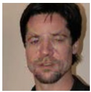
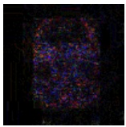
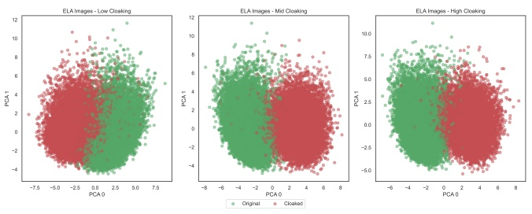
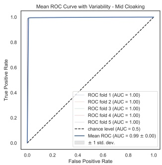
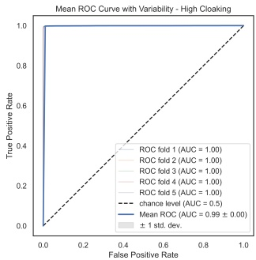

# Unmasking the Threat: Detección de Cloaking Attacks en Facial Recognition

Xavier Merino

Computer Engineering and Sciences

Florida Institute of Technology

Melbourne, FL, USA

xmerino2012@fit.edu

Pei Zhou

Computer Engineering and Sciences

Florida Institute of Technology

Melbourne, FL, USA

pzhou2022@my.fit.edu

Michael King

Computer Engineering and Sciences

Florida Institute of Technology

Melbourne, FL, USA

michaelking@fit.edu

**Resumen—Aquellas personas preocupadas por su privacidad pueden optar por salvaguardar sus fotografías en línea añadiendo perturbaciones imperceptibles a nivel de píxel. Esta técnica, conocida como “cloaking”, constituye una forma de clean-label poisoning attack. Los datos manipulados se introducen en un modelo de facial recognition para su entrenamiento manteniendo las etiquetas originales, lo que potencialmente induce a error al modelo y envenena gradualmente su comprensión de los rasgos faciales de una persona. En consecuencia, el rendimiento del modelo se ve disminuido para ciertas identidades. Al reentrenar un modelo para que sea robusto frente a estas perturbaciones, es posible eludir estos ataques. Sin embargo, los costes asociados con el reentrenamiento o la sustitución de un modelo pueden resultar prohibitivos, especialmente debido a que no existe garantía alguna de que el modelo sea robusto ante futuros ataques. En su lugar, proponemos un método para identificar imágenes con cloaking y excluirlas de los pipelines de entrenamiento. Nuestro método emplea img2vec con un modelo ResNet-18 preentrenado para lograr una rápida convergencia. Nuestro enfoque alcanzó una accuracy del 97% a través de una amplia variedad de perturbation budgets, y asimismo permite reutilizar elementos de un modelo existente para disminuir la necesidad de construir otro modelo adicional.**

**Index Terms—face recognition, image cloaking, data poisoning**

## I. INTRODUCCIÓN

El auge del intercambio de fotografías en línea ha propiciado que un número creciente de imágenes de personas sean extraídas de la web (scraped) para diversos fines, incluidos el desarrollo y el entrenamiento de algoritmos de facial recognition. Estos algoritmos, impulsados por métodos de deep learning, poseen la capacidad de identificar con precisión a individuos a partir de sus características faciales, independientemente de la calidad de la imagen, la pose, la iluminación o la expresión. No obstante, la facilidad del web scraping ha suscitado preocupación [1], en particular debido a que empresas como Clearview.ai han recopilado más de 30 mil millones de imágenes sin consentimiento explícito [2], alimentando la inquietud pública en torno al uso y las implicaciones de privacidad de sus fotos personales.

Por otra parte, los algoritmos de facial recognition aportan un valor significativo en numerosos escenarios operativos. Contribuyen a la identificación de individuos en grabaciones de videovigilancia, facilitando la prevención e investigación de delitos. Estos algoritmos también mejoran el control de acceso, previenen la suplantación de identidad y aumentan la precisión y eficiencia de los procedimientos en ámbitos tales como el control de pasaportes [3] y la banca en línea [4] [5]. Además, la tecnología de facial recognition brinda comodidades como el etiquetado automático de fotos [6] y beneficios de personalización, incluyendo experiencias a medida, sugerencias de productos [7] y publicidad dirigida [8]. Sin embargo, la posibilidad de rastrear a individuos sin su consentimiento plantea serias preocupaciones sobre la privacidad [9], y los casos de identificaciones falsas positivas han derivado en detenciones injustas y complicaciones legales, tal como lo ejemplifica el caso de Nijeer Parks [10] [11].

En respuesta al uso generalizado y a los riesgos asociados con el facial recognition, existe una creciente demanda de protección contra esta tecnología, aun a expensas de renunciar a algunas de las comodidades que ofrece. Dicha demanda ha impulsado el desarrollo de técnicas destinadas a mermar la capacidad de un algoritmo para identificar individuos. Una de estas técnicas es el cloaking, que consiste en introducir distorsiones imperceptibles en las fotografías a nivel de píxel, dificultando que los modelos de machine learning reconozcan los rostros [12] [13].

El cloaking se clasifica como un tipo de data poisoning attack que manipula los modelos de deep learning para inducir predicciones inexactas [14]. Dicha manipulación puede dar lugar a errores costosos y derivar en el reentrenamiento del modelo, representando una amenaza significativa para las empresas que utilizan modelos de deep learning. Afortunadamente, la adopción de tecnologías de cloaking sigue siendo limitada; Fawkes [13], uno de los algoritmos más destacados, ha sido descargado aproximadamente 840.000 veces. Esto sugiere que es poco probable que los algoritmos de facial recognition, frecuentemente entrenados con datasets masivos compuestos por millones o miles de millones de fotos, se vean afectados de manera sustancial por la inclusión de un número reducido de imágenes envenenadas o con cloaking. En consecuencia, el rendimiento general del algoritmo solo experimenta un impacto marginal, afectando únicamente a unas pocas identidades específicas. Esto plantea un dilema a las organizaciones: modificar sus core models para abordar estas pocas identidades con cloaking o bien aceptar una degradación en el rendimiento.

El coste de reentrenar modelos puede variar en función de factores como la complejidad del modelo, el volumen de datos de entrenamiento y los recursos computacionales requeridos [15]. En consecuencia, las organizaciones suelen optar por tolerar la degradación del modelo hasta que resulte estrictamente necesario actualizarlo por completo. No obstante, incluso si se mejora la robustez del modelo, esto solo garantiza la neutralización de ataques provenientes de algoritmos de cloaking conocidos y no protege contra ataques futuros [16].

Para abordar este desafío, proponemos una técnica alternativa que permite a las organizaciones detectar y gestionar los poisoning attacks, prolongando así la vida útil de sus modelos de facial recognition. Nuestra contribución radica en el desarrollo de un algoritmo diseñado específicamente para identificar datos envenenados (poisoned data), centrándose de manera particular en las perturbaciones generadas por Fawkes, un algoritmo de cloaking conocido por su resiliencia frente a los métodos de detección de anomalías [13]. Inspirándose en el campo del análisis forense de imágenes (photo forensics), nuestro algoritmo aborda el reto de identificar perturbaciones visualmente imperceptibles. Al filtrar y detectar de manera eficaz las perturbaciones generadas por Fawkes, nuestro algoritmo actúa como una salvaguarda potencial, frustrando los intentos de envenenamiento en los modelos de facial recognition.

Este trabajo se estructura en varias secciones. La Sección 2 ofrece una breve descripción general del algoritmo Fawkes [13], de otras contramedidas frente a data poisoning attacks abordadas en la literatura y del dataset empleado en nuestra investigación. La Sección 3 describe el enfoque utilizado para filtrar y detectar las perturbaciones generadas por Fawkes. La Sección 4 expone nuestros resultados, valida la eficacia de nuestro enfoque en la detección de imágenes con cloaking y analiza las limitaciones actuales. La Sección 5 presenta las conclusiones. La Sección 6 explora futuras líneas de investigación que aprovechan el reconocimiento de data poisoning para reducir los costes de entrenamiento.

## II. ANTECEDENTES Y TRABAJOS RELACIONADOS

## A. Algoritmo Fawkes

Fawkes es un sistema concebido para proteger la privacidad de los usuarios frente a la intrusión de tecnologías de web scraping que recopilan las fotografías de los usuarios sin su consentimiento con el propósito de entrenar modelos de facial recognition. Shan et al. [13] explican que Fawkes induce a error a los modelos comerciales mediante la adición de perturbaciones a nivel de píxel (cloaking) en las imágenes antes de que sean subidas a la red. Afirman que Fawkes fue diseñado para operar eficazmente contra una diversidad de modelos preentrenados (pre-trained models) comúnmente utilizados en tareas de facial recognition. Entre ellos, señalan las populares soluciones basadas en la nube de Microsoft (es decir, Azure Face) y Amazon (es decir, Rekognition), así como su contraparte china de amplia difusión, Face++. El propósito consiste en evitar que los desarrolladores de modelos elaboren futuras contramedidas, si bien este objetivo ha resultado esquivo, ya que en la literatura científica ya se han propuesto varias alternativas.

Fawkes genera imágenes con cloaking mediante: (1) la selección aleatoria de imágenes objetivo (target images) a partir de un dataset de imágenes de acceso público, (2) la localización y cálculo del feature vector del centro del rostro, y (3) la selección de los feature vectors que exhiben la mayor disimilitud respecto a la imagen original. Posteriormente, (4) calcula el cloak basándose en la imagen objetivo seleccionada aleatoriamente e intenta (5) minimizar la distancia entre el cloak y la imagen objetivo bajo la restricción impuesta por el perturbation budget. El perturbation budget es un parámetro que puede ajustarse para incrementar la capacidad de preservación de la privacidad del algoritmo, aunque a expensas de introducir perturbaciones visuales en las imágenes. Para evaluar la calidad visual de las imágenes con cloaking, Fawkes utiliza la medida “Structural Dissimilarity Index Measure” (DSSIM). Esta métrica cuantifica la diferencia perceptual entre dos imágenes considerando su información estructural. Por defecto, el algoritmo busca producir alteraciones significativas con perturbaciones imperceptibles a simple vista garantizando un DSSIM ≤ 0.007, logrando así un delicado trade-off entre preservar la privacidad y mantener la calidad visual.

Janssen y Carton [17] examinaron las perturbaciones introducidas por los niveles predeterminados (presets) de la herramienta Fawkes y observaron que, aun cuando se intenta preservar la estructura facial, el preset alto (high preset) suministrado por la distribución del código fuente de Fawkes genera artefactos añadidos a la imagen que pueden inducir a los usuarios a abandonar su uso debido a la generación de imágenes poco atractivas (por ejemplo, manchas azuladas que pueden hacer que una persona parezca enferma, hendiduras y cráteres en los rostros, etc.) [17].

## B. Contramedidas para Data Poisoning

El algoritmo Fawkes se considera un “clean-label attack”, un tipo de data poisoning attack en el que el atacante carece de control sobre el etiquetado de los datos de entrenamiento, pero puede inyectar datos envenenados aparentemente inofensivos para provocar predicciones inexactas en el modelo. Esta modalidad de poisoning attack se distingue porque permite al usuario envenenar datasets publicando fotografías en línea, las cuales son posteriormente recolectadas mediante web scraping y procesadas por un modelo. Dado que el veneno es visualmente imperceptible, puede ser etiquetado “correctamente” por anotadores experimentados e influir en las predicciones del modelo. Este tipo de ataque puede pasar inadvertido, puesto que no impacta significativamente en el rendimiento global del modelo, sino que ataca a clases específicas mediante el desplazamiento de las fronteras de decisión (decision boundaries).

Chen et al. [18] proponen una contramedida denominada ORIOLE, la cual genera imágenes con multicloaking a partir de imágenes originales filtradas procedentes de una base de datos de usuarios. Al emplear algoritmos de acceso público como Fawkes, el entrenador del modelo puede experimentar con múltiples perturbation budgets y entrenar al modelo para que aprenda características a partir de estas imágenes con cloaking. Esto permite que el modelo clasifique con precisión futuras entradas con cloaking, incluso ante variaciones menores, siempre y cuando las imágenes de prueba con cloaking pertenezcan al mismo feature space que las imágenes con multicloaking de dicha identidad.

Otra contramedida consiste en esperar la aparición de nuevas tecnologías capaces de aprender rasgos faciales sin verse afectadas por las perturbaciones introducidas por los algoritmos de cloaking [16]. Esta estrategia resulta efectiva debido a que el número de imágenes con cloaking es típicamente mínimo en comparación con el conjunto de entrenamiento del modelo. Radiya-Dixit et al. proponen migrar hacia modelos preentrenados más recientes que Fawkes no fue diseñado para engañar [16]. No obstante, este enfoque exigiría una sustitución constante de modelos (model swapping), lo que podría resultar costoso [15] cada vez que se desarrolle un nuevo algoritmo de cloaking.

Los enfoques basados en deep learning, tales como los explorados por Rota et al. [19], tienen por objetivo detectar imágenes manipuladas extrayendo patrones a partir de parches de imagen (image patches). Dividen las imágenes en patches y generan máscaras para identificar dónde han tenido lugar las alteraciones, si bien este enfoque puede no ser completamente preciso y solo proporciona la proximidad general de los cambios.

Peri et al. [20] proponen un enfoque diferente que utiliza k-Nearest-Neighbors (k-NN) para detectar el data poisoning. Sugieren localizar un punto y sus vecinos más cercanos, marcando el punto central como sospechoso si su etiqueta no coincide con la moda de los vecinos. Este proceso implica determinar el valor óptimo de k, el cual varía según los datos y el modelo. No obstante, seleccionar el valor de k correcto resulta crucial para evitar la exclusión de datos limpios.

Chen et al. [21] argumentan que la mayoría de las contramedidas, incluida la solución k-NN propuesta por Peri et al. [20], son específicas para cada ataque (attack-specific). Proponen una solución genérica denominada De-Pois [21], la cual utiliza las propiedades de las conditional generative adversarial networks (cGAN) y de Wasserstein GAN with Gradient Penalty (WGAN-GP) para defenderse contra data poisoning attacks. De-Pois puede tanto excluir datos envenenados del entrenamiento como mitigar el impacto de los datos envenenados sobre el rendimiento del modelo. El enfoque consiste en generar datos sintéticos mediante cGAN, aprender la distribución de predicciones utilizando WGAN-GP y emplear el discriminador como decision boundary para reconocer los datos envenenados a partir de un conjunto reducido de datos limpios. Otra contramedida genérica propuesta por Hong et al. [22] emplea private stochastic gradient descent (DP-SGD) para discriminar entre datos envenenados y limpios.

Fuera del ámbito de los métodos de deep learning, Kukharev et al. [23] proponen el uso exclusivo de puntos antropomórficos para distinguir una identidad.

## C. Dataset

Utilizamos el dataset PubFig83 [24], el cual contiene 100 fotografías para 83 individuos, sumando un total de 8300 imágenes faciales pre-recortadas. Se deriva del trabajo de Kumar et al. [25] orientado a reconocer la presencia o ausencia de características descriptibles de apariencia visual (por ejemplo, sonrisa, bigote, cejas pobladas, etc.). La colección consta primordialmente de fotografías de celebridades y ha sido procesada para eliminar imágenes casi duplicadas. Se utiliza ampliamente debido a su resolución de imagen consistente.

Pinto et al. [24] utilizaron el dataset para estudiar el facial recognition no restringido en Facebook. Inspirados por las noticias sobre la recopilación de miles de millones de imágenes de la web por parte de Clearview.ai [26], los autores de Fawkes emplearon PubFig83 para evaluar el rendimiento de su algoritmo en figuras públicas. Como resultado, PubFig83 se ha convertido en uno de los datasets más populares en la investigación sobre preservación de la privacidad. Chen et al. [18] hicieron uso de PubFig83 como dataset de usuarios para contrastar sus resultados con la investigación original de Fawkes. De manera similar, Radiya-Dixit et al. [16] replicaron sus resultados utilizando este dataset para demostrar que las defensas adaptativas pueden vulnerar a Fawkes en PubFig83. En consonancia con estos estudios, también empleamos el dataset PubFig83 debido a que Fawkes reportó una tasa de éxito de cloaking del 99% en este dataset, así como por contar con un número suficiente de identidades (es decir, más de 30 clases), lo que supuestamente confiere inmunidad frente a técnicas de detección de anomalías.

Para las 8300 imágenes del dataset, empleamos el algoritmo Fawkes para aplicar cloaking a las imágenes. La distribución binaria toma una imagen como entrada y genera una imagen visualmente indistinguible con perturbaciones añadidas. La distribución del código fuente, por otro lado, proporciona mayor flexibilidad en términos del nivel de cloaking (por ejemplo: cloaking bajo, medio y alto). Generamos versiones con cloaking de cada imagen para cada nivel. A medida que se incrementa el nivel de cloaking, Fawkes añade más perturbaciones a la imagen, volviéndose cada nivel más perceptible a simple vista. Véanse las Fig. 1a–1d para un ejemplo. Nuestro dataset de imágenes se compone, por ende, de 8300 imágenes originales y 8300 imágenes con cloaking para cada nivel, sumando un total de 33200 imágenes.

## III. METODOLOGÍA

Nuestro objetivo es minimizar la exposición de un modelo a imágenes con cloaking durante las fases de entrenamiento y reentrenamiento. Las imágenes con cloaking introducen distorsiones que pueden alterar progresivamente la comprensión del modelo sobre los rasgos faciales de una persona, ocasionando falsas coincidencias y una reducción en la accuracy. Al detectar e identificar las imágenes con cloaking antes de que ingresen al pipeline de entrenamiento, podemos prevenir el envenenamiento del modelo (model poisoning) y garantizar una identificación confiable. Además, al poder identificar las imágenes con cloaking, podemos filtrarlas y procesarlas mediante algoritmos robustos sin la necesidad de reentrenar el core model. Este enfoque ahorra recursos computacionales, reduce costes y prolonga la vida útil de las inversiones de una organización. A partir de estas consideraciones, proponemos el desarrollo de modelos de fusión (fusion models) capaces de complementar las debilidades del core model.

Para abordar el reto de identificar imágenes envenenadas, aplicamos un filtro forense sobre la imagen de sondeo (probe image). En este enfoque, utilizamos Error Level Analysis (ELA) según se describe en [27]. ELA es una técnica empleada para detectar modificaciones en fotografías digitales analizando los niveles de compresión de la imagen. La premisa fundamental es que, cuando una imagen se altera, sus niveles de compresión pueden exhibir patrones reconocibles. ELA permite identificar manipulaciones empleadas para ocultar evidencias, generar imágenes falsas o aplicar filtros y otras técnicas de manipulación que comprometen la integridad de la imagen. Para llevar a cabo ELA, la imagen se comprime a diversos niveles y las imágenes resultantes se comparan con la original. Las discrepancias entre la imagen original y las comprimidas se evalúan con el fin de identificar regiones donde los valores de compresión se desvían significativamente de la media. Dichas regiones denotan una manipulación o mejora potencial de la imagen. En las Fig. 2a–2d se puede observar un ejemplo de ELA aplicado tanto a imágenes sin cloaking como a imágenes con cloaking.

Posteriormente, la versión ELA de la imagen de prueba se somete a feature extraction. Aprovechamos embedders para obtener una representación multidimensional de una imagen, independientemente de su tamaño. Puesto que estas representaciones presentan comúnmente una alta cantidad de dimensiones, aplicamos técnicas de reducción de dimensionalidad para: (1) mejorar la visualización de los datos y (2) reducir el tiempo de entrenamiento requerido para que el clasificador identifique las perturbaciones. Al reducir las dimensiones, buscamos capturar la variación suficiente que posibilite la clasificación. Empleamos img2vec [28] como feature extractor para cada imagen, aplicamos Principal Component Analysis (PCA) para la reducción de dimensionalidad y seleccionamos Support Vector Machines (SVM) como algoritmo de clasificación.

(a) Original

(b) Low Cloaking

(c) Mid Cloaking

(d) High Cloaking

Fig. 1. Cloaking Levels Applied To Image

(a) Original

(b) Low Cloaking

(c) Mid Cloaking

(d) High Cloaking

Fig. 2. ELA Applied To Image

## IV. DISCUSIÓN Y RESULTADOS

Img2vec es un algoritmo inspirado en word2vec [29] cuyo propósito es representar datos de imágenes en un formato apto para algoritmos de machine learning, donde las imágenes afines poseen representaciones similares. En nuestro estudio, transformamos las imágenes del dataset en sus equivalentes ELA y empleamos img2vec para aprender las perturbaciones ocasionadas por el algoritmo Fawkes. Implementamos la arquitectura ResNet-18 [30] en la implementación de img2vec, ya que ofrece una convergencia más rápida en comparación con arquitecturas más profundas. La arquitectura ResNet-18 genera feature vectors con una dimensionalidad por defecto de 512. No obstante, para reducir el tiempo de procesamiento y la dimensionalidad de las características, aplicamos PCA. Los vectores reducidos se utilizan a continuación para entrenar un algoritmo de clasificación SVM encargado de determinar si una fotografía ha sido objeto de cloaking. La Fig. 3 ilustra un scatterplot de las representaciones vectoriales comprimidas de las imágenes ELA.

Con el fin de obtener una evaluación más precisa de nuestro modelo de clasificación, realizamos una stratified k-fold cross-validation sobre diversos subconjuntos de los datos. Esta técnica nos ayuda a mitigar el impacto de las fluctuaciones aleatorias en los datos, ofreciendo una indicación más confiable del rendimiento del modelo en comparación con un único train-test split. La stratified k-fold cross-validation garantiza que cada fold contenga un número idéntico de muestras de cada clase, preservando la distribución de clases en los conjuntos de entrenamiento y prueba. Específicamente, empleamos una 5-fold cross-validation para analizar minuciosamente el rendimiento de nuestro modelo. Esto implica que el modelo se entrena en el 80% de los datos y se evalúa en el 20% restante para cada fold. Tras entrenar y evaluar el modelo en los 5 folds, se promedian las métricas de rendimiento para determinar el desempeño global del modelo.

Nuestro objetivo es detectar fotos con cloaking identificando las perturbaciones introducidas por el algoritmo Fawkes en niveles de perturbación predefinidos (es decir, bajo, medio y alto). Como se mencionó en la Sección 2, nuestro dataset engloba tanto las fotos originales de PubFig83 como las correspondientes imágenes con cloaking. Por consiguiente, se generaron tres imágenes con cloaking para cada imagen del dataset, representativas de los distintos niveles de cloaking predeterminados. Para fines de claridad y presentación exhaustiva, exponemos nuestros resultados de forma separada para cada nivel de cloaking. Asimismo, incluimos un reporte global que combina los resultados de todos los niveles citados, puesto que representa de manera más fiel los escenarios aleatorios que se presentan en situaciones del mundo real.

scatter

| Series | PCA(i) (range) | PCA j (range) |
| --- | --- | --- |
| Original | -8~8 | -5~12 |
| Cloaked | -8~8 | -5~12 |

Fig. 3. Feature Vectors as Extracted by Img2Vec

## A. Low Cloaking Level

Las imágenes sometidas a cloaking en el nivel bajo presentan la menor distorsión entre todos los niveles. Los resultados de la cross-validation se presentan en la Tabla I. A pesar de las perturbaciones imperceptibles, el modelo alcanzó una accuracy promedio elevada del 93% a lo largo de los 5 folds. Esto indica que el modelo clasificó con precisión las sutiles alteraciones ocasionadas por el algoritmo Fawkes. También se calcularon la precision, el recall y el F1 score, mostrando un desempeño sólido en todas las clases, con una precision promedio del 94,5%, un recall del 91,3% y un F1 score del 92,9%. La reducida desviación estándar para cada métrica de rendimiento sugiere un comportamiento consistente y confiable a través de los diferentes subconjuntos de datos. La gráfica ROC de la Fig. 4a representa visualmente la capacidad diagnóstica del modelo a medida que varía el umbral.

## B. Mid Cloaking Level

Las imágenes con cloaking en el nivel medio exhiben distorsiones visuales notorias en el rostro del individuo. Dadas las evidentes alteraciones, es previsible que algunos usuarios opten por prescindir de este nivel de cloaking. Otros estudios han reportado que las perturbaciones se vuelven más prominentes en imágenes de alta resolución. Los resultados de la cross-validation se presentan en la Tabla II. El modelo mostró un rendimiento excepcional al identificar imágenes con cloaking en este nivel, alcanzando una alta accuracy del 99,2%. De igual manera, precision, recall y F1 score demostraron un desempeño sobresaliente, con promedios del 99,5%, 99% y 99,2% respectivamente. El modelo exhibió estabilidad y un rendimiento constante en todas las clases. Consúltese la gráfica ROC en la Fig. 4b.

## C. High Cloaking Level

Las imágenes con cloaking en el nivel alto exhiben distorsiones visualmente significativas en el rostro del individuo. Se ha señalado que este nivel puede generar la impresión de que una persona aparenta estar enferma, presentando pliegues visibles, arrugas y alteraciones en la pigmentación de la piel [17]. Los resultados de la cross-validation se detallan en la Tabla III. Dado el carácter fácilmente distinguible de los cloaks de nivel medio, se esperaba un nivel de rendimiento semejante en el nivel alto. Como se anticipaba, el modelo alcanzó una accuracy del 99,6% en el conjunto de prueba a lo largo de todos los folds. La precision, el recall y el F1 score también demostraron la capacidad del modelo para clasificar correctamente las muestras dentro de una clase específica, con promedios del 99,6% para todas las métricas. La baja desviación estándar en todas las métricas refuerza aún más la confiabilidad del modelo. Consúltese la gráfica ROC en la Fig. 4c.

## D. Mixed Cloaking Level

Este nivel incorpora imágenes con cloaking provenientes de todos los niveles con el fin de simular aquello que un algoritmo de web scraping podría encontrar al buscar fotografías. Puesto que los usuarios pueden aportar imágenes desde cualquier nivel de cloaking, este escenario representa mejor la realidad. Los resultados de la cross-validation se exponen en la Tabla IV. En este escenario mixto, el modelo obtuvo un desempeño satisfactorio, alcanzando una accuracy del 97,4%. Asimismo, el modelo demostró una sólida precision (99%), recall (97,6%) y F1 score (98,2%), evidenciando su capacidad para clasificar adecuadamente las muestras sin importar el grado de cloaking. La variabilidad en este escenario mixto es superior debido a las perturbaciones adicionales introducidas conforme se incrementa el nivel de cloaking. Sin embargo, la reducida desviación estándar observada en todas las métricas de rendimiento confirma el comportamiento consistente del algoritmo. Consúltese la gráfica ROC en la Fig. 4d.

## E. Limitaciones

El rendimiento actual del modelo puede mejorarse aún más al abordar ciertas limitaciones. Una limitación surge del hecho de que el algoritmo Fawkes concentra sus perturbaciones exclusivamente en la región del rostro, originando límites bien definidos dentro de las imágenes. No obstante, al emplear Error Level Analysis (ELA), que examina la imagen en su totalidad, los artefactos adicionales introducidos por modificaciones tales como portadas de revistas, montajes o correcciones de color en la periferia del rostro pueden elevar el riesgo de una clasificación errónea. Además, en imágenes de alta resolución donde el rostro ocupa solo una pequeña proporción de la imagen global, la presencia de información circunstancial y de entorno detallada puede inducir a clasificaciones erróneas.

Para superar estas limitaciones, una solución potencial consiste en generar el ELA específicamente para la región facial. Al aislar

roc

| Series | AUC |
| --- | --- |
| ROC fold 1 | 0.96 |
| ROC fold 2 | 0.97 |
| ROC fold 3 | 0.97 |
| ROC fold 4 | 0.97 |
| ROC fold 5 | 0.97 |
| Mean ROC | \(0.97 \pm 0.00\) |

(a) Low Cloaking Level

roc

| Series | AUC |
| --- | --- |
| ROC fold 1 | 1.00 |
| ROC fold 2 | 1.00 |
| ROC fold 3 | 1.00 |
| ROC fold 4 | 1.00 |
| ROC fold 5 | 1.00 |
| Mean ROC | \(0.99 \pm 0.00\) |

(b) Mid Cloaking Level

roc

| Series | AUC |
| --- | --- |
| ROC fold 1 | 1.00 |
| ROC fold 2 | 1.00 |
| ROC fold 3 | 1.00 |
| ROC fold 4 | 1.00 |
| ROC fold 5 | 1.00 |
| chance level | 0.5 |

(c) High Cloaking Level

roc

| Series | AUC |
| --- | --- |
| ROC fold 1 | 0.99 |
| ROC fold 2 | 0.99 |
| ROC fold 3 | 0.99 |
| ROC fold 4 | 0.99 |
| ROC fold 5 | 0.99 |
| chance level | 0.5 |
| Mean ROC | \(0.99 \pm 0.00\) |

(d) Mixed Cloaking Level

Fig. 4. Mean ROC Curve with Variability

TABLE I LOW CLOAKING CROSS VALIDATION RESULTS

| Fold | Accuracy | Precision | Recall | F1 | ROC AUC |
| --- | --- | --- | --- | --- | --- |
| 1 | 0.9256 | 0.9538 | 0.8945 | 0.9232 | 0.9644 |
| 2 | 0.9333 | 0.9501 | 0.9147 | 0.9321 | 0.9676 |
| 3 | 0.9348 | 0.9375 | 0.9317 | 0.9346 | 0.9683 |
| 4 | 0.9234 | 0.9460 | 0.8981 | 0.9214 | 0.9652 |
| 5 | 0.9348 | 0.9417 | 0.9270 | 0.9343 | 0.9723 |
| Mean | 0.9304 | 0.9458 | 0.9132 | 0.9291 | 0.9676 |
| Std. Dev | 0.0049 | 0.0058 | 0.0149 | 0.0056 | 0.0028 |

TABLE II MID CLOAKING CROSS VALIDATION RESULTS

| Fold | Accuracy | Precision | Recall | F1 | ROC AUC |
| --- | --- | --- | --- | --- | --- |
| 1 | 0.9926 | 0.9960 | 0.9892 | 0.9926 | 0.9974 |
| 2 | 0.9910 | 0.9942 | 0.9877 | 0.9909 | 0.9978 |
| 3 | 0.9928 | 0.9946 | 0.9910 | 0.9928 | 0.9972 |
| 4 | 0.9924 | 0.9938 | 0.9910 | 0.9924 | 0.9985 |
| 5 | 0.9935 | 0.9964 | 0.9906 | 0.9935 | 0.9981 |
| Mean | 0.9924 | 0.9950 | 0.9899 | 0.9924 | 0.9978 |
| Std. Dev | 0.0008 | 0.0010 | 0.0013 | 0.0008 | 0.0005 |

TABLE III HIGH CLOAKING CROSS VALIDATION RESULTS

| Fold | Accuracy | Precision | Recall | F1 | ROC AUC |
| --- | --- | --- | --- | --- | --- |
| 1 | 0.9967 | 0.9989 | 0.9946 | 0.9967 | 0.9996 |
| 2 | 0.9958 | 0.9953 | 0.9964 | 0.9958 | 0.9991 |
| 3 | 0.9964 | 0.9960 | 0.9967 | 0.9964 | 0.9996 |
| 4 | 0.9962 | 0.9953 | 0.9971 | 0.9962 | 0.9997 |
| 5 | 0.9946 | 0.9964 | 0.9928 | 0.9946 | 0.9988 |
| Mean | 0.9960 | 0.9964 | 0.9955 | 0.9960 | 0.9994 |
| Std. Dev | 0.0007 | 0.0013 | 0.0016 | 0.0007 | 0.0004 |

TABLE IV MIXED CLOAKING CROSS VALIDATION RESULTS

| Fold | Accuracy | Precision | Recall | F1 | ROC AUC |
| --- | --- | --- | --- | --- | --- |
| 1 | 0.9723 | 0.9909 | 0.9719 | 0.9813 | 0.9909 |
| 2 | 0.9743 | 0.9890 | 0.9766 | 0.9828 | 0.9916 |
| 3 | 0.9771 | 0.9879 | 0.9815 | 0.9847 | 0.9925 |
| 4 | 0.9717 | 0.9889 | 0.9733 | 0.9810 | 0.9916 |
| 5 | 0.9765 | 0.9902 | 0.9783 | 0.9842 | 0.9916 |
| Mean | 0.9744 | 0.9894 | 0.9763 | 0.9828 | 0.9916 |
| Std. Dev | 0.0022 | 0.0011 | 0.0034 | 0.0015 | 0.0005 |

y centrarse únicamente en el rostro, mientras se excluye el contexto circundante, el algoritmo puede detectar de mejor manera las perturbaciones a nivel de píxel, tanto sutiles como intensas, introducidas por el algoritmo Fawkes. Este enfoque posee el potencial de generar un algoritmo más adaptado con métricas de rendimiento superiores.

## V. CONCLUSIÓN

Fawkes, un algoritmo de preservación de la privacidad ampliamente utilizado, ha ganado notable popularidad en la protección de las identidades de las personas. Sin embargo, en lo que respecta a influir sobre algoritmos de facial recognition entrenados con grandes datasets, el impacto de las imágenes distorsionadas o maliciosas resulta relativamente mínimo. El rendimiento de estos algoritmos puede verse afectado únicamente para unas pocas identidades específicas. Reentrenar el modelo completo para abordar la identificación de un número reducido de personas puede no ser una solución viable ni rentable, pero ello no disminuye la importancia de abordar el problema. Las organizaciones deben tomar decisiones en cuanto a adaptar sus core models para gestionar identidades con cloaking o bien aceptar una posible merma en el rendimiento. Aun cuando se incremente la robustez del modelo, esto solo neutraliza los ataques actuales y no garantiza la prevención de ataques futuros.

Dados los costes asociados con el reentrenamiento de modelos, las empresas pueden optar por tolerar la degradación del modelo hasta que resulte imprescindible actualizarlos. En este estudio, proponemos un enfoque alternativo que permite a las organizaciones detectar y mitigar las amenazas de envenenamiento (poisoning threats), prolongando de este modo la vida útil de sus modelos de facial recognition. Nuestro enfoque se centra en la detección de imágenes con cloaking, orientándose específicamente a las perturbaciones introducidas por el algoritmo Fawkes. Mediante nuestros experimentos, demostramos que la inspección y filtrado de imágenes con cloaking es factible, ofreciendo una solución potencial para evitar que los modelos sean envenenados gradualmente. Nuestro método basado en análisis forense de imágenes alcanzó una accuracy promedio del 97% en la detección de imágenes con cloaking con diversos niveles de perturbación.

## VI. TRABAJO FUTURO

Este trabajo presenta una técnica que aborda específicamente el algoritmo Fawkes. Sin embargo, han existido otros estudios cuyo propósito es generalizar la identificación de perturbaciones orientadas a la preservación de la privacidad. Si bien nuestro foco principal consistió en detectar imágenes con cloaking que potencialmente pudieran envenenar un modelo y comprometer su efectividad, la detección por sí sola no posibilita la identificación precisa de los individuos. Este trabajo sirve como un paso inicial hacia el desarrollo de un modelo de fusión (fusion model) que combine modelos ya desplegados con modelos personalizados diseñados para gestionar a los usuarios que emplean poisoning attacks. Dicho modelo prolongaría la vida útil de las aplicaciones ya desplegadas y eliminaría la necesidad de un entrenamiento exhaustivo de nuevos modelos con grandes cantidades de datos. Además, aun cuando en este estudio empleamos img2vec como feature extractor, resulta viable aprovechar otras redes mediante transfer learning para evitar la necesidad de crear nuevas redes desde cero.

## REFERENCIAS

[1] G. Benitez Torres and M. C. King, “Harvesting faces from social media photos for biometric analysis,” in 2020 IEEE International Symposium on Technology and Society (ISTAS), 2020, pp. 230–234.
[2] J. Schneider, “Clearview ai has scraped more than 30 billion photos from social media,” Mar 2023. [Online]. Available: https://petapixel.com/2023/03/29/clearview-ai-has-scraped-more-than-30-billion-photos-from-social-media/
[3] L. R. Carlos-Roca, I. H. Torres, and C. F. Tena, “Facial recognition application for border control,” in 2018 International Joint Conference on Neural Networks (IJCNN), Jul. 2018, pp. 1–7.
[4] S. D V, A. R, E. R. K, and A. S, “Enhnaced Security Feature of ATM’s Through Facial Recognition,” in 2021 5th International Conference on Intelligent Computing and Control Systems (ICICCS), May 2021, pp. 1252–1256.
[5] S. Manna, S. Ghildiyal, and K. Bhimani, “Face Recognition from Video using Deep Learning,” in 2020 5th International Conference on Communication and Electronics Systems (ICCES), Jun. 2020, pp. 1101–1106.
[6] J. Mehta, E. Ramnani, and S. Singh, “Face detection and tagging using deep learning,” in 2018 International Conference on Computer, Communication, and Signal Processing (ICCCSP). IEEE, 2018, pp. 1–6.
[7] G. Yolcu, I. Oztel, S. Kazan, C. Oz, and F. Bunyak, “Deep learningbased face analysis system for monitoring customer interest,” Journal of Ambient Intelligence and Humanized Computing, vol. 11, no. 1, pp. 237–248, Jan. 2020.
[8] J. F. Hair and M. Sarstedt, “Data, measurement, and causal inferences in machine learning: opportunities and challenges for marketing,” Journal of Marketing Theory and Practice, vol. 29, no. 1, pp. 65–77, Jan. 2021.
[9] X. Liu, L. Xie, Y. Wang, J. Zou, J. Xiong, Z. Ying, and A. V. Vasilakos, “Privacy and Security Issues in Deep Learning: A Survey,” IEEE Access, vol. 9, pp. 4566–4593, 2021.
[10] K. Hill, “Another Arrest, and Jail Time, Due to a Bad Facial Recognition Match,” The New York Times, Dec. 2020.
[11] T. Maxwell, “A man spent 10 days in jail based on a facial recognition error.”
[12] V. Cherepanova, M. Goldblum, H. Foley, S. Duan, J. Dickerson, G. Taylor, and T. Goldstein, “LowKey: Leveraging Adversarial Attacks to Protect Social Media Users from Facial Recognition,” Jan. 2021.
[13] S. Shan, E. Wenger, J. Zhang, H. Li, H. Zheng, and B. Y. Zhao, “Fawkes: Protecting Privacy against Unauthorized Deep Learning Models,” p. 17.
[14] A. Shafahi, W. R. Huang, M. Najibi, O. Suciu, C. Studer, T. Dumitras, and T. Goldstein, “Poison Frogs! Targeted Clean-Label Poisoning Attacks on Neural Networks,” in Advances in Neural Information Processing Systems, vol. 31. Curran Associates, Inc., 2018.
[15] V. J. H. Sawant, Anand Ashok, “The Growing Cost of Deep Learning for Source Code.”
[16] E. Radiya-Dixit, S. Hong, N. Carlini, and F. Tramer, “Data Poisoning \` Won’t Save You From Facial Recognition,” Mar. 2022.
[17] D. Janssen and S. Carton, “An exploration of the suitability of Fawkes for practical applications,” p. 12.
[18] L. Chen, H. Wang, B. Z. H. Zhao, M. Xue, and H. Qian, “Oriole: Thwarting Privacy Against Trustworthy Deep Learning Models,” in Information Security and Privacy, ser. Lecture Notes in Computer Science, J. Baek and S. Ruj, Eds. Cham: Springer International Publishing, 2021, pp. 550–568.
[19] P. Rota, E. Sangineto, V. Conotter, and C. Pramerdorfer, “Bad teacher or unruly student: Can deep learning say something in Image Forensics analysis?” in 2016 23rd International Conference on Pattern Recognition (ICPR), Dec. 2016, pp. 2503–2508.
[20] N. Peri, N. Gupta, W. R. Huang, L. Fowl, C. Zhu, S. Feizi, T. Goldstein, and J. P. Dickerson, “Deep k-NN Defense Against Clean-Label Data Poisoning Attacks,” in Computer Vision – ECCV 2020 Workshops, ser. Lecture Notes in Computer Science, A. Bartoli and A. Fusiello, Eds. Cham: Springer International Publishing, 2020, pp. 55–70.
[21] J. Chen, X. Zhang, R. Zhang, C. Wang, and L. Liu, “De-Pois: An Attack-Agnostic Defense against Data Poisoning Attacks,” IEEE Transactions on Information Forensics and Security, vol. 16, pp. 3412–3425, 2021.
[22] S. Hong, V. Chandrasekaran, Y. Kaya, T. Dumitraş, and N. Papernot, “On the Effectiveness of Mitigating Data Poisoning Attacks with Gradient Shaping,” Feb. 2020.
[23] G. Kukharev, K. Maulenov, and N. Shchegoleva, “CAN I PROTECT MY FACE IMAGE FROM RECOGNITION?” in 9th International Conference ”Distributed Computing and Grid Technologies in Science and Education”. Crossref, Dec. 2021, pp. 514–518.
[24] N. Pinto, Z. Stone, T. Zickler, and D. Cox, “Scaling up biologicallyinspired computer vision: A case study in unconstrained face recognition on facebook,” in CVPR 2011 WORKSHOPS. IEEE, 2011, pp. 35–42.
[25] N. Kumar, A. C. Berg, P. N. Belhumeur, and S. K. Nayar, “Attribute and simile classifiers for face verification,” in 2009 IEEE 12th International Conference on Computer Vision, Sep. 2009, pp. 365–372.
[26] “Facial recognition firm Clearview AI tells investors it’s seeking massive expansion beyond law enforcement,” Washington Post.
[27] N. Krawetz and H. F. Solutions, “A picture’s worth,” Hacker Factor Solutions, vol. 6, no. 2, p. 2, 2007.
[28] C. Safka, “Christiansafka/img2vec: Use pre-trained models in pytorch to extract vector embeddings for any image,” https://github.com/christiansafka/img2vec.
[29] T. Mikolov, I. Sutskever, K. Chen, G. S. Corrado, and J. Dean, “Distributed representations of words and phrases and their compositionality,” Advances in neural information processing systems, vol. 26, 2013.
[30] K. He, X. Zhang, S. Ren, and J. Sun, “Deep Residual Learning for Image Recognition,” 2016, pp. 770–778.
