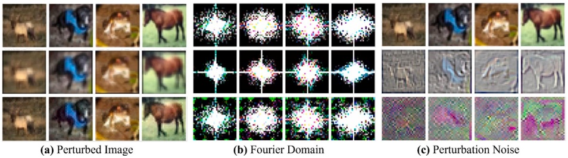

# Wavelet Domain Steganography for Robust Unlearnable Data✩

**Jiahao Li, Yiqiang Chen** ∗**, Yunbing Xing, Yang Gu**

**Beijing Key Laboratory for Multimodal Collaboration and Advanced Application, Institute of Computing Technology, Chinese Academy of Sciences, Beijing, 100190, China**

**University of Chinese Academy of Sciences, Beijing, 100190, China**

## A R T I C L E I N F O

**Palabras clave:**

**Steganography**

**Wavelet**

**Unlearnable**

**Robust**

## R E S U M E N

**En los últimos años, los unlearnable data han surgido como una vía eficaz para prevenir la explotación no autorizada de datos personales, impidiendo intencionalmente que los modelos aprendan patrones significativos durante el entrenamiento, garantizando al mismo tiempo que los datos procesados permanezcan visualmente indistinguibles de los originales. Los enfoques previos, tales como los métodos de error-minimizing noise, han producido resultados prometedores al perturbar el aprendizaje del modelo, pero a menudo carecen de robustez frente al adversarial training. Más recientemente, se han introducido técnicas basadas en convolución para abordar esta limitación, mejorando la resistencia al adversarial training, pero a costa de sacrificar detalles de alta frecuencia de la imagen. En este estudio, proponemos un método novedoso denominado Wavelet Domain Steganography (WDS) que inscribe esteganográficamente información específica de la clase en el dominio de la wavelet transform. Aprovechando las propiedades inherentes de multirresolución y localización de las wavelets, WDS permite un control preciso sobre la información esteganográfica inyectada en diferentes subbandas de frecuencia. El método propuesto preserva los detalles de alta frecuencia y mantiene la fidelidad visual al tiempo que inhibe eficazmente el aprendizaje de información semántica por parte de las deep neural networks. Las evaluaciones experimentales demuestran que WDS exhibe una unlearnability robusta bajo data augmentations comunes y escenarios de adversarial training, logrando así un trade-off mejorado entre imperceptibilidad y unlearnability en comparación con los métodos previos.**

## 1. Introducción

**Las deep neural networks (DNNs) han logrado avances extraordinarios en la clasificación de imágenes [1], la detección de objetos [2] y muchas otras tareas de computer vision [3]. No obstante, su generalización depende en gran medida del supuesto de que los datos de entrenamiento sean tanto representativos como aprendibles. Esta dependencia expone una vulnerabilidad fundamental: si un adversario puede inyectar ruido cuidadosamente diseñado en los datos de entrenamiento, el modelo puede fallar al extraer características útiles, lo que resulta en un rendimiento deficiente en tareas posteriores. Esta amenaza ha sido formalizada recientemente mediante el concepto de unlearnable data (ULD), que son muestras de entrenamiento perturbadas diseñadas para prevenir un aprendizaje eficaz [4–6].**

**Los primeros enfoques para generar unlearnable data, como el error-minimizing [7], tomaron prestadas técnicas de los adversarial attacks [8] al tratar un surrogate model como una función diferenciable y aplicar optimización de la pérdida. Sin embargo, a diferencia de los adversarial examples que buscan maximizar la pérdida sobre entradas de prueba [9], estos minimizan la pérdida posterior en las muestras de entrenamiento perturbadas, haciéndolas poco informativas para el aprendizaje de representaciones. Aunque son eficaces bajo entrenamiento estándar, se ha descubierto que los métodos iniciales [7,10,11] son frágiles cuando los modelos emplean** **adversarial training [12]. Los estudios posteriores se han inspirado en mejorar la robustez mediante técnicas como la optimización de surrogate con aumentación adversarial [13]. No obstante, estas técnicas a menudo padecen inestabilidad en la optimización [14] y un elevado costo computacional [15].**

**Para eludir estas limitaciones, las investigaciones recientes han cambiado hacia estrategias surrogate-free. Entre los esfuerzos destacados se incluyen la alteración de un solo píxel (single-pixel tampering) [16] y el filtrado basado en convolución [15]. Si bien estos métodos mejoran la robustez y la eficiencia, a menudo sacrifican la imperceptibilidad visual, introduciendo cambios de píxeles abruptos y no suaves o artefactos de desenfoque. Esto nos motiva a plantearnos: ¿Podemos desarrollar un método de generación de ULD surrogate-free que no sacrifique en exceso la imperceptibilidad y la eficiencia mientras mantiene la robustez bajo adversarial training?**

**En este artículo, proponemos Wavelet-Domain Steganography (WDS), un marco novedoso para generar unlearnable data mediante la inserción de perturbaciones estructuradas en subbandas específicas del wavelet domain. Nuestro método aprovecha las características de multirresolución y frecuencia localizada de las wavelets, permitiendo un control preciso sobre la ubicación de las perturbaciones. Al modificar esteganográficamente bandas de frecuencia** **seleccionadas, WDS desbarata el aprendizaje de características mientras preserva la apariencia natural de la imagen.**

<small>✩ Este artículo forma parte de un número especial titulado: ‘PR\_Security and Trustworthiness’ publicado en Pattern Recognition.</small>

<small>∗ Autor de correspondencia en: Beijing Key Laboratory for Multimodal Collaboration and Advanced Application, Institute of Computing Technology, Chinese Academy of Sciences; University of Chinese Academy of Sciences, Beijing, 100190, China.</small>

<small>Direcciones de correo electrónico: [lijiahao@ict.ac.cn](mailto:lijiahao@ict.ac.cn) (J. Li), [yqchen@ict.ac.cn](mailto:yqchen@ict.ac.cn) (Y. Chen), [xingyunbing@ict.ac.cn](mailto:xingyunbing@ict.ac.cn) (Y. Xing), [guyang@ict.ac.cn](mailto:guyang@ict.ac.cn) (Y. Gu).</small>

**Llevamos a cabo extensos experimentos en CIFAR-10, CIFAR-100 e ImageNet-100 bajo diversas arquitecturas y esquemas de entrenamiento. Los resultados demuestran que WDS logra una alta robustez frente al adversarial training y a las data augmentations comunes, con una sólida transferibilidad entre modelos. Además, nuestro análisis revela que las DNNs exhiben un sesgo implícito hacia el aprendizaje a partir de ciertos componentes frecuenciales—una vulnerabilidad que WDS explota de forma sistemática.**

**Nuestras contribuciones se resumen de la siguiente manera:**

**• Proponemos WDS, un método de ULD surrogate-free para generar unlearnable examples utilizando wavelet-domain steganography.**
**• Demostramos que WDS logra una robustez state-of-the-art frente al adversarial training y las data augmentations, teniendo en cuenta simultáneamente la eficiencia y la imperceptibilidad.**
**• Proporcionamos un análisis de frecuencia del comportamiento de las DNNs, ofreciendo perspectivas sobre por qué las perturbaciones en el wavelet domain son particularmente eficaces para degradar la aprendibilidad.**

## 2. Trabajo relacionado

## 2.1. Métodos basados en surrogate

**Los primeros enfoques para generar unlearnable data (ULD) tomaron prestadas ideas de la optimización de adversarial attacks [8,9], tratando a un surrogate model como un proxy diferenciable y aplicando minimización iterativa de la pérdida para reducir el carácter informativo de las muestras de entrenamiento [7,10,11]. Si bien estos métodos basados en surrogate son eficaces bajo entrenamiento estándar, tienden a fallar bajo adversarial training [12], lo que motivó a investigaciones posteriores a incorporar la aumentación adversarial en el bucle de optimización [13]. Sin embargo, estos enfoques introducen nuevos desafíos, como la inestabilidad durante el entrenamiento [14] y una sobrecarga computacional significativa [15].**

## 2.2. Métodos surrogate-free

**Para mitigar estas limitaciones, los esfuerzos recientes exploran alternativas surrogate-free como el single-pixel tampering [16] y el filtrado espacial basado en convolución [15]. Estas técnicas aprovechan sutilmente el fenómeno de shortcut learning [17] en las DNNs mediante el diseño de perturbaciones específicas de la clase que inducen una asociación más fácil de aprender entre los patrones de ruido y las etiquetas. Si bien los métodos surrogate-free ofrecen una robustez y eficiencia mejoradas, a menudo comprometen la imperceptibilidad—introduciendo ya sea una disonancia abrupta con los píxeles circundantes [16,18] o la pérdida de detalles de alta frecuencia [15]. Ideas afines también se han explorado en investigaciones sobre marcas de agua en el dominio de la frecuencia (frequency-domain watermarking) y perturbaciones adversariales. Los métodos de watermarking en el dominio frecuencial incrustan señales auxiliares en los coeficientes de transformación para lograr la verificación de propiedad o la ocultación de información, mientras que las perturbaciones adversariales manipulan las señales de entrada para alterar las predicciones del modelo en tiempo de inferencia. Aunque estos enfoques comparten la noción de modificar componentes espectrales, sus objetivos difieren fundamentalmente de la generación de unlearnable data. El watermarking busca preservar el rendimiento en la tarea mientras codifica información recuperable, y las perturbaciones adversariales apuntan a errores de predicción en tiempo de inferencia. Por el contrario, WDS establece intencionalmente señales de atajo dependientes de la clase en los datos de entrenamiento para deteriorar el aprendizaje de representaciones y degradar la generalización posterior. Notablemente, el éxito de los métodos basados en convolución insinúa un efecto implícito en el dominio de la frecuencia, puesto que las convoluciones se corresponden con una manipulación indirecta de la frecuencia [19]. Esta observación nos motiva a explorar un enfoque más explícito en el dominio frecuencial para la generación de ULD surrogate-free, lo que nos conduce a nuestra propuesta de wavelet-domain steganography (WDS). A diferencia del watermarking convencional en el dominio de la frecuencia, la señal incrustada en WDS no tiene como propósito la verificación de propiedad ni la recuperación de mensajes, sino inducir correlaciones espurias robustas dependientes de la clase que persistan bajo adversarial training y data augmentation.**

## 3. Preliminares

**Sea** $\mathcal { D }   =   \{ ( x _ { i } , y _ { i } ) \} _ { i = 1 } ^ { N }$ **el conjunto de datos original, donde** $x _ { i }   \in   \mathcal { X }   \subset$ $\mathbb { R } ^ { d }$ **es una imagen e** $y _ { i } \in \mathcal { Y }$ **es su etiqueta correspondiente. El objetivo de la generación de datasets inaprendibles es construir un dataset perturbado** $\mathcal { D } ^ { \prime }   =   \{ ( x _ { i } ^ { \prime } , y _ { i } ) \} _ { i = 1 } ^ { N }$ **, donde cada imagen perturbada viene dada por** $x _ { i } ^ { \prime }   =   x _ { i }$ + $\delta _ { i } ,$ sujeto a $\| \tilde { \delta } _ { i } \| _ { p } \leq \epsilon ,$ de modo que los modelos entrenados en $D ^ { \prime }$ **fallen al aprender representaciones semánticas significativas, garantizando al mismo tiempo que** $x _ { i } ^ { \prime }$ **permanezca visualmente indistinguible de** $x _ { i } .$ Finalmente, para un modelo $\xi _ { \theta } ( \cdot ) , \theta =$ arg mi $\mathbb { n } _ { \theta }   \mathbb { E } _ { ( x , y ) \sim D ^ { \prime } } [ \mathcal { L } ( \xi _ { \theta } ( x ) , y ) ]$ **, el objetivo final es asegurar que el entrenamiento sobre el conjunto de datos perturbado** $D ^ { \prime }$ **conduzca a una generalización deficiente sobre los datos de prueba.**

$$
\mathbb {E} _ {(x, y) \sim D} [ \mathcal {L} (\xi_ {\Theta} (x), y) ] \gg \mathbb {E} _ {(x, y) \sim D _ {\text {test}}} [ \mathcal {L} (\xi_ {\Theta} (x), y) ]. \tag {1}
$$

**En el contexto del error-minimizing noise (EM), la tarea se formula como un problema de optimización bi-nivel min–min. Específicamente, la minimización interna busca una perturbación** 𝛿 **que minimice la pérdida de clasificación**  **del surrogate model** $f _ { \theta }$ **bajo la restricción** $\| \delta \| _ { p } \leq \epsilon ,$ **mientras que la minimización externa actualiza los parámetros del modelo** 𝜃 **para reducir aún más la loss function.**

$$
\min _ {\theta} \min _ {\| \delta \| <   \epsilon} \mathcal {L} \left(f _ {\theta} \left(x _ {i} + \delta\right), y _ {i}\right). \tag {2}
$$

**Para mejorar la robustez frente al adversarial training, se propuso el robust error-minimizing noise (REM). REM complementa el marco de EM incorporando una perturbación adversarial** 𝜂 **generada mediante projected gradient descent (PGD) en la optimización interna, reformulando así el problema como una optimización min–min–max:**

$$
\min _ {\theta} \min _ {\| \delta \| <   \rho_ {u}} \max _ {\| \eta \| <   \rho_ {a}} \mathcal {L} \left(f _ {\theta} \left(x _ {i} + \delta + \eta\right), y _ {i}\right). \tag {3}
$$

**En métodos surrogate-free como CUDA, la perturbación se genera a través de una función determinista diseñada manualmente** $\varPhi _ { y _ { i } } ( \cdot )$ **parametrizada por núcleos de convolución vinculados a las etiquetas.**

$$
\delta_ {i} = \Phi_ {y _ {i}} \left(x _ {i}\right) - x _ {i}. \tag {4}
$$

**La perturbación resultante está diseñada implícita e indirectamente para inducir shortcut learning en las redes neuronales profundas mediante la creación de una asociación fácil de aprender entre los patrones del kernel y las etiquetas.**
## 4. Metodología

**En esta sección, presentamos Wavelet Domain Steganography (WDS), un enfoque novedoso para generar unlearnable data mediante la esteganografía de perturbaciones específicas de la clase en el dominio de la wavelet transform. A diferencia de los métodos previos que operan en los dominios espaciales, WDS aprovecha las propiedades de multirresolución y localización de la wavelet transform para controlar con precisión la inyección de perturbaciones a través de diferentes subbandas de frecuencia. Como se ilustra en la Fig. 1, el marco WDS consta de seis componentes principales: (1) Bitwise Label Encoding and Upsampling, (2) Haar Discrete Wavelet Transform (HDWT), (3) Steganography Information Injection, (4) Inverse Discrete Wavelet Transform (IDWT), (5) Steganography Information Extraction, y (6) Joint End-to-End Optimization.**

## 4.1. Haar discrete wavelet transform

**Dada una imagen de entrada** $x \in \mathbb { R } ^ { H \times W \times C }$ **, donde** $H , W ,$ **y** 𝐶 **denotan la altura, el ancho y el número de canales, respectivamente, aplicamos primero una discrete wavelet transform (DWT) de un nivel para descomponer cada canal en cuatro subbandas de frecuencia: una subbanda de coeficientes de aproximación** $( c _ { A } )$ **y tres subbandas de coeficientes de detalle (detalle horizontal** $c _ { H } ,$ **detalle vertical** $c _ { V }$ **, y detalle diagonal** $c _ { D } ) ,$ correspondientes a componentes de alta frecuencia horizontales, verticales **y diagonales. Matemáticamente, la descomposición DWT se puede expresar como:**

$$
(c _ {A}, c _ {H}, c _ {V}, c _ {D}) = \mathrm{DWT} (x, \psi), \tag {5}
$$

flowchart

Este diagrama de flujo ilustra el flujo de trabajo de procesamiento de imágenes de Petri, comenzando desde la generación de la imagen de un pájaro mediante binarización y upsampling, seguido por el procesamiento de datos y la concatenación, hasta la salida final a través de la IDWT.

Fig. 1. Descripción general del método Wavelet Domain Steganography (WDS).

**donde** $\psi$ es la función base wavelet seleccionada. Sin pérdida de gen**eralidad, utilizamos a lo largo de este artículo la transformada de Haar comúnmente empleada. A diferencia de las transformaciones basadas en Fourier, que distribuyen la información globalmente a través del espectro de frecuencia, la descomposición wavelet preserva la localización espacial, lo que nos permite incrustar selectivamente perturbaciones en diferentes subbandas con una distorsión perceptual mínima.**

## 4.2. Bitwise label encoding and upsampling

**Dado un conjunto de datos** $\mathcal { D } \: = \: \{ ( x _ { i } , y _ { i } ) \} _ { i = 1 } ^ { N }$ **con** $C$ **clases, codificamos cada etiqueta** $y \in \{ 1 , 2 , \ldots , C \}$ en un vector binario de 𝑘 **bits, donde** $k = \left[ \log _ { 2 } ( C ) \right]$ Por ejemplo, si $C = 1 0 \left( e . g . \right.$ , CIFAR-10), entonces $k ~ = ~ 4$ . El vector binario $\mathbf { b } _ { y } \in \{ 0 , 1 \} ^ { k }$ **se convierte luego en una imagen de perturbación con la misma dimensión espacial que la subbanda wavelet objetivo. Introducimos un upsampler** $\mathcal { V } ( \cdot )$ **que toma el vector** $\mathbf { b } _ { y }$ **y genera una imagen de perturbación:**

$$
\mathbf {B} _ {y} = \mathcal {V} \left(\mathbf {b} _ {y}\right) \in \mathbb {R} ^ {h \times w \times C}. \tag {6}
$$

**Aquí,** ℎ **y** 𝑤 **denotan la altura y el ancho de la subbanda wavelet objetivo** $( e . g . , \; c _ { A } \mathrm { \bf ~ o ~ } \; c _ { D } ) ,$ **de manera que** $\mathbf { B } _ { y }$ **coincida con la dimensión espacial de la subbanda a modificar. Tomando como ejemplo la transformación DWT de un nivel,** $\begin{array} { r } { h \; = \; \frac { H } { 2 } } \end{array}$ **y** $\begin{array} { r } { w \; = \; \frac { W } { 2 } } \end{array}$ **. Sin pérdida de generalidad, en este artículo se utiliza la transformación de un nivel. En la práctica,** $\mathcal { V } ( \cdot )$ **puede implementarse de varias formas, como repitiendo o intercalando cada bit a través de diferentes regiones espaciales o aprendiendo un pequeño neural upsampler** que mapee $\mathbf { b } _ { y }$ a $\mathbf { B } _ { y }$

## 4.3. Steganography information injection

**Para incrustar información específica de la clase, apuntamos a dos subbandas:** $c _ { A }$ (coeficientes de aproximación) y $c _ { D }$ **(detalle diagonal). No inyectamos** en $c _ { H } \quad \mathrm { { \bf { o } } } \quad c _ { V }$ **por las siguientes razones: (1)** $c _ { H }$ y $c _ { V }$ captu**ran principalmente la información de bordes horizontales y verticales, la cual determina los detalles locales y la nitidez de la imagen. La esteganografía en estas subbandas afectará directamente la estructura de bordes, resultando en un desenfoque de los bordes de la imagen, distorsión de textura o ruido antinatural, que puede ser fácilmente observado por el ojo humano. (2) La subbanda de alta frecuencia** $c _ { D }$ **contiene principalmente información de textura y bordes diagonales, pero la energía global es baja, por lo que una cantidad moderada de modificación no suele ser fácil de detectar. (3) La esteganografía conjunta de** $c _ { A }$ y $c _ { D }$ puede afectar todo el espec**tro de información de forma más uniforme y mejorar la redundancia de la información esteganográfica inaprendible. Incluso si una subbanda se corrompe, parte o la totalidad de la información incrustada aún puede recuperarse a través de otra subbanda para garantizar la robustez de la información incrustada.** Concatenamos cada subbanda con la perturbación upsampled $\mathbf { B } _ { y }$ **a lo largo de la dimensión de los canales, y luego la introducimos en un autoencoder para su inyección.**

$$
\widetilde {c _ {A}} = \phi_ {c _ {A}} \left(\operatorname{Concat} \left(c _ {A}, \mathbf {B} _ {y}\right)\right), \quad \widetilde {c _ {D}} = \phi_ {c _ {D}} \left(\operatorname{Concat} \left(c _ {D}, \mathbf {B} _ {y}\right)\right). \tag {7}
$$

**Aquí** $\phi$ **denota el inyector implementado mediante el autoencoder detallado en el Apéndice B. Los inyectores** $\phi _ { c _ { A } }$ y $\phi _ { c _ { D } }$ **se entrenan conjuntamente con los extractores** $\zeta _ { c _ { A } } ,   \zeta _ { c _ { D } } ,$ y $\zeta _ { x ^ { \prime } }$ **de extremo a extremo, en lugar de ser** **preentrenados por separado. Las salidas** $\widetilde { c _ { A } }$ **y** $\widetilde { c _ { D } }$ **son las subbandas inyectadas, que contienen tanto la estructura de la subbanda original como la información esteganográfica. Para garantizar la imperceptibilidad de la inyección, se introduce una pérdida de reconstrucción para restringir la desviación de las subbandas inyectadas respecto a las originales. Específicamente, definimos la pérdida de reconstrucción como**

$$
\mathcal {L} _ {\mathrm{c} _ {\mathrm{A}}} = \left\| \widetilde {c _ {A}} - c _ {A} \right\| _ {1}, \quad \mathcal {L} _ {\mathrm{c} _ {\mathrm{D}}} = \left\| \widetilde {c _ {D}} - c _ {D} \right\| _ {1}, \tag {8}
$$

**la cual penaliza las discrepancias entre las subbandas originales e inyectadas de baja frecuencia y diagonal, manteniendo la calidad visual de la imagen reconstruida tras la inverse discrete wavelet transform.**

## 4.4. Inverse discrete wavelet transform

**Tras el paso de inyección, las subbandas perturbadas** $\widetilde { c _ { A } }$ **y** $\widetilde { c _ { D } }$ **se recombinan con** $c _ { H }$ **y** $c _ { V } \colon$

$$
x ^ {\prime} = \operatorname{IDWT} \left(\widetilde {c _ {A}}, c _ {H}, c _ {V}, \widetilde {c _ {D}}\right). \tag {9}
$$

**Esto produce la imagen perturbada final** $\boldsymbol { x } ^ { \prime } \in \mathbb { R } ^ { H \times W \times 3 }$ **, la cual permanece visualmente similar a** 𝑥 **pero incrusta patrones específicos de la clase que engañan a las redes neuronales profundas. Denotamos la diferencia** $\delta = x ^ { \prime }   -   x$ **como la perturbación en el wavelet domain. Con el fin de garantizar que la diferencia entre la imagen perturbada y la imagen original sea lo más pequeña posible, introducimos una pérdida de reconstrucción:**

$$
\mathcal {L} _ {x ^ {\prime}} = \| x ^ {\prime} - x \| _ {2} ^ {2}. \tag {10}
$$

**Entonces, el objetivo final para la restricción de consistencia de la imagen es:**

$$
\mathcal {L} _ {\text {wavelet}} = \left(\mathcal {L} _ {x ^ {\prime}} + \mathcal {L} _ {\mathrm{c} _ {\mathrm{A}}} + \mathcal {L} _ {\mathrm{c} _ {\mathrm{D}}}\right) / 3. \tag {11}
$$

**Esto asegura que la imagen inyectada permanezca visualmente indistinguible de la original.**

## 4.5. Steganography information extraction

**Para garantizar que la información esteganográfica se incruste exitosamente, introducimos tres extractores binarios, cada uno responsable de recuperar el código de etiqueta de** 𝑘 **bits a partir de una subbanda diferente y de la imagen reconstruida:**

$$
\widehat {\mathbf {b}} _ {c _ {A}} = \zeta_ {c _ {A}} \left(\widetilde {c _ {A}}\right), \quad \widehat {\mathbf {b}} _ {c _ {D}} = \zeta_ {c _ {D}} \left(\widetilde {c _ {D}}\right), \quad \widehat {\mathbf {b}} _ {x ^ {\prime}} = \zeta_ {x ^ {\prime}} \left(x ^ {\prime}\right). \tag {12}
$$

**Cada extractor se entrena como un clasificador multi-binario que produce los bits predichos** $\mathbf { \hat { b } } ^ { [ j ] }$ **. Calculamos una pérdida de binary cross-entropy (BCE) para cada extractor:**

$$
\mathcal {L} _ {c _ {A}} ^ {B C E} = - \sum_ {j = 1} ^ {k} \left[ b _ {y} ^ {[ j ]} \log \widehat {b} _ {c _ {A}} ^ {[ j ]} + (1 - b _ {y} ^ {[ j ]}) \log (1 - \widehat {b} _ {c _ {A}} ^ {[ j ]}) \right],
$$

$$
\mathcal {L} _ {c _ {D}} ^ {B C E} = - \sum_ {j = 1} ^ {k} \left[ b _ {y} ^ {[ j ]} \log \widehat {b} _ {c _ {D}} ^ {[ j ]} + \left(1 - b _ {y} ^ {[ j ]}\right) \log \left(1 - \widehat {b} _ {c _ {D}} ^ {[ j ]}\right) \right], \tag {13}
$$

$$
\mathcal {L} _ {x ^ {\prime}} ^ {B C E} = - \sum_ {j = 1} ^ {k} \left[ b _ {y} ^ {[ j ]} \log \widehat {b} _ {x ^ {\prime}} ^ {[ j ]} + (1 - b _ {y} ^ {[ j ]}) \log (1 - \widehat {b} _ {x ^ {\prime}} ^ {[ j ]}) \right].
$$

Algoritmo 1 Wavelet Domain Steganography (WDS)

Require: Dataset $\mathcal{D}$ con imágenes $\{x_i\}$ y etiquetas $\{y_i\}$; wavelet transform HDWT, transformada inversa IDWT; neural upsampler $\mathcal{U}$, autoencoders $\phi_{c_A}$, $\phi_{c_D}$; extractores $\zeta_{c_A}$, $\zeta_{c_D}$, $\zeta_{x'}$; hiperparámetros $\lambda$.
Inicializar todos los parámetros de la red de forma aleatoria.
for each iteración de entrenamiento do
    Muestrear mini-batch $\{(x_i, y_i)\}$ de $\mathcal{D}$
    Calcular códigos binarios de etiquetas $\mathbf{b}_{y_i}$ para cada etiqueta $y_i$
    $(c_A, c_H, c_V, c_D) \leftarrow \text{HDWT}(x_i)$
    Efectuar upsampling de $\mathbf{b}_{y_i}$ a $\mathbf{B}_{y_i}$
    $\widetilde{c_A} \leftarrow \phi_{c_A}(\text{Concat}(c_A, \mathbf{B}_{y_i}))$
    $\widetilde{c_D} \leftarrow \phi_{c_D}(\text{Concat}(c_D, \mathbf{B}_{y_i}))$
    $x_i' \leftarrow \text{IDWT}(\widetilde{c_A}, c_H, c_V, \widetilde{c_D})$
    Calcular pérdidas de reconstrucción $\mathcal{L}_{c_A}, \mathcal{L}_{c_D}, \mathcal{L}_{x'}$
    Calcular pérdidas BCE $\mathcal{L}_{c_A}^{BCE}, \mathcal{L}_{c_D}^{BCE}, \mathcal{L}_{x'}^{BCE}$
    $\mathcal{L}_{stego} \leftarrow \mathcal{L}_{c_A}^{BCE} + \mathcal{L}_{c_D}^{BCE} + \mathcal{L}_{x'}^{BCE}$
    $\mathcal{L}_{wavelet} \leftarrow \mathcal{L}_{c_A} + \mathcal{L}_{c_D} + \mathcal{L}_{x'}$
    $\mathcal{L} \leftarrow \mathcal{L}_{stego} + \lambda \mathcal{L}_{wavelet}$
    Retropropagar $\mathcal{L}$ y actualizar los parámetros de $\phi_{c_A}, \phi_{c_D}, \zeta_{c_A}, \zeta_{c_D}, \zeta_{x'}$
end for

**Entonces, la pérdida final de esteganografía se define de la siguiente manera.**

$$
\mathcal {L} _ {s t e g o} = (\mathcal {L} _ {x ^ {\prime}} ^ {B C E} + \mathcal {L} _ {\mathrm{c} _ {\mathrm{A}}} ^ {B C E} + \mathcal {L} _ {\mathrm{c} _ {\mathrm{D}}} ^ {B C E}) / 3. \tag {14}
$$

## 4.6. Joint end-to-end optimization

**Todo el marco WDS se optimiza de extremo a extremo. Específicamente, definimos una pérdida de reconstrucción (imperceptibilidad)** $\mathcal { L } _ { w a v e l e t }$ **para asegurar que** $x ^ { \prime }$ **sea cercano a** $x ,$ y una pérdida de esteganografía $\mathcal { L } _ { s t e g o }$ **para imponer una incrustación exitosa de la información esteganográfica. El objetivo general viene dado por:**

$$
\mathcal {L} = \mathcal {L} _ {\text {stego}} + \lambda \mathcal {L} _ {\text {wavelet}} \tag {15}
$$

**donde** 𝜆 **es un coeficiente que equilibra la unlearnability y la imperceptibilidad. Al aprovechar las propiedades de multirresolución de las wavelets e introducir perturbaciones esteganográficas específicas de la clase, WDS proporciona un paradigma novedoso y eficaz para generar unlearnable data robustos. El Algoritmo 1 resume el procedimiento WDS. El análisis teórico de por qué WDS induce correlaciones espurias y logra una unlearnability robusta se detalla en el Apéndice A.**

## 5. Experimentos

## 5.1. Configuración experimental

**Datasets. Llevamos a cabo evaluaciones en tres datasets de benchmark ampliamente utilizados: CIFAR-10, CIFAR-100 [20] e ImageNet-100 [21]. Estos conjuntos de datos han sido utilizados extensamente en estudios previos [7,13,15], lo que garantiza comparaciones significativas y reproducibles.**

**Arquitectura. Para validar la eficacia de WDS a través de diferentes arquitecturas de redes neuronales, realizamos experimentos utilizando ResNet-18 [22], VGG-16 [23], Wide ResNet-34-10 [24] y DenseNet-121 [25]. Esto asegura la aplicabilidad de WDS a través de diversas estructuras de modelos.**

**Baselines. Comparamos WDS frente a métodos de generación de unlearnable data state-of-the-art, incluidos CUDA [15], REM [13], EM [7], TAP [11], NTGA [10], SEM [14], PUE [26] y GUE [27]. Estos métodos representan diferentes enfoques hacia la inaprendibilidad de los datos, permitiendo una evaluación exhaustiva.**

**Evaluación. La métrica principal de rendimiento es la accuracy de clasificación sobre el conjunto de prueba original, donde una menor accuracy indica una mayor unlearnability.** **Todos los experimentos se llevan a cabo bajo condiciones de entrenamiento consistentes para asegurar comparaciones justas entre los métodos.**

**Detalles de implementación. La arquitectura detallada del modelo de upsampling del vector binario, el inyector de información esteganográfica y el extractor de información esteganográfica se proporciona en el Apéndice B. Todos los experimentos se realizan utilizando el framework PyTorch [28] en una GPU NVIDIA RTX 3090 con 24 GB de memoria. Para asegurar comparaciones justas, aplicamos técnicas estándar de data augmentation [29], que incluyen volteo aleatorio (random flipping), recorte (cropping) y redimensionamiento (resizing), en todos los conjuntos de datos. Para cada dataset, la longitud del código binario** 𝑘 **se determina como** ⌈log2 𝐶⌉**. El marco WDS se entrena con el optimizador Adam [30], utilizando una tasa de aprendizaje de 0.001, un batch size de 500 y un total de 100 epochs. Fijamos** $\lambda   =   0 . 9$ **para equilibrar la pérdida de reconstrucción y la de esteganografía en todos los conjuntos de datos. Siguiendo trabajos previos, REM emplea radios de perturbación de** $\rho _ { u }   =   8 / 2 5 5$ **y** $\rho _ { a }   =   4 / 2 5 5   \mathrm { ~ [ 1 3 ] ~ }$ **, mientras que CUDA utiliza filtros convolucionales de tamaño** $k   =   3$ **y parámetros de desenfoque** $p _ { b }   =   0 . 3$ para CIFAR-10 y **CIFAR-100, y** $k ~ = ~ 9$ **con** $p _ { b } ~ = ~ 0 . 0 6$ **para ImageNet-100 [15]. Para comparar intuitivamente la fidelidad visual y las características en el dominio frecuencial de nuestro método WDS con el baseline representativo CUDA, mostramos los resultados de visualización de imágenes perturbadas, espectros de Fourier y ruido de perturbación en la Fig. 2. Los detalles completos de la implementación experimental, incluidas las especificaciones de hardware, los hiperparámetros de entrenamiento completos y las referencias de código abierto para todos los métodos de baseline, se detallan en el Apéndice C.**

## 5.2. Resultados y análisis

**Unlearnability a través de conjuntos de datos. La Tabla 1 demuestra que WDS logra consistentemente la menor test accuracy en todos los conjuntos de datos, lo que indica su unlearnability superior. Bajo entrenamiento con empirical risk minimization (ERM), WDS supera significativamente a los métodos previos, reduciendo la accuracy al 11.36% en CIFAR-10, 1.62% en CIFAR-100 y 2.47% en ImageNet-100. Más importante aún, WDS se mantiene altamente robusto frente al adversarial training, donde otros métodos como EM y TAP sufren una recuperación sustancial de accuracy. Notablemente, en CIFAR-10, el adversarial training eleva la accuracy de EM del 13.20% al 88.62%, mientras que la de WDS solo se incrementa del 11.36% al 15.27%. Esto resalta la eficacia de WDS para mantener la unlearnability incluso bajo estrategias adaptativas de entrenamiento fuertes.**

**Transferibilidad entre modelos. La Tabla 2 evalúa la unlearnability de los conjuntos de datos de CIFAR-10 a través de diferentes arquitecturas de red. WDS alcanza consistentemente la menor test accuracy, demostrando su robustez frente a variaciones de modelo. Mientras que los métodos previos como EM, TAP y NTGA no logran evitar el aprendizaje en todas las arquitecturas, WDS reduce significativamente la accuracy, logrando 15.27% en ResNet-18, 14.27% en VGG-16 y 16.51% en DenseNet-121. En particular, incluso frente a Wide ResNet-34-10, que normalmente se beneficia de una mayor capacidad, WDS mantiene una sólida unlearnability con una accuracy del 18.35%. Estos resultados subrayan la generalizabilidad y la eficacia de WDS para degradar el rendimiento del modelo independientemente de las diferencias arquitectónicas.**

**Unlearnability a través de porcentajes de protección. La Tabla 3 presenta la test accuracy de ResNet-18 entrenada en CIFAR-10 bajo diferentes porcentajes de datos protegidos. A medida que la proporción de datos protegidos aumenta, WDS demuestra consistentemente una unlearnability más fuerte, logrando la menor accuracy en todos los niveles de protección. En particular, con un 100% de protección, WDS limita la accuracy al 15.27% bajo adversarial training y al 11.36% bajo ERM, superando ampliamente a los métodos anteriores. Incluso con protección parcial (por ejemplo, 60%), WDS sigue siendo más eficaz que CUDA, reduciendo la accuracy al 83.51% en comparación con el 86.03% de CUDA. Estos resultados demuestran que WDS logra de manera consistente una unlearnability más sólida que los métodos previos en todos los porcentajes de protección, confirmando su efectividad incluso en escenarios de protección parcial.**

**Robustez frente a configuraciones de entrenamiento. La Tabla 4 evalúa la robustez de WDS bajo diversas configuraciones de entrenamiento. A través de todos los conjuntos de datos y de adversarial training (AT), WDS alcanza consistentemente una menor accuracy en comparación con CUDA, demostrando una unlearnability superior. Notablemente, a medida que** **el presupuesto de adversarial training** $\rho _ { a }$ **se incrementa, CUDA exhibe una disminución gradual en la accuracy, mientras que WDS permanece altamente resistente a la adaptación del modelo. Por ejemplo, en CIFAR-10 con** $\ell _ { \infty } \mathrm { ~ A T ~ } ( \rho _ { a } = 8 / 2 5 5 )$ **, WDS limita la accuracy al 16.30%, significativamente menor que el 32.85% de CUDA. De manera similar, en ImageNet-100 con** $\ell _ { \infty } \mathrm { A T } ( \rho _ { a } = 4 / 2 5 5 )$ **, WDS logra un 19.86% en comparación con el 38.68% de CUDA. Estos resultados resaltan la fuerte resiliencia de WDS frente a diferentes estrategias de entrenamiento, reforzando su** **efectividad en escenarios del mundo real donde el adversarial training se emplea comúnmente.**

text_image

(a) Perturbed Image
(b) Fourier Domain
(c) Perturbation Noise

Fig. 2. Comparación entre los métodos CUDA y WDS. (a) Comparación de imágenes perturbadas. El esquema de filtrado global con kernel fijo en CUDA sufre de artefactos de convolución intrínsecos en los bordes de la imagen, lo que genera bandas oscuras regulares y desenfoque localizado de la textura alrededor de los bordes de las muestras. En contraste, las muestras procesadas con WDS son visualmente indistinguibles de las imágenes originales, sin distorsión estructural ni desviación de color perceptibles. (b) El análisis en el dominio de la frecuencia visualiza los espectros de Fourier de las imágenes mediante un modo de fusión de canales RGB. Los resultados indican que CUDA suprime significativamente los componentes de alta frecuencia de la imagen para inducir shortcut learning, lo que conduce a una dramática atenuación de energía en las regiones de alta frecuencia del espectro. A diferencia de CUDA, WDS inyecta perturbaciones específicas de la clase exclusivamente en las subbandas wavelet objetivo, preservando completamente la distribución original de energía en todas las frecuencias—particularmente los componentes de detalle de alta frecuencia correspondientes a bordes y texturas. (c) Los mapas de ruido de perturbación se derivan de los residuos píxel a píxel entre las imágenes procesadas y originales, normalizados al intervalo [0, 1] para su visualización. La perturbación de CUDA presenta una distribución espacialmente no uniforme, siendo la magnitud en los límites significativamente mayor que en las regiones centrales, lo que explica los artefactos de borde observados. Por otro lado, la perturbación de WDS se distribuye más uniformemente sobre toda la imagen sin una gran agregación regional, lo cual es la razón de su mejor imperceptibilidad visual. WDS mejora el trade-off entre fidelidad visual y unlearnability robusta mediante perturbaciones selectivas en frecuencia en comparación con el paradigma de CUDA.

Tabla 1 Test accuracy (%) de ResNet-18 entrenada en varios datos inaprendibles. Utilizamos $\ell _ { \infty }$ AT con presupuesto $\rho _ { a } = 4 / 2 5 5 .$

<table><tr><td rowspan="2">Dataset</td><td rowspan="2">Training Method</td><td rowspan="2">Clean</td><td colspan="9">Unlearnability method</td></tr><tr><td>EM</td><td>TAP</td><td>NTGA</td><td>REM</td><td>SEM</td><td>PUE</td><td>GUE</td><td>CUDA</td><td>Ours</td></tr><tr><td rowspan="2">CIFAR-10</td><td>ERM</td><td>94.66</td><td>13.20</td><td>22.51</td><td>16.27</td><td>27.09</td><td>13.00</td><td>17.39</td><td>13.25</td><td>18.48</td><td>11.36</td></tr><tr><td>AT</td><td>89.51</td><td>88.62</td><td>88.02</td><td>88.96</td><td>48.16</td><td>31.92</td><td>84.54</td><td>52.79</td><td>44.40</td><td>15.27</td></tr><tr><td rowspan="2">CIFAR-100</td><td>ERM</td><td>76.27</td><td>1.60</td><td>13.75</td><td>3.22</td><td>10.14</td><td>1.95</td><td>3.40</td><td>8.35</td><td>12.69</td><td>1.62</td></tr><tr><td>AT</td><td>64.50</td><td>63.43</td><td>62.39</td><td>62.44</td><td>27.10</td><td>20.25</td><td>62.71</td><td>43.02</td><td>34.34</td><td>6.73</td></tr><tr><td rowspan="2">ImageNet-100</td><td>ERM</td><td>80.66</td><td>1.26</td><td>9.10</td><td>8.42</td><td>13.74</td><td>4.10</td><td>3.87</td><td>11.54</td><td>8.96</td><td>2.47</td></tr><tr><td>AT</td><td>66.62</td><td>63.40</td><td>63.56</td><td>63.06</td><td>41.66</td><td>37.82</td><td>65.33</td><td>38.90</td><td>38.68</td><td>19.86</td></tr></table>

Tabla 2 Test accuracy (%) de unlearnable data en CIFAR-10 entrenados en diversas arquitecturas de red con $\ell _ { \infty }$ AT $( \rho _ { a } = 4 / 2 5 5 )$

<table><tr><td rowspan="2">Model</td><td rowspan="2">Clean</td><td colspan="9">Unlearnability method</td></tr><tr><td>EM</td><td>TAP</td><td>NTGA</td><td>REM</td><td>SEM</td><td>PUE</td><td>GUE</td><td>CUDA</td><td>Ours</td></tr><tr><td>ResNet-18</td><td>89.51</td><td>88.62</td><td>88.02</td><td>88.96</td><td>48.16</td><td>31.92</td><td>84.54</td><td>52.79</td><td>44.40</td><td>15.27</td></tr><tr><td>VGG-16</td><td>87.51</td><td>86.48</td><td>86.27</td><td>86.65</td><td>65.23</td><td>44.37</td><td>86.43</td><td>68.83</td><td>42.98</td><td>14.27</td></tr><tr><td>Wide ResNet-34-10</td><td>91.21</td><td>90.05</td><td>90.23</td><td>89.95</td><td>48.39</td><td>31.42</td><td>90.85</td><td>51.36</td><td>53.02</td><td>18.35</td></tr><tr><td>DenseNet-121</td><td>83.27</td><td>82.44</td><td>81.72</td><td>80.73</td><td>81.48</td><td>77.85</td><td>81.57</td><td>82.71</td><td>45.95</td><td>16.51</td></tr></table>

Tabla 3 Test accuracy (%) de ResNet-18 en CIFAR-10 con diferentes porcentajes de protección de datos. Las dos últimas filas muestran los resultados con la configuración ERM. El resto de las filas muestran los resultados para los métodos de unlearnability entrenados en el entorno $\ell _ { \infty }$ AT $( \rho _ { a } = 4 / 2 5 5 )$.

<table><tr><td rowspan="3">Unlearnability method</td><td colspan="10">Data protection percentage</td></tr><tr><td rowspan="2">0%</td><td colspan="2">20%</td><td colspan="2">40%</td><td colspan="2">60%</td><td colspan="2">80%</td><td rowspan="2">100%</td></tr><tr><td>Mixed</td><td>Clean</td><td>Mixed</td><td>Clean</td><td>Mixed</td><td>Clean</td><td>Mixed</td><td>Clean</td></tr><tr><td>EM</td><td rowspan="9">89.51</td><td>89.60</td><td></td><td>89.40</td><td></td><td>89.49</td><td></td><td>89.10</td><td></td><td>88.62</td></tr><tr><td>TAP</td><td>89.01</td><td></td><td>88.66</td><td></td><td>88.40</td><td></td><td>88.04</td><td></td><td>88.02</td></tr><tr><td>NTGA</td><td>89.56</td><td rowspan="2">88.17</td><td>89.35</td><td rowspan="2">86.76</td><td>89.22</td><td rowspan="2">85.07</td><td>89.17</td><td rowspan="2">79.41</td><td>88.96</td></tr><tr><td>REM</td><td>89.60</td><td>89.34</td><td>89.61</td><td>88.09</td><td>48.16</td></tr><tr><td>SEM</td><td>89.82</td><td></td><td>89.65</td><td></td><td>88.66</td><td></td><td>85.19</td><td></td><td>31.29</td></tr><tr><td>PUE</td><td>88.49</td><td></td><td>89.42</td><td></td><td>88.43</td><td></td><td>86.51</td><td></td><td>85.54</td></tr><tr><td>GUE</td><td>89.75</td><td></td><td>89.71</td><td></td><td>88.57</td><td></td><td>87.26</td><td></td><td>52.79</td></tr><tr><td>CUDA</td><td>88.54</td><td></td><td>87.24</td><td></td><td>86.03</td><td></td><td>84.34</td><td></td><td>44.40</td></tr><tr><td>Ours</td><td>87.93</td><td></td><td>86.04</td><td></td><td>83.51</td><td></td><td>81.60</td><td></td><td>15.27</td></tr><tr><td>CUDA+ERM</td><td rowspan="2">94.66</td><td>93.28</td><td rowspan="2">93.75</td><td>91.34</td><td rowspan="2">92.56</td><td>89.91</td><td rowspan="2">89.77</td><td>85.61</td><td rowspan="2">84.30</td><td>18.48</td></tr><tr><td>Ours+ERM</td><td>91.07</td><td>89.25</td><td>82.98</td><td>71.33</td><td>11.36</td></tr></table>

**Robustez frente a Data Augmentations. Evaluamos WDS bajo diversas estrategias de aumento comúnmente utilizadas para mejorar la generalización. A pesar de estas transformaciones, WDS mantiene consistentemente una sólida unlearnability. Mixup [31] y Cutout [32] arrojan la menor test accuracy con un 13.07% y 13.51%, mientras que Cutmix [33] la incrementa ligeramente al 14.02%. Métodos más complejos como Autoaugment [34]** **y Orthogonal Regularization [35] conducen a incrementos moderados al 15.79% y 15.40%, respectivamente. Las transformaciones a nivel de apariencia como Grayscale [36], Randomized Smoothing [37] y compresión JPEG [38] generan accuracies ligeramente superiores de 17.03%, 16.24% y 17.04%. Estos resultados confirman que WDS se mantiene altamente eficaz a través de diversos escenarios de aumentación. La implementación completa se detalla en el Apéndice B.**

Tabla 4 Test accuracy (%) de ResNet-18 con CUDA y WDS bajo diversas configuraciones de entrenamiento.

<table><tr><td>Dataset</td><td>Clean</td><td>Training method</td><td>CUDA</td><td>Ours</td></tr><tr><td rowspan="7">CIFAR-10</td><td rowspan="7">94.66</td><td>ERM</td><td>18.48</td><td>11.36</td></tr><tr><td>AT  $\ell_{\infty}$  ( $\rho_{a} = 4/255$ )</td><td>44.40</td><td>15.27</td></tr><tr><td>AT  $\ell_{\infty}$  ( $\rho_{a} = 8/255$ )</td><td>32.85</td><td>16.30</td></tr><tr><td>AT  $\ell_{\infty}$  ( $\rho_{a} = 16/255$ )</td><td>19.32</td><td>18.14</td></tr><tr><td>AT L2 ( $\rho_{a} = 0.25$ )</td><td>39.05</td><td>16.16</td></tr><tr><td>AT L2 ( $\rho_{a} = 0.50$ )</td><td>51.19</td><td>20.75</td></tr><tr><td>AT L2 ( $\rho_{a} = 0.75$ )</td><td>51.14</td><td>24.17</td></tr><tr><td rowspan="4">CIFAR-100</td><td rowspan="4">76.27</td><td>ERM</td><td>12.69</td><td>1.62</td></tr><tr><td>AT  $\ell_{\infty}$  ( $\rho_{a} = 4/255$ )</td><td>34.34</td><td>6.73</td></tr><tr><td>AT  $\ell_{\infty}$  ( $\rho_{a} = 8/255$ )</td><td>30.00</td><td>11.93</td></tr><tr><td>AT L2 ( $\rho_{a} = 0.75$ )</td><td>36.90</td><td>8.21</td></tr><tr><td rowspan="4">ImageNet-100</td><td rowspan="4">80.66</td><td>ERM</td><td>8.96</td><td>2.47</td></tr><tr><td>AT  $\ell_{\infty}$  ( $\rho_{a} = 4/255$ )</td><td>38.68</td><td>19.86</td></tr><tr><td>AT  $\ell_{\infty}$  ( $\rho_{a} = 8/255$ )</td><td>40.08</td><td>26.53</td></tr><tr><td>AT L2 ( $\rho_{a} = 0.75$ )</td><td>20.58</td><td>12.77</td></tr></table>

Tabla 5 Resiliencia del marco WDS frente a ataques de frecuencia recientes bajo adversarial training. Mientras que el adversarial training recupera la test accuracy en CUDA, sigue siendo ineficaz en WDS a través de múltiples conjuntos de datos.

<table><tr><td></td><td>Dataset</td><td>Clean</td><td>REM</td><td>AT</td><td>RSKFF</td></tr><tr><td rowspan="3">CUDA</td><td>CIFAR-10</td><td>94.66</td><td>18.48</td><td>44.40</td><td>78.53</td></tr><tr><td>CIFAR-100</td><td>76.27</td><td>12.69</td><td>34.34</td><td>53.33</td></tr><tr><td>ImageNet-100</td><td>80.66</td><td>8.96</td><td>38.68</td><td>43.08</td></tr><tr><td rowspan="3">Ours</td><td>CIFAR-10</td><td>94.66</td><td>11.36</td><td>15.27</td><td>28.73</td></tr><tr><td>CIFAR-100</td><td>76.27</td><td>1.62</td><td>6.73</td><td>8.92</td></tr><tr><td>ImageNet-100</td><td>80.66</td><td>2.47</td><td>19.86</td><td>20.93</td></tr></table>

Tabla 6 Test accuracy (%) de ResNet-18 entrenada en CIFAR-10 utilizando componentes de frecuencia aislados. Solo se preserva una subbanda wavelet o la magnitud de Fourier a la vez. Los resultados revelan el sesgo frecuencial del modelo.

<table><tr><td rowspan="2"> $c_A$ </td><td colspan="3">Haar</td><td rowspan="2">Fourier FFT</td><td rowspan="2">Test Acc(%)</td></tr><tr><td> $c_H$ </td><td> $c_V$ </td><td> $c_D$ </td></tr><tr><td>✓</td><td>×</td><td>×</td><td>×</td><td>×</td><td>12.88</td></tr><tr><td>×</td><td>✓</td><td>×</td><td>×</td><td>×</td><td>16.61</td></tr><tr><td>×</td><td>×</td><td>✓</td><td>×</td><td>×</td><td>14.59</td></tr><tr><td>×</td><td>×</td><td>×</td><td>✓</td><td>×</td><td>10.09</td></tr><tr><td>×</td><td>×</td><td>×</td><td>×</td><td>✓</td><td>17.75</td></tr></table>

**Robustez frente a ataques de frecuencia. La Tabla 5 evalúa la resistencia de WDS frente a técnicas de descifrado basadas en frecuencia como RSKFF [39], las cuales han demostrado recuperar el rendimiento del modelo en conjuntos de datos protegidos con CUDA. Mientras que RSKFF mejora significativamente la accuracy de ResNet-18 entrenada en CIFAR-10 procesado con CUDA (de 44.40% a 78.53%), CIFAR-100 (de 34.34% a 53.33%) e ImageNet-100 (de 38.68% a 43.08%), no logra quebrar eficazmente a WDS. En particular, WDS mantiene una accuracy sustancialmente menor bajo RSKFF, alcanzando solo 28.73% en CIFAR-10, 8.92% en CIFAR-100 y 20.93% en ImageNet-100. Estos resultados confirman que WDS es significativamente más resistente a los métodos de recuperación basados en frecuencia que las técnicas previas de unlearnability.**

**Análisis del sesgo de frecuencia de las DNNs. Para comprender qué componentes de frecuencia son más críticos para desbaratar el aprendizaje de representaciones, realizamos un estudio de ablación preservando selectivamente subbandas wavelet individuales o el dominio de Fourier en CIFAR-10 con ResNet-18. Como se muestra en la Tabla 6, realizar esteganografía únicamente en la subbanda de detalle diagonal** $( c _ { D } )$ **arroja la menor test accuracy con un 10.09%, lo que indica la** unlearnability más fuerte. En contraste, el uso de las subbandas horizontal $( c _ { H } )$ o vertical $( c _ { V } )$ **da como resultado accuracies más altas de 16.61% y 14.59%, respectivamente, lo que sugiere una disrupción menos eficaz. La subbanda de aproximación de baja frecuencia** $( c _ { A } )$ **por sí sola produce un 12.88%, mostrando una unlearnability moderada debido a su codificación estructural gruesa. Curiosamente, el uso del dominio de Fourier conduce a una accuracy del 17.75%, confirmando aún más que ciertas frecuencias estructuradas son útiles para la inaprendibilidad. Estos hallazgos revelan que las DNNs exhiben una sensibilidad desigual a las subbandas de frecuencia, siendo la subbanda de detalle diagonal más crítica para desbaratar la aprendibilidad. WDS explota este sesgo frecuencial inyectando perturbaciones en aquellas subbandas más esenciales para la extracción de características, logrando así una unlearnability más sólida mientras preserva la calidad visual.**

**Análisis de costo computacional. La Tabla 7 compara el tiempo requerido para generar perturbaciones inaprendibles a través de diferentes métodos. Si bien CUDA sigue siendo el más rápido, su vulnerabilidad a los ataques de frecuencia limita su aplicabilidad práctica. En contraste, WDS logra un sólido equilibrio entre eficiencia y robustez. WDS requiere 0.35 h para CIFAR-10 y CIFAR-100, lo cual es significativamente más rápido que REM (22.6 h) y NTGA (5.2 h), ofreciendo al mismo tiempo una resistencia superior frente a ataques adversariales y basados en frecuencia. En ImageNet-100, WDS requiere 2.55 h, logrando un trade-off razonable entre costo computacional y seguridad. Estos resultados demuestran que WDS es computacionalmente viable para conjuntos de datos a gran escala manteniendo una alta robustez.**
## 6. Conclusión

**Proponemos Wavelet Domain Steganography (WDS), un marco surrogate-free para generar unlearnable data mediante la incrustación de perturbaciones estructuradas en subbandas wavelet. A diferencia de los enfoques previos basados en un solo píxel y en convolución, WDS manipula directamente los componentes de frecuencia—inyectando señales específicas de la clase en bandas de baja y alta frecuencia—para alcanzar un fino equilibrio entre imperceptibilidad y unlearnability. Extensos experimentos demuestran el rendimiento superior de WDS a través de diversos conjuntos de datos, arquitecturas y esquemas de adversarial training, con una sólida robustez frente a ataques dirigidos en frecuencia y data augmentations. El análisis posterior del sesgo de frecuencia revela que WDS apunta eficazmente a las regiones espectrales en las que las redes profundas más confían para el aprendizaje, ofreciendo una perspectiva fundamentada e interpretable sobre las vulnerabilidades de los modelos. Nuestro trabajo resalta el potencial del modelado en el dominio de la frecuencia para el aprendizaje con preservación de la privacidad y proporciona un marco riguroso para la generación de unlearnable data basados en wavelets. El trabajo futuro se centrará en abordar las limitaciones actuales de WDS, incluyendo la mejora de la eficiencia computacional para aplicaciones a gran escala, el incremento de la aleatoriedad de las perturbaciones frente a ataques de eliminación, y la extensión del marco a la protección de datos intermodales (cross-modal). Estos esfuerzos promoverán aún más el despliegue en el mundo real de la tecnología de unlearnable data en escenarios de protección de la privacidad.**

## Declaración de contribución de autoría CRediT

**Jiahao Li: Writing – review & editing, Writing – original draft, Visualization, Methodology, Investigation, Data curation, Conceptualization. Yiqiang Chen: Supervision, Project administration. Yunbing Xing: Writing – review & editing, Software, Funding acquisition. Yang Gu: Writing – review & editing, Resources, Funding acquisition.**

## Declaración de intereses en conflicto

**Los autores declaran que no tienen intereses financieros en competencia ni relaciones personales conocidas que pudieran haber parecido influir en el trabajo reportado en este artículo.**

## Agradecimientos

**Este trabajo está respaldado por el Science and Technology Innovation Program of Hunan Province (N.º 2025ZYC007) y el Innovation Funding of ICT, CAS (N.º E461020).**

Tabla 7 Tiempo empleado para generar perturbaciones inaprendibles para varios conjuntos de datos utilizando diferentes técnicas de inaprendibilidad.

| Dataset | EM | TAP | NTGA | REM | SEM | PUE | GUE | CUDA | Ours |
| --- | --- | --- | --- | --- | --- | --- | --- | --- | --- | --- |
| CIFAR-10 | 0.4 h | 0.5 h | 5.2 h | 22.6 h | 6.35 h | 2.16 h | 3.75 h | 10.8 s | 0.35 h |
| CIFAR-100 | 0.4 h | 0.5 h | 5.2 h | 22.6 h | 6.35 h | 2.16 h | 3.75 h | 15.5 s | 0.35 h |
| ImageNet-100 | 3.9 h | 5.2 h | 14.6 h | 51.2 h | 18.4 h | 7.80 h | 10.2 h | 0.15 h | 2.55 h |

## Apéndice A. Análisis teórico

**Esta sección proporciona un análisis teórico formal que explica cómo el marco Wavelet Domain Steganography (WDS) induce una correlación espuria entre las perturbaciones específicas de la clase y las etiquetas, conduciendo en última instancia a la inaprendibilidad en las deep neural networks (DNNs) víctimas.**

## A.1. Configuración formal y notaciones

**Sea** $\mathcal { X } \subset \mathbb { R } ^ { H \times W \times C }$ **el espacio de las imágenes originales, y** $\mathcal { Y } = \{ 1 , \ldots , K \}$ **el conjunto de** 𝐾 **etiquetas de clase distintas. El proceso generador de datos real está gobernado por una distribución de probabilidad conjunta** $P ( X , Y )$ **sobre** ${ \mathcal { X } } \times { \mathcal { Y } } .$ **Definimos la Discrete Wavelet Transform (DWT) como un operador** $\mathcal { W } : \mathcal { X } \rightarrow$ $\mathcal { C } _ { A } \times \mathcal { C } _ { H } \times \mathcal { C } _ { V } \times \mathcal { C } _ { D } .$ Para una imagen $x   \in   { \mathcal { X } } _ { i }$ **su descomposición DWT es** $( c _ { A } ( x ) , c _ { H } ( x ) , c _ { V } ( x ) , c _ { D } ( x ) ) ~ = ~ { \mathcal W } ( x ) ,$ donde $c _ { A } ( x ) \; \in \; { \mathcal { C } } _ { A }$ **representa los coeficientes de aproximación (baja frecuencia),** $c _ { H } ( x ) \in { \mathcal { C } } _ { H }$ **representa los coeficientes de detalle horizontal,** $c _ { V } ( x ) \; \in \; { \mathcal { C } } _ { V }$ <strong>representa</strong> **los coeficientes de detalle vertical, y** $c _ { D } ( x ) \in C _ { D }$ representa los coeficientes de detalle diagonal (alta **frecuencia). La DWT inversa se denota como** $\mathcal { W } ^ { - 1 } : C _ { A } { \times } C _ { H } { \times }$ ${ \mathcal { C } } _ { V } { \times } { \mathcal { C } } _ { D } \to { \mathcal { X } } ,$ satisfaciendo $\mathcal { W } ^ { - 1 } ( \mathcal { W } ( x ) ) = x$ **para todo** $x \in { \mathcal { X } } .$ **Para cada clase** 𝑦 ∈ ${ \mathcal { Y } } ,$ WDS emplea un módulo de generación de perturbación $G _ { y } : \mathcal { Y } \to \mathcal { P } _ { A }   \times   \mathcal { P } _ { D } .$ Este módulo produce un par de perturbaciones específicas de la clase $( \delta _ { A } ( y ) , \delta _ { D } ( y ) ) ,$ donde $\delta _ { A } ( y ) \in \mathcal { P } _ { A } \subset C _ { A }$ y $\delta _ { D } ( y ) \in \mathcal { P } _ { D } \subset \mathcal { C } _ { D } .$ Una característica crítica de las perturbaciones de WDS es que son condicionadas a la clase y adaptativas a la muestra: la perturbación para la muestra $x _ { i }$ de clase $y _ { i }$ se genera fusionando la plantilla específica de la clase $B _ { y _ { i } }$ con los coeficientes wavelet originales $c _ { A } ( x _ { i } )$ y $c _ { D } ( x _ { i } )$ mediante autoencoders. Por razones de tratabilidad teórica, asumimos de forma simplificadora que la varianza intra-clase de las perturbaciones WDS es despreciable, es decir, $\mathbf { V a r } [ \delta _ { A } ( x _ { i } , y _ { i } ) | Y \; = \; y _ { i } ] \; \approx \; 0$ y $\mathrm { V a r } [ \delta _ { D } ( x _ { i } , y _ { i } ) | Y   =   y _ { i } ]   \approx   0$ . Esta suposición se justifica por la fuerte restricción de la pérdida de reconstrucción en WDS, la cual limita la desviación de las perturbaciones a través de muestras de una misma clase. Para el propósito de este análisis teórico, las consideramos constantes fijas y deterministas para cada 𝑦. Dada una imagen original $x _ { i }$ con su etiqueta real $y _ { i } ,$ el ejemplo inaprendible correspondiente $x _ { i } ^ { \prime }$ se construye inyectando perturbaciones adaptativas a la clase en las subbandas $c _ { A }$ **y** $c _ { D }$ **, mientras se preservan las subbandas** $c _ { H }$ y $c _ { V }$ inalteradas:

$$
c _ {A} ^ {\prime} (x _ {i}, y _ {i}) = \phi_ {c _ {A}} \left(\operatorname{Concat} (c _ {A} (x _ {i}), B _ {y _ {i}})\right)
$$

$$
c _ {D} ^ {\prime} \left(x _ {i}, y _ {i}\right) = \phi_ {c _ {D}} \left(\operatorname{Concat} \left(c _ {D} \left(x _ {i}\right), B _ {y _ {i}}\right)\right)
$$

**La imagen perturbada** $x _ { i } ^ { \prime }$ **se reconstruye luego mediante la DWT inversa:**

$$
x _ {i} ^ {\prime} = \mathcal {W} ^ {- 1} (c _ {A} ^ {\prime} (x _ {i}, y _ {i}), c _ {H} (x _ {i}), c _ {V} (x _ {i}), c _ {D} ^ {\prime} (x _ {i}, y _ {i}))
$$

**Bajo nuestra suposición simplificadora de varianza intra-clase despreciable, esto puede aproximarse como:**

$$
c _ {A} ^ {\prime} (x _ {i}, y _ {i}) \approx c _ {A} (x _ {i}) + \delta_ {A} (y _ {i}), \quad c _ {D} ^ {\prime} (x _ {i}, y _ {i}) \approx c _ {D} (x _ {i}) + \delta_ {D} (y _ {i}) \quad \forall x _ {i} \in \mathcal {X}, y _ {i} \in \mathcal {Y}
$$

**Sea** $f _ { \theta }   :   \mathcal { X } \to \mathbb { R } ^ { K }$ **una deep neural network parametrizada por** $\theta \in \theta ,$ **que produce logits para cada clase. La distribución de probabilidad predicha sobre las clases es** $\hat { P } ( Y = y | x ^ { \prime } ; \theta ) = \operatorname { s o f t m a x } ( f _ { \theta } ( x ^ { \prime } ) ) _ { y }$ **. El modelo víctima se entrena para minimizar la pérdida empírica de entropía cruzada (cross-entropy loss) sobre** $D ^ { \prime } ;$

$$
\mathcal {L} (\theta ; D ^ {\prime}) = - \frac {1}{N} \sum_ {i = 1} ^ {N} \log \hat {P} (Y = y _ {i} | x _ {i} ^ {\prime}; \theta)
$$

**El proceso de entrenamiento busca encontrar los parámetros óptimos** $\begin{array} { r l } { \theta ^ { * } } & { { } = } \end{array}$ arg $\operatorname* { m i n } _ { \theta \in \Theta } \mathcal { L } ( \theta ; D ^ { \prime } )$

## A.2. Variables auxiliares

**Para analizar formalmente la inducción de correlaciones espurias, introducimos una variable aleatoria auxiliar** 𝑆 **que representa la señal de perturbación específica de la clase. Sea** 𝑆 **una variable aleatoria discreta cuyos valores** $s _ { k }$ **corresponden directamente al par de perturbaciones** $( \delta _ { A } ( y _ { k } ) , \delta _ { D } ( y _ { k } ) )$ aso**ciado con la clase** $y _ { k }$ **. Existe un mapeo determinista** $\mathcal { M } : \mathcal { Y } \rightarrow \mathcal { P } _ { A } \times \mathcal { P } _ { D }$ **tal que** $S = { \mathcal { M } } ( Y ) .$ **. Por consiguiente,** $S _ { A } = \delta _ { A } ( Y )$ **y** $S _ { D } = \delta _ { D } ( Y )$ **. La imagen perturbada** $X ^ { \prime }$ **puede expresarse por tanto como una función de la imagen original** 𝑋 **y de la señal de perturbación** 𝑆:

$$
X ^ {\prime} = \mathcal {W} ^ {- 1} (c _ {A} (X) + S _ {A}, c _ {H} (X), c _ {V} (X), c _ {D} (X) + S _ {D})
$$

**La distribución de probabilidad conjunta sigue el modelo gráfico:** $Y \rightarrow$ $S \; \rightarrow \; X ^ { \prime } \; \leftarrow \; X ,$ **, donde** 𝑋 **e** 𝑌 **están correlacionadas mediante el proceso generador de datos original** $P ( X , Y )$ . Bajo nuestra suposición de modelado, la se**ñal de perturbación** 𝑆 **depende únicamente de la etiqueta de clase** 𝑌 **y es independiente** de 𝑋 **dado** $Y ,$ lo que formalmente rinde $I ( X ; S | Y ) = 0 .$

**El objetivo del entrenamiento de una deep neural network (DNN)** $f _ { \theta }$ **es maximizar la información mutua** $I ( \varPhi ( X ^ { \prime } ) ; Y )$ capturada por la representación interme**dia del modelo** 𝛷(𝑋′; 𝜃)**. Por la Data Processing Inequality (DPI), la representación aprendida no puede contener más información sobre las etiquetas que la propia entrada, lo que significa que** $I ( \varPhi ( X ^ { \prime } ) ; Y ) \leq I ( X ^ { \prime } ; Y )$

**Para analizar** $I ( X ^ { \prime } ; Y ) _ { ; }$ **aplicamos la regla de la cadena de la información mutua:** $I ( Y ; S , X ^ { \prime } )   =   I ( Y ; S ) + I ( Y ; X ^ { \prime } | S )$ **. Puesto que** $S \; = \; { \mathcal { M } } ( Y )$ **es determinista, tenemos que** $H ( S | Y ) = 0 .$ **Además, bajo el supuesto de que la codificación de clases utilizada en WDS es inyectiva** $( \mathbf { i } . \mathbf { e } . )$ **, cada clase corresponde a una plantilla única),** 𝑌 **puede recuperarse perfectamente a partir de** $S ,$ **lo que significa que** $H ( Y | S ) = 0 .$ En consecuencia, $I ( Y ; S ) = H ( Y ) - H ( Y | S ) = H ( Y ) = H ( S ) .$ **Esto implica que** 𝑆 **contiene información completa sobre la etiqueta de clase** $Y ,$ y la información mutua conjunta se simplifica a $I ( Y ; S , X ^ { \prime } ) = H ( Y ) +$ $I ( Y ; X ^ { \prime } | S )$

**La conclusión crítica es que la presencia de** 𝑆 **dentro de** 𝑋′ **proporciona una señal altamente informativa para predecir** 𝑌 **. Dado que** $I ( S ; Y ) = H ( Y )$ **bajo el supuesto de codificación inyectiva, el proceso de aprendizaje puede explotar fácilmente características relacionadas con la perturbación** $F _ { \mathrm { p e r t } } ( X ^ { \prime } )$ **que codifican** $S ,$ **en lugar de características semánticas** $F _ { \mathrm { o r i g } } ( X ^ { \prime } )$ **derivadas del contenido original de la imagen** 𝑋**. Esta tendencia constituye la base teórica del fenómeno de shortcut learning analizado en la siguiente sección.**

## A.3. Shortcut learning

**Los modelos de deep learning, por su propia naturaleza, buscan el camino más eficiente para minimizar la loss function durante el entrenamiento, lo que a menudo conduce a la explotación de características atajo (shortcut features). Para cada muestra de entrenamiento** $( x _ { i } ^ { \prime } , y _ { i } ) _ { : }$ **la entrada** $x _ { i } ^ { \prime }$ **porta dos tipos de señales predictivas para** $y _ { i } ;$

• Señal Semántica Real $( X _ { o r i g } ) { : }$ Derivada de las características vi**suales inherentes de** $x _ { i } ,$ **. Esta señal es típicamente compleja, de alta dimensión y exhibe una elevada varianza intra-clase.**
• Señal de Perturbación Espuria $( X _ { p e r t } ) !$ Derivada de $\delta _ { A } ( y _ { i } )$ y $\delta _ { D } ( y _ { i } )$ inyec**tadas deliberadamente. Debido al diseño de WDS, esta señal es casi invariante para todas las muestras pertenecientes a la misma clase** $y _ { i } .$ Sea $h _ { y _ { i } } = \mathcal { W } ^ { - 1 } ( \delta _ { A } ( y _ { i } ) , \mathbf { 0 } , \mathbf { 0 } , \delta _ { D } ( y _ { i } ) )$ la imagen de perturbación pura para la clase $y _ { i } ,$ donde 𝟎 denota matrices de ceros para las subbandas $c _ { H }$ y $c _ { V }.$

**La cross-entropy loss** $\mathcal { L } ( x ^ { \prime } , y ; \theta )$ **depende de la salida de** $f _ { \theta } ( x ^ { \prime } )$ . Los gradientes $\nabla _ { \theta } \mathcal { L }$ guían las actualizaciones de los parámetros. La idea clave es que la señal de perturbación $h _ { y }$ proporciona una relación señal-ruido (SNR) y una consistencia significativamente superiores a través de las muestras de entrenamiento de la misma clase en comparación con las características semánticas reales de 𝑥. Sea $g _ { s } ( x ^ { \prime } ) = \nabla _ { \theta } \mathcal { L } ( x ^ { \prime } , y ; \theta )$ el gradiente de la pérdida para una muestra determinada. La esperanza de este gradiente para un lote es $\mathbb { E } [ g _ { s } ( x ^ { \prime } ) ]$ . La contribución de $h _ { y }$ al gradiente $\nabla _ { \theta } \mathcal { L }$ es consistente y fuerte para todas las muestras etiquetadas como 𝑦, debido a que el patrón de perturbación es casi invariante en toda la clase. En cambio, la contribución de la imagen original 𝑥 es diversa debido a la alta varianza intra-clase en imágenes naturales, lo que resulta en una varianza del gradiente significativamente mayor a través de los mini-batches y en una señal de optimización más débil. Esto crea un fuerte sesgo de aprendizaje hacia la señal de perturbación. Por ejemplo, si $f _ { \theta } ( x ^ { \prime } ) = W   \cdot   \varPhi ( x ^ { \prime } )   +   b$ (última capa), el gradiente de la pérdida respecto a 𝑊 involucra a $\phi ( x ^ { \prime } ) .$ . El término $\phi ( x ^ { \prime } )$ reflejará los componentes de entrada. El componente de $\phi ( x ^ { \prime } )$ correspondiente a $h _ { y }$ será consistente para todas las muestras de la clase 𝑦. Esto conduce a una dirección de actualización fuerte y consistente en SGD, alineando rápidamente los pesos del modelo para detectar $h _ { y } .$ Durante el stochastic gradient descent (SGD), la regla de actualización de parámetros es $\theta _ { t + 1 }   =   \theta _ { t } - \eta \nabla _ { \theta } \mathcal { L } ( x _ { t } ^ { \prime } , y _ { t } ; \theta _ { t } )$ . La señal de gradiente consistente y robusta originada en las perturbaciones específicas de la clase $( \delta _ { A } ( y ) , \delta _ { D } ( y ) )$ asegura que los parámetros del modelo 𝜃 se optimicen rápidamente para reconocer y depender de estos patrones distintivos. Conceptualicemos el feature extractor de la DNN $\phi ( x ^ { \prime } )$ como descompuesto en dos componentes: $F _ { o r i g } ( x ^ { \prime } )$ (características del contenido original) y $F _ { p e r t } ( x ^ { \prime } )$ (características de la perturbación inyectada)**. El** objetivo de entrenamiento empuja implícitamente al modelo a aprovechar las características más eficientes para predecir 𝑌 . Dado que $F _ { p e r t } ( X ^ { \prime } )$ para una clase específica $Y   =   y$ **ex**hibe una varianza intra-clase extremadamente baja $( \mathrm { V a r } [ F _ { p e r t } ( X ^ { \prime } ) | Y = y ] \approx 0 )$ y una alta distinguibilidad inter-clase, el modelo priorizará inherentemente el aprendizaje del mapeo desde $F _ { p e r t } ( X ^ { \prime } )$ **ha**cia 𝑌 **. Por consiguiente, los parámetros óptimos** $\theta ^ { * }$ **encontrados mediante el entrenamiento satisfarán:**

$$
\lim _ {N \to \infty} \mathbb {E} _ {(X, Y) \sim P} \left[ \mathcal {L} \left(f _ {\theta} ^ {*} \left(\mathcal {W} ^ {- 1} (c _ {A} (X) + \delta_ {A} (Y), c _ {H} (X), c _ {V} (X), c _ {D} (X) + \delta_ {D} (Y))\right), Y\right) \right] \approx 0
$$

**Esto implica que el modelo aprendido** $f _ { \theta ^ { * } }$ **se vuelve altamente sensible a la presencia y forma específica de** $\delta _ { A } ( y )$ **y** $\delta _ { D } ( y )$ **dentro de** $x ^ { \prime } .$ **La distribución de probabilidad aprendida aproxima efectivamente:**

$$
\hat {P} (Y = y | x ^ {\prime}; \theta^ {*}) \approx \hat {P} (Y = y | \mathcal {W} ^ {- 1} (\delta_ {A} (y), \mathbf {0}, \mathbf {0}, \delta_ {D} (y)))
$$

**El modelo aprende a predecir la etiqueta** 𝑌 **predominantemente a partir de la perturbación inyectada específica de la clase** $S ,$ **en lugar de hacerlo a partir de las características semánticas intrínsecas de la imagen original** 𝑋.

## A.4. Inaprendibilidad (Unlearnability)

**El establecimiento de esta correlación espuria conduce directamente al efecto de inaprendibilidad cuando el modelo se evalúa sobre datos limpios y no perturbados. Cuando el modelo entrenado** $f _ { \theta ^ { * } }$ **se evalúa en un conjunto de prueba limpio** $D _ { c l e a n } = \{ ( x _ { k } , y _ { k } ) \} _ { k = 1 } ^ { M }$ **, donde** $x _ { k }$ **representa una imagen original sin perturbar (es decir, no contiene la información inyectada** $\delta ( y _ { k } )$ **). Para una imagen limpia** $x _ { k } ;$

$$
x _ {k} = \mathcal {W} ^ {- 1} (c _ {A} (x _ {k}), c _ {H} (x _ {k}), c _ {V} (x _ {k}), c _ {D} (x _ {k}))
$$

**Críticamente,** $x _ { k }$ **carece de la firma única en el wavelet domain** $\begin{array} { r l } { h _ { y _ { k } } } & { { } = } \end{array}$ $\mathcal { W } ^ { - 1 } ( \delta _ { A } ( y _ { k } ) , \mathbf { 0 } , \mathbf { 0 } , \delta _ { D } ( y _ { k } ) )$ **en la que el modelo** $f _ { \theta ^ { * } }$ **aprendió a apoyarse primordialmente para la clasificación.**

**Dado que** $f _ { \theta ^ { * } }$ ha optimizado sus representaciones internas y capas de clasifi**cación para explotar las fuertes características** $F _ { p e r t } ( X ^ { \prime } )$ **(derivadas de** ${ \boldsymbol { S } } ) ,$ **su rendimiento sobre entradas donde** $F _ { p e r t } ( X ^ { \prime } )$ **está ausente o significativamente alterada (como en imágenes limpias) se degradará severamente. Específicamente, la probabilidad predicha para la clase verdadera** $y _ { k }$ para una imagen limpia $x _ { k }$ **será significativamente menor que para una imagen perturbada** $x _ { k } ^ { \prime } ;$

$$
\hat {P} (Y = y _ {k} | x _ {k}; \theta^ {*}) \ll \hat {P} (Y = y _ {k} | x _ {k} ^ {\prime}; \theta^ {*})
$$

**Esto ocurre porque las características** $F _ { p e r t } ( x _ { k } )$ **ex**traídas de una imagen limpia $x _ { k }$ no coincidirán con los patrones aprendidos correspondientes a la perturba**ción específica de la clase** 𝑆**. Por consiguiente, la salida de clasificación del modelo** para $x _ { k }$ **será errónea o exhibirá baja confianza para la clase verdadera** $y _ { k } .$ Esta caída sustancial en el rendimiento sobre datos limpios cuantifica con precisión la unlearnability alcanzada por WDS. En conclusión, el marco WDS **orquesta una forma sofisticada de shortcut learning al inyectar una señal estadísticamente dominante y específica de la clase en el wavelet domain de las imágenes de entrenamiento. El sesgo de optimización inherente de las DNNs hacia correlaciones más simples y robustas las lleva a establecer una dependencia espuria de esta señal inyectada, deteriorando así su capacidad de generalizar a partir del verdadero contenido semántico y tornando los datos inaprendibles para las DNNs.**

## A.5. Límites teóricos para la correlación espuria

**Para proporcionar límites matemáticos más concretos sobre el fenómeno de la correlación espuria y su impacto en la unlearnability, introducimos un modelo simplificado para el proceso de aprendizaje de la DNN víctima. Este análisis busca ilustrar los principios subyacentes con derivaciones formales bajo supuestos razonables. Asumimos que el feature extractor de la DNN víctima** $\phi \; : \; { \mathcal { X } } ^ { \prime } \; \to \; \mathbb { R } ^ { d } \; \left( \mathbf { e } . \mathbf { g } \right.$ **., la capa previa al clasificador) puede descomponer implícita o explícitamente la entrada** $x ^ { \prime }$ **en dos componentes dentro de su espacio de características:** $F _ { o r i g } ( x ) \; \in \; \mathbb { R } ^ { d _ { 1 } }$ **: Características derivadas predominantemente del contenido original de la imagen** 𝑥. $F _ { p e r t } ( s ) \in \mathbb { R } ^ { d _ { 2 } } ;$ **: Características derivadas** predominantemente de la señal de perturbación inyectada $s = ( \delta _ { A } ( y ) , \delta _ { D } ( y ) ).$ De este modo, para una imagen perturbada $x ^ { \prime } = \mathcal { W } ^ { - 1 } ( c _ { A } ( x ) { + } \delta _ { A } ( y ) , c _ { H } ( X ) , c _ { V } ( X ) , c _ { D } ( x ) { + }$ $\delta _ { D } ( y ) )$ , su representación en el espacio de características satisface $\varPhi ( x ^ { \prime } ) = F _ { o r i g } ( x ) +$ $F _ { p e r t } ( s )   +   \epsilon ( x , s ) ,$ donde $\epsilon ( x , s )$ es un término cruzado despreciable con ‖𝜖(𝑥, 𝑠)‖ ≪ min(‖ $F _ { o r i g } ( x ) \| , \| F _ { p e r t } ( s ) \| ) ,$ , permitiendo la aproximación $\varPhi ( x ^ { \prime } ) \approx F _ { o r i g } ( x ) +$ $F _ { p e r t } ( s )$ . Asumimos que $F _ { o r i g } ( x )$ **y** $F _ { p e r t } ( s )$ se encuentran en subespacios ortogonales, y que $d = d _ { 1 } + d _ { 2 }.$

**Para cada clase** $y _ { k } \in { \mathcal { Y } } _ { \mathbf { : } }$ **la** característica de perturbación $F _ { p e r t } ( s _ { k } )$ es distintiva **y suficientemente separada de** $F _ { p e r t } ( s _ { j } )$ **para** $j \neq k .$ **Específicamente, asumimos que existe un margen** $\gamma > 0$ **tal que para cualquier** $k \neq j { : }$

$$
\| F _ {p e r t} (s _ {k}) - F _ {p e r t} (s _ {j}) \| \geq \gamma
$$

**Además, asumimos que dentro de una clase** $y _ { k } ,$ **, la varianza de** $F _ { p e r t } ( s _ { k } )$ a través de diferentes muestras es despreciable, es decir, Var $[ F _ { p e r t } ( s _ { k } ) | Y   =   y _ { k } ]   \approx   0 .$ Esto refleja la naturaleza determinista de $\delta ( y )$ . Asumimos que la capa final de la DNN es un clasificador lineal $W \; \in \; \mathbb { R } ^ { K \times d }$ y sesgo $b \in \mathbb { R } ^ { K }$ . Los logits son $f _ { \theta } ( x ^ { \prime } ) = W \varPhi ( x ^ { \prime } )   +   b .$ . El algoritmo de aprendizaje $( \mathbf { e . g . } )$ , SGD) aprende preferentemente las correlaciones más simples y consistentes. Dados dos conjuntos de características, uno con alta SNR (procedente de 𝑆) y otro con menor SNR (procedente de $X ) ,$ el algoritmo convergerá a una solución que explote principalmente las características de alta SNR. Sea $P _ { S } ( y )$ la distribución de probabilidad sobre las clases inducida únicamente por las características de perturbación**. Las** características $F _ { p e r t } ( s _ { k } )$ **para cada clase** $y _ { k }$ **son distintas y consistentes.**

**La DNN puede aprender una matriz de pesos** $W ^ { * }$ **que actúa efectivamente como un clasificador perfecto para** $F _ { p e r t } ( s _ { k } )$ **. Específicamente, particionamos la matriz de pesos como** $W   =   [ W _ { o r i g } | W _ { p e r t } ]$ **donde** $W _ { o r i g } \; \in \; \mathbb { R } ^ { K \times d _ { 1 } }$ **y** $W _ { p e r t } \; \in \; \mathbb { R } ^ { K \times d _ { 2 } }$ **. Podemos encontrar** $W _ { p e r t } ^ { * } \in \mathbb { R } ^ { K \times d _ { 2 } }$ **y** $\stackrel { \mathrm { ~ \scriptsize ~ \hat { ~ } ~ } } { b ^ { * } \in \mathbb { R } ^ { K } }$ **tales que para cada clase** $y _ { k } ;$ $(W_{pert}^{*}F_{pert}(s_{k}^{**}) + b^{*})_{k} \gg (W_{pert}^{*}F_{pert}(s_{k}) + b^{*})_{j} \quad \forall j \neq k.$ . Esto implica que la cross-entropy loss para las características de perturbación solas puede reducirse a casi cero. La pérdida de entrenamiento mínima alcanzable para los datos perturbados $\mathcal { L } ( \theta ^ { * } ; D ^ { \prime } )$ está acotada por la capacidad de clasificar la señal de perturbación 𝑆:

$$
\mathcal {L} (\theta^ {*}; D ^ {\prime}) \leq \mathbb {E} _ {(x, y) \sim P (X, Y)} \left[ - \log \hat {P} (Y = y | F _ {p e r t} (s _ {y})) \right]
$$

**Un clasificador lineal puede alcanzar un error de entrenamiento arbitrariamente cercano a cero sobre** $F _ { p e r t } ( s )$ **, asumiendo suficientes datos de entrenamiento. Sea** $\epsilon _ { t r a i n }$ **el error de entrenamiento. Podemos acotar** $\epsilon _ { t r a i n }$ **en función de la separabilidad de** $F _ { p e r t } ( s )$

**Si las características de perturbación son linealmente separables con margen** $\gamma$ en el espacio $F _ { \mathrm { p e r t } }$ **, entonces existe un clasificador lineal que separa perfectamente las clases basándose únicamente en** $F _ { \mathrm { p e r t } } ( s )$ . Además, dado que la señal de per**turbación es determinista para cada clase, tenemos que** Var $[ \bar { F } _ { \mathrm { p e r t } } ( s _ { k } ) ~ ]$

$Y = y _ { k } ] \approx 0$ . Por lo tanto, el error empírico de entrenamiento puede conducirse arbi**trariamente cerca de cero utilizando únicamente las características de perturbación:** lim $\scriptstyle \mathrm { I } _ { N \to \infty }   \epsilon _ { \mathrm { t r a i n } }   =$ 0**. Esto demuestra que la señal de perturbación** 𝑆 **es suficiente para minimizar el objetivo de entrenamiento, sin requerir que el modelo explote plenamente las características semánticas del contenido original de la imagen.**

**Consideremos ahora el rendimiento del modelo entrenado** $f _ { \theta ^ { * } }$ **sobre datos limpios y no perturbados** $x _ { c l e a n } .$ **Para dicha imagen, la señal de perturbación** 𝑆 **está ausente. La característica extraída por** $f _ { \theta ^ { * } }$ **para una imagen limpia** $x _ { c l e a n }$ **será** $\varPhi ( x _ { c l e a n } ) \approx F _ { o r i g } ( x _ { c l e a n } )$ **. No hay componente** $F _ { p e r t } ( s )$ **. Puesto que el modelo** $f _ { \theta ^ { * } }$ **ha convergido a una solución que se apoya primordialmente en** $F _ { p e r t } ( s ) ,$ **su capacidad de clasificar basándose únicamente en** $F _ { o r i g } ( x _ { c l e a n } )$ **se verá severamente deteriorada. Sea** $W ^ { * } ~ = ~ [ W _ { o r i g } ^ { * } | W _ { p e r t } ^ { * } ]$ **la matriz de pesos aprendida, donde** $W _ { o r i g } ^ { * }$ opera sobre $F _ { o r i g }$ **y** $W _ { p e r t } ^ { * }$ **opera sobre** $F _ { p e r t } .$ **Debido al shortcut learning, el proceso de optimización penalizará fuertemente las desviaciones de clasificar correctamente** $F _ { p e r t } ( s )$ **. Los pesos** $W _ { p e r t } ^ { * }$ **estarán altamente ajustados para distinguir** $F _ { p e r t } ( s _ { k } )$ **para diferentes** 𝑘**. A la inversa, los pesos** $W _ { o r i g } ^ { * }$ **podrían no ser aprendidos eficazmente para distinguir** $F _ { o r i g } ( x ) ,$ **, o incluso podrían ser suprimidos activamente si** $F _ { o r i g } ( x )$ **introduce ruido relativo a la potente señal** $F _ { p e r t } ( s )$ **.**

**Sea** $P _ { c l e a n } ( y | x )$ **la probabilidad condicional verdadera de** 𝑦 **dado** 𝑥**. La predicción del modelo sobre datos limpios es** $\begin{array} { r l r } { \hat { P } ( Y } & { { } = } & { y | x _ { c l e a n } ; \theta ^ { * } ) } \end{array}$ = **softmax**( $W ^ { * } F _ { o r i g } ( x _ { c l e a n } ) + b ^ { * } ) _ { y }$ **. El error de prueba esperado sobre datos limpios,** $\epsilon _ { t e s t } ,$ **será elevado. Podemos acotar la pérdida esperada sobre datos limpios:**

$$
\mathbb {E} _ {(X, Y) \sim P (X, Y)} \left[ - \log \hat {P} (Y = y | X; \theta^ {*}) \right]
$$

**Esta pérdida será significativamente mayor que la pérdida de entrenamiento.**

**Consideremos el caso en el que el modelo ha aprendido a ignorar** $F _ { o r i g } ( x )$ **por completo, fijando efectivamente** $W _ { o r i g } ^ { * } ~ \approx ~ 0 .$ **En este escenario extremo, la predicción sobre datos limpios sería:**

$$
\hat {P} (Y = y | x _ {c l e a n}; \theta^ {*}) = \operatorname{softmax} (b ^ {*}) _ {y}
$$

**Dado que** 𝑏∗ **está optimizado para los datos perturbados, podría representar una distribución uniforme o un sesgo hacia la clase más frecuente en el conjunto de entrenamiento, conduciendo a una accuracy de clasificación cercana a la adivinación aleatoria** $( 1 / K )$ **o peor. El error de prueba** $\epsilon _ { t e s t }$ **sobre datos limpios puede acotarse inferiormente por un valor significativamente mayor que cero, reflejando el fallo al generalizar a partir de las verdaderas características semánticas. Para un problema de clasificación de** 𝐾 **clases, la accuracy de la adivinación aleatoria es** 1∕𝐾**. Si el modelo se apoya completamente en la perturbación, su accuracy ideal sobre datos limpios se aproximará a este nivel de adivinación aleatoria.**

$$
\epsilon_ {t e s t} \geq 1 - \frac {1}{K} - \delta_ {b i a s}
$$

**donde** $\delta _ { b i a s }$ **da cuenta de cualquier sesgo residual hacia ciertas clases aprendido a partir de** $b ^ { * }$ **o de componentes menores de** $W _ { o r i g } ^ { * }.$ Este límite inferior sig**nifica un fallo sustancial de clasificación. Desde una perspectiva de teoría de la información, la representación aprendida por el modelo** $Z = \varPhi ( X ^ { \prime } )$ **apunta a maximizar** $I ( Z ; Y )$ **. La información total** $I ( X ^ { \prime } ; Y )$ **puede descomponerse conceptualmente como:**

$$
I (X ^ {\prime}; Y) = I (X ^ {\prime}; Y | S) + I (S; Y)
$$

**donde** $\begin{array} { r c l } { { I ( S ; Y ) } } & { { = } } & { { H ( Y ) } } \end{array}$ **(puesto que** 𝑆 **determina perfectamente a** 𝑌 **). El término** $I ( X ^ { \prime } ; Y | S )$ **representa la información sobre** 𝑌 **contenida en la imagen original** 𝑋**, dado que se conoce la perturbación** 𝑆 **. Esta es la información útil para la generalización. Debido al sesgo de optimización, el proceso de aprendizaje minimiza efectivamente la dependencia de** $I ( X ^ { \prime } ; Y | S )$ **y maximiza la dependencia de** 𝐼(𝑆; 𝑌 )**. Sea** $Z ^ { * }$ **la representación óptima aprendida. El modelo converge a** $Z ^ { * }$ **tal que:**

$$
I (Z ^ {*}; Y) \approx I (S; Y) = H (Y)
$$

**mientras que** $I ( Z ^ { * } ; X | S )$ (información sobre la imagen original dada la perturba**ción) no se maximiza, y potencialmente se minimiza si interfiere con la clasificación basada en** 𝑆**. Esto implica que la entropía condicional** $H ( Y | Z ^ { * } )$ **es forzada a ser pequeña, pero** $H ( Y | Z ^ { * } , X _ { c l e a n } )$ **(donde** $X _ { c l e a n }$ **es la imagen limpia) permanecerá alta, porque** $Z ^ { * }$ **codifica principalmente** 𝑆**, la cual** **está ausente en** $X _ { c l e a n } .$ La divergencia entre $P ( Y | X _ { c l e a n } )$ **y** $P ( Y | Z ^ { * } )$ **será grande, conduciendo a un elevado error de clasificación.**
## Apéndice B. Detalles del modelo

**Esta sección detalla las arquitecturas de los componentes clave de nuestro sistema, incluidos el modelo de upsampling del vector binario, el inyector de información esteganográfica y el extractor. Cada submódulo está cuidadosamente diseñado para equilibrar la capacidad de representación y la eficiencia computacional, manteniendo al mismo tiempo la modularidad para facilitar posibles sustituciones o extensiones. La Tabla B.8 muestra la arquitectura del modelo de upsampling del vector binario, el cual reconstruye imágenes de alta resolución a partir de vectores binarios de baja dimensión. El modelo proyecta primero el vector binario en una representación espacial utilizando una capa totalmente conectada (fully connected layer) y una operación de reshape. Esta representación se somete luego a un upsampling progresivo a través de una serie de capas convolucionales y de interpolación bilineal. El uso del upsampling bilineal garantiza transiciones espaciales suaves, mientras que las capas convolucionales refinan los detalles. La red encoder–decoder descrita en la Tabla B.9 actúa como el inyector de información esteganográfica. Toma como entrada la concatenación de la imagen original y la imagen reconstruida, e incrusta la señal objetivo mediante rutas jerárquicas de codificación y decodificación. La arquitectura se asemeja estrechamente a una U-Net, aprovechando skip connections entre las capas del encoder y del decoder para preservar el detalle espacial durante la transformación de características. El extractor de información esteganográfica (Tabla B.10) refleja el diseño de un codificador convolucional, convirtiendo una imagen con esteganografía incrustada de vuelta a su representación binaria subyacente. Una serie de capas convolucionales con stride 2 comprimen la información espacial en un tensor de características compacto, el cual se aplana subsecuentemente y se proyecta en un código binario mediante una capa lineal. Esto permite una recuperación robusta de las señales incrustadas incluso después de transformaciones complejas. Vale la pena señalar que cada componente del pipeline está diseñado para ser modular e intercambiable. Por ejemplo, el modelo de upsampling podría reemplazarse con decodificadores generativos más avanzados, como arquitecturas basadas en GANs o modelos de difusión. Del mismo modo, el inyector y el extractor de información pueden actualizarse con vision transformers o mecanismos de autoatención para mejorar aún más la capacidad de codificación o la robustez.**

## Apéndice C. Detalles de implementación de los experimentos

**El hardware utilizado en el artículo principal es una GPU NVIDIA GeForce RTX 3090 de 24 GB y una CPU Intel Xeon Gold 6248R @ 3.00 GHz. Para CIFAR-10 y CIFAR-100, aplicamos volteo aleatorio (random flipping), relleno (padding) de 4 píxeles y recorte aleatorio a un tamaño de 32x32. Para ImageNet-100, se utilizan volteo aleatorio y redimensionamiento a 224x224, seguidos de recorte aleatorio. Todas las imágenes se reescalan para que sus valores de píxel estén en el rango [0, 1]. Todos los experimentos se ejecutan cinco veces con semillas aleatorias controladas. En los experimentos de unlearnability entre arquitecturas, seguimos el trabajo de código abierto previo [13]**<strong>1</strong>**para asegurar la consistencia. Para los experimentos de robustez frente a data augmentation, Mixup [31] utiliza una implementación de código abierto**<strong>2</strong> **con** $\alpha \; = \; 1 ,$ **, Cutout utiliza una implementación de código abierto3 con** $\mathsf { n } _ { \mathrm { h o l e s } } \; = \; 1$ **y** length = 16**, Cutmix utiliza una implementación de código abierto**<strong>4</strong> **con** $\alpha ~ = ~ 1 ,$ **,** Autoaugment [34] utiliza el paquete torchvision de PyTorch [28], **JPEG [38] utiliza el paquete torchvision de PyTorch [28] con** quality = 90, **Randomized Smoothing [37] utiliza una implementación de código abierto**<strong>5</strong> **con un nivel de ruido de 0.5, Orthogonal Regularization [35] utiliza una implementación de código abierto6 con** $\mathbf { r e g } = 1 e ^ { - 6 }$

1 [https://github.com/fshp971/robust-unlearnable-examples/tree/main/models](https://github.com/fshp971/robust-unlearnable-examples/tree/main/models)
2 [https://github.com/facebookresearch/mixup-cifar10/blob/main/train.py](https://github.com/facebookresearch/mixup-cifar10/blob/main/train.py)
3 [https://github.com/uoguelph-mlrg/Cutout/blob/master/util/cutout.py](https://github.com/uoguelph-mlrg/Cutout/blob/master/util/cutout.py)
4 [https://github.com/hysts/pytorch\_cutmix/blob/master/cutmix.py](https://github.com/hysts/pytorch_cutmix/blob/master/cutmix.py)
5 [https://github.com/Hadisalman/smoothing-adversarial](https://github.com/Hadisalman/smoothing-adversarial)
6 [https://github.com/kevinzakka/pytorch-goodies](https://github.com/kevinzakka/pytorch-goodies)

Tabla B.8 Arquitectura del modelo de upsampling del vector binario.

| Layer | Input shape | Operation | Kernel size | Stride | Output shape |
| --- | --- | --- | --- | --- | --- |
| FC1 | (k) | Linear → ReLU | - | - | (64 × H/8 × W/8) |
| Reshape | - | Reshape to (64, H/8, W/8) | - | - | (64, H/8, W/8) |
| Upsample1 | (64, H/8, W/8) | Bilinear Upsample | - | ×2 | (64, H/4, W/4) |
| Conv1 | (64, H/4, W/4) | Conv2D(128) + ReLU | 3 × 3 | 1 | (128, H/4, W/4) |
| Upsample2 | (128, H/4, W/4) | Bilinear Upsample | - | ×2 | (128, H/2, W/2) |
| Conv2 | (128, H/2, W/2) | Conv2D(64) + ReLU | 3 × 3 | 1 | (64, H/2, W/2) |
| Upsample3 | (64, H/2, W/2) | Bilinear Upsample | - | ×2 | (64, H, W) |
| Conv3 | (64, H, W) | Conv2D(C) | 3 × 3 | 1 | (C, H, W) |

Tabla B.9 Arquitectura del inyector de información esteganográfica.

| Layer | Input shape | Operation | Kernel size | Stride | Output shape |
| --- | --- | --- | --- | --- | --- |
| Enc1 | (3 + 3, H, W) | 2 × Conv2D(64) + BN + ReLU | 3 × 3 | 1 | (64, H, W) |
| Pool1 | (64, H, W) | MaxPool2D | 2 × 2 | 2 | (64, H/2, W/2) |
| Enc2 | (64, H/2, W/2) | 2 × Conv2D(128) + BN + ReLU | 3 × 3 | 1 | (128, H/2, W/2) |
| Pool2 | (128, H/2, W/2) | MaxPool2D | 2 × 2 | 2 | (128, H/4, W/4) |
| Enc3 | (128, H/4, W/4) | 2 × Conv2D(256) + BN + ReLU | 3 × 3 | 1 | (256, H/4, W/4) |
| Pool3 | (256, H/4, W/4) | MaxPool2D | 2 × 2 | 2 | (256, H/8, W/8) |
| Enc4 | (256, H/8, W/8) | 2 × Conv2D(512) + BN + ReLU | 3 × 3 | 1 | (512, H/8, W/8) |
| Up3 | (512, H/8, W/8) | ConvTranspose2D(512→256) | 2 × 2 | 2 | (256, H/4, W/4) |
| Dec3 | (256 + 256, H/4, W/4) | 2 × Conv2D(256) + BN + ReLU | 3 × 3 | 1 | (256, H/4, W/4) |
| Up2 | (256, H/4, W/4) | ConvTranspose2D(256→128) | 2 × 2 | 2 | (128, H/2, W/2) |
| Dec2 | (128 + 128, H/2, W/2) | 2 × Conv2D(128) + BN + ReLU | 3 × 3 | 1 | (128, H/2, W/2) |
| Up1 | (128, H/2, W/2) | ConvTranspose2D(128→64) | 2 × 2 | 2 | (64, H, W) |
| Dec1 | (64 + 64, H, W) | 2 × Conv2D(64) + BN + ReLU | 3 × 3 | 1 | (64, H, W) |
| Output | (64, H, W) | Conv2D(64→3) | 1 × 1 | 1 | (3, H, W) |

Tabla B.10 Arquitectura del extractor de información esteganográfica.

| Layer | Input shape | Operation | Kernel size | Stride | Output shape |
| --- | --- | --- | --- | --- | --- |
| Conv1 | (3, H, W) | Conv2D(C → 64) + ReLU | 4 × 4 | 2 | (64, H/2, W/2) |
| Conv2 | (64, H/2, W/2) | Conv2D(64→128) + ReLU | 4 × 4 | 2 | (128, H/4, W/4) |
| Conv3 | (128, H/4, W/4) | Conv2D(128→256) + ReLU | 4 × 4 | 2 | (256, H/8, W/8) |
| Conv4 | (256, H/8, W/8) | Conv2D(256→512) + ReLU | 4 × 4 | 2 | (512, H/16, W/16) |
| Flatten | (512, H/16, W/16) | Flatten | - | - | (512 × H/16 × W/16) |
| FC | (512 · H/16 · W/16) | Linear → Bit Vector | - | - | (bit_length) |

Tabla D.11 Comparación de calidad visual de ejemplos inaprendibles generados por WDS y CUDA.

| Métrica | WDS | CUDA |
| --- | --- | --- |
| SSIM ↑ | 0.9129 | 0.8893 |
| LPIPS ↓ | 0.0157 | 0.0254 |
| $\mathcal{F}_{\text{diff}}$ ↓ | 0.7974 | 1.0159 |

## Apéndice D. Evaluación cuantitativa de la calidad visual

**Evaluamos la fidelidad visual de los ejemplos inaprendibles generados por nuestro método WDS y el baseline CUDA utilizando tres métricas complementarias: similitud estructural (SSIM), similitud perceptual (LPIPS) y diferencia en el dominio de la frecuencia.**

**SSIM [40] cuantifica la similitud estructural local en una escala de 0 a 1, donde los valores más altos indican una mayor concordancia con el original. LPIPS [41] es una métrica perceptual aprendida que se correlaciona con los juicios humanos; puntuaciones más bajas reflejan una mayor similitud perceptual. Para evaluar las características frecuenciales de las perturbaciones, calculamos la diferencia absoluta media entre las transformadas de Fourier 2D de las imágenes limpias e inaprendibles:**

$$
\mathcal {F} _ {\mathrm{diff}} = \frac {1}{H W} \sum_ {i = 1} ^ {H} \sum_ {j = 1} ^ {W} \left| \mathcal {F} (I _ {\mathrm{clean}}) _ {i j} - \mathcal {F} (I _ {\mathrm{unlearnable}}) _ {i j} \right|,
$$

**donde**  **denota la transformada de Fourier 2D, y** $H , W$ **son las dimensiones de la imagen.**

**Como se muestra en la Tabla D.11, ambos métodos preservan la similitud estructural con valores de SSIM cercanos a 0.9. Sin embargo, WDS logra un LPIPS y diferencias en el dominio frecuencial más bajos, lo que indica una mejor fidelidad perceptual y perturbaciones de frecuencia más localizadas. Estos resultados sugieren que WDS proporciona una calidad visual mejorada a la vez que preserva la unlearnability.**

## Disponibilidad de datos

**Todos los datos se proporcionan con citas y están disponibles públicamente.**

## Referencias

[1] [X. Zuo, Q. Liu, B. Qiao, Y. Wang, Y. Xie, Y. Cheng, X. Zhou, R. Wang, Multi-view subspace approach with superpixel meta-samples and relationalconsistency contrastive learning for unsupervised PolSAR image classification, Pattern Recognit. 179 (2026) 113789.](http://refhub.elsevier.com/S0031-3203%2826%2901387-7/sb1)
[2] [Y. Lv, G. Dong, X. Song, MicroDETR: DETR with frequency-spatial aware and cross-scale fusion for tiny object detection, Pattern Recognit. 179 (2026) 113747.](http://refhub.elsevier.com/S0031-3203%2826%2901387-7/sb2)
[3] [C. Xu, C.-T. Li, Y. Hu, C.P. Lim, D. Creighton, Deep learning techniques for video instance segmentation: A survey, Pattern Recognit. 167 (2025) 111763.](http://refhub.elsevier.com/S0031-3203%2826%2901387-7/sb3)
[4] [Z. Guo, Y. Qian, S. Zhao, J. Dong, Y. Li, O. Arandjelović, L. Fang, C.P. Lau, Artwork protection against unauthorized neural style transfer and aesthetic color distance metric, Pattern Recognit. 171 (2026) 112105.](http://refhub.elsevier.com/S0031-3203%2826%2901387-7/sb4)
[5] [Z. Guo, J. Dong, Y. Qian, K. Wang, W. Li, Z. Guo, Y. Wang, Y. Li, O. Arandjelović, L. Fang, Artwork protection against neural style transfer using locally adaptive adversarial color attack, in: ECAI 2024, IOS Press, 2024, pp. 1414–1421.](http://refhub.elsevier.com/S0031-3203%2826%2901387-7/sb5)
[6] [Y. Ge, R. Gu, Y. Liu, L. Zhao, B. Du, Q. Wang, When unlearnable examples cooperate with watermarking: A dual voice data protection against unauthorized exploitation, IEEE Trans. Dependable Secur. Comput. (2025).](http://refhub.elsevier.com/S0031-3203%2826%2901387-7/sb6)
[7] [H. Huang, X. Ma, S.M. Erfani, J. Bailey, Y. Wang, Unlearnable examples: Making personal data unexploitable, in: International Conference on Learning Representations, 2021.](http://refhub.elsevier.com/S0031-3203%2826%2901387-7/sb7)
[8] [S.H. Huang, N. Papernot, I.J. Goodfellow, Y. Duan, P. Abbeel, Adversarial attacks on neural network policies, in: 5th International Conference on Learning Representations, ICLR 2017, Toulon, France, April 24-26, 2017, Workshop Track Proceedings, OpenReview.net, 2017.](http://refhub.elsevier.com/S0031-3203%2826%2901387-7/sb8)
[9] [A. Madry, A. Makelov, L. Schmidt, D. Tsipras, A. Vladu, Towards deep learning models resistant to adversarial attacks, in: International Conference on Learning Representations, 2018.](http://refhub.elsevier.com/S0031-3203%2826%2901387-7/sb9)
[10] [C.-H. Yuan, S.-H. Wu, Neural tangent generalization attacks, in: International Conference on Machine Learning, PMLR, 2021, pp. 12230–12240.](http://refhub.elsevier.com/S0031-3203%2826%2901387-7/sb10)
[11] [L. Fowl, M. Goldblum, P.-y. Chiang, J. Geiping, W. Czaja, T. Goldstein, Adversarial examples make strong poisons, Adv. Neural Inf. Process. Syst. 34 (2021) 30339–30351.](http://refhub.elsevier.com/S0031-3203%2826%2901387-7/sb11)
[12] L. Engstrom, A. Ilyas, A. Athalye, Evaluating and understanding the robustness of adversarial logit pairing, 2018, arXiv preprint [arXiv:1807.10272](http://arxiv.org/abs/1807.10272).
[13] [S. Fu, F. He, Y. Liu, L. Shen, D. Tao, Robust unlearnable examples: Protecting data privacy against adversarial learning, in: International Conference on Learning Representations, 2022.](http://refhub.elsevier.com/S0031-3203%2826%2901387-7/sb13)
[14] [Y. Liu, K. Xu, X. Chen, L. Sun, Stable unlearnable example: Enhancing the robustness of unlearnable examples via stable error-minimizing noise, Proc. the AAAI Conf. Artif. Intell. 38 (4) (2024) 3783–3791.](http://refhub.elsevier.com/S0031-3203%2826%2901387-7/sb14)
[15] [V.S. Sadasivan, M. Soltanolkotabi, S. Feizi, Cuda: Convolution-based unlearnable datasets, in: Proceedings of the IEEE/CVF Conference on Computer Vision and Pattern Recognition, 2023, pp. 3862–3871.](http://refhub.elsevier.com/S0031-3203%2826%2901387-7/sb15)
[16] [S. Wu, S. Chen, C. Xie, X. Huang, One-pixel shortcut: On the learning preference of deep neural networks, in: The Eleventh International Conference on Learning Representations, 2023.](http://refhub.elsevier.com/S0031-3203%2826%2901387-7/sb16)
[17] [R. Geirhos, J.-H. Jacobsen, C. Michaelis, R. Zemel, W. Brendel, M. Bethge, F.A. Wichmann, Shortcut learning in deep neural networks, Nat. Mach. Intell. 2 (11) (2020) 665–673.](http://refhub.elsevier.com/S0031-3203%2826%2901387-7/sb17)
[18] [J. Su, D.V. Vargas, K. Sakurai, One pixel attack for fooling deep neural networks, IEEE Trans. Evol. Comput. 23 (5) (2019) 828–841.](http://refhub.elsevier.com/S0031-3203%2826%2901387-7/sb18)
[19] [C.A. Calder, N. Cressie, Some topics in convolution-based spatial modeling, in: Proceedings of the 56th Session of the International Statistics Institute, Lisbon Portugal, 2007, pp. 22–29.](http://refhub.elsevier.com/S0031-3203%2826%2901387-7/sb19)
[20] [A. Krizhevsky, G. Hinton, et al., Learning Multiple Layers of Features from Tiny Images, Toronto, ON, Canada, 2009.](http://refhub.elsevier.com/S0031-3203%2826%2901387-7/sb20)
[21] [J. Deng, W. Dong, R. Socher, L.-J. Li, K. Li, L. Fei-Fei, Imagenet: A large-scale hierarchical image database, in: 2009 IEEE Conference on Computer Vision and Pattern Recognition, Ieee, 2009, pp. 248–255.](http://refhub.elsevier.com/S0031-3203%2826%2901387-7/sb21)
[22] [K. He, X. Zhang, S. Ren, J. Sun, Deep residual learning for image recognition, in: Proceedings of the IEEE Conference on Computer Vision and Pattern Recognition, 2016, pp. 770–778.](http://refhub.elsevier.com/S0031-3203%2826%2901387-7/sb22)
[23] [K. Simonyan, A. Zisserman, Very deep convolutional networks for large-scale image recognition, in: Y. Bengio, Y. LeCun (Eds.), 3rd International Conference on Learning Representations, ICLR 2015, San Diego, CA, USA, May 7-9, 2015, Conference Track Proceedings, 2015.](http://refhub.elsevier.com/S0031-3203%2826%2901387-7/sb23)
[24] [S. Zagoruyko, N. Komodakis, Wide residual networks, in: E.R.H. Richard C. Wilson, W.A.P. Smith (Eds.), Proceedings of the British Machine Vision Conference, BMVC, BMVA Press, 2016, pp. 87.1–87.12.](http://refhub.elsevier.com/S0031-3203%2826%2901387-7/sb24)
[25] [G. Huang, Z. Liu, L. Van Der Maaten, K.Q. Weinberger, Densely connected convolutional networks, in: Proceedings of the IEEE Conference on Computer Vision and Pattern Recognition, 2017, pp. 4700–4708.](http://refhub.elsevier.com/S0031-3203%2826%2901387-7/sb25)
[26] [D. Wang, M. Xue, B. Li, S. Camtepe, L. Zhu, Provably unlearnable data examples, in: 32nd Annual Network and Distributed System Security Symposium, NDSS 2025, San Diego, California, USA, February 24-28, 2025, The Internet Society, 2025.](http://refhub.elsevier.com/S0031-3203%2826%2901387-7/sb26)
[27] [S. Liu, Y. Wang, X.-S. Gao, Game-theoretic unlearnable example generator, in: Proceedings of the AAAI Conference on Artificial Intelligence, vol. 38, (19) 2024, pp. 21349–21358.](http://refhub.elsevier.com/S0031-3203%2826%2901387-7/sb27)
[28] [A. Paszke, S. Gross, F. Massa, A. Lerer, J. Bradbury, G. Chanan, T. Killeen, Z. Lin, N. Gimelshein, L. Antiga, et al., Pytorch: An imperative style, high-performance deep learning library, Adv. Neural Inf. Process. Syst. 32 (2019).](http://refhub.elsevier.com/S0031-3203%2826%2901387-7/sb28)
[29] [C. Shorten, T.M. Khoshgoftaar, A survey on image data augmentation for deep learning, J. Big Data 6 (1) (2019) 1–48.](http://refhub.elsevier.com/S0031-3203%2826%2901387-7/sb29)
[30] [D. Kingma, J. Ba, Adam: A method for stochastic optimization, in: International Conference on Learning Representations, 2014.](http://refhub.elsevier.com/S0031-3203%2826%2901387-7/sb30)
[31] [H. Zhang, M. Cisse, Y.N. Dauphin, D. Lopez-Paz, mixup: Beyond empirical risk minimization, in: International Conference on Learning Representations, 2018.](http://refhub.elsevier.com/S0031-3203%2826%2901387-7/sb31)
[32] T. DeVries, Improved regularization of convolutional neural networks with cutout, 2017, arXiv preprint [arXiv:1708.04552](http://arxiv.org/abs/1708.04552).
[33] [S. Yun, D. Han, S.J. Oh, S. Chun, J. Choe, Y. Yoo, Cutmix: Regularization strategy to train strong classifiers with localizable features, in: Proceedings of the IEEE/CVF International Conference on Computer Vision, 2019, pp. 6023–6032.](http://refhub.elsevier.com/S0031-3203%2826%2901387-7/sb33)
[34] [E.D. Cubuk, B. Zoph, D. Mane, V. Vasudevan, Q.V. Le, AutoAugment: Learning augmentation strategies from data, in: Proceedings of the IEEE/CVF Conference on Computer Vision and Pattern Recognition, CVPR, 2019.](http://refhub.elsevier.com/S0031-3203%2826%2901387-7/sb34)
[35] [A. Brock, T. Lim, J.M. Ritchie, N.J. Weston, Neural photo editing with introspective adversarial networks, in: 5th International Conference on Learning Representations 2017, 2017.](http://refhub.elsevier.com/S0031-3203%2826%2901387-7/sb35)
[36] [C. Saravanan, Color image to grayscale image conversion, in: 2010 Second International Conference on Computer Engineering and Applications, vol. 2, IEEE, 2010, pp. 196–199.](http://refhub.elsevier.com/S0031-3203%2826%2901387-7/sb36)
[37] [J. Cohen, E. Rosenfeld, Z. Kolter, Certified adversarial robustness via randomized smoothing, in: International Conference on Machine Learning, PMLR, 2019, pp. 1310–1320.](http://refhub.elsevier.com/S0031-3203%2826%2901387-7/sb37)
[38] [Z. Liu, Z. Zhao, M. Larson, Image shortcut squeezing: Countering perturbative availability poisons with compression, in: International Conference on Machine Learning, PMLR, 2023, pp. 22473–22487.](http://refhub.elsevier.com/S0031-3203%2826%2901387-7/sb38)
[39] [D. Kim, P. Sandoval-Segura, Learning from convolution-based unlearnable datasets, in: The Third Workshop on New Frontiers in Adversarial Machine Learning, 2024.](http://refhub.elsevier.com/S0031-3203%2826%2901387-7/sb39)
[40] [Z. Wang, A.C. Bovik, H.R. Sheikh, E.P. Simoncelli, Image quality assessment: From error visibility to structural similarity, IEEE Trans. Image Process. 13 (4) (2004) 600–612.](http://refhub.elsevier.com/S0031-3203%2826%2901387-7/sb40)
[41] [R. Zhang, P. Isola, A.A. Efros, E. Shechtman, O. Wang, The unreasonable effectiveness of deep features as a perceptual metric, in: Proceedings of the IEEE Conference on Computer Vision and Pattern Recognition, CVPR, IEEE, 2018, pp. 586–595.](http://refhub.elsevier.com/S0031-3203%2826%2901387-7/sb41)

**Jiahao Li obtuvo el título de B.S. en matemáticas computacionales de la Universidad de Shandong en 2020 y el título de Ph.D. en ciencias de la computación del Instituto de Tecnología de la Computación (ICT), Academia China de Ciencias (CAS). Actualmente es profesor asistente en el ICT, CAS. Su investigación actual se centra en machine learning, pattern recognition, detección de anomalías, inaprendibilidad, shortcut learning y redes de memoria.**

**Yiqiang Chen obtuvo los títulos de B.S. y M.S. en ciencias de la computación de la Universidad de Xiangtan, Xiangtan, China, en 1996 y 1999, respectivamente, y el título de Ph.D. en ciencias de la computación del Instituto de Tecnología de la Computación (ICT), Academia China de Ciencias (CAS), Beijing, China, en 2003. En 2004, fue investigador académico visitante en el Departamento de Ciencias de la Computación de la Universidad de Ciencia y Tecnología de Hong Kong, Hong Kong. Actualmente es profesor y director del Centro de Investigación de Sistemas de Computación Ubicua en el ICT, CAS. Sus intereses de investigación incluyen inteligencia artificial, computación ubicua e interacción persona-ordenador.**

**Yunbing Xing obtuvo el título de M.S. en ciencias de la computación de la Universidad Politécnica del Noroeste, Xi’an, China, en 2008. Actualmente es ingeniero sénior en el Instituto de Tecnología de la Computación, Academia China de Ciencias. Sus intereses de investigación incluyen renderizado de gráficos, síntesis de lengua de señas e interacción persona-ordenador.**

**Yang Gu obtuvo el B.S. en ciencias de la computación de la Universidad de Correos y Telecomunicaciones de Beijing, China en 2010, y el título de Ph.D. en ciencias de la computación del Instituto de Tecnología de la Computación (ICT), Academia China de Ciencias (CAS), Beijing, China, en 2016. Actualmente es profesora asociada en el Centro de Investigación de Sistemas de Computación Ubicua en el ICT, CAS. Sus intereses de investigación incluyen detección inteligente y salud digital.**
