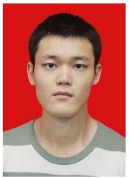

# ARMOR: Shielding Unlearnable Examples against Data Augmentation

Xueluan Gong, Member, IEEE, Yuji Wang, Yanjiao Chen, Senior Member, IEEE, Haocheng Dong, Yiming Li, Mengyuan Sun, Shuaike Li, Qian Wang, Fellow, IEEE, y Chen Chen

**Resumen—Los datos privados, cuando se publican en línea, pueden ser recopilados por partes no autorizadas para entrenar deep neural networks (DNNs). Para proteger la privacidad, se pueden agregar defensive noises a las muestras originales a fin de degradar su capacidad de aprendizaje (learnability) por parte de las DNNs. Recientemente, se han propuesto los unlearnable examples [19] para minimizar la training loss, de modo que el modelo no aprenda prácticamente nada. Sin embargo, los datos crudos a menudo se preprocesan antes de ser utilizados para el entrenamiento, lo que puede restaurar la información privada de los datos protegidos. En este artículo, revelamos la vulneración de data privacy inducida por data augmentation, una técnica de preprocesamiento de datos comúnmente utilizada para mejorar la capacidad de generalización del modelo, siendo este el primer trabajo de su tipo hasta donde tenemos conocimiento. Demostramos que data augmentation puede elevar sustancialmente la accuracy del modelo entrenado con unlearnable examples del 21.3% al 66.1%. Para abordar este problema, proponemos un framework de defensa, denominado** ARMOR**, con el objetivo de proteger la data privacy frente a posibles brechas ocasionadas por data augmentation. Con el fin de superar la dificultad de no tener acceso al proceso de entrenamiento del modelo, diseñamos un surrogate model asistido por un non-local module que captura con mayor precisión el efecto de data augmentation. Además, diseñamos una estrategia de selección de surrogate augmentation que maximiza el alineamiento de distribuciones entre muestras aumentadas y no aumentadas, seleccionando la estrategia de augmentation óptima para cada clase. Asimismo, empleamos un algoritmo de ajuste dinámico del step size para potenciar el proceso de generación de defensive noise. Se llevan a cabo extensos experimentos en 4 datasets y 5 métodos de data augmentation para verificar el rendimiento de** ARMOR**. Las comparaciones con 6 métodos de defensa state-of-the-art han demostrado que** ARMOR **puede preservar la condición de inaprendible (unlearnability) de los datos privados protegidos bajo data augmentation.** ARMOR **reduce la test accuracy del modelo entrenado en muestras protegidas y aumentadas hasta en un 60% más que las líneas base (baselines). También demostramos que** ARMOR **es robusto frente a adversarial training. Liberaremos nuestro código como código abierto tras la publicación.**

**Términos del índice—Unlearnable examples, data augmentation y preservación de data privacy.**

## I. INTRODUCCIÓN

EL éxito de los modelos de deep learning se atribuye, en gran medida, a la disponibilidad de extensas muestras de datos [31], [48], [41]. Para entrenar un modelo DNN de alto rendimiento, el entrenador del modelo puede recopilar muestras de datos de diversas fuentes. Aunque muchos datasets públicos pueden descargarse fácilmente

- X. Gong y C. Chen pertenecen a la Nanyang Technological University, Singapur (correo electrónico: {xueluan.gong, chen.chen}@ntu.edu.sg).
- Y. Chen pertenece al College of Electrical Engineering, Zhejiang University, China (correo electrónico: chenyanjiao@zju.edu.cn).
- Y. Wang, H. Dong, M. Sun, S. Li y Q. Wang pertenecen a la School of Cyber Science and Engineering, Wuhan University, China (correo electrónico: {yujiwang, hc dong, mengyuansun, shuaikeli, qianwang}@whu.edu.cn).
- Y. Li pertenece al ZJU-Hangzhou Global Scientific and Technological Innovation Center (HIC) y también al State Key Laboratory of Blockchain and Data Security, Zhejiang University, China (correo electrónico: li-ym@zju.edu.cn).

en línea, las muestras de datos privados resultan atractivas gracias a su gran cantidad y diversidad. Por ejemplo, un número enorme de imágenes faciales se publican en redes sociales y quedan al alcance de partes no autorizadas para entrenar modelos DNN de reconocimiento facial de alto rendimiento. Para proteger los datos personales contra el uso indebido, se han promulgado normativas a nivel global, tales como el Reglamento General de Protección de Datos (GDPR) de la Unión Europea [45] y la Ley de Privacidad del Consumidor de California (CCPA) [13].

Para proteger las muestras de datos privados frente a su utilización como datos de entrenamiento para modelos DNN, los investigadores han propuesto añadir defensive noises a las muestras originales. Las muestras protegidas resultantes pueden publicarse, dado que presentan una capacidad de aprendizaje ínfima pero preservan la calidad perceptual de las muestras originales. Para alcanzar este objetivo, los primeros trabajos tomaron prestadas técnicas de los ataques de adversarial examples, generando adversarial noises imperceptibles para desviar el proceso de entrenamiento de los modelos DNN [29], [10], [50]. Recientemente, se ha propuesto el concepto de unlearnable examples [19], [26]. El principio fundamental consiste en minimizar la training loss de modo que se aprenda muy poco a partir de las muestras protegidas. Al descubrir que el adversarial training menoscaba la condición de inaprendible (unlearnability), Fu et al. [12] propusieron generar unlearnable examples robustos que minimicen la loss del adversarial training.

En este artículo, presentamos una nueva amenaza para la data privacy planteada por data augmentation, una técnica de preprocesamiento de datos comúnmente utilizada [7], [36]. Por lo general, data augmentation se aplica a muestras de datos crudos para solucionar problemas de desequilibrio de clases y mejorar la capacidad de generalización del modelo entrenado. Hasta donde tenemos conocimiento, somos los primeros en revelar la amenaza potencial para la data privacy inducida por data augmentation. Demostramos que los unlearnable examples state-of-the-art (por ejemplo, EMIN [19]) pueden suprimir eficazmente la accuracy de los modelos entrenados a no más del 15%. Desafortunadamente, si se aplica data augmentation a los unlearnable examples, la accuracy de los modelos entrenados se elevará a más del 60%, deteriorando severamente la unlearnability de los datos protegidos.

Para abordar este desafío, desarrollamos ARMOR, un framework de defensa que permite proteger la data privacy frente a técnicas avanzadas de data augmentation. El principal desafío radica en que el defensor no posee conocimiento ni control sobre el proceso de entrenamiento efectuado por el atacante. De forma más específica, el defensor no conoce la estructura del modelo ni la estrategia de data augmentation seleccionada por el atacante. Para superar esta dificultad, proponemos utilizar un surrogate model cuidadosamente diseñado y una estrategia de selección de surrogate augmentation con el fin de generar defensive noises que minimicen la training loss. Para la construcción del surrogate model, diseñamos un non-local module que amplía el receptive field del surrogate model para capturar mayores beneficios procedentes de data augmentation. Para la selección de la estrategia de surrogate augmentation, buscamos la mejor estrategia de aumento para asegurar que las muestras aumentadas sigan la distribución de las muestras originales. Bajo modelos sustitutos (surrogate models) y estrategias sustitutas tan sólidas, los defensive noises se optimizan mediante gradient descent. Con el fin de potenciar aún más el proceso de optimización, adoptamos un mecanismo de learning rate scheduling para ajustar dinámicamente el learning rate en función de la norma del gradiente.

Hemos llevado a cabo extensos experimentos para evaluar el rendimiento de protección de datos de ARMOR. Comparamos ARMOR con 6 métodos de defensa state-of-the-art, incluidos EMAX [29], TAP [10], NTGA [50], EMIN [19], REM [12] y ruido aleatorio (random noise), en cuatro datasets, es decir, CIFAR-10, CIFAR-100, Mini-ImageNet y VGG-Face. Los resultados experimentales confirman que ARMOR puede reducir la test accuracy del modelo entrenado con el dataset protegido y aumentado hasta en un 60% más que las líneas base (baselines). Además, ARMOR demuestra resiliencia frente a sofisticadas estrategias de data augmentation, incluyendo Mixup [53], Feature distillation [27], PuzzleMix [21], FastAA [25] y DeepAA [54]. También se comprueba que ARMOR es robusto ante adversarial training.

En conclusión, realizamos las siguientes contribuciones:

• Revelamos la posible vulneración de data privacy causada por data augmentation. Hasta donde llega nuestro conocimiento, somos los primeros en descubrir dicha amenaza potencial para la data privacy.
• Desarrollamos un framework de defensa capaz de resistir eficazmente estrategias avanzadas de data augmentation. Para lograr que la defensa sea efectiva en un entorno de caja negra (black-box), construimos minuciosamente el surrogate model y seleccionamos el surrogate augmentation para generar defensive noises robustos.
• Extensos experimentos demuestran que ARMOR supera a los métodos de protección de datos state-of-the-art al reducir significativamente la test accuracy del modelo bajo estrategias avanzadas de data augmentation. Además, ARMOR demuestra robustez frente a adversarial training y resulta eficaz para generar defensive noises de tipo class-wise.

## II. PRELIMINARES

## A. Data Privacy en Deep Learning

Una red neuronal profunda1 (deep neural network, DNN) es una función $f _ { \Theta }$ parametrizada por Θ, que mapea una entrada x a la salida y. Los parámetros Θ se optimizan minimizando el error de predicción agregado $( \mathbf { i . e . }$, definido como la loss function $\mathcal { L } )$ sobre el training dataset $\mathcal { D } _ { t r a i n } = \{ \mathbf { x } _ { i } , \mathbf { y } _ { i } \} _ { i = 1 } ^ { N }$ según

$$
\min _ {\Theta} \frac {1}{N} \sum_ {i = 1} ^ {N} \mathcal {L} \left(f _ {\Theta} \left(\mathbf {x} _ {i}\right), \mathbf {y} _ {i}\right). \tag {1}
$$

Los training datasets son considerados activos valiosos debido a que su calidad ejerce una influencia considerable en el rendimiento del modelo. Las muestras de datos de entrenamiento suelen recolectarse de diversas fuentes, incluyendo usuarios individuales cuyos datos privados pueden resultar sensibles [22], [1]. Pueden ocurrir posibles brechas de data privacy tanto en la fase previa al despliegue (pre-deployment) como en la fase posterior al despliegue (post-deployment) de deep learning [15], [38]. En la fase previa al despliegue,

1Sin pérdida de generalidad, en este artículo consideramos tareas de clasificación y exploraremos esta cuestión en DNNs generativas en nuestros trabajos futuros.

los atacantes pueden recolectar un gran conjunto de datos no autorizados $( \mathbf { e . g . }$ procedentes de redes sociales en línea) para construir sus training datasets [38], [9], [35], [18], [5], [19], [12]. En la fase posterior al despliegue, los atacantes pueden inferir la pertenencia (membership) [39], [3], [42] o los atributos [14], [11], [16] de las muestras de datos de entrenamiento.

En este artículo, nos centramos en proteger la data privacy en la fase previa al despliegue. Más concretamente, el objetivo principal es proteger los datos privados de los usuarios para evitar que sean explotados por partes no autorizadas para entrenar un modelo DNN de alto rendimiento. Para alcanzar esta meta, investigaciones existentes han propuesto añadir defensive noises a las muestras de datos originales a fin de reducir su capacidad de aprendizaje (learnability), es decir, el modelo DNN entrenado con las muestras de datos perturbadas no alcanzará una accuracy satisfactoria. Dada una muestra original x, su versión preservadora de la privacidad $\mathbf { x } ^ { \prime }$ se crea como

$$
\mathbf {x} ^ {\prime} = \mathbf {x} + \delta . \tag {2}
$$

donde δ es el defensive noise.

Existen diversas opciones para $\delta ,$ siendo una ingenua el ruido gaussiano (Gaussian noise). Con frecuencia se adoptan adversarial noises, dado que pueden desviar el proceso de entrenamiento. EMAX [29], UTAP [10], CTAP [10] y NTGA [50] siguieron esta línea. Recientemente surgió la idea de las muestras inaprendibles (unlearnable samples) [19], generando el defensive noise $\delta$ mediante un problema de optimización

$$
\min _ {\theta} \mathbb {E} _ {(\mathbf {x}, \mathbf {y}) \in \mathcal {D} _ {c}} \left[ \min _ {\delta} \mathcal {L} \left(f _ {\theta} (\mathbf {x} + \delta), \mathbf {y}\right) \right], \tag {3}
$$

donde $f _ { \theta }$ representa un modelo DNN hipotético en entrenamiento, $\mathcal { D } _ { c }$ es un dataset de entrenamiento limpio (clean training dataset) utilizado para entrenar $f _ { \theta } ,$ y $\mathcal { L }$ es la loss function para entrenar $f _ { \theta } .$ El problema de optimización bi-nivel consta de un problema de minimización externo y otro interno. El problema de minimización externo busca los parámetros θ que minimizan el error de entrenamiento de $f _ { \theta }$ en el clean training dataset $\mathcal { D } _ { c }$ . El problema de minimización interno busca un ruido δ acotado por norma $L _ { p }$ que minimice la loss de $f _ { \theta }$ sobre la muestra $\mathbf { x } + \delta$, de tal forma que el modelo $f _ { \theta }$ no aprenda casi nada a partir de la muestra $\mathbf { x } + { \boldsymbol { \delta } } .$

A pesar de los esfuerzos por minimizar la learnability de las muestras originales, se ha comprobado que los unlearnable examples son vulnerables a adversarial training [12]. Específicamente, los adversarial examples creados a partir de estos unlearnable examples generarán una loss no mínima, permitiendo que el modelo aprenda información útil y socavando así la protección de la privacidad. Para abordar este problema, Fu et al. [12] propusieron un método de generación de unlearnable examples robustos empleando una optimización min-min-max definida como

$$
\min _ {\theta} \mathbb {E} _ {(\mathbf {x}, \mathbf {y}) \in \mathcal {D} _ {c}} \min _ {\delta} \max _ {\epsilon} \mathcal {L} \left(f _ {\theta} (\mathbf {x} + \epsilon + \delta), \mathbf {y}\right), \tag {4}
$$

donde ϵ es el adversarial noise añadido para maximizar la loss destinada a adversarial training. Tanto ϵ como δ están acotados para garantizar la imperceptibilidad.

En este artículo, revelaremos la vulnerabilidad de los métodos de defensa existentes, especialmente de los unlearnable examples, frente a data augmentation. Además, proponemos las contramedidas correspondientes para reforzar la protección de data privacy.

## B. Data Augmentation

Data augmentation [44], [30], [43] es una técnica que enriquece un training dataset generando nuevos ejemplos mediante transformaciones de las muestras de datos originales, por ejemplo, volteo (flipping), rotación, escalado, recorte (cropping) y alteración del color. El propósito de data augmentation es contribuir a mejorar el rendimiento y la capacidad de generalización de los modelos de machine learning, especialmente si las muestras de datos de entrenamiento disponibles son limitadas. Al generar ejemplos más diversos, data augmentation ayuda a que el modelo aprenda a ser más robusto ante variaciones en los datos. Se ha demostrado que data augmentation también puede ayudar a defenderse contra ataques de adversarial examples [34], [51] y backdoor attacks [2], [33]. En este artículo, revisamos cinco métodos representativos y state-of-the-art de data augmentation: Mixup [53], feature distillation [27], PuzzleMix [21], Fast AutoAugment [25] y DeepAA [54].

TABLE I TEST ACCURACY OF MODELS TRAINED ON PROTECTED SAMPLES WITH OR WITHOUT DATA AUGMENTATION. THE AUGMENTATION METHOD IS DEEPAA [54]. PROTECTED SAMPLES ARE GENERATED BY GAUSSIAN NOISE, EMIN [19], AND REM [12].

<table><tr><td rowspan="9">CIFAR-10</td><td rowspan="3">No protection</td><td>No augmentation</td><td>VGG-16</td><td>ResNet-18</td><td>ResNet-50</td><td>DenseNet-121</td><td>WRN_34_10</td></tr><tr><td rowspan="2">Augmentation</td><td>92.66%</td><td>94.09%</td><td>94.38%</td><td>94.89%</td><td>95.52%</td></tr><tr><td>93.86%</td><td>94.49%</td><td>94.52%</td><td>95.28%</td><td>96.54%</td></tr><tr><td rowspan="2">Gaussian</td><td>No augmentation</td><td>92.49%</td><td>94.11%</td><td>93.56%</td><td>94.76%</td><td>95.61%</td></tr><tr><td>Augmentation</td><td>93.68%</td><td>92.79%</td><td>90.80%</td><td>93.63%</td><td>96.17%</td></tr><tr><td rowspan="2">EMIN [19]</td><td>No augmentation</td><td>25.59%</td><td>25.08%</td><td>19.19%</td><td>21.70%</td><td>21.38%</td></tr><tr><td>Augmentation</td><td>62.69%</td><td>56.05%</td><td>51.01%</td><td>57.32%</td><td>66.14%</td></tr><tr><td rowspan="2">REM [12]</td><td>No augmentation</td><td>29.61%</td><td>24.15%</td><td>20.50%</td><td>23.55%</td><td>24.50%</td></tr><tr><td>Augmentation</td><td>47.58%</td><td>43.25%</td><td>41.24%</td><td>44.39%</td><td>50.38%</td></tr><tr><td rowspan="9">CIFAR-100</td><td rowspan="3">No protection</td><td>No augmentation</td><td>VGG-16</td><td>ResNet-18</td><td>ResNet-50</td><td>DenseNet-121</td><td>WRN_34_10</td></tr><tr><td rowspan="2">Augmentation</td><td>69.43%</td><td>71.84%</td><td>71.69%</td><td>73.04%</td><td>75.77%</td></tr><tr><td>65.06%</td><td>75.01%</td><td>73.42%</td><td>76.06%</td><td>79.25%</td></tr><tr><td rowspan="2">Gaussian</td><td>No augmentation</td><td>69.30%</td><td>71.22%</td><td>69.61%</td><td>72.67%</td><td>75.05%</td></tr><tr><td>Augmentation</td><td>64.04%</td><td>72.15%</td><td>72.62%</td><td>73.76%</td><td>76.92%</td></tr><tr><td rowspan="2">EMIN [19]</td><td>No augmentation</td><td>10.81%</td><td>15.19%</td><td>11.24%</td><td>13.64%</td><td>10.95%</td></tr><tr><td>Augmentation</td><td>40.36%</td><td>39.92%</td><td>42.45%</td><td>40.32%</td><td>46.03%</td></tr><tr><td rowspan="2">REM [12]</td><td>No augmentation</td><td>15.10%</td><td>13.18%</td><td>11.91%</td><td>13.37%</td><td>11.90%</td></tr><tr><td>Augmentation</td><td>30.70%</td><td>27.07%</td><td>25.74%</td><td>32.74%</td><td>30.25%</td></tr><tr><td rowspan="9">Mini-ImageNet</td><td rowspan="3">No protection</td><td>No augmentation</td><td>VGG-16</td><td>ResNet-18</td><td>ResNet-50</td><td>DenseNet-121</td><td>WRN_34_10</td></tr><tr><td rowspan="2">Augmentation</td><td>75.69%</td><td>74.56%</td><td>68.34%</td><td>76.07%</td><td>71.11%</td></tr><tr><td>77.66%</td><td>77.87%</td><td>70.50%</td><td>72.53%</td><td>74.30%</td></tr><tr><td rowspan="2">Gaussian</td><td>No augmentation</td><td>59.37%</td><td>65.55%</td><td>59.60%</td><td>68.45%</td><td>60.69%</td></tr><tr><td>Augmentation</td><td>67.90%</td><td>70.84%</td><td>69.35%</td><td>68.64%</td><td>68.56%</td></tr><tr><td rowspan="2">EMIN [19]</td><td>No augmentation</td><td>14.98%</td><td>11.67%</td><td>16.81%</td><td>15.45%</td><td>22.96%</td></tr><tr><td>Augmentation</td><td>58.06%</td><td>63.51%</td><td>58.84%</td><td>53.08%</td><td>50.38%</td></tr><tr><td rowspan="2">REM [12]</td><td>No augmentation</td><td>26.81%</td><td>23.43%</td><td>24.02%</td><td>33.97%</td><td>33.40%</td></tr><tr><td>Augmentation</td><td>44.46%</td><td>43.60%</td><td>42.52%</td><td>53.95%</td><td>47.92%</td></tr><tr><td rowspan="9">VGG-Face</td><td rowspan="3">No protection</td><td>No augmentation</td><td>VGG-16</td><td>ResNet-18</td><td>ResNet-50</td><td>DenseNet-121</td><td>WRN_34_10</td></tr><tr><td rowspan="2">Augmentation</td><td>93.59%</td><td>93.09%</td><td>93.62%</td><td>95.56%</td><td>94.54%</td></tr><tr><td>97.18%</td><td>97.21%</td><td>93.02%</td><td>97.29%</td><td>97.73%</td></tr><tr><td rowspan="2">Gaussian</td><td>No augmentation</td><td>94.24%</td><td>94.28%</td><td>95.80%</td><td>96.20%</td><td>93.65%</td></tr><tr><td>Augmentation</td><td>97.21%</td><td>97.61%</td><td>95.78%</td><td>90.91%</td><td>95.12%</td></tr><tr><td rowspan="2">EMIN [19]</td><td>No augmentation</td><td>1.46%</td><td>1.49%</td><td>1.57%</td><td>1.53%</td><td>1.65%</td></tr><tr><td>Augmentation</td><td>42.63%</td><td>48.75%</td><td>41.14%</td><td>40.84%</td><td>35.75%</td></tr><tr><td rowspan="2">REM [12]</td><td>No augmentation</td><td>3.21%</td><td>4.32%</td><td>5.53%</td><td>3.46%</td><td>4.21%</td></tr><tr><td>Augmentation</td><td>36.86%</td><td>46.43%</td><td>40.78%</td><td>42.76%</td><td>37.43%</td></tr></table>

<u>Mixup.</u> Mixup [53] construye una combinación ponderada de pares de muestras seleccionadas aleatoriamente a partir del training dataset. Dadas dos muestras $( \mathbf { x } _ { i } , \mathbf { y } _ { i } )$ y $( \mathbf { x } _ { j } , \mathbf { y } _ { j } )$, se genera una muestra aumentada como $( \lambda \mathbf { x } _ { i } + ( 1 - \lambda ) \mathbf { x } _ { j } , \lambda \mathbf { y } _ { i } + ( 1 - \lambda ) \mathbf { y } _ { j } )$, donde $\lambda \in [ 0 , 1 ]$ es un coeficiente de mezcla que determina el peso de cada muestra en la combinación lineal.

<u>Feature distillation.</u> Feature distillation [27] se diseñó inicialmente para mitigar ataques de adversarial examples. Rediseña el procedimiento de cuantificación de un algoritmo de compresión JPEG tradicional [46]. Dependiendo de la ubicación de la cuantificación derivada en JPEG, feature distillation dispone de los modos de una pasada (one-pass) y de dos pasadas (two-pass). El feature distillation de una pasada inserta una cuantificación/descuantificación en el proceso de descompresión del algoritmo JPEG original. El feature distillation de dos pasadas embebe una cuantificación especialmente diseñada en el lado del sensor para comprimir las muestras de datos crudos.

<u>PuzzleMix.</u> PuzzleMix [21] es una extensión de Mixup que resuelve el problema de generar muestras aumentadas poco naturales. PuzzleMix encuentra la máscara de mezcla óptima basándose en la información de saliencia (saliency). Se ha demostrado que PuzzleMix supera a los métodos Mixup state-of-the-art en términos de generalización y robustez contra la corrupción de datos y las adversarial perturbations.

<u>FastAA.</u> AutoAugment [6] automatiza la búsqueda de una estrategia óptima de data augmentation para un dataset original dado mediante reinforcement learning. Para reducir la complejidad computacional de AutoAugment, Fast AutoAugment (FastAA) [25] emplea una estrategia de búsqueda más eficiente basada en density matching. La idea principal consiste en aprender una distribución de probabilidad sobre un espacio de estrategias candidatas de aumento que maximice el rendimiento de un modelo dado sobre un dataset de validación. La distribución se aprende haciendo coincidir la densidad de un espacio de características aprendido de las muestras aumentadas con la de las muestras originales. De este modo, FastAA acelera significativamente el proceso de búsqueda en comparación con el algoritmo AutoAugment original.

<u>DeepAA.</u> Deep AutoAugment (DeepAA) [54] construye un framework de data augmentation multicapa. En cada capa, la estrategia de aumento se optimiza para maximizar la similitud del coseno entre el gradiente de los datos originales y el de los datos aumentados a lo largo de la dirección de baja varianza. Para evitar un incremento exponencial en la dimensionalidad del espacio de búsqueda, DeepAA apila capas de forma incremental de acuerdo con la distribución de datos transformada por todas las capas de aumento precedentes.

Dado un conjunto de métodos de aumento, la estrategia de aumento de cada capa se representa como una probabilidad de utilizar cada método de aumento:

$$
\arg \max _ {\mathbf {p}} \frac {\mathbf {g} ^ {T} \cdot \nabla \mathbf {g} ^ {A} (\mathbf {x} , \mathbf {p})}{\left| \left| \mathbf {g} ^ {T} \right| \right| \cdot \left| \left| \nabla \mathbf {g} ^ {A} (\mathbf {x} , \mathbf {p}) \right| \right|}, \tag {5}
$$

donde p es la estrategia de aumento, $\nabla \mathbf { g } ^ { A } ( \mathbf { x } , \mathbf { p } )$ es el gradiente promedio de las muestras aumentadas, $\mathbf { g } ^ { T }$ es el gradiente de las muestras de datos originales, y || · || es la norma $L_{2}$.
## III. REVELANDO LOS EFECTOS DE DATA AUGMENTATION SOBRE DATA PRIVACY

Revelamos que data augmentation perjudicará la protección de la privacidad proporcionada por los métodos existentes de generación de defensive noise. Hasta donde sabemos, esta es la primera vez que se pone al descubierto dicha vulnerabilidad.

En primer lugar, presentamos el rendimiento de diferentes modelos entrenados con muestras protegidas con o sin data augmentation. Como se muestra en la Tabla I, evaluamos el rendimiento de protección del ruido gaussiano (Gaussian noise) y de dos métodos de defensa state-of-the-art basados en unlearnable examples, es decir, EMIN [19] y REM [12]. Utilizamos DeepAA [54] como método de data augmentation.

## Efecto de Data Augmentation sobre Data Privacy

• **Sin data augmentation**, la protección de data privacy proporcionada por los unlearnable examples es eficaz.
• **Con data augmentation**, la protección de data privacy proporcionada por los unlearnable examples se ve comprometida.

Como se muestra en la Tabla I, sin data augmentation, EMIN y REM evitan eficazmente que los modelos DNN alcancen una alta test accuracy mediante el aprendizaje a partir de muestras de datos protegidas. Por ejemplo, las DNNs entrenadas con el dataset limpio y desprotegido de CIFAR-10 obtienen test accuracies del 92.66% (VGG-16) y del 94.09% (ResNet-18). Estas accuracies caen al 25.59% (VGG-16) y al 25.08% (ResNet-18) bajo la protección de EMIN. Desafortunadamente, cuando se adopta data augmentation, EMIN y REM luchan por mantener la test accuracy de los modelos no autorizados por debajo del 30%, en especial en el caso de EMIN. Por ejemplo, la test accuracy del modelo WRN 34 10 es de apenas 21.38% bajo EMIN para el dataset CIFAR-10, pero se dispara al 66.14% una vez que se utiliza DeepAA.

Para verificar aún más nuestros hallazgos, evaluamos otras estrategias de data augmentation state-of-the-art, incluidas Mixup [53], Feature distillation [27], PuzzleMix [21] y FastAA [25]. Los resultados experimentales se presentan en la Tabla II. Los resultados demuestran que diversas estrategias de data augmentation pueden deteriorar la protección de data privacy. Además de DeepAA, tanto FastAA como PuzzleMix pueden mejorar sustancialmente la test accuracy del modelo (por ejemplo, >60% en varios casos), incluso si se utilizan EMIN y REM para la protección de la privacidad. Se pueden encontrar más resultados de evaluación sobre los efectos de data augmentation en los métodos de defensa EMAX [29], UTAP [10], CTAP [10] y NTGA [50] en la Tabla IV y la Tabla V.

A través de experimentos exhaustivos, hemos descubierto que casi todos los defensive noises existentes son susceptibles a data augmentation. Este hallazgo destaca la importancia de mitigar las posibles violaciones de data privacy introducidas por data augmentation.

## IV. PROTEGIENDO DATA PRIVACY BAJO DATA AUGMENTATION

En este artículo, proponemos ARMOR para mejorar la protección de data privacy bajo el impacto de data augmentation.

## A. Threat Model

Consideramos dos partes: el defensor (defender) y el atacante (attacker).

**Defensor**. El rol de defensor generalmente lo asume el propietario de los datos, quien posee un dataset privado $\mathcal { D } _ { c } = { ( \mathbf { x } _ { i } , y _ { i } ) } _ { i = 1 } ^ { n } .$ El objetivo del defensor consiste en generar un dataset protegido correspondiente $\mathcal { D } _ { u }$ para su publicación en redes sociales, donde $\mathcal { D } _ { u } = \{ ( \mathbf { x } _ { i } + \delta _ { i } , y _ { i } ) \} _ { i = 1 } ^ { n }$ . Debe garantizarse que un modelo entrenado con el dataset protegido publicado $\mathcal { D } _ { u }$ presente un rendimiento deficiente en el conjunto de prueba $\mathcal { D } _ { t }$ , incluso si el entrenador del modelo emplea estrategias avanzadas de data augmentation. El defensive noise δ está acotado por $| | \delta | | _ { p } \leq \epsilon \mathrm { ~ para ~ }$ garantizar la imperceptibilidad. Siguiendo los trabajos de defensa existentes [19], asumimos que el defensor tiene acceso total al dataset privado $\mathcal { D } _ { c } .$ . No obstante, el defensor no posee conocimiento ni control sobre el proceso de entrenamiento del modelo del atacante. Adicionalmente, el defensor no puede modificar los ejemplos protegidos una vez que han sido publicados.

**Atacante**. El rol de atacante suele asumirlo el entrenador del modelo, quien tiene como meta entrenar un modelo $f$ de alto rendimiento utilizando el dataset público $\mathcal { D } _ { u }$ . El atacante puede emplear cualquier estrategia de data augmentation para mejorar el rendimiento del modelo. Asimismo, exploramos la eficacia de ARMOR cuando el atacante adopta adversarial training para fortalecer el rendimiento del modelo.

## B. Formulación del Problema de Protección de Privacidad

Para generar un defensive noise δ capaz de resistir data augmentation, formulamos el problema de optimización como

$$
\min _ {\theta} \mathbb {E} _ {(\mathbf {x}, \mathbf {y}) \sim \mathcal {D} _ {c}} \left[ \min _ {\delta} \mathcal {L} \left(f \left(\mathcal {A} (\mathbf {x} + \delta , \mathbf {p}), \mathbf {y}\right) \right], \right. \tag {6}
$$

donde $\mathcal { A } ( \mathbf { x } + \delta , \mathbf { p } )$ es la función que aplica la estrategia de data augmentation p sobre la muestra protegida $\mathbf { x } + \delta .$ La idea clave de la Ecuación (6) radica en minimizar la loss de la muestra protegida incluso cuando se aplica data augmentation. En la Ecuación (6), $f ( \cdot )$ y p son el surrogate model y la estrategia de surrogate augmentation que utiliza el defensor para emular el modelo real y la estrategia de aumento real adoptados por el atacante. Por consiguiente, la elección de $f ( \cdot )$ y de p es esencial para determinar el rendimiento de protección de la privacidad. Además, resolver el problema min-min para alcanzar el defensive noise óptimo δ dista de ser trivial. Para abordar estos desafíos, dotamos a ARMOR de tres bloques constructivos fundamentales, tal como se ilustra en la Figura 1.

• Construcción del surrogate model. Sin información sobre la estructura del modelo del atacante, el defensor puede verse en la necesidad de inicializar un surrogate model. Nuestro estudio empírico revela que un surrogate model, establecido con la asistencia de data augmentation, puede capturar características más informativas, lo que conduce a un mejor rendimiento de protección. Dado que data augmentation favorece la expansión del receptive field del modelo hacia una región de muestra más amplia, introducimos un non-local module como complemento (plug-in) en el surrogate model para capturar un receptive field global de la muestra.

TABLE II TEST ACCURACY OF MODELS TRAINED ON PROTECTED SAMPLES WITH OR WITHOUT DATA AUGMENTATION. DIFFERENT DATA AUGMENTATION METHODS ARE ADOPTED. PROTECTED SAMPLES ARE GENERATED BY EMIN AND REM.

<table><tr><td rowspan="6">Mixup [53]</td><td rowspan="2">Unprotected</td><td rowspan="2">Augmentation</td><td>CIFAR-10</td><td>CIFAR-100</td><td>Mini-ImageNet</td><td>VGG-Face</td></tr><tr><td>95.03%</td><td>77.19%</td><td>76.89%</td><td>94.49%</td></tr><tr><td rowspan="2">EMIN [19]</td><td>No Augmentation</td><td>25.08%</td><td>15.19%</td><td>14.98%</td><td>1.46%</td></tr><tr><td>Augmentation</td><td>33.65%</td><td>18.02%</td><td>17.79%</td><td>47.96%</td></tr><tr><td rowspan="2">REM [12]</td><td>No Augmentation</td><td>24.15%</td><td>13.18%</td><td>26.81%</td><td>3.21%</td></tr><tr><td>Augmentation</td><td>31.58%</td><td>17.61%</td><td>36.98%</td><td>36.76%</td></tr><tr><td rowspan="6">Feature distillation [27]</td><td rowspan="2">Unprotected</td><td rowspan="2">Augmentation</td><td>CIFAR-10</td><td>CIFAR-100</td><td>Mini-ImageNet</td><td>VGG-Face</td></tr><tr><td>92.91%</td><td>68.48%</td><td>77.11%</td><td>95.40%</td></tr><tr><td rowspan="2">EMIN [19]</td><td>No Augmentation</td><td>25.08%</td><td>15.19%</td><td>14.98%</td><td>1.46%</td></tr><tr><td>Augmentation</td><td>31.17%</td><td>22.08%</td><td>21.40%</td><td>38.65%</td></tr><tr><td rowspan="2">REM [12]</td><td>No Augmentation</td><td>24.15%</td><td>13.18%</td><td>26.81%</td><td>3.21%</td></tr><tr><td>Augmentation</td><td>32.67%</td><td>25.05%</td><td>36.13%</td><td>27.34%</td></tr><tr><td rowspan="6">PuzzleMix [21]</td><td rowspan="2">Unprotected</td><td rowspan="2">Augmentation</td><td>CIFAR-10</td><td>CIFAR-100</td><td>Mini-ImageNet</td><td>VGG-Face</td></tr><tr><td>95.37%</td><td>68.65%</td><td>76.46%</td><td>94.36%</td></tr><tr><td rowspan="2">EMIN [19]</td><td>No Augmentation</td><td>25.08%</td><td>15.19%</td><td>14.98%</td><td>1.46%</td></tr><tr><td>Augmentation</td><td>40.52%</td><td>28.57%</td><td>18.14%</td><td>48.78%</td></tr><tr><td rowspan="2">REM [12]</td><td>No Augmentation</td><td>24.15%</td><td>13.18%</td><td>26.81%</td><td>3.21%</td></tr><tr><td>Augmentation</td><td>40.43%</td><td>21.12%</td><td>64.95%</td><td>35.87%</td></tr><tr><td rowspan="6">FastAA [25]</td><td rowspan="2">Unprotected</td><td rowspan="2">Augmentation</td><td>CIFAR-10</td><td>CIFAR-100</td><td>Mini-ImageNet</td><td>VGG-Face</td></tr><tr><td>94.81%</td><td>73.64%</td><td>76.60%</td><td>94.97%</td></tr><tr><td rowspan="2">EMIN [19]</td><td>No Augmentation</td><td>25.08%</td><td>15.19%</td><td>14.98%</td><td>1.46%</td></tr><tr><td>Augmentation</td><td>44.00%</td><td>32.27%</td><td>18.94%</td><td>40.08%</td></tr><tr><td rowspan="2">REM [12]</td><td>No Augmentation</td><td>24.15%</td><td>13.18%</td><td>26.81%</td><td>3.21%</td></tr><tr><td>Augmentation</td><td>38.40%</td><td>24.72%</td><td>38.73%</td><td>35.74%</td></tr></table>

• Selección de la estrategia de surrogate augmentation. Nuestros extensos resultados experimentales en la Sección III han demostrado que DeepAA [54] es el que más eleva la accuracy del modelo atacante. Dado un conjunto de operaciones de aumento, para cada muestra, DeepAA calcula la estrategia de aumento óptima para lograr el alineamiento de gradientes (gradient alignment), de acuerdo con la Ecuación (5). Inspirados por DeepAA, proponemos un algoritmo de selección de estrategias de aumento para seleccionar dinámicamente estrategias de aumento específicas para cada clase.
• Generación de defensive noise. Adoptamos Projected Gradient Descent (PGD) [29] para resolver el problema de optimización min-min. PGD realiza actualizaciones iterativas para buscar la solución óptima, transformando la generación de ruido en un proceso iterativo de actualización de la política de aumento y de actualización del ruido. Además, proponemos utilizar un esquema adaptativo de learning rate scheduling en PGD, lo que mejora la eficiencia del proceso iterativo y mitiga el riesgo de overfitting.

## C. Construcción del Surrogate Model

Idealmente, el surrogate model debería poseer la misma estructura que el modelo del atacante. Sin embargo, asumimos que el defensor no tiene acceso al modelo del atacante. Trabajos previos [19], [12] han revelado que los unlearnable examples generados mediante un tipo específico de modelo aún pueden mostrar un buen rendimiento de protección bajo otros tipos de modelos entrenados. En este caso, podemos optar por elegir una estructura de modelo comúnmente utilizada, por ejemplo, ResNet-18, para construir el surrogate model.

Nuestro extenso estudio empírico revela que ARMOR proporciona una mejor protección cuando el surrogate model se beneficia más de data augmentation. Con base en esto, mejoramos la estructura fundamental del surrogate model para amplificar el impacto de data augmentation.

Data augmentation tiene como objetivo mejorar la capacidad de generalización del modelo reduciendo su dependencia de características locales, lo que ayuda a mitigar el overfitting. Al incrementar la diversidad de los datos, data augmentation alienta al modelo a ampliar su receptive field hacia una región de muestra más amplia. Inspirados por este principio, tras inicializar el surrogate model con un modelo DNN de uso común, incorporamos adicionalmente un non-local module [47] que captura un receptive field global de la muestra.

El non-local module transforma una entrada a en una salida b de la misma dimensión según

$$
\mathbf {b} _ {i} = \frac {1}{\mathcal {C} (\mathbf {a})} \sum_ {\forall j} F \left(\mathbf {a} _ {i}, \mathbf {a} _ {j}\right) G \left(\mathbf {a} _ {j}\right), \tag {7}
$$

donde $\mathbf { b } _ { i }$ es la i-ésima característica de la salida b, $\mathbf { a } _ { i }$ es la i-ésima característica de la entrada a, $\mathcal { F } ( \cdot , \cdot )$ es una función por pares cuya salida depende de la relación entre $\mathbf { a } _ { i }$ y $\mathbf { a } _ { j } ,$ y $\mathcal { G } ( \cdot )$ calcula la j-ésima característica de la representación de la entrada a. Además, C(a) denota un factor utilizado para la normalización.

La clave de un non-local module radica en el diseño de G y $\mathcal { F } .$ Para G, seleccionamos una transformación lineal como $\mathcal { G } ( \mathbf { a } _ { j } ) = \mathbf { W } _ { G } \mathbf { a } _ { j } ,$ donde $\mathbf { W } _ { G }$ es una matriz de pesos aprendida durante el proceso de entrenamiento. Para $\mathcal { F }$ , desarrollamos una estructura con incrustación gaussiana (Gaussian-embedded structure) como

$$
\mathcal {F} \left(\mathbf {a} _ {i}, \mathbf {a} _ {j}\right) = e ^ {\varphi \left(\mathbf {a} _ {i}\right) ^ {T} \cdot \phi \left(\mathbf {a} _ {j}\right)}, \tag {8}
$$

donde $\varphi ( \cdot )$ y $\phi ( \cdot )$ son funciones de transformación lineal, y $\mathbf { x } ^ { T }$ es la transpuesta de la matriz x.

Fig. 1. Descripción general de ARMOR. ARMOR contiene principalmente tres componentes clave: construcción del surrogate model, selección de la estrategia de surrogate augmentation y generación de defensive noise.

TABLE III A LIST OF STANDARD AUGMENTATION SEARCH SPACE. “IDENTITY” DENOTES APPLYING NO DATA AUGMENTATION TO THE DATA SAMPLE.

| Operation | Magnitude |
| --- | --- |
| Identity | - |
| ShearX | [-0.3, 0.3] |
| ShearY | [-0.3, 0.3] |
| TranslateX | [-0.45, 0.45] |
| TranslateY | [-0.45, 0.45] |
| Rotate | [-30, 30] |
| AutoContrast | - |
| Invert | - |
| Equalize | - |
| Solarize | [0, 256] |
| Posterize | [4, 8] |
| Contrast | [0.1, 1.9] |
| Color | [0.1, 1.9] |
| Brightness | [0.1, 1.9] |
| Sharpness | [0.1, 1.9] |
| Flips | - |
| Cutout | [8, 16] |
| Crop | - |

El non-local module puede actuar como un complemento (plug-in) que se inserta entre cualquiera de las capas de un modelo DNN.

## D. Selección de la Estrategia de Surrogate Augmentation

Data augmentation enriquece un dataset sintetizando puntos de datos adicionales que siguen la misma distribución subyacente [17]. Por lo tanto, un data augmentation eficaz debe mantener la distribución subyacente de los datos, asegurando que la distribución de las muestras aumentadas se alinee con la de las muestras originales [4]. Para lograr este objetivo, DeepAA adopta el alineamiento de gradientes (gradient alignment), es decir, alinear los gradientes calculados sobre el batch de muestras aumentadas con aquellos calculados sobre la base del batch de muestras originales [54]. Dado que el atacante solo obtiene la versión protegida de las muestras

## Algoritmo 1 Selección de la Estrategia de Surrogate Augmentation

**Entrada:** Dataset limpio $D _ { c }$ , ruido existente δ, estrategia de aumento existente p, modelo auxiliar preentrenado ${ \bar { f ^ { \prime } } } ,$ número de clases c y época de entrenamiento $r .$

**Salida:** Estrategia de aumento p.

1: **para** k en $1 , 2 , . . . r$ **hacer**
2: Muestrear un minibatch $( x _ { k } , y _ { k } ) \sim D _ { c } .$
3: $x _ { k } ^ { \prime } = x _ { k } + \delta .$
4: Actualizar el modelo auxiliar f′ en base al minibatch $( x _ { k } ^ { \prime } , y _ { k } )$
5: **fin para**
6: **para** i en $0 , 1 , 2 , . . . c - 1$ **hacer**
7: Seleccionar aleatoriamente batches de muestras $x _ { 1 }$ y $x _ { 2 }$ con la misma etiqueta i.
8: // Gradient matching
9: $\mathbf { p } _ { i } = \operatorname { a r g } \operatorname { m a x } _ { o \in \mathbb { O } } \mathsf { C S } ( \nabla x _ { 1 } , \nabla \mathcal { A } ( x _ { 2 } , \mathbf { o } ) ) ,$ ,
10: **fin para**
11: Retornar p.

privadas, seleccionamos la estrategia de aumento que maximiza la similitud del coseno entre los gradientes promedio de los datos protegidos y los de los datos protegidos aumentados.

Matemáticamente, buscamos la estrategia de aumento óptima p como

$$
\begin{array}{l} \mathbf {p} = \arg \max _ {\mathbf {p}} \mathrm{CS} (\nabla x _ {1}, \nabla \mathcal {A} (x _ {2}, \mathbf {p})) \\ = \arg \max _ {\mathbf {p}} \frac {\nabla x _ {1} \times \nabla \mathcal {A} \left(x _ {2} , \mathbf {p}\right)}{\left| \left| \nabla x _ {1} \right| \right| \times \left| \left| \nabla \mathcal {A} \left(x _ {2} , \mathbf {p}\right) \right| \right|}, \tag {9} \\ \end{array}
$$

donde $\operatorname { C S } ( \cdot , \cdot )$ calcula la similitud del coseno, || · || representa la norma $L _ { 2 }$, y $x _ { 1 }$ y $x _ { 2 }$ son dos batches de imágenes procedentes de los datos perturbados actuales. Para mejorar la eficiencia, adoptamos la estrategia de aumento de nivel de clase (class-wise augmentation strategy), es decir, seleccionamos una estrategia específica para cada clase en cada época, ya que las muestras de la misma clase habitualmente comparten representaciones de características similares.
Algoritmo 2 Generación de Defensive Noise

Entrada: Dataset limpio  $D_{c}$ , ruido existente  $\delta$ , estrategia de aumento existente p, época de entrenamiento del surrogate model  $r_{f}$ , y época de entrenamiento del ruido  $r_{d}$ .

Salida: Ruido actualizado δ.

// Proceso de actualización del ruido.
for $k$ in $1, 2, \ldots, r_f$ do
    Muestrear un minibatch $(x_k, y_k) \sim D_c$.
    Actualizar el surrogate model $f$ en base al minibatch $(\mathcal{A}(x_k + \delta, \mathbf{p}), y_k)$.
end for
$\delta_0 = \delta$;
// Iteración del método PGD con step size adaptativo; el primer subíndice indica el índice de la imagen, el segundo subíndice indica la ronda de actualización; $\beta, c, \gamma$ son constantes predeterminadas.

8: para t en $1 , 2 , . . . r _ { d }$ hacer

9: $n_{i,t} = \beta n_{i,t-1} + (1 - \beta)||\nabla_{x_{i,t-1}}\mathrm{L}(x_{i,t-1},y_i)||_2^2.$
10: $\alpha_t = \frac{\gamma}{c+\sqrt{\sum_i n_{i,t}}}.$
11: $\delta_t = \delta_{t-1} - \alpha_t * \mathrm{sign}(\nabla_\delta \mathcal{L}(f(\mathcal{A}(\mathbf{x} + \delta_{t-1},\mathbf{p}),\mathbf{y}))),$

12: fin para

13: Retornar $\delta .$

Para cada clase, determinamos la estrategia de aumento óptima utilizando un modelo auxiliar $f ^ { \prime } .$ Este modelo se entrena inicialmente con muestras limpias y posteriormente se actualiza utilizando datos perturbados durante cada época de selección de la estrategia de aumento. Sea $\mathbf { p } _ { i }$ la operación de aumento seleccionada para la i-ésima clase. La selección de la estrategia de aumento se actualiza como

$$
\mathbf {p} _ {i} = \arg \max _ {o \in \mathbb {O}} \mathbf {C S} \left(\nabla x _ {1}, \nabla \mathcal {A} \left(x _ {2}, \mathbf {o}\right)\right), \tag {10}
$$

donde O denota el conjunto de operaciones de aumento definido en la Tabla III, y $x _ { 1 }$ y $x _ { 2 }$ representan dos batches de imágenes etiquetadas como i. El algoritmo para seleccionar la estrategia de surrogate augmentation se resume en el Algoritmo 1.

## E. Generación de Defensive Noise

El defensive noise se genera para hacer que el modelo del atacante presente una loss pequeña sobre la muestra protegida. De este modo, el modelo atacante difícilmente puede aprender información constructiva a partir de la imagen. Utilizamos cross-entropy como loss function y el método de optimización de primer orden PGD [29] para actualizar el ruido como

$$
\delta_ {t + 1} = \delta_ {t} - \alpha * \operatorname{sign} (\nabla \mathcal {L} (f (\mathcal {A} (\mathbf {x} + \delta_ {t}, \mathbf {p}), \mathbf {y}))), \tag {11}
$$

donde t es la iteración actual y α es el learning rate.

El learning rate α determina la longitud de cada paso dado en la dirección negativa del gradiente durante el proceso de iteración por gradient descent. Si el learning rate es excesivamente pequeño, el proceso de entrenamiento puede converger con demasiada lentitud. Si el learning rate es excesivamente grande, la training loss puede oscilar y no disminuir de manera monótona. Por lo tanto, es crucial ajustar dinámicamente el learning rate de acuerdo con el estado de la iteración actual. Tradicionalmente, PGD emplea un learning rate constante.

En su lugar, ajustamos el learning rate para que sea inversamente proporcional a la norma del gradiente de entrada. Específicamente, a las muestras con mayores normas de gradiente se les asignan learning rates más bajos [20], y viceversa:

$$
\begin{array}{l} n _ {i, t} = \beta n _ {i, t - 1} + (1 - \beta) | | \nabla_ {\mathbf {x} _ {i, t - 1}} \mathcal {L} (x _ {i, t - 1}, y _ {i}) | | _ {2} ^ {2}, \\ \alpha_ {t} = \frac {\gamma}{c + \sqrt {\sum_ {i} n _ {i , t}}}, \tag {12} \\ \end{array}
$$

donde $x _ { i , t }$ es la i-ésima muestra en la t-ésima iteración, $\beta$ es el momentum, $n _ { i , t }$ es el promedio móvil de la norma del gradiente, y $\gamma , c$ son hiperparámetros destinados a evitar que $\alpha _ { t }$ crezca en exceso.

El proceso de generación de defensive noise se itera hasta que el proceso de entrenamiento del surrogate model converge. Nótese que nuestro algoritmo de generación de ruido puede generar tanto ruido a nivel de muestra (sample-wise noise) como a nivel de clase (class-wise noise). El sample-wise noise puede optimizarse directamente a través de la Ecuación (11). Para el class-wise noise, calculamos y promediamos el defensive noise generado para cada muestra dentro de una clase determinada.

El proceso de generación de defensive noise se sintetiza en el Algoritmo 2.

## V. CONFIGURACIÓN DE LA EVALUACIÓN

## A. Modelos y Datasets

Llevamos a cabo experimentos en cuatro datasets ampliamente utilizados: CIFAR-10 [23], CIFAR-100 [23], Mini-ImageNet [8] y VGG-Face [32]. Por defecto, utilizamos ResNet-18 para entrenar el surrogate model en CIFAR-10, CIFAR-100, Mini-ImageNet y VGG-Face.

**CIFAR-10**. CIFAR-10 [23] consta de 60,000 imágenes en color, cada una de un tamaño de $32 \times 32$ píxeles, divididas en 10 clases diferentes. Cada clase contiene 6,000 imágenes. Las imágenes de CIFAR-10 son sumamente diversas y pueden resultar desafiantes para una clasificación precisa debido a variaciones en iluminación, escala, orientación y a la presencia de objetos superpuestos. Seleccionamos aleatoriamente 50,000 muestras del dataset para formar el training set, mientras que las 10,000 muestras restantes se reservan para el test set. Entrenamos el modelo sobre el training set durante 100 epochs. El learning rate es de 0.1, el batch size es de 128, el weight decay es de 0.0005 y el momentum stochastic gradient descent es de 0.9. Se utiliza un scheduler CosineAnnealingLR en el proceso de entrenamiento, con un valor de T max de 100 y un valor de eta min de 0.

**CIFAR-100**. CIFAR-100 [23] es una extensión del dataset CIFAR-10. Consta de 60,000 imágenes en color, cada una de 32 × 32 píxeles, pero a diferencia de CIFAR-10, contiene 100 clases diferentes. Cada clase en CIFAR-100 representa una categoría detallada (fine-grained), con 600 imágenes por clase. Dividimos el dataset en un training set y un test set, con 50,000 imágenes para entrenamiento y 10,000 imágenes para pruebas. Entrenamos el modelo durante 150 epochs. Fijamos el learning rate en 0.1, el batch size en 128 y el momentum stochastic gradient descent en 0.9. Se utiliza un scheduler CosineAnnealingLR en el proceso de entrenamiento, con un valor de T max de 150 y un valor de eta min de 0.

**Mini-ImageNet.** Mini-ImageNet, un subconjunto ampliamente utilizado de ImageNet [8], goza de gran popularidad dentro de la comunidad científica [49], [28]. Mini-ImageNet se selecciona minuciosamente para incluir diversas categorías de objetos y un amplio rango de variaciones de imagen, resultando idóneo para evaluar y comparar diferentes modelos de clasificación de imágenes. Mini-ImageNet comprende un total de 60,000 imágenes, de las cuales dividimos 40,000 imágenes para el training set y 10,000 imágenes para el test set. Cada imagen tiene una alta resolución con dimensiones de 224 × 224. Entrenamos el modelo durante 150 epochs. Fijamos el learning rate en 0.1, el batch size en 64, el momentum de stochastic gradient descent en 0.9 y el weight decay en 0.0005. Se utiliza un scheduler CosineAnnealingLR en el proceso de entrenamiento, con un valor de T max de 150 y un valor de eta min de 0.

Fig. 2. Resultados de visualización de diferentes tipos de defensive noise y las correspondientes unlearnable samples de EMAX [29], TAP [10], NTGA [50], EMIN [19], REM [12] y ARMOR. Para cada dataset, seleccionamos aleatoriamente dos muestras como ejemplo.

**VGG-Face.** VGGFace [32] es un dataset de reconocimiento facial a gran escala creado por investigadores del Visual Geometry Group (VGG). VGGFace contiene una vasta colección de imágenes faciales que abarca un amplio abanico de identidades procedentes de diversas fuentes. Incluye aproximadamente 2.6 millones de imágenes de más de 2,600 individuos, convirtiéndose en uno de los datasets de reconocimiento facial más grandes disponibles. Cada imagen tiene una alta resolución de dimensiones 224 × 224. En este artículo, seleccionamos aleatoriamente 200 categorías de imágenes para conformar el dataset. Se destinan 53,811 imágenes para entrenamiento y 10,762 imágenes para pruebas. Redimensionamos las imágenes a 3 × 224 × 224. Fijamos el learning rate en 0.01. El mini-batch size se fija en 64. Se utiliza un scheduler CosineAnnealingLR en el proceso de entrenamiento, con un valor de T max de 150 y un valor de eta min de 0.

## B. Métricas de Evaluación

En consonancia con investigaciones previas [12], [19], empleamos la test accuracy como métrica para evaluar la capacidad de preservación de la privacidad del ruido. Una test accuracy más baja indica que el modelo ha adquirido un conocimiento mínimo a partir de los datos de entrenamiento, sugiriendo por ende una robusta capacidad de protección de la privacidad por parte del ruido.

En los experimentos, empleamos sample-wise noise por defecto, a menos que se especifique lo contrario. Asumimos que el entrenador del modelo comercial utiliza primordialmente DeepAA [54], una estrategia avanzada y ampliamente adoptada de data augmentation automática. El espacio de búsqueda de las operaciones de aumento óptimas se muestra en la Tabla III. Asimismo, exploramos la eficacia de ARMOR cuando el entrenador del modelo adopta otras estrategias de data augmentation state-of-the-art en los experimentos, tales como Mixup [53], Feature distillation [27], PuzzleMix [21] y FastAA [25].

## C. Configuración Experimental de Diversos Métodos de Generación de Defensive Noise

Comparamos ARMOR con varios métodos de protección de datos state-of-the-art, incluidos el ruido gaussiano (Gaussian noise), EMAX [29], TAP [10], NTGA [50], EMIN [19] y REM [12].

**Gaussian noise.** Generamos ruido aleatorio de forma independiente para cada ejemplo de entrenamiento o para cada clase, muestreando del intervalo [−ϵ, ϵ].

**EMAX.** EMAX [29] se genera a partir de los gradientes de un modelo preentrenado. Generamos el ruido para EMAX mediante un ataque PGD-20 sobre un modelo ResNet-18 preentrenado aplicado al training dataset, fijando el step size en 2.

**EMIN.** EMIN [19] se genera con arreglo a la Ecuación (3). En cada epoch, entrenamos el surrogate model durante algunos epochs para resolver el problema de minimización externo, y se emplea PGD para resolver el problema de minimización interno. El número de training epochs se establece en 10, y el ataque PGD se parametriza con 10 rondas, cada una con un step size de 0.8. La tasa de error de condición de parada es $\lambda = 0.1$ para sample-wise noise y $\lambda = 0.01$ para class-wise noise.

TABLE IV TEST ACCURACY OF MODELS TRAINED ON DATA PROTECTED BY ARMOR AND BASELINE DEFENSIVE NOISES IN THE NON-DATA-AUGMENTATION SCENARIO. ARMOR AND BASELINES USE SAMPLE-WISE NOISE.

<table><tr><td rowspan="2">Model</td><td colspan="9">CIFAR-10</td></tr><tr><td>Unprotected</td><td>GaussNoise</td><td>EMAX [29]</td><td>UTAP [10]</td><td>CTAP [10]</td><td>NTGA [50]</td><td>EMIN [19]</td><td>REM [12]</td><td>ARMOR</td></tr><tr><td>VGG-16</td><td>92.66%</td><td>92.49%</td><td>90.91%</td><td>85.90%</td><td>34.70%</td><td>42.13%</td><td>25.59%</td><td>29.61%</td><td>14.66%</td></tr><tr><td>ResNet-18</td><td>94.09%</td><td>94.11%</td><td>91.10%</td><td>84.72%</td><td>20.74%</td><td>33.88%</td><td>25.08%</td><td>24.15%</td><td>12.85%</td></tr><tr><td>ResNet-50</td><td>94.38%</td><td>93.56%</td><td>91.78%</td><td>85.35%</td><td>18.82%</td><td>20.55%</td><td>19.19%</td><td>20.50%</td><td>11.74%</td></tr><tr><td>DenseNet-121</td><td>94.89%</td><td>94.76%</td><td>87.89%</td><td>79.25%</td><td>18.43%</td><td>31.09%</td><td>21.70%</td><td>23.55%</td><td>11.09%</td></tr><tr><td>WRN_34_10</td><td>95.52%</td><td>95.61%</td><td>89.84%</td><td>82.76%</td><td>18.77%</td><td>25.52%</td><td>21.38%</td><td>24.50%</td><td>11.94%</td></tr><tr><td rowspan="2">Model</td><td colspan="9">CIFAR-100</td></tr><tr><td>Unprotected</td><td>GaussNoise</td><td>EMAX [29]</td><td>UTAP [10]</td><td>CTAP [10]</td><td>NTGA [50]</td><td>EMIN [19]</td><td>REM [12]</td><td>ARMOR</td></tr><tr><td>VGG-16</td><td>69.43%</td><td>69.30%</td><td>66.16%</td><td>63.26%</td><td>62.45%</td><td>35.86%</td><td>10.81%</td><td>15.10%</td><td>9.35%</td></tr><tr><td>ResNet-18</td><td>71.84%</td><td>71.22%</td><td>68.10%</td><td>66.15%</td><td>64.00%</td><td>22.41%</td><td>15.19%</td><td>13.18%</td><td>12.62%</td></tr><tr><td>ResNet-50</td><td>71.69%</td><td>69.61%</td><td>69.79%</td><td>66.10%</td><td>65.31%</td><td>19.74%</td><td>13.24%</td><td>11.91%</td><td>12.63%</td></tr><tr><td>DenseNet-121</td><td>73.04%</td><td>72.67%</td><td>71.50%</td><td>67.32%</td><td>67.66%</td><td>28.58%</td><td>13.64%</td><td>13.37%</td><td>13.23%</td></tr><tr><td>WRN_34_10</td><td>75.77%</td><td>75.05%</td><td>73.45%</td><td>70.67%</td><td>68.50%</td><td>18.57%</td><td>10.95%</td><td>11.90%</td><td>7.46%</td></tr><tr><td rowspan="2">Model</td><td colspan="9">Mini-ImageNet</td></tr><tr><td>Unprotected</td><td>GaussNoise</td><td>EMAX [29]</td><td>UTAP [10]</td><td>CTAP [10]</td><td>NTGA [50]</td><td>EMIN [19]</td><td>REM [12]</td><td>ARMOR</td></tr><tr><td>ResNet-18</td><td>75.69%</td><td>59.37%</td><td>57.45%</td><td>61.39%</td><td>21.00%</td><td>50.76%</td><td>14.98%</td><td>26.81%</td><td>3.72%</td></tr><tr><td>ResNet-50</td><td>74.56%</td><td>65.55%</td><td>57.25%</td><td>60.37%</td><td>18.70%</td><td>52.20%</td><td>11.67%</td><td>23.43%</td><td>4.48%</td></tr><tr><td>DenseNet-121</td><td>68.34%</td><td>59.60%</td><td>59.43%</td><td>54.74%</td><td>20.12%</td><td>57.94%</td><td>16.81%</td><td>24.02%</td><td>6.00%</td></tr><tr><td>EfficientNet</td><td>76.07%</td><td>68.45%</td><td>58.54%</td><td>52.28%</td><td>30.33%</td><td>53.22%</td><td>15.45%</td><td>33.97%</td><td>2.25%</td></tr><tr><td>ResNext-50</td><td>71.11%</td><td>60.69%</td><td>57.75%</td><td>45.14%</td><td>17.62%</td><td>54.36%</td><td>22.96%</td><td>33.40%</td><td>2.90%</td></tr><tr><td rowspan="2">Model</td><td colspan="9">VGG-Face</td></tr><tr><td>Unprotected</td><td>GaussNoise</td><td>EMAX [29]</td><td>UTAP [10]</td><td>CTAP [10]</td><td>NTGA [50]</td><td>EMIN [19]</td><td>REM [12]</td><td>ARMOR</td></tr><tr><td>ResNet-18</td><td>93.59%</td><td>94.24%</td><td>69.88%</td><td>84.73%</td><td>65.76%</td><td>87.54%</td><td>1.46%</td><td>3.21%</td><td>0.28%</td></tr><tr><td>ResNet-50</td><td>93.09%</td><td>94.28%</td><td>60.56%</td><td>85.61%</td><td>70.73%</td><td>90.48%</td><td>1.49%</td><td>4.32%</td><td>0.19%</td></tr><tr><td>DenseNet-121</td><td>93.62%</td><td>95.80%</td><td>61.36%</td><td>85.92%</td><td>72.54%</td><td>91.36%</td><td>1.57%</td><td>5.53%</td><td>0.25%</td></tr><tr><td>EfficientNet</td><td>95.56%</td><td>96.20%</td><td>61.53%</td><td>87.63%</td><td>73.25%</td><td>88.94%</td><td>1.53%</td><td>3.46%</td><td>0.27%</td></tr><tr><td>ResNext-50</td><td>94.54%</td><td>93.65%</td><td>62.42%</td><td>84.32%</td><td>67.56%</td><td>86.75%</td><td>1.65%</td><td>4.21%</td><td>0.17%</td></tr></table>

**TAP.** TAP [10] se genera llevando a cabo un targeted adversarial attack sobre el modelo entrenado con datos limpios. En este ataque, seguimos las configuraciones de hiperparámetros especificadas en el trabajo original.

**NTGA.** NTGA [50] es un método eficiente que permite clean-label, black-box generalization attacks contra Deep Neural Networks. Este trabajo se basa en el desarrollo de Neural Tangent Kernels (NTKs). En cada dataset, dividimos aleatoriamente el 10% de los ejemplos del training dataset como validation set para asistir en la generación del ruido.

**REM**. REM [12] sigue la Ecuación (4) para generar el ruido. Fijamos el radio de perturbación del adversarial training en 2, tal como se utiliza habitualmente en los experimentos del trabajo original. Todas las demás configuraciones de hiperparámetros siguen las especificaciones del trabajo original.

**ARMOR**. En la construcción del surrogate model, el non-local module se añade respectivamente a los dos primeros bloques residuales de ResNet-18. Para la selección de la estrategia de surrogate augmentation, elegimos ResNet-18 como la estructura de nuestro modelo auxiliar y preentrenamos el modelo auxiliar desde cero sobre todo el training dataset durante 10 epochs. Durante cada iteración, entrenamos el modelo auxiliar con 10 batches de datos perturbados y luego lo utilizamos para actualizar nuestra estrategia de surrogate augmentation. En la generación de defensive noise, seguimos el mismo proceso que EMIN. Entrenamos el surrogate model sobre 10 batches, y el ataque PGD se parametriza con 10 rondas, cada una con un step size de 0.8.

La condición de parada es también la misma que en EMIN.

Nótese que para las líneas base (baselines) y ARMOR, el radio de perturbación defensiva ϵ se fija en 8/255. Con base en estudios previos en investigación adversarial, el defensive noise bajo esta restricción resulta imperceptible para observadores humanos.

Todos los experimentos se implementan en Python y se ejecutan en una máquina con CPU Intel(R) Xeon(R) Gold 5117 @2.00GHz de 14 núcleos y GPU NVIDIA GeForce RTX 3080 Ti con sistema operativo Ubuntu 18.04.
## VI. RESULTADOS DE LA EVALUACIÓN

## A. Comparación con Baselines

Comparamos ARMOR con varios métodos de protección de datos state-of-the-art, incluidos EMAX [29], TAP [10], NTGA [50], EMIN [19] y REM [12]. Implementamos estas líneas base (baselines) de acuerdo con sus códigos de fuente abierta. También utilizamos ruido gaussiano (Gaussian noise) como baseline.

Comparamos ARMOR con las líneas base tanto en escenarios sin data augmentation como con data augmentation. En ambos escenarios, existen dos tipos de ruidos: sample-wise noise y class-wise noise. La mayoría de estos métodos generan sample-wise noise. Únicamente EMAX [29] y EMIN [19] incluyen también class-wise noise. Por lo tanto, únicamente comparamos ARMOR con EMAX [29] y EMIN [19] respecto al rendimiento con class-wise noise. En los experimentos, empleamos diferentes estructuras de modelos para evaluar la efectividad y transferibilidad del ruido generado por ARMOR y por las líneas base.

En primer lugar, comparamos ARMOR con las líneas base en términos de sample-wise noise. Los resultados comparativos se presentan en la Tabla IV y la Tabla V. Podemos observar que los modelos entrenados con unlearnable data generada por ARMOR arrojan sistemáticamente la test accuracy más baja a través de diversos datasets y arquitecturas de modelo. Además, el ruido aleatorio (random noise) carece prácticamente de efecto alguno para proteger los datos privados contra su uso para entrenar un modelo de alto rendimiento. En el escenario sin data augmentation, tomando CIFAR-10 como ejemplo, ARMOR reduce la test accuracy del 92.66% al 14.66% (VGG-16), del 94.09% al 12.85% (ResNet-18), del 94.38% al 11.74% (ResNet-50), del 94.89% al 11.09% (DenseNet-121) y del 95.52% al 11.94% (WRN 34 10), respectivamente. En contraste, la test accuracy más baja obtenida por los métodos baseline sigue siendo de hasta 25.59% (VGG-16), 20.74% (ResNet-18), 18.82% (ResNet-50), 18.43% (DenseNet-121) y 18.77% (WRN 34 10). Para los datasets de alta resolución, ARMOR puede reducir sustancialmente la test accuracy de diferentes modelos a menos del 2.25% (Mini-ImageNet) y a menos del 0.17% (VGG-Face), lo cual resulta más eficaz que las líneas base. Como se ilustra en la Tabla V, observamos que la accuracy del modelo limpio mejora tras aplicar la estrategia de data augmentation, y la mayoría de los ruidos de las líneas base resultan ineficaces en este caso. Por ejemplo, EMIN puede reducir la test accuracy del 92.66% al 25.59% sin data augmentation para el dataset CIFAR-10 usando VGG-16; no obstante, solo puede disminuir la test accuracy del 93.86% al 62.69% con data augmentation. En comparación, ARMOR también logra reducir con éxito la test accuracy del modelo a menos del 30% en la mayoría de los casos bajo data augmentation. Estos resultados evidencian que ARMOR es robusto frente a data augmentation.

TABLE V TEST ACCURACY OF MODELS TRAINED ON DATA PROTECTED BY ARMOR AND BASELINE DEFENSIVE NOISES IN THE DATA-AUGMENTATION SCENARIO. ARMOR AND BASELINES USE SAMPLE-WISE NOISE.

<table><tr><td rowspan="2">Model</td><td rowspan="2">Unprotected</td><td rowspan="2">Random</td><td rowspan="2">EMAX [29]</td><td colspan="6">CIFAR-10</td></tr><tr><td>UTAP [10]</td><td>CTAP [10]</td><td>NTGA [50]</td><td>EMIN [19]</td><td>REM [12]</td><td>ARMOR</td></tr><tr><td>VGG-16</td><td>93.86%</td><td>93.68%</td><td>90.33%</td><td>85.28%</td><td>50.02%</td><td>89.95%</td><td>62.69%</td><td>47.58%</td><td>29.59%</td></tr><tr><td>ResNet-18</td><td>94.49%</td><td>92.79%</td><td>89.42%</td><td>85.79%</td><td>40.20%</td><td>90.71%</td><td>56.05%</td><td>43.25%</td><td>28.84%</td></tr><tr><td>ResNet-50</td><td>94.52%</td><td>90.80%</td><td>83.96%</td><td>80.61%</td><td>38.95%</td><td>90.25%</td><td>51.01%</td><td>41.24%</td><td>28.07%</td></tr><tr><td>DenseNet-121</td><td>95.28%</td><td>93.63%</td><td>87.31%</td><td>78.43%</td><td>39.04%</td><td>80.91%</td><td>57.32%</td><td>44.39%</td><td>31.32%</td></tr><tr><td>WRN_34_10</td><td>96.54%</td><td>96.17%</td><td>90.43%</td><td>84.00%</td><td>42.30%</td><td>82.55%</td><td>66.14%</td><td>50.38%</td><td>30.73%</td></tr><tr><td rowspan="2">Model</td><td rowspan="2">Unprotected</td><td rowspan="2">Random</td><td rowspan="2">EMAX [29]</td><td colspan="6">CIFAR-100</td></tr><tr><td>UTAP [10]</td><td>CTAP [10]</td><td>NTGA [50]</td><td>EMIN [19]</td><td>REM [12]</td><td>ARMOR</td></tr><tr><td>VGG-16</td><td>65.06%</td><td>64.04%</td><td>60.31%</td><td>58.26%</td><td>54.68%</td><td>63.15%</td><td>40.36%</td><td>30.70%</td><td>22.60%</td></tr><tr><td>ResNet-18</td><td>75.01%</td><td>72.15%</td><td>69.59%</td><td>67.44%</td><td>64.91%</td><td>52.30%</td><td>39.92%</td><td>27.07%</td><td>25.10%</td></tr><tr><td>ResNet-50</td><td>73.42%</td><td>72.62%</td><td>69.17%</td><td>68.51%</td><td>63.38%</td><td>62.64%</td><td>42.45%</td><td>25.74%</td><td>24.04%</td></tr><tr><td>DenseNet-121</td><td>76.06%</td><td>73.76%</td><td>70.35%</td><td>67.00%</td><td>64.26%</td><td>62.63%</td><td>40.32%</td><td>32.74%</td><td>26.48%</td></tr><tr><td>WRN_34_10</td><td>79.25%</td><td>76.92%</td><td>73.88%</td><td>71.11%</td><td>71.12%</td><td>54.41%</td><td>46.03%</td><td>30.25%</td><td>26.40%</td></tr><tr><td rowspan="2">Model</td><td rowspan="2">Unprotected</td><td rowspan="2">Random</td><td rowspan="2">EMAX [29]</td><td colspan="6">Mini-ImageNet</td></tr><tr><td>UTAP [10]</td><td>CTAP [10]</td><td>NTGA [50]</td><td>EMIN [19]</td><td>REM [12]</td><td>ARMOR</td></tr><tr><td>ResNet-18</td><td>77.66%</td><td>67.90%</td><td>59.99%</td><td>63.26%</td><td>37.69%</td><td>64.28%</td><td>58.06%</td><td>44.46%</td><td>11.69%</td></tr><tr><td>ResNet-50</td><td>77.87%</td><td>70.84%</td><td>58.29%</td><td>60.92%</td><td>36.42%</td><td>60.56%</td><td>63.51%</td><td>43.60%</td><td>14.27%</td></tr><tr><td>DenseNet-121</td><td>70.50%</td><td>69.35%</td><td>54.59%</td><td>54.02%</td><td>35.12%</td><td>63.06%</td><td>58.84%</td><td>42.52%</td><td>11.96%</td></tr><tr><td>EfficientNet</td><td>72.53%</td><td>68.64%</td><td>62.19%</td><td>51.79%</td><td>40.74%</td><td>66.42%</td><td>53.08%</td><td>53.95%</td><td>13.67%</td></tr><tr><td>ResNext-50</td><td>74.30%</td><td>68.56%</td><td>57.50%</td><td>45.74%</td><td>34.44%</td><td>58.23%</td><td>60.78%</td><td>47.92%</td><td>12.80%</td></tr><tr><td rowspan="2">Model</td><td rowspan="2">Unprotected</td><td rowspan="2">Random</td><td rowspan="2">EMAX [29]</td><td colspan="6">VGG-Face</td></tr><tr><td>UTAP [10]</td><td>CTAP [10]</td><td>NTGA [50]</td><td>EMIN [19]</td><td>REM [12]</td><td>ARMOR</td></tr><tr><td>ResNet-18</td><td>97.18%</td><td>97.21%</td><td>89.65%</td><td>97.02%</td><td>80.66%</td><td>94.35%</td><td>42.63%</td><td>36.86%</td><td>23.10%</td></tr><tr><td>ResNet-50</td><td>97.21%</td><td>97.61%</td><td>89.66%</td><td>97.00%</td><td>82.57%</td><td>96.57%</td><td>48.75%</td><td>46.43%</td><td>28.36%</td></tr><tr><td>DenseNet-121</td><td>93.02%</td><td>95.78%</td><td>90.73%</td><td>96.49%</td><td>85.10%</td><td>93.78%</td><td>41.14%</td><td>40.78%</td><td>26.11%</td></tr><tr><td>EfficientNet</td><td>97.29%</td><td>90.91%</td><td>86.34%</td><td>96.42%</td><td>83.11%</td><td>95.32%</td><td>40.84%</td><td>42.76%</td><td>20.79%</td></tr><tr><td>ResNext-50</td><td>97.73%</td><td>95.12%</td><td>87.83%</td><td>97.67%</td><td>82.10%</td><td>92.90%</td><td>35.75%</td><td>37.43%</td><td>18.97%</td></tr></table>

TABLE VI TEST ACCURACY OF MODELS TRAINED ON DATA PROTECTED BY ARMOR AND BASELINE DEFENSIVE NOISES IN THE NON-DATA-AUGMENTATION SCENARIO. ARMOR AND BASELINES USE CLASS-WISE NOISE.

<table><tr><td>Dataset</td><td>Model</td><td>Unprotected</td><td>EMIN</td><td>EMAX</td><td>ARMOR</td></tr><tr><td rowspan="5">CIFAR-10</td><td>VGG-16</td><td>92.66%</td><td>19.75%</td><td>27.89%</td><td>11.53%</td></tr><tr><td>ResNet-18</td><td>94.09%</td><td>12.21%</td><td>10.85%</td><td>10.69%</td></tr><tr><td>ResNet-50</td><td>94.38%</td><td>12.49%</td><td>12.74%</td><td>11.78%</td></tr><tr><td>DenseNet-121</td><td>94.89%</td><td>11.76%</td><td>13.27%</td><td>9.40%</td></tr><tr><td>WRN_34_10</td><td>95.52%</td><td>15.64%</td><td>15.44%</td><td>10.46%</td></tr><tr><td rowspan="5">CIFAR-100</td><td>VGG-16</td><td>69.43%</td><td>2.25%</td><td>37.21%</td><td>1.58%</td></tr><tr><td>ResNet-18</td><td>71.84%</td><td>5.17%</td><td>29.74%</td><td>1.69%</td></tr><tr><td>ResNet-50</td><td>71.69%</td><td>1.97%</td><td>24.44%</td><td>1.55%</td></tr><tr><td>DenseNet-121</td><td>73.04%</td><td>1.61%</td><td>23.93%</td><td>1.12%</td></tr><tr><td>WRN_34_10</td><td>75.77%</td><td>1.89%</td><td>23.31%</td><td>1.71%</td></tr><tr><td rowspan="5">Mini-ImageNet</td><td>ResNet-18</td><td>75.69%</td><td>1.40%</td><td>7.81%</td><td>1.34%</td></tr><tr><td>ResNet-50</td><td>74.56%</td><td>1.95%</td><td>7.92%</td><td>1.52%</td></tr><tr><td>DenseNet-121</td><td>68.34%</td><td>2.05%</td><td>6.38%</td><td>1.59%</td></tr><tr><td>MobileNet</td><td>76.34%</td><td>1.29%</td><td>4.05%</td><td>1.46%</td></tr><tr><td>ResNext-50</td><td>71.11%</td><td>2.11%</td><td>6.14%</td><td>2.04%</td></tr><tr><td rowspan="5">VGG-Face</td><td>ResNet-18</td><td>93.59%</td><td>1.28%</td><td>1.28%</td><td>0.51%</td></tr><tr><td>ResNet-50</td><td>93.09%</td><td>0.39%</td><td>1.28%</td><td>0.32%</td></tr><tr><td>DenseNet-121</td><td>93.62%</td><td>0.67%</td><td>0.48%</td><td>0.26%</td></tr><tr><td>ResNext-50</td><td>88.72%</td><td>0.70%</td><td>1.28%</td><td>0.28%</td></tr><tr><td>EfficientNet</td><td>95.56%</td><td>0.43%</td><td>0.51%</td><td>0.48%</td></tr></table>

TABLE VII TEST ACCURACY OF MODELS TRAINED ON DATA PROTECTED BY ARMOR AND BASELINE DEFENSIVE NOISES IN THE DATA-AUGMENTATION SCENARIO. ARMOR AND BASELINES USE CLASS-WISE NOISE.

<table><tr><td>Dataset</td><td>Model</td><td>Unprotected</td><td>EMIN</td><td>EMAX</td><td>ARMOR</td></tr><tr><td rowspan="5">CIFAR-10</td><td>VGG-16</td><td>93.86%</td><td>54.41%</td><td>65.80%</td><td>27.23%</td></tr><tr><td>ResNet-18</td><td>94.49%</td><td>41.45%</td><td>51.71%</td><td>25.48%</td></tr><tr><td>ResNet-50</td><td>94.52%</td><td>51.74%</td><td>47.30%</td><td>23.68%</td></tr><tr><td>DenseNet-121</td><td>95.38%</td><td>45.79%</td><td>51.41%</td><td>26.58%</td></tr><tr><td>WRN_34_10</td><td>96.54%</td><td>37.14%</td><td>55.06%</td><td>25.45%</td></tr><tr><td rowspan="5">CIFAR-100</td><td>VGG-16</td><td>65.06%</td><td>14.98%</td><td>62.26%</td><td>13.50%</td></tr><tr><td>ResNet-18</td><td>75.01%</td><td>24.53%</td><td>59.64%</td><td>22.48%</td></tr><tr><td>ResNet-50</td><td>73.42%</td><td>19.17%</td><td>49.71%</td><td>13.17%</td></tr><tr><td>DenseNet-121</td><td>76.06%</td><td>14.06%</td><td>51.02%</td><td>12.09%</td></tr><tr><td>WRN_34_10</td><td>79.25%</td><td>16.36%</td><td>48.88%</td><td>13.59%</td></tr><tr><td rowspan="5">Mini-ImageNet</td><td>ResNet-18</td><td>77.66%</td><td>22.68%</td><td>44.26%</td><td>7.67%</td></tr><tr><td>ResNet-50</td><td>77.87%</td><td>22.48%</td><td>46.92%</td><td>8.19%</td></tr><tr><td>DenseNet-121</td><td>70.50%</td><td>24.33%</td><td>38.35%</td><td>6.42%</td></tr><tr><td>EfficientNet</td><td>72.53%</td><td>18.56%</td><td>42.22%</td><td>4.06%</td></tr><tr><td>ResNext-50</td><td>74.30%</td><td>29.97%</td><td>44.59%</td><td>8.43%</td></tr><tr><td rowspan="5">VGG-Face</td><td>ResNet-18</td><td>97.18%</td><td>19.87%</td><td>21.25%</td><td>4.13%</td></tr><tr><td>ResNet-50</td><td>97.21%</td><td>26.22%</td><td>33.22%</td><td>5.56%</td></tr><tr><td>DenseNet-121</td><td>96.02%</td><td>17.15%</td><td>22.98%</td><td>9.36%</td></tr><tr><td>ResNext-50</td><td>93.77%</td><td>28.54%</td><td>33.15%</td><td>1.28%</td></tr><tr><td>EfficientNet</td><td>97.29%</td><td>10.86%</td><td>18.28%</td><td>2.72%</td></tr></table>

TABLE VIII ABLATION STUDY IN THE NON-DATA-AUGMENTATION SCENARIO.

<table><tr><td>Dataset</td><td>Model</td><td>Unprotected</td><td>Base Noise</td><td>Base+ Non-local</td><td>Base+Non-local+ Adaptive_Stepsize</td></tr><tr><td rowspan="5">CIFAR-10</td><td>VGG-16</td><td>92.66%</td><td>24.54%</td><td>16.75%</td><td>14.66%</td></tr><tr><td>ResNet-18</td><td>94.09%</td><td>18.98%</td><td>15.43%</td><td>12.85%</td></tr><tr><td>ResNet-50</td><td>94.38%</td><td>14.54%</td><td>14.34%</td><td>11.74%</td></tr><tr><td>DenseNet-121</td><td>94.89%</td><td>18.14%</td><td>16.96%</td><td>11.09%</td></tr><tr><td>WRN_34_10</td><td>95.52%</td><td>17.55%</td><td>16.90%</td><td>11.94%</td></tr><tr><td rowspan="5">CIFAR-100</td><td>VGG-16</td><td>69.43%</td><td>13.30%</td><td>12.03%</td><td>9.35%</td></tr><tr><td>ResNet-18</td><td>71.84%</td><td>20.60%</td><td>15.25%</td><td>12.62%</td></tr><tr><td>ResNet-50</td><td>71.69%</td><td>16.94%</td><td>11.96%</td><td>11.63%</td></tr><tr><td>DenseNet-121</td><td>73.04%</td><td>23.43%</td><td>17.79%</td><td>13.23%</td></tr><tr><td>WRN_34_10</td><td>75.77%</td><td>20.11%</td><td>16.20%</td><td>7.46%</td></tr><tr><td rowspan="5">Mini-ImageNet</td><td>ResNet-18</td><td>75.69%</td><td>9.55%</td><td>6.03%</td><td>3.72%</td></tr><tr><td>ResNet-50</td><td>74.56%</td><td>8.78%</td><td>4.99%</td><td>4.48%</td></tr><tr><td>DenseNet-121</td><td>68.34%</td><td>10.86%</td><td>6.00%</td><td>4.90%</td></tr><tr><td>EfficientNet</td><td>76.07%</td><td>12.97%</td><td>6.46%</td><td>2.25%</td></tr><tr><td>ResNext-50</td><td>71.11%</td><td>8.91%</td><td>4.49%</td><td>2.90%</td></tr><tr><td rowspan="5">VGG-Face</td><td>ResNet-18</td><td>93.59%</td><td>0.32%</td><td>0.29%</td><td>0.28%</td></tr><tr><td>ResNet-50</td><td>93.09%</td><td>0.54%</td><td>0.36%</td><td>0.19%</td></tr><tr><td>DenseNet-121</td><td>93.62%</td><td>0.60%</td><td>0.39%</td><td>0.25%</td></tr><tr><td>ResNext-50</td><td>88.72%</td><td>0.38%</td><td>0.33%</td><td>0.27%</td></tr><tr><td>EfficientNet</td><td>95.56%</td><td>0.45%</td><td>0.19%</td><td>0.17%</td></tr></table>

TABLE IX ABLATION STUDY IN THE DATA-AUGMENTATION SCENARIO.

<table><tr><td>Dataset</td><td>Model</td><td>Unprotected</td><td>Base Noise</td><td>Base+ Non-local</td><td>Base+Non-local+ Adaptive_Stepsize</td></tr><tr><td rowspan="5">CIFAR-10</td><td>VGG-16</td><td>93.86%</td><td>46.76%</td><td>40.89%</td><td>29.59%</td></tr><tr><td>ResNet-18</td><td>94.49%</td><td>42.24%</td><td>41.92%</td><td>28.84%</td></tr><tr><td>ResNet-50</td><td>94.52%</td><td>44.66%</td><td>40.62%</td><td>28.07%</td></tr><tr><td>DenseNet-121</td><td>95.28%</td><td>45.27%</td><td>43.56%</td><td>31.32%</td></tr><tr><td>WRN_34_10</td><td>96.54%</td><td>44.07%</td><td>43.66%</td><td>30.73%</td></tr><tr><td rowspan="5">CIFAR-100</td><td>VGG-16</td><td>65.06%</td><td>27.72%</td><td>27.31%</td><td>22.60%</td></tr><tr><td>ResNet-18</td><td>75.01%</td><td>32.25%</td><td>29.11%</td><td>25.10%</td></tr><tr><td>ResNet-50</td><td>73.42%</td><td>33.21%</td><td>24.43%</td><td>24.04%</td></tr><tr><td>DenseNet-121</td><td>76.06%</td><td>30.29%</td><td>29.67%</td><td>26.48%</td></tr><tr><td>WRN_34_10</td><td>79.25%</td><td>34.15%</td><td>28.98%</td><td>26.40%</td></tr><tr><td rowspan="5">Mini-ImageNet</td><td>ResNet-18</td><td>77.66%</td><td>25.34%</td><td>18.64%</td><td>11.69%</td></tr><tr><td>ResNet-50</td><td>77.87%</td><td>26.90%</td><td>25.17%</td><td>14.27%</td></tr><tr><td>DenseNet-121</td><td>70.50%</td><td>24.90%</td><td>19.39%</td><td>11.96%</td></tr><tr><td>EfficientNet</td><td>72.53%</td><td>24.67%</td><td>24.10%</td><td>13.67%</td></tr><tr><td>ResNext-50</td><td>74.30%</td><td>21.88%</td><td>14.39%</td><td>12.80%</td></tr><tr><td rowspan="5">VGG-Face</td><td>ResNet-18</td><td>97.18%</td><td>27.68%</td><td>26.43%</td><td>23.10%</td></tr><tr><td>ResNet-50</td><td>97.21%</td><td>33.69%</td><td>33.54%</td><td>31.36%</td></tr><tr><td>DenseNet-121</td><td>96.02%</td><td>29.13%</td><td>26.89%</td><td>26.11%</td></tr><tr><td>ResNext-50</td><td>93.77%</td><td>30.45%</td><td>26.65%</td><td>20.79%</td></tr><tr><td>EfficientNet</td><td>97.29%</td><td>21.76%</td><td>20.99%</td><td>8.97%</td></tr></table>

También comparamos ARMOR con las líneas base en términos de class-wise noise. Los resultados comparativos se presentan en la Tabla VI y la Tabla VII. Se muestra que ARMOR también puede alcanzar la mejor capacidad de protección en la mayoría de los casos para todos los datasets en comparación con los métodos de generación de class-wise noise state-of-the-art, especialmente en el escenario con data augmentation. Asimismo, descubrimos que el class-wise noise resulta más eficaz que el sample-wise noise para disminuir la test accuracy del modelo. Esta discrepancia puede atribuirse a la correlación explícita que exhibe el class-wise noise con la etiqueta correspondiente. Al aprender esta correlación, el modelo puede reducir eficazmente los errores de entrenamiento. En consecuencia, el modelo se enfoca involuntariamente en aprender el ruido en sí en lugar de capturar el verdadero contenido subyacente. No obstante, se ha demostrado que el class-wise noise es más propenso a quedar al descubierto [19]. En el caso del sample-wise noise, cada muestra individual es sometida a un patrón de ruido distinto, y no existe una correlación explícita entre el ruido y la etiqueta correspondiente. En este escenario, el modelo solo tiende a desestimar las muestras de bajo error, al tiempo que concede mayor importancia a los ejemplos normales y con alto error.

TABLE X EFFECTIVENSS OF ARMOR AND BASELINES UNDER DIFFERENT DATA AUGMENTATION STRATEGIES.

<table><tr><td>Dataset</td><td>Method</td><td>Unprotected</td><td>EMIN</td><td>CTAP</td><td>NTGA</td><td>REM</td><td>ARMOR</td></tr><tr><td rowspan="5">CIFAR-10</td><td>FastAA</td><td>94.81%</td><td>44.00%</td><td>42.71%</td><td>86.96%</td><td>38.40%</td><td>22.91%</td></tr><tr><td>Mixup</td><td>95.03%</td><td>33.65%</td><td>32.78%</td><td>44.66%</td><td>31.58%</td><td>21.15%</td></tr><tr><td>PuzzleMix</td><td>95.37%</td><td>40.52%</td><td>45.53%</td><td>34.85%</td><td>40.43%</td><td>17.93%</td></tr><tr><td> $FD^1$ </td><td>92.91%</td><td>31.17%</td><td>68.11%</td><td>81.58%</td><td>32.67%</td><td>16.13%</td></tr><tr><td>DeepAA</td><td>94.49%</td><td>56.05%</td><td>40.20%</td><td>90.71%</td><td>43.25%</td><td>28.84%</td></tr><tr><td>Dataset</td><td>Method</td><td>Unprotected</td><td>EMIN</td><td>CTAP</td><td>NTGA</td><td>REM</td><td>ARMOR</td></tr><tr><td rowspan="5">CIFAR-100</td><td>FastAA</td><td>73.64%</td><td>32.27%</td><td>64.92%</td><td>51.47%</td><td>24.72%</td><td>17.12%</td></tr><tr><td>Mixup</td><td>77.19%</td><td>18.02%</td><td>64.69%</td><td>28.74%</td><td>17.61%</td><td>14.73%</td></tr><tr><td>PuzzleMix</td><td>68.65%</td><td>28.57%</td><td>62.73%</td><td>24.37%</td><td>21.12%</td><td>12.55%</td></tr><tr><td> $FD^1$ </td><td>68.48%</td><td>22.08%</td><td>60.39%</td><td>54.69%</td><td>25.05%</td><td>21.57%</td></tr><tr><td>DeepAA</td><td>75.01%</td><td>39.92%</td><td>64.91%</td><td>52.30%</td><td>27.07%</td><td>22.60%</td></tr><tr><td>Dataset</td><td>Method</td><td>Unprotected</td><td>EMIN</td><td>CTAP</td><td>NTGA</td><td>REM</td><td>ARMOR</td></tr><tr><td rowspan="5">Mini-ImageNet</td><td>FastAA</td><td>76.60%</td><td>18.94%</td><td>50.32%</td><td>58.49%</td><td>38.73%</td><td>13.77%</td></tr><tr><td>Mixup</td><td>76.89%</td><td>17.79%</td><td>44.97%</td><td>50.77%</td><td>36.98%</td><td>5.42%</td></tr><tr><td>PuzzleMix</td><td>76.46%</td><td>18.14%</td><td>60.64%</td><td>55.78%</td><td>64.95%</td><td>5.02%</td></tr><tr><td> $FD^1$ </td><td>77.11%</td><td>21.40%</td><td>46.12%</td><td>58.80%</td><td>36.13%</td><td>11.10%</td></tr><tr><td>DeepAA</td><td>77.66%</td><td>58.06%</td><td>63.26%</td><td>64.28%</td><td>44.46%</td><td>11.69%</td></tr><tr><td>Dataset</td><td>Method</td><td>Unprotected</td><td>EMIN</td><td>CTAP</td><td>NTGA</td><td>REM</td><td>ARMOR</td></tr><tr><td rowspan="5">VGG-Face</td><td>FastAA</td><td>94.97%</td><td>20.08%</td><td>72.78%</td><td>93.59%</td><td>15.74%</td><td>3.30%</td></tr><tr><td>Mixup</td><td>94.49%</td><td>7.96%</td><td>65.91%</td><td>90.12%</td><td>6.76%</td><td>0.57%</td></tr><tr><td>PuzzleMix</td><td>94.36%</td><td>8.78%</td><td>66.36%</td><td>91.62%</td><td>5.87%</td><td>0.65%</td></tr><tr><td> $FD^1$ </td><td>95.40%</td><td>8.65%</td><td>67.84%</td><td>92.92%</td><td>7.34%</td><td>0.65%</td></tr><tr><td>DeepAA</td><td>97.18%</td><td>42.63%</td><td>80.66%</td><td>94.35%</td><td>36.86%</td><td>23.10%</td></tr></table>

1 Abreviatura de Feature distillation.

TABLE XI IMPACT OF SURROGATE MODEL STRUCTURE ON PROTECTION ABILITY IN THE NON-DATA-AUGMENTATION SCENARIO.

| Dataset | Unprotected | VGG-16 | ResNet-18 | ResNet-50 | DenseNet-121 |
| --- | --- | --- | --- | --- | --- | --- |
| CIFAR-10 | 94.09% | 22.79% | 12.85% | 22.61% | 26.82% |
| CIFAR-100 | 71.84% | 11.11% | 12.62% | 13.65% | 16.39% |
| Dataset | Unprotected | ResNet-18 | ResNet-50 | DenseNet-121 | ResNext-50 |
| Mini-ImageNet | 75.69% | 3.72% | 9.06% | 10.95% | 8.95% |
| Dataset | Unprotected | ResNet-18 | ResNet-50 | DenseNet-121 | EffientNet |
| VGG-Face | 93.59% | 0.28% | 0.54% | 0.46% | 0.43% |

Para explorar la invisibilidad del ruido generado, visualizamos los resultados de diferentes tipos de defensive noise y los ejemplos correspondientes en la Figura 2. Podemos observar que las muestras inaprendibles (unlearnable samples) generadas por ARMOR retienen una apariencia natural, preservando la usabilidad de la imagen original.

TABLE XII IMPACT OF SURROGATE MODEL STRUCTURE ON PROTECTION ABILITY IN THE DATA-AUGMENTATION SCENARIO.

| Dataset | Unprotected | VGG-16 | ResNet-18 | ResNet-50 | DenseNet-121 |
| --- | --- | --- | --- | --- | --- | --- |
| CIFAR-10 | 94.49% | 29.82% | 30.84% | 29.49% | 30.41% |
| CIFAR-100 | 75.01% | 24.26% | 25.10% | 27.50% | 29.68% |
| Dataset | Unprotected | ResNet-18 | ResNet-50 | DenseNet-121 | ResNext-50 |
| Mini-ImageNet | 77.66% | 11.69% | 26.12% | 25.78% | 18.76% |
| Dataset | Unprotected | ResNet-18 | ResNet-50 | DenseNet-121 | EffientNet |
| VGG-Face | 97.18% | 23.10% | 28.65% | 29.03% | 23.33% |

TABLE XIII IMPACT OF ϵ ON THE EFFECTIVENESS OF ARMOR IN THE NON-DATA-AUGMENTATION SCENARIO.

| Dataset | Unprotected | $\epsilon = 4$ | $\epsilon = 8$ | $\epsilon = 12$ | $\epsilon = 16$ |
| --- | --- | --- | --- | --- | --- |
| CIFAR-10 | 94.09% | 14.03% | 12.85% | 10.41% | 9.87% |
| CIFAR-100 | 71.84% | 42.17% | 12.62% | 8.95% | 8.05% |
| Mini-ImageNet | 75.69% | 9.27% | 3.72% | 3.50% | 3.02% |
| VGG-Face | 93.59% | 2.45% | 0.65% | 0.46% | 0.28% |

## B. Estudio de Ablación

En esta sección, llevamos a cabo un estudio de ablación para examinar la necesidad del framework base de generación de ruido resistente a aumentos, el non-local module y el algoritmo de ajuste dinámico del step size. Los resultados se muestran en la Tabla VIII y la Tabla IX. La columna “Unprotected” representa la test accuracy del modelo sobre datos desprotegidos. La columna “Base Noise” representa la test accuracy sobre datos protegidos únicamente con el ruido base de ARMOR sin non-local module ni ajuste dinámico del step size. El método “Base+Non-local” incorpora el non-local module. El método “Base+Non-local+Adaptive Stepsize” representa el método integral de protección de datos de ARMOR. En esta sección, utilizamos sample-wise noise.

Tanto en el escenario sin data augmentation como con data augmentation, al comparar “Unprotected” y “Base Noise”, podemos constatar que nuestro framework base de generación de ruido logra reducir significativamente la test accuracy del modelo. Por ejemplo, al emplear el modelo VGG-16, la test accuracy limpia es del 93.86% para CIFAR-10 con data augmentation, pero desciende hasta el 46.76% utilizando el método de protección “Base Noise”. La reducción supera el 47.10%.

En comparación con “Base Noise”, el método “Base+Non-local” reduce aún más la test accuracy del modelo, lo que demuestra la eficacia del non-local module. El éxito del non-local module estriba en que impulsa al surrogate model a enfocarse también en la información procedente de otras áreas y a evitar sobreenfatizar características localizadas.

Se demuestra que el algoritmo de ajuste dinámico del step size también puede reducir todavía más la test accuracy del modelo en prácticamente todos los casos para todos los datasets. Por ejemplo, al utilizar el modelo VGG-16, el método de protección “Base+Non-local+Adaptive Stepsize” puede reducir adicionalmente la test accuracy del 40.89% al 29.59% en el escenario con data augmentation. Esta reducción alcanza un valor de hasta el 11.3%.

TABLE XIV IMPACT OF ϵ ON THE EFFECTIVENESS OF ARMOR IN THE DATA-AUGMENTATION SCENARIO.

| Dataset | Unprotected | $\epsilon = 4$ | $\epsilon = 8$ | $\epsilon = 12$ | $\epsilon = 16$ |
| --- | --- | --- | --- | --- | --- |
| CIFAR-10 | 94.49% | 33.56% | 30.84% | 30.50% | 29.05% |
| CIFAR-100 | 75.01% | 60.07% | 25.10% | 23.68% | 19.60% |
| Mini-ImageNet | 77.66% | 28.50% | 11.69% | 10.05% | 9.04% |
| VGG-Face | 97.18% | 95.60% | 70.68% | 55.56% | 23.10% |

## C. Rendimiento bajo Diferentes Métodos de Data Augmentation

Exploramos la efectividad de ARMOR y de las líneas base cuando el entrenador del modelo adopta otras estrategias de data augmentation state-of-the-art, tales como Mixup [53], Feature distillation [27], PuzzleMix [21] y FastAA [25]. Dado que CTAP supera a UTAP en protección de datos, presentamos exclusivamente aquí los resultados de CTAP. Los resultados se muestran en la Tabla X.

Podemos apreciar que diversas estrategias de data augmentation pueden hacer que los datos protegidos vuelvan a ser aprendibles, especialmente en el caso de TAP y NTGA. Si bien EMIN y REM en ocasiones demuestran resiliencia ante data augmentation (es decir, reducen la test accuracy a menos del 30%), estrategias como FastAA y PuzzleMix logran elevar con éxito la test accuracy del modelo por encima del 40% e incluso del 60% para dichos métodos. En comparación, ARMOR consigue disminuir exitosamente la test accuracy del modelo a menos del 30% (en la mayoría de los casos a menos del 20%) para todos los métodos avanzados de data augmentation evaluados en todos los datasets.

## D. Impacto de la Estructura del Surrogate Model

Por defecto, el surrogate model para los cuatro datasets adopta la arquitectura ResNet-18. Exploramos si ARMOR también resulta eficaz cuando se utilizan otras estructuras de surrogate model, tales como VGG-16, ResNet-50, DenseNet-121, EfficientNet y ResNext-50. Nótese que configuramos la estructura del modelo comercial no autorizado como ResNet-18.

Los resultados se presentan en la Tabla XI y la Tabla XII. Se comprueba que ARMOR es robusto frente a las estructuras del surrogate model. ARMOR puede reducir eficazmente la test accuracy del modelo comercial no autorizado con independencia de la estructura del surrogate model.

## E. Impacto del Valor de ϵ

En ARMOR, utilizamos el método de optimización de primer orden PGD [29] para actualizar el ruido δ. En PGD, ϵ representa la perturbación máxima permitida para el ruido. Variamos los valores de ϵ e investigamos su impacto sobre ARMOR. Los resultados se muestran en la Tabla XIII y la Tabla XIV.

Un valor superior de ϵ ofrece una protección mejorada pero puede hacer que el ruido resulte más perceptible. La elección de ϵ conlleva un trade-off entre la eficacia de la protección y la ocultación. Extensas pruebas experimentales han revelado que un ϵ de 8 resulta ideal para los datasets CIFAR-10, CIFAR-100 y Mini-ImageNet, volviendo el ruido prácticamente invisible. Para el dataset VGG-Face, hallamos que un ϵ de 16 genera imágenes suficientemente naturales y permite alcanzar el objetivo defensivo. La necesidad de un mayor nivel de ruido en el dataset VGG-Face obedece a sus características particulares. Las imágenes en VGG-Face se encuentran muy próximas entre sí dentro de una misma categoría (distancias intra-clase reducidas) pero distantes entre categorías distintas (distancias inter-clase amplias). Como consecuencia, el dataset VGG-Face manifiesta un nivel superior de separabilidad lineal, lo que conduce a una elevada accuracy de clasificación [37]. Para confundir eficazmente las características entre diferentes categorías, un valor mayor de ϵ resulta indispensable.

TABLE XV IMPACT OF THE NUMBER OF PROTECTION LABELS ON THE PROTECTION ABILITY IN NON-DATA-AUGMENTATION SCENARIOS.

<table><tr><td rowspan="2">Dataset</td><td rowspan="2">Protected class</td><td rowspan="2">Test accuracy of #</td><td colspan="3">Sample-wise</td><td colspan="3">Class-wise</td></tr><tr><td>EMAX</td><td>EMIN</td><td>ARMOR</td><td>EMAX</td><td>EMIN</td><td>ARMOR</td></tr><tr><td rowspan="6">CIFAR-10</td><td rowspan="2">Class 0 ~ 1</td><td>Unprotected label</td><td>94.50%</td><td>94.41%</td><td>94.24%</td><td>94.49%</td><td>94.36%</td><td>94.71%</td></tr><tr><td>Protected label</td><td>10.85%</td><td>7.65%</td><td>5.35%</td><td>3.40%</td><td>11.30%</td><td>0.60%</td></tr><tr><td rowspan="2">Class 0 ~ 4</td><td>Unprotected label</td><td>97.72%</td><td>97.22%</td><td>97.48%</td><td>97.42%</td><td>97.28%</td><td>97.80%</td></tr><tr><td>Protected label</td><td>2.75%</td><td>2.96%</td><td>1.24%</td><td>0.36%</td><td>1.32%</td><td>0.08%</td></tr><tr><td rowspan="2">Class 0 ~ 7</td><td>Unprotected label</td><td>98.60%</td><td>98.20%</td><td>98.25%</td><td>98.50%</td><td>98.60%</td><td>98.70%</td></tr><tr><td>Protected label</td><td>1.84%</td><td>1.48%</td><td>0.44%</td><td>0.89%</td><td>0.68%</td><td>0.05%</td></tr><tr><td rowspan="8">CIFAR-100</td><td rowspan="2">Class 0 ~ 9</td><td>Unprotected label</td><td>72.12%</td><td>71.53%</td><td>72.93%</td><td>72.12%</td><td>72.30%</td><td>71.71%</td></tr><tr><td>Protected label</td><td>18.36%</td><td>22.90%</td><td>20.50%</td><td>29.40%</td><td>10.80%</td><td>9.40%</td></tr><tr><td rowspan="2">Class 0 ~ 19</td><td>Unprotected label</td><td>74.78%</td><td>71.60%</td><td>72.79%</td><td>74.48%</td><td>74.06%</td><td>73.98%</td></tr><tr><td>Protected label</td><td>14.10%</td><td>15.65%</td><td>12.10%</td><td>11.80%</td><td>4.60%</td><td>3.85%</td></tr><tr><td rowspan="2">Class 0 ~ 49</td><td>Unprotected label</td><td>78.02%</td><td>74.24%</td><td>77.54%</td><td>78.06%</td><td>78.40%</td><td>77.54%</td></tr><tr><td>Protected label</td><td>11.90%</td><td>9.48%</td><td>7.42%</td><td>12.26%</td><td>5.24%</td><td>3.02%</td></tr><tr><td rowspan="2">Class 0 ~ 79</td><td>Unprotected label</td><td>86.46%</td><td>83.35%</td><td>86.60%</td><td>89.05%</td><td>89.45%</td><td>87.95%</td></tr><tr><td>Protected label</td><td>5.88%</td><td>6.54%</td><td>5.52%</td><td>8.32%</td><td>4.37%</td><td>2.32%</td></tr><tr><td rowspan="6">Mini-ImageNet</td><td rowspan="2">Class 0 ~ 19</td><td>Unprotected label</td><td>73.56%</td><td>72.54%</td><td>73.47%</td><td>73.40%</td><td>73.79%</td><td>73.94%</td></tr><tr><td>Protected label</td><td>23.25%</td><td>28.05%</td><td>6.95%</td><td>27.60%</td><td>19.15%</td><td>19.60%</td></tr><tr><td rowspan="2">Class 0 ~ 49</td><td>Unprotected label</td><td>76.22%</td><td>76.44%</td><td>74.66%</td><td>76.76%</td><td>75.04%</td><td>73.80%</td></tr><tr><td>Protected label</td><td>21.40%</td><td>11.54%</td><td>3.64%</td><td>19.22%</td><td>0.48%</td><td>0.20%</td></tr><tr><td rowspan="2">Class 0 ~ 79</td><td>Unprotected label</td><td>86.15%</td><td>86.45%</td><td>83.40%</td><td>86.00%</td><td>85.10%</td><td>84.00%</td></tr><tr><td>Protected label</td><td>2.59%</td><td>4.61%</td><td>0.59%</td><td>7.84%</td><td>0.10%</td><td>0.08%</td></tr><tr><td rowspan="6">VGG-Face</td><td rowspan="2">Class 0 ~ 39</td><td>Unprotected label</td><td>94.61%</td><td>94.61%</td><td>94.44%</td><td>94.51%</td><td>94.39%</td><td>94.54%</td></tr><tr><td>Protected label</td><td>74.55%</td><td>9.77%</td><td>8.42%</td><td>0.29%</td><td>0.00%</td><td>0.00%</td></tr><tr><td rowspan="2">Class 0 ~ 99</td><td>Unprotected label</td><td>95.07%</td><td>94.82%</td><td>94.97%</td><td>94.92%</td><td>94.75%</td><td>94.75%</td></tr><tr><td>Protected label</td><td>71.99%</td><td>1.11%</td><td>0.98%</td><td>0.10%</td><td>0.08%</td><td>0.00%</td></tr><tr><td rowspan="2">Class 0 ~ 159</td><td>Unprotected label</td><td>95.98%</td><td>95.29%</td><td>94.43%</td><td>94.15%</td><td>94.22%</td><td>94.60%</td></tr><tr><td>Protected label</td><td>63.68%</td><td>0.01%</td><td>0.00%</td><td>0.06%</td><td>0.04%</td><td>0.00%</td></tr></table>

## F. Impacto del Número de Etiquetas de Protección

A continuación, exploramos el impacto del número de etiquetas de protección en la capacidad defensiva. En este caso, el defensive noise protege únicamente un subconjunto de etiquetas, dejando las muestras de las etiquetas restantes desprotegidas tras su publicación. Los resultados de test accuracy de los modelos entrenados con etiquetas desprotegidas y protegidas se presentan en la Tabla XV y la Tabla XVI. Tanto para ARMOR como para las líneas base, podemos observar que a medida que se incrementa el número de etiquetas protegidas, nuestra capacidad defensiva mejora, propiciando una disminución en la test accuracy de la etiqueta protegida.

## G. Costo Temporal de las Líneas Base y ARMOR

Calculamos los costos de tiempo para generar los diferentes tipos de defensive noise en los distintos datasets. Los resultados se muestran en la Tabla XVII. El formato $t _ { 1 } + t _ { 2 }$ representa que los métodos de generación de ruido comprenden dos etapas: etapa de preentrenamiento del modelo $( t _ { 1 } )$ y etapa de generación de ruido $( t _ { 2 } )$ . Podemos comprobar que ARMOR exhibe un rendimiento sobresaliente en términos de eficiencia de ejecución, superando a varias líneas base tales como TAP, NTGA y REM por un margen significativo. Si bien ARMOR requiere un tiempo adicional en comparación con EMIN y EMAX, el ruido generado por ARMOR presenta capacidades de protección notablemente superiores a las de EMIN y EMAX.

## H. Robustez frente a Adversarial Training

El adversarial training es una técnica propuesta para mejorar la robustez de los modelos de deep learning frente a adversarial examples. La idea que sustenta el adversarial training consiste en enriquecer el proceso de entrenamiento incorporando adversarial examples durante la fase de entrenamiento. El adversarial training estándar [29] aborda un problema min-max, donde el objetivo es minimizar la loss function mientras los adversarial examples se hallan presentes. En nuestro estudio, investigamos la resiliencia de ARMOR frente a adversarial training considerando estrategias comunes de adversarial training, a saber: Super-convergence [40] y Propagate [52]. Super-convergence [40] se basa en los adversarial examples generados por FGSM [24], mientras que Propagate [52] se basa en los adversarial examples generados por PGD [29]. Comparamos ARMOR con REM, cuyo defensive noise está específicamente diseñado para resistir adversarial training. Los resultados se muestran en la Tabla XVIII.

De manera similar a REM, podemos comprobar que ARMOR también resulta robusto frente a adversarial training. ARMOR puede reducir con eficacia la test accuracy del modelo incluso si el entrenador del modelo adopta estrategias de adversarial training state-of-the-art. Tomando CIFAR como ejemplo, tras aplicar [29], la test accuracy disminuye significativamente del 93.74% al 12.90%, evidenciando la solidez y robustez de ARMOR frente a adversarial training.
## VII. CONCLUSIÓN

Este artículo pone al descubierto la vulnerabilidad de los unlearnable examples existentes frente a data augmentation, una técnica de preprocesamiento ampliamente utilizada. Para hacer frente a esta problemática, proponemos un novedoso framework de generación de unlearnable examples, denominado ARMOR, para salvaguardar la data privacy frente a posibles brechas originadas por data augmentation. En ARMOR, introducimos un surrogate model asistido por un non-local module con el fin de sortear la dificultad de no contar con acceso al proceso de entrenamiento del modelo. Además, diseñamos un algoritmo de selección de la estrategia de surrogate augmentation que maximiza el alineamiento de distribuciones entre las muestras aumentadas y no aumentadas. Asimismo, proponemos el uso de un algoritmo de ajuste adaptativo del learning rate para perfeccionar el proceso de generación de defensive noise. Extensos experimentos sobre diversos datasets, incluidos CIFAR-10, CIFAR-100, Mini-ImageNet y VGG-Face, verifican la efectividad y superioridad de ARMOR tanto en sample-wise noise como en class-wise noise. ARMOR también ha demostrado ser robusto frente a adversarial training.

TABLE XVI IMPACT OF THE NUMBER OF PROTECTION LABELS ON THE PROTECTION ABILITY IN THE DATA-AUGMENTATION SCENARIO.

<table><tr><td rowspan="2">Dataset</td><td rowspan="2">Protected class</td><td rowspan="2">Test accuracy of #</td><td colspan="3">Sample-wise</td><td colspan="3">Class-wise</td></tr><tr><td>EMAX</td><td>EMIN</td><td>ARMOR</td><td>EMAX</td><td>EMIN</td><td>ARMOR</td></tr><tr><td rowspan="6">CIFAR-10</td><td rowspan="2">Class 0 ~ 1</td><td>Unprotected label</td><td>92.46%</td><td>93.08%</td><td>93.05%</td><td>93.36%</td><td>92.89%</td><td>93.15%</td></tr><tr><td>Protected label</td><td>36.12%</td><td>50.80%</td><td>28.65%</td><td>16.54%</td><td>28.50%</td><td>11.50%</td></tr><tr><td rowspan="2">Class 0 ~ 4</td><td>Unprotected label</td><td>97.30%</td><td>96.64%</td><td>96.32%</td><td>97.14%</td><td>96.80%</td><td>96.52%</td></tr><tr><td>Protected label</td><td>31.25%</td><td>26.19%</td><td>7.40%</td><td>9.55%</td><td>7.40%</td><td>3.12%</td></tr><tr><td rowspan="2">Class 0 ~ 7</td><td>Unprotected label</td><td>98.50%</td><td>97.90%</td><td>97.45%</td><td>98.10%</td><td>97.80%</td><td>97.65%</td></tr><tr><td>Protected label</td><td>4.64%</td><td>13.20%</td><td>5.75%</td><td>6.08%</td><td>5.04%</td><td>1.34%</td></tr><tr><td rowspan="8">CIFAR-100</td><td rowspan="2">Class 0 ~ 9</td><td>Unprotected label</td><td>75.22%</td><td>74.62%</td><td>74.68%</td><td>74.89%</td><td>72.61%</td><td>75.74%</td></tr><tr><td>Protected label</td><td>21.60%</td><td>32.00%</td><td>22.40%</td><td>38.80%</td><td>14.50%</td><td>14.00%</td></tr><tr><td rowspan="2">Class 0 ~ 19</td><td>Unprotected label</td><td>76.26%</td><td>75.59%</td><td>76.11%</td><td>76.02%</td><td>76.29%</td><td>76.40%</td></tr><tr><td>Protected label</td><td>14.80%</td><td>25.95%</td><td>18.45%</td><td>26.95%</td><td>7.75%</td><td>7.25%</td></tr><tr><td rowspan="2">Class 0 ~ 49</td><td>Unprotected label</td><td>80.14%</td><td>77.50%</td><td>78.06%</td><td>80.10%</td><td>79.60%</td><td>79.16%</td></tr><tr><td>Protected label</td><td>12.23%</td><td>21.54%</td><td>9.32%</td><td>16.06%</td><td>8.22%</td><td>6.36%</td></tr><tr><td rowspan="2">Class 0 ~ 79</td><td>Unprotected label</td><td>87.56%</td><td>85.80%</td><td>85.70%</td><td>90.45%</td><td>87.94%</td><td>84.85%</td></tr><tr><td>Protected label</td><td>9.95%</td><td>18.59%</td><td>8.04%</td><td>13.38%</td><td>5.86%</td><td>3.71%</td></tr><tr><td rowspan="6">Mini-ImageNet</td><td rowspan="2">Class 0 ~ 19</td><td>Unprotected label</td><td>77.81%</td><td>77.61%</td><td>77.34%</td><td>77.89%</td><td>77.34%</td><td>77.09%</td></tr><tr><td>Protected label</td><td>30.14%</td><td>33.15%</td><td>12.00%</td><td>30.90%</td><td>33.60%</td><td>11.20%</td></tr><tr><td rowspan="2">Class 0 ~ 49</td><td>Unprotected label</td><td>80.20%</td><td>79.44%</td><td>79.82%</td><td>80.14%</td><td>80.14%</td><td>78.80%</td></tr><tr><td>Protected label</td><td>27.10%</td><td>25.38%</td><td>5.70%</td><td>25.28%</td><td>16.20%</td><td>5.76%</td></tr><tr><td rowspan="2">Class 0 ~ 79</td><td>Unprotected label</td><td>89.70%</td><td>88.35%</td><td>87.45%</td><td>88.65%</td><td>86.75%</td><td>87.20%</td></tr><tr><td>Protected label</td><td>20.00%</td><td>25.64%</td><td>2.50%</td><td>20.99%</td><td>4.68%</td><td>1.98%</td></tr><tr><td rowspan="6">VGG-Face</td><td rowspan="2">Class 0 ~ 39</td><td>Unprotected label</td><td>97.25%</td><td>97.46%</td><td>97.20%</td><td>97.41%</td><td>90.43%</td><td>97.34%</td></tr><tr><td>Protected label</td><td>47.17%</td><td>77.89%</td><td>36.38%</td><td>44.30%</td><td>62.75%</td><td>24.19%</td></tr><tr><td rowspan="2">Class 0 ~ 99</td><td>Unprotected label</td><td>97.63%</td><td>97.76%</td><td>97.81%</td><td>97.83%</td><td>97.77%</td><td>97.57%</td></tr><tr><td>Protected label</td><td>29.13%</td><td>72.55%</td><td>25.97%</td><td>22.84%</td><td>51.20%</td><td>22.06%</td></tr><tr><td rowspan="2">Class 0 ~ 159</td><td>Unprotected label</td><td>97.61%</td><td>98.27%</td><td>98.20%</td><td>97.47%</td><td>98.37%</td><td>97.47%</td></tr><tr><td>Protected label</td><td>20.83%</td><td>48.94%</td><td>15.02%</td><td>10.77%</td><td>39.31%</td><td>4.05%</td></tr></table>

TABLE XVII COMPUTING COST OF ARMOR AND BASELINES.

| Dataset | EMIN | EMAX | TAP | REM | NTGA | ARMOR |
| --- | --- | --- | --- | --- | --- | --- | --- |
| CIFAR-10 | 0.56h | 0.30h+0.42h | 9.50h | 38.00h+2.50h | 17.67h | 0.50h+1.90h |
| CIFAR-100 | 1.50h | 0.50h+0.40h | 10.70h | 33.50h+3.50h | 18.56h | 0.65h+3.13h |
| Mini-ImageNet | 3.50h | 2.24h+2.08h | 16.00h | 27.00h+22.00h | 32.50h | 1.10h+6.12h |
| VGG-Face | 5.60h | 2.64h+2.88h | 13.00h | 18.75h+34.00h | 38.35h | 1.35h+10.25h |

TABLE XVIII EFFECTIVENESS OF ARMOR AND REM UNDER ADVERSARIAL TRAINING.

<table><tr><td>Dataset</td><td>Method</td><td> $\rho^{*}$ </td><td>Unprotected</td><td>REM</td><td>ARMOR</td></tr><tr><td rowspan="3">CIFAR-10</td><td>Super-convergence</td><td>-</td><td>88.20%</td><td>43.24%</td><td>14.16%</td></tr><tr><td rowspan="2">Propagate</td><td>1</td><td>93.74%</td><td>10.10%</td><td>12.90%</td></tr><tr><td>2</td><td>91.16%</td><td>31.47%</td><td>34.38%</td></tr><tr><td rowspan="3">CIFAR-100</td><td>Super-convergence</td><td>-</td><td>66.56%</td><td>14.83%</td><td>26.54%</td></tr><tr><td rowspan="2">Propagate</td><td>1</td><td>72.10%</td><td>12.06%</td><td>11.75%</td></tr><tr><td>2</td><td>68.89%</td><td>14.69%</td><td>28.18%</td></tr><tr><td rowspan="3">Mini-ImageNet</td><td>Super-convergence</td><td>-</td><td>69.18%</td><td>6.78%</td><td>9.32%</td></tr><tr><td>Propagate</td><td>1</td><td>73.42%</td><td>3.84%</td><td>6.90%</td></tr><tr><td>Propagate</td><td>2</td><td>70.26%</td><td>4.44%</td><td>8.17%</td></tr><tr><td rowspan="3">VGG-Face</td><td>Super-convergence</td><td>-</td><td>94.66%</td><td>70.77%</td><td>32.35%</td></tr><tr><td rowspan="2">Propagate</td><td>1</td><td>91.68%</td><td>17.72%</td><td>35.26%</td></tr><tr><td>2</td><td>92.93%</td><td>27.19%</td><td>35.72%</td></tr></table>

∗ El hiperparámetro $\rho$ se refiere al radio de perturbación del ataque PGD.

## REFERENCIAS

[1] Mohammad Al-Rubaie and J Morris Chang. Privacy-preserving machine learning: Threats and solutions. IEEE Security & Privacy, 17(2):49–58, 2019.
[2] Eitan Borgnia, Valeriia Cherepanova, Liam Fowl, Amin Ghiasi, Jonas Geiping, Micah Goldblum, Tom Goldstein, and Arjun Gupta. Strong data augmentation sanitizes poisoning and backdoor attacks without an accuracy tradeoff. In ICASSP 2021-2021 IEEE International Conference on Acoustics, Speech and Signal Processing, pages 3855–3859. IEEE, 2021.
[3] Nicholas Carlini, Steve Chien, Milad Nasr, Shuang Song, Andreas Terzis, and Florian Tramer. Membership inference attacks from first principles. In IEEE Symposium on Security and Privacy, pages 1897–1914, 2022.
[4] Shuxiao Chen, Edgar Dobriban, and Jane H Lee. A group-theoretic framework for data augmentation. The Journal of Machine Learning Research, 21(1):9885–9955, 2020.
[5] Valeriia Cherepanova, Micah Goldblum, Harrison Foley, Shiyuan Duan, John Dickerson, Gavin Taylor, and Tom Goldstein. Lowkey: Leveraging adversarial attacks to protect social media users from facial recognition. arXiv preprint arXiv:2101.07922, 2021.
[6] Ekin D Cubuk, Barret Zoph, Dandelion Mane, Vijay Vasudevan, and Quoc V Le. Autoaugment: Learning augmentation strategies from data. In IEEE/CVF Conference on Computer Vision and Pattern Recognition, pages 113–123, 2019.
[7] Ekin D Cubuk, Barret Zoph, Jonathon Shlens, and Quoc V Le. Randaugment: Practical automated data augmentation with a reduced search space. In IEEE/CVF Conference on Computer Vision and Pattern Recognition Workshops, pages 702–703, 2020.
[8] fast.ai. Imagenette: A smaller subset of 10 easily classified classes from imagenet. Available: https://github.com/fastai/imagenette.
[9] Liam Fowl, Ping-yeh Chiang, Micah Goldblum, Jonas Geiping, Arpit Bansal, Wojtek Czaja, and Tom Goldstein. Preventing unauthorized use of proprietary data: Poisoning for secure dataset release. arXiv preprint arXiv:2103.02683, 2021.
[10] Liam Fowl, Micah Goldblum, Ping-yeh Chiang, Jonas Geiping, Wojciech Czaja, and Tom Goldstein. Adversarial examples make strong poisons. Advances in Neural Information Processing Systems, 34:30339–30351, 2021.
[11] Matt Fredrikson, Somesh Jha, and Thomas Ristenpart. Model inversion attacks that exploit confidence information and basic countermeasures. In ACM SIGSAC Conference on Computer and Communications Security, pages 1322–1333, 2015.
[12] Shaopeng Fu, Fengxiang He, Yang Liu, Li Shen, and Dacheng Tao. Robust unlearnable examples: Protecting data against adversarial learning. In International Conference on Learning Representations, 2022.
[13] Eric Goldman. An introduction to the california consumer privacy act (ccpa). Santa Clara Univ. Legal Studies Research Paper, 2020.
[14] Neil Zhenqiang Gong and Bin Liu. Attribute inference attacks in online social networks. ACM Transactions on Privacy and Security, 21(1):1–30, 2018.
[15] Xueluan Gong, Yanjiao Chen, Qian Wang, Meng Wang, and Shuyang Li. Private data inference attacks against cloud: Model, technologies, and research directions. IEEE Communications Magazine, 60(9):46–52, 2022.
[16] Xueluan Gong, Ziyao Wang, Yanjiao Chen, Qian Wang, Cong Wang, and Chao Shen. Netguard: Protecting commercial web apis from model inversion attacks using gan-generated fake samples. In ACM Web Conference, pages 2045–2053, 2023.
[17] Ryuichiro Hataya, Jan Zdenek, Kazuki Yoshizoe, and Hideki Nakayama. Faster autoaugment: Learning augmentation strategies using backpropagation. In European Conference on Computer Vision, pages 1–16. Springer, 2020.
[18] Shengshan Hu, Xiaogeng Liu, Yechao Zhang, Minghui Li, Leo Yu Zhang, Hai Jin, and Libing Wu. Protecting facial privacy: generating adversarial identity masks via style-robust makeup transfer. In IEEE/CVF Conference on Computer Vision and Pattern Recognition, pages 15014–15023, 2022.
[19] Hanxun Huang, Xingjun Ma, Sarah Monazam Erfani, James Bailey, and Yisen Wang. Unlearnable examples: Making personal data unexploitable. In International Conference on Learning Representations, 2021.
[20] Zhichao Huang, Yanbo Fan, Chen Liu, Weizhong Zhang, Yong Zhang, Mathieu Salzmann, Sabine Susstrunk, and Jue Wang. Fast adversarial training with adaptive step size, 2022.
[21] Jang-Hyun Kim, Wonho Choo, and Hyun Oh Song. Puzzle mix: Exploiting saliency and local statistics for optimal mixup. In International Conference on Machine Learning, pages 5275–5285. PMLR, 2020.
[22] Nishat Koti, Mahak Pancholi, Arpita Patra, and Ajith Suresh. Swift: Super-fast and robust privacy-preserving machine learning. In USENIX Security Symposium, pages 2651–2668, 2021.
[23] Alex Krizhevsky and Geoffrey Hinton. Learning multiple layers of features from tiny images. 2009.
[24] Alexey Kurakin, Ian Goodfellow, and Samy Bengio. Adversarial machine learning at scale. In International Conference on Learning Representations, 2017.
[25] Sungbin Lim, Ildoo Kim, Taesup Kim, Chiheon Kim, and Sungwoong Kim. Fast autoaugment. In Advances in Neural Information Processing Systems, 2019.
[26] Zhuoran Liu, Zhengyu Zhao, Alex Kolmus, Tijn Berns, Twan van Laarhoven, Tom Heskes, and Martha Larson. Going grayscale: The road to understanding and improving unlearnable examples. arXiv preprint arXiv:2111.13244, 2021.
[27] Zihao Liu, Qi Liu, Tao Liu, Nuo Xu, Xue Lin, Yanzhi Wang, and Wujie Wen. Feature distillation: DNN-oriented JPEG compression against adversarial examples. In Conference on Computer Vision and Pattern Recognition, pages 860–868. IEEE, 2019.
[28] Shaohao Lu, Yuqiao Xian, Ke Yan, Yi Hu, Xing Sun, Xiaowei Guo, Feiyue Huang, and Wei-Shi Zheng. Discriminator-free generative adversarial attack. In ACM International Conference on Multimedia, pages 1544–1552, 2021.
[29] Aleksander Madry, Aleksandar Makelov, Ludwig Schmidt, Dimitris Tsipras, and Adrian Vladu. Towards deep learning models resistant to adversarial attacks. In International Conference on Learning Representations, 2018.
[30] Kiran Maharana, Surajit Mondal, and Bhushankumar Nemade. A review: Data pre-processing and data augmentation techniques. Global Transitions Proceedings, 3(1):91–99, 2022.
[31] Maryam M Najafabadi, Flavio Villanustre, Taghi M Khoshgoftaar, Naeem Seliya, Randall Wald, and Edin Muharemagic. Deep learning applications and challenges in big data analytics. Journal of Big Data, 2(1):1–21, 2015.
[32] Omkar M Parkhi, Andrea Vedaldi, and Andrew Zisserman. Deep face recognition. In British Machine Vision Conference, pages 41.1–41.12. BMVA Press, 2015.
[33] Han Qiu, Yi Zeng, Shangwei Guo, Tianwei Zhang, Meikang Qiu, and Bhavani Thuraisingham. Deepsweep: An evaluation framework for mitigating dnn backdoor attacks using data augmentation. In ACM Asia Conference on Computer and Communications Security, pages 363–377, 2021.
[34] Han Qiu, Yi Zeng, Tianwei Zhang, Yong Jiang, and Meikang Qiu. Fencebox: A platform for defeating adversarial examples with data augmentation techniques. arXiv preprint arXiv:2012.01701, 2020.
[35] Evani Radiya-Dixit, Sanghyun Hong, Nicholas Carlini, and Florian Tramer. Data poisoning won’t save you from facial recognition. arXiv preprint arXiv:2106.14851, 2021.
[36] Sylvestre-Alvise Rebuffi, Sven Gowal, Dan Andrei Calian, Florian Stimberg, Olivia Wiles, and Timothy A Mann. Data augmentation can improve robustness. Advances in Neural Information Processing Systems, 34:29935–29948, 2021.
[37] Jie Ren, Han Xu, Yuxuan Wan, Xingjun Ma, Lichao Sun, and Jiliang Tang. Transferable unlearnable examples, 2022.
[38] Shawn Shan, Emily Wenger, Jiayun Zhang, Huiying Li, Haitao Zheng, and Ben Y Zhao. Fawkes: Protecting privacy against unauthorized deep learning models. In USENIX Security Symposium, 2020.
[39] Reza Shokri, Marco Stronati, Congzheng Song, and Vitaly Shmatikov. Membership inference attacks against machine learning models. In IEEE Symposium on Security and Privacy, pages 3–18, 2017.
[40] Leslie N. Smith and Nicholay Topin. Super-convergence: Very fast training of neural networks using large learning rates, 2018.
[41] Chen Sun, Abhinav Shrivastava, Saurabh Singh, and Abhinav Gupta. Revisiting unreasonable effectiveness of data in deep learning era. In IEEE International Conference on Computer Vision, pages 843–852, 2017.
[42] Xinyu Tang, Saeed Mahloujifar, Liwei Song, Virat Shejwalkar, Milad Nasr, Amir Houmansadr, and Prateek Mittal. Mitigating membership inference attacks by self-distillation through a novel ensemble architecture. In USENIX Security Symposium, pages 1433–1450, 2022.
[43] Martin A Tanner and Wing Hung Wong. The calculation of posterior distributions by data augmentation. Journal of the American statistical Association, 82(398):528–540, 1987.
[44] David A Van Dyk and Xiao-Li Meng. The art of data augmentation. Journal of Computational and Graphical Statistics, 10(1):1–50, 2001.
[45] Paul Voigt and Axel Von dem Bussche. The eu general data protection regulation (gdpr). A Practical Guide, 1st Ed., Cham: Springer International Publishing, 10(3152676):10–5555, 2017.
[46] Gregory K Wallace. The JPEG still picture compression standard. IEEE Transactions on Consumer Electronics, 38(1):xviii–xxxiv, 1992.
[47] Xiaolong Wang, Ross Girshick, Abhinav Gupta, and Kaiming He. Non-local neural networks. In IEEE Conference on Computer Vision and Pattern Recognition, pages 7794–7803, 2018.
[48] Xizhao Wang, Yanxia Zhao, and Farhad Pourpanah. Recent advances in deep learning. International Journal of Machine Learning and Cybernetics, 11:747–750, 2020.
[49] Chong Xiang, Arjun Nitin Bhagoji, Vikash Sehwag, and Prateek Mittal. Patchguard: A provably robust defense against adversarial patches via small receptive fields and masking. In 30th USENIX Security Symposium, 2021.
[50] Chia-Hung Yuan and Shan-Hung Wu. Neural tangent generalization attacks. In International Conference on Machine Learning, pages 12230–12240. PMLR, 2021.
[51] Yi Zeng, Han Qiu, Gerard Memmi, and Meikang Qiu. A data augmentation-based defense method against adversarial attacks in neural networks. In International Conference on Algorithms and Architectures for Parallel Processing, pages 274–289. Springer, 2020.
[52] Dinghuai Zhang, Tianyuan Zhang, Yiping Lu, Zhanxing Zhu, and Bin Dong. You only propagate once: Accelerating adversarial training via maximal principle, 2019.
[53] Hongyi Zhang, Moustapha Cisse, Yann N Dauphin, and David Lopez-Paz. mixup: Beyond empirical risk minimization. arXiv preprint arXiv:1710.09412, 2017.
[54] Yu Zheng, Zhi Zhang, Shen Yan, and Mi Zhang. Deep autoaugment. In The Tenth International Conference on Learning Representations, 2022.

imagen_natural

Retrato de una mujer con atuendo formal de negocios sobre un fondo azul sólido (sin texto ni símbolos visibles)

**Xueluan Gong** obtuvo su título de B.S. en Ciencias de la Computación e Ingeniería Electrónica en la Hunan University en 2018. Obtuvo su título de Ph.D. en la School of Computer Science de la Wuhan University en 2023. Sus intereses de investigación incluyen la seguridad de redes y la seguridad de IA. Sus investigaciones han sido publicadas en múltiples conferencias y revistas de primer nivel, tales como IEEE S&P, USENIX Security, NDSS, WWW, IJCAI, IEEE JSAC, IEEE TDSC e IEEE TIFS. También se desempeñó como revisora de ICML, NeurIPS, ICLR, IEEE TIFS, IEEE TDSC, etc.

imagen_natural

Retrato de una joven con cárdigan blanco y pajarita sobre un fondo azul sólido (sin texto ni símbolos visibles)

**Mengyuan Sun** cursa actualmente el B.E. en la School of Cyber Science and Engineering de la Wuhan University, China. Su interés de investigación es la seguridad de IA.

imagen_natural

Fotografía de retrato de un joven con traje formal y corbata sobre un fondo azul sólido (sin texto ni símbolos visibles)

**Yuji Wang** cursa actualmente el B.E. en la School of Cyber Science and Engineering de la Wuhan University, China. Sus intereses de investigación incluyen la seguridad de IA y la seguridad de la información.

imagen_natural

Fotografía de retrato de un joven sobre un fondo rojo sólido (sin texto ni símbolos visibles)

**Shuaike Li** cursa actualmente el B.E. en la School of Cyber Science and Engineering de la Wuhan University, China. Su interés de investigación es la seguridad de IA.

imagen_natural

Fotografía de retrato de una mujer con cabello largo oscuro vistiendo un blazer oscuro (sin texto ni símbolos visibles)

**Yanjiao Chen** obtuvo su título de B.E. en Ingeniería Electrónica en la Tsinghua University en 2010 y su título de Ph.D. en Ciencias e Ingeniería de la Computación en la Hong Kong University of Science and Technology en 2015. Actualmente es Investigadora Bairen en la Zhejiang University, China. Sus intereses de investigación abarcan la gestión del espectro para redes Femtocell, economía de redes, seguridad de redes y Calidad de Experiencia (QoE) en la entrega/distribución multimedia.

imagen_natural

Retrato de un hombre con gafas y camisa estampada (sin texto ni símbolos visibles)

**Qian Wang** es Profesor en la School of Cyber Science and Engineering de la Wuhan University, China. Fue seleccionado para el Programa Nacional de Jóvenes Talentos de Alto Nivel de China e incluido entre el 2% de los Mejores Científicos del Mundo por la Stanford University. También recibió el Fondo Nacional de Ciencias para Jóvenes Investigadores Excelentes de China en 2018. Ha estado dedicado durante largo tiempo a la investigación en seguridad del ciberespacio, con especial atención a la seguridad de IA, seguridad y privacidad en la externalización de datos, seguridad de sistemas inalámbricos y criptografía aplicada. Fue galardonado con el IEEE TCSC Award for Excellence in Scalable Computing de 2018 (investigador en etapa temprana de su carrera) y el IEEE ComSoc Asia-Pacific Outstanding Young Researcher Award de 2016. Ha publicado más de 200 artículos, con más de 120 publicaciones en conferencias internacionales de primer nivel, incluidas USENIX NSDI, ACM CCS, USENIX Security, NDSS, ACM MobiCom, ICML, etc., acumulando más de 20,000 citas en Google Scholar. Asimismo, es co-receptor de 8 premios a Mejor Artículo y Mejor Artículo de Estudiante en prestigiosas conferencias, entre ellas ICDCS, IEEE ICNP, etc. En 2021, su estudiante de doctorado fue seleccionado en el Programa de Reclutamiento “Top Minds” de Huawei. Se desempeña como Editor Asociado para IEEE Transactions on Dependable and Secure Computing (TDSC) e IEEE Transactions on Information Forensics and Security (TIFS). Es fellow del IEEE y miembro de la ACM.

imagen_natural

Retrato de un joven vestido con una camisa polo azul marino con cuello a rayas celeste (sin texto ni símbolos visibles)

**Haocheng Dong** cursa actualmente el B.E. en la School of Cyber Science and Engineering de la Wuhan University, China. Sus intereses de investigación incluyen la seguridad de IA y la seguridad de la información.

imagen_natural

Retrato de un hombre con gafas y traje (sin texto ni símbolos visibles)

**Yiming Li** es actualmente Profesor de Investigación en la School of Cyber Science and Technology de la Zhejiang University. Antes de ello, obtuvo su título de Ph.D. con honores en Ciencias y Tecnología de la Computación en la Tsinghua University (2023) y su título de B.S. con honores en Matemáticas en la Ningbo University (2018). Sus intereses de investigación se centran en el dominio de Trustworthy ML e Inteligencia Artificial Responsable, especialmente el aprendizaje de backdoors (backdoor learning) y la protección de derechos de autor en IA. Sus investigaciones se han publicado en múltiples conferencias y revistas de primer nivel, tales como ICLR, NeurIPS e IEEE TIFS. Se ha desempeñado como Area Chair de ACM MM y miembro sénior del comité de programa de AAAI, así como revisor de IEEE TPAMI, IEEE TIFS, IEEE TDSC, etc. Sus investigaciones han sido destacadas por importantes medios de comunicación, tales como IEEE Spectrum. Fue galardonado con el Premio al Mejor Artículo en PAKDD y el Premio Rising Star en WAIC.

imagen_natural

Retrato de un hombre con atuendo formal y gafas sobre fondo azul (sin texto ni símbolos visibles)

**Chen Chen** obtuvo su título de Ph.D. en Ciencias de la Computación en la Nanyang Technological University, Singapur, en 2024, su Maestría en Ciencias de la Computación en la University of New South Wales, Australia, en 2018, y su título de Grado en la University of Science and Technology Beijing, China, en 2012. Sus intereses de investigación radican en el área de seguridad de IA, Knowledge Graphs y Large Language Models.
