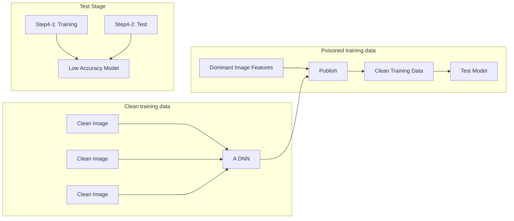
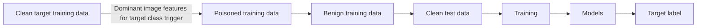
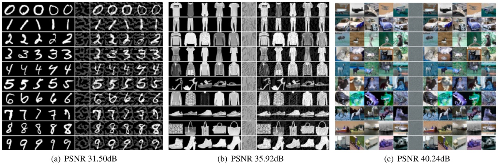
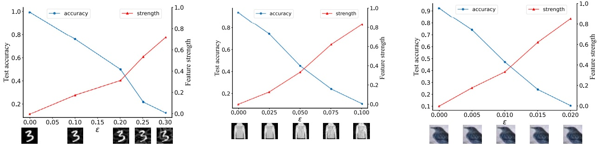

# Clean-label poisoning attack con perturbation causante de dominant features ✩

Chen Zhang a,b, Zhuo Tang b,∗, Kenli Li b

a College of Computer Science and Technology, China University of Petroleum (East China), Qingdao, China

b College of Computer Science and Electronic Engineering, Hunan University, Changsha, China

## INFORMACIÓN DEL ARTÍCULO

Palabras clave:

Poisoning attack

Clean-label

Unlearnable examples

Backdoor attack

Image features

## R E S U M E N

Numerosos estudios han demostrado que los modelos de deep learning son sensibles a los ataques mediante adversarial examples. Sin embargo, debido a la alta exigencia computacional y a la limitada capacidad de explicación de las deep neural networks (DNNs), la investigación sobre poisoning attacks contra modelos profundos es insuficiente. En este trabajo, considerando la interpretación de que las DNNs son feature extractors, proponemos un clean-label poisoning attack contra DNNs mediante dominant image features añadidas a los datos originales. Cada categoría de datos limpios se aumenta con perturbaciones imperceptibles que denominamos “dominant image features” de otra categoría. Las dominant image features determinan a qué clase pertenece la entrada, mientras que la entrada limpia se comporta como ruido. Las DNNs bien entrenadas con estos datos envenenados obtendrán una accuracy extremadamente baja en datos de prueba limpios. El ataque puede hacer que los datos personales sean unlearnable para las DNNs, lo que preserva la privacidad individual. Además, nuestro data poisoning attack puede expandirse a un potente clean-label backdoor attack debido a que las muestras envenenadas y sus etiquetas resultan consistentes para los seres humanos. Los resultados experimentales muestran que nuestro ataque propuesto puede superar a los poisoning attacks avanzados previos, lo que demuestra la efectividad de nuestro ataque presentado. Adicionalmente, nuestro trabajo proporciona una nueva perspectiva sobre la interpretación de las DNNs como feature extractors.

## 1. Introducción

Aunque los modelos de deep learning han ganado una adopción generalizada en diversas tareas [28,29], son vulnerables a los ataques adversarios [27]. Los ataques pueden dividirse en ataques de evasión (evasion attacks) y data poisoning attacks considerando el momento en el que se produce el ataque [42]. Los ataques de evasión o adversarial examples, que pueden inducir rápidamente a modelos profundos bien entrenados a generar predicciones inexactas en el momento de la decisión, han sido ampliamente investigados junto con sus métodos de defensa [5,27]. Hasta la fecha, muchos poisoning attacks se han aplicado con éxito a modelos tradicionales de machine learning, tales como support vector machine [4] y modelos de regresión [21]. En el mundo real, la mayoría de las empresas indica que el data poisoning representa una amenaza mayor que otros ataques adversarios [25].

Sin embargo, no se han realizado estudios a gran escala para investigar los poisoning attacks contra deep neural networks (DNNs). Una de las razones es que los métodos tradicionales de bi-level optimization son demasiado costosos computacionalmente y complejos cuando se aplican a

✩ Este trabajo cuenta con el apoyo de la National Natural Science Foundation of China (Subvenciones n.º 62225205, 92055213, 61873090), el National Key Research and Development Program of China (2021ZD40303, 2018YFB1701400), la Natural Science Foundation of Hunan Province of China (2021JJ10023) y el proyecto del plan de investigación y desarrollo de áreas clave de la provincia de Guangdong (Subvención n.º 2020B0101100001).

\* Autor de correspondencia.

Direcciones de correo electrónico: [zhangchen2@hnu.edu.cn](mailto:zhangchen2@hnu.edu.cn) (C. Zhang), [ztang@hnu.edu.cn](mailto:ztang@hnu.edu.cn) (Z. Tang), [lkl@hnu.edu.cn](mailto:lkl@hnu.edu.cn) (K. Li).

[https://doi.org/10.1016/j.ins.2023.03.124](https://doi.org/10.1016/j.ins.2023.03.124)

Recibido el 20 de octubre de 2022; Recibido en versión revisada el 9 de marzo de 2023; Aceptado el 19 de marzo de 2023

Disponible en línea el 22 de marzo de 2023

0020-0255/© 2023 Publicado por Elsevier Inc.

DNNs. Otra razón es que el mecanismo de funcionamiento de las DNNs no se comprende en su totalidad. Intentos recientes, tales como las influence functions [8,23], el label flipping [48] y los backdoor attacks [35], orientados a ejecutar ataques significativamente más potentes, prestan escasa atención a restringir las modificaciones, lo que a menudo da como resultado imágenes envenenadas y visiblemente corrompidas con perturbaciones significativas. Al mismo tiempo, estas entradas envenenadas pueden ser detectadas fácilmente mediante métodos de detección de anomalías [34].

A diferencia del trabajo previo centrado en reducir el rendimiento sobre datos de prueba limpios sin restringir la magnitud de las perturbaciones de las imágenes ni reducir la cantidad de muestras envenenadas, proponemos un verdadero clean-label poisoning attack sobre la totalidad de las imágenes de entrenamiento. En la práctica, controlar la totalidad de los datos de entrenamiento es un escenario realista; por ejemplo, si una empresa suministra ciertos datos internos a otra organización cuando requiere servicios de modelado de datos, pero, para proteger la privacidad, la empresa no desea que estos modelos basados en dichos datos sean efectivos para datos de prueba reales; esto podría lograrse utilizando tales datos envenenados antes de que los datos hayan sido publicados.

Un ataque también puede ser una defensa. Nuestro ataque asimismo puede ser utilizado para la protección de la privacidad personal. Considérese el caso de las imágenes faciales individuales, uno de los escenarios más significativos del mundo real. Numerosas fotografías faciales son fáciles de obtener de sitios de redes sociales. Los atacantes pueden entrenar sistemas de reconocimiento o verificación facial con estas imágenes faciales para vulnerar la privacidad personal. Luego, los atacantes pueden reconocer la identidad de una persona mediante una imagen facial capturada por una cámara en algún lugar. En consecuencia, los usuarios esperan que las DNNs entrenadas sobre las imágenes faciales públicas no puedan reconocer sus fotos tomadas con una cámara. Dedicamos nuestro trabajo a superar esta preocupación. Podríamos "envenenar" las imágenes faciales de entrenamiento para degradar el rendimiento de las DNNs sobre los datos de prueba, manteniendo a la vez la calidad de las imágenes originales.

En ataques recientes se ha asumido que los atacantes tienen acceso a todos los datos de entrenamiento utilizados por la víctima [10,37]. Los autores se concentraron en la publicación segura de datos (secure data release); Feng et al. [9] denominaron a sus entradas envenenadas como training time adversarial data, mientras que Huang et al. [18] las llamaron unlearnable examples. Estos ataques se han convertido en una vía prometedora para proteger los datos de usuario divulgados públicamente y han servido de inspiración para nuestro trabajo.

Específicamente, para garantizar que los datos envenenados sean verdaderos clean-label, las perturbaciones deben ser razonablemente invisibles; es decir, una imagen envenenada y su imagen original pertenecen a la misma categoría desde la perspectiva humana. Además, las imágenes envenenadas deben lucir naturales y estar etiquetadas con precisión, superando la inspección humana. Por otra parte, nuestro objetivo es confundir al máximo a las DNNs que estén bien entrenadas sobre estos datos envenenados al predecir imágenes de prueba limpias.

A partir de la motivación anterior, se ha considerado la explicación de que las DNNs son feature extractors [15]. Desde este punto de vista, Ilyas et al. [20] ilustraron que la existencia de adversarial examples se debe a la presencia de características no robustas (non-robust features) en los datos de entrenamiento. Zhang et al. [46] propusieron que las perturbaciones universales que poseen strong features pueden engañar a las DNNs analizando la influencia mutua entre las imágenes y las perturbaciones. Inspirados por este trabajo, presentamos un clean-label poisoning attack contra DNNs mediante dominant image features añadidas a las imágenes originales.

En este trabajo, nos centramos en los ataques a DNNs para tareas de clasificación de imágenes. En detalle, en primer lugar, entrenamos una DNN con datos de entrenamiento limpios; resulta mejor si son las víctimas quienes preparan los modelos de entrenamiento. En segundo lugar, basándonos en esta DNN, buscamos perturbaciones imperceptibles para añadirlas a cada categoría de datos limpios. Estas perturbaciones que denominamos “dominant image features” desempeñan un papel decisivo en la emisión de la etiqueta de otra categoría al ser introducidas en la DNN. Aunque la magnitud numérica de las imágenes originales es mayor que la de las perturbaciones añadidas a ellas, estas se comportan como ruido frente a las dominant image features, lo que conduce a una baja accuracy en datos de prueba limpios en DNNs bien entrenadas con datos envenenados. En este contexto, el ruido significa que, debido a la robustez de los modelos de redes neuronales, la salida del modelo permanece inalterada al añadir ruido gaussiano a la entrada.

De manera similar, debido a las características prominentes de cada clase de datos envenenados, las DNNs distinguirán fácilmente cada categoría para obtener una mayor training accuracy que aquellas entrenadas con datos limpios. Además, nuestro data poisoning attack puede expandirse a un backdoor attack más potente si los atacantes pueden acceder a las entradas durante la inferencia. Las dominant image features también pueden utilizarse como triggers para introducirse en las imágenes de prueba, desempeñando un papel decisivo en las etiquetas de salida del modelo. Nuestras contribuciones principales se resumen de la siguiente manera:

• Proponemos un clean-label poisoning attack contra DNNs. Las perturbaciones de los datos envenenados generados por nuestro ataque son imperceptibles pero constituyen dominant image features, lo que garantiza que estos datos envenenados sean difíciles de detectar al tiempo que reducen significativamente la accuracy de las DNNs entrenadas con datos envenenados cuando se evalúan sobre datos limpios.
• Podemos expandir nuestro data poisoning attack a un potente backdoor attack en el que las muestras envenenadas y sus etiquetas resultan legítimas para los seres humanos.
• Los resultados experimentales muestran que los modelos envenenados, es decir, DNNs bien entrenadas con nuestros datos envenenados, obtienen una mayor training accuracy que aquellos entrenados con datos de entrenamiento limpios y una test accuracy extremadamente baja en datos de prueba limpios, lo que demuestra que nuestras perturbaciones imperceptibles poseen dominant features que son fáciles de clasificar, mientras que las imágenes limpias se comportan como ruido para los modelos envenenados. Nuestro ataque supera a los poisoning attacks avanzados anteriores en términos de rendimiento. Nuestro trabajo verifica desde una nueva perspectiva la interpretación que concibe a las DNNs como feature extractors.

Estructuramos este artículo como sigue. Los trabajos relacionados sobre poisoning attacks se presentan en la Sección 2. Nuestro ataque se describe detalladamente en la Sección 3, donde se diferencian de forma específica el proceso de nuestro ataque y las dominant image features en nuestro método. Llevamos a cabo experimentos para demostrar la efectividad de nuestro poisoning attack en la Sección 4. Las conclusiones se presentan en la Sección 5.

## 2. Trabajos relacionados

En esta sección, en primer lugar, resumimos los trabajos previos clasificándolos en dos categorías: (1) poisoning attacks y (2) backdoor attacks. En segundo lugar, identificamos las limitaciones de las investigaciones anteriores en estas áreas y enfatizamos la novedad y la relevancia de nuestro ataque.

## 2.1. Poisoning attacks

Estos ataques modifican los datos o etiquetas de entrenamiento sin acceder a las muestras de prueba tras el entrenamiento de los modelos. Pueden dividirse brevemente en las siguientes categorías en función de sus metodologías.

**Feature Collision Attacks,** los cuales son data poisoning attacks dirigidos (targeted), hacen que una imagen objetivo sea clasificada erróneamente en la categoría base al perturbar los datos de entrenamiento. El ataque básico minimiza la distancia entre las imágenes envenenadas y el ejemplo objetivo en el espacio de características, limitando al mismo tiempo la magnitud de las perturbaciones [36]. Guo y Liu [13] mejoraron el método básico agregando dos restricciones adicionales que exigen que las imágenes envenenadas y limpias tengan las mismas etiquetas mientras se encuentran alejadas en el espacio de características. Otra variante de los feature collision attacks consiste en desplazar los vectores de características de las imágenes envenenadas en el espacio de características para encerrar el vector de características del objetivo [1]. Estas variantes poseen una mayor confiabilidad de ataque debido a que todo el espacio que contiene el punto objetivo pertenece a la misma clase base. Aunque este tipo de ataques favorece el rendimiento clean-label como resultado de restringir la magnitud de las perturbaciones, únicamente inducen a que una pequeña fracción de los ejemplos objetivo se clasifique erróneamente en la clase base, resultando menos eficientes.

**Bilevel Optimization.** Un poisoning attack básico puede transformarse en un problema de optimización binivel (bilevel optimization) que busca un dato envenenado con perturbaciones mínimas para lograr que el modelo bien entrenado, cuyos parámetros se obtienen minimizando la loss function sobre los datos envenenados, emita la etiqueta objetivo cuando se le presenta una imagen de prueba limpia. Estos ataques funcionan adecuadamente en modelos tradicionales de machine learning, tales como SVM [4] y modelos de regresión [21], debido a que el problema de optimización binivel puede resolverse utilizando las condiciones KKT. Sin embargo, la optimización binivel en DNNs es más complicada debido a la no convexidad de las DNNs. Muñoz-González et al. [32] intentaron utilizar varios pasos de gradient descent para aproximar la solución del problema de optimización binivel. No obstante, este enfoque, que los autores denominaron “back-gradient descent”, solo involucra una red unílaminar y es ineficiente debido a que un paso genera un único ejemplo envenenado. Huang et al. [19] propusieron MetaPoison, un método mejorado de back-gradient descent, y lo aplicaron a arquitecturas de red y procesos de entrenamiento realistas. El rendimiento de MetaPoison es significativamente superior al de métodos anteriores, pero ejecutar MetaPoison en múltiples GPUs puede resultar costoso. En resumen, resolver el problema de optimización binivel conlleva un alto costo computacional; la forma de acelerar el data poisoning para el entrenamiento a escala industrial continúa siendo un problema abierto.

**Label Flipping Attacks** son otro tipo de poisoning attack que modifica las etiquetas de entrenamiento en lugar de alterar los datos de entrenamiento. En [3] se utilizaron inversiones de etiquetas (label flips) aleatorias y adversarias para envenenar SVM. Zhao et al. [49] propusieron un método de projected gradient ascent para label flipping capaz de envenenar modelos lineales de caja negra, tales como regresión logística, SVM y LS-SVM. Zhang y Zhu [48] emplearon teoría de juegos para formular un análisis teórico de los label flipping attacks en SVM. Aunque se ha demostrado teórica y empíricamente que los label flipping attacks son efectivos y poseen la ventaja de no modificar los datos de entrenamiento, no son “clean-label”, por lo que los pares envenenados de datos y etiquetas pueden ser percibidos con facilidad por supervisores humanos. Asimismo, se han propuesto numerosos métodos de defensa, tanto teóricos como empíricos, para contrarrestar los label flipping attacks [34].

**Influence Functions** evalúan la influencia de pequeñas alteraciones en los datos de entrenamiento sobre los parámetros del modelo generados mediante el entrenamiento, lo cual puede aprovecharse para elaborar ejemplos envenenados. Koh et al. [23] mejoraron su trabajo para obtener poisoning attacks más fuertes acelerando la optimización binivel. En aplicaciones prácticas, Fang et al. [8] emplearon influence functions para implementar data poisoning attacks contra sistemas de recomendación. Aunque las influence functions se han aplicado exitosamente para llevar a cabo data poisoning attacks en modelos tradicionales de machine learning, resultan menos aplicables para capturar la dependencia de datos en DNNs, las cuales son altamente no convexas [2].

**Unlearnable Examples.** Estos ataques manipulan todo el conjunto de entrenamiento, ocasionando una deficiente generalización de las DNNs entrenadas con datos envenenados. Presentamos nuestro trabajo también dentro de esta configuración. Feng et al. [9] generaron training time adversarial examples (datos envenenados) con autoencoders. Aunque su ataque es eficaz en conjuntos de datos de juguete (toy datasets), no funciona adecuadamente en conjuntos de datos a gran escala debido a la complejidad. Shen et al. [37] propusieron TensorClog, un método de unlearnable examples desde la perspectiva de hacer que el gradiente de entrenamiento del modelo de deep neural network desaparezca. Huang et al. [18] propusieron un proceso de optimización binivel para generar perturbaciones para unlearnable examples, mientras que Fowl et al. [10] elaboraron perturbaciones manipulando el gradiente de una red. Para abordar la vulnerabilidad de los unlearnable examples frente al adversarial training, Fu et al. [11] presentaron robust unlearnable examples que pueden evitar que los datos sean aprendidos durante el adversarial training. Yu et al. [44] propusieron emplear atajos sintéticos (synthetic shortcuts) para generar unlearnable examples, basándose en el hecho de que los unlearnable examples son (casi) linealmente separables. Adoptamos estos enfoques como comparaciones de baseline frente a nuestro método.

## 2.2. Backdoor attacks

Los backdoor attacks, también conocidos como ataques troyanos (Trojan attacks), permiten a los atacantes alterar las imágenes de entrada durante el tiempo de prueba. En consecuencia, estos ataques son más potentes. Pueden dividirse brevemente en las siguientes categorías según sus metodologías.

**Basic Backdoor Attacks.** La idea básica de los ataques troyanos consiste en que, dada una entrada de prueba con un backdoor trigger, las DNNs bien entrenadas con datos envenenados emitirán una etiqueta determinada. El trigger puede ser un pequeño parche o alguna característica minúscula local. Para asegurar que estos ataques no sean detectados cuando los modelos envenenados se configuran en la práctica, los modelos operan normalmente sin triggers. En [12], los autores formularon por primera vez backdoor attacks exitosos contra DNNs inyectando ejemplos envenenados mal etiquetados en los datos de entrenamiento. Durante el entrenamiento, las DNNs clasifican fácilmente estas imágenes envenenadas al aprender la característica del backdoor trigger. En el mundo físico, los autores de [43] emplearon backdoor attacks para engañar sistemas de reconocimiento facial. La desventaja evidente de estos backdoor attacks radica en que los observadores humanos pueden descubrir fácilmente el trigger añadido a los ejemplos de prueba.

**Clean-Label Backdoor Attacks.** Una forma sencilla de realizar backdoor attacks consiste en envenenar datos agregando triggers sobre imágenes y asignándoles una etiqueta objetivo incorrecta. De este modo, los ejemplos envenenados pueden detectarse fácilmente mediante inspección humana. Recientemente, en [41] y [35], los autores llevaron a cabo clean-label backdoor attacks, en los cuales las etiquetas de las muestras envenenadas se diseñaron para ser semánticamente verdaderas. Zhao et al. [50] presentaron clean-label backdoor attacks en reconocimiento de video utilizando triggers universales adversarios de backdoor. Aunque su proceso de generación de triggers es similar al nuestro manteniendo etiquetas limpias, el trigger es fácil de reconocer para los humanos. Los modelos de Turner et al. [41] utilizaron redes generativas adversarias (GANs) y adversarial examples, mientras que Saha et al. [35] adaptaron el marco de colisión de características mencionado en la Sección 2.1 para generar ejemplos envenenados de backdoor. Si bien estos ataques son clean-label attacks, el ataque de Saha solo es aplicable a modelos de transferencia, mientras que el de Turner requiere entrenar una GAN o un surrogate model, los cuales suelen ser computacionalmente costosos debido a su complejidad.

Aunque las investigaciones previas sobre backdoor attacks han demostrado su notable potencial y éxito, intervenir durante el tiempo de inferencia del modelo sigue siendo un desafío en la realidad.

## 2.3. Nuestro poisoning attack

Desarrollamos nuestro poisoning attack basándonos en la premisa de que la etiqueta predicha resulta altamente predecible a partir de características fuertes (strong features) presentes en una imagen. En consecuencia, podemos diseñar dominant image features que se añaden a los datos de entrenamiento para envenenar las DNNs. Las dominant image features diseñadas por nosotros son imperceptibles desde la perspectiva humana, lo que confiere a nuestro ataque la condición de clean-label. Por otra parte, al evitar la resolución de problemas de optimización binivel, las imágenes envenenadas pueden generarse de manera más eficiente. Además, nuestro data poisoning attack puede expandirse a un potente backdoor attack. Consideramos las dominant image features como un trigger para introducir muestras objetivo garantizando la propiedad clean-label. La efectividad de nuestro ataque también explica las DNNs como feature extractors desde una nueva perspectiva, lo cual reviste gran relevancia para el estudio de la causalidad teórica en deep learning.

## 3. Nuestro ataque propuesto

Formulamos formalmente el data poisoning attack contra DNNs y proponemos nuestro proceso de ataque detalladamente.

## 3.1. Formalización del ataque

Tomando como base el objetivo de degradar el rendimiento sobre datos de prueba limpios mediante la adición de perturbaciones imperceptibles a las imágenes de entrenamiento y los unlearnable examples introducidos en la Sección $^ { 2 , }$ nuestro ataque puede formalizarse como sigue.

Consideramos una DNN como un modelo de amenaza que puede denotarse como $f ( { \pmb x } )   =   y$, el cual recibe una entrada $\pmb { x } \in \mathbb { R } ^ { n }$ y produce una etiqueta de salida 𝑦. En este trabajo, nos centramos en el problema de clasificación de imágenes, donde 𝒙 se encuentra en el rango [0, 255]. Un conjunto de datos 𝐷 que contiene $N _ { D }$ puntos de datos se compone del conjunto de entrenamiento $D _ { \mathrm { t r a i n } }$ y del conjunto de prueba $D _ { \mathrm { t e s t } }$, cuyos volúmenes muestrales son $N _ { \mathrm { t r a i n } }$ y $N _ { \mathrm { t e s t } }$, respectivamente. Entonces, nuestra tarea puede formalizarse en el siguiente problema de optimización:

$$
\begin{array}{l} \max _ {r} \frac {1}{N _ {\text {test}}} \sum_ {(\boldsymbol {x}, y) \in D _ {\text {test}}} \mathbb {1} \left\{f _ {\theta^ {*} (\boldsymbol {r})} (\boldsymbol {x}) \neq y \right\}, \\ s. t. \left\{ \begin{array}{l} \theta^ {*} = \arg \min _ {\theta} \sum_ {(\boldsymbol {x}, y) \in D _ {\text {train}}} \left[ \mathcal {L} \left(f _ {\theta} (\boldsymbol {x} + \boldsymbol {r}), y\right) \right], \\ | | \boldsymbol {r} | | _ {p} \leq \epsilon , \\ \boldsymbol {x} + \boldsymbol {r} \in [ 0, 2 5 5 ], \end{array} \right. \tag {1} \\ \end{array}
$$

donde 𝟙{⋅} es una función indicadora tal que, cuando la entrada es verdadera, la salida es 1, y en caso contrario, 0; $\mathcal { L } ( \cdot , \cdot )$ es la cross-entropy loss function para el entrenamiento de DNNs, y 𝒓 es la perturbation cuya norma 𝑝 es menor o igual que 𝜖 añadida a una imagen 𝒙. En este caso, la restricción de perturbation 𝜖 garantiza que la muestra envenenada sea difícil de detectar. Cada combinación de una perturbation respectiva 𝒓 para su imagen original 𝒙 se empareja con una DNN $f _ { \theta ^ { * } ( r ) } ( \cdot )$ entrenada sobre las imágenes envenenadas correspondientes. El problema persigue encontrar cada perturbation mínima 𝒓 para cada muestra 𝒙 de tal forma que la accuracy de la DNN $f _ { \theta ^ { * } ( r ) } ( \cdot )$ sobre imágenes de prueba benignas sea menor que la accuracy de todas las demás DNNs posibles entrenadas sobre diferentes conjuntos de perturbaciones 𝒓 para la misma imagen 𝒙.

Evidentemente, resolver el problema de optimización no convexo antes mencionado resulta sumamente difícil, en particular debido a las restricciones no lineales. Aquí intentamos hallar una solución aproximada al problema de optimización desde la perspectiva de las características. Nuestra idea se fundamenta en la interpretación que considera a las DNNs como feature extractors. En la suma de características fuertes y débiles, las características fuertes continúan predominando. "Fuerte" y "débil" en este contexto denotan el grado de contribución de dicha característica a los resultados de clasificación al sumar dos características suministradas a una DNN. En [46], los autores emplearon el coeficiente de correlación de Pearson para medir la fuerza y debilidad, logrando resultados satisfactorios. Por consiguiente, transformamos la resolución de la perturbation mínima 𝒓 para cada muestra 𝒙 en la resolución de perturbaciones por clase (class-wise perturbations). Cuando las características fuertes de una clase, definidas también como perturbaciones 𝒓 en la Ecuación (1), se añaden a ejemplos benignos de otra clase, las características fuertes siguen dominando la clasificación. Es por ello que denominamos a estas perturbaciones dominant image features.

## 3.2. Procedimiento del ataque

Tal como se ilustra en la Fig. 1, el procedimiento de nuestro data poisoning attack se muestra visualmente. En detalle, el procedimiento del poisoning attack puede formularse de la siguiente manera:

• Paso 1: Entrenar una DNN con datos de entrenamiento limpios. Resulta preferible una DNN que haya sido entrenada por las víctimas. Este modelo nos permite identificar características fuertes.

flowchart

Fig. 1. Esquema de nuestro data poisoning attack.

• Paso 2: Generar dominant image features para cada categoría. Estas características añadidas a otras entradas continúan predominando al ser introducidas en las DNNs. Además, dichas características pueden actuar como triggers en backdoor attacks.
• Paso 3: Añadir las dominant image features de una clase a los datos benignos de otra clase. Asegurarse de que todas las clases hayan recibido la adición de las dominant image features de otra clase.
• Paso 4: Entrenar DNNs con datos envenenados y evaluarlas sobre datos de prueba limpios.

A continuación se presenta la descripción detallada de cada paso.

## 3.2.1. Entrenamiento limpio / envenenado (Clean / poisoned training)

Por lo general, el proceso de entrenamiento de redes neuronales puede transformarse en la resolución de un problema de optimización. Así, los pesos de una DNN pueden actualizarse minimizando la función objetivo mediante métodos de batch gradient descent y back-propagation. En tareas de clasificación, la cross-entropy loss es la más comúnmente utilizada para calcular la disimilitud entre las etiquetas de ground truth y las predicciones emitidas:

$$
\mathcal {L} = - \frac {1}{N _ {\text {batch}}} \sum_ {(\boldsymbol {x}, \boldsymbol {y}) \in D _ {\text {train}} \text {or} D _ {\text {poisoned}}} \boldsymbol {y} ^ {T} \log (f (\boldsymbol {x})). \tag {2}
$$

Para asegurar el éxito de nuestro ataque, entrenamos las DNNs sobre datos envenenados. A diferencia de los trabajos anteriores enfocados en reducir el número de muestras envenenadas, nosotros envenenamos todo el conjunto de entrenamiento para lograr perturbaciones mínimas. Aunque los procesos de entrenamiento sobre datos limpios y envenenados son idénticos, los rendimientos de sus respectivas DNNs son notablemente diferentes. Evaluamos la efectividad del envenenamiento comparando la accuracy de DNNs con idéntica arquitectura entrenadas sobre datos limpios o envenenados.

## 3.2.2. Generación de dominant image features

El ataque comienza con el diseño de las dominant image features que habrán de añadirse a las imágenes benignas. A diferencia de los poisoning attacks generales que solo permiten modificar unas pocas muestras de entrenamiento, a cada imagen de los datos de entrenamiento se le asigna un tipo de dominant image features suficientemente reducidas para gozar de un sigilo adecuado desde la perspectiva humana. Inspirados por [46], asumimos que si logramos encontrar un tipo de perturbaciones dominantes respecto a otra clase para los puntos de datos de una clase dada, las imágenes limpias procedentes de los datos de prueba serán clasificadas erróneamente con alta probabilidad por DNNs bien entrenadas con datos envenenados, debido a que las DNNs tienden en mayor medida a aprender características fuertes —de las cuales carecen los datos limpios— para clasificar. En esencia, las dominant image features son independientes de las imágenes limpias, cuyas características quedan destruidas hasta resultar irreconocibles para las DNNs.

Con este propósito, para ciertos datos dados y una DNN $f ( { \pmb x } )$ que ha sido bien entrenada sobre muestras de entrenamiento limpias, la generación de dominant image features para una etiqueta objetivo puede satisfacer la siguiente ecuación:

$$
\begin{array}{l} f (\boldsymbol {x} + \boldsymbol {r}) = t, \text {for} (\boldsymbol {x}, y) \in D, \\ \text {s.t.} | | \boldsymbol {r} | | _ {p} \leq \epsilon , \\ \end{array}
$$

donde 𝒓 denota las dominant image features o perturbaciones cuya norma $p$ está restringida por 𝜖 para resultar imperceptibles desde la perspectiva humana, 𝑡 es la etiqueta objetivo que deseamos que emita $f ( { \pmb x } + { \pmb r } )$, e 𝑦 es la etiqueta original de la imagen 𝒙. Nótese que la etiqueta de 𝒙 puede ser arbitraria. Esto asegura que, con independencia de cuál sea la categoría de la imagen original, las perturbaciones resultarán dominantes. Al mismo tiempo, estas dominant image features pueden ser aprendidas con facilidad por las DNNs, cuya training accuracy, por consiguiente, es excepcionalmente elevada. Sin embargo, el rendimiento de estas DNNs colapsará sobre datos de prueba benignos que carecen de dominant image features y se comportan como ruido frente a los modelos.

Algoritmo 1 Generación de dominant image features.

Input: Training data $D_{\text{train}}$, test data $D_{\text{test}}$, a well-trained DNN model $f$ on clean training data, objective function $\mathcal{L}_t$, the maximum number of iterations $I$, perturbation magnitude $\epsilon$, features strength ratio threshold $\delta$, batch size $b$.
Output: Dominant image features $r$ for target label $t$.
Initialize $r \leftarrow 0$,
Initialize $iteration = 1$, $\text{sth}(\boldsymbol{r}) = 0$.
while $iteration \leq I$ and $\text{sth}(\boldsymbol{r}) \leq \delta$ do
    Sample randomly: $\boldsymbol{x}_B \subset D_{\text{train}}$: $|\boldsymbol{x}_B| = b$
    Calculate gradient $g_r = \mathbb{E}_{\boldsymbol{x} \in \boldsymbol{x}_B} \left[ \nabla_r \mathcal{L}_I \right]$
    Update $r \leftarrow \text{Optimize}(g_r)$
    Project norm $r \leftarrow \frac{\boldsymbol{r}}{||\boldsymbol{r}||_p} \epsilon$
    Calculate $\text{sth}(\boldsymbol{r}) = \frac{1}{N_{\text{test}}} \sum_{(x,y) \in D_{\text{test}}} \mathbb{1} \{ f(\boldsymbol{x} + \boldsymbol{r}) = t \}$
    Increase count $iteration \leftarrow iteration + 1$
Return $r$.

Esta optimización se asemeja a un problema de universal adversarial perturbation. Sin embargo, los trabajos previos se concentran en la perspectiva de desplazar los puntos de datos hacia los límites de decisión [31]. Por tanto, nos enfocamos en el escenario de dominant image features que sean robustas frente al efecto de las entradas. De manera similar a [46], podemos emplear el algoritmo PGD para resolver este problema de optimización.

Para cumplir con el objetivo requerido en la Ecuación (3), resolvemos alternativamente el siguiente problema:

$$
\mathcal {L} _ {t} = \max \left(\max _ {c \neq t} Z _ {c} (\boldsymbol {x} + \boldsymbol {r}) - Z _ {t} (\boldsymbol {x} + \boldsymbol {r}), - \kappa\right) \tag {4}
$$

donde $Z _ { c }$ indica la componente del vector de salida previa a la capa softmax y el subíndice representa la 𝑐-ésima componente de los logits, 𝜅 promueve el nivel de confianza, y 𝒙 son ejemplos provenientes de los datos de entrenamiento originales. Al minimizar la loss function, el logit objetivo se incrementará, y simultáneamente $\operatorname* { m a x } _ { c \neq t } Z _ { c } ( { \pmb x }   +   { \pmb r } )$ disminuirá. Sin embargo, las actualizaciones del gradiente se verán afectadas debido a que todas las demás categorías, excepto la categoría objetivo, participan en la optimización, lo que podría perjudicar la generación de dominant image features para la clase objetivo. Por consiguiente, tomamos el valor del logit de la categoría objetivo en el proceso de optimización, mientras que los demás se emplean para acotamiento (clamping) a modo de referencia.

El algoritmo simple pero efectivo para generar dominant image features se resume en el Algoritmo 1. Se adoptan el método Adam [22] y el entrenamiento por lotes (batch training) para minimizar la loss function. Puesto que las dominant image features son universales, muestreamos aleatoriamente algunas imágenes en lugar de entrenar con todos los datos, con el fin de mejorar la eficiencia del algoritmo. Considerando que algunas imágenes limpias pueden ser más robustas que nuestras perturbaciones, las dominant image features fallarían sobre dichas imágenes. Establecemos un umbral de "strength ratio" de características 𝛿 de forma que el algoritmo termine cuando la proporción de fuerza de nuestras imágenes dominantes para la etiqueta objetivo supere dicho umbral. Esto también resulta útil para incrementar la eficiencia del algoritmo. Por lo general, calcular las tasas de características sobre el conjunto de prueba es más generalizable debido a que estas no se emplean durante el entrenamiento. En consecuencia, detenemos el algoritmo siempre que

$$
\operatorname{sth} (\boldsymbol {r}) = \frac {1}{N _ {\text {test}}} \sum_ {(\boldsymbol {x}, y) \in D _ {\text {test}}} \mathbb {1} \left\{f (\boldsymbol {x} + \boldsymbol {r}) = t \right\} \geq \delta . \tag {5}
$$

## 3.2.3. Generación de poisoning data

Para lograr el objetivo de confundir al máximo cualquier DNN correspondiente entrenada sobre los datos envenenados al suministrarle datos de prueba limpios, los datos envenenados deben reunir las siguientes propiedades.

• En primer lugar, las imágenes de la misma categoría en los datos envenenados deben presentar características similares.
• En segundo lugar, la diferencia de características entre distintas clases debe ser lo suficientemente apreciable para que las DNNs puedan aprender con facilidad el límite de decisión.
• En tercer lugar, las imágenes de la misma categoría en los datos envenenados y en los benignos deben ser reconocidas como diferentes por las DNNs envenenadas.

Una vez obtenidas las dominant image features para cada clase, los datos envenenados pueden conseguirse de manera simple. Para cada categoría, existe un tipo de dominant image feature correspondiente a otra categoría objetivo para añadir. Entonces, los datos envenenados $x _ { p }$ pueden generarse como:

$$
\begin{array}{l} \boldsymbol {x} _ {p} = \boldsymbol {x} _ {c} + \boldsymbol {r} _ {t}, \\ \forall c, t \in \{Y \}, c \neq t, \tag {6} \\ \boldsymbol {x} _ {c} \in D _ {\text {train}}, \\ \end{array}
$$

donde $r _ { t }$ es un tipo de dominant image features para la clase 𝑡, e {𝑌} denota el conjunto de etiquetas. De este modo, las imágenes de una misma categoría poseen las mismas dominant image features, pudiendo ser clasificadas fácilmente en una clase, mientras que los datos de prueba limpios se comportan como ruido frente a los datos envenenados. No obstante, para una tarea de clasificación con 𝐾 categorías, nuestro ataque requiere generar 𝐾 dominant image features para cada clase, por lo que nuestro ataque sería menos eficiente si 𝐾 es grande en aplicaciones reales.

flowchart

Fig. 2. Esquema de nuestro backdoor attack. Tomando la clase "plane" como clase objetivo.

## 3.3. Extensión a un backdoor attack

Dado que asignamos un tipo de dominant image features a una categoría en los datos de entrenamiento, lo que equivale a una inyección de backdoor, estas características pueden emplearse como triggers para backdoor attacks. Como se ilustra en la Fig. 2, entrenar una DNN con datos benignos junto con datos envenenados —que son parte de las imágenes objetivo a las que se les han añadido dominant image features de la clase objetivo— situará al modelo de amenaza bajo un backdoor attack. Si bien obtenemos la dominant image feature mediante 𝑓(𝒙 + 𝒓) = 𝑡 (Ecuación (3)), donde 𝒓 actúa como un trigger, tales dominant image features no se transfieren a otras DNNs. Por ello, envenenamos una fracción de las muestras de entrenamiento de la clase objetivo con un backdoor trigger para establecer un vínculo entre el trigger y la etiqueta objetivo. Entretanto, dado que las dominant image features contenidas en la imagen son visualmente imperceptibles y las muestras envenenadas junto con sus etiquetas son consistentes para los seres humanos, el backdoor attack constituye un clean-label attack.

## 4. Experimentos

En esta sección, validamos la efectividad de nuestro ataque describiendo el conjunto de datos, la metodología, la evaluación y los resultados experimentales correspondientes.

## 4.1. Datasets

En los experimentos se utilizan los siguientes conjuntos de datos.

**MNIST.** MNIST es el conjunto de datos reducido más utilizado en deep learning; contiene imágenes de dígitos manuscritos del 0 al 9.

**Fashion-MNIST.** Fashion-MNIST es un conjunto de datos de imágenes que reemplaza a MNIST. El tamaño, formato y partición de los conjuntos de entrenamiento y prueba de este dataset son idénticos a los del MNIST original. Incluye 70 000 imágenes positivas (60 000/10 000 para entrenamiento/prueba) de diferentes productos clasificados en 10 categorías.

**CIFAR-10.** CIFAR-10 es un dataset utilizado para el reconocimiento de objetos genéricos. Contiene 10 categorías de imágenes en color RGB. El tamaño de cada imagen es de $3 2 \times 3 2 _ { ; }$ , y el dataset dispone de un total de 50 000 imágenes de entrenamiento y 10 000 imágenes de prueba.

**ImageNet-100.** ImageNet es una base de datos visual de gran escala para el estudio del reconocimiento de objetos visuales. Comprende más de 1 millón de imágenes pertenecientes a 1 000 clases diversas. Por razones de eficiencia computacional, utilizamos las primeras 100 clases (ImageNet-100) como nuestro dataset.

En la Fig. 3 se muestran ejemplos aleatorios de cada categoría junto con sus correspondientes dominant image features e imágenes envenenadas. Existen diversas opciones para seleccionar dominant image features para las categorías. Aquí seleccionamos aleatoriamente una de ellas garantizando la Ecuación (6).

Fig. 3. Imágenes de entrenamiento originales y sus correspondientes dominant image features (perturbaciones) e imágenes envenenadas de los datasets MNIST, Fashion-MNIST y CIFAR-10.

Tabla 1 Rendimiento según la función de optimización en CIFAR-10.

| Target class | airplane | automobile | bird | cat | deer | dog | frog | horse | ship | truck |
| --- | --- | --- | --- | --- | --- | --- | --- | --- | --- | --- | --- |
| sth(r) | 0.76 | 0.72 | 0.67 | 0.68 | 0.62 | 0.65 | 0.54 | 0.60 | 0.75 | 0.75 |

## 4.2. Modelos y despliegue

Para la obtención de las dominant image features, entrenamos en primer lugar redes LeNet sobre MNIST (Fashion-MNIST) limpios y redes DenseNet [17] sobre los datasets CIFAR-10 e ImageNet-100. Posteriormente, para evaluar el rendimiento de nuestro ataque, entrenamos diversos clasificadores bajo una configuración más realista. Para el dataset simple MNIST, entrenamos SVM, regresión logística (LR), random forest (RF) y LeNet sobre imágenes envenenadas; para Fashion-MNIST, entrenamos varias redes neuronales poco profundas (shallow neural networks), mientras que para los datasets CIFAR-10 e ImageNet-100 entrenamos VGG [38], GoogLeNet [39], ResNet [14], RegNet [33], DenseNet [17] y DPN [6]. Empleamos el optimizador Stochastic Gradient Descent (SGD) con un coeficiente de momentum de 0.9 para todos los experimentos y utilizamos batch sizes de 64 y 32 para CIFAR-10 e ImageNet-100, respectivamente. El learning rate para los modelos ResNet, DenseNet y RegNetX es de 0.1. El learning rate para los modelos VGG, GoogLeNet y DPN es de 0.01. Entrenamos todos los modelos durante 200 epochs. El learning rate se reduce en un factor de 10 en las epochs 100 y 150. Sin pérdida de generalidad, en nuestros experimentos se emplean las diversas arquitecturas de red antes mencionadas con diferente número de capas.

## 4.3. Evaluación del rendimiento

**Métrica.** Utilizamos la test accuracy para evaluar la capacidad y efectividad de ataque de los métodos analizados. Una test accuracy más próxima a la conjetura aleatoria (random guessing) sugiere que el modelo adquirió un conocimiento insignificante a partir de los datos de entrenamiento, lo cual evidencia una alta efectividad del ataque.

**Rendimiento del ataque.** Conforme a la configuración descrita anteriormente, entrenamos los clasificadores correspondientes con restricciones de perturbation 𝜖 establecidas en 0.3, 0.1, 0.05 y 0.02 (cuando el espacio de valores de la entrada 𝒙 es [0, 1]) bajo la norma 𝑝 = ∞ para MNIST, Fashion-MNIST, CIFAR-10 e ImageNet-100, respectivamente. El umbral de feature strength ratio 𝛿 se fija en 0.75 para todos los datasets, y los batch sizes se establecen en 128, 128, 64 y 32 para los cuatro conjuntos de datos, respectivamente. Los resultados de clasificación se sintetizan en las Tablas 2, 3 y 4. Las perturbaciones de los datasets MNIST, Fashion-MNIST y CIFAR-10 pueden observarse en la parte central de cada imagen en la Fig. 3. Entre ellos, para MNIST, entrenamos un Random Forest estándar con 1 000 árboles y un Kernel-SVM que emplea RBF con un coeficiente de kernel igual a 0.01; para Fashion-MNIST, entrenamos varias CNNs superficiales con distintas capas convolucionales y fully connected.

Para los datasets MNIST y Fashion-MNIST, muestreamos aleatoriamente 500 imágenes (50 imágenes por clase) para optimizar la función objetivo. Para la mayoría de las clases objetivo, el **Algoritmo 1** experimentó una parada temprana debido a que el "strength ratio" sth (𝒓) alcanzó o superó el valor de 0.75. Para el dataset CIFAR-10, muestreamos aleatoriamente 1 000 imágenes (100 imágenes por clase) para la optimización de la función objetivo. El rendimiento respecto a la función de optimización se expone en la Tabla 1. El sth (𝒓) de las clases “airplane”, “ship” y “truck” es igual o mayor a 0.75, mientras que el sth (𝒓) de la clase “frog” es 0.54, lo que indica que la dominant image feature de la clase “frog” resulta más difícil de aprender.

Al ser entrenados sobre datos envenenados, la training accuracy alcanza de manera notable o se aproxima al 100%, mientras que la test accuracy media desciende drásticamente a tan solo 19.91%, 14.18%, 10.64% y 1.80%. Esto demuestra que nuestras dominant image features son sumamente sencillas de aprender. El entrenamiento de un clasificador logra distinguir los diferentes tipos de dominant image features. Sin embargo, para los datos de prueba limpios desprovistos de dominant image features, los clasificadores los procesan exactamente como ruidos, alcanzando apenas una accuracy ligeramente superior a la adivinación aleatoria. La test accuracy se reduce de forma más pronunciada en las DNNs. En el caso del modelo de regresión logística, este resulta ser el menos afectado por los datos envenenados. Esto se debe a que la regresión logística trata cada píxel de forma aislada y desordenada, siendo insensible a las características locales. Estos resultados experimentales aportan evidencia contundente sobre la eficacia del ataque presentado.

Tabla 2 Training y test accuracy cuando los clasificadores se entrenan sobre los datos de entrenamiento limpios originales y sobre los datos envenenados, respectivamente, en MNIST.

<table><tr><td></td><td></td><td>Logistic Regression</td><td>Linear-SVM</td><td>Kernel-SVM</td><td>Random Forest</td><td>LeNet</td><td>Media</td></tr><tr><td rowspan="2">Clean Data</td><td>training</td><td>91.48%</td><td>84.78%</td><td>98.99%</td><td>100%</td><td>99.98%</td><td>95.05%</td></tr><tr><td>test</td><td>91.44%</td><td>84.21%</td><td>97.92%</td><td>97.21%</td><td>99.08%</td><td>93.97%</td></tr><tr><td rowspan="2">Poisoning Data</td><td>training</td><td>100%</td><td>100%</td><td>100%</td><td>100%</td><td>100%</td><td>100%</td></tr><tr><td>test</td><td>41.52%</td><td>25.72%</td><td>9.8%</td><td>9.83%</td><td>12.66%</td><td>19.91%</td></tr></table>

Tabla 3 Training y test accuracy cuando los clasificadores se entrenan sobre los datos de entrenamiento limpios originales y sobre los datos envenenados, respectivamente, en Fashion-MNIST.

<table><tr><td></td><td></td><td>2 Conv</td><td>2Conv + 2 FC</td><td>3 Conv + 2 FC</td><td>2Conv + 3 FC</td><td>VGG16</td><td>Media</td></tr><tr><td rowspan="2">Clean Data</td><td>training</td><td>88.32%</td><td>89.60%</td><td>93.58%</td><td>95.67%</td><td>97.66%</td><td>92.86%</td></tr><tr><td>test</td><td>87.6%</td><td>88.35%</td><td>90.71%</td><td>93.42%</td><td>93.55%</td><td>90.73%</td></tr><tr><td rowspan="2">Poisoning Data</td><td>training</td><td>99.53%</td><td>99.81%</td><td>100%</td><td>100%</td><td>100%</td><td>99.87%</td></tr><tr><td>test</td><td>18.57%</td><td>16.22%</td><td>13.41%</td><td>11.93%</td><td>10.76%</td><td>14.18%</td></tr></table>

Tabla 4 Test accuracy cuando los clasificadores se entrenan sobre los datos de entrenamiento limpios originales y sobre los datos envenenados, respectivamente, en CIFAR-10 e ImageNet-100.

<table><tr><td></td><td>Dataset</td><td>GoogLeNet</td><td>VGG19</td><td>ResNet18</td><td>DenseNet121</td><td>RegNetX200</td><td>DPN92</td><td>Media</td></tr><tr><td rowspan="2">Clean Data</td><td>CIFAR-10</td><td>92.26%</td><td>87.23%</td><td>90.36%</td><td>95.66%</td><td>95.43%</td><td>91.78%</td><td>92.12%</td></tr><tr><td>ImageNet-100</td><td>53.74%</td><td>49.66%</td><td>60.58%</td><td>61.11%</td><td>63.48%</td><td>62.25%</td><td>58.47%</td></tr><tr><td rowspan="2">Poisoning Data</td><td>CIFAR-10</td><td>10.07%</td><td>12.37%</td><td>10.54%</td><td>10.61%</td><td>10.01%</td><td>10.22%</td><td>10.64%</td></tr><tr><td>ImageNet-100</td><td>1.73%</td><td>1.33%</td><td>2.10%</td><td>1.52%</td><td>1.88%</td><td>2.26%</td><td>1.80%</td></tr></table>

Tabla 5 Comparación de diferentes enfoques de envenenamiento. Empleamos la restricción 𝜖 = 0.05 utilizando el mismo modelo RegNet en CIFAR-10.

| Enfoque | Test Accuracy |
| --- | --- |
| Clean (None) | 95.43% |
| Random Noise | 90.16% |
| TensorClog [37] | 82.36% |
| DeepConfuse [9] | 28.54% |
| Unlearnable Examples [18] | 20.75% |
| Alignment [10] | 51.18% |
| Robust unlearnable examples [11] | 15.18% |
| Synthetic Perturbations [44] | 13.54% |
| Ours | 10.54% |

**Comparación con baselines.** Adicionalmente, establecemos una comparación de baseline para nuestro enfoque en CIFAR-10 contrastándolo con el rendimiento de otros enfoques de envenenamiento, manipulación de datos y datos limpios. Comparamos nuestro método con los ataques de disponibilidad existentes que incluyen TensorClog [37], Loss Minimization [18], DeepConfuse [9], un enfoque basado en alineación de gradientes (gradient alignment) [10], Robust unlearnable examples [11] y Synthetic Perturbations [44]. Para asegurar la equidad de la comparación, la única discrepancia entre todos los enfoques radica en que los datos de entrenamiento son envenenados mediante los diferentes ataques. Asimismo, garantizamos que la restricción de perturbation 𝜖 y la proporción de datos envenenados permanezcan idénticas. Para comprobar la influencia de las perturbaciones generadas frente a las no optimizadas sobre la accuracy de agrupamiento, comparamos nuestro enfoque con ruido aditivo aleatorio fijo.

Como se evidencia en la Tabla $^ { 5 , }$ advertimos que nuestro método supera ampliamente a dichos enfoques. En comparación con los poisoning attacks avanzados anteriores, logramos reducir de manera significativa la test accuracy del modelo víctima.

**Sigilo de las perturbaciones (Perturbation Stealthiness).** Como se observa en la Fig. 3, la magnitud de las dominant image features se encuentra restringida a un rango reducido. Existe una discrepancia mínima entre las imágenes envenenadas y las originales desde el punto de vista humano, en especial en imágenes de mayor resolución. Para MNIST, la restricción de perturbation 𝜖 es 0.3; las imágenes envenenadas son detectadas con facilidad bajo inspección humana. Sin embargo, la categoría de cada imagen continúa siendo reconocida fácilmente por las personas, lo que asegura la condición clean-label para cada imagen. Para CIFAR-10, la restricción de perturbation 𝜖 es 0.02, la cual resulta imperceptible para el ojo humano.

Asimismo, adoptamos el PSNR (Peak Signal-to-Noise Ratio) para evaluar cuantitativamente la diferencia entre la imagen limpia y la imagen envenenada. El PSNR constituye el método de medición objetiva más común y ampliamente utilizado para evaluar la calidad visual de las imágenes. Cuanto mayor sea el valor, menor será la distorsión. El PSNR se define como:

$$
\mathrm{PSNR} = 1 0 \cdot \log_ {1 0} \left(\frac {\mathrm{MAX} _ {\mathrm{I}} ^ {2}}{\mathrm{MSE}}\right), \tag {7}
$$

Fig. 4. Efecto de variar 𝜖 en MNIST (izquierda), Fashion-MNIST (centro) y CIFAR-10 (derecha). Las imágenes con la perturbación del tamaño correspondiente también se visualizan sobre el eje x.

bar

| Umbral de strength ratio \(\delta\) | Media de test accuracy (%) |
| --- | --- |
| ~0.35 | ~53 |
| 0.5 | ~36 |
| ~0.65 | ~15 |
| ~0.75 | ~11 |
| ~0.85 | ~11 |
| 1.0 | ~11 |

Fig. 5. Test accuracy en función del umbral de feature strength ratio 𝛿.

donde MSE representa el error cuadrático medio (mean square error) entre la imagen limpia 𝒙 y la imagen envenenada 𝒙′; MAXI es el valor de píxel máximo posible de la imagen. Por lo general, para datos uint8, el valor máximo de píxel es 255; para datos en coma flotante, el valor máximo de píxel es 1. La unidad de PSNR es dB. Como se expone en la Fig. 3, el PSNR entre las imágenes limpias y las imágenes envenenadas en los datasets MNIST, Fashion-MNIST y CIFAR-10 es de 31.50 dB, 35.92 dB y 40.24 dB, respectivamente. Los resultados demuestran que, para los conjuntos de datos MNIST y Fashion-MNIST, las perturbaciones son perceptibles pero aceptables, mientras que para el conjunto de datos CIFAR-10 las perturbaciones resultan difícilmente apreciables.

Discutimos además la influencia de la restricción de perturbación 𝜖 sobre el rendimiento de la test accuracy y el strength ratio de las dominant image features mencionado en la Ecuación (5). Concretamente, para MNIST, Fashion-MNIST y CIFAR-10, variamos 𝜖 de 0 (sin cambios) a 0.3, 0.1 y 0.02 respectivamente, manteniendo las demás configuraciones inalteradas; los resultados se presentan en la Fig. 4. Aquí evaluamos la accuracy en LeNet, VGG-16 y GoogLeNet para MNIST, Fashion-MNIST y CIFAR-10, respectivamente. Podemos detectar que a medida que 𝜖 se incrementa, la test accuracy disminuye, lo que significa que la eficiencia del ataque mejora, y el feature strength ratio (promedio de todas las clases) aumenta. Los resultados experimentales revelan que la test accuracy desciende por debajo del 20% mientras que el feature strength ratio supera el 50% cuando 𝜖 sobrepasa 0.25, 0.075 y 0.015 para MNIST, Fashion-MNIST y CIFAR-10, respectivamente. Entretanto, cuando 𝜖 se reduce a 0.2, 0.05 y 0.01 para MNIST, Fashion-MNIST y CIFAR-10 respectivamente, la perturbation resulta difícil de reconocer para los observadores humanos. No obstante, la test accuracy continúa reduciéndose en más de un 50%. En el caso de imágenes de alta resolución, 𝜖 puede ser más pequeño, lo que asegura el sigilo de nuestros ataques.

**Variación del rendimiento según otros parámetros.** Para el parámetro f, un modelo DNN bien entrenado sobre datos de entrenamiento limpios, hemos entrenado previamente un DenseNet en CIFAR-10. En este apartado evaluamos la test accuracy de acuerdo con las perturbaciones diseñadas por distintos modelos DNN bien entrenados. La Tabla 7 muestra la test accuracy cuando los modelos DNN son bien entrenados sobre datos envenenados elaborados mediante modelos VGG y ResNet. La test accuracy de los modelos bien entrenados sobre datos envenenados sigue siendo notablemente inferior a la test accuracy de los modelos bien entrenados sobre datos limpios. Los resultados demuestran que los modelos generalizan de forma deficiente independientemente del tipo de modelo empleado para generar los datos envenenados sobre los que se entrenan. Sin importar el modelo, siempre que este posea una alta accuracy sobre datos limpios, puede aprender dominant image features (perturbaciones efectivas) a través de nuestro **Algoritmo 1**.

Evaluamos la test accuracy media de acuerdo con la variación del umbral de strength ratio 𝛿. Como se ilustra en la Fig. 5, cuando el umbral de strength ratio 𝛿 se establece en 1, el algoritmo iterará el número máximo de veces sin detenerse anticipadamente. En la práctica, observamos que cuando el umbral de strength ratio 𝛿 es superior a 0.7, la test accuracy logra mantener un valor bajo y estable. Fijamos el umbral de feature strength ratio 𝛿 en 0.75 como margen de relajación.

También evaluamos el rendimiento en función del tamaño de la muestra aleatoria y del strength ratio. En la práctica, la cantidad de puntos de datos en el conjunto de entrenamiento no necesita ser voluminosa para calcular dominant image features válidas para toda la distribución. En la Fig. 6 mostramos el strength ratio medio de todas las categorías obtenido sobre el conjunto de prueba para distintos tamaños de imágenes en el conjunto de entrenamiento en CIFAR-10. Cabe señalar que con un conjunto que contenga más de 1 000 imágenes, el strength ratio medio de todas las categorías puede mantener un valor sumamente estable. En particular, podemos seleccionar aleatoriamente muestras mucho menores que el número total de puntos de entrenamiento. Los resultados corroboran la alta eficiencia de nuestro algoritmo.

bar

| Número de imágenes en el conjunto de entrenamiento | Strength ratio |
| --- | --- |
| ~100 | ~0.32 |
| ~500 | ~0.56 |
| ~1000 | ~0.70 |
| ~1500 | ~0.70 |

Fig. 6. Strength ratio medio de todas las categorías en el conjunto de prueba frente al tamaño de la muestra aleatoria.

Tabla 6 Efectos de las defensas contra poisoning attacks. Empleamos la restricción 𝜖 = 0.05 utilizando el modelo RegNet en CIFAR-10. Todos los resultados son el promedio de 5 ejecuciones.

| Defensa | Test Accuracy |
| --- | --- |
| Clean (None) | 95.43% |
| AdvTrain | 19.75% |
| Data Augmentation básica | 10.66% |
| Cutout | 10.58% |
| Mixup | 10.82% |
| CutMix | 10.60% |
| FA | 12.26% |
| DPSGD | 18.86% |

Tabla 7 Test accuracy cuando los modelos se entrenan sobre los datos de entrenamiento limpios originales y sobre los datos envenenados. Los datos envenenados son generados por diferentes modelos.

<table><tr><td></td><td></td><td>GoogLeNet</td><td>VGG19</td><td>ResNet18</td><td>DenseNet121</td><td>RegNetX200</td><td>DPN92</td><td>Media</td></tr><tr><td>Clean Data</td><td></td><td>92.26%</td><td>87.23%</td><td>90.36%</td><td>95.66%</td><td>95.43%</td><td>91.78%</td><td>92.12%</td></tr><tr><td rowspan="2">Poisoning Data</td><td>Generado por VGG</td><td>10.23%</td><td>10.46%</td><td>11.30%</td><td>10.85%</td><td>10.38%</td><td>10.06%</td><td>10.54%</td></tr><tr><td>Generado por ResNet</td><td>10.06%</td><td>12.66%</td><td>10.12%</td><td>10.87%</td><td>10.10%</td><td>10.31%</td><td>10.69%</td></tr></table>

**Resistencia a las defensas (Resistance to Defense).** Hemos ilustrado la efectividad de nuestro data poisoning attack cuando los modelos víctima son entrenados sin protección. No obstante, los investigadores han propuesto diversos métodos de defensa frente a data poisoning attacks. Por consiguiente, en esta sección experimentamos con la eficacia de algunas de las defensas más prevalentes frente a nuestro ataque.

Adversarial Training. Consideramos el Adversarial Training (AdvTrain), el cual constituye un método de defensa eficaz contra adversarial examples [30] y data poisoning attacks [40]. Aunque Ilyas et al. demostraron que AdvTrain puede excluir de manera eficiente las non-robust features de las muestras y forzar al modelo a aprender únicamente las características robustas [20], AdvTrain no consigue mitigar el éxito de nuestro ataque debido a que nuestras dominant image features son strong features estrechamente vinculadas con sus respectivas clases. Los resultados experimentales presentados en la Tabla 6 lo confirman.

Data Augmentation. Los métodos de data augmentation constituyen defensas habituales para contrarrestar los efectos de pequeñas perturbaciones en las entradas. Sin embargo, dado que nuestras perturbaciones son strong features, las técnicas de data augmentation tales como desplazamiento aleatorio (random shift), recorte (crop), volteo (flip) y rotación no afectarán el aprendizaje de estas características por parte de la red neuronal. Aquí consideramos 4 técnicas más avanzadas de data augmentation: Cutout [7], Mixup [47], CutMix [45] y Fast Autoaugment (FA) [26]. Los resultados experimentales se recogen en la Tabla 6.

Differentially Private SGD (DPSGD). DPSGD, al adaptar los conjuntos de datos a pequeñas perturbaciones mediante la inyección de ruido a los gradientes de entrenamiento y su correspondiente acotamiento (clipping), constituye un antídoto eficaz contra el data poisoning [16]. No obstante, DPSGD suele manifestar una disminución drástica en la accuracy. Evaluamos DPSGD con parámetros de clipping y ruido fijados en 1.0 y 0.005. Los resultados se muestran en la Tabla 6.

En conclusión, demostramos que los métodos de defensa previamente presentados resultan ineficaces contra nuestro data poisoning attack.

bar

| Categoría | Accuracy |
| --- | --- |
| Envenenado | ~0.08 |
| Limpio | ~0.92 |

Fig. 7. Recognition accuracy.

Tabla 8 Tasas de éxito del ataque (attack success rates) con backdoor attacks. Seleccionamos todas las categorías como categoría objetivo y luego calculamos el promedio. Fijamos el porcentaje de envenenamiento en 20% para la categoría objetivo.

| Ataques | Attack Success Rates |
| --- | --- |
| BadNets [12] | 24.5% |
| Label-Consistent Attack [41] | 58.2% |
| Zhao et al. [50] | 80.8% |
| Ours | 84.6% |

## 4.4. Un escenario del mundo real

Presentamos una prueba en un escenario del mundo real: el reconocimiento facial. Como se mencionó en la introducción, los usuarios esperan que las DNNs entrenadas sobre sus imágenes faciales públicas no puedan reconocer sus fotografías tomadas con una cámara. Por tanto, los usuarios pueden recurrir a nuestro poisoning attack para elaborar imágenes faciales envenenadas que posteriormente suben a sitios de redes sociales.

En aras del realismo, asumimos que los usuarios disponen de un dataset facial reducido con sus propias imágenes. Pueden utilizar este dataset para entrenar un modelo de reconocimiento facial y generar dominant image features. Luego, los usuarios pueden envenenar sus imágenes faciales y publicarlas sin preocupación. Los atacantes entrenan modelos de reconocimiento facial utilizando imágenes faciales recopiladas de internet. Dichos modelos podrían emplearse para reconocer la imagen facial del usuario tomada por una cámara en cualquier lugar. No obstante, los modelos que aprenden sobre imágenes envenenadas presentarán un desempeño deficiente ante las fotografías faciales limpias de los usuarios.

**Configuración experimental.** Dividimos aleatoriamente el dataset PubFig [24] en dos particiones: 80% para entrenamiento y 20% para prueba. El dataset PubFig consta de 58 797 imágenes faciales correspondientes a 200 personas. Asumimos que disponemos de un subconjunto reducido de imágenes faciales para proteger. Seleccionamos al azar del dataset PubFig imágenes faciales de 30 identidades como subconjunto de privacidad personal a proteger. En primer lugar, empleamos este subconjunto para entrenar un modelo DNN y luego generamos imágenes envenenadas para el subconjunto utilizando nuestro método de ataque. En segundo lugar, reemplazamos el subconjunto limpio por el subconjunto envenenado para el entrenamiento del modelo. El dataset de entrenamiento cuenta con imágenes faciales limpias correspondientes a 150 identidades e imágenes faciales envenenadas para 50 identidades. Entrenamos una LeNet para la generación de dominant image features y una VGG-19 [38] para el reconocimiento facial.

**Resultado frente al reconocimiento facial.** Reportamos la accuracy del modelo VGG-19 sobre las imágenes de prueba limpias en la Fig. 7. Podemos observar que la test accuracy limpia de los usuarios protegidos es de tan solo el 8%, mientras que la accuracy de reconocimiento del resto de las personas alcanza el 92%. Este resultado confirma la efectividad de nuestro poisoning attack como mecanismo de protección de la privacidad.

## 4.5. Extensión a un backdoor attack

Evaluamos el rendimiento de nuestro modelo víctima ResNet-18 en CIFAR-10. Para la generación de las dominant image features, empleamos un modelo VGG-19 con 𝜖 = 0.05.

**Comparación con baselines.** En primer lugar, empleamos un backdoor attack estándar restringido a utilizar únicamente muestras pertenecientes a la clase objetivo [12]. En segundo lugar, consideramos el label-consistent backdoor attack [41]. Aplicamos perturbaciones adversarias utilizando PGD con 𝜖 = 0.05 y luego añadimos triggers estáticos fijos. En tercer lugar, consideramos asimismo la transferencia directa del backdoor attack clean-label basado en video a imágenes como nuestro baseline [50]. Para todos los ataques, envenenamos el 20% de los datos objetivo (el 2% del conjunto de datos completo).

Adoptamos el attack success rate (ASR) como métrica de evaluación, la cual representa la proporción de muestras no pertenecientes a la clase objetivo que son clasificadas erróneamente en la categoría objetivo tras aplicar el backdoor trigger. Como se muestra en la Tabla 8, nuestro backdoor supera a los enfoques previos, lo que valida la efectividad de nuestros ataques. Aunque la tasa de éxito del ataque de Zhao et al. es muy cercana a la nuestra, el sigilo de sus perturbaciones resulta sumamente inferior.

## 5. Conclusión

En este trabajo, presentamos un clean-label poisoning attack contra DNNs. Nuestro ataque, que evita resolver la optimización binivel tradicional, resulta más eficiente. Al mismo tiempo, las perturbaciones generadas por nuestro método constituyen dominant image features imperceptibles, lo cual asegura que estos datos envenenados sean difíciles de detectar a la vez que degradan al máximo el rendimiento de las DNNs entrenadas sobre datos envenenados al enfrentarse a datos de prueba limpios. Por consiguiente, nuestro ataque posee la propiedad de clean-label. Nuestro ataque puede convertir los datos personales en unlearnable para las DNNs, preservando así la privacidad individual. Además, nuestro data poisoning attack puede expandirse a un potente clean-label backdoor attack en el que las muestras envenenadas y sus etiquetas resultan consistentes para los seres humanos. Aportamos amplia evidencia experimental en cuatro datasets con modelos tradicionales de machine learning y DNNs, demostrando que los clasificadores bien entrenados sobre nuestros datos envenenados alcanzan una mayor training accuracy y una test accuracy sustancialmente menor, lo que corrobora que nuestras perturbaciones imperceptibles con dominant features son fáciles de clasificar mientras que las imágenes limpias se comportan como ruido para los modelos envenenados. El experimento comparativo también comprobó que nuestro ataque propuesto puede superar a los poisoning attacks avanzados precedentes. Nuestro trabajo verifica desde una nueva perspectiva la interpretación que concibe a las DNNs como feature extractors.

## Declaración de contribución de autoría CRediT

**Chen Zhang:** Conceptualización, Análisis formal, Metodología, Software, Redacción – borrador original. **Zhuo Tang:** Administración del proyecto, Recursos, Redacción – revisión y edición. **Kenli Li:** Recursos, Supervisión.

## Declaración de conflicto de intereses

Los autores declaran que no tienen intereses financieros en competencia ni relaciones personales conocidas que pudieran parecer haber influido en el trabajo presentado en este artículo.

## Disponibilidad de datos

No se utilizaron datos para la investigación descrita en el artículo.

## Referencias

[1] [H. Aghakhani, D. Meng, Y.X. Wang, C. Kruegel, G. Vigna, Bullseye polytope: a scalable clean-label poisoning attack with improved transferability, in: 2021 IEEE European Symposium on Security and Privacy (EuroS&P), IEEE, 2021, pp. 159–178.](http://refhub.elsevier.com/S0020-0255%2823%2900447-4/bibC05AC292988EB4983925107CA3B4073Cs1)
[2] [S. Basu, P. Pope, S. Feizi, Influence functions in deep learning are fragile, in: International Conference on Learning Representations, 2020.](http://refhub.elsevier.com/S0020-0255%2823%2900447-4/bib0CA8DBCE7D1774A0DDBD7113D109552Cs1)
[3] [B. Biggio, B. Nelson, P. Laskov, Support vector machines under adversarial label noise, in: Asian Conference on Machine Learning, 2011, pp. 97–112.](http://refhub.elsevier.com/S0020-0255%2823%2900447-4/bibD8A6D28E61972D1800B14E452F82513Fs1)
[4] [B. Biggio, B. Nelson, P. Laskov, Poisoning attacks against support vector machines, in: Proceedings of the 29th International Conference on International Conference on Machine Learning, 2012, pp. 1467–1474.](http://refhub.elsevier.com/S0020-0255%2823%2900447-4/bibE6367D7A5E3D2FF84EA4EDAA1DF02333s1)
[5] R. Chen, J. Chen, H. Zheng, Q. Xuan, Z. Ming, W. Jiang, C. Cui, Salient feature extractor for adversarial defense on deep neural networks, Inf. Sci. 600 (2022) 118–143, [https://doi.org/10.1016/j.ins.2022.03.056](https://doi.org/10.1016/j.ins.2022.03.056).
[6] [Y. Chen, J. Li, H. Xiao, X. Jin, S. Yan, J. Feng, Dual path networks, in: Advances in Neural Information Processing Systems, 2017, pp. 4467–4475.](http://refhub.elsevier.com/S0020-0255%2823%2900447-4/bibC660E448E061AB6EEDE9D8D8A87F30BDs1)
[7] [T. DeVries, G.W. Taylor, Improved regularization of convolutional neural networks with cutout, in: International Conference on Learning Representations, 2018.](http://refhub.elsevier.com/S0020-0255%2823%2900447-4/bibF5B8A79E3AA7F2A0D574497D069BAC52s1)
[8] [M. Fang, N.Z. Gong, J. Liu, Influence function based data poisoning attacks to top-n recommender systems, in: Proceedings of the Web Conference 2020, 2020, pp. 3019–3025.](http://refhub.elsevier.com/S0020-0255%2823%2900447-4/bib844343C7D4EEC13E7B945776F5958373s1)
[9] [J. Feng, Q.Z. Cai, Z.H. Zhou, Learning to confuse: generating training time adversarial data with auto-encoder, Adv. Neural Inf. Process. Syst. 32 (2019) 11994–12004](http://refhub.elsevier.com/S0020-0255%2823%2900447-4/bib9D915114AEA5E0E6F1DB1904696D8DAFs1).
[10] [L. Fowl, P.y. Chiang, M. Goldblum, J. Geiping, A. Bansal, W. Czaja, T. Goldstein, Preventing unauthorized use of proprietary data: poisoning for secure dataset release, arXiv preprint, arXiv:2103.02683, 2021](http://refhub.elsevier.com/S0020-0255%2823%2900447-4/bib171C0868B5AFB43EDAC8BEB552F43A44s1).
[11] S. Fu, F. He, Y. Liu, L. Shen, D. Tao, Robust unlearnable examples: protecting data privacy against adversarial learning, in: The Tenth International Conference on Learning Representations, ICLR 2022, Virtual Event, April 25-29, 2022, 2022, OpenReview.net, [https://openreview.net/forum?id=baUQQPwQiAg](https://openreview.net/forum?id=baUQQPwQiAg), 2022.
[12] [T. Gu, B. Dolan-Gavitt, S. Garg, Badnets: identifying vulnerabilities in the machine learning model supply chain, arXiv preprint, arXiv:1708.06733, 2017.](http://refhub.elsevier.com/S0020-0255%2823%2900447-4/bib285E251196B89A8C9F788B9DB7C2C6EDs1)
[13] [J. Guo, C. Liu, Practical poisoning attacks on neural networks, in: European Conference on Computer Vision, Springer, 2020, pp. 142–158.](http://refhub.elsevier.com/S0020-0255%2823%2900447-4/bib906E5110006A9B00929A10667D953988s1)
[14] [K. He, X. Zhang, S. Ren, J. Sun, Deep residual learning for image recognition, in: Proceedings of the IEEE Conference on Computer Vision and Pattern Recognition, 2016, pp. 770–778.](http://refhub.elsevier.com/S0020-0255%2823%2900447-4/bib1159C580214BA145EFEFCE903CCC1A58s1)
[15] [K. He, X. Zhang, S. Ren, J. Sun, Identity mappings in deep residual networks, in: European Conference on Computer Vision, Springer, 2016, pp. 630–645.](http://refhub.elsevier.com/S0020-0255%2823%2900447-4/bib246C6B1CC941E3334E8F72F30C0C1E97s1)
[16] S. Hong, V. Chandrasekaran, Y. Kaya, T. Dumitraş, N. Papernot, On the effectiveness of mitigating data poisoning attacks with gradient shaping, arXiv preprint, [arXiv:2002.11497, 2020](http://refhub.elsevier.com/S0020-0255%2823%2900447-4/bibB0CE6C35B8EFBD5E69146AD862F66B02s1).
[17] [G. Huang, Z. Liu, L. Van Der Maaten, K.Q. Weinberger, Densely connected convolutional networks, in: Proceedings of the IEEE Conference on Computer Vision and Pattern Recognition, 2017, pp. 4700–4708](http://refhub.elsevier.com/S0020-0255%2823%2900447-4/bib2A9791DE66930F65D1ACB6338E4320EEs1).
[18] [H. Huang, X. Ma, S.M. Erfani, J. Bailey, Y. Wang, Unlearnable examples: making personal data unexploitable, in: 9th International Conference on Learning Representations ICLR, 2021.](http://refhub.elsevier.com/S0020-0255%2823%2900447-4/bib58B5711E3A1A8DB1AA5F5E4BB9DA4E86s1)
[19] [W.R. Huang, J. Geiping, L. Fowl, G. Taylor, T. Goldstein, Metapoison: practical general-purpose clean-label data poisoning, Adv. Neural Inf. Process. Syst. 33 (2020)](http://refhub.elsevier.com/S0020-0255%2823%2900447-4/bib31A1E3F806E449E7FBEC04D220408260s1).
[20] [A. Ilyas, S. Santurkar, D. Tsipras, L. Engstrom, B. Tran, A. Madry, Adversarial examples are not bugs, they are features, in: Advances in Neural Information Processing Systems, 2019, pp. 125–136.](http://refhub.elsevier.com/S0020-0255%2823%2900447-4/bib814F618112F68BF0FE85D34A0249D0A2s1)
[21] [M. Jagielski, A. Oprea, B. Biggio, C. Liu, C. Nita-Rotaru, B. Li, Manipulating machine learning: poisoning attacks and countermeasures for regression learning, in: 2018 IEEE Symposium on Security and Privacy (SP), IEEE, 2018, pp. 19–35.](http://refhub.elsevier.com/S0020-0255%2823%2900447-4/bibE9218808DABB0C60A7DA5A723F0DD98Bs1)
[22] [D.P. Kingma, J. Ba, Adam: a method for stochastic optimization, in: ICLR, 2015 (Poster).](http://refhub.elsevier.com/S0020-0255%2823%2900447-4/bibB88B8F9E9C5AF9DF750A673227029C8Fs1)
[23] [P.W. Koh, J. Steinhardt, P. Liang, Stronger data poisoning attacks break data sanitization defenses, in: Sixth International Conference on Learning Representations (ICLR 2018), 2018.](http://refhub.elsevier.com/S0020-0255%2823%2900447-4/bib9864B593D4115C854538A43C2DAA3D54s1)
[24] [N. Kumar, A.C. Berg, P.N. Belhumeur, S.K. Nayar, Attribute and simile classifiers for face verification, in: 2009 IEEE 12th International Conference on Computer Vision, IEEE, 2009, pp. 365–372.](http://refhub.elsevier.com/S0020-0255%2823%2900447-4/bibC8A4F5C2CD9AF5791292759540DA966As1)
[25] [R.S.S. Kumar, M. Nyström, J. Lambert, A. Marshall, M. Goertzel, A. Comissoneru, M. Swann, S. Xia, Adversarial machine learning-industry perspectives, in: 2020 IEEE Security and Privacy Workshops (SPW), IEEE, 2020, pp. 69–75.](http://refhub.elsevier.com/S0020-0255%2823%2900447-4/bib34C3C247E0D908DE6378696110397E20s1)
[26] [S. Lim, I. Kim, T. Kim, C. Kim, S. Kim, Fast autoaugment, Adv. Neural Inf. Process. Syst. 32 (2019) 6665–6675](http://refhub.elsevier.com/S0020-0255%2823%2900447-4/bib00C769A322CB43F1150046C968C09F04s1).
[27] H. Liu, B. Zhao, M. Ji, M. Li, P. Liu, Greedyfool: multi-factor imperceptibility and its application to designing a black-box adversarial attack, Inf. Sci. 613 (2022) 717–730, [https://doi.org/10.1016/j.ins.2022.08.026](https://doi.org/10.1016/j.ins.2022.08.026), [https://www.sciencedirect.com/science/article/pii/S0020025522009094](https://www.sciencedirect.com/science/article/pii/S0020025522009094).
[28] [S. Liu, S. Wang, X. Liu, J. Dai, K. Muhammad, A.H. Gandomi, W. Ding, M. Hijji, V.H.C. de Albuquerque, Human inertial thinking strategy: a novel fuzzy reasoning mechanism for iot-assisted visual monitoring, IEEE Int. Things J. (2022).](http://refhub.elsevier.com/S0020-0255%2823%2900447-4/bibC4F880B4C8461A534C92AD268C6DC5B1s1)
[29] S. Liu, S. Wang, X. Liu, A.H. Gandomi, M. Daneshmand, K. Muhammad, V.H.C. de Albuquerque, Human memory update strategy: a multi-layer template update mechanism for remote visual monitoring, IEEE Trans. Multimed. 23 (2021) 2188–2198, [https://doi.org/10.1109/TMM.2021.3065580](https://doi.org/10.1109/TMM.2021.3065580).
[30] [A. Madry, A. Makelov, L. Schmidt, D. Tsipras, A. Vladu, Towards deep learning models resistant to adversarial attacks, in: International Conference on Learning Representations, 2018.](http://refhub.elsevier.com/S0020-0255%2823%2900447-4/bibDE39DBB3CFEF4025DB9A5B1539634DBEs1)
[31] [S.M. Moosavi-Dezfooli, A. Fawzi, O. Fawzi, P. Frossard, Universal adversarial perturbations, in: Proceedings of the IEEE Conference on Computer Vision and Pattern Recognition, 2017, pp. 1765–1773.](http://refhub.elsevier.com/S0020-0255%2823%2900447-4/bib05EF0BC52B0720C81A634869EA90F34Fs1)
[32] [L. Muñoz-González, B. Biggio, A. Demontis, A. Paudice, V. Wongrassamee, E.C. Lupu, F. Roli, Towards poisoning of deep learning algorithms with back-gradient optimization, in: Proceedings of the 10th ACM Workshop on Artificial Intelligence and Security, 2017, pp. 27–38.](http://refhub.elsevier.com/S0020-0255%2823%2900447-4/bib0EF0D3E77782C9B2DFC441FED81D96B2s1)
[33] [I. Radosavovic, R.P. Kosaraju, R. Girshick, K. He, P. Dollár, Designing network design spaces, in: Proceedings of the IEEE/CVF Conference on Computer Vision and Pattern Recognition, 2020, pp. 10428–10436.](http://refhub.elsevier.com/S0020-0255%2823%2900447-4/bib11285AC7BCDC4200A1AF33553E04D637s1)
[34] [E. Rosenfeld, E. Winston, P. Ravikumar, Z. Kolter, Certified robustness to label-flipping attacks via randomized smoothing, in: International Conference on Machine Learning, PMLR, 2020, pp. 8230–8241.](http://refhub.elsevier.com/S0020-0255%2823%2900447-4/bibE8B348E168A182A22883501406412D89s1)
[35] [A. Saha, A. Subramanya, H. Pirsiavash, Hidden trigger backdoor attacks, in: Proceedings of the AAAI Conference on Artificial Intelligence, 2020, pp. 11957–11965.](http://refhub.elsevier.com/S0020-0255%2823%2900447-4/bib87D47761EA65FA9159B97660C70A05D1s1)
[36] [A. Shafahi, W.R. Huang, M. Najibi, O. Suciu, C. Studer, T. Dumitras, T. Goldstein, Poison frogs! Targeted clean-label poisoning attacks on neural networks, in: Advances in Neural Information Processing Systems, 2018, pp. 6103–6113.](http://refhub.elsevier.com/S0020-0255%2823%2900447-4/bibF45AEE5E387ADE476850DECBC248A928s1)
[37] [J. Shen, X. Zhu, D. Ma, Tensorclog: an imperceptible poisoning attack on deep neural network applications, IEEE Access 7 (2019) 41498–41506](http://refhub.elsevier.com/S0020-0255%2823%2900447-4/bibFA5169CAAA41CC0490ABBDF795A1DB56s1).
[38] [K. Simonyan, A. Zisserman, Very deep convolutional networks for large-scale image recognition, arXiv preprint, arXiv:1409.1556, 2014.](http://refhub.elsevier.com/S0020-0255%2823%2900447-4/bib079CC8DC6C53025E1FC5C703D7EC3B00s1)
[39] [C. Szegedy, W. Liu, Y. Jia, P. Sermanet, S. Reed, D. Anguelov, D. Erhan, V. Vanhoucke, A. Rabinovich, Going deeper with convolutions, in: Proceedings of the IEEE Conference on Computer Vision and Pattern Recognition, 2015, pp. 1–9.](http://refhub.elsevier.com/S0020-0255%2823%2900447-4/bibD2E88E8DB4AEBA47B3B5A02B1F4FF111s1)
[40] [L. Tao, L. Feng, J. Yi, S.J. Huang, S. Chen, Provable defense against delusive poisoning, arXiv preprint, arXiv:2102.04716, 2021](http://refhub.elsevier.com/S0020-0255%2823%2900447-4/bibB03D4B610806CF73D9D6B7D463EEC63Fs1).
[41] [A. Turner, D. Tsipras, A. Madry, Label-consistent backdoor attacks, arXiv preprint, arXiv:1912.02771, 2019.](http://refhub.elsevier.com/S0020-0255%2823%2900447-4/bibFB8AB6E7F200DB9ADEEC7C17B4366B2Es1)
[42] [Y. Vorobeychik, M. Kantarcioglu, Adversarial machine learning, in: Synthesis Lectures on Artificial Intelligence and Machine Learning, vol. 12, 2018, pp. 1–169.](http://refhub.elsevier.com/S0020-0255%2823%2900447-4/bib0EF98F4FD9B64FE794FE518B2829A9B4s1)
[43] [E. Wenger, J. Passananti, Y. Yao, H. Zheng, B.Y. Zhao, Backdoor attacks on facial recognition in the physical world, arXiv preprint, arXiv:2006.14580, 2020.](http://refhub.elsevier.com/S0020-0255%2823%2900447-4/bib98F7BA3E34690DBF98C3F15B33EE45A0s1)
[44] [D. Yu, H. Zhang, W. Chen, J. Yin, T. Liu, Availability attacks create shortcuts, in: A. Zhang, H. Rangwala (Eds.), KDD ’22: The 28th ACM SIGKDD Conference on Knowledge Discovery and Data Mining, Washington, DC, USA, August 14 - 18, 2022, ACM, 2022, pp. 2367–2376.](http://refhub.elsevier.com/S0020-0255%2823%2900447-4/bib52716F9227A328FCAB68C2CB870A966Bs1)
[45] [S. Yun, D. Han, S.J. Oh, S. Chun, J. Choe, Y. Yoo, Cutmix: regularization strategy to train strong classifiers with localizable features, in: Proceedings of the IEEE/CVF International Conference on Computer Vision, 2019, pp. 6023–6032.](http://refhub.elsevier.com/S0020-0255%2823%2900447-4/bib3369FA080A4CA4FD2ABB86E0C341AB87s1)
[46] [C. Zhang, P. Benz, T. Imtiaz, I.S. Kweon, Understanding adversarial examples from the mutual influence of images and perturbations, in: Proceedings of the IEEE/CVF Conference on Computer Vision and Pattern Recognition, 2020, pp. 14521–14530.](http://refhub.elsevier.com/S0020-0255%2823%2900447-4/bib192396212B01B514FB3F603899A5998Bs1)
[47] [H. Zhang, M. Cisse, Y.N. Dauphin, D. Lopez-Paz, Mixup: beyond empirical risk minimization, in: International Conference on Learning Representations, 2018.](http://refhub.elsevier.com/S0020-0255%2823%2900447-4/bib7850FFDDFC916E07343CDFEF102551BAs1)
[48] [R. Zhang, Q. Zhu, A game-theoretic analysis of label flipping attacks on distributed support vector machines, in: 2017 51st Annual Conference on Information Sciences and Systems (CISS), IEEE, 2017, pp. 1–6.](http://refhub.elsevier.com/S0020-0255%2823%2900447-4/bib40461F06CD896D0A73A3E8D3B6EAF256s1)
[49] [M. Zhao, B. An, W. Gao, T. Zhang, Efficient label contamination attacks against black-box learning models, in: IJCAI, 2017, pp. 3945–3951.](http://refhub.elsevier.com/S0020-0255%2823%2900447-4/bibBF804E5D50577A08C2E235DE1FE1AE07s1)
[50] [S. Zhao, X. Ma, X. Zheng, J. Bailey, J. Chen, Y.G. Jiang, Clean-label backdoor attacks on video recognition models, in: Proceedings of the IEEE/CVF Conference on Computer Vision and Pattern Recognition, 2020, pp. 14443–14452.](http://refhub.elsevier.com/S0020-0255%2823%2900447-4/bibC0B981705DB589F2B7E3F31263B08039s1)
