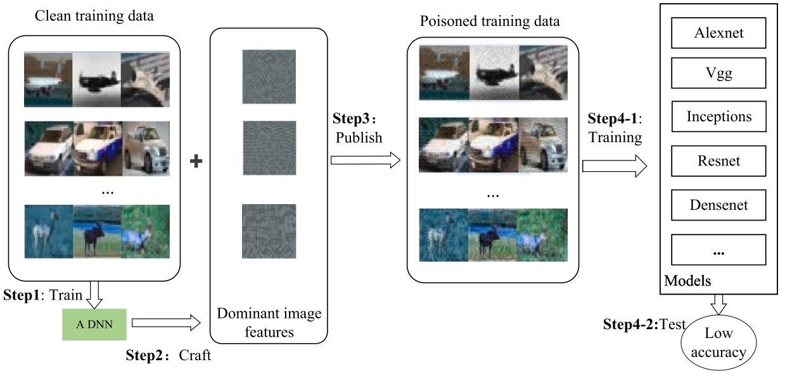
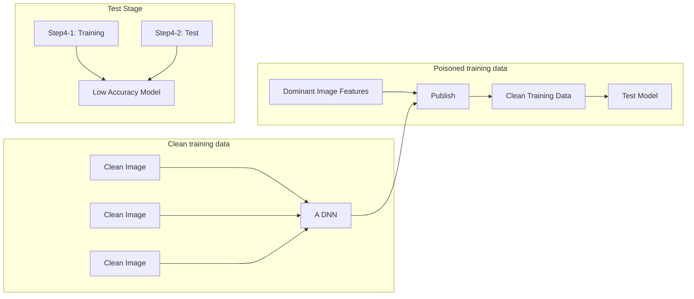
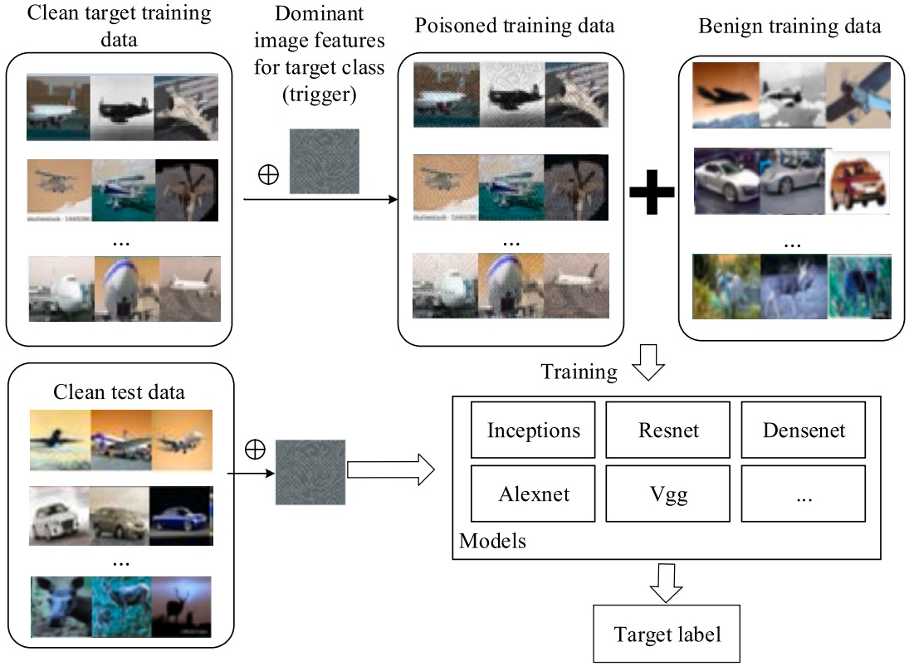
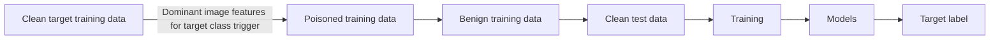
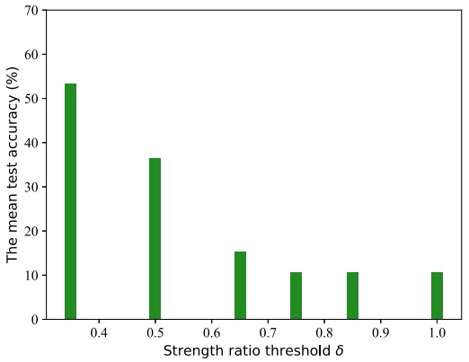
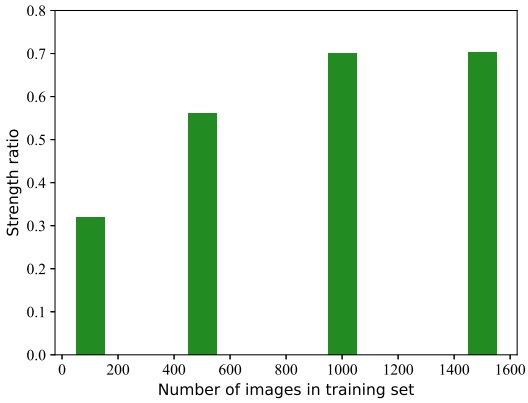
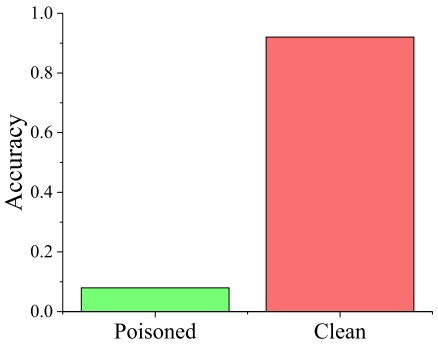

# Clean-label poisoning attack with perturbation causing dominant features ✩

Chen Zhang a,b, Zhuo Tang b,∗, Kenli Li b

a College of Computer Science and Technology, China University of Petroleum (East China), Qingdao, China

b College of Computer Science and Electronic Engineering, Hunan University, Changsha, China

## A R T I C L E I N F O

Keywords:

Poisoning attack

Clean-label

Unlearnable examples

Backdoor attack

Image features

## A B S T R A C T

Numerous studies have proved that deep learning models are sensitive to attacks from adversarial examples. However, due to the high computationally demanding and limiting explanation for deep neural networks (DNNs), research on poisoning attacks against deep models is insufficient. In this work, considering the interpretation that DNNs are feature extractors, we propose a clean-label poisoning attack against DNNs by dominant image features added to the original data. Each category of clean data is augmented with imperceptible perturbations which we call “dominant image features” of another category. The dominant image features determine which class the input belongs to, while the clean input behaves like noise. Well-trained DNNs on these poisoning data will get extremely low accuracy on clean test data. The attack can make personal data unlearnable for DNNs, which preserves an individual’s privacy. Besides, our data poisoning attack can be expanded into a powerful clean-label backdoor attack in that the poisoned samples and their labels are consistent for humans. Experimental results show that our proposed attack can exceed the previous advanced poisoning attacks which demonstrate the effectiveness of our presented attack. Additionally, our work provides a new perspective on the interpretation of DNNs as feature extractors.

## 1. Introduction

Although deep learning models have earned widespread adoption in various tasks [28,29], they are vulnerable to adversarial attacks [27]. The attacks can be divided into evasion attacks and data poisoning attacks considering when the attack takes place [42]. Evasion attacks or adversarial examples which can quickly induce well-trained deep models to output inaccurate predictions at decision time have been widely investigated with their defense methods [5,27]. To date, many poisoning attacks have been successfully applied to traditional machine learning models, such as support vector machine [4] and regression models [21]. In the real world, a majority of companies indicate that data poisoning has a greater threat than other adversarial attacks [25].

However, no large-scale studies have been performed to research the poisoning attacks against deep neural networks (DNNs). One reason is that the traditional bi-level optimization methods are too computationally expensive and complex when applied to

✩ The work is supported by the National Natural Science Foundation of China (Grant Nos. 62225205, 92055213, 61873090), the National Key Research and Development Program of China (2021ZD40303, 2018YFB1701400), Natural Science Foundation of Hunan Province of China (2021JJ10023), Guangdong Province research and development plan project in key area (Grant Nos. 2020B0101100001).

\* Corresponding author.

E-mail addresses: [zhangchen2@hnu.edu.cn](mailto:zhangchen2@hnu.edu.cn) (C. Zhang), [ztang@hnu.edu.cn](mailto:ztang@hnu.edu.cn) (Z. Tang), [lkl@hnu.edu.cn](mailto:lkl@hnu.edu.cn) (K. Li).

[https://doi.org/10.1016/j.ins.2023.03.124](https://doi.org/10.1016/j.ins.2023.03.124)

Received 20 October 2022; Received in revised form 9 March 2023; Accepted 19 March 2023

Available online 22 March 2023

0020-0255/© 2023 Published by Elsevier Inc.

DNNs. Another is that the working mechanism of DNNs is not entirely comprehended. Recent attempts, such as influence functions [8,23], label flipping [48], and backdoor attacks [35], to perform significantly more potent attacks pay little attention to restricting the modifications, which often result in visibly corrupted and poisoning images with significant disturbances. Meanwhile, these poisoned inputs can be easily detected by anomaly detection methods [34].

Contrary to previous work concentrating on reducing the performance on clean test data without restricting the magnitude of image perturbations and reducing the number of poisoning samples, we propose a true clean-label poisoning attack on the whole training images. In practice, controlling the entire training data is a realistic scenario, for example, if a company provides some internal data to another organization when needing data modeling services, but to protect privacy, the company does not want these models based on the data to be effective for real test data; this could be achieved by utilizing such poisoning data before data having been released.

An attack can also be a defense. Our attack can also be utilized for personal privacy protection. Consider individual face images, one of the most significant real-world scenarios. Numerous face photos are straightforward to acquire from social networking sites. The attackers can train face recognition or verification systems on these face images to violate personal privacy. Then the attackers can recognize someone’s identity through a face image shot by a camera somewhere. Thus, the users expect that the DNNs trained on the public face images cannot recognize their photos taken on a camera. We dedicate our work to overcoming this concern. We could “poison” the training face images for the poor performance of DNNs on test data while keeping the quality of original images.

Recent attacks have been provided that the attackers have access to all training data used by the victim [10,37]. The authors concentrated on secure data release that Feng et al. [9] called their poisoned inputs as training time adversarial data while Huang et al. [18] named unlearnable examples. These attacks become an exciting way to protect publicly released user data and have inspired our work.

Specifically, to ensure that poisoning data are true clean-label, the perturbations should be reasonably invisible; that is, a poisoning image and its raw image belong to the same category from a human perspective. Furthermore, poisoning images should look natural and precisely labeled, passing human inspection. Moreover, on the other hand, we aim to maximally confuse DNNs who are well trained on these poisoning data when predicting clean test images.

Building on the above motivation, the explanation that DNNs are feature extractors [15] has been considered. From this point of view, Ilyas et al. [20] illustrated that the existence of adversarial examples is due to non-robust features in the training data. Zhang et al. [46] proposed that universal perturbations having strong features can fool DNNs by analyzing the mutual influence of images and perturbations. We present a clean-label poisoning attack against DNNs by dominant image features added to original images inspired by this work.

In this work, we concentrate on the attacks of DNNs for image classification tasks. In detail, firstly, we train a DNN on clean training data; it is better if victims prepare training models. Secondly, based on this DNN, we search for imperceptible perturbations to add to each clean data category. These disturbances we call “dominant image features” have a decisive role in outputting another category label when putting in the DNN. Although the numerical magnitude of original images is larger than the perturbations added to them, they behave like noises to dominant image features, which leads to the low accuracy on clean test data of well-trained poisoning DNNs. Here the noises mean that since the robustness of neural network models, the model output remains unchanged when adding Gaussian noises to the input.

Similarly, due to each class of poisoning data’s prominent features, DNNs will easily distinguish each category to obtain higher training accuracy than those trained on clean data. In addition, our data poisoning attack can be expanded into a more powerful backdoor attack if the attackers can access inputs during inference. The dominant image features also can be used as triggers to introduce test images, which play a decisive role in the model output labels. Our significant contributions can be summarized as follows:

• We propose a clean-label poisoning attack against DNNs. The perturbations of poisoned data generated by our attack are imperceptible but dominant image features, which guarantees that these poisoning data are hard to detect while significantly reducing the accuracy of DNNs trained on poisoning data when tested on clean data.
• We can expand our data poisoning attack into a powerful backdoor attack that the poisoned samples and their labels appear legitimate for humans.
• Experimental results show that poisoning models, well-trained DNNs on our poisoning data, have higher training accuracy than those trained on clean training data and extremely low test accuracy on clean test data, which demonstrates that our imperceptible perturbations have dominant features which are easy to be classified while the clean images behave like noise to poisoning models. Our attack outperforms previous advanced poisoning attacks in terms of performance. Our work verifies the interpretation that considering DNNs as feature extractors from a new perspective.

We organize this paper as follows. The related work of poisoning attacks is present in Section 2. Our attack is detailedly described in Section 3, where it specifically differs the process of our attack and the dominant image features in our method. We execute experiments to demonstrate the effectiveness of our poisoning attack in Section 4. The conclusion is shown in Section 5.

## 2. Related work

In this section, firstly, we summarize previous work with two categories: (1) poisoning attacks and (2) backdoor attacks. Secondly, we identify the limitations of previous research in these areas and emphasize the novelty and significance of our attack.

## 2.1. Poisoning attacks

The attacks modify the training data or labels while not accessing test samples after trained models. They could be briefly divided into the following categories based on their methodologies.

**Feature Collision Attacks,** which target data poisoning attacks, make a target image be mistakenly classified into the base category by disturbing the training data. The primary attack minimizes the gap between poisoned images and target example in feature space while limiting the magnitude of the perturbations [36]. Guo and Liu [13] improved the basic method by adding two additional restrictions that urge poisoned and clean images to have the same labels while far away in feature space. Another variant of feature collision attacks involves moving the feature vectors of poisoned images in feature space to enclose the target’s feature vector [1]. These variants have better attack reliability because the whole space containing the target point belongs to the same base class. Although these kinds of attacks facilitate the clean-label performance result from restricting the magnitude of perturbations, they only lead to bits of target examples misclassified into the base class. These are less efficient.

**Bilevel Optimization.** A basic poisoning attack could be transformed into a bilevel optimization problem that finds a poisoned data with minimal disturbances to let the well-trained model whose parameters are got by minimizing the loss function on poisoning data output target label when given a clean test image. These attacks work well on traditional machine learning models, such as SVM [4] and regression models [21], because the bilevel optimization problem could be solved by utilizing the KKT conditions. However, bilevel optimization in DNNs is more complicated due to the non-convexity of DNNs. Muñoz-González et al. [32] tried to utilize several steps of gradient descent to approximate the solution of the bilevel optimization problem. However, this approach these authors called “back-gradient descent” only involves a unilaminar network and is inefficient because one step generates one poisoned example. Huang et al. [19] proposed MetaPoison, an improved back-gradient descent method, and made it apply to realistic network architectures and training processes. The performance of MetaPoison is significantly better than previous methods, but running MetaPoison on multiple GPUs can be expensive. In summary, figuring out the bilevel optimization problem is calculating cost, how to accelerate data poisoning for industrial-scale training is still an open problem.

**Label Flipping Attacks** are another type of poisoning attack that changes training labels instead of switching training data. Random and adversarial label flips have been utilized to poison SVM in [3]. Zhao et al. [49] proposed a projected gradient ascent method for label flipping that could poison black linear models, such as logistic regression, SVM, and LS-SVM. Zhang and Zhu [48] utilized game theory to state a theoretical analysis for label flipping attacks on SVM. Although label flipping attacks have been theoretically and empirically shown effective and have the advantage of not modifying the training data, they are not “clean-label” so that the poisoning pairs of data and labels could be easily perceived by human supervisors. Also, numerous defense methods, theoretical and empirical, have been proposed to defend label flipping attacks [34].

**Influence Functions** evaluate the influence of small changes in training data on the model parameters generated by training, which can be utilized to craft poisoning examples. Koh et al. [23] improved their work to obtain stronger poisoning attacks through expediting bilevel optimization. In practical application, Fang et al. [8] employed influence functions to implement data poisoning attacks on recommended systems. Although influence functions have successfully been applied to conduct data poisoning attacks on traditional machine learning models, they are less applicable to capturing data dependence in DNNs, which are highly non-convex [2].

**Unlearnable Examples.** These attacks handle the whole training set, resulting in a lousy generalization of DNNs trained on poisoning data. We also present our work in this setting. Feng et al. [9] generated training time adversarial examples (poisoned data) with auto-encoder. Although their attack is effective on toy datasets, it doesn’t work well on large-scale datasets because of the complexity. Shen et al. [37] proposed TensorClog, an unlearnable example method from the perspective of causing the training gradient of the deep neural network model to disappear. Huang et al. [18] proposed a bi-level optimization process to craft perturbations for unlearnable examples while Fowl et al. [10] crafted perturbations by manipulating the gradient of a network. To address unlearnable examples’ vulnerability in adversarial training, Fu et al. [11] presented robust unlearnable examples that can prevent data from being learned in adversarial training. Yu et al. [44] proposed to use synthetic shortcuts to craft unlearnable examples, based on the fact that unlearnable examples are (almost) linearly separable. We take these approaches as baseline comparisons for our method.

## 2.2. Backdoor attacks

Backdoor attacks, also known as Trojan attacks, allow the attackers to alter the input images during test time. Thus, these attacks are more powerful. They can be briefly divided into the following categories based on their methodologies.

**Basic Backdoor Attacks.** The basic idea of Trojan attacks is that given a test input with a backdoor trigger, the well-trained DNNs on poisoning data will output a particular label. The trigger may be a small patch or something local tiny feature. To ensure these attacks are not detected when the poisoning models are practically configured, the models are running normally without triggers. In [12], the authors first stated successful backdoor attacks on DNNs by injecting mislabeled poison examples into the training data. During training, the DNNs are easily classified these poisoning images by learning the backdoor trigger feature. In the physical world, the authors in [43] utilized backdoor attacks to fool facial recognition systems. The obvious disadvantage of these backdoor attacks is that human observers can easily discover the trigger added to test examples.

**Clean-Label Backdoor Attacks.** A simple way of backdoor attacks is to poison data by adding triggers on images and giving an incorrect target label. Thus, the poisoned examples could be easily detected by human inspection. Recently, in [41] and [35], the authors conducted clean-label backdoor attacks, where the labels of poisoning examples were designed to be semantically true. Zhao et al. [50] presented clean-label backdoor attacks on video recognition utilizing universal adversarial backdoor triggers. Although their trigger-generating process is similar to ours while keeping labels clean, the trigger is easy to be recognized by humans. Models Turner et al. [41] utilized generative adversarial networks and adversarial examples while Saha et al. [35] adapted the feature collision framework mentioned in Section 2.1 to craft backdoor poisoning examples. Although these attacks are clean-label attacks, Saha’s attack only applies to transfer models while Turner’s needs to train a GAN or a surrogate model which are generally computationally expensive due to the complexity.

Although previous investigations of backdoor attacks have shown their significant potential and success, it is still challenging to intervene at the model’s inference time in reality.

## 2.3. Our poisoning attack

We dedicate our poisoning attack based on the insight that the predicted label would be highly predictive by strong features in an image. Then we can design dominant image features which add to the training data to poison DNNs. The dominant image features crafted by us are imperceptible from a human perspective, which produces our attack as clean-label. On the other hand, because of avoiding solving bilevel optimization problems, poisoning images could be generated more effectively. In addition, our data poisoning attack can be expanded into a powerful backdoor attack. We consider dominant image features as a trigger to introduce target samples that guarantee clean-label. Our attack’s effectiveness also explains DNNs as feature extractors from a new perspective, which is of great significance for studying the theoretical causality of deep learning.

## 3. Our proposed attack

We regularly state the data poisoning attack against DNNs and propose our attack process detailedly.

## 3.1. Attack formalization

Based on the goal of reducing the performance on clean test data by adding imperceptible disturbances to the training images and unlearnable examples introduced in Section $^ { 2 , }$ our attack could be formalized as follows.

We consider a DNN as a threat model that could be denoted as $f ( { \pmb x } )   =   y$ which receives an input $\pmb { x } \in \mathbb { R } ^ { n }$ and gives an output label 𝑦. In this work, we focus on the problem of image classification, where 𝒙 is in the range [0, 255]. A dataset 𝐷 containing $N _ { D }$ data points is composed of training set $D _ { \mathrm { t r a i n } }$ and test set $D _ { \mathrm { t e s t } }$ whose sample volume are $N _ { \mathrm { t r a i n } }$ and $N _ { \mathrm { t e s t } }$ respectively. Then our task could be formalized into the following optimization problem:

$$
\begin{array}{l} \max _ {r} \frac {1}{N _ {\text {test}}} \sum_ {(\boldsymbol {x}, y) \in D _ {\text {test}}} \mathbb {1} \left\{f _ {\theta^ {*} (\boldsymbol {r})} (\boldsymbol {x}) \neq y \right\}, \\ s. t. \left\{ \begin{array}{l} \theta^ {*} = \arg \min _ {\theta} \sum_ {(\boldsymbol {x}, y) \in D _ {\text {train}}} \left[ \mathcal {L} \left(f _ {\theta} (\boldsymbol {x} + \boldsymbol {r}), y\right) \right], \\ | | \boldsymbol {r} | | _ {p} \leq \epsilon , \\ \boldsymbol {x} + \boldsymbol {r} \in [ 0, 2 5 5 ], \end{array} \right. \tag {1} \\ \end{array}
$$

where 𝟙{⋅} is an indicator function that when the input is true, the output is 1, otherwise 0; $\mathcal { L } ( \cdot , \cdot )$ is the cross-entropy loss function for training DNNs, and 𝒓 is the perturbation whose 𝑝 norm is less than or equal to 𝜖 added to an image 𝒙. Here the perturbation restriction 𝜖 guarantees that the poisoned sample is hard to detect. Every combination of respective perturbation 𝒓 for its original image 𝒙 is paired with a DNN $f _ { \theta ^ { * } ( r ) } ( \cdot )$ trained on the consistent poisoned images. The problem aims to seek out each minimum perturbation 𝒓 for each sample 𝒙 so that the accuracy of DNN $f _ { \theta ^ { * } ( r ) } ( \cdot )$ on benign test images is lower than the accuracy of all other possible DNNs trained on different sets of perturbations 𝒓 for the same image 𝒙.

Obviously, solving the aforementioned non-convex optimization problem is very difficult, peculiarly because of the non-linear restrictions. Here we try to find an approximate solution to the optimization problem from the feature perspective. Our idea is based on the interpretation considering DNNs as feature extractors. In the summation of strong and weak features, strong features still dominate. “Strong” and “weak” here mean the degree of contribution of its feature for classification results when summating two features feeding to a DNN. In [46], the authors utilized the Pearson correlation coefficient to measure the strength and weaknesses, which achieved good results. Thus, we transform solving the minimum perturbation 𝒓 for each sample 𝒙 into solving class-wise perturbations. When the strong features of one class, also defined as perturbations 𝒓 in Equation (1), are added to benign examples of another class, the strong features still dominate for classification. That is why we call the perturbations dominant image features.

## 3.2. Attack procedure

As shown in Fig. 1, our data poisoning attack procedure is visually illustrated. In detail, the poisoning attack procedure could be formulated as follows:

• Step 1: Train a DNN on clean training data. A DNN having been trained by victims is better. This model can help us to find strong features.

flowchart

Fig. 1. The framework of our data poisoning attack.

• Step 2: Generate dominant image features for each category. These features added to other inputs still dominate when being put into DNNs. Besides, the features can be triggers in backdoor attacks.
• Step 3: Add dominant image features of one class to benign data of another class. Make sure that all classes have been added with the dominant image features of another class.
• Step 4: Train DNNs with poisoned data and test them on clean test data.

Following are the detailed description of each step.

## 3.2.1. Clean / poisoned training

Generally, the training process of neural networks can be transformed into solving an optimization problem. Then the weights of a DNN can be updated by minimizing the objective function utilizing batch gradient descent methods and back-propagation. In classification tasks, the cross-entropy loss is the most commonly used for calculating the dissimilarity between the ground truth labels and forecast outputs:

$$
\mathcal {L} = - \frac {1}{N _ {\text {batch}}} \sum_ {(\boldsymbol {x}, \boldsymbol {y}) \in D _ {\text {train}} \text {or} D _ {\text {poisoned}}} \boldsymbol {y} ^ {T} \log (f (\boldsymbol {x})). \tag {2}
$$

To make our attack successful, we train the DNNs on poisoning data. Contrary to previous work focusing on reducing the number of poisoned samples, we poison the whole training dataset for minimum perturbations. Although the training processes on clean and poisoned data are identical, the performances of their DNNs are pretty different. We evaluate the effectiveness of poisoning by comparing the accuracy of DNNs with the same architecture but training on clean or poisoning data.

## 3.2.2. Dominant image features generation

The attack starts with crafting dominant image features which would be added to the benign images. Unlike general poisoning attacks that only allow a few training samples to be changed, each image in the training data would be assigned a kind of dominant image features that are small enough to have sufficient stealthiness from a human perspective. Inspired by [46], we assume that if we can find a kind of perturbations that have dominant to another class for the data points of a given class, the clean images from test data would be misclassified with high chances by well-trained DNNs on poisoned data because the DNNs are more inclined to learn strong features which the clean data do not have for classifying. Essentially, the dominant image features are independent of the clean images whose features are destroyed to be unrecognizable to DNNs.

For this purpose, for some given data and a DNN $f ( { \pmb x } )$ which has been well trained on clean training samples, the dominant image features generation for a target label can be satisfied the following equation:

$$
\begin{array}{l} f (\boldsymbol {x} + \boldsymbol {r}) = t, \text {for} (\boldsymbol {x}, y) \in D, \\ \text {s.t.} | | \boldsymbol {r} | | _ {p} \leq \epsilon , \\ \end{array}
$$

where 𝒓 denotes the dominant image features or perturbations whose $p$ norm is constrained by 𝜖 to be imperceptible from a human perspective, 𝑡 is the target label we wish $f ( { \pmb x } + { \pmb r } )$ to output, and 𝑦 is the original label for image 𝒙. Notice that the label of 𝒙 could be arbitrary. This ensures that no matter what category the original image is, the perturbations would be dominant. Meanwhile, these dominant image features could easily be learned by DNNs whose training accuracy, therefore, is exceptionally high. However, the performance of these DNNs will be broken on benign test data which do not have dominant image features and behave like noise to the models.

Algorithm 1 Dominant image features generation.

Input: Training data $D_{\text{train}}$, test data $D_{\text{test}}$, a well-trained DNN model $f$ on clean training data, objective function $\mathcal{L}_t$, the maximum number of iterations $I$, perturbation magnitude $\epsilon$, features strength ratio threshold $\delta$, batch size $b$.
Output: Dominant image features $r$ for target label $t$.
Initialize $r \leftarrow 0$,
Initialize $iteration = 1$, $\text{sth}(\boldsymbol{r}) = 0$.
while $iteration \leq I$ and $\text{sth}(\boldsymbol{r}) \leq \delta$ do
    Sample randomly: $\boldsymbol{x}_B \subset D_{\text{train}}$: $|\boldsymbol{x}_B| = b$
    Calculate gradient $g_r = \mathbb{E}_{\boldsymbol{x} \in \boldsymbol{x}_B} \left[ \nabla_r \mathcal{L}_I \right]$
    Update $r \leftarrow \text{Optimize}(g_r)$
    Project norm $r \leftarrow \frac{\boldsymbol{r}}{||\boldsymbol{r}||_p} \epsilon$
    Calculate $\text{sth}(\boldsymbol{r}) = \frac{1}{N_{\text{test}}} \sum_{(x,y) \in D_{\text{test}}} \mathbb{1} \{ f(\boldsymbol{x} + \boldsymbol{r}) = t \}$
    Increase count $iteration \leftarrow iteration + 1$
Return $r$.

This optimization looks like a universal adversarial perturbation problem. However, previous work concentrates on the perspective of moving the data points to the decision boundaries [31]. Thus, we focus on the scene of dominant image features that are robust to the effect of inputs. Similar to [46], we could utilize the PGD algorithm to solve this optimization problem.

To perform the requested objective Equation (3), we instead solve the following problem:

$$
\mathcal {L} _ {t} = \max \left(\max _ {c \neq t} Z _ {c} (\boldsymbol {x} + \boldsymbol {r}) - Z _ {t} (\boldsymbol {x} + \boldsymbol {r}), - \kappa\right) \tag {4}
$$

where $Z _ { c }$ indicates the entry of the output vector before the softmax layer and the subscript means the 𝑐th entry of the logits, 𝜅 encourages the confidence, and 𝒙 are examples from the original training data. While minimizing the loss function, the target logit will increase, and $\operatorname* { m a x } _ { c \neq t } Z _ { c } ( { \pmb x }   +   { \pmb r } )$ will decrease simultaneously. However, gradient updates will be affected due to all other categories except the target category participating in the optimization, which may hurt the generation of dominant image features for the target class. Thus, we take the target category logit value in the optimization process while others are utilized for clamping as references.

The simple but effective algorithm for generating dominant image features is summarized in Algorithm 1. The Adam method [22] and batch training are adopted to minimize the loss function. Because the dominant image features are universal, we randomly sample some images instead of training on the whole data to improve the algorithm’s efficiency. Considering that some clean images may be more robust than our perturbations, the dominant image features would be failing on these images. We set a feature “strength ratio” threshold 𝛿 that the algorithm will be terminated when our dominant images’ strength ratio for the target label is beyond it. This is also helpful for improving algorithm efficiency. Generally, calculating feature rates on the test dataset is more generalized because they are not used for training. Therefore, we stop the algorithm whenever

$$
\operatorname{sth} (\boldsymbol {r}) = \frac {1}{N _ {\text {test}}} \sum_ {(\boldsymbol {x}, y) \in D _ {\text {test}}} \mathbb {1} \left\{f (\boldsymbol {x} + \boldsymbol {r}) = t \right\} \geq \delta . \tag {5}
$$

## 3.2.3. Poisoning data generation

To achieve the goal of maximally confusing any corresponding DNNs trained on the poisoning data when given clean test data, the poisoned data should have the following properties.

• Firstly, the images of the same category in poisoning data need to have similar features.
• Secondly, the feature difference between different classes should be noticeable enough that DNNs can easily learn the decision boundary.
• Thirdly, images of the same category in poisoning and benign data should be recognized as different by poisoned DNNs.

Once we have achieved dominant image features for each class, poisoning data could be gotten simply. For each category, there is a kind of dominant image feature for another target category to add. Then the poisoning data $x _ { p }$ could be generated as:

$$
\begin{array}{l} \boldsymbol {x} _ {p} = \boldsymbol {x} _ {c} + \boldsymbol {r} _ {t}, \\ \forall c, t \in \{Y \}, c \neq t, \tag {6} \\ \boldsymbol {x} _ {c} \in D _ {\text {train}}, \\ \end{array}
$$

where $r _ { t }$ is a kind of dominant image features for class 𝑡, and {𝑌 } denotes the label set. In this way, the images in one category have the same dominant image features, which could easily be classified as one class while the clean test data behave like noise to the poisoned data. While for a classification task with 𝐾 categories, our attack needs to generate 𝐾 dominant image features for each class, our attack would be less high-efficiency if 𝐾 is large in real applications.

flowchart

Fig. 2. The framework of our backdoor attack. Take the “plane” class as a target class.

## 3.3. Extend to a backdoor attack

Because we assign a kind of dominant image features for one category in training data, which likes backdoor injection, the features could be utilized as triggers for backdoor attacks. As shown in Fig. 2, training a DNN on benign data with poisoned data which are part of the target images added with dominant image features of the target class, will make a threat model under a backdoor attack. Although we acquire the dominant image feature by 𝑓(𝒙 + 𝒓) = 𝑡 (Equation (3)) where 𝒓 seems like a trigger, that dominant image features could not transfer to other DNNs. Therefore, we poison a part of the training samples of the target class with a backdoor trigger to create a link between the trigger and the target label. Meanwhile, while the dominant image features contained in the image are visually imperceptible and the poisoned samples and their labels are consistent for humans, the backdoor attack is a clean-label attack.

## 4. Experiments

In this section, we validate our attack’s effectiveness by describing the dataset, methodology, evaluation, and the corresponding experimental results.

## 4.1. Dataset

The following datasets are utilized in the experiments.

**MNIST.** MNIST is the most used mini dataset in deep learning; it contains handwritten digit images for 0 to 9.

**Fashion-MNIST.** Fashion-MNIST is an image dataset that replaces the MNIST. The size, format, and training/test set partition of this dataset are the same as the original MNIST. It includes positive images of 70, 000 (60, 000/10, 000 for training/test) different products from 10 categories.

**CIFAR-10.** CIFAR-10 is a dataset utilized to recognize universal objects. It contains 10 categories of RGB color images. The image’s size is $3 2 \times 3 2 _ { ; }$ , and the dataset has a total of 50,000 training and 10,000 test images.

**ImageNet-100.** The ImageNet is a large visual database for the study of visual object recognition. It includes over 1 million images coming from 1,000 various classes. Due to the efficiency, we utilize the first 100 classes (ImageNet-100) as our dataset.

Random examples from each category and their corresponding dominant image features and poisoning image are shown in Fig. 3. There are many options for picking dominant image features for categories. Here we randomly select one while guaranteeing Equation (6).

Fig. 3. Original training images and their corresponding dominant image features (perturbations) and poisoning images from MNIST, Fashion-MNIST, and CIFAR-10 datasets.

Table 1 The performance according to the optimization function on CIFAR-10.

| Target class | airplane | automobile | bird | cat | deer | dog | frog | horse | ship | truck |
| --- | --- | --- | --- | --- | --- | --- | --- | --- | --- | --- |
| sth(r) | 0.76 | 0.72 | 0.67 | 0.68 | 0.62 | 0.65 | 0.54 | 0.60 | 0.75 | 0.75 |

## 4.2. Models and deployment

For getting dominant image features, we first trained LeNets on clean MNIST (Fashion-MNIST) and DenseNets [17] on CIFAR-10 and ImageNet-100 datasets. Then, to evaluate our attack’s performance, we have trained diverse classifiers in a more realistic setting. For simple MNIST dataset, we train SVMs, logistic regression (LR), random forest (RF), and LeNet on poisoned images, for Fashion-MNIST, we trained several shallow neural networks, while for CIFAR-10 and ImageNet-100 datasets, we trained VGG [38], GoogLeNet [39], ResNet [14], RegNet [33], DenseNet [17], and DPN [6]. We utilize the Stochastic Gradient Descent (SGD) optimizer with a momentum coefficient of 0.9 for all experiments and employ the batch sizes of 64 and 32 for CIFAR-10 and ImageNet-100, respectively. The learning rate for ResNet, DenseNet and RegNetX models is 0.1. The learning rate for VGG, GoogleNet, and DPN models is 0.01. We train all models for 200 epochs. The learning rate is divided by 10 at epochs 100 and 150. Without loss of generality, various network architectures mentioned above with different layers are used in our experiments.

## 4.3. Performance evaluation

**Metric.** We use the test accuracy to assess the attack effectiveness ability of the attack approaches. A closer test accuracy to random guessing suggests that the model learned little knowledge from the training data, which thus implies a strong attack effectiveness.

**Attack Performance.** According to the setting described above, we trained corresponding classifiers with perturbation constraint 𝜖 to be 0.3, 0.1, 0.05, 0.02 (when the value space of input 𝒙 is [0, 1]) under 𝑝 = ∞ for MNIST, Fashion-MNIST, CIFAR-10, and ImageNet-100, respectively. The feature strength ratio threshold 𝛿 is set to be 0.75 for all datasets, and the batch sizes are set to 128, 128, 64, and 32, for four datasets, respectively. The classification results are summarized in Tables 2, 3, and 4. The perturbations of MNIST, Fashion-MNIST, and CIFAR-10 datasets can be seen in the middle of each image in Fig. 3. Among them, for MNIST, we train a standard Random Forest with 1,000 trees and a Kernel-SVM utilizing RBF with a kernel coefficient equal to 0.01; for fashion-MNIST, we trained several shadow CNNs with different convolutional and fully connected layers.

For MNIST and Fashion-MNIST datasets, we randomly sample 500 images (50 images per class) for optimizing the objective function. For most target classes, **Algorithm 1** has been early stopped because the “strength ratio” sth (𝒓) is equal to or larger than 0.75. For the CIFAR-10 dataset, we randomly sample 1000 images (100 images per class) for optimizing the objective function. The performance according to the optimization function is shown in Table 1. The sth (𝒓) of classes “airplane”, “ship”, and “truck” is equal to or larger than 0.75, while the sth (𝒓) of class “frog” is 0.54, which means the dominant image feature of class “frog” is harder to learn.

When trained on poisoning data, the training accuracy remarkably reaches or closes to 100% while the mean test accuracy drops to only 19.91%, 14.18%, 10.64%, and 1.80%. This illustrates that our dominant image features are straightforward to learn. Training a classifier can classify different kinds of dominant image features. However, for clean test data with no dominant image features, the classifiers treat them just like noises and only get slightly higher accuracy than random guessing. The test accuracy drops more significantly on DNNs. For logistic regression model, it is the least affected by poisoning data. This is because LR treats each pixel individually and disorderly. It is insensitive to local features. These experimental results show strong evidence of our presented attack’s efficacy.

Table 2 Training and test accuracy when the classifiers are trained on the original clean training data and poisoning data, respectively on MNIST.

<table><tr><td></td><td></td><td>Logistic Regression</td><td>Linear-SVM</td><td>Kernel-SVM</td><td>Random Forest</td><td>LeNet</td><td>Mean</td></tr><tr><td rowspan="2">Clean Data</td><td>training</td><td>91.48%</td><td>84.78%</td><td>98.99%</td><td>100%</td><td>99.98%</td><td>95.05%</td></tr><tr><td>test</td><td>91.44%</td><td>84.21%</td><td>97.92%</td><td>97.21%</td><td>99.08%</td><td>93.97%</td></tr><tr><td rowspan="2">Poisoning Data</td><td>training</td><td>100%</td><td>100%</td><td>100%</td><td>100%</td><td>100%</td><td>100%</td></tr><tr><td>test</td><td>41.52%</td><td>25.72%</td><td>9.8%</td><td>9.83%</td><td>12.66%</td><td>19.91%</td></tr></table>

Table 3 Training and test accuracy when the classifiers are trained on the original clean training data and poisoning data, respectively on Fashion-MNIST.

<table><tr><td></td><td></td><td>2 Conv</td><td>2Conv + 2 FC</td><td>3 Conv + 2 FC</td><td>2Conv + 3 FC</td><td>VGG16</td><td>Mean</td></tr><tr><td rowspan="2">Clean Data</td><td>training</td><td>88.32%</td><td>89.60%</td><td>93.58%</td><td>95.67%</td><td>97.66%</td><td>92.86%</td></tr><tr><td>test</td><td>87.6%</td><td>88.35%</td><td>90.71%</td><td>93.42%</td><td>93.55%</td><td>90.73%</td></tr><tr><td rowspan="2">Poisoning Data</td><td>training</td><td>99.53%</td><td>99.81%</td><td>100%</td><td>100%</td><td>100%</td><td>99.87%</td></tr><tr><td>test</td><td>18.57%</td><td>16.22%</td><td>13.41%</td><td>11.93%</td><td>10.76%</td><td>14.18%</td></tr></table>

Table 4 Test accuracy when the classifiers are trained on the original clean training data and poisoning data, respectively on CIFAR-10 and ImageNet-100.

<table><tr><td></td><td>Dataset</td><td>GoogLeNet</td><td>VGG19</td><td>ResNet18</td><td>DenseNet121</td><td>RegNetX200</td><td>DPN92</td><td>Mean</td></tr><tr><td rowspan="2">Clean Data</td><td>CIFAR-10</td><td>92.26%</td><td>87.23%</td><td>90.36%</td><td>95.66%</td><td>95.43%</td><td>91.78%</td><td>92.12%</td></tr><tr><td>ImageNet-100</td><td>53.74%</td><td>49.66%</td><td>60.58%</td><td>61.11%</td><td>63.48%</td><td>62.25%</td><td>58.47%</td></tr><tr><td rowspan="2">Poisoning Data</td><td>CIFAR-10</td><td>10.07%</td><td>12.37%</td><td>10.54%</td><td>10.61%</td><td>10.01%</td><td>10.22%</td><td>10.64%</td></tr><tr><td>ImageNet-100</td><td>1.73%</td><td>1.33%</td><td>2.10%</td><td>1.52%</td><td>1.88%</td><td>2.26%</td><td>1.80%</td></tr></table>

Table 5 Comparison of different poisoning approach. We employ constraint 𝜖 to be 0.05 utilizing the same RegNet model on CIFAR-10.

| Approach | Test Accuracy |
| --- | --- |
| Clean (None) | 95.43% |
| Random Noise | 90.16% |
| TensorClog [37] | 82.36% |
| DeepConfuse [9] | 28.54% |
| Unlearnable Examples [18] | 20.75% |
| Alignment [10] | 51.18% |
| Robust unlearnable examples [11] | 15.18% |
| Synthetic Perturbations [44] | 13.54% |
| Ours | 10.54% |

**Baseline Comparison.** In addition, we set a baseline comparison for our approach on CIFAR-10 by comparing it with the performance of other poisoning approaches, data manipulation, and clean data. We compare our approach to existing availability attacks containing TensorClog [37], Loss Minimization [18], DeepConfuse [9], a gradient alignment based approach [10], Robust unlearnable examples [11] and Synthetic Perturbations [44]. To make sure the comparison is fair, the only difference between all approaches is that the training data is poisoned by different attacks. And we ensure that the perturbation constraint 𝜖 and the proportion of poisoned data are the same. To verify the influence of generated versus non-crafted perturbations on clustering accuracy, we compare our approach to fixed, random additive noise.

As shown in Table $^ { 5 , }$ we notice that our method widely exceeds these approaches. Comparing to the previous advanced poisoning attacks, we significantly reduce the test accuracy of the victim model.

**Perturbation Stealthiness.** As shown in Fig. 3, the magnitude of dominant image features is restricted to a small range. There is little difference between the poisoned and original images from a human perspective, especially for images with higher resolutions. For MNIST, the perturbation constraint 𝜖 is 0.3; the poisoned images are easily detected by human inspection. However, the category of each image is still easily recognized by humans, which ensures the clean-label for each image. For CIFAR-10, the perturbation constraint 𝜖 is 0.02, which humans hardly notice.

We also take PSNR (Peak Signal-to-Noise Ratio) to quantitatively evaluate the difference between the clean image and the poisoning image. PSNR is the most common and widely used objective measurement method for evaluating image quality. The larger the value, the less distortion. PSNR is defined as:

$$
\mathrm{PSNR} = 1 0 \cdot \log_ {1 0} \left(\frac {\mathrm{MAX} _ {\mathrm{I}} ^ {2}}{\mathrm{MSE}}\right), \tag {7}
$$

Fig. 4. Effect of varying 𝜖 on MNIST (left), Fashion-MNIST (middle), and CIFAR-10 (right). The images with the current size perturbation are also displayed on the x-axis.

bar

| Strength ratio threshold \(\delta\) | Mean test accuracy (%) |
| --- | --- |
| ~0.35 | ~53 |
| 0.5 | ~36 |
| ~0.65 | ~15 |
| ~0.75 | ~11 |
| ~0.85 | ~11 |
| 1.0 | ~11 |

Fig. 5. The test accuracy according the feature strength ratio threshold 𝛿.

where MSE represents the mean square error of the clean image 𝒙 and the poisoning image 𝒙′; MAXI is the maximum possible pixel value of the image. Generally, for uint8 data, the maximum pixel value is 255; for floating-point data, the maximum pixel value is 1. The unit of PSNR is dB. As shown in Fig. 3, the PSNR between the clean images and the poisoning images on MNIST, Fashion-MNIST, and CIFAR-10 datasets are 31.50 dB, 35.92 dB, and 40.24 dB, respectively. The results show that for MNIST and Fashion-MNIST datasets, the perturbations are perceptible but acceptable, while for the CIFAR-10 dataset, the perturbations are hardly noticeable.

We further discuss the disturbance constraint 𝜖 influence the performance of test accuracy and strength ratio of dominant image features mentioned in Equation (5). Concretely, for MNIST, Fashion-MNIST, and CIFAR-10, we vary 𝜖 from 0 (no changing) to 0.3, 0.1, and 0.02 respectively, while keeping other settings in the same way, and the results are shown in Fig. 4. Here we test the accuracy on LeNet, VGG-16, and GoogLeNet for MNIST, Fashion-MNIST, and CIFAR-10 respectively. We could detect that as 𝜖 increases, the test accuracy declines, which means the attack efficiency improves, and the feature strength ratio (average of all) increases. The experimental results show that the test accuracy reduces under 20% while the feature strength ratio exceeds 50% when 𝜖 exceeds 0.25, 0.075, and 0.015 for MNIST, Fashion-MNIST, and CIFAR-10, respectively. Meanwhile, when 𝜖 reduces 0.2, 0.05, and 0.01 for MNIST, Fashion-MNIST, and CIFAR-10 respectively, the perturbation is difficult for humans to recognize. However, the test accuracy is still reduced by over 50%. For high-resolution images, the 𝜖 could be smaller, which guarantees the stealthiness of our attacks.

**The performance change according to other parameters.** For the parameter f, a well-trained DNN model on clean training data, we have trained a DenseNet on CIFAR-10 before. Here we evaluate the test accuracy according to perturbations crafted by different well-trained DNN models. Table 7 shows the test accuracy when DNN models are well-trained on poisoning data which are crafted by VGG and ResNet models. The test accuracy of models well-trained on poisoning data is still much lower than the test accuracy of models well-trained on clean data. The results show that the models generalize poorly no matter what kind of modelgenerated poisoned data the models are trained on. No matter what model, as long as it has high accuracy on clean data, it can learn dominant image features (effective perturbation) through our **Algorithm 1**.

We evaluated the mean test accuracy according to the change of the strength ratio threshold 𝛿. As shown in Fig. 5, when the strength ratio threshold 𝛿 is set to 1, that is the algorithm will iterate the maximum number of times without stopping early. In practice, we observe that when the strength ratio threshold 𝛿 is greater than 0.7, the test accuracy can maintain a low stable value. We set the feature strength ratio threshold 𝛿 to 0.75 for relaxing.

We also tested the performance according to the random sample size and the strength ratio. In practice, the number of data points in the training set need not be large to compute dominant image features that are valid for the whole distribution. We show in Fig. 6 the mean strength ratio of all categories obtained on the test set for different sizes of images in the training set for CIFAR-10. Note that with a set containing over 1000 images, the mean strength ratio of all categories can maintain a highly stable value. In particular, we can randomly pick samples to be much smaller than the number of training points. The results show the high efficiency of our algorithm.

bar

| Number of images in training set | Strength ratio |
| --- | --- |
| ~100 | ~0.32 |
| ~500 | ~0.56 |
| ~1000 | ~0.70 |
| ~1500 | ~0.70 |

Fig. 6. The mean strength ratio of all categories on the test set versus the random sample size.

Table 6 Effects of defenses against poisoning attacks. We employ constraint 𝜖 to be 0.05 utilizing RegNet model on CIFAR-10. All results averaged over 5 runs.

| Defense | Test Accuracy |
| --- | --- |
| Clean (None) | 95.43% |
| AdvTrain | 19.75% |
| Basic Data Augmentation | 10.66% |
| Cutout | 10.58% |
| Mixup | 10.82% |
| CutMix | 10.60% |
| FA | 12.26% |
| DPSGD | 18.86% |

Table 7 Test accuracy when the models are trained on the original clean training data and poisoning data. The poisoning data is crafted by different models.

<table><tr><td></td><td></td><td>GoogLeNet</td><td>VGG19</td><td>ResNet18</td><td>DenseNet121</td><td>RegNetX200</td><td>DPN92</td><td>Mean</td></tr><tr><td>Clean Data</td><td></td><td>92.26%</td><td>87.23%</td><td>90.36%</td><td>95.66%</td><td>95.43%</td><td>91.78%</td><td>92.12%</td></tr><tr><td rowspan="2">Poisoning Data</td><td>Crafted by VGG</td><td>10.23%</td><td>10.46%</td><td>11.30%</td><td>10.85%</td><td>10.38%</td><td>10.06%</td><td>10.54%</td></tr><tr><td>Crafted by ResNet</td><td>10.06%</td><td>12.66%</td><td>10.12%</td><td>10.87%</td><td>10.10%</td><td>10.31%</td><td>10.69%</td></tr></table>

**Resistance to Defense.** We have illustrated the effectiveness of our data poisoning attack when the victim models are trained without protection. However, the researchers have proposed various defense methods against data poisoning attacks. Thus, we experiment with the efficacy of some prevalent defenses against our attack in this section.

Adversarial Training. We consider the Adversarial Training (AdvTrain), which is an effective defense method against adversarial examples [30] and data poisoning attacks [40]. While Ilyas et al. showed that AdvTrain could efficiently exclude the non-robust features from the samples and apply the model to learn only the robust features [20], AdvTrain can not alleviate the success of our attack because our dominant image features are strong features which have closely collection with their own classes. Experimental results shown in Table 6 confirm this.

Data Augmentation. Data augmentation methods are popular defenses to counteract the effects of small perturbations of inputs. However, while our perturbations are strong features, data augmentation methods, such as random shift, crop, flip, and rotation, will not affect neural network learning these features. Here we consider 4 more advanced data augmentation techniques: Cutout [7], Mixup [47], Cutmix [45], and Fast Autoaugment (FA) [26]. The experimental results are shown in Table 6.

Differentially Private SGD (DPSGD). DPSGD, making datasets adapt to small perturbations by adding noise to training gradients and clipping them, is an efficient antidote to data poisoning [16]. Nevertheless, DPSGD usually appears massively decreased accuracy. We test DPSGD with clipping and noise parameters 1.0 and 0.005. The results are shown in Table 6.

In conclusion, we show that previously presented defense methods are ineffective against our data poisoning attack.

bar

| Category | Accuracy |
| --- | --- |
| Poisoned | ~0.08 |
| Clean | ~0.92 |

Fig. 7. Recognition accuracy.

Table 8 The attack success rates with backdoor attacks. We choose all categories as the target category, and then take the average. We set poisoning percentage to 20% for the target category.

| Attacks | Attack Success Rates |
| --- | --- |
| BadNets [12] | 24.5% |
| Label-Consistent Attack [41] | 58.2% |
| Zhao's [50] | 80.8% |
| Ours | 84.6% |

## 4.4. A real-world scenario

We represent a test on a real-world scenario, face recognition. As mentioned in the introduction, the users expect that the DNNs trained on their public face images cannot recognize their face photos taken on a camera. Thus, the users can utilize our poisoning attack to craft poisoned face images uploaded on social network sites.

For the sake of reality, we assume that the users have a small face dataset of their own images. They could utilize the dataset to train a face recognize model and craft dominant image features. Then the users can poison their face images and upload these images without concern. The attackers train face recognition models by face images collected from the internet. The models could be utilized to recognize the users’ face image taken on a camera somewhere. However, the models learning on poisoned images will perform inadequately the users’ clean face photos.

**Experimental Settings.** We randomly divide the PubFig dataset [24] into two parts: 80% for training and 20% for the test. The PubFig dataset consists of 58,797 face images of 200 people. We assume that we have a small subset of face images for protecting. We pick face images of 30 identities randomly from the PubFig dataset as a subset for personal privacy to protect. Firstly, we utilize this subset to train a DNN model then craft poisoned images for the subset using our attack approach. Secondly, we replace the clean subset with the poisoned subset for model training. The training dataset has clean face images for 150 identities and poisoned face images for 50 identities. We train a LeNet for dominant image features generation and a VGG-19 [38] for face recognition.

**Result against Face Recognition.** We report the accuracy of the VGG-19 model on the clean test images in Fig. 7. We can see that the clean test accuracy of the protected users is only 8%, while the recognition accuracy of the rest of the people is 92%. This result confirms the effectiveness of our poisoning attack as a privacy protection.

## 4.5. Extend to a backdoor attack

We evaluate the performance of our victim model of ResNet-18 on CIFAR-10. For crafting dominant image features, we use a VGG-19 with 𝜖 = 0.05.

**Baseline Comparison.** Firstly, we utilize a standard backdoor attack which is restricted only to using samples from the target class [12]. Secondly, we consider label-consistent backdoor attack [41]. We apply adversarial perturbations using PGD with 𝜖 = 0.05 then added with fixed static triggers. Thirdly, we also consider transferring the video-based clean-label backdoor attack directly to the image as our baseline [50]. For all attacks, we poison 20% of the target data (2% of the entire dataset).

We take the attack success rate (ASR) as the evaluation metric, which is the ratio of non-target samples misclassified to the target category after applying the backdoor trigger. As shown in Table 8, our backdoor outperforms the previous approaches, which validates our attacks’ effectiveness. Although Zhao’s attack success rate is very close to ours, their perturbation stealthiness is far inferior.

## 5. Conclusion

In this work, we present a clean-label poisoning attack against DNNs. Our attack that avoids solving the traditional bilevel optimization is more efficient. Meanwhile, the perturbations generated by our attack are imperceptible but dominant image features, which guarantees that these poisoning data are hard to detect while maximally reducing the performance of DNNs trained on poisoning data for clean test data. Hence our attack is clean-labeled. Our attack could make personal data unlearnable for DNNs, which preserves an individual’s privacy. Besides, our data poisoning attack can be expanded into a powerful clean-label backdoor attack that the poisoned samples, and their labels are consistent for humans. We provide extensive experimental evidence on four datasets with traditional machine learning models and DNNs, showing that well-trained classifiers on our poisoning data have higher training accuracy and extremely lower test accuracy, which demonstrates that our imperceptible perturbations with dominant features are easy to be classified while the clean images behave like noise to poisoning models. The comparison experiment also proved that our proposed attack can exceed the previous advanced poisoning attacks. Our work verifies the interpretation that considers DNNs as feature extractors from a new perspective.

## CRediT authorship contribution statement

**Chen Zhang:** Conceptualization, Formal analysis, Methodology, Software, Writing – original draft. **Zhuo Tang:** Project administration, Resources, Writing – review & editing. **Kenli Li:** Resources, Supervision.

## Declaration of competing interest

The authors declare that they have no known competing financial interests or personal relationships that could have appeared to influence the work reported in this paper.

## Data availability

No data was used for the research described in the article.

## References

[1] [H. Aghakhani, D. Meng, Y.X. Wang, C. Kruegel, G. Vigna, Bullseye polytope: a scalable clean-label poisoning attack with improved transferability, in: 2021 IEEE European Symposium on Security and Privacy (EuroS&P), IEEE, 2021, pp. 159–178.](http://refhub.elsevier.com/S0020-0255%2823%2900447-4/bibC05AC292988EB4983925107CA3B4073Cs1)
[2] [S. Basu, P. Pope, S. Feizi, Influence functions in deep learning are fragile, in: International Conference on Learning Representations, 2020.](http://refhub.elsevier.com/S0020-0255%2823%2900447-4/bib0CA8DBCE7D1774A0DDBD7113D109552Cs1)
[3] [B. Biggio, B. Nelson, P. Laskov, Support vector machines under adversarial label noise, in: Asian Conference on Machine Learning, 2011, pp. 97–112.](http://refhub.elsevier.com/S0020-0255%2823%2900447-4/bibD8A6D28E61972D1800B14E452F82513Fs1)
[4] [B. Biggio, B. Nelson, P. Laskov, Poisoning attacks against support vector machines, in: Proceedings of the 29th International Conference on International Conference on Machine Learning, 2012, pp. 1467–1474.](http://refhub.elsevier.com/S0020-0255%2823%2900447-4/bibE6367D7A5E3D2FF84EA4EDAA1DF02333s1)
[5] R. Chen, J. Chen, H. Zheng, Q. Xuan, Z. Ming, W. Jiang, C. Cui, Salient feature extractor for adversarial defense on deep neural networks, Inf. Sci. 600 (2022) 118–143, [https://doi.org/10.1016/j.ins.2022.03.056](https://doi.org/10.1016/j.ins.2022.03.056).
[6] [Y. Chen, J. Li, H. Xiao, X. Jin, S. Yan, J. Feng, Dual path networks, in: Advances in Neural Information Processing Systems, 2017, pp. 4467–4475.](http://refhub.elsevier.com/S0020-0255%2823%2900447-4/bibC660E448E061AB6EEDE9D8D8A87F30BDs1)
[7] [T. DeVries, G.W. Taylor, Improved regularization of convolutional neural networks with cutout, in: International Conference on Learning Representations, 2018.](http://refhub.elsevier.com/S0020-0255%2823%2900447-4/bibF5B8A79E3AA7F2A0D574497D069BAC52s1)
[8] [M. Fang, N.Z. Gong, J. Liu, Influence function based data poisoning attacks to top-n recommender systems, in: Proceedings of the Web Conference 2020, 2020, pp. 3019–3025.](http://refhub.elsevier.com/S0020-0255%2823%2900447-4/bib844343C7D4EEC13E7B945776F5958373s1)
[9] [J. Feng, Q.Z. Cai, Z.H. Zhou, Learning to confuse: generating training time adversarial data with auto-encoder, Adv. Neural Inf. Process. Syst. 32 (2019) 11994–12004](http://refhub.elsevier.com/S0020-0255%2823%2900447-4/bib9D915114AEA5E0E6F1DB1904696D8DAFs1).
[10] [L. Fowl, P.y. Chiang, M. Goldblum, J. Geiping, A. Bansal, W. Czaja, T. Goldstein, Preventing unauthorized use of proprietary data: poisoning for secure dataset release, arXiv preprint, arXiv:2103.02683, 2021](http://refhub.elsevier.com/S0020-0255%2823%2900447-4/bib171C0868B5AFB43EDAC8BEB552F43A44s1).
[11] S. Fu, F. He, Y. Liu, L. Shen, D. Tao, Robust unlearnable examples: protecting data privacy against adversarial learning, in: The Tenth International Conference on Learning Representations, ICLR 2022, Virtual Event, April 25-29, 2022, 2022, OpenReview.net, [https://openreview.net/forum?id=baUQQPwQiAg](https://openreview.net/forum?id=baUQQPwQiAg), 2022.
[12] [T. Gu, B. Dolan-Gavitt, S. Garg, Badnets: identifying vulnerabilities in the machine learning model supply chain, arXiv preprint, arXiv:1708.06733, 2017.](http://refhub.elsevier.com/S0020-0255%2823%2900447-4/bib285E251196B89A8C9F788B9DB7C2C6EDs1)
[13] [J. Guo, C. Liu, Practical poisoning attacks on neural networks, in: European Conference on Computer Vision, Springer, 2020, pp. 142–158.](http://refhub.elsevier.com/S0020-0255%2823%2900447-4/bib906E5110006A9B00929A10667D953988s1)
[14] [K. He, X. Zhang, S. Ren, J. Sun, Deep residual learning for image recognition, in: Proceedings of the IEEE Conference on Computer Vision and Pattern Recognition, 2016, pp. 770–778.](http://refhub.elsevier.com/S0020-0255%2823%2900447-4/bib1159C580214BA145EFEFCE903CCC1A58s1)
[15] [K. He, X. Zhang, S. Ren, J. Sun, Identity mappings in deep residual networks, in: European Conference on Computer Vision, Springer, 2016, pp. 630–645.](http://refhub.elsevier.com/S0020-0255%2823%2900447-4/bib246C6B1CC941E3334E8F72F30C0C1E97s1)
[16] S. Hong, V. Chandrasekaran, Y. Kaya, T. Dumitraş, N. Papernot, On the effectiveness of mitigating data poisoning attacks with gradient shaping, arXiv preprint, [arXiv:2002.11497, 2020](http://refhub.elsevier.com/S0020-0255%2823%2900447-4/bibB0CE6C35B8EFBD5E69146AD862F66B02s1).
[17] [G. Huang, Z. Liu, L. Van Der Maaten, K.Q. Weinberger, Densely connected convolutional networks, in: Proceedings of the IEEE Conference on Computer Vision and Pattern Recognition, 2017, pp. 4700–4708](http://refhub.elsevier.com/S0020-0255%2823%2900447-4/bib2A9791DE66930F65D1ACB6338E4320EEs1).
[18] [H. Huang, X. Ma, S.M. Erfani, J. Bailey, Y. Wang, Unlearnable examples: making personal data unexploitable, in: 9th International Conference on Learning Representations ICLR, 2021.](http://refhub.elsevier.com/S0020-0255%2823%2900447-4/bib58B5711E3A1A8DB1AA5F5E4BB9DA4E86s1)
[19] [W.R. Huang, J. Geiping, L. Fowl, G. Taylor, T. Goldstein, Metapoison: practical general-purpose clean-label data poisoning, Adv. Neural Inf. Process. Syst. 33 (2020)](http://refhub.elsevier.com/S0020-0255%2823%2900447-4/bib31A1E3F806E449E7FBEC04D220408260s1).
[20] [A. Ilyas, S. Santurkar, D. Tsipras, L. Engstrom, B. Tran, A. Madry, Adversarial examples are not bugs, they are features, in: Advances in Neural Information Processing Systems, 2019, pp. 125–136.](http://refhub.elsevier.com/S0020-0255%2823%2900447-4/bib814F618112F68BF0FE85D34A0249D0A2s1)
[21] [M. Jagielski, A. Oprea, B. Biggio, C. Liu, C. Nita-Rotaru, B. Li, Manipulating machine learning: poisoning attacks and countermeasures for regression learning, in: 2018 IEEE Symposium on Security and Privacy (SP), IEEE, 2018, pp. 19–35.](http://refhub.elsevier.com/S0020-0255%2823%2900447-4/bibE9218808DABB0C60A7DA5A723F0DD98Bs1)
[22] [D.P. Kingma, J. Ba, Adam: a method for stochastic optimization, in: ICLR, 2015 (Poster).](http://refhub.elsevier.com/S0020-0255%2823%2900447-4/bibB88B8F9E9C5AF9DF750A673227029C8Fs1)
[23] [P.W. Koh, J. Steinhardt, P. Liang, Stronger data poisoning attacks break data sanitization defenses, in: Sixth International Conference on Learning Representations (ICLR 2018), 2018.](http://refhub.elsevier.com/S0020-0255%2823%2900447-4/bib9864B593D4115C854538A43C2DAA3D54s1)
[24] [N. Kumar, A.C. Berg, P.N. Belhumeur, S.K. Nayar, Attribute and simile classifiers for face verification, in: 2009 IEEE 12th International Conference on Computer Vision, IEEE, 2009, pp. 365–372.](http://refhub.elsevier.com/S0020-0255%2823%2900447-4/bibC8A4F5C2CD9AF5791292759540DA966As1)
[25] [R.S.S. Kumar, M. Nyström, J. Lambert, A. Marshall, M. Goertzel, A. Comissoneru, M. Swann, S. Xia, Adversarial machine learning-industry perspectives, in: 2020 IEEE Security and Privacy Workshops (SPW), IEEE, 2020, pp. 69–75.](http://refhub.elsevier.com/S0020-0255%2823%2900447-4/bib34C3C247E0D908DE6378696110397E20s1)
[26] [S. Lim, I. Kim, T. Kim, C. Kim, S. Kim, Fast autoaugment, Adv. Neural Inf. Process. Syst. 32 (2019) 6665–6675](http://refhub.elsevier.com/S0020-0255%2823%2900447-4/bib00C769A322CB43F1150046C968C09F04s1).
[27] H. Liu, B. Zhao, M. Ji, M. Li, P. Liu, Greedyfool: multi-factor imperceptibility and its application to designing a black-box adversarial attack, Inf. Sci. 613 (2022) 717–730, [https://doi.org/10.1016/j.ins.2022.08.026](https://doi.org/10.1016/j.ins.2022.08.026), [https://www.sciencedirect.com/science/article/pii/S0020025522009094](https://www.sciencedirect.com/science/article/pii/S0020025522009094).
[28] [S. Liu, S. Wang, X. Liu, J. Dai, K. Muhammad, A.H. Gandomi, W. Ding, M. Hijji, V.H.C. de Albuquerque, Human inertial thinking strategy: a novel fuzzy reasoning mechanism for iot-assisted visual monitoring, IEEE Int. Things J. (2022).](http://refhub.elsevier.com/S0020-0255%2823%2900447-4/bibC4F880B4C8461A534C92AD268C6DC5B1s1)
[29] S. Liu, S. Wang, X. Liu, A.H. Gandomi, M. Daneshmand, K. Muhammad, V.H.C. de Albuquerque, Human memory update strategy: a multi-layer template update mechanism for remote visual monitoring, IEEE Trans. Multimed. 23 (2021) 2188–2198, [https://doi.org/10.1109/TMM.2021.3065580](https://doi.org/10.1109/TMM.2021.3065580).
[30] [A. Madry, A. Makelov, L. Schmidt, D. Tsipras, A. Vladu, Towards deep learning models resistant to adversarial attacks, in: International Conference on Learning Representations, 2018.](http://refhub.elsevier.com/S0020-0255%2823%2900447-4/bibDE39DBB3CFEF4025DB9A5B1539634DBEs1)
[31] [S.M. Moosavi-Dezfooli, A. Fawzi, O. Fawzi, P. Frossard, Universal adversarial perturbations, in: Proceedings of the IEEE Conference on Computer Vision and Pattern Recognition, 2017, pp. 1765–1773.](http://refhub.elsevier.com/S0020-0255%2823%2900447-4/bib05EF0BC52B0720C81A634869EA90F34Fs1)
[32] [L. Muñoz-González, B. Biggio, A. Demontis, A. Paudice, V. Wongrassamee, E.C. Lupu, F. Roli, Towards poisoning of deep learning algorithms with back-gradient optimization, in: Proceedings of the 10th ACM Workshop on Artificial Intelligence and Security, 2017, pp. 27–38.](http://refhub.elsevier.com/S0020-0255%2823%2900447-4/bib0EF0D3E77782C9B2DFC441FED81D96B2s1)
[33] [I. Radosavovic, R.P. Kosaraju, R. Girshick, K. He, P. Dollár, Designing network design spaces, in: Proceedings of the IEEE/CVF Conference on Computer Vision and Pattern Recognition, 2020, pp. 10428–10436.](http://refhub.elsevier.com/S0020-0255%2823%2900447-4/bib11285AC7BCDC4200A1AF33553E04D637s1)
[34] [E. Rosenfeld, E. Winston, P. Ravikumar, Z. Kolter, Certified robustness to label-flipping attacks via randomized smoothing, in: International Conference on Machine Learning, PMLR, 2020, pp. 8230–8241.](http://refhub.elsevier.com/S0020-0255%2823%2900447-4/bibE8B348E168A182A22883501406412D89s1)
[35] [A. Saha, A. Subramanya, H. Pirsiavash, Hidden trigger backdoor attacks, in: Proceedings of the AAAI Conference on Artificial Intelligence, 2020, pp. 11957–11965.](http://refhub.elsevier.com/S0020-0255%2823%2900447-4/bib87D47761EA65FA9159B97660C70A05D1s1)
[36] [A. Shafahi, W.R. Huang, M. Najibi, O. Suciu, C. Studer, T. Dumitras, T. Goldstein, Poison frogs! Targeted clean-label poisoning attacks on neural networks, in: Advances in Neural Information Processing Systems, 2018, pp. 6103–6113.](http://refhub.elsevier.com/S0020-0255%2823%2900447-4/bibF45AEE5E387ADE476850DECBC248A928s1)
[37] [J. Shen, X. Zhu, D. Ma, Tensorclog: an imperceptible poisoning attack on deep neural network applications, IEEE Access 7 (2019) 41498–41506](http://refhub.elsevier.com/S0020-0255%2823%2900447-4/bibFA5169CAAA41CC0490ABBDF795A1DB56s1).
[38] [K. Simonyan, A. Zisserman, Very deep convolutional networks for large-scale image recognition, arXiv preprint, arXiv:1409.1556, 2014.](http://refhub.elsevier.com/S0020-0255%2823%2900447-4/bib079CC8DC6C53025E1FC5C703D7EC3B00s1)
[39] [C. Szegedy, W. Liu, Y. Jia, P. Sermanet, S. Reed, D. Anguelov, D. Erhan, V. Vanhoucke, A. Rabinovich, Going deeper with convolutions, in: Proceedings of the IEEE Conference on Computer Vision and Pattern Recognition, 2015, pp. 1–9.](http://refhub.elsevier.com/S0020-0255%2823%2900447-4/bibD2E88E8DB4AEBA47B3B5A02B1F4FF111s1)
[40] [L. Tao, L. Feng, J. Yi, S.J. Huang, S. Chen, Provable defense against delusive poisoning, arXiv preprint, arXiv:2102.04716, 2021](http://refhub.elsevier.com/S0020-0255%2823%2900447-4/bibB03D4B610806CF73D9D6B7D463EEC63Fs1).
[41] [A. Turner, D. Tsipras, A. Madry, Label-consistent backdoor attacks, arXiv preprint, arXiv:1912.02771, 2019.](http://refhub.elsevier.com/S0020-0255%2823%2900447-4/bibFB8AB6E7F200DB9ADEEC7C17B4366B2Es1)
[42] [Y. Vorobeychik, M. Kantarcioglu, Adversarial machine learning, in: Synthesis Lectures on Artificial Intelligence and Machine Learning, vol. 12, 2018, pp. 1–169.](http://refhub.elsevier.com/S0020-0255%2823%2900447-4/bib0EF98F4FD9B64FE794FE518B2829A9B4s1)
[43] [E. Wenger, J. Passananti, Y. Yao, H. Zheng, B.Y. Zhao, Backdoor attacks on facial recognition in the physical world, arXiv preprint, arXiv:2006.14580, 2020.](http://refhub.elsevier.com/S0020-0255%2823%2900447-4/bib98F7BA3E34690DBF98C3F15B33EE45A0s1)
[44] [D. Yu, H. Zhang, W. Chen, J. Yin, T. Liu, Availability attacks create shortcuts, in: A. Zhang, H. Rangwala (Eds.), KDD ’22: The 28th ACM SIGKDD Conference on Knowledge Discovery and Data Mining, Washington, DC, USA, August 14 - 18, 2022, ACM, 2022, pp. 2367–2376.](http://refhub.elsevier.com/S0020-0255%2823%2900447-4/bib52716F9227A328FCAB68C2CB870A966Bs1)
[45] [S. Yun, D. Han, S.J. Oh, S. Chun, J. Choe, Y. Yoo, Cutmix: regularization strategy to train strong classifiers with localizable features, in: Proceedings of the IEEE/CVF International Conference on Computer Vision, 2019, pp. 6023–6032.](http://refhub.elsevier.com/S0020-0255%2823%2900447-4/bib3369FA080A4CA4FD2ABB86E0C341AB87s1)
[46] [C. Zhang, P. Benz, T. Imtiaz, I.S. Kweon, Understanding adversarial examples from the mutual influence of images and perturbations, in: Proceedings of the IEEE/CVF Conference on Computer Vision and Pattern Recognition, 2020, pp. 14521–14530.](http://refhub.elsevier.com/S0020-0255%2823%2900447-4/bib192396212B01B514FB3F603899A5998Bs1)
[47] [H. Zhang, M. Cisse, Y.N. Dauphin, D. Lopez-Paz, Mixup: beyond empirical risk minimization, in: International Conference on Learning Representations, 2018.](http://refhub.elsevier.com/S0020-0255%2823%2900447-4/bib7850FFDDFC916E07343CDFEF102551BAs1)
[48] [R. Zhang, Q. Zhu, A game-theoretic analysis of label flipping attacks on distributed support vector machines, in: 2017 51st Annual Conference on Information Sciences and Systems (CISS), IEEE, 2017, pp. 1–6.](http://refhub.elsevier.com/S0020-0255%2823%2900447-4/bib40461F06CD896D0A73A3E8D3B6EAF256s1)
[49] [M. Zhao, B. An, W. Gao, T. Zhang, Efficient label contamination attacks against black-box learning models, in: IJCAI, 2017, pp. 3945–3951.](http://refhub.elsevier.com/S0020-0255%2823%2900447-4/bibBF804E5D50577A08C2E235DE1FE1AE07s1)
[50] [S. Zhao, X. Ma, X. Zheng, J. Bailey, J. Chen, Y.G. Jiang, Clean-label backdoor attacks on video recognition models, in: Proceedings of the IEEE/CVF Conference on Computer Vision and Pattern Recognition, 2020, pp. 14443–14452.](http://refhub.elsevier.com/S0020-0255%2823%2900447-4/bibC0B981705DB589F2B7E3F31263B08039s1)