<!-- MinerU 4.0.9, tier advanced, VLM llama.cpp/Vulkan GPU; automatic extraction, tables require comparison with the PDF. -->

[PDF original](../../Asynchronous%20Event%20Error-Minimizing%20Noise%20for%20Safeguarding%20Event%20Dataset.pdf)

# Asynchronous Event Error-Minimizing Noise for Safeguarding Event Dataset

Ruofei Wang1 Peiqi Duan2,3 Boxin Shi2,3 Renjie Wan1∗

1Department of Computer Science, Hong Kong Baptist University

2State Key Laboratory of Multimedia Information Processing, School of Computer Science, Peking University
3National Engineering Research Center of Visual Technology, School of Computer Science, Peking University ruofei@life.hkbu.edu.hk, {duanqi0001, shiboxin}@pku.edu.cn, renjiewan@hkbu.edu.hk

Figure 1. Comparison between the learnable event streams (i.e., clean data), unlearnable event streams generated by event pollution (E. pol.), and our UEVs, including class-wise noise (C. noise) and sample-wise noise (S. noise). In case (b), we degrade the quality of these event streams by polluting the coordinates, timestamps, polarity, and adding new random events (reading order).

## Abstract

With more event datasets being released online, safeguarding the event dataset against unauthorized usage has become a serious concern for data owners. Unlearnable Examples are proposed to prevent the unauthorized exploitation of image datasets. However, it’s unclear how to create unlearnable asynchronous event streams to prevent event misuse. In this work, we propose the first unlearnable event stream generation method to prevent unauthorized training from event datasets. A new form of asynchronous event error-minimizing noise is proposed to perturb event streams, tricking the unauthorized model into learning embedded noise instead of realistic features. To be compatible with the sparse event, a projection strategy is presented to sparsify the noise to render our unlearnable event streams (UEvs). Extensive experiments demonstrate that our method effectively protects event data from unauthorized exploitation, while preserving their utility for legitimate use. We hope our UEvs contribute to the advancement of secure and trustworthy event dataset sharing. Code is available at: https://github.com/rfww/uevs.

## 1. Introduction

Recently, the easy availability of various event datasets [15, 27, 50, 54] has significantly accelerated the development of event vision tasks across various domains, including autonomous driving [39], pose estimation [24, 47], signlanguage recognition [59], etc. However, a concerning fact is that some datasets are collected for restricted applications, without permission for unauthorized usage [1, 50]. The lack of protection mechanisms for event datasets leaves them susceptible to misuse for unauthorized purposes.

To prevent unauthorized dataset usage, a novel concept known as Unlearnable Examples (UEs) [22] is proposed. Different from data pollution that degrades the dataset quality to avoid misuse [58, 60], UEs incorporates an imperceptible adversarial noise in clean images to make them unlearnable for machine learning models. This technique perturbs the data in a way that disrupts the learning process of unauthorized models, effectively rendering the data unusable for unauthorized purposes. However, for authorized users, these data still retain the original utility and appearance. Therefore, this approach not only reduces the risk of data misuse but also preserves the dataset’s fidelity and integrity, posing an effective way for safeguarding datasets.

Though UEs achieve great success in protecting image datasets [12, 46, 57], how to generate effective unlearnable asynchronous event dataset is unclear. As illustrated in Fig. 1 (a), event data comprises a sequence of asynchronous events $( i . e . , ( x , y , t , p ) )$ , where $( x , y )$ represents the x-y co-ordinates, t denotes the timestamp, and p indicates the polarity. This special characteristic creates an event stream that resembles spatio-temporal point clouds rather than conventional 2D images [9]. Therefore, it is impossible to employ existing image UEs methods [22, 26, 57] to safeguard asynchronous event datasets.

<small>∗Corresponding author. This work was carried out at Renjie Group.</small>

Owing to the unique characteristics of event data, there are two main challenges in achieving the unlearnable functionality of event data. First, event data are distinguished by the binary polarity: $p = \pm 1$ . It creates a highly discrete pattern distinct from the image samples used in previous UEs. Directly incorporating noise based on previous settings can diminish the effectiveness, as the noise contains values outside the binary pattern. This raises a significant challenge: generating effective error-minimizing noise that aligns with the discrete nature of event data. Second, current event vision tasks need to transfer the event data into the event stack and then feed it into the downstream DNN models. However, these stacks prevent noise from being injected directly into the event stream. Thus, effectively injecting noise into the event stream presents another significant challenge.

To this end, we propose the Unlearnable Event stream (UEVs) method with the Event Error-Minimizing Noise $\mathrm { ( E ^ { 2 } M N ) }$ to safeguard event datasets. **First**, we formulate an event-based optimization function to generate E2MN. Specifically, our E2MN includes two forms: classwise noise (Fig. 1 (c)) and sample-wise noise (Fig. 1 (d)), with the former generated on the class-by-class basis and the latter on case-by-case basis. These two forms all aim to build a shortcut between the input sample and target labels to prevent the model from learning real semantic features. **Second**, we propose an adaptive projection mechanism to sparsify the generated noise, resulting in the projected noise that can be compatible with event stacks seamlessly. Thereby, the possibility of our $\mathrm { E ^ { 2 } M N }$ being detected by malicious users is reduced. **Third**, we propose a new retrieval strategy to reconstruct the event stream from its corresponding representation. This strategy ensures that $\mathrm { E ^ { 2 } M N }$ is effectively transferred from unlearnable event stacks to unlearnable event streams.

Our main contributions are as follows:

• We present the first Unlearnable Event stream (UEVs) with an event error-minimizing noise $( \mathrm { E } ^ { 2 } \mathrm { M N } )$ to prevent unauthorized usage of the valuable event dataset.
• We propose an adaptive projection mechanism to sparsify the noise $\mathrm { E ^ { 2 } M N }$ , enabling the noise to be compatible with the original event stack. Subsequently, a retrieval strategy is introduced to reconstruct the unlearnable event stream from its corresponding event stack.

• We conduct extensive experiments to demonstrate that our $\mathrm { E ^ { 2 } M N }$ outperforms various event pollution operations (Fig. 1 (b)) in terms of effectiveness, imperceptibility, and robustness.

## 2. Related work

## 2.1. Event vision

Event vision [8, 10, 37] has gained increasing popularity recently due to the advantages brought by the event data [25, 33], which consists of a series of asynchronous events by recording the change of pixel-wise brightness [13]. Compared with conventional images, event data shows merits in terms of high dynamic range and temporal resolution, low time latency and power consumption [14, 50]. The easily available and diverse event datasets [1, 15, 27, 31, 42] have been crucial for the increasing attention to various event vision tasks. Researchers can effortlessly ensure their event data is compatible with current deep vision models via utilizing existing event representation methods [14, 23, 30], thereby effectively facilitating various explorations in event-based learning. Millerdurai et al. [41] propose employing an egocentric monocular event camera for 3D human motion capture, which addresses the failure of RGB cameras under low lighting and fast motions. Sun et al. [52] propose an unsupervised domain adaption method for semantic segmentation on event data, which motivates the segmentor to learn semantic information from labeled images to unlabeled events. Moreover, event-based studies achieve satisfactory performances in pose estimation [24], segmentation [5], deblurring [3, 28], denoising [9], optical flow [32], object recognition [61], object tracking [56], monitoring [18], etc.

Despite the significant interest and promising performance of event-based learning in various domains, there have been no investigations into preventing the unauthorized exploitation of event datasets. The absence of this exploration could result in the valuable event datasets being stolen for illegal purposes, leading to serious threat.

## 2.2. Unlearnable examples

Unlearnable Examples (UEs) are proposed to prevent the unauthorized training of Deep Neural Networks (DNNs) on some private or protected datasets [22, 48]. Generally, UEs are generated through a min-min bilevel optimization pipeline with a surrogate model [22]. The generated noise is called Error-Minimizing Noise (EMN) because it gradually reduces losses from the training data. This noise aims to deceive the target model into believing that correct predictions can be made merely based on perturbations, resulting in overlooking semantic features [22, 46]. To improve the robustness of vanilla UEs, Fu et al. [12] introduce adversarial noise into the EMN against adversarial training. He et al. [19] propose to generate unlearnable examples based on unsupervised contrastive learning, which extends the supervised unlearnable noise generation into unsupervised learning. Ren et al. [46] propose Classwise Separability Discriminant, which aims to better transfer the unlearnable effects to other training settings and datasets by enhancing the linear separability. Meng et al. [40] propose a deep hiding strategy that adaptively hides semantic images into the latent domain of poisoned samples to generate UEs. Although current UEs have shown promising results in image area [34, 35, 51], this technique cannot be directly applied to protect asynchronous event streams due to the different data characteristics. To this end, our work focuses on exploring the unlearnable event stream to safeguard the event dataset against unauthorized usage.

## 3. Methodology

## 3.1. Preliminary of event data

Given an event data-based classification dataset $\begin{array} { r l } { \mathcal { D } } & { { } = } \end{array}$ $\{ ( \mathcal { E } _ { i } , l _ { i } ) \} _ { i = 1 } ^ { N } ,$ where $\mathcal { E } , l ,$ and N indicate the event stream, the corresponding category label, and the dataset length, respectively. The event stream $\mathcal { E }$ consists of a variety of individual events, recorded as:

$$
\mathcal {E} = \left\{\boldsymbol {e} _ {k} \right\} _ {k = 1} ^ {K} = \left\{\left(x _ {k}, y _ {k}, t _ {k}, p _ {k}\right) \right\} _ {k = 1} ^ {K}, \tag {1}
$$

where $( x _ { k } , y _ { k } , t _ { k } , p _ { k } )$ indicates the x and $y$ direction coordinates, time stamp, and polarity of the k-th event, respectively. $K$ is the length of the event stream E [13]. Specifically, an event, $e _ { k } ,$ , has occurred when the variation of the log brightness at each pixel exceeds the threshold $\sigma ,   i . e .$ $| \operatorname { l o g } ( x _ { k } , y _ { k } , t _ { k } ) { - } \operatorname { l o g } ( x _ { k } , y _ { k } , t _ { k - 1 } ) | > \sigma$ The polarity $p _ { k } = + 1 . 0$ when the difference between bi-temporal brightness is higher than $+ \sigma$ . Otherwise, $p _ { k }$ is set to −1.0.

## 3.2. Our scenario

We propose UEVs to prevent unauthorized training on the valuable event datasets that effectively protect the data owner’s interests. Generally, two parties are mentioned in unlearnable event streams, $i . e . .$ , the protector and the hacker. The protector has full accessibility to the original dataset and generates UEVs for his/her private data before the dataset is released. To ensure the unlearnability, the protector can use various surrogate models to generate the event error-minimizing noise. However, he/she cannot touch any information about the models or training skills that the hacker would use. As a hacker, he/she has no knowledge about the original datasets and surrogate models. He/she aims to steal these data to train their illegal models with any training tricks. In this paper, we are the protector to make the collected event dataset unlearnable with the imperceptible noise $\mathrm { E ^ { 2 } M N . }$

## 3.3. Unlearnable event stream

**Overview.** The overall pipeline of our UEVs is shown in Fig. 2. The framework takes the original event stream as input and outputs an unlearnable one. Based on the fact that an example with higher training loss contains more useful knowledge to be learned [12], we formulate the pipeline of our Unlearnable Event streams (UEVs) as:

$$
\arg \min _ {\theta} \mathbb {E} _ {(\mathcal {E}, l) \in \mathcal {D}} \left[ \min _ {\delta} \mathcal {L} \left(f _ {\theta} ^ {\prime} (\mathcal {R} (\mathcal {E}) + \boldsymbol {\delta}), l\right) \right] \text {s.t.} | | \delta | | _ {\infty} \leq \epsilon , \tag {2}
$$

where $f ^ { \prime }$ denotes a surrogate model used for noise $\delta$ generation, L indicates the loss function, and R means event representation. Eq. (2) is a min-min bi-level optimization function, where both constrained optimization items all aim to minimize the loss of the surrogate model. Specifically, the inner minimization is employed to find the $L _ { \infty } \mathrm { - n o r m }$ bounded noise δ to improve the model’s performance, while the outer optimization finds the optimal parameter θ to minimize the model’s classification loss. Obviously, the core component of UEVs is to find the effective noise δ to minimize the loss of $f ^ { \prime } ,$ thereby suppressing the model from learning real semantic features from input events.

To generate unlearnable event streams, first, we convert the asynchronous event data into a regular event stack; second, we feed this stack into a surrogate model to compute the noise $\delta ;$ third, we project δ to be compatible with the binary-polarity event stack; and fourth, we reconstruct the unlearnable event stream from the unlearnable event stack.

**Event representation.** To be compatible with existing vision models [20, 49, 53], the event stream needs to be transferred into image-like stacks and then input as images for the following predictions [2, 45]. To meet the regular input requirement of the surrogate model, we propose binning events into a C-channel event stack. We set C with a large value to prevent possible event corruption since the single or three-channel maps may easily lead to the coverage of previous events. Each channel of this stack consists of polarities of those events distributed in the divided time bin $\Delta _ { t }$ . Hence, our event stack only contains three types of values at each coordinate: {0, 0.5, 1.0}, denoting an event with polarity = −1, no event, and an event with polarity = +1, respectively. Note that the event data cannot be reconstructed from the event stack if any values other than these two specific values are used.

**Noise generation.** The event stack is then fed into the surrogate model $f ^ { \prime }$ used for the noise generation. The training steps of $f ^ { \prime }$ are limited since training the surrogate model with larger steps would lead to ineffective event error-minimizing noise optimization. Thus, we train the parameter $\theta$ of $f ^ { \prime }$ with only M iterations first and then optimize $\delta$ across the entire $\mathcal { D } _ { c }$ . This entire bi-level optimization process (Eq. (2)) is terminated once the classification accuracy is higher than γ. Essentially, the generated event error-minimizing noise is a kind of easy-to-learn feature $( i . e .$ , the shortcut between input samples and target labels) that guides the model trained on E MN to ignore their realistic semantics. Our event error-minimizing noise consists of two types:

flowchart

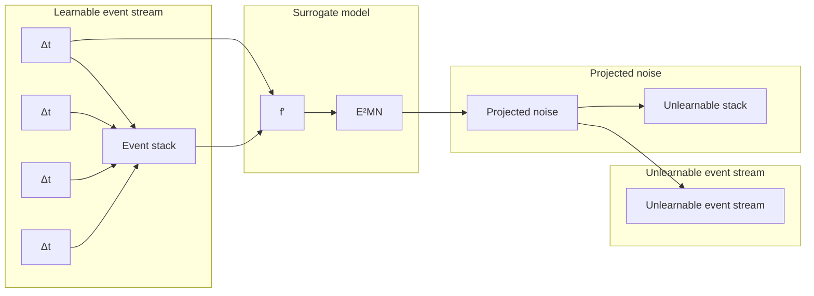

Figure 2. Framework of our UEVs. UEVs converts an event stream to the C-channel event stack $( t   =   C   \times   \Delta _ { t } )$ and then employs a surrogate model $f ^ { \prime }$ to generate the event error-minimizing noise (E2MN). Subsequently, the E2MN is projected into $\{ - 0 . 5 , 0 , 0 . 5 \}$ and integrated with the target event stack to generate the unlearnable event stack. The final unlearnable event stream can be reconstructed from the unlearnable event stack and original event stream via the proposed retrieval strategy.

• **Sample-wise noise.** Sample-wise noise $\Delta _ { s }$ is obtained by the first-order optimization method PGD [38] as follows:

$$
\hat {\boldsymbol {\mathcal {E}}} _ {s + 1} ^ {\prime} = \Pi_ {\epsilon} \big (\hat {\boldsymbol {\mathcal {E}}} _ {s} ^ {\prime} - \alpha \cdot \mathrm{sign} (\nabla_ {\hat {\boldsymbol {\mathcal {E}}}} \mathcal {L} (f ^ {\prime} (\hat {\boldsymbol {\mathcal {E}}} _ {s} ^ {\prime}), l)) \big), \tag {3}
$$

where, ${ \hat { \pmb { \mathscr { E } } } } \; = \; { \mathscr { R } } ( { \mathscr { E } } )$ indicates the event stack, s denotes the current perturbation step, $\nabla _ { \pmb { \hat { \mathcal { E } } } } \mathcal { L } ( f ( \pmb { \hat { \mathcal { E } } } _ { s } ^ { \prime } ) , l )$ is the gradient of the loss with respect to the $\hat { \mathcal { E } } ,$ Πϵ is a projection function that clips the perturbed event stack back to the ϵ-ball around the event stack $\hat { \varepsilon }$ when it goes beyond, and α is the step size. $\mathcal { L }$ is the cross entropy loss function. The generated event error-minimizing noise is achieved by: $\delta _ { i }   =   \hat { \mathcal { E } } _ { i } ^ { ' } - \hat { \mathcal { E } } _ { i }$ i and calculates it case-by-case to get $\Delta _ { s }   =   \{ \pmb { \delta } _ { 1 } , \pmb { \delta } _ { 2 } , \cdots , \pmb { \delta } _ { N } \}$ . The output $\hat { \varepsilon } ^ { \prime }$ is not our final unlearnable event stack since it does not exhibit a binarypolarity characteristic, which is crucial for the reconstruction of unlearnable events. We need to project this noise into a sparse pattern that is compatible with the original event stack to generate our unlearnable event streams.

• **Class-wise noise.** Since sample-wise noise depends on each input event, memory consumption would increase sharply as the dataset scale grows. Therefore, we introduce the class-wise noise: $\Delta _ { c }   =   \{ \delta _ { l _ { 1 } } , \delta _ { l _ { 2 } } \cdots , \delta _ { l _ { N } } \}$ which applies the same noise to different events within the same class. For $\Delta _ { c } ,$ we firstly initialize the noise in the class-level and then employ Eq. (3) to optimize the noise $\delta _ { l }$ with all event streams sampled from the class l. Class-wise noise shows advantages over sample-wise noise in terms of practicality and efficiency. It can be easily applied to newly captured event streams and has a smaller noise scale. Same to the sample-wise noise, class-wise noise cannot be directly used to generate unlearnable event streams, which also needs to be projected into a sparse form for UEVs generation.

**Noise projection.** As demonstrated in Sec. 3.1, the event stream consists solely of polarities of −1 and +1, which are normalized to 0 and 1 in event stack, receptively. Therefore, we need to project the generated event errorminimizing noise into a sparse and event-friendly pattern to facilitate the subsequent generation of unlearnable event streams. Here, we propose projecting the generated noise into $\{ - 0 . 5 , 0 . 0 , + 0 . 5 \}$ as follows:

$$
\mathbf {P} (\delta) = \left\{ \begin{array}{l l} - 0. 5, & \text {if} \delta_ {i, j} <   \mu - \tau \times \pi , \\ 0. 0, & \text {if} \mu - \tau \times \pi \leq \delta_ {i, j} \leq \mu + \tau \times \pi , \\ + 0. 5, & \text {if} \delta_ {i, j} > \mu + \tau \times \pi , \end{array} \right. \tag {4}
$$

where, the $\mu$ and π denote the mean and 1/2 bound of noise $\delta ,$ τ is a balancing parameter.

τ imposes great influence on two criteria of our UEVs, $i . e .$ , effectiveness and imperceptibility. Effectiveness means that the projected noise still owns the unlearnable functionality for event streams. Imperceptibility denotes that the injected noise is imperceptible to users. A higher τ benefits better imperceptibility but corrupts the effectiveness. To ensure the effectiveness of the projected noise, we enforce the surrogate model to discriminate between the unlearnable features and clean features during model training. Thereby, the model can generate a strong shortcut during noise optimization, preventing the model from learning real semantic features. We reformulate the loss function of the outer optimization in Eq. (2) as:

$$
\mathcal {L} ^ {*} = \lambda_ {1} \mathcal {L} + \lambda_ {2} \mathcal {L} _ {s}. \tag {5}
$$

$\mathcal { L } _ { s }$ is the similarity loss that aims to enlarge the difference between clean and unlearnable features.

**Event reconstruction.** After getting the projected event error-minimizing noise, we incorporate this noise into $\hat { \mathcal { E } }$ to generate the unlearnable counterpart. Note that what we obtain here is only the unlearnable event stack. We need to reconstruct the unlearnable event stream from this stack. Therefore, a retrieval strategy is proposed to recover the compressed dense temporal information when converting event data into event stacks. For an event within the unlearnable event stack $\hat { \mathcal { E } } ,$ **1)** if it is recorded in original event stream E then search for the time stamp t in $\mathcal { E }$ to assign it directly; **2)** if it is a newly generated event, initialize a new adaptive time stamp based on the selected $\Delta _ { t }$ to set it. Based on this strategy, the generated unlearnable events can be transferred from unlearnable event stacks into event streams, as shown in Fig. 1. The overall pipeline of our UEVs is illustrated in Algorithm 1. $\mathcal { R } ( \cdot )$ and $\mathcal { R } ^ { \prime } ( \cdot )$ denote event representation and event reconstruction, respectively.

## 3.4. Implementation details

Following [22], we employ the ResNet18 [20] as the surrogate model. The SGD optimizer is employed with a learning rate of $1 0 ^ { - 4 }$ and a momentum of 0.9. An exponential learning rate scheduler with a gamma of 0.9 is used. The iteration number M and epoch number are set to 10 and 30, respectively. The batch size is 16. The C in the event stack is set to 16. In noise generation, the step number S, parameter ϵ, and step size α are 10, 0.5, and 0.8/255, respectively. The balancing ratio τ is $3 / 4$ . The accuracy γ is 0.99. We train all models on a single NVIDIA V100 GPU.

## 4. Experiment

## 4.1. Setup

**Dataset.** Four event-based datasets are used in our experiments, including N-Caltech101 [42], CIFAR10-DVS [31], DVS128 Gesture [1], and N-ImageNet [27]. Due to the limited computing resources, the first 10 classes are sampled from N-ImageNet [27] for experiments. Detailed information is shown in Table 6 of the Supplementary Material.

**Baseline.** To evaluate the effectiveness, we implement several event pollution operations (see Fig. 1 (b)) as our baselines, including coordinate shifting (CS), time stamp shifting (TS), polarity inversion (PI), manual pattern injection (MP), and area shuffling (AS).

Algorithm 1: UEVs Perturbation Algorithm.

Input: Surrogate model $f'_{\theta}(\cdot)$, clean dataset $\mathcal{D}_c$, optimization number $M$, accuracy $\gamma$.
Output: Perturbation $\delta$, Unlearnable dataset $\mathcal{D}_u$.
$\delta \leftarrow randomization$;
Do
    for $i$ in range($M$) do
        $(\mathcal{E}, l) = Next(\mathcal{D}_c)$;
        $\theta \leftarrow \theta - \nabla_{\theta}(\mathcal{L}^*(f'_{\theta}(\mathcal{R}(\mathcal{E}) + [\delta_i / \delta_{l_i}]), l))$
        $\triangleright$ Sample or class -wise noise: $\delta_i / \delta_{l_i}$
    end
    for $(\mathcal{E}, l)$ in $\mathcal{D}_c$ do
        $\delta = \mathbb{P}(\mathcal{E}, l, f', \delta, \theta)$;
        $\triangleright$ Perturbed by Eq. (3)
        $Clip(\delta, -\epsilon, +\epsilon)$;
    end
    $acc = evaluation(\mathcal{D}_c, f', \delta, \theta)$;
Until $acc$ higher than $\gamma$;
for $(\mathcal{E}_j, l_j)$ in $\mathcal{D}_c$ do
    $\delta' = \mathbf{P}(\delta \leftarrow [\delta_j \text{ or } \delta_{l_j}])$; $\triangleright$ Eq. (4)
    $\mathcal{E}' = \mathcal{R}'\big(\text{Clip}(\mathcal{R}(\mathcal{E}_j) + \delta', 0, 1)\big)$;
    $\mathcal{D}_u.append((\mathcal{E}'_j, l_j))$; $\triangleright$ Unlearnable event
end

To test the generalizibility of UEVs, we introduce ResNet18 (RN18) [20], ResNet50 (RN50) [20], VGG16 (VG16) [49], DenseNet121 (DN121) [21], EfficientNet-B1 (EN-B1) [53], ViTB [7], and SwinB [36] as baselines in our experiment.

**Metric.** Following the existing UEs method [22], we use the test accuracy to evaluate the data protection ability of the proposed method. The lower the test accuracy, the stronger the protection ability. To assess the imperceptibility of the generated noise, we employ PSNR, SSIM, and MSE to measure the visual perception on the event stack [9].

## 4.2. Evaluation

**Visualization comparison** of aforementioned various noise forms is shown in Fig. 3. We implement five kinds of event distortion operations as baselines to evaluate our UEVs. The coordinate shifting (CS) only introduces an offset in x and y directions without adding any additional noise, as shown in the 2nd column. We put off the time stamps of each event by a fixed time bin to achieve the TS, which shows that some new events are introduced in the current representations. Reverse the polarity of all events (PI) is another noise form that shows a noticeable difference between the clean data and unlearnable counterpart in the 4th column. MP is implemented by injecting special event streams manually, which shows an obvious pattern in the top-left corner of the representation. We also shuffle the event in block-level (AS) to confuse the model training, which shows a noticeable difference between the clean data and unlearnable one poisoned by AS. Our class-wise noise and sample-wise noise are shown in the last two columns of Fig. 3. Detailed imperceptibility evaluation of each kind of noise is shown in Table 1. Injecting a small manual pattern (MP) can achieve a good imperceptibility. But our $\Delta _ { c }$ and $\Delta _ { s }$ achieve the best overall performance in imperceptibility and unlearnability. The PSNR of $\Delta _ { c }$ and $\Delta _ { s }$ are 20.39 and 18.22, respectively.

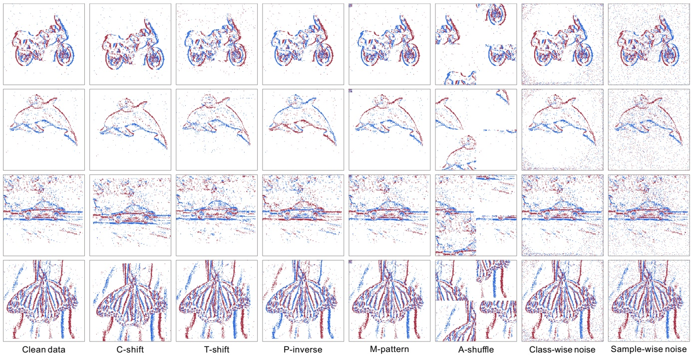

flowchart

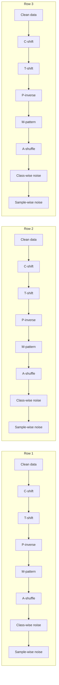

Figure 3. Visualization results of various noise forms on the N-Caltech101 dataset [42]. Blue/Red points denote the events with $p =$ +1/−1. Our noise E2MN does not corrupt the target objects, and the noise distributed in the background region appears quite realistic.

**Quantitative results** of various unlearnable noise forms on the four datasets are shown in Table 2. We can find that our sample-wise and class-wise noise achieve a noticeable accuracy drop among the whole classifiers compared with the baselines. Shifting the coordinates or time stamps of the event cannot achieve a reliable unlearnable effect. For example, on the DVS128 Gesture dataset, ResNet18 achieves an improvement by 1.21% when train the classifier on $\mathcal { D } _ { u }$ poisoned by CS than the clean dataset $\mathcal { D } _ { c }$ . Setting the polarity of each event to inverse can confuse the model to learn semantic features, where PI achieves the accuracy drop by 40.87% on the N-Caltech101 dataset. However, this noise can be removed easily via simple data augmentation skills. Injecting a manual pattern (MP) into the event stream to build a shortcut between the event data and target label is inspired by backdoor attacks [55]. We randomize patterns for each class to poison the event data that influences the accuracy of ResNet18 from 65.19% to 36.12% on the CIFAR10- DVS dataset. On N-ImageNet, the MP achieves an obvious accuracy drop by 45.40 since it is easier to be captured by deep models than the real complex features of input data. Shuffling the event in block-level (AS) (see the 6th column of Fig. 3) cannot protect the event stream effectively, which achieves the accuracy by 48.25%, 39.81%, 58.68%, and 28.00% on N-Caltech101, CIFAR10-DVS, DVS128 Gesture, and N-ImageNet, respectively.

Table 1. Imperceptibility evaluation of various noise forms.

|  | CS | TS | PI | MP | AS | $\Delta_c$ | $\Delta_s$ |
| --- | --- | --- | --- | --- | --- | --- | --- |
| PSNR | 12.19 | 13.07 | 16.76 | 28.82 | 11.75 | 20.36 | 18.22 |
| SSIM | 0.316 | 0.418 | 0.996 | 0.997 | 0.245 | 0.791 | 0.571 |
| MSE | 0.182 | 0.143 | 0.067 | 0.069 | 0.212 | 0.028 | 0.040 |

On the contrary, our sample-wise noise and class-wise noise all achieve credible unlearnable performance on four datasets. Since ResNet18 is selected as the surrogate model in our experiment, the best unlearnable effectiveness is obtained when a malicious user trains ResNet18 on the unlearnable datasets. To evaluate the generalizability of the UEVs, we have trained a series of popular DNN classifiers on the clean data and our unlearnable counterpart. As shown in Table 2, the class-wise noise can deceive almost all of the classifiers to learn shortcuts on N-Caltech101, where the accuracy of these classifiers is less than 5% except EfficientNet-B1. Moreover, it also achieves a great accuracy drop higher than 35% on both CIFAR10-DVS and DVS128 Gesture datasets. For sample-wise noise, every data has a different low-error noise, which noise can reduce the loss during the optimization process of the model, which leads to the event data unlearnable. In Table 2, sample-wise noise $\Delta _ { s }$ achieves the biggest accuracy drop by 77.60%, 57.87%, and 66.67% on four datasets, respectively.

Table 2. The testing accuracy (%) of various DNN classifiers trained on the clean training sets $( \mathcal { D } _ { c } )$ and their unlearnable ones $( \mathcal { D } _ { u } )$ generated by five kinds of event pollutions, sample-wise noise $( \Delta _ { s } )$ , and class-wise noise $( \Delta _ { c } )$

<table><tr><td rowspan="2">Noise Form</td><td rowspan="2">Model</td><td colspan="2">N-Caltech101</td><td colspan="2">CIFAR10-DVS</td><td colspan="2">DVS128 Gesture</td><td colspan="2">N-ImageNet</td></tr><tr><td> $\mathcal{D}_c$ </td><td> $\mathcal{D}_u$ </td><td> $\mathcal{D}_c$ </td><td> $\mathcal{D}_u$ </td><td> $\mathcal{D}_c$ </td><td> $\mathcal{D}_u$ </td><td> $\mathcal{D}_c$ </td><td> $\mathcal{D}_u$ </td></tr><tr><td>CS</td><td rowspan="5">Res18</td><td rowspan="5">78.32</td><td>50.43(-27.79)</td><td rowspan="5">65.19</td><td>46.80(-18.39)</td><td rowspan="5">74.14</td><td>75.35(+01.21)</td><td rowspan="5">56.60</td><td>42.60(-14.00)</td></tr><tr><td>TS</td><td>37.54(-40.87)</td><td>35.34(-29.85)</td><td>72.92(-01.22)</td><td>41.20(-15.40)</td></tr><tr><td>PI</td><td>40.78(-37.45)</td><td>22.72(-42.47)</td><td>31.94(-42.20)</td><td>41.80(-4.80)</td></tr><tr><td>MP</td><td>50.26(-28.06)</td><td>36.12(-29.07)</td><td>68.06(-06.08)</td><td>11.20(-45.40)</td></tr><tr><td>AS</td><td>48.25(-30.07)</td><td>39.81(-25.38)</td><td>58.68(-15.46)</td><td>28.00(-28.00)</td></tr><tr><td rowspan="7"> $\Delta_c$ </td><td>RN18</td><td>78.52</td><td>01.90(-76.62)</td><td>65.22</td><td>22.33(-42.89)</td><td>74.31</td><td>14.93(-59.38)</td><td>56.80</td><td>10.00(-46.80)</td></tr><tr><td>RN50</td><td>80.64</td><td>04.88(-75.76)</td><td>67.67</td><td>18.83(-48.84)</td><td>78.47</td><td>24.31(-54.16)</td><td>61.60</td><td>10.00(-51.60)</td></tr><tr><td>VG16</td><td>71.63</td><td>03.68(-67.95)</td><td>67.77</td><td>30.19(-37.58)</td><td>81.94</td><td>20.49(-61.45)</td><td>56.20</td><td>04.00(-52.20)</td></tr><tr><td>DN121</td><td>75.59</td><td>02.18(-73.31)</td><td>62.72</td><td>24.37(-38.35)</td><td>74.31</td><td>22.22(-52.09)</td><td>59.20</td><td>08.80(-50.40)</td></tr><tr><td>EN-B1</td><td>74.44</td><td>12.81(-61.63)</td><td>72.72</td><td>23.50(-49.22)</td><td>62.50</td><td>19.10(-43.40)</td><td>56.20</td><td>06.20(-50.00)</td></tr><tr><td> $ViT_B$ </td><td>44.69</td><td>01.55(-43.14)</td><td>45.44</td><td>09.51(-35.93)</td><td>66.67</td><td>26.74(-39.93)</td><td>41.00</td><td>10.00(-31.00)</td></tr><tr><td> $Swin_B$ </td><td>90.70</td><td>00.52(-90.18)</td><td>75.24</td><td>29.03(-46.21)</td><td>83.29</td><td>28.12(-55.17)</td><td>72.00</td><td>10.00(-62.00)</td></tr><tr><td rowspan="7"> $\Delta_s$ </td><td>RN18</td><td>78.12</td><td>00.52(-77.60)</td><td>65.15</td><td>15.51(-49.64)</td><td>73.96</td><td>14.54(-59.42)</td><td>56.40</td><td>10.20(-46.20)</td></tr><tr><td>RN50</td><td>80.30</td><td>06.09(-74.21)</td><td>67.86</td><td>12.62(-55.24)</td><td>79.17</td><td>20.03(-59.14)</td><td>61.20</td><td>16.80(-44.40)</td></tr><tr><td>VG16</td><td>72.03</td><td>14.13(-57.90)</td><td>67.18</td><td>27.86(-39.32)</td><td>81.94</td><td>26.39(-55.55)</td><td>55.40</td><td>14.80(-40.60)</td></tr><tr><td>DN121</td><td>75.30</td><td>11.49(-63.85)</td><td>64.27</td><td>15.73(-48.54)</td><td>74.31</td><td>20.83(-53.48)</td><td>59.20</td><td>11.40(-47.80)</td></tr><tr><td>EN-B1</td><td>73.81</td><td>17.98(-55.83)</td><td>72.82</td><td>14.95(-57.87)</td><td>64.93</td><td>16.32(-48.61)</td><td>55.60</td><td>11.40(-44.20)</td></tr><tr><td> $ViT_B$ </td><td>44.73</td><td>01.09(-43.64)</td><td>47.38</td><td>26.02(-21.36)</td><td>67.01</td><td>30.21(-36.80)</td><td>40.40</td><td>08.80(-31.60)</td></tr><tr><td> $Swin_B$ </td><td>90.70</td><td>21.14(-69.56)</td><td>75.44</td><td>27.18(-48.26)</td><td>83.68</td><td>17.01(-66.67)</td><td>71.20</td><td>09.00(-62.20)</td></tr></table>

## 4.3. Ablation study

**Similarity loss.** To ensure the event error-minimizing noise can still prevent model learning after being projected, we introduce the similarity loss to enlarge the distance between the clean and unlearnable stacks during the surrogate model training. Detailed results are shown in Table 3. Compared with **E1** in Table 3, the effectiveness of our samplewise noise (**E2**) is decreased when we remove the similarity loss. Minimizing the similarity between the clean and unlearnable stacks is to improve the difference between the shortcut and real semantic features of input samples under the correct classification, avoiding possible feature learning. As shown in Fig. 4, this similarity supervision is crucial for ensuring the unlearnability of our UEVs due to the big difference between the original noise and projected noise.

**Mixed noise.** In the main experiment, we have conducted exploration about the sample-wise noise and class-wise noise, respectively. According to detailed results, we can find that sample-wise and class-wise noises achieve the best performance on different datasets among various classifiers. Here, we propose a mixed counterpart to evaluate the effectiveness of our UEVs, which is beneficial for personalized utilization and preventing noise exposure. Since it’s hard to optimize these two kinds of noises simultaneously, we mix the obtained two noises as the mixed counterpart instead of training it from scratch. Specifically, we design two modes to generate the mixed noise. First, we randomly select δ from $\Delta _ { c }$ and $\Delta _ { s }$ to poison the input sample, denoting as $\Delta _ { c } \vee \Delta _ { u } .$ . Second, we employ the element-wise addition to generate the unlearnable examples, naming $\Delta _ { c } + \Delta _ { u }$

Table 3. Results of ablation experiments for UEVs (sample-wise noise) on N-Caltech101 dataset.

|  | RN18 | RN50 | VG16 | DN121 | EN-B1 | $ViT_B$ | $Swin_B$ |
| --- | --- | --- | --- | --- | --- | --- | --- |
| E1 | 0.52 | 6.09 | 14.13 | 11.49 | 17.98 | 1.09 | 21.14 |
| E2 | 3.85 | 15.22 | 38.31 | 10.17 | 24.18 | 37.51 | 27.51 |
| E3 | 5.17 | 5.40 | 22.23 | 6.15 | 18.78 | 1.21 | 16.66 |
| E4 | 5.34 | 5.17 | 8.16 | 5.17 | 5.86 | 1.03 | 0.57 |
| E5 | 13.04 | 8.04 | 14.99 | 10.74 | 16.54 | 9.88 | 25.73 |
| E6 | 27.74 | 33.08 | 44.28 | 34.92 | 27.17 | 8.85 | 24.41 |

As shown in Table 3, **E3** and **E4** represent the $\Delta _ { c } \vee \Delta _ { v }$ and $\Delta _ { c } + \Delta _ { u }$ respectively, where the proposed event errorminimizing noise remains highly effective. Although employing $\Delta _ { c } + \Delta _ { u }$ can achieve a better unlearnable performance, simple addition leads to the low stealthiness of the noise. Randomly selecting noise from $\Delta _ { c } \lor \Delta _ { u }$ provides another possible solution for dataset protection, making our

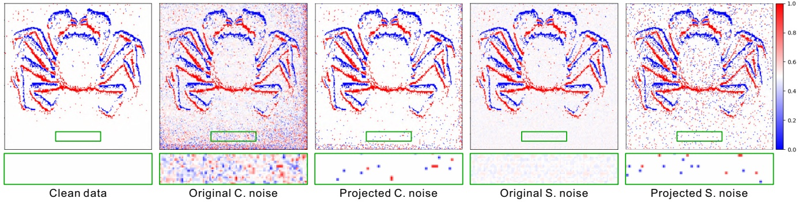

Figure 4. Visualization results of clean data representation, unlearnable representations generated by class-wise noise and sample-wise noise with and without projection, respectively. Details are zoomed in the green box.

UEVs more flexible in practical usage.

**Robustness.** In event-based learning, data augmentation is always adopted to enhance the model’s performance. Therefore, studying the robustness of our unlearnable event streams against data augmentation methods is of great importance. Here, we employ the common random shift, crop, flip, and event drop [17] as augmentation techniques in our experiments. As shown in Table 3 **E5**, these augmentation techniques slightly eliminate the effectiveness of our event error-minimizing noise. This evaluation demonstrates the high practicality of our UEVs in various training scenarios.

**Different adversarial attacks.** As shown in Eq. (3), our E2MN is generated inspired by the PGD attack. Therefore, exploring the generalization ability of our method encountering other adversarial attack methods (e.g., FGSM [16]) becomes natural. For example, we reformulate the Eq. (3) via FGSM as $\begin{aligned} { \mathbf { \hat { \mathcal { E } } } ^ { \prime } = \mathbf { \hat { \mathcal { E } } } - \alpha \cdot \operatorname { s i g n } ( \nabla _ { \mathbf { \hat { \mathcal { E } } } } \mathcal { L } ( f _ { \theta } ^ { \prime } ( \mathbf { \hat { \mathcal { E } } } ) , l ) ) } \\ \end{aligned}$ to induce the model focusing on easy-learned features. Here, we set α to 8/255 and use the same configurations with Eq. (3) to train the surrogate model. In Table 3, **E6** shows the unlearnable performance of our UEVs via FGSM on N-Caltech101 dataset. The unlearnable ability of our method is indeed decreased by using FGSM. However, UEVs can still pre-vent unauthorized models from achieving reliable predictions under the protection provided by UEVs.

**Noise projection.** To ensure the generated noise can be compatible with event streams, the noise projection has been proposed to process the generated noise. Here, we conduct the ablation study to showcase the necessary of this operation. Note that the polarity of events is normalized into {0.0, 0.5, 1.0}, where 0.0/1.0 denote the polarity of an event is -1/+1, 0.5 means there is no event. As shown in Fig. 4, there are many noises in the background of the representation frames while removing the projection operation (original noise). Hence, it’s impossible to reconstruct an unlearnable event stream from non-projected representations. We propose Eq. (4) to project our noise into {-0.5, 0, +0.5}. In Eq. (4), τ is introduced to balance the effectiveness and stealthiness of the injected noise in our UEVs. A larger τ can achieve higher stealthiness while corrupting the noise’s unlearnable ability. Minimizing the τ can achieve good effectiveness but the stealthiness would be corrupted.

## 5. Conclusion

This paper proposes the first unlearnable framework for asynchronous event streams (UEVs), which provides the possibility to protect the event data from being learned by unauthorized models. Specifically, a new form of event error-minimizing noise (E2MN) is presented to integrate with event data, preventing the model from learning its real semantic features. To ensure the learned noise can be compatible with sparse event data, we propose a projection mechanism to project the E2MN into event friendly counterpart that facility the generation of unlearnable event streams. Additionally, a retrieval strategy is proposed to reconstruct the unlearnable event streams from their corresponding unlearnable stacks. Extensive ablation studies and analysis experiments conducted on four datasets with seven popular DNN models demonstrate the effectiveness, imperceptibility, and robustness of UEVs.

**Acknowledgement.** Renjie Group is supported by the National Natural Science Foundation of China under Grant No. 62302415, Guangdong Basic and Applied Basic Research Foundation under Grant No. 2022A1515110692, 2024A1515012822, and the Blue Sky Research Fund of HKBU under Grant No. BSRF/21-22/16. Boxin Shi and Peiqi Duan are supported by National Natural Science Foundation of China (Grant No. 62088102, 62402014), Beijing Natural Science Foundation (Grant No. L233024), and Beijing Municipal Science & Technology Commission, Administrative Commission of Zhongguancun Science Park (Grant No. Z241100003524012).

## References

[1] Arnon Amir, Brian Taba, David Berg, Timothy Melano, Jeffrey McKinstry, Carmelo Di Nolfo, Tapan Nayak, Alexander Andreopoulos, Guillaume Garreau, Marcela Mendoza, et al. A low power, fully event-based gesture recognition system. In Proc. CVPR, pages 7243–7252, 2017. 1, 2, 5, 4
[2] Lorenzo Berlincioni, Luca Cultrera, Chiara Albisani, Lisa Cresti, Andrea Leonardo, Sara Picchioni, Federico Becattini, and Alberto Del Bimbo. Neuromorphic event-based facial expression recognition. In Proc. CVPR, 2023. 3
[3] Marco Cannici and Davide Scaramuzza. Mitigating motion blur in neural radiance fields with events and frames. In Proc. CVPR, pages 9286–9296, 2024. 2
[4] Nicholas Carlini and David Wagner. Towards evaluating the robustness of neural networks. In S&P, pages 39–57, 2017. 3
[5] Zhiwen Chen, Zhiyu Zhu, Yifan Zhang, Junhui Hou, Guangming Shi, and Jinjian Wu. Segment any event streams via weighted adaptation of pivotal tokens. In Proc. CVPR, pages 3890–3900, 2024. 2
[6] Yinpeng Dong, Fangzhou Liao, Tianyu Pang, Hang Su, Jun Zhu, Xiaolin Hu, and Jianguo Li. Boosting adversarial attacks with momentum. In Proc. CVPR, pages 9185–9193, 2018. 3
[7] Alexey Dosovitskiy, Lucas Beyer, Alexander Kolesnikov, Dirk Weissenborn, Xiaohua Zhai, Thomas Unterthiner, Mostafa Dehghani, Matthias Minderer, Georg Heigold, Sylvain Gelly, Jakob Uszkoreit, and Neil Houlsby. An image is worth 16x16 words: Transformers for image recognition at scale. In ICLR, 2021. 5
[8] Peiqi Duan, Zihao W Wang, Boxin Shi, Oliver Cossairt, Tiejun Huang, and Aggelos K Katsaggelos. Guided event filtering: Synergy between intensity images and neuromorphic events for high performance imaging. TPAMI, 44(11): 8261–8275, 2021. 2
[9] Peiqi Duan, Zihao W Wang, Xinyu Zhou, Yi Ma, and Boxin Shi. EventZoom: Learning to denoise and super resolve neuromorphic events. In Proc. CVPR, pages 12824–12833, 2021. 2, 5, 3
[10] Peiqi Duan, Boyu Li, Yixin Yang, Hanyue Lou, Minggui Teng, Xinyu Zhou, Yi Ma, and Boxin Shi. Eventaid: Benchmarking event-aided image/video enhancement algorithms with real-captured hybrid dataset. TPAMI, 2025. 2
[11] Li Fei-Fei, Rob Fergus, and Pietro Perona. Learning generative visual models from few training examples: An incremental bayesian approach tested on 101 object categories. In Proc. CVPRW, pages 178–178, 2004. 4
[12] Shaopeng Fu, Fengxiang He, Yang Liu, Li Shen, and Dacheng Tao. Robust unlearnable examples: Protecting data privacy against adversarial learning. In ICLR, 2022. 2, 3
[13] Guillermo Gallego, Tobi Delbruck, Garrick Orchard, Chiara ¨ Bartolozzi, Brian Taba, Andrea Censi, Stefan Leutenegger, Andrew J Davison, Jorg Conradt, Kostas Daniilidis, et al. ¨ Event-based vision: A survey. TPAMI, 44(1):154–180, 2020. 2, 3
[14] Daniel Gehrig, Antonio Loquercio, Konstantinos G Derpanis, and Davide Scaramuzza. End-to-end learning of rep-
resentations for asynchronous event-based data. In Proc. ICCV, pages 5633–5643, 2019. 2
[15] Mathias Gehrig, Willem Aarents, Daniel Gehrig, and Davide Scaramuzza. Dsec: A stereo event camera dataset for driving scenarios. RAL, 6(3):4947–4954, 2021. 1, 2
[16] Ian J Goodfellow, Jonathon Shlens, and Christian Szegedy. Explaining and harnessing adversarial examples. In ICLR, 2015. 8, 3
[17] Fuqiang Gu, Weicong Sng, Xuke Hu, and Fangwen Yu. Eventdrop: Data augmentation for event-based learning. In Proc. IJCAI, 2021. 8, 3
[18] Friedhelm Hamann, Suman Ghosh, Ignacio Juarez Martinez, Tom Hart, Alex Kacelnik, and Guillermo Gallego. Lowpower continuous remote behavioral localization with event cameras. In Proc. CVPR, pages 18612–18621, 2024. 2
[19] Hao He, Kaiwen Zha, and Dina Katabi. Indiscriminate poisoning attacks on unsupervised contrastive learning. In ICLR, 2023. 3
[20] Kaiming He, Xiangyu Zhang, Shaoqing Ren, and Jian Sun. Deep residual learning for image recognition. In Proc. CVPR, pages 770–778, 2016. 3, 5
[21] Gao Huang, Zhuang Liu, Laurens Van Der Maaten, and Kilian Q Weinberger. Densely connected convolutional networks. In Proc. CVPR, pages 4700–4708, 2017. 5
[22] Hanxun Huang, Xingjun Ma, Sarah Monazam Erfani, James Bailey, and Yisen Wang. Unlearnable examples: Making personal data unexploitable. In ICLR, 2021. 1, 2, 5, 3
[23] Ze Huang, Li Sun, Cheng Zhao, Song Li, and Songzhi Su. Eventpoint: Self-supervised interest point detection and description for event-based camera. In Proc. WACV, pages 5396–5405, 2023. 2
[24] Jianping Jiang, Jiahe Li, Baowen Zhang, Xiaoming Deng, and Boxin Shi. Evhandpose: Event-based 3D hand pose estimation with sparse supervision. TPAMI, 2024. 1, 2
[25] Jianping Jiang, Xinyu Zhou, Bingxuan Wang, Xiaoming Deng, Chao Xu, and Boxin Shi. Complementing event streams and rgb frames for hand mesh reconstruction. In Proc. CVPR, pages 24944–24954, 2024. 2
[26] Wan Jiang, Yunfeng Diao, He Wang, Jianxin Sun, Meng Wang, and Richang Hong. Unlearnable examples give a false sense of security: Piercing through unexploitable data with learnable examples. In Pro. ACM MM, pages 8910–8921, 2023. 2
[27] Junho Kim, Jaehyeok Bae, Gangin Park, Dongsu Zhang, and Young Min Kim. N-imagenet: Towards robust, fine-grained object recognition with event cameras. In Proc. ICCV, pages 2146–2156, 2021. 1, 2, 5, 4
[28] Taewoo Kim, Hoonhee Cho, and Kuk-Jin Yoon. Frequencyaware event-based video deblurring for real-world motion blur. In Proc. CVPR, pages 24966–24976, 2024. 2
[29] Alex Krizhevsky, Geoffrey Hinton, et al. Learning multiple layers of features from tiny images. 2009. 4
[30] Xavier Lagorce, Garrick Orchard, Francesco Galluppi, Bertram E Shi, and Ryad B Benosman. Hots: a hierarchy of event-based time-surfaces for pattern recognition. TPAMI, 39(7):1346–1359, 2016. 2
[31] Hongmin Li, Hanchao Liu, Xiangyang Ji, Guoqi Li, and Luping Shi. Cifar10-dvs: an event-stream dataset for object classification. Front. Neurosci., 11:309, 2017. 2, 5, 4
[32] Haotian Liu, Guang Chen, Sanqing Qu, Yanping Zhang, Zhijun Li, Alois Knoll, and Changjun Jiang. Tma: Temporal motion aggregation for event-based optical flow. In Proc. ICCV, pages 9685–9694, 2023. 2
[33] Haoyue Liu, Shihan Peng, Lin Zhu, Yi Chang, Hanyu Zhou, and Luxin Yan. Seeing motion at nighttime with an event camera. In Proc. CVPR, pages 25648–25658, 2024. 2
[34] Xinwei Liu, Xiaojun Jia, Yuan Xun, Siyuan Liang, and Xiaochun Cao. Multimodal unlearnable examples: Protecting data against multimodal contrastive learning. In Proc. ACM MM, pages 8024–8033, 2024. 3
[35] Yixin Liu, Kaidi Xu, Xun Chen, and Lichao Sun. Stable unlearnable example: Enhancing the robustness of unlearnable examples via stable error-minimizing noise. In Proc. AAAI, pages 3783–3791, 2024. 3
[36] Ze Liu, Yutong Lin, Yue Cao, Han Hu, Yixuan Wei, Zheng Zhang, Stephen Lin, and Baining Guo. Swin transformer: Hierarchical vision transformer using shifted windows. In Proc. ICCV, pages 10012–10022, 2021. 5
[37] Qi Ma, Danda Pani Paudel, Ajad Chhatkuli, and Luc Van Gool. Deformable neural radiance fields using rgb and event cameras. In Proc. ICCV, pages 3590–3600, 2023. 2
[38] Aleksander Madry, Aleksandar Makelov, Ludwig Schmidt, Dimitris Tsipras, and Adrian Vladu. Towards deep learning models resistant to adversarial attacks. In ICLR, 2018. 4, 3
[39] Ana I Maqueda, Antonio Loquercio, Guillermo Gallego, Narciso Garc´ıa, and Davide Scaramuzza. Event-based vision meets deep learning on steering prediction for self-driving cars. In Proc. CVPR, pages 5419–5427, 2018. 1
[40] Ruohan Meng, Chenyu Yi, Yi Yu, Siyuan Yang, Bingquan Shen, and Alex C Kot. Semantic deep hiding for robust unlearnable examples. TIFS, 2024. 3
[41] Christen Millerdurai, Hiroyasu Akada, Jian Wang, Diogo Luvizon, Christian Theobalt, and Vladislav Golyanik. EventEgo3D: 3D human motion capture from egocentric event streams. In Proc. CVPR, pages 1186–1195, 2024. 2
[42] Garrick Orchard, Ajinkya Jayawant, Gregory K Cohen, and Nitish Thakor. Converting static image datasets to spiking neuromorphic datasets using saccades. Front. Neurosci., 9: 437, 2015. 2, 5, 6, 4
[43] Henri Rebecq, Timo Horstschaefer, and Davide Scaramuzza. Real-time visual-inertial odometry for event cameras using keyframe-based nonlinear optimization. In Proc. BMVC, pages 16–1, 2017. 3
[44] Henri Rebecq, Rene Ranftl, Vladlen Koltun, and Davide ´ Scaramuzza. Events-to-video: Bringing modern computer vision to event cameras. In Proc. CVPR, pages 3857–3866, 2019. 4
[45] Henri Rebecq, Rene Ranftl, Vladlen Koltun, and Davide ´ Scaramuzza. High speed and high dynamic range video with an event camera. TPAMI, 43(6):1964–1980, 2019. 3
[46] Jie Ren, Han Xu, Yuxuan Wan, Xingjun Ma, Lichao Sun, and Jiliang Tang. Transferable unlearnable examples. In ICLR, 2023. 2, 3
[47] Viktor Rudnev, Vladislav Golyanik, Jiayi Wang, Hans-Peter Seidel, Franziska Mueller, Mohamed Elgharib, and Christian Theobalt. Eventhands: Real-time neural 3D hand pose estimation from an event stream. In Proc. ICCV, pages 12385–12395, 2021. 1
[48] Shawn Shan, Emily Wenger, Jiayun Zhang, Huiying Li, Haitao Zheng, and Ben Y Zhao. Fawkes: Protecting privacy against unauthorized deep learning models. In USENIX Security, pages 1589–1604, 2020. 2
[49] K Simonyan and A Zisserman. Very deep convolutional net works for large-scale image recognition. In ICLR, 2015. 3, 5
[50] Amos Sironi, Manuele Brambilla, Nicolas Bourdis, Xavier Lagorce, and Ryad Benosman. HATS: Histograms of averaged time surfaces for robust event-based object classification. In Proc. CVPR, pages 1731–1740, 2018. 1, 2, 3
[51] Ye Sun, Hao Zhang, Tiehua Zhang, Xingjun Ma, and Yu-Gang Jiang. Unseg: One universal unlearnable example generator is enough against all image segmentation. In NeurIPS, 2024. 3
[52] Zhaoning Sun, Nico Messikommer, Daniel Gehrig, and Davide Scaramuzza. Ess: Learning event-based semantic segmentation from still images. In Proc. ECCV, pages 341–357, 2022. 2
[53] Mingxing Tan and Quoc Le. EfficientNet: Rethinking model scaling for convolutional neural networks. In ICML, 2019. 3, 5
[54] Ajay Vasudevan, Pablo Negri, Bernabe Linares-Barranco, and Teresa Serrano-Gotarredona. Introduction and analysis of an event-based sign language dataset. In FG 2020, pages 675–682, 2020. 1
[55] Ruofei Wang, Qing Guo, Haoliang Li, and Renjie Wan. Event trojan: Asynchronous event-based backdoor attacks. In Proc. ECCV, pages 315–332, 2024. 6, 3
[56] Xiao Wang, Shiao Wang, Chuanming Tang, Lin Zhu, Bo Jiang, Yonghong Tian, and Jin Tang. Event stream-based visual object tracking: A high-resolution benchmark dataset and a novel baseline. In Proc. CVPR, pages 19248–19257, 2024. 2
[57] Jingwen Ye and Xinchao Wang. Ungeneralizable examples. In Proc. CVPR, pages 11944–11953, 2024. 2
[58] Pei Zhang, Shuo Zhu, and Edmund Y Lam. Event encryption: Rethinking privacy exposure for neuromorphic imaging. NCE, 4(1):014002, 2024. 1
[59] Pengyu Zhang, Hao Yin, Zeren Wang, Wenyue Chen, Shengming Li, Dong Wang, Huchuan Lu, and Xu Jia. Evsign: Sign language recognition and translation with streaming events. In Proc. ECCV, pages 335–351, 2025. 1
[60] Xian Zhang, Yong Wang, Qing Yang, Yiran Shen, and Hongkai Wen. Ev-perturb: event-stream perturbation for privacy-preserving classification with dynamic vision sensors. MULTIMED TOOLS APPL, 83(6):16823–16847, 2024. 1
[61] Nikola Zubic, Daniel Gehrig, Mathias Gehrig, and Davide ´ Scaramuzza. From chaos comes order: Ordering event representations for object recognition and detection. In Proc. ICCV, pages 12846–12856, 2023. 2

Páginas originales para cotejo

### Página 1

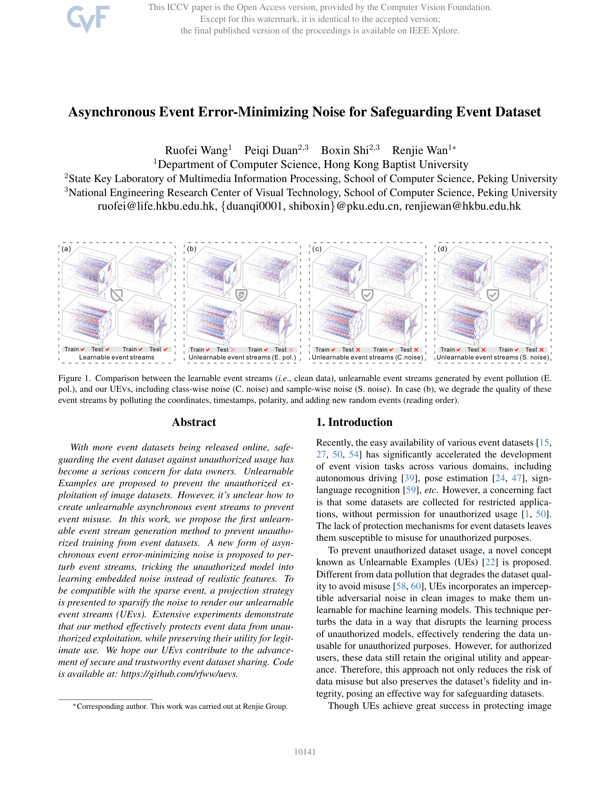

### Página 2

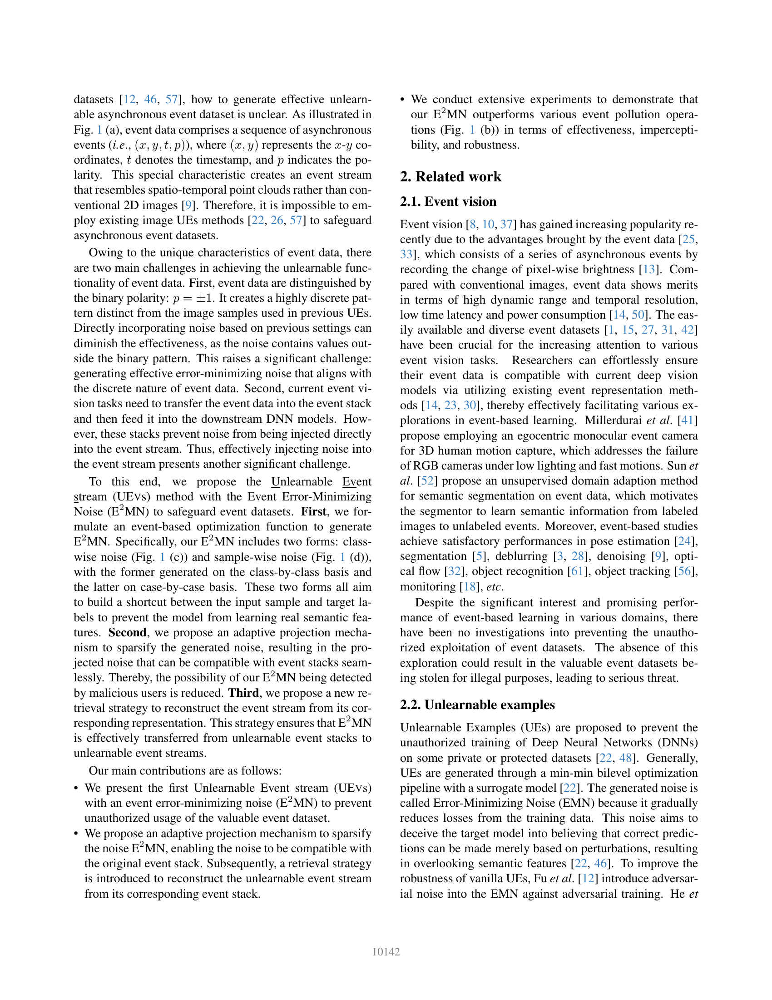

### Página 3

### Página 4

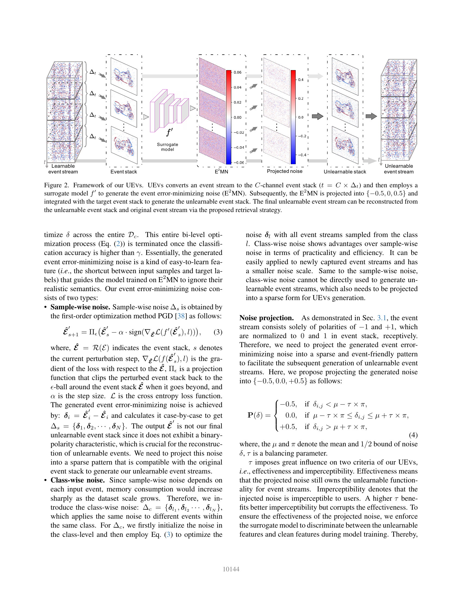

### Página 5

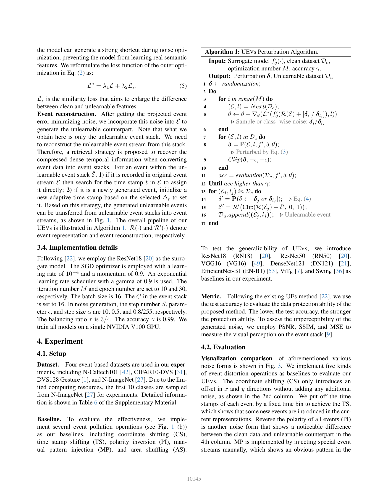

### Página 6

### Página 7

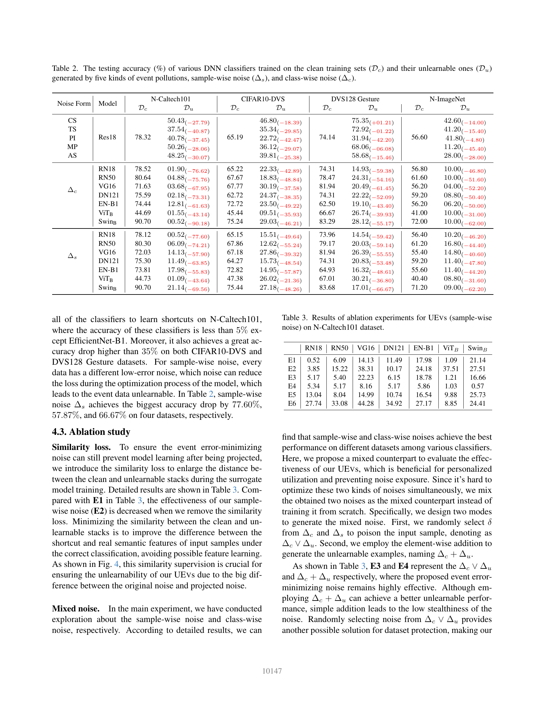

### Página 8

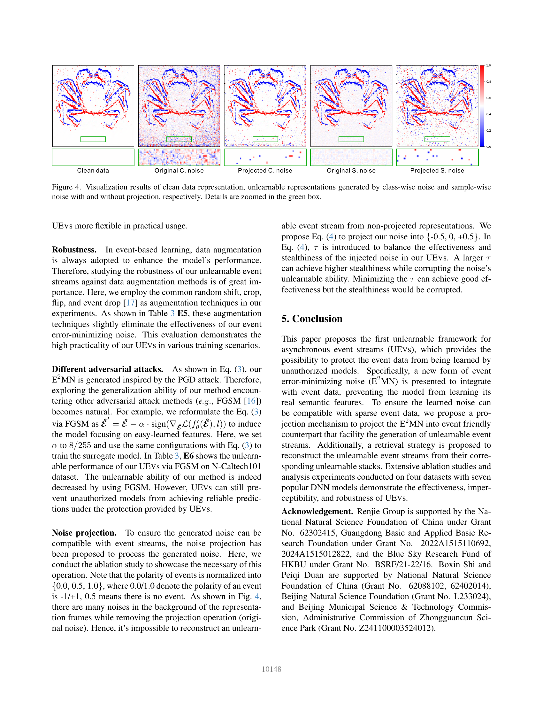

### Página 9

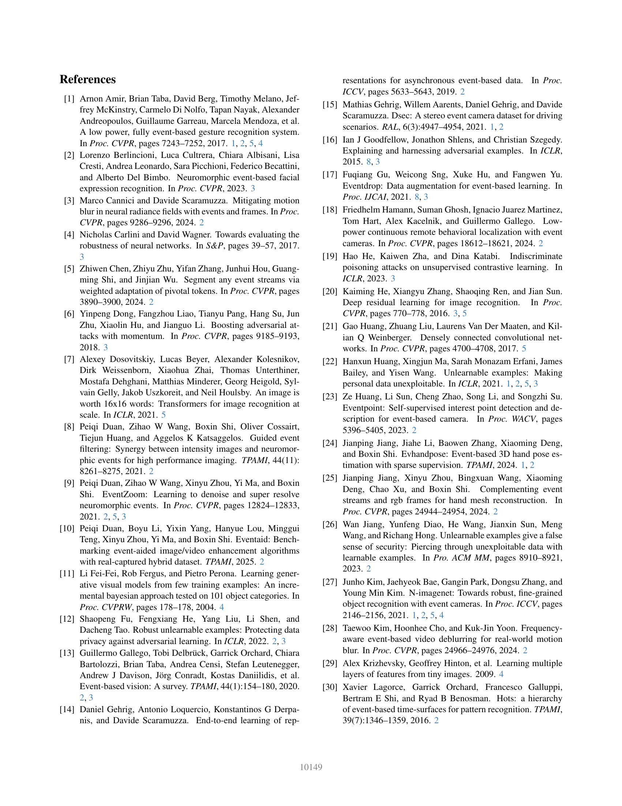

### Página 10

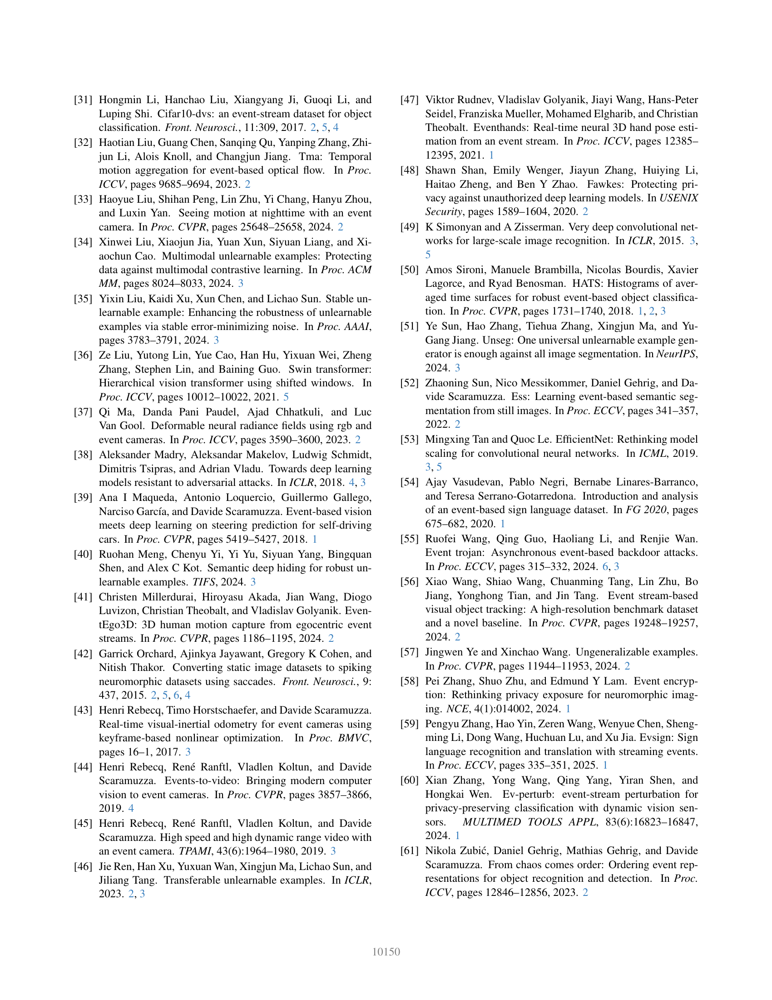

