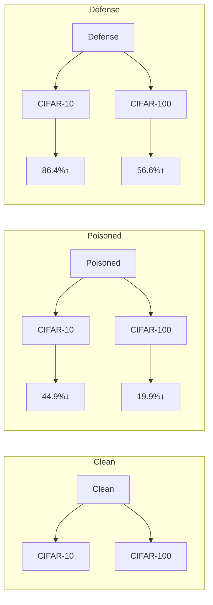
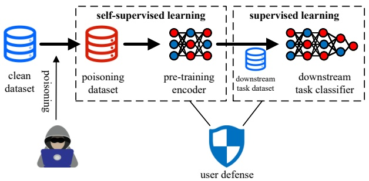
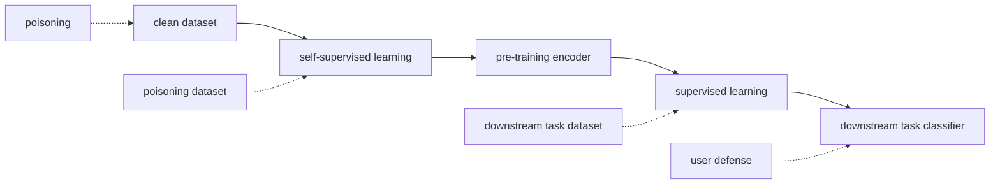
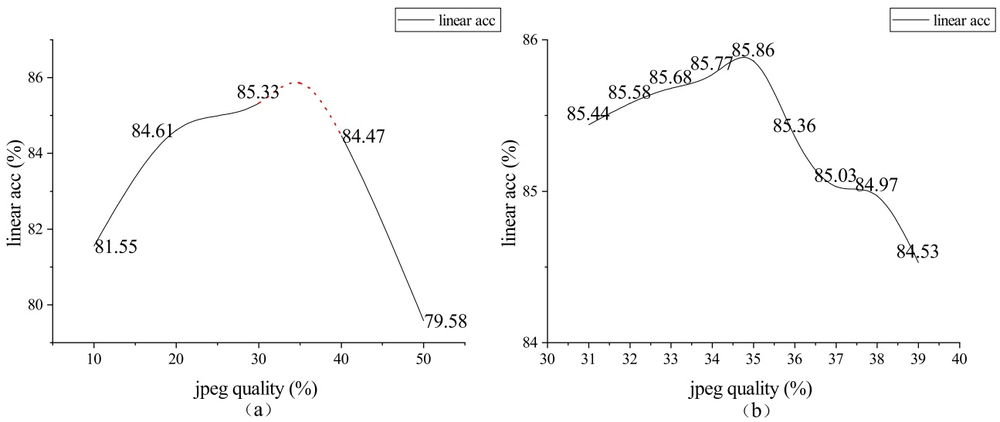
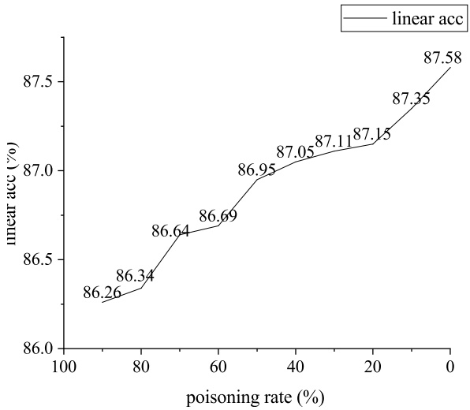
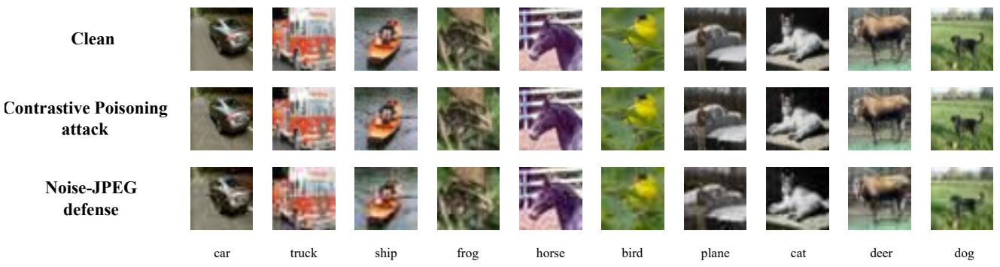
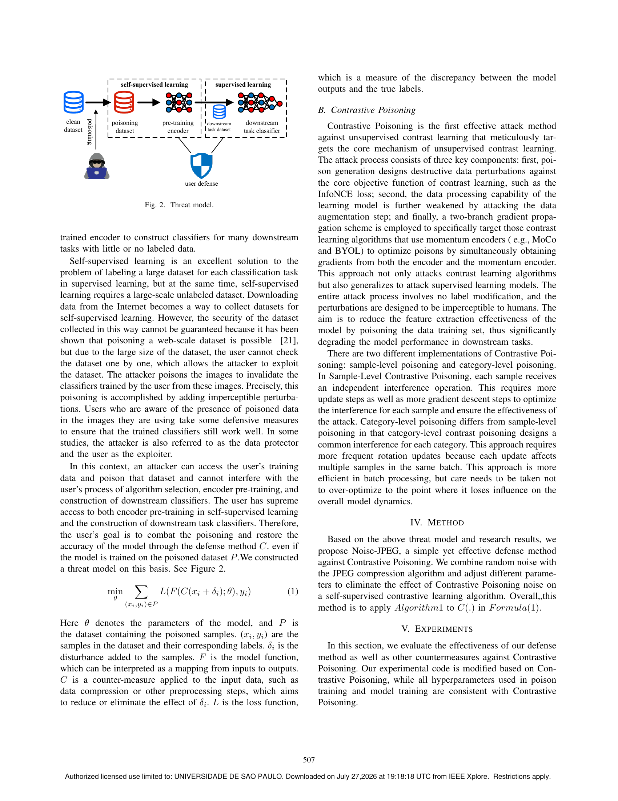
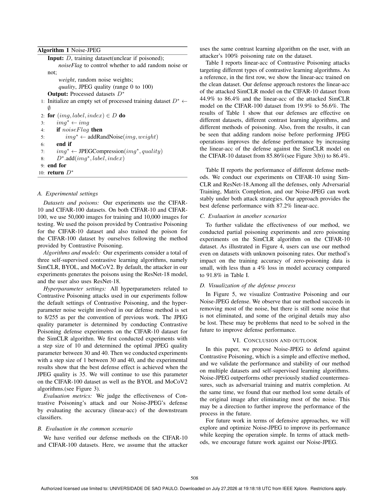
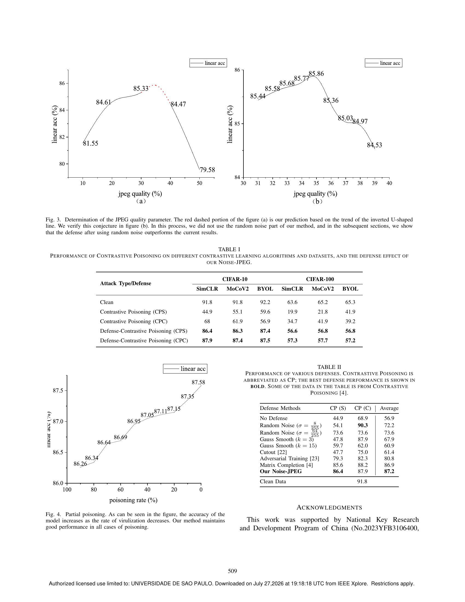
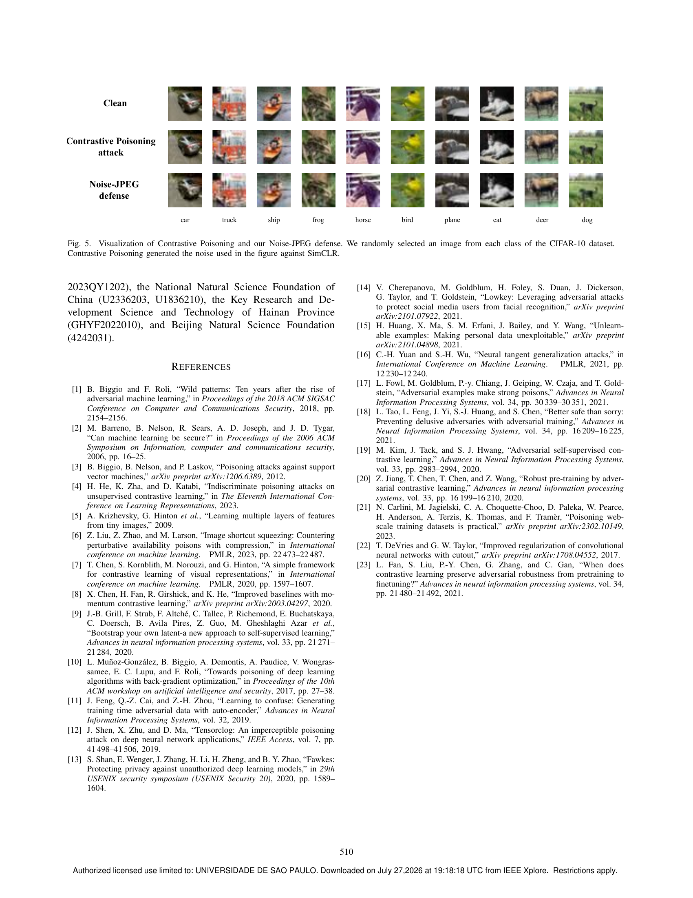

<!-- MinerU 4.0.9, tier advanced, VLM llama.cpp/Vulkan GPU; automatic extraction, tables require comparison with the PDF. -->

[PDF original](../../Defense-Contrastive-Poisoning-An-Application-of-JPEG-to-Self-Supervised-Contrastive-Learning.pdf)

# Defense Contrastive Poisoning: An Application of JPEG to Self-Supervised Contrastive Learning Indiscriminate Poisoning Attacks

Weihao Guo<sup>∗,†</sup>, Xiaoji Ma<sup>∗,†</sup>, Pingyuan Ge<sup>∗,†</sup>, Ying Chen<sup>∗,†</sup>, Qiuling Yue<sup>∗</sup>and Yuqing Zhang ∗,†

<sup>∗</sup>School of Cyberspace Security, Hainan University, Haikou, China

†National Computer Network Intrusion Protection Center, University of Chinese Academy of Sciences, Beijing, China

{guowh,maxj,gepy,cheny22}@nipc.org.cn, yueqiuling@hainanu.edu.cn, zhangyq@nipc.org.cn

**Abstract—Indiscriminate poisoning attacks are a particular type of data poisoning attack in which the attacker adds perturbations to the training data or labels to interfere with the learning process of the model, thus affecting its performance and usability. Self-supervised learning is a new artificial intelligence paradigm that does not require labeling of the dataset during training. Contrastive Poisoning is a method of Indiscriminate poisoning attacks for self-supervised contrastive learning. Contrastive Poisoning has shown excellent attack results on several self-supervised learning algorithms. In this paper, we propose a JPEG-based method, Noise-JPEG, for defense against Contrastive Poisoning. We test the effectiveness of Noise-JPEG’s defense against several self-supervised contrastive learning algorithms on CIFAR-10 and CIFAR-100 datasets. The results show that our method is effective on different datasets and algorithms. Exhibit stable and effective defense performance. Noise-JPEG outperforms other previously studied countermeasures, such as adversarial training and matrix completion. Our method will increase the accuracy of models attacked by Contrastive Poisoning from 44.9% to 86.4%.**

**Index Terms—Self-supervised Learning, Poisoning Attacks, JPEG, Contrastive Poisoning**

## I. INTRODUCTION

Indiscriminate poisoning attacks, also known as availability attacks [1], are a particular type of data poisoning attacks. In this attack, the attacker adds perturbations to the training data or labels that interfere with the learning process of the model, thus affecting its performance and availability. This attack may cause the model to produce misleading features or decisions, therefore posing a threat to the robustness and security of the system. As early as 2006, Barreno et al. [2]presented security issues faced by machine learning, which mentioned spoofing and jamming attacks. Biggio et al. [3]investigated poisoning attacks against Support Vector Machines (SVMs) in classical machine learning models, where the use of a gradient ascent strategy significantly increased the classifier error.

Self-supervised learning is a new artificial intelligence paradigm that can be a good solution to the problem that traditional supervised learning (or transfer learning) requires labeling a large number of datasets for each classification task. With the continuous development of self-supervised learning, some new data poisoning attacks against self-supervised learning systems have been proposed. One of the Indiscriminate

Yuqing Zhang is corresponding author.


<details>
<summary>flowchart</summary>


</details>

Fig. 1. An illustration of our Noise-JPEG for defense Contrastive Poisoning. Contrastive Poisoning reduces the model accuracy but is then restored by our Noise-JPEG.The poison employed in the results was created via Contrastive Poisoning.

poisoning attacks against contrastive learning is Contrastive Poisoning, which was first proposed by He et al [4]. The method is able to significantly degrade the performance of comparative learning algorithms, where the accuracy of the SimCLR algorithm decreases from 91.8% to 44.9% on the CIFAR-10 [5] dataset and from 63.6% to 19.9% on CIFAR-100 [5].As illustrated by Figure 1 (a)→(b), the high accuracy of the model is substantially reduced by indiscriminate poisoning attacks. Contrastive poisoning has some cross-algorithmic and cross-architecture generalizability. However, most of the other research work on self-supervised learning is still focused on designing new algorithms to improve the performance of the algorithms. The security of self-supervised learning is largely unexplored.

JPEG (Joint Photographic Experts Group) is a common image compression standard that is usually used for the compression and storage of digital images. The compression algorithm uses lossy compression, i.e., it reduces the size of the file by discarding some details and information in the image to achieve compression. Liu et al. [6] used JPEG, grayscale processing, and other Image compression techniques to implement a data poisoning attack defense method called ISS, Image Shortcut Squeezing, which is simple and effective and shows promising results against a wide range of previous Indiscriminate poisoning attacks. Still, the study only experimented with supervised learning.

Based on the previous research and the shortcomings, we further explore the effectiveness of image processing techniques such as JPEG to defend against data poisoning attacks in self-supervised learning. Our work can be summarized as follows:

1. We propose a defense method against Contrastive Poisoning attacks, which is simple and effective based on JPEG and random noise.

2. We demonstrate that the our Noise-JPEG method shows good defense against Contrastive Poisoning attacks on self-supervised learning algorithms such as SimCLR [7], MoCo [8], BYOL [9], etc., and outperforms previous defense methods.As illustrated by Figure 1 (b)→(c), the low accuracy of the poisoned model is restored by our Noise-JPEG to be close to the original accuracy.

3. We make recommendations for future research work on self-supervised contrastive learning data poisoning attacks based on the existing experimental results.

## II. RELATED WORK

## A. Indiscriminate poisoning attack

Indiscriminate poisoning attacks have been widely studied in classical machine learning. As early as 2016, Barreno et al. [2] raised security issues facing machine learning, which mentioned spoofing and jamming attacks. In 2012, Biggio et al. [3] investigated poisoning attacks against Support Vector Machines (SVMs) in classical machine learning models, where the use of gradient ascent strategies in the attack significantly increased the classifier error. In recent years, Indiscriminate poisoning attacks against deep learning have also become popular research. In their study, Munoz- ˜ Gonzalez et al. [10] proposed a poisoning attack algorithm ´ based on the idea of inverse gradient optimization, which drastically reduces the complexity of the attack by calculating the gradient through automatic differentiation while inverting the learning process. This approach is able to target a much more comprehensive range of learning compared to previous poisoning strategies algorithms, including neural networks and deep learning architectures, as these algorithms are trained through gradient-based procedures. In their study, Feng et al. [11] present a framework for generating adversarial perturbations using an autoencoder-like network in conjunction with a fictitious differentiable classifier. Using an optimization algorithm with alternating updates, the perturbation generator and the classifier are pitted against each other, minimizing the performance of the classifier on a clean test set. Shen et al. [12] in their study propose a technique called TensorClog that can generate doxing samples without affecting human perception.TensorClog reduces the partial derivatives of the loss function with respect to the weights by minimizing the training effectiveness of the data, thus intentionally causing the gradient to vanish. Shan et al. [13] and Cherepanova et al. [14] in their study proposed a data poisoning attack against face recognition models. Huang et al. [15] in their study used a two-layer optimization method to efficiently generate different forms of error-minimizing noise, which is so tiny that it is hard to detect with the naked eye and thus does not affect the regular use of the data. Yuan and Wu [16] in their study proposed a generalization attack method that uses the mean of GP as an alternative model for DNNs, thus avoiding the complex two-layer optimization problem and does not need to know the specific parameters and structure of the target model. Fowl et al. [17] in their study, used gradient descent-based algorithms to find the optimal adversarial poisoning samples.

Indiscriminate poisoning attacks against self-supervised learning are currently limited to Contrastive Poisoning, an Indiscriminate poisoning attack effective for self-supervised learning proposed by He et al. [4]. The researchers empirically evaluated Contrastive Poisoning on multiple datasets (CIFAR-10/100, STL-10, ImageNet-100) and algorithms (SimCLR, BYOL, MoCoV2). The results show that Contrastive Learning is more robust than Indiscriminate Data Poisoning. All previous Instigated poisoning attacks on supervised learning are ineffective against contrastive learning algorithms, while contrastive poisoning has shown excellent results for contrastive learning algorithms.

## B. Defense of indiscriminate poisoning attacks

In past research, there have been various schemes for defense against Indiscriminate poisoning attacks, including adversarial training, data augmentation techniques, and so on. Among them, adversarial training is considered to be the most effective defense against Indiscriminate poisoning attacks [17], [18], which is intuitive since the poisoned data is located in a small ∞ ball of clean data. Adversarial robustness ensures that the model makes the same predictions in a small neighborhood around the input samples. Thus, its good accuracy on the poisoned training set translates to the clean test set. To enhance the adversarial robustness of contrast learning, several specialized adversarial training frameworks have been proposed: Kim et al. [19] proposed to use an anchor adversarial example as its positive sample; Jiang et al. [20] proposed to use a secondary encoder-trained with adversarial examples and compare it to a normally trained encoder. Data enhancement has also been widely studied as a defense mechanism against poisoning attacks [15], [18]. Liu et al. [6] implemented a defense against data poisoning attacks called ISS, Image Shortcut Squeezing, using image compression techniques such as JPEG and grayscale processing. Still, these studies have only experimented on supervised learning.

The only defense scheme against self-supervised learning Indiscriminate poisoning attack is currently a new matrixcompletion-based data enhancement method proposed by He et al. [4] Proposing Contrastive Poisoning is divided into two steps: firstly, randomly delete pixels in the image, and secondly, reconstruct lost pixels using the matrix-completion technique.

## III. BACKGROUND

## A. Threat model

The purpose of self-supervised learning is to use a large amount of unlabeled data for pre-training and then use the pre-trained encoder to construct classifiers for many downstream tasks with little or no labeled data.



<details>
<summary>flowchart</summary>


</details>

Fig. 2. Threat model.

Self-supervised learning is an excellent solution to the problem of labeling a large dataset for each classification task in supervised learning, but at the same time, self-supervised learning requires a large-scale unlabeled dataset. Downloading data from the Internet becomes a way to collect datasets for self-supervised learning. However, the security of the dataset collected in this way cannot be guaranteed because it has been shown that poisoning a web-scale dataset is possible [21], but due to the large size of the dataset, the user cannot check the dataset one by one, which allows the attacker to exploit the dataset. The attacker poisons the images to invalidate the classifiers trained by the user from these images. Precisely, this poisoning is accomplished by adding imperceptible perturbations. Users who are aware of the presence of poisoned data in the images they are using take some defensive measures to ensure that the trained classifiers still work well. In some studies, the attacker is also referred to as the data protector and the user as the exploiter.

In this context, an attacker can access the user’s training data and poison that dataset and cannot interfere with the user’s process of algorithm selection, encoder pre-training, and construction of downstream classifiers. The user has supreme access to both encoder pre-training in self-supervised learning and the construction of downstream task classifiers. Therefore, the user’s goal is to combat the poisoning and restore the accuracy of the model through the defense method C. even if the model is trained on the poisoned dataset P.We constructed a threat model on this basis. See Figure 2.

$$
\min _ {\theta} \sum_ {(x _ {i}, y _ {i}) \in P} L (F (C (x _ {i} + \delta_ {i}); \theta), y _ {i}) \tag {1}
$$

Here θ denotes the parameters of the model, and $P$ is the dataset containing the poisoned samples. $( x _ { i } , y _ { i } )$ are the samples in the dataset and their corresponding labels. $\delta _ { i }$ is the disturbance added to the samples. $F$ is the model function, which can be interpreted as a mapping from inputs to outputs. C is a counter-measure applied to the input data, such as data compression or other preprocessing steps, which aims to reduce or eliminate the effect of $\delta _ { i }$ . L is the loss function, which is a measure of the discrepancy between the model outputs and the true labels.

## B. Contrastive Poisoning

Contrastive Poisoning is the first effective attack method against unsupervised contrast learning that meticulously targets the core mechanism of unsupervised contrast learning. The attack process consists of three key components: first, poison generation designs destructive data perturbations against the core objective function of contrast learning, such as the InfoNCE loss; second, the data processing capability of the learning model is further weakened by attacking the data augmentation step; and finally, a two-branch gradient propagation scheme is employed to specifically target those contrast learning algorithms that use momentum encoders ( e.g., MoCo and BYOL) to optimize poisons by simultaneously obtaining gradients from both the encoder and the momentum encoder. This approach not only attacks contrast learning algorithms but also generalizes to attack supervised learning models. The entire attack process involves no label modification, and the perturbations are designed to be imperceptible to humans. The aim is to reduce the feature extraction effectiveness of the model by poisoning the data training set, thus significantly degrading the model performance in downstream tasks.

There are two different implementations of Contrastive Poisoning: sample-level poisoning and category-level poisoning. In Sample-Level Contrastive Poisoning, each sample receives an independent interference operation. This requires more update steps as well as more gradient descent steps to optimize the interference for each sample and ensure the effectiveness of the attack. Category-level poisoning differs from sample-level poisoning in that category-level contrast poisoning designs a common interference for each category. This approach requires more frequent rotation updates because each update affects multiple samples in the same batch. This approach is more efficient in batch processing, but care needs to be taken not to over-optimize to the point where it loses influence on the overall model dynamics.

## IV. METHOD

Based on the above threat model and research results, we propose Noise-JPEG, a simple yet effective defense method against Contrastive Poisoning. We combine random noise with the JPEG compression algorithm and adjust different parameters to eliminate the effect of Contrastive Poisoning noise on a self-supervised contrastive learning algorithm. Overall,,this method is to apply Algorithm1 to C(.) in F ormula(1).

## V. EXPERIMENTS

In this section, we evaluate the effectiveness of our defense method as well as other countermeasures against Contrastive Poisoning. Our experimental code is modified based on Contrastive Poisoning, while all hyperparameters used in poison training and model training are consistent with Contrastive Poisoning.

Algorithm 1 Noise-JPEG

<div class="docvortex-algorithm" style="white-space: pre-wrap; font-family:monospace;">
Input: $D$, training dataset(unclear if poisoned);
noiseFlag to control whether to add random noise or not;
weight, random noise weights;
quality, JPEG quality (range 0 to 100)
Output: Processed datasets $D^*$
Initialize an empty set of processed training dataset $D^* \leftarrow \emptyset$
for (img, label, index) $\in D$ do
    img$^* \leftarrow img$
    if noiseFlag then
        img$^* \leftarrow \text{addRandNoise}(img, weight)$
    end if
    img$^* \leftarrow \text{JPEGCompression}(img^*, quality)$
    $D^*.add(img^*, label, index)$
end for
return $D^*$
</div>

## A. Experimental settings

Datasets and poisons: Our experiments use the CIFAR-10 and CIFAR-100 datasets. On both CIFAR-10 and CIFAR-100, we use 50,000 images for training and 10,000 images for testing. We used the poison provided by Contrastive Poisoning for the CIFAR-10 dataset and also trained the poison for the CIFAR-100 dataset by ourselves following the method provided by Contrastive Poisoning.

Algorithms and models: Our experiments consider a total of three self-supervised contrastive learning algorithms, namely SimCLR, BYOL, and MoCoV2. By default, the attacker in our experiments generates the poisons using the ResNet-18 model, and the user also uses ResNet-18.

Hyperparameter settings: All hyperparameters related to Contrastive Poisoning attacks used in our experiments follow the default settings of Contrastive Poisoning, and the hyperparameter noise weight involved in our defense method is set to 8/255 as per the convention of previous work. The JPEG quality parameter is determined by conducting Contrastive Poisoning defense experiments on the CIFAR-10 dataset for the SimCLR algorithm. We first conducted experiments with a step size of 10 and determined the optimal JPEG quality parameter between 30 and 40. Then we conducted experiments with a step size of 1 between 30 and 40, and the experimental results show that the best defense effect is achieved when the JPEG quality is 35. We will continue to use this parameter on the CIFAR-100 dataset as well as the BYOL and MoCoV2 algorithms.(see Figure 3).

Evaluation metrics: We judge the effectiveness of Contrastive Poisoning’s attack and our Noise-JPEG’s defense by evaluating the accuracy (linear-acc) of the downstream classifiers.

## B. Evaluation in the common scenario

We have verified our defense methods on the CIFAR-10 and CIFAR-100 datasets. Here, we assume that the attacker uses the same contrast learning algorithm on the user, with an attacker’s 100% poisoning rate on the dataset.

Table I reports linear-acc of Contrastive Poisoning attacks targeting different types of contrastive learning algorithms. As a reference, in the first row, we show the linear-acc trained on the clean dataset. Our defense approach restores the linear-acc of the attacked SimCLR model on the CIFAR-10 dataset from 44.9% to 86.4% and the linear-acc of the attacked SimCLR model on the CIFAR-100 dataset from 19.9% to 56.6%. The results of Table 1 show that our defenses are effective on different datasets, different contrast learning algorithms, and different methods of poisoning. Also, from the results, it can be seen that adding random noise before performing JPEG operations improves the defense performance by increasing the linear-acc of the defense against the SimCLR model on the CIFAR-10 dataset from 85.86%(see Figure 3(b)) to 86.4%.

Table II reports the performance of different defense methods. We conduct our experiments on CIFAR-10 using Sim-CLR and ResNet-18.Among all the defenses, only Adversarial Training, Matrix Completion, and our Noise-JPEG can work stably under both attack strategies. Our approach provides the best defense performance with 87.2% linear-acc.

## C. Evaluation in another scenarios

To further validate the effectiveness of our method, we conducted partial poisoning experiments and zero poisoning experiments on the SimCLR algorithm on the CIFAR-10 dataset. As illustrated in Figure 4, users can use our method even on datasets with unknown poisoning rates. Our method’s impact on the training accuracy of zero-poisoning data is small, with less than a 4% loss in model accuracy compared to 91.8% in Table I.

## D. Visualization of the defense process

In Figure 5, we visualize Contrastive Poisoning and our Noise-JPEG defense. We observe that our method succeeds in removing most of the noise, but there is still some noise that is not eliminated, and some of the original details may also be lost. These may be problems that need to be solved in the future to improve defense performance.

## VI. CONCLUSION AND OUTLOOK

In this paper, we propose Noise-JPEG to defend against Contrastive Poisoning, which is a simple and effective method, and we validate the performance and stability of our method on multiple datasets and self-supervised learning algorithms. Noise-JPEG outperforms other previously studied countermeasures, such as adversarial training and matrix completion. At the same time, we found that our method lost some details of the original image after eliminating most of the noise. This may be a direction to further improve the performance of the process in the future.

For future work in terms of defensive approaches, we will explore and optimize Noise-JPEG to improve its performance while keeping the operation simple. In terms of attack methods, we encourage future work against our Noise-JPEG.



Fig. 3. Determination of the JPEG quality parameter. The red dashed portion of the figure (a) is our prediction based on the trend of the inverted U-shaped line. We verify this conjecture in figure (b). In this process, we did not use the random noise part of our method, and in the subsequent sections, we show that the defense after using random noise outperforms the current results.

TABLE I PERFORMANCE OF CONTRASTIVE POISONING ON DIFFERENT CONTRASTIVE LEARNING ALGORITHMS AND DATASETS, AND THE DEFENSE EFFECT OF OUR NOISE-JPEG.

<table><tr><td rowspan="2">Attack Type/Defense</td><td colspan="3">CIFAR-10</td><td colspan="3">CIFAR-100</td></tr><tr><td>SimCLR</td><td>MoCoV2</td><td>BYOL</td><td>SimCLR</td><td>MoCoV2</td><td>BYOL</td></tr><tr><td>Clean</td><td>91.8</td><td>91.8</td><td>92.2</td><td>63.6</td><td>65.2</td><td>65.3</td></tr><tr><td>Contrastive Poisoning (CPS)</td><td>44.9</td><td>55.1</td><td>59.6</td><td>19.9</td><td>21.8</td><td>41.9</td></tr><tr><td>Contrastive Poisoning (CPC)</td><td>68</td><td>61.9</td><td>56.9</td><td>34.7</td><td>41.9</td><td>39.2</td></tr><tr><td>Defense-Contrastive Poisoning (CPS)</td><td>86.4</td><td>86.3</td><td>87.4</td><td>56.6</td><td>56.8</td><td>56.8</td></tr><tr><td>Defense-Contrastive Poisoning (CPC)</td><td>87.9</td><td>87.4</td><td>87.5</td><td>57.3</td><td>57.7</td><td>57.2</td></tr></table>



<details>
<summary>line</summary>

| Poisoning rate (%) | Linear acc (%) |
| --- | --- |
| 100 | 86.26 |
| 80 | 86.34 |
| 70 | 86.64 |
| 60 | 86.69 |
| 50 | 86.95 |
| 40 | 87.05 |
| 30 | 87.11 |
| 20 | 87.15 |
| 10 | 87.35 |
| 0 | 87.58 |
</details>

Fig. 4. Partial poisoning. As can be seen in the figure, the accuracy of the model increases as the rate of virulization decreases. Our method maintains good performance in all cases of poisoning.

TABLE II PERFORMANCE OF VARIOUS DEFENSES. CONTRASTIVE POISONING IS ABBREVIATED AS CP; THE BEST DEFENSE PERFORMANCE IS SHOWN IN BOLD. SOME OF THE DATA IN THE TABLE IS FROM CONTRASTIVE POISONING [4].

<table><tr><td>Defense Methods</td><td>CP (S)</td><td>CP (C)</td><td>Average</td></tr><tr><td>No Defense</td><td>44.9</td><td>68.9</td><td>56.9</td></tr><tr><td>Random Noise ( $\sigma = \frac{8}{255}$ )</td><td>54.1</td><td>90.3</td><td>72.2</td></tr><tr><td>Random Noise ( $\sigma = \frac{64}{255}$ )</td><td>73.6</td><td>73.6</td><td>73.6</td></tr><tr><td>Gauss Smooth ( $k = 3$ )</td><td>47.8</td><td>87.9</td><td>67.9</td></tr><tr><td>Gauss Smooth ( $k = 15$ )</td><td>59.7</td><td>62.0</td><td>60.9</td></tr><tr><td>Cutout [22]</td><td>47.7</td><td>75.0</td><td>61.4</td></tr><tr><td>Adversarial Training [23]</td><td>79.3</td><td>82.3</td><td>80.8</td></tr><tr><td>Matrix Completion [4]</td><td>85.6</td><td>88.2</td><td>86.9</td></tr><tr><td>Our Noise-JPEG</td><td>86.4</td><td>87.9</td><td>87.2</td></tr><tr><td>Clean Data</td><td colspan="3">91.8</td></tr></table>

## ACKNOWLEDGMENTS

This work was supported by National Key Research and Development Program of China (No.2023YFB3106400,



<details>
<summary>flowchart</summary>

```mermaid
graph LR
  subgraph Clean
  A[""] --> B[""]
  B --> C[""]
  C --> D[""]
  D --> E[""]
  E --> F[""]
  F --> G[""]
  G --> H[""]
  H --> I[""]
  I --> J[""]
  J --> K[""]
  K --> L[""]
  end

  subgraph Contrastive Poisoning attack
  M[""] --> N[""]
  N --> O[""]
  O --> P[""]
  P --> Q[""]
  Q --> R[""]
  R --> S[""]
  S --> T[""]
  T --> U[""]
  U --> V[""]
  V --> W[""]
  end

  subgraph Noise_JPEG_defense["Noise-JPEG defense"]
  X[""] --> Y[""]
  Y --> Z[""]
  Z --> AA[""]
  AA --> AB[""]
  AB --> AC[""]
  AC --> AD[""]
  AD --> AE[""]
  AE --> AF[""]
  AF --> AG[""]
  AG --> AH[""]
  AH --> AI[""]
  AI --> AJ[""]
  AJ --> AK[""]
  AK --> AL[""]
  AL --> AM[""]
  end
```
</details>

Fig. 5. Visualization of Contrastive Poisoning and our Noise-JPEG defense. We randomly selected an image from each class of the CIFAR-10 dataset. Contrastive Poisoning generated the noise used in the figure against SimCLR.

2023QY1202), the National Natural Science Foundation of China (U2336203, U1836210), the Key Research and Development Science and Technology of Hainan Province (GHYF2022010), and Beijing Natural Science Foundation (4242031).

## REFERENCES

[1] B. Biggio and F. Roli, “Wild patterns: Ten years after the rise of adversarial machine learning,” in Proceedings of the 2018 ACM SIGSAC Conference on Computer and Communications Security, 2018, pp. 2154–2156.
[2] M. Barreno, B. Nelson, R. Sears, A. D. Joseph, and J. D. Tygar, “Can machine learning be secure?” in Proceedings of the 2006 ACM Symposium on Information, computer and communications security, 2006, pp. 16–25.
[3] B. Biggio, B. Nelson, and P. Laskov, “Poisoning attacks against support vector machines,” arXiv preprint arXiv:1206.6389, 2012.
[4] H. He, K. Zha, and D. Katabi, “Indiscriminate poisoning attacks on unsupervised contrastive learning,” in The Eleventh International Conference on Learning Representations, 2023.
[5] A. Krizhevsky, G. Hinton et al., “Learning multiple layers of features from tiny images,” 2009.
[6] Z. Liu, Z. Zhao, and M. Larson, “Image shortcut squeezing: Countering perturbative availability poisons with compression,” in International conference on machine learning. PMLR, 2023, pp. 22 473–22 487.
[7] T. Chen, S. Kornblith, M. Norouzi, and G. Hinton, “A simple framework for contrastive learning of visual representations,” in International conference on machine learning. PMLR, 2020, pp. 1597–1607.
[8] X. Chen, H. Fan, R. Girshick, and K. He, “Improved baselines with momentum contrastive learning,” arXiv preprint arXiv:2003.04297, 2020.
[9] J.-B. Grill, F. Strub, F. Altche, C. Tallec, P. Richemond, E. Buchatskaya, ´ C. Doersch, B. Avila Pires, Z. Guo, M. Gheshlaghi Azar et al., “Bootstrap your own latent-a new approach to self-supervised learning,” Advances in neural information processing systems, vol. 33, pp. 21 271–21 284, 2020.
[10] L. Munoz-Gonz ˜ alez, B. Biggio, A. Demontis, A. Paudice, V. Wongras- ´ samee, E. C. Lupu, and F. Roli, “Towards poisoning of deep learning algorithms with back-gradient optimization,” in Proceedings of the 10th ACM workshop on artificial intelligence and security, 2017, pp. 27–38.
[11] J. Feng, Q.-Z. Cai, and Z.-H. Zhou, “Learning to confuse: Generating training time adversarial data with auto-encoder,” Advances in Neural Information Processing Systems, vol. 32, 2019.
[12] J. Shen, X. Zhu, and D. Ma, “Tensorclog: An imperceptible poisoning attack on deep neural network applications,” IEEE Access, vol. 7, pp. 41 498–41 506, 2019.
[13] S. Shan, E. Wenger, J. Zhang, H. Li, H. Zheng, and B. Y. Zhao, “Fawkes: Protecting privacy against unauthorized deep learning models,” in 29th USENIX security symposium (USENIX Security 20), 2020, pp. 1589–1604.
[14] V. Cherepanova, M. Goldblum, H. Foley, S. Duan, J. Dickerson, G. Taylor, and T. Goldstein, “Lowkey: Leveraging adversarial attacks to protect social media users from facial recognition,” arXiv preprint arXiv:2101.07922, 2021.
[15] H. Huang, X. Ma, S. M. Erfani, J. Bailey, and Y. Wang, “Unlearnable examples: Making personal data unexploitable,” arXiv preprint arXiv:2101.04898, 2021.
[16] C.-H. Yuan and S.-H. Wu, “Neural tangent generalization attacks,” in International Conference on Machine Learning. PMLR, 2021, pp. 12 230–12 240.
[17] L. Fowl, M. Goldblum, P.-y. Chiang, J. Geiping, W. Czaja, and T. Goldstein, “Adversarial examples make strong poisons,” Advances in Neural Information Processing Systems, vol. 34, pp. 30 339–30 351, 2021.
[18] L. Tao, L. Feng, J. Yi, S.-J. Huang, and S. Chen, “Better safe than sorry: Preventing delusive adversaries with adversarial training,” Advances in Neural Information Processing Systems, vol. 34, pp. 16 209–16 225, 2021.
[19] M. Kim, J. Tack, and S. J. Hwang, “Adversarial self-supervised contrastive learning,” Advances in Neural Information Processing Systems, vol. 33, pp. 2983–2994, 2020.
[20] Z. Jiang, T. Chen, T. Chen, and Z. Wang, “Robust pre-training by adversarial contrastive learning,” Advances in neural information processing systems, vol. 33, pp. 16 199–16 210, 2020.
[21] N. Carlini, M. Jagielski, C. A. Choquette-Choo, D. Paleka, W. Pearce, H. Anderson, A. Terzis, K. Thomas, and F. Tramer, “Poisoning web- \` scale training datasets is practical,” arXiv preprint arXiv:2302.10149, 2023.
[22] T. DeVries and G. W. Taylor, “Improved regularization of convolutional neural networks with cutout,” arXiv preprint arXiv:1708.04552, 2017.
[23] L. Fan, S. Liu, P.-Y. Chen, G. Zhang, and C. Gan, “When does contrastive learning preserve adversarial robustness from pretraining to finetuning?” Advances in neural information processing systems, vol. 34, pp. 21 480–21 492, 2021.


<details>
<summary>Páginas originales para cotejo</summary>

### Página 1


### Página 2


### Página 3



### Página 4



### Página 5



### Página 6



</details>
