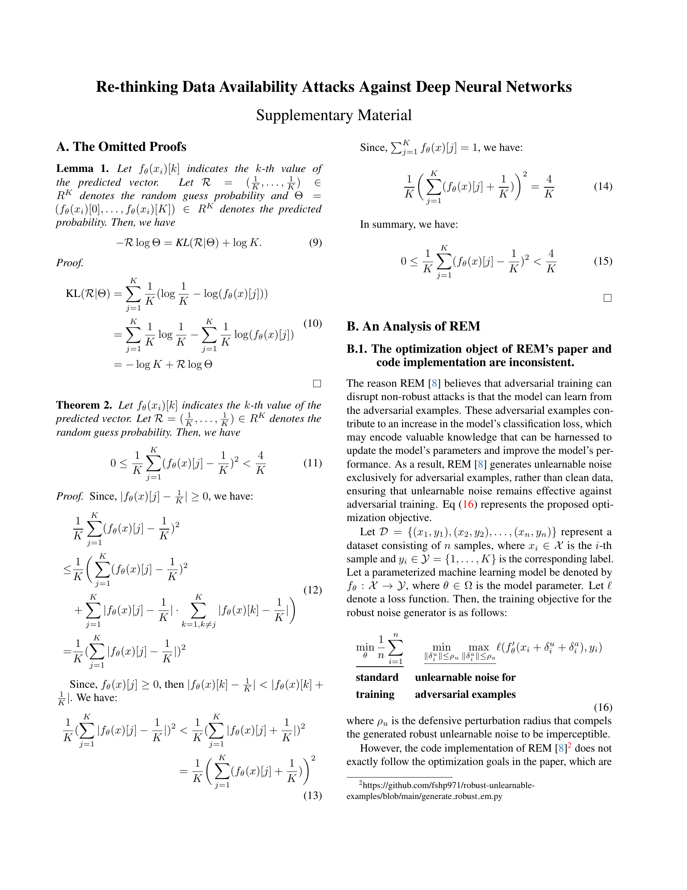
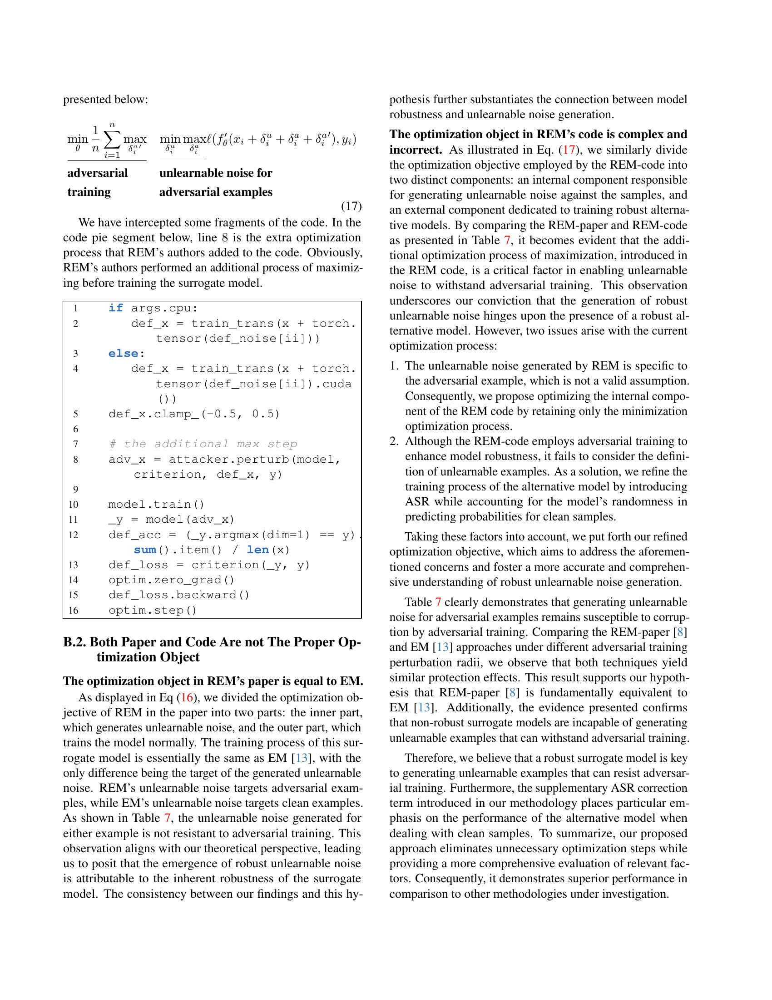
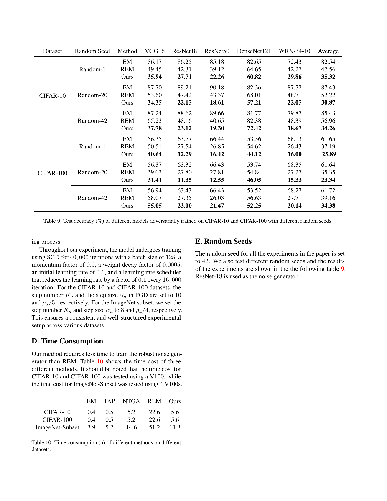

<!-- MinerU 4.0.9, tier advanced, VLM llama.cpp/Vulkan GPU; automatic extraction, tables require comparison with the PDF. -->

[PDF original](../../Fang_Re-thinking_Data_Availability_CVPR_2024_supplemental.pdf)

# Re-thinking Data Availability Attacks Against Deep Neural Networks Supplementary Material

## A. The Omitted Proofs

**Lemma 1.** Let $f _ { \theta } ( x _ { i } ) [ k ]$ indicates the k-th value of the predicted vector. Let $\begin{array} { r c l r } { \mathcal { R } } & { = } & { ( \frac { 1 } { K } , \ldots , \frac { 1 } { K } ) } & { \in } \\ \end{array}$ $R ^ { K }$ denotes the random guess probability and $\begin{array} { r l } { \Theta } & { { } = } \end{array}$ $\begin{aligned} { ( f _ { \theta } ( x _ { i } ) [ 0 ] , \ldots , f _ { \theta } ( x _ { i } ) [ K ] ) \in R ^ { K } } \\ \end{aligned}$ denotes the predicted probability. Then, we have

$$
- \mathcal {R} \log \Theta = K L (\mathcal {R} | \Theta) + \log K. \tag {9}
$$

Proof.

$$
\begin{array}{l} \mathrm{KL} (\mathcal {R} | \Theta) = \sum_ {j = 1} ^ {K} \frac {1}{K} \left(\log \frac {1}{K} - \log (f _ {\theta} (x) [ j ])\right) \\ = \sum_ {j = 1} ^ {K} \frac {1}{K} \log \frac {1}{K} - \sum_ {j = 1} ^ {K} \frac {1}{K} \log \left(f _ {\theta} (x) [ j ]\right) \tag {10} \\ = - \log K + \mathcal {R} \log \Theta \\ \end{array}
$$

**Theorem 2.** Let $f _ { \theta } ( x _ { i } ) [ k ]$ indicates the k-th value of the predicted vector. Let $\textstyle \mathcal { R } = ( \frac { 1 } { K } , \ldots , \frac { 1 } { K } ) \in R ^ { K }$ denotes the random guess probability. Then, we have

$$
0 \leq \frac {1}{K} \sum_ {j = 1} ^ {K} (f _ {\theta} (x) [ j ] - \frac {1}{K}) ^ {2} <   \frac {4}{K} \tag {11}
$$

Proof. Since, $\begin{array} { r } { | f _ { \theta } ( x ) [ j ] - \frac { 1 } { K } | \geq 0 } \end{array}$ , we have:

$$
\begin{array}{l} \frac {1}{K} \sum_ {j = 1} ^ {K} (f _ {\theta} (x) [ j ] - \frac {1}{K}) ^ {2} \\ \leq \frac {1}{K} \left(\sum_ {j = 1} ^ {K} \left(f _ {\theta} (x) [ j ] - \frac {1}{K}\right) ^ {2} \right. \tag {12} \\ \left. + \sum_ {j = 1} ^ {K} \left| f _ {\theta} (x) [ j ] - \frac {1}{K} \right| \cdot \sum_ {k = 1, k \neq j} ^ {K} \left| f _ {\theta} (x) [ k ] - \frac {1}{K} \right|\right) \\ = \frac {1}{K} \left(\sum_ {j = 1} ^ {K} \left| f _ {\theta} (x) [ j ] - \frac {1}{K} \right|\right) ^ {2} \\ \end{array}
$$

Since, $f _ { \theta } ( x ) [ j ] \geq 0 ,$ , then $\textstyle | f _ { \theta } ( x ) [ k ] - \frac { 1 } { K } | < | f _ { \theta } ( x ) [ k ] +$ $\frac { 1 } { K }$ . We have:

$$
\begin{array}{l} \frac {1}{K} \left(\sum_ {j = 1} ^ {K} \left| f _ {\theta} (x) [ j ] - \frac {1}{K} \right|\right) ^ {2} <   \frac {1}{K} \left(\sum_ {j = 1} ^ {K} \left| f _ {\theta} (x) [ j ] + \frac {1}{K} \right|\right) ^ {2} \\ = \frac {1}{K} \left(\sum_ {j = 1} ^ {K} \left(f _ {\theta} (x) [ j ] + \frac {1}{K}\right)\right) ^ {2} \tag {13} \\ \end{array}
$$

Since, $\begin{array} { r } { \sum _ { j = 1 } ^ { K } f _ { \theta } ( x ) [ j ] = 1 } \end{array}$ , we have:

$$
\frac {1}{K} \left(\sum_ {j = 1} ^ {K} (f _ {\theta} (x) [ j ] + \frac {1}{K})\right) ^ {2} = \frac {4}{K} \tag {14}
$$

In summary, we have:

$$
0 \leq \frac {1}{K} \sum_ {j = 1} ^ {K} (f _ {\theta} (x) [ j ] - \frac {1}{K}) ^ {2} <   \frac {4}{K} \tag {15}
$$

## B. An Analysis of REM

## B.1. The optimization object of REM’s paper and code implementation are inconsistent.

The reason REM [8] believes that adversarial training can disrupt non-robust attacks is that the model can learn from the adversarial examples. These adversarial examples contribute to an increase in the model’s classification loss, which may encode valuable knowledge that can be harnessed to update the model’s parameters and improve the model’s performance. As a result, REM [8] generates unlearnable noise exclusively for adversarial examples, rather than clean data, ensuring that unlearnable noise remains effective against adversarial training. Eq (16) represents the proposed optimization objective.

Let $\mathcal { D } \: = \: \{ ( x _ { 1 } , y _ { 1 } ) , ( x _ { 2 } , y _ { 2 } ) , \ldots , ( x _ { n } , y _ { n } ) \}$ represent a dataset consisting of n samples, where $x _ { i } \in \mathcal { X }$ is the i-th sample and $y _ { i } \in \mathcal { Y } = \{ 1 , \ldots , K \}$ is the corresponding label. Let a parameterized machine learning model be denoted by $f _ { \theta } : { \mathcal { X } } \to { \mathcal { Y } }$ , where $\theta \in \Omega$ is the model parameter. Let ℓ denote a loss function. Then, the training objective for the robust noise generator is as follows:

$$
\underline {{\min _ {\theta} \frac {1}{n} \sum_ {i = 1} ^ {n}}} \quad \underline {{\min _ {\| \delta_ {i} ^ {u} \| \leq \rho_ {u}} \max _ {\| \delta_ {i} ^ {a} \| \leq \rho_ {a}} \ell (f _ {\theta} ^ {\prime} (x _ {i} + \delta_ {i} ^ {u} + \delta_ {i} ^ {a}) , y _ {i})}}
$$

standard unlearnable noise for

trainingadversarial examples

(16)

where $\rho _ { u }$ is the defensive perturbation radius that compels the generated robust unlearnable noise to be imperceptible.

However, the code implementation of REM [8]2 does not exactly follow the optimization goals in the paper, which are presented below:

<small>2https://github.com/fshp971/robust-unlearnableexamples/blob/main/generate robust em.py</small>

$\frac{\min_{\theta} \frac{1}{n} \sum_{i=1}^{n} \max_{\delta_i^{a'}}}{\text{adversarial}}$ $\frac{\min_{\delta_i^u} \max_{\delta_i^a}\ell(f_\theta'(x_i + \delta_i^u + \delta_i^a + \delta_i^{a'})}, y_i)}{\text{unlearnable noise for training}}$ adversarial examples
(17)

We have intercepted some fragments of the code. In the code pie segment below, line 8 is the extra optimization process that REM’s authors added to the code. Obviously, REM’s authors performed an additional process of maximizing before training the surrogate model.

if args.cpu:
    def_x = train_trans(x + torch.tensor(def_noise[ii]))
else:
    def_x = train_trans(x + torch.tensor(def_noise[ii]).cuda())
def_x.clamp_(-0.5, 0.5)

# the additional max step
adv_x = attacker.perturb(model,criterion, def_x, y)

model.train()
_y = model(adv_x)
def_acc = (_y.argmax(dim=1) == y).
    sum().item() / len(x)
def_loss = criterion(_y, y)
optim.zero_grad()
def_loss.backward()
optim.step()

## B.2. Both Paper and Code Are not The Proper Optimization Object

## The optimization object in REM’s paper is equal to EM.

As displayed in Eq (16), we divided the optimization objective of REM in the paper into two parts: the inner part, which generates unlearnable noise, and the outer part, which trains the model normally. The training process of this surrogate model is essentially the same as EM [13], with the only difference being the target of the generated unlearnable noise. REM’s unlearnable noise targets adversarial examples, while EM’s unlearnable noise targets clean examples. As shown in Table 7, the unlearnable noise generated for either example is not resistant to adversarial training. This observation aligns with our theoretical perspective, leading us to posit that the emergence of robust unlearnable noise is attributable to the inherent robustness of the surrogate model. The consistency between our findings and this hypothesis further substantiates the connection between model robustness and unlearnable noise generation.

**The optimization object in REM’s code is complex and incorrect.** As illustrated in Eq. (17), we similarly divide the optimization objective employed by the REM-code into two distinct components: an internal component responsible for generating unlearnable noise against the samples, and an external component dedicated to training robust alternative models. By comparing the REM-paper and REM-code as presented in Table 7, it becomes evident that the additional optimization process of maximization, introduced in the REM code, is a critical factor in enabling unlearnable noise to withstand adversarial training. This observation underscores our conviction that the generation of robust unlearnable noise hinges upon the presence of a robust alternative model. However, two issues arise with the current optimization process:

1. The unlearnable noise generated by REM is specific to the adversarial example, which is not a valid assumption. Consequently, we propose optimizing the internal component of the REM code by retaining only the minimization optimization process.
2. Although the REM-code employs adversarial training to enhance model robustness, it fails to consider the definition of unlearnable examples. As a solution, we refine the training process of the alternative model by introducing ASR while accounting for the model’s randomness in predicting probabilities for clean samples.

Taking these factors into account, we put forth our refined optimization objective, which aims to address the aforementioned concerns and foster a more accurate and comprehensive understanding of robust unlearnable noise generation.

Table 7 clearly demonstrates that generating unlearnable noise for adversarial examples remains susceptible to corruption by adversarial training. Comparing the REM-paper [8] and EM [13] approaches under different adversarial training perturbation radii, we observe that both techniques yield similar protection effects. This result supports our hypothesis that REM-paper [8] is fundamentally equivalent to EM [13]. Additionally, the evidence presented confirms that non-robust surrogate models are incapable of generating unlearnable examples that can withstand adversarial training.

Therefore, we believe that a robust surrogate model is key to generating unlearnable examples that can resist adversar ial training. Furthermore, the supplementary ASR correction term introduced in our methodology places particular emphasis on the performance of the alternative model when dealing with clean samples. To summarize, our proposed approach eliminates unnecessary optimization steps while providing a more comprehensive evaluation of relevant factors. Consequently, it demonstrates superior performance in comparison to other methodologies under investigation.

<table><tr><td>Dataset</td><td>Adv. Train. $\rho_a$ </td><td>Clean</td><td>EM</td><td>TAP</td><td>NTGA</td><td>REM-paper $\rho_a = 4/255$ </td><td>REM-code $\rho_a = 4/255$ </td><td>EntF $\rho_a = 4/255$ </td><td>Ours $\rho_a = 4/255$ </td></tr><tr><td rowspan="5">CIFAR-10</td><td>0</td><td>94.66</td><td>13.20</td><td>22.51</td><td>16.27</td><td>12.81</td><td>22.93</td><td>94.65</td><td>12.71</td></tr><tr><td>1/255</td><td>93.74</td><td>22.08</td><td>92.16</td><td>41.53</td><td>37.42</td><td>30.00</td><td>93.56</td><td>14.71</td></tr><tr><td>2/255</td><td>92.37</td><td>71.43</td><td>90.53</td><td>85.13</td><td>80.46</td><td>30.04</td><td>92.00</td><td>15.38</td></tr><tr><td>3/255</td><td>90.90</td><td>87.71</td><td>89.55</td><td>89.41</td><td>88.92</td><td>31.75</td><td>91.04</td><td>15.51</td></tr><tr><td>4/255</td><td>89.51</td><td>88.62</td><td>88.02</td><td>88.96</td><td>88.70</td><td>48.16</td><td>89.52</td><td>23.12</td></tr></table>

Table 7. Test accuracy (%) of models trained on data protected by different availability attacks via standard training and adversarial training.

## C. Detailed Experimental Settings

## C.1. Data Augmentation

In our experiments, we employ distinct data augmentation techniques tailored to different datasets. For CIFAR-10 and CIFAR-100 [15], we apply data augmentation comprising random flipping, padding of 4 pixels on each side, random cropping to a size of $3 2 \times 3 2$ , and rescaling per pixel in the range [−0.5, 0.5] for individual images. In the case of the ImageNet subset, we implement data augmentation through random cropping, resizing to dimensions of 224 × 224, random flipping, and rescaling per pixel in the range [−0.5, 0.5] for each image.

## C.2. Adversarial Training

Adversarial training [19] is a commonly used method to improve model robustness. Standard adversarial training aims to solve the following min-max optimization problem:

$$
\left| \min _ {\theta} \frac {1}{n} \sum_ {i = 1} ^ {n} \max _ {| | \delta_ {i} | | \leq \rho_ {a}} \ell (f _ {\theta} (x _ {i} + \delta_ {i}), y _ {i}) \right. \tag {18}
$$

## C.3. Projected Gradient Descent

PGD [19] is a standard approach for solving inner maximization and minimization problems. It performs iterative projection updates to search for the optimal perturbation as follows:

$$
\delta^ {(k)} = \prod_ {\| \delta \| \leq \rho} \left[ \delta^ {(k - 1)} + c \cdot \alpha \cdot \operatorname{sign} \left(\frac {\partial}{\partial \delta} \ell (f _ {\theta} (x + \delta^ {(k - 1)}), y)\right) \right] \tag {19}
$$

where k is the current iteration step (K steps at all), $\delta ^ { ( k ) }$ is the perturbation found in the k-th iteration, $c \in \{ - 1 , 1 \}$ is a factor for controlling the gradient direction, α is the step size, and $\Pi _ { \| \delta \| \leq \rho }$ means the projection is calculated in the ball sphere $\{ \widetilde { \delta } : \| \delta \|   \leq   \rho \}$ . The final output perturbation is $\delta ^ { ( \bar { K ^ { \prime } } ) }$ . Throughout this paper, the coefficient c is set as 1 when solving maximization problems and −1 when solving minimization problems.

## C.4. Detailed Settings for Our Method

In our approach, we build upon REM [8] and utilize ResNet-18 [11] as the surrogate model $f _ { \theta } ^ { \prime } .$ In our experiments, we employ $L _ { \infty }$ -bounded noise constraints, denoted as $\| \delta _ { u } \| _ { \infty } \leq$ $\rho _ { u }$ and $\| \delta _ { a } \| _ { \infty } \leq \rho _ { a }$ , where $\rho _ { u }$ represents the unlearnable noise perturbation radius and $\rho _ { a }$ denotes the adversarial perturbation radius. Both quantities assume various values. The PGD settings are detailed in Table 8.

Regarding the CIFAR-10 and CIFAR-100 datasets, each surrogate model undergoes training via SGD over 5, 000 iterations, utilizing a batch size of 128, a momentum factor of 0.9, a weight decay factor of 0.0005, an initial learning rate of 0.1, and a learning rate scheduler that reduces the learning rate by a factor of 0.1 every 2, 000 iteration.

Similarly, for the ImageNet subset, we train each surrogate model using SGD for 3, 000 iterations with a batch size of 128, a momentum factor of 0.9, a weight decay factor of 0.0005, an initial learning rate of 0.1, and a learning rate scheduler that decays the learning rate by a factor of 0.1 every 1, 200 iteration.

<table><tr><td>Datasets</td><td>Noise Type</td><td> $\alpha_u$ </td><td> $K_u$ </td><td> $\alpha_a$ </td><td> $K_a$ </td></tr><tr><td rowspan="6">CIFAR-10 CIFAR-100</td><td>EM</td><td> $\rho_u/5$ </td><td>10</td><td>-</td><td>-</td></tr><tr><td>TAP</td><td> $\rho_u/125$ </td><td>250</td><td>-</td><td>-</td></tr><tr><td>NTGA</td><td> $\rho_u/10 \times 1.1$ </td><td>10</td><td>-</td><td>-</td></tr><tr><td>REM</td><td> $\rho_u/5$ </td><td>10</td><td> $\rho_a/5$ </td><td>10</td></tr><tr><td>EntF</td><td> $\rho_u/5$ </td><td>10</td><td> $\rho_a/5$ </td><td>10</td></tr><tr><td>Ours</td><td> $\rho_u/5$ </td><td>10</td><td> $\rho_a/5$ </td><td>10</td></tr><tr><td rowspan="6">ImageNet Subset</td><td>EM</td><td> $\rho_u/5$ </td><td>7</td><td>-</td><td>-</td></tr><tr><td>TAP</td><td> $\rho_u/50$ </td><td>100</td><td>-</td><td>-</td></tr><tr><td>NTGA</td><td> $\rho_u/8 \times 1.1$ </td><td>8</td><td>-</td><td>-</td></tr><tr><td>REM</td><td> $\rho_u/4$ </td><td>7</td><td> $\rho_a/5$ </td><td>10</td></tr><tr><td>EntF</td><td> $\rho_u/4$ </td><td>7</td><td> $\rho_a/5$ </td><td>10</td></tr><tr><td>Ours</td><td> $\rho_u/4$ </td><td>7</td><td> $\rho_a/5$ </td><td>10</td></tr></table>

Table 8. The settings of PGD [19] for the noise generations of errorminimizing noise (EM) [13], targeted adversarial poisoning noise (TAP) [7], neural tangent generalization attack noise (NTGA) [37], robust error-minimizing noise (REM) [8], and our method in different experiments. $\rho _ { u }$ denotes the defensive perturbation radius of different types of noise, while $\rho _ { a }$ denotes the adversarial perturbation radius of the robust error-minimizing noise.

## C.5. Model Training Details

In accordance with Eq. (18), we carry out adversarial training [19] as described in appendix C.2. Analogous to the training of the noise generator, we focus on the $L _ { \infty }$ -bounded noise, denoted as $\| \rho _ { a } \| _ { \infty } \leq \rho _ { a }$ , during the adversarial train-

<table><tr><td>Dataset</td><td>Random Seed</td><td>Method</td><td>VGG16</td><td>ResNet18</td><td>ResNet50</td><td>DenseNet121</td><td>WRN-34-10</td><td>Average</td></tr><tr><td rowspan="9">CIFAR-10</td><td rowspan="3">Random-1</td><td>EM</td><td>86.17</td><td>86.25</td><td>85.18</td><td>82.65</td><td>72.43</td><td>82.54</td></tr><tr><td>REM</td><td>49.45</td><td>42.31</td><td>39.12</td><td>64.65</td><td>42.27</td><td>47.56</td></tr><tr><td>Ours</td><td>35.94</td><td>27.71</td><td>22.26</td><td>60.82</td><td>29.86</td><td>35.32</td></tr><tr><td rowspan="3">Random-20</td><td>EM</td><td>87.70</td><td>89.21</td><td>90.18</td><td>82.36</td><td>87.72</td><td>87.43</td></tr><tr><td>REM</td><td>53.60</td><td>47.42</td><td>43.37</td><td>68.01</td><td>48.71</td><td>52.22</td></tr><tr><td>Ours</td><td>34.35</td><td>22.15</td><td>18.61</td><td>57.21</td><td>22.05</td><td>30.87</td></tr><tr><td rowspan="3">Random-42</td><td>EM</td><td>87.24</td><td>88.62</td><td>89.66</td><td>81.77</td><td>79.87</td><td>85.43</td></tr><tr><td>REM</td><td>65.23</td><td>48.16</td><td>40.65</td><td>82.38</td><td>48.39</td><td>56.96</td></tr><tr><td>Ours</td><td>37.78</td><td>23.12</td><td>19.30</td><td>72.42</td><td>18.67</td><td>34.26</td></tr><tr><td rowspan="9">CIFAR-100</td><td rowspan="3">Random-1</td><td>EM</td><td>56.35</td><td>63.77</td><td>66.44</td><td>53.56</td><td>68.13</td><td>61.65</td></tr><tr><td>REM</td><td>50.51</td><td>27.54</td><td>26.85</td><td>54.62</td><td>26.43</td><td>37.19</td></tr><tr><td>Ours</td><td>40.64</td><td>12.29</td><td>16.42</td><td>44.12</td><td>16.00</td><td>25.89</td></tr><tr><td rowspan="3">Random-20</td><td>EM</td><td>56.37</td><td>63.32</td><td>66.43</td><td>53.74</td><td>68.35</td><td>61.64</td></tr><tr><td>REM</td><td>39.03</td><td>27.80</td><td>27.81</td><td>54.84</td><td>27.27</td><td>35.35</td></tr><tr><td>Ours</td><td>31.41</td><td>11.35</td><td>12.55</td><td>46.05</td><td>15.33</td><td>23.34</td></tr><tr><td rowspan="3">Random-42</td><td>EM</td><td>56.94</td><td>63.43</td><td>66.43</td><td>53.52</td><td>68.27</td><td>61.72</td></tr><tr><td>REM</td><td>58.07</td><td>27.35</td><td>26.03</td><td>56.63</td><td>27.71</td><td>39.16</td></tr><tr><td>Ours</td><td>55.05</td><td>23.00</td><td>21.47</td><td>52.25</td><td>20.14</td><td>34.38</td></tr></table>

Table 9. Test accuracy (%) of different models adversarially trained on CIFAR-10 and CIFAR-100 with different random seeds.

ing process.

Throughout our experiment, the model undergoes training using SGD for 40, 000 iterations with a batch size of 128, a momentum factor of 0.9, a weight decay factor of 0.0005, an initial learning rate of 0.1, and a learning rate scheduler that reduces the learning rate by a factor of 0.1 every 16, 000 iteration. For the CIFAR-10 and CIFAR-100 datasets, the step number $K _ { a }$ and the step size $\alpha _ { a }$ in PGD are set to 10 and $\rho _ { a } / 5 ,$ respectively. For the ImageNet subset, we set the step number $K _ { a }$ and step size $\alpha _ { a }$ to 8 and $\rho _ { a } / 4 ,$ , respectively. This ensures a consistent and well-structured experimental setup across various datasets.

## D. Time Consumption

Our method requires less time to train the robust noise generator than REM. Table 10 shows the time cost of three different methods. It should be noted that the time cost for CIFAR-10 and CIFAR-100 was tested using a V100, while the time cost for ImageNet-Subset was tested using 4 V100s.

|  | EM | TAP | NTGA | REM | Ours |
| --- | --- | --- | --- | --- | --- |
| CIFAR-10 | 0.4 | 0.5 | 5.2 | 22.6 | 5.6 |
| CIFAR-100 | 0.4 | 0.5 | 5.2 | 22.6 | 5.6 |
| ImageNet-Subset | 3.9 | 5.2 | 14.6 | 51.2 | 11.3 |

Table 10. Time consumption (h) of different methods on different datasets.

## E. Random Seeds

The random seed for all the experiments in the paper is set to 42. We also test different random seeds and the results of the experiments are shown in the the following table 9. ResNet-18 is used as the noise generator.

Páginas originales para cotejo

### Página 1

### Página 2

### Página 3

### Página 4

