<!-- MinerU 4.0.9, tier advanced, VLM llama.cpp/Vulkan GPU; automatic extraction, tables require comparison with the PDF. -->

[PDF original](../../Re-Thinking-Data-Availability-Attacks-Against-Deep-Neural-Networks.pdf)

# Re-thinking Data Availability Attacks Against Deep Neural Networks

Bin Fang1,\* Bo Li2,∗,† Shuang Wu2 Shouhong Ding2 Ran Yi1 Lizhuang Ma1,3,†

1 Shanghai Jiao Tong University, Shanghai 2 Youtu Lab Tencent, Shanghai

3MoE Key Lab of Artificial Intelligence, Shanghai Jiao Tong University

{fang-bin, ranyi, lzma}@sjtu.edu.cn njumagiclibo@gmail.com {calvinwu, ericshding}@tencent.com

## Abstract

The unauthorized use of personal data for commercial purposes and the covert acquisition of private data for training machine learning models continue to raise concerns. To address these issues, researchers have proposed availability attacks that aim to render data unexploitable. However, many availability attack methods can be easily disrupted by adversarial training. Although some robust methods can resist adversarial training, their protective effects are limited. In this paper, we re-examine the existing availability attack methods and propose a novel two-stage min-max-min optimization paradigm to generate robust unlearnable noise. The inner min stage is utilized to generate unlearnable noise, while the outer min-max stage simulates the training process of the poisoned model. Additionally, we formulate the attack effects and use it to constrain the optimization ob jective. Comprehensive experiments have revealed that the noise generated by our method can lead to a decline in test accuracy for adversarially trained poisoned models by up to approximately 30%, in comparison to SOTA methods. 1

## 1. Introduction

Over the last decade, remarkable advancements have been made in the field of Artificial Intelligence (AI), leading to significant impacts across a wide range of domains. The key driving force behind impressive achievements of deep learn ing has been access to vast quantities of high-quality data. In fact, many major AI breakthroughs have been realized only after obtaining the appropriate training data. The recent advances in large foundation models [4, 21] and generative models [22, 25] stand as strong evidence. Nonetheless, behind these remarkable accomplishments lies an issue that cannot be overlooked: the unauthorized collection and utilization of data. There is evidence to suggest that technology corporations are engaged in the collection and utilization of unauthorized data for the purpose of training their commercial models [2, 9, 33, 42, 43].

To mitigate the unauthorized use of data, availability attacks have been proposed [1]. Numerous studies demonstrate that injecting imperceptible noise, known as unlearnable noise, into data can considerably impair the performance of models reliant on such poisoned data [6, 7, 13, 27, 28, 35–37, 41]. The poisoned data is called unlearnable examples, which is firstly proposed by Error-Minimizing (EM) [13]. Nevertheless, the unlearnable noise produced by these approaches can be readily neutralized by adversarial training [7, 8, 13, 27, 32, 34], thereby undermining the protective efficacy with respect to the unlearnable examples. Researches have argued that EM [13] noise is inadequately equipped to defend against adversarial training due to its standard training of the surrogate model, which solely extracts non-robust features [14]. To address this limitation, Robust Error-Minimizing (REM) [8] and Entangled Features (EntF) [34] have been introduced to diminish the detrimental impact of adversarial training on unlearnable examples.

Although REM [8] and EntF [34] noise partially mitigate the detrimental effects of adversarial training on unlearnable examples, their theoretical underpinnings remain uncertain. Upon examining their optimization objectives, it becomes evident that the goal of REM [8] closely resembles that of EM [13], suggesting that the surrogate model employed in REM also lacks robustness. Furthermore, concerning EntF [34], previous research [10, 24] has demonstrated that constraining noise with only features makes it challenging to achieve conservation effects in classification tasks.

Building upon these analyses, we put forward two key proposals: **(1)** A surrogate model, trained from scratch utilizing adversarial training techniques, has the potential to generate more robust protective noise, thereby mitigating the adverse effects of adversarial training. **(2)** Furthermore, EM [13] provides a definition for the performance of poisoned models on clean examples, stating that “DNNs trained on unlearnable examples will exhibit performance equivalent to random guessing on normal test examples”. This definition has been overlooked in previous research. For the first time, we propose Average Randomness Constraint to formalize the intended effect of unlearnable noise based on its definition and adapt our optimization objective to encompass this understanding. As a result, our method attains remarkable protective performance in both standard and adversarial training. In summary, our contributions are as follows:

<small>\*Equal contribution</small>

<small>†Corresponding author</small>

<small>1Code is available at EuterpeK/Rethinking-Data-Availability-Attacks</small>

• We provide an overview of prior methods for availability attacks and assess the limitations of these strategies.
• We propose a reliable optimization objective (min-maxmin) that efficiently mitigates the disruptive effects of adversarial training, offering robust data protection.
• For the first time, we propose average randomness constraint to formulate the expected effect of unlearnable examples and use this constraint to adjust our optimization objective, subsequently resulting in significant performance improvements.
• We establish a foundation for future research, allowing for the easy integration of additional constraints into our optimization objective, thus promoting further progress.

## 2. Related Work

## 2.1. Poisoning Attacks

Data poisoning attacks aim to compromise the training process of a model by introducing noise into the training dataset, resulting in significant testing errors on specific or unseen samples during the testing phase. Backdoor attacks constitute a prevalent form of data poisoning attack, often char acterized by the injection of triggers into training samples, which subsequently provokes the misclassification of images containing these triggers during the testing phase [16, 17, 20]. However, it is worth noting that these attacks usually impact only samples with trigger patterns, while leaving clean samples unaffected and accurately classified [3, 29].

## 2.2. Availability Attacks

Availability Attacks aim to safeguard data from unauthorized exploitation by generating imperceptible, unlearnable noise. The data compromised by this type of attack are referred to as unlearnable examples. Deep neural networks trained on unlearnable examples display performance similar to random guessing on clean test examples.

**Model-free Attacks.** These attacks generally produce unlearnable noise at the pixel level instead of the feature level. As a result, methods in this category, such as LSP [36], AR [28], CUDA [27] and OPS [35], do not require any feature information on clean data, leading to an unrelated connection with data features. However, this inherent design principle makes unlearnable examples susceptible to featurebased defense methods, such as adversarial training [8, 18].

**Model-based Attacks.** These attacks typically generate unlearnable noise using surrogate models. This group of methods trains a surrogate model, also referred to as a noise generator. The training process of the surrogate model is used to mimic the training process of poisoned models. Based on whether the surrogate models employ adversarial training techniques, these methods can be classified into two distinct categories. EM [13] and REM [8] have substantiated that prevalent data augmentation techniques, such as Cutout [5], Mixup [40], and CutMix [38], do not compromise the protective efficacy of unlearnable noise.

**I. Non-robust Model-based Attacks.** This type of attack involves training surrogate models as non-robust models that learn non-robust features, such as TAP [7], NTGA [37], and EM [13]. As a result, the unlearnable noise generated by this approach only targets poisoned models subjected to standard training and merely prevents models from learning standard data features. Once the poisoned models undergo adversarial training, the protective effects are disrupted.

**II. Robust Model-based Attacks.** This type of attack entails training surrogate models as robust models that learn robust features, such as REM [8] and EntF [34]. Although these methods can withstand adversarial training, their protective effect remains limited.

## 3. Methodology

We provide the list of symbols used throughout the main manuscript. These symbols are summarized in Table 1.

| Symbol | Description |
| --- | --- |
| $x_i \in \mathbb{R}^{w\times h\times c}$ | The $i$-th example from a dataset $\mathcal{D}$. |
| $y_i \in \mathcal{Y}=\{1,\ldots,K\}$ | The class label associated with $x_i$ for supervised learning (one-hot encoded). |
| $\mathcal{D}=\{(x_1,y_1),\ldots,(x_N,y_N)\}$ | Training set: $N$ data-label pairs. |
| $f'_{\theta}$ | The surrogate model (noise generator). |
| $\delta_i^u \in [-\rho_u,\rho_u]$ | The $i$-th unlearnable noise associated with $x_i$ generated by the surrogate model $f'_{\theta}$. |
| $x'_i=x_i+\delta_i^u$ | The $i$-th unlearnable example. |
| $\delta_i^a \in [-\rho_a,\rho_a]$ | The $i$-th adversarial noise associated with $x'_i$ generated by the surrogate model $f'_{\theta}$. |
| $\rho_u \in \mathbb{R}$ | Unlearnable noise radius. |
| $\rho_a \in \mathbb{R}$ | Adversarial noise radius. |
| $\ell$ or $\mathcal{L}$ | Loss function. |
| $P \in \mathbb{R}^K$ | Predicted probability vector. |
| $R \in \mathbb{R}$ | Averaged prediction randomness. |
| $\mathcal{R}=(\frac{1}{K})^K$ | Random guessing probability. |
| $\Theta \in \mathbb{R}$ | Predicted probability. |

Table 1. The list of symbols used in this paper.

## 3.1. Limitations of Robust Model-based Methods

As we have discussed in Section 2.2, to resist the disruptive effects of adversarial training on unlearnable examples, currently, there is only one way to go, which is robust modelbased availability attacks. However, REM [8] and EntF [34] have some flaws.

REM [8] posits that the protective effect of unlearnable examples is compromised in adversarial training because the model can learn knowledge from adversarial examples during the process. Based on this perspective, REM generates unlearnable noise for adversarial examples. REM proposes a **min-(min-max)** optimization procedure. The training objective of REM is as follows:

|  | REM | Ours |
| --- | --- | --- |
| Optimization Object | min-(min-max) | (min-max)-min |
| Surrogate Model | non-robust | robust |
| Randomness Constrain | w/o | w |

Table 2. The main differences between REM and our method. Randomness Constraint is detailedly introduced in Section 3.3.

$$
\min _ {\theta} \frac {1}{n} \sum_ {i = 1} ^ {n} \min _ {\| \delta_ {i} ^ {u} \| \leq \rho_ {u}} \max _ {\| \delta_ {i} ^ {a} \| \leq \rho_ {a}} \ell \left(f _ {\theta} ^ {\prime} \left(x _ {i} + \delta_ {i} ^ {u} + \delta_ {i} ^ {a}\right), y _ {i}\right). \tag {1}
$$

The optimization objective in Equation 1 can be partitioned into two distinct steps. The initial step involves the inner **min-max** as depicted, which is employed to generate adversarial samples and produce the corresponding unlearnable noise. Subsequently, the second step consists of the outer minθ, which functions to update the surrogate model.

Given that $\rho _ { a } \; < \; \rho _ { u }$ , the inputs utilized for updating the surrogate model are essentially the same as those in EM [13]. Consequently, REM is fundamentally akin to EM, with both surrogate models exhibiting non-robust characteristics. Nonetheless, the poisoned model becomes robust following adversarial training, even when the training data comprises unlearnable instances. As such, we posit that a robust surrogate model should be employed to generate robust unlearnable noise. We propose a **min-max-min** optimization objective that significantly deviates from REM. Table 2 illus trates the primary distinctions. Section 3.2 offers a detailed overview of our optimization objective. An in-depth analysis and extensive experiments highlighting the insufficiency of REM objective can be found in Appendix B.

EntF [34] utilizes a pre-trained robust feature extractor, aiming to challenge the premise of adversarial training by making similar features more aggregated. However, according to previous studies [10, 24], the noise generated via feature constraints cannot protect classification tasks.

## 3.2. Two-Stage Optimization Procedure

In light of our analysis, we regard that a robust surrogate model is essential for generating unlearnable noise that can effectively protect unlearnable examples against adversarial training. We propose a two-stage **min-max-min** optimization process to train a robust surrogate model capable of generating robust unlearnable noise. The two stages have different targets. **The first stage** involves an inner minimization process, where unlearnable noise is obtained for a noise generator that undergoes adversarial training. Since adversarial training can extract robust features, the unlearnable noise generated by robust models can naturally resist adversarial training. **The second stage** consists of an external min-max optimization process equivalent to adversarial training. The input for this stage includes images with robust unlearnable noise added, allowing the external procedure to simulate the adversarial training process and closely resemble the train ing process of a poisoned model using adversarial training. **Consequently**, both the first and second stages complement each other, and the internal generation of unlearnable noise results in better protective effects. The two-stage min-maxmin optimization process is specified below:

Algorithm I: Training the noise generator

Input: Training data set $\mathcal{D}$, training iteration $M$,
classes $K$, learning rate $\eta$
PGD parameters $\rho_u, \alpha_u$ and $K_u$ for stage 1,
PGD parameters $\rho_a, \alpha_a$ and $K_a$ for stage 2.
Output: Our noise generator $f'_\theta$.
Initialize source model parameter $\theta$.
for $i$ in $1, \cdots, M$ do
    Sample a minibatch $(x, y) \sim \mathcal{D}$.
    Initialize $\delta^u$.
    for $k$ in $1, \cdots, K_u$ do
        $g_k \leftarrow \frac{\partial}{\partial \delta^u} \ell(f'_\theta(x + \delta^u), y)$
        $\delta^u \leftarrow \prod_{\|\delta\| \leq \rho_u} (\delta^u - \alpha_u \cdot \text{sign}(g_k))$
    end for
    for $k$ in $1, \cdots, K_a$ do
        $g_k \leftarrow \frac{\partial}{\partial \delta^u} \ell(f'_\theta(x + \delta^u + \delta^a), y)$
        $\delta^a \leftarrow \prod_{\|\delta\| \leq \rho_a} (\delta^a + \alpha_a \cdot \text{sign}(g_k))$
    end for
    $g_k \leftarrow \frac{\partial}{\partial \theta} [\ell(f'_\theta(x + \delta^u + \delta^a), y)$
        $+\frac{1}{K} \sum_{k=1}^{K} (f'_\theta(x_i)[k] - \frac{1}{K})^2]$
    $\theta \leftarrow \theta - \eta \cdot g_k$
end for
return $f'_\theta$

a) Generate unlearnable examples $x ^ { \prime }$ from the surrogate model $f _ { \theta } ^ { \prime }$ by

$$
\delta_ {i} ^ {u} = \min _ {| | \delta_ {i} ^ {u} | | \leq \rho_ {u}} \ell \left(f _ {\theta} ^ {\prime} \left(x _ {i} + \delta_ {i} ^ {u}\right), y _ {i}\right). \tag {2}
$$

b) Perform adversarial training of the surrogate model $f _ { \theta } ^ { \prime }$ to extract the robust features of the unlearnable examples

$$
\min _ {\theta} \frac {1}{n} \sum_ {i = 1} ^ {n} \max _ {| | \delta_ {i} ^ {a} | | \leq \rho_ {a}} \ell (f _ {\theta} ^ {\prime} (x _ {i} + \delta_ {i} ^ {u} + \delta_ {i} ^ {a}), y _ {i}). \tag {3}
$$

Additionally, we expect $\rho _ { a } < \rho _ { u }$ . As suggested in REM [8], when $\rho _ { a } \geq \rho _ { u }$ , the generated unlearnable noise $\delta _ { u }$ could not suppress any learnable knowledge.

However, the optimization objective in Equation 3 does not reflect the constraint on the prediction performance for clean samples. Therefore, we need to add constraints to this optimization objective. The Algorithm I shows the two-stage optimization procedure with constraints on the performance for clean examples. Section 3.3 will introduce this constraint in detail.

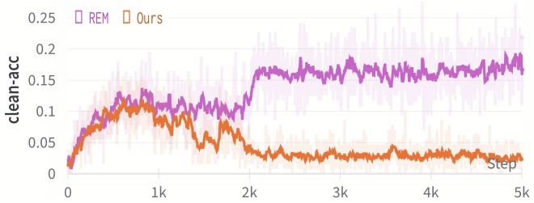

line

| Step | REM (clean-acc) | Ours (clean-acc) |
| --- | --- | --- |
| 0 | ~0.02 | ~0.02 |
| 1k | ~0.11 | ~0.09 |
| 2k | ~0.16 | ~0.04 |
| 3k | ~0.17 | ~0.03 |
| 4k | ~0.17 | ~0.03 |
| 5k | ~0.18 | ~0.03 |

Figure 1. The test accuracy of the clean examples on the training phase of the surrogate model.

## 3.3. Average Randomness Constraint

EM [13] posits that a model trained on unlearnable examples should exhibit random guessing behavior when applied to clean samples. Noting that the majority of prior studies did not constrain performance on clean samples. Additionally, as illustrated in Figure 1, the test accuracies of clean examples during noise generator training reveal that the noise produced by REM [8] still permits the surrogate models to learn a substantial amount of information. For the first time, we propose the Average Randomness Constraint to formulate the behavior of surrogate models on clean examples and utilize it to modify the optimization objective of Equation 3 in the second stage. Figure 1 showcases the effects of our method, with further details provided below.

**Definition 1** (Average Prediction Randomness). Let D indicate a dataset consisting of N samples, where $x _ { i }   \in   \mathcal { X }$ is the i-th sample and $y _ { i }$ is the corresponding label. Let a classifier denote $C : { \mathcal { X } } \to { \mathcal { Y } }$ . Let $P _ { k }$ be the probability vector of model predictions on samples with ground-truth label $k ,$ where the j-th element of $P _ { k }$ is

$$
P _ {k} ^ {j} \triangleq \frac {\sum_ {i = 1} ^ {N} \mathbb {I} \left\{C \left(x _ {i}\right) = j \right\} \cdot \mathbb {I} \left\{y _ {i} = k \right\}}{\sum_ {i = 1} ^ {N} \mathbb {I} \left\{y _ {i} = k \right\}}. \tag {4}
$$

The average prediction randomness metric $R _ { p }$ is defined as

$$
R _ {p} \triangleq \frac {1}{N} \sum_ {k = 1} ^ {K} \sum_ {i = 1} ^ {N} \mathbb {I} \left\{y _ {i} = k \right\} \cdot \mathcal {L} \left(P _ {k}\right), \tag {5}
$$

where $\mathcal { L } ( \cdot )$ denotes a distance function.

$R _ { p }$ measures the distance between the current predicted distribution and the uniform distribution. The smaller the value of $R _ { p } ,$ the better dispersion. However, $R _ { p }$ is non-differentiable and cannot be optimized directly. We introduce a differentiable modified formulation to alleviate this problem, that is Definition 2.

**Definition 2** (Differentiable Average Randomness). Let D represent a dataset consisting of N samples, where $x _ { i } \in \mathcal { X }$ is the i-th sample and $y _ { i }$ is the corresponding label. Let a parameterized machine learning model be represented as $f _ { \theta } .$ The averaged sample-wise randomness of predictions given by the classifier $f _ { \theta } ( \cdot )$ is defined as

$$
R _ {s} \triangleq \frac {1}{N} \sum_ {i = 1} ^ {N} \mathcal {L} \left(f (x _ {i})\right). \tag {6}
$$

The differentiable average randomness represents the average dispersion of predicted probability vectors.

**Theorem 1.** Let $f _ { \theta } ( x _ { i } ) [ k ]$ indicates the k-th value of the predicted vector. Let $\textstyle { \mathcal { R } } = ( { \frac { 1 } { K } } , \ldots , { \frac { 1 } { K } } ) \in R ^ { K }$ denotes the random guess probability. Then, we have

$$
0 \leq \frac {1}{K} \sum_ {j = 1} ^ {K} (f _ {\theta} (x) [ j ] - \frac {1}{K}) ^ {2} <   \frac {4}{K}.
$$

Distance function L in Definition 2 assessing the distance between the predicted distribution and a uniform distribution is of paramount importance. There are three common types of loss functions: Mean Squared Error (MSE), Kullback-Leibler (KL) divergence, and Cross-Entropy (CE). We analyze these three loss functions in detail below.

(1) Previous study [23] suggests that models trained using a distance-based loss function frequently outperform those trained with non-distance loss functions. Cross-entropy and KL divergence are prevalent measures for calculating the distance between distributions; nevertheless, neither constitutes a distance function. While MSE is a distance function. (2) CE and KL are equivalent as demonstrated by Lemma in **Appendix A**. In most cases (under our experimental settings), the MSE is smaller than the CE loss. Additionally, both loss functions achieve their minimum values under the same conditions, suggesting that optimizing MSE is equivalent to optimizing CE. (3) MSE is smoother. Concerning KL loss, when the prediction probability for a specific class $f _ { \theta } ( \cdot ) [ k ]$ is exceedingly small, both the loss and gradient become infinite, leading to gradient explosion and complicating the training process. In contrast, MSE showcases relative smoothness within its value range, possessing well-defined upper and lower bounds (given in Theorem 1), thereby easing model training.

Based on these insights, MSE serves as the distance func tion L in Definition 2 to assess Differentiable Average Randomness (DAR). A smaller DAR implies increased randomness in the output probability of $f _ { \theta }$ on clean samples, indicating a reduced degree of knowledge acquisition by the model. The sample-wise DAR (i.e., our average randomness constraint) is then defined as follows:

<table><tr><td>Dataset</td><td>Adv. Train. $\rho_{a}$ </td><td>Clean</td><td>EM</td><td>TAP</td><td>NTGA</td><td>REM $\rho_{a}=4/255$ </td><td>EntF $\rho_{a}=4/255$ </td><td>Ours $\rho_{a}=4/255$ </td></tr><tr><td rowspan="5">CIFAR-10</td><td>0</td><td>94.66</td><td>13.20</td><td>22.51</td><td>16.27</td><td>22.93</td><td>94.65</td><td>12.71</td></tr><tr><td>1/255</td><td>93.74</td><td>22.08</td><td>92.16</td><td>41.53</td><td>30.00</td><td>93.56</td><td>14.71</td></tr><tr><td>2/255</td><td>92.37</td><td>71.43</td><td>90.53</td><td>85.13</td><td>30.04</td><td>92.00</td><td>15.38</td></tr><tr><td>3/255</td><td>90.90</td><td>87.71</td><td>89.55</td><td>89.41</td><td>31.75</td><td>91.04</td><td>15.51</td></tr><tr><td>4/255</td><td>89.51</td><td>88.62</td><td>88.02</td><td>88.96</td><td>48.16</td><td>89.52</td><td>23.12</td></tr><tr><td rowspan="5">CIFAR-100</td><td>0</td><td>76.27</td><td>1.60</td><td>13.75</td><td>3.22</td><td>11.63</td><td>75.83</td><td>3.27</td></tr><tr><td>1/255</td><td>71.90</td><td>71.47</td><td>70.03</td><td>65.74</td><td>14.48</td><td>71.88</td><td>7.79</td></tr><tr><td>2/255</td><td>68.91</td><td>68.49</td><td>66.91</td><td>66.53</td><td>16.60</td><td>68.94</td><td>7.73</td></tr><tr><td>3/255</td><td>66.45</td><td>65.66</td><td>64.30</td><td>64.80</td><td>20.70</td><td>66.43</td><td>9.91</td></tr><tr><td>4/255</td><td>64.50</td><td>63.43</td><td>62.39</td><td>62.44</td><td>27.35</td><td>63.94</td><td>23.00</td></tr><tr><td rowspan="5">ImageNet Subset</td><td>0</td><td>80.66</td><td>1.26</td><td>9.10</td><td>8.42</td><td>13.74</td><td>78.96</td><td>4.08</td></tr><tr><td>1/255</td><td>76.20</td><td>74.88</td><td>75.14</td><td>63.28</td><td>21.58</td><td>75.34</td><td>11.80</td></tr><tr><td>2/255</td><td>72.52</td><td>71.74</td><td>70.56</td><td>66.96</td><td>29.40</td><td>72.10</td><td>16.88</td></tr><tr><td>3/255</td><td>69.68</td><td>66.90</td><td>67.64</td><td>65.98</td><td>35.76</td><td>67.88</td><td>22.34</td></tr><tr><td>4/255</td><td>66.62</td><td>63.40</td><td>63.56</td><td>63.06</td><td>41.66</td><td>63.60</td><td>31.64</td></tr></table>

Table 3. Test accuracy (%) of models adversarially trained with different perturbation radii. The training data, namely unlearnable examples, is generated by different availability attacks.

$$
\frac {1}{K} \sum_ {k = 1} ^ {K} \left(f _ {\theta} ^ {\prime} \left(x _ {i}\right) [ k ] - \frac {1}{K}\right) ^ {2} \tag {7}
$$

In summary, we use Equation 7 to modify Equation 3 in the second step. The final optimization objective in the second step is given by Equation 8. By adding the constraint of Equation 7, the model will learn less knowledge. Figure 1 also demonstrates the effectiveness of this constraint item.

$$
\begin{array}{l} \frac {\min _ {\theta} \frac {1}{n} \sum_ {i = 1} ^ {n} \left[ \max _ {| | \delta_ {i} ^ {a} | | \leq \rho_ {a}} \ell \left(f _ {\theta} ^ {\prime} \left(x _ {i} + \delta_ {i} ^ {u} + \delta_ {i} ^ {a}\right) , y _ {i}\right) \right.}{K} \tag {8} \\ \left. + \frac {1}{K} \sum_ {k = 1} ^ {K} \left(f _ {\theta} ^ {\prime} (x _ {i}) [ k ] - \frac {1}{K}\right) ^ {2} \right]. \\ \end{array}
$$

## 4. Experiments

In this section, we have conducted extensive experiments to showcase the effectiveness and generalization ability of our method from various perspectives. Detailed settings can be found in **Appendix C**.

## 4.1. Experiment Setup

**Datasets.** To verify the effectiveness of our method on images of **varying categories and resolutions**, we use three commonly employed datasets in our experiments: CIFAR-10, CIFAR-100 [15], and ImageNet subset [26] (consists of the first 100 classes). The data augmentation technique [30] is applied in each experiment.

**Surrogate Models.** Following EM [13] and REM [8], we use ResNet-18 [11] as the surrogate model $f _ { \theta } ^ { \prime }$ for trainging our noise generator with Eq. (2) and Eq. (8). The $L _ { \infty } .$ bounded noises $\| \delta _ { u } \| _ { \infty } \leq \rho _ { u }$ are adopted in our experiments. In all training phrases of surrogate models, the value of $\rho _ { u }$ is set to 8/255, and the value of $\rho _ { a }$ is set to 4/255. Furthermore, we also employ other surrogate models, including VGG-16[31], ResNet-50[11], and DenseNet-121[12], to test the generalization ability of our method.

**Compared Methods.** Our proposed method is compared with other state-of-the-art availability attacks, **TAP** [7], **NTGA** [37], **EM** [13], **REM** [8], and **EntF** [34].

**Noise Test.** Noise generated by our method is tested on both standard training and adversarial training [19]. We focus on $L _ { \infty }$ -bounded noise $\| \delta _ { a } \| _ { \infty }   \leq   \rho _ { a }$ in adversarial training. In all training phrases of poisoned models, the adversarial training radius $\rho _ { a }$ is set 4/255 unless otherwise specified. We conduct adversarial training on unlearnable examples created by our method using different poisoned models, including VGG-16 [31], ResNet-18, ResNet-50 [11], DenseNet-121 [12], and wide ResNet-34-10 [39]. It is important to note that when $\rho _ { a }$ is set to 0, adversarial training degenerates to standard training.

**Metric.** We evaluate the data protection ability of unlearnable noise by measuring the test accuracy of the model trained on unlearnable examples. Low test accuracy indicates that the model has learned little from the unlearnable examples, suggesting strong protection ability.

## 4.2. Effectiveness on standard and adversarial training

To evaluate the robustness against adversarial training, we first introduce unlearnable noise to the entire training set, generating unlearnable CIFAR-10 [15], CIFAR-100 [15], and ImageNet-subset [26]. The unlearnable noise perturbation radius, denoted as $\rho _ { u } ,$ is set to 8/255 for all noisegenerating methods and the adversarial perturbation radius $\rho _ { a }$ is set as 4/255 for REM [8], EntF [34] and our method. We then train models using different adversarial training perturbation radii $\rho _ { a }$ . Table 3 presents the accuracies of the adversarially trained models on the unlearnable examples generated by different availability attacks.

<table><tr><td rowspan="2">Dataset</td><td rowspan="2">Model</td><td rowspan="2">Clean</td><td rowspan="2">EM</td><td rowspan="2">TAP</td><td rowspan="2">NTGA</td><td>REM</td><td>EntF</td><td>Ours</td></tr><tr><td> $\rho_a = 4/255$ </td><td> $\rho_a = 4/255$ </td><td> $\rho_a = 4/255$ </td></tr><tr><td rowspan="5">CIFAR-10</td><td>VGG-16</td><td>87.51</td><td>87.24</td><td>86.27</td><td>86.65</td><td>65.23</td><td>87.71</td><td>37.78</td></tr><tr><td>RN-18</td><td>89.51</td><td>88.62</td><td>88.02</td><td>88.96</td><td>48.16</td><td>89.52</td><td>23.12</td></tr><tr><td>RN-50</td><td>89.79</td><td>89.66</td><td>88.45</td><td>88.79</td><td>40.65</td><td>89.92</td><td>19.30</td></tr><tr><td>DN-121</td><td>83.27</td><td>81.77</td><td>81.72</td><td>80.73</td><td>82.38</td><td>83.52</td><td>72.42</td></tr><tr><td>WRN-34-10</td><td>91.21</td><td>79.87</td><td>90.23</td><td>89.95</td><td>48.39</td><td>91.30</td><td>18.67</td></tr><tr><td rowspan="5">CIFAR-100</td><td>VGG-16</td><td>57.46</td><td>56.94</td><td>55.24</td><td>55.81</td><td>58.07</td><td>57.86</td><td>55.05</td></tr><tr><td>RN-18</td><td>64.50</td><td>63.43</td><td>62.39</td><td>62.44</td><td>27.35</td><td>63.94</td><td>23.00</td></tr><tr><td>RN-50</td><td>66.93</td><td>66.43</td><td>64.44</td><td>64.91</td><td>26.03</td><td>66.46</td><td>21.47</td></tr><tr><td>DN-121</td><td>53.73</td><td>53.52</td><td>52.93</td><td>52.40</td><td>56.63</td><td>53.89</td><td>52.25</td></tr><tr><td>WRN-34-10</td><td>68.64</td><td>68.27</td><td>65.80</td><td>67.41</td><td>27.71</td><td>69.42</td><td>20.14</td></tr></table>

Table 4. Test accuracy (%) of different models adversarially trained on unlearnable CIFAR-10 and CIFAR-100 datasets.

As shown in Table 3, the adversarial training perturbation $\rho _ { a }$ ranges from 1/255 to 4/255, with ResNet-18 [11] as the surrogate models. For adversarial training, we observe that even a small adversarial training perturbation radius of 2/255 can damage the protecting effects of TAP [7], NTGA [37], EM[13], and EntF [34]. Table 3 demonstrates that when the unlearnable noise perturbation radius is fixed, the protec tive effect decreases as the adversarial training perturbation radius increases. This finding suggests that to protect data against adversarial training with a perturbation radius $\rho _ { a } ,$ one must set the unlearnable perturbation radius $\rho _ { w }$ of robust methods to a value relatively larger than $\rho _ { a }$ . Notably, our method consistently outperforms other approaches regardless of the adversarial perturbation radii. In standard training scenarios, our method also exhibits superior performance compared to other methods.

Furthermore, our method retains significant protective effects across different datasets, irrespective of their resolution or class composition, particularly when subjected to adversarial training. Overall, these experiments indicate that our method effectively safeguards data across various datasets and adversarial training perturbation radii.

## 4.3. Transferability on different poisoned model architectures

Thus far, we have conducted adversarial training exclusively with ResNet-18 [11], which is the same as the source model used in unlearnable noise generation. We now evaluate the effectiveness of the unlearnable noise generated by our method under various poisoned models. Specifically, we perform adversarial training with a perturbation radius of $4 / 2 5 5$ and five different models, including VGG-16 [31], ResNet-18 [11], ResNet-50 [11], DenseNet-121 [12], and Wide ResNet-34-10 [39], on data protected by noise generated via ResNet-18. We set the unlearnable perturbation radius $\rho _ { u }$ for each type of unlearnable noise at 8/255. Table 4 presents the test accuracies of the trained models on CIFAR-10 and CIFAR-100 [15]. The results in Table 4 reveal that our unlearnable noise, generated from ResNet-18, can effectively protect data against various adversarially trained models, surpassing the performance of other methods.

## 4.4. Transferability on different surrogate models

So far, our method has used ResNet-18 as a surrogate model to generate noise. ResNet-18’s specific properties may contribute to our method’s effectiveness. To evaluate the generalization performance of our approach, we employ different surrogate models to generate unlearnable noise. Additionally, since our ASR is not tied to any specific model architecture, it should remain effective regardless of the surrogate model used. The adversarial training perturbation radius is set to 4/255, and the unlearnable perturbation radius $\rho _ { u }$ for each type of unlearnable noise is set at 8/255. We test four noise generators with different architectures, including VGG-16 [31], ResNet-18 [11], ResNet-50 [11], and DenseNet-121 [12]. Each type of noise is tested on five different models: VGG-16, ResNet-18, ResNet-50, DenseNet-121, and WRN-34-10 [39]. Test accuracies of poisoned models on unlearnable CIFAR-10 and CIFAR-100 [15] are presented in Table 5.

As depicted in Table 5, our method demonstrates exceptional generalizability. Regardless of the surrogate model’s capabilities, our method consistently outperforms other availability attacks, both robust and non-robust. In detail, using different noise generators, the average accuracy of our method on CIFAR-10 is reduced by approximately 7% to

<table><tr><td>Datasets</td><td>Surrogate Model</td><td>Method</td><td>VGG-16</td><td>ResNet-18</td><td>ResNet-50</td><td>DenseNet-121</td><td>WRN-34-10</td><td>Average</td></tr><tr><td rowspan="12">CIFAR-10</td><td rowspan="3">VGG-16</td><td>EM</td><td>87.75</td><td>89.21</td><td>90.19</td><td>83.58</td><td>90.83</td><td>88.31</td></tr><tr><td>REM</td><td>73.60</td><td>74.73</td><td>74.16</td><td>77.63</td><td>74.94</td><td>75.01</td></tr><tr><td>Ours</td><td>63.11</td><td>67.50</td><td>64.37</td><td>61.02</td><td>65.65</td><td>64.33</td></tr><tr><td rowspan="3">ResNet-18</td><td>EM</td><td>87.24</td><td>88.62</td><td>89.66</td><td>81.77</td><td>79.87</td><td>85.43</td></tr><tr><td>REM</td><td>65.23</td><td>48.16</td><td>40.65</td><td>82.38</td><td>48.39</td><td>58.96</td></tr><tr><td>Ours</td><td>37.78</td><td>23.12</td><td>19.30</td><td>72.42</td><td>18.67</td><td>34.26</td></tr><tr><td rowspan="3">ResNet-50</td><td>EM</td><td>87.57</td><td>89.17</td><td>89.83</td><td>82.64</td><td>90.68</td><td>87.98</td></tr><tr><td>REM</td><td>51.88</td><td>44.27</td><td>37.79</td><td>82.01</td><td>42.09</td><td>51.61</td></tr><tr><td>Ours</td><td>49.33</td><td>39.95</td><td>36.50</td><td>79.69</td><td>41.57</td><td>49.41</td></tr><tr><td rowspan="3">DenseNet-121</td><td>EM</td><td>87.59</td><td>84.51</td><td>85.57</td><td>82.76</td><td>85.68</td><td>85.22</td></tr><tr><td>REM</td><td>67.30</td><td>69.62</td><td>66.42</td><td>60.51</td><td>72.09</td><td>67.19</td></tr><tr><td>Ours</td><td>61.41</td><td>58.77</td><td>58.55</td><td>58.66</td><td>63.38</td><td>60.15</td></tr><tr><td rowspan="12">CIFAR-100</td><td rowspan="3">VGG-16</td><td>EM</td><td>57.33</td><td>63.55</td><td>65.44</td><td>53.45</td><td>68.23</td><td>61.60</td></tr><tr><td>REM</td><td>41.13</td><td>52.00</td><td>51.77</td><td>48.92</td><td>56.05</td><td>49.97</td></tr><tr><td>Ours</td><td>36.67</td><td>45.82</td><td>46.45</td><td>45.52</td><td>48.59</td><td>44.61</td></tr><tr><td rowspan="3">ResNet-18</td><td>EM</td><td>56.94</td><td>63.43</td><td>66.43</td><td>53.52</td><td>68.27</td><td>61.72</td></tr><tr><td>REM</td><td>58.07</td><td>27.35</td><td>26.03</td><td>56.63</td><td>27.71</td><td>39.16</td></tr><tr><td>Ours</td><td>55.05</td><td>23.00</td><td>21.47</td><td>52.25</td><td>20.14</td><td>34.38</td></tr><tr><td rowspan="3">ResNet-50</td><td>EM</td><td>56.82</td><td>64.19</td><td>66.93</td><td>54.51</td><td>68.56</td><td>62.20</td></tr><tr><td>REM</td><td>54.61</td><td>35.50</td><td>30.43</td><td>54.26</td><td>35.11</td><td>41.98</td></tr><tr><td>Ours</td><td>52.57</td><td>26.17</td><td>29.38</td><td>52.19</td><td>25.91</td><td>37.24</td></tr><tr><td rowspan="3">DenseNet-121</td><td>EM</td><td>57.39</td><td>63.73</td><td>66.37</td><td>54.62</td><td>68.43</td><td>62.11</td></tr><tr><td>REM</td><td>47.22</td><td>41.89</td><td>45.49</td><td>41.15</td><td>50.66</td><td>45.28</td></tr><tr><td>Ours</td><td>38.15</td><td>34.70</td><td>34.46</td><td>37.84</td><td>32.30</td><td>35.49</td></tr></table>

Table 5. Test accuracy (%) of different models adversarially trained on CIFAR-10 and CIFAR-100 generated by different noise generators.

25% compared to state-of-the-art (SOTA) methods, and the average accuracy on CIFAR-100 is reduced by roughly 4% to 10% compared to SOTA methods. These results indicate that our approach possesses superior generalizability, and we have successfully proposed a generalizable method rather than a specific noise.

## 4.5. Protective effects on different protection percentages

In a more realistic and challenging scenario, only a portion of the data is protected, while the rest remains clean.

Specifically, we randomly select a subset of the training data from the entire set and introduce unlearnable noise to it. Subsequently, we conduct adversarial training with ResNet-18 on the combined noisy and clean data. The unlearnable perturbation radius for each noise is set to 8/255, while the adversarial perturbation radius $\rho _ { a }$ of REM [8], Entf [34], and our method is set to $4 / 2 5 5$ . The difference between the test accuracies on mixed data and clean data reflects the knowledge gained from the protected training data. The accuracies on clean test data are reported in Table 6.

Table 6 illustrates that as the percentage of data protection decreases, the performance of the trained model improves, indicating that the model can still learn from clean data. Furthermore, Table 6 reveals that in all cases, our method offers superior data protection compared to other approaches. This observation confirms that the unlearnable noise generated by our method is more effective, even when combined with clean data. Additionally, it suggests that our methods are capable of concealing more information.

When the protection ratio is relatively low, the protective effects of all methods are not particularly pronounced, which may be associated with the composition of the dataset. For example, in the CIFAR-10 [15] training set, each category contains 5,000 samples. Even if unlearnable noise is introduced to a small portion of the data, a significant amount of clean data remains. The remained clean data is sufficient for the model to acquire ample knowledge, so the addition of a small number of unlearnable examples does not lead to substantial accuracy changes. However, when the proportion of unlearnable examples increases, our method exhibits a noticeable performance improvement.

## 5. Conclusion and Discussion

**Conclusion.** In this paper, we have systematically reviewed existing availability attacks that aim to safeguard data from unauthorized usage by generating unlearnable noise and analyzed their limitations. Drawing from prior research and our experiments, we argue that a robust surrogate model, trained from scratch, is crucial for generating robust unlearnable noise capable of withstanding the detrimental effects of ad versarial training. Moreover, we recognize that the current optimization process of robust model-based availability attacks is suboptimal, leading to the potential invalidation of their protective effects during adversarial training. To tackle these challenges, we introduce a two-stage **(min-max)-min** optimization procedure for training robust surrogate models from scratch. The inner **min** step employs a robust surrogate model to generate robust unlearnable noise for clean examples, while the outer **min-max** step simulates the adversarial training process of the poisoned model to enhance its robustness, using unlearnable examples as input. Additionally, we propose Differentiable Average Randomness (DAR) to formally define the protective effect of unlearnable examples and constrain the optimization objective during the surrogate model’s training phase. Through extensive experiments, we showcase the superior protective performance of our approach, laying a solid foundation for future research.

<table><tr><td rowspan="3">Dataset</td><td rowspan="3">Adv. Train. $\rho_a$ </td><td rowspan="3">Noise Type</td><td colspan="10">Data Protection Percentage</td></tr><tr><td rowspan="2">0%</td><td colspan="2">20%</td><td colspan="2">40%</td><td colspan="2">60%</td><td colspan="2">80%</td><td rowspan="2">100%</td></tr><tr><td>Mixed</td><td>Clean</td><td>Mixed</td><td>Clean</td><td>Mixed</td><td>Clean</td><td>Mixed</td><td>Clean</td></tr><tr><td rowspan="12">CIFAR-10</td><td rowspan="6">2/255</td><td>EM</td><td rowspan="6">92.37</td><td>92.33</td><td></td><td>92.18</td><td></td><td>92.00</td><td></td><td>92.06</td><td></td><td>71.43</td></tr><tr><td>TAP</td><td>92.17</td><td></td><td>91.62</td><td></td><td>91.32</td><td></td><td>91.48</td><td></td><td>90.53</td></tr><tr><td>NTGA</td><td>92.41</td><td rowspan="2">91.30</td><td>92.19</td><td rowspan="2">90.31</td><td>92.23</td><td rowspan="2">88.65</td><td>91.74</td><td rowspan="2">83.37</td><td>85.13</td></tr><tr><td>REM</td><td>92.23</td><td>90.79</td><td>88.85</td><td>83.70</td><td>30.04</td></tr><tr><td>EntF</td><td>92.14</td><td></td><td>91.85</td><td></td><td>91.02</td><td></td><td>90.54</td><td></td><td>92.00</td></tr><tr><td>Ours</td><td>92.03</td><td></td><td>90.34</td><td></td><td>87.98</td><td></td><td>83.32</td><td></td><td>15.38</td></tr><tr><td rowspan="6">4/255</td><td>EM</td><td rowspan="6">89.51</td><td>89.39</td><td></td><td>89.09</td><td></td><td>89.41</td><td></td><td>89.41</td><td></td><td>88.62</td></tr><tr><td>TAP</td><td>89.01</td><td></td><td>88.66</td><td></td><td>88.40</td><td></td><td>88.04</td><td></td><td>88.02</td></tr><tr><td>NTGA</td><td>89.56</td><td rowspan="2">88.17</td><td>89.35</td><td rowspan="2">86.76</td><td>89.22</td><td rowspan="2">85.07</td><td>89.17</td><td rowspan="2">79.41</td><td>88.96</td></tr><tr><td>REM</td><td>89.71</td><td>89.89</td><td>89.63</td><td>87.17</td><td>48.16</td></tr><tr><td>EntF</td><td>89.98</td><td></td><td>88.59</td><td></td><td>88.56</td><td></td><td>88.53</td><td></td><td>89.52</td></tr><tr><td>Ours</td><td>88.79</td><td></td><td>88.36</td><td></td><td>88.25</td><td></td><td>84.84</td><td></td><td>23.12</td></tr><tr><td rowspan="12">CIFAR-100</td><td rowspan="6">2/255</td><td>EM</td><td rowspan="6">68.91</td><td>68.68</td><td></td><td>68.80</td><td></td><td>68.28</td><td></td><td>68.70</td><td></td><td>68.49</td></tr><tr><td>TAP</td><td>68.40</td><td></td><td>67.93</td><td></td><td>67.25</td><td></td><td>67.09</td><td></td><td>66.91</td></tr><tr><td>NTGA</td><td>68.52</td><td rowspan="2">66.54</td><td>68.82</td><td rowspan="2">64.21</td><td>68.36</td><td rowspan="2">58.35</td><td>68.71</td><td rowspan="2">47.99</td><td>66.53</td></tr><tr><td>REM</td><td>68.90</td><td>68.29</td><td>61.42</td><td>51.99</td><td>16.60</td></tr><tr><td>EntF</td><td>69.38</td><td></td><td>66.93</td><td></td><td>65.80</td><td></td><td>66.92</td><td></td><td>68.94</td></tr><tr><td>Ours</td><td>68.39</td><td></td><td>65.60</td><td></td><td>60.74</td><td></td><td>49.97</td><td></td><td>7.73</td></tr><tr><td rowspan="6">4/255</td><td>EM</td><td rowspan="6">64.50</td><td>64.65</td><td></td><td>63.82</td><td></td><td>64.19</td><td></td><td>64.32</td><td></td><td>63.43</td></tr><tr><td>TAP</td><td>64.36</td><td></td><td>63.35</td><td></td><td>62.58</td><td></td><td>63.15</td><td></td><td>62.39</td></tr><tr><td>NTGA</td><td>63.48</td><td rowspan="2">61.73</td><td>63.59</td><td rowspan="2">57.61</td><td>63.64</td><td rowspan="2">53.86</td><td>62.83</td><td rowspan="2">44.79</td><td>62.44</td></tr><tr><td>REM</td><td>64.27</td><td>64.67</td><td>64.99</td><td>63.14</td><td>27.35</td></tr><tr><td>EntF</td><td>64.76</td><td></td><td>64.06</td><td></td><td>62.86</td><td></td><td>61.68</td><td></td><td>63.94</td></tr><tr><td>Ours</td><td>63.46</td><td></td><td>63.24</td><td></td><td>61.24</td><td></td><td>58.91</td><td></td><td>23.00</td></tr></table>

Table 6. Test accuracy (%) on CIFAR-10 and CIFAR-100 with different protection percentages.

**Limitations and future works.** The method proposed in this paper necessitates the incorporation of an adversarial training process to generate robust unlearnable examples, resulting in substantial computational costs when applied to large-scale datasets, such as ImageNet. In our future work, we aim to explore efficient robust methods to accelerate our approach. Furthermore, the current method has not been optimized for situations involving partial protection of data. When unlearnable noise is added to only a fraction of the data, the anti-learning effect is considerably weaker compared to scenarios where protective noise is introduced to the entire dataset. This gap presents a valuable avenue for future research, as it is crucial to develop techniques that can effectively safeguard data privacy even when only a subset of the data is targeted for protection. In future work, we may consider incorporating misleading erroneous high-level semantic information into unlearnable examples, ensuring that any knowledge acquired by the model consists of incorrect information.

## Acknowledgments

This work was supported by the National Natural Science Foundation of China (No. 62302297, No. 72192821), Shanghai Municipal Science and Technology Major Project (2021SHZDZX0102), Shanghai Science and Technology Commission (21511101200), Shanghai Sailing Program (22YF1420300), Young Elite Scientists Sponsorship Program by CAST (2022QNRC001) and YuCaiKe [2023] Project Number: 14105167-2023.

## References

[1] Battista Biggio, Blaine Nelson, and Pavel Laskov. Poisoning attacks against support vector machines. In Proceedings of the 29th International Conference on Machine Learning, ICML 2012, Edinburgh, Scotland, UK, June 26 - July 1, 2012. icml.cc / Omnipress, 2012. 1
[2] Blake Brittain. Ai companies ask u.s. court to dismiss artists’ copyright lawsuit. [Online]. site: https://www.reuters.com/legal/ai- companies- ask- uscourt-dismiss-artists-copyright-lawsuit-2023-04-19/, 2023. 1
[3] Xinyun Chen, Chang Liu, Bo Li, Kimberly Lu, and Dawn Song. Targeted backdoor attacks on deep learning systems using data poisoning. CoRR, abs/1712.05526, 2017. 2
[4] Jacob Devlin, Ming-Wei Chang, Kenton Lee, and Kristina Toutanova. BERT: pre-training of deep bidirectional transformers for language understanding. In Proceedings of the 2019 Conference of the North American Chapter of the Association for Computational Linguistics: Human Language Technologies, NAACL-HLT 2019, Minneapolis, MN, USA, June 2-7, 2019, Volume 1 (Long and Short Papers), pages 4171–4186. Association for Computational Linguistics, 2019. 1
[5] Terrance Devries and Graham W. Taylor. Improved regularization of convolutional neural networks with cutout. CoRR, abs/1708.04552, 2017. 2
[6] Liam Fowl, Ping-yeh Chiang, Micah Goldblum, Jonas Geiping, Arpit Bansal, Wojtek Czaja, and Tom Goldstein. Pre-venting unauthorized use of proprietary data: Poisoning for secure dataset release. CoRR, abs/2103.02683, 2021. 1
[7] Liam Fowl, Micah Goldblum, Ping-yeh Chiang, Jonas Geiping, Wojciech Czaja, and Tom Goldstein. Adversarial examples make strong poisons. In Advances in Neural Information Processing Systems 34: Annual Conference on Neural Information Processing Systems 2021, NeurIPS 2021, December 6-14, 2021, virtual, pages 30339–30351, 2021. 1, 2, 5, 6, 3
[8] Shaopeng Fu, Fengxiang He, Yang Liu, Li Shen, and Dacheng Tao. Robust unlearnable examples: Protecting data privacy against adversarial learning. In The Tenth International Conference on Learning Representations, ICLR 2022, Virtual Event, April 25-29, 2022. OpenReview.net, 2022. 1, 2, 3, 4, 5, 6, 7
[9] Matt Growcoot. Midjourney founder admits to using a ‘hundred million’ images without consent. [Online]. site: https://petapixel.com/2022/12/21/midjourny-founder-admits-to-using-a-hundred-million-images-without-consent/,2022. 1
[10] Hao He, Kaiwen Zha, and Dina Katabi. Indiscriminate poisoning attacks on unsupervised contrastive learning. In The Eleventh International Conference on Learning Representations, ICLR 2023, Kigali, Rwanda, May 1-5, 2023. OpenReview.net, 2023. 1, 3
[11] Kaiming He, Xiangyu Zhang, Shaoqing Ren, and Jian Sun. Deep residual learning for image recognition. In 2016 IEEE Conference on Computer Vision and Pattern Recognition,
CVPR 2016, Las Vegas, NV, USA, June 27-30, 2016, pages 770–778. IEEE Computer Society, 2016. 5, 6, 3
[12] Gao Huang, Zhuang Liu, and Kilian Q. Weinberger. Densely connected convolutional networks. CoRR, abs/1608.06993, 2016. 5, 6
[13] Hanxun Huang, Xingjun Ma, Sarah Monazam Erfani, James Bailey, and Yisen Wang. Unlearnable examples: Making personal data unexploitable. In 9th International Conference on Learning Representations, ICLR 2021, Virtual Event, Austria, May 3-7, 2021. OpenReview.net, 2021. 1, 2, 3, 4, 5, 6
[14] Andrew Ilyas, Shibani Santurkar, Dimitris Tsipras, Logan Engstrom, Brandon Tran, and Aleksander Madry. Adversarial examples are not bugs, they are features. In Advances in Neural Information Processing Systems 32: Annual Conference on Neural Information Processing Systems 2019, NeurIPS 2019, December 8-14, 2019, Vancouver, BC, Canada, pages 125–136, 2019. 1
[15] Alex Krizhevsky, Geoffrey Hinton, et al. Learning multiple layers of features from tiny images. 2009. 5, 6, 7, 3
[16] Yige Li, Xixiang Lyu, Nodens Koren, Lingjuan Lyu, Bo Li, and Xingjun Ma. Neural attention distillation: Erasing backdoor triggers from deep neural networks. In 9th International Conference on Learning Representations, ICLR 2021, Virtual Event, Austria, May 3-7, 2021. OpenReview.net, 2021. 2
[17] Yunfei Liu, Xingjun Ma, James Bailey, and Feng Lu. Reflection backdoor: A natural backdoor attack on deep neural networks. In Computer Vision - ECCV 2020 - 16th European Conference, Glasgow, UK, August 23-28, 2020, Proceedings, Part X, pages 182–199. Springer, 2020. 2
[18] Zhuoran Liu, Zhengyu Zhao, and Martha A. Larson. Image shortcut squeezing: Countering perturbative availability poisons with compression. CoRR, abs/2301.13838, 2023. 2
[19] Aleksander Madry, Aleksandar Makelov, Ludwig Schmidt, Dimitris Tsipras, and Adrian Vladu. Towards deep learning models resistant to adversarial attacks. In 6th International Conference on Learning Representations, ICLR 2018, Vancouver, BC, Canada, April 30 - May 3, 2018, Conference Track Proceedings. OpenReview.net, 2018. 5, 3
[20] Tuan Anh Nguyen and Anh Tuan Tran. Input-aware dynamic backdoor attack. In Advances in Neural Information Processing Systems 33: Annual Conference on Neural Information Processing Systems 2020, NeurIPS 2020, December 6-12, 2020, virtual, 2020. 2
[21] OpenAI. GPT-4 technical report. CoRR, abs/2303.08774, 2023. 1
[22] Jonas Oppenlaender. The creativity of text-to-image generation. In 25th International Academic Mindtrek conference, Academic Mindtrek 2022, Tampere, Finland, November 16-18, 2022, pages 192–202. ACM, 2022. 1
[23] Tianyu Pang, Min Lin, Xiao Yang, Jun Zhu, and Shuicheng Yan. Robustness and accuracy could be reconcilable by (proper) definition. In International Conference on Machine Learning, ICML 2022, 17-23 July 2022, Baltimore, Maryland, USA, pages 17258–17277. PMLR, 2022. 4
[24] Jie Ren, Han Xu, Yuxuan Wan, Xingjun Ma, Lichao Sun, and Jiliang Tang. Transferable unlearnable examples. In The Eleventh International Conference on Learning Representa-
tions, ICLR 2023, Kigali, Rwanda, May 1-5, 2023. OpenReview.net, 2023. 1, 3
[25] Robin Rombach, Andreas Blattmann, Dominik Lorenz, Patrick Esser, and Bjorn Ommer. High-resolution image ¨ synthesis with latent diffusion models. In IEEE/CVF Conference on Computer Vision and Pattern Recognition, CVPR 2022, New Orleans, LA, USA, June 18-24, 2022, pages 10674–10685. IEEE, 2022. 1
[26] Olga Russakovsky, Jia Deng, Hao Su, Jonathan Krause, Sanjeev Satheesh, Sean Ma, Zhiheng Huang, Andrej Karpathy, Aditya Khosla, Michael S. Bernstein, Alexander C. Berg, and Li Fei-Fei. Imagenet large scale visual recognition challenge. Int. J. Comput. Vis., 115(3):211–252, 2015. 5, 6
[27] Vinu Sankar Sadasivan, Mahdi Soltanolkotabi, and Soheil Feizi. CUDA: convolution-based unlearnable datasets. CoRR, abs/2303.04278, 2023. 1, 2
[28] Pedro Sandoval Segura, Vasu Singla, Jonas Geiping, Micah Goldblum, Tom Goldstein, and David Jacobs. Autoregressive perturbations for data poisoning. In NeurIPS, 2022. 1, 2
[29] Ali Shafahi, W. Ronny Huang, Mahyar Najibi, Octavian Suciu, Christoph Studer, Tudor Dumitras, and Tom Goldstein. Poison frogs! targeted clean-label poisoning attacks on neural networks. In Advances in Neural Information Processing Systems 31: Annual Conference on Neural Information Processing Systems 2018, NeurIPS 2018, December 3-8, 2018, Montreal, Canada ´ , pages 6106–6116, 2018. 2
[30] Connor Shorten and Taghi M. Khoshgoftaar. A survey on image data augmentation for deep learning. J. Big Data, 6: 60, 2019. 5
[31] Karen Simonyan and Andrew Zisserman. Very deep convolutional networks for large-scale image recognition. In 3rd International Conference on Learning Representations, ICLR 2015, San Diego, CA, USA, May 7-9, 2015, Conference Track Proceedings, 2015. 5, 6
[32] Lue Tao, Lei Feng, Jinfeng Yi, Sheng-Jun Huang, and Songcan Chen. Better safe than sorry: Preventing delusive adversaries with adversarial training. In Advances in Neural Information Processing Systems 34: Annual Conference on Neural Information Processing Systems 2021, NeurIPS 2021, December 6-14, 2021, virtual, pages 16209–16225, 2021. 1
[33] Jason Vermes. Why regulators in canada and italy are dig ging into chatgpt’s use of personal information. [Online]. site: https://www.cbc.ca/news/world/openai-chatgpt - data - privacy - investigations - 1 . 6804205, 2023. 1
[34] Rui Wen, Zhengyu Zhao, Zhuoran Liu, Michael Backes, Tianhao Wang, and Yang Zhang. Is adversarial training really a silver bullet for mitigating data poisoning? In The Eleventh International Conference on Learning Representations, ICLR 2023, Kigali, Rwanda, May 1-5, 2023. OpenReview.net, 2023. 1, 2, 3, 5, 6, 7
[35] Shutong Wu, Sizhe Chen, Cihang Xie, and Xiaolin Huang. One-pixel shortcut: On the learning preference of deep neural networks. In The Eleventh International Conference on Learning Representations, ICLR 2023, Kigali, Rwanda, May 1-5, 2023. OpenReview.net, 2023. 1, 2
[36] Da Yu, Huishuai Zhang, Wei Chen, Jian Yin, and Tie-Yan Liu. Availability attacks create shortcuts. In KDD ’22: The
28th ACM SIGKDD Conference on Knowledge Discovery and Data Mining, Washington, DC, USA, August 14 - 18, 2022, pages 2367–2376. ACM, 2022. 2
[37] Chia-Hung Yuan and Shan-Hung Wu. Neural tangent generalization attacks. In Proceedings of the 38th International Conference on Machine Learning, ICML 2021, 18-24 July 2021, Virtual Event, pages 12230–12240. PMLR, 2021. 1, 2, 5, 6, 3
[38] Sangdoo Yun, Dongyoon Han, Sanghyuk Chun, Seong Joon Oh, Youngjoon Yoo, and Junsuk Choe. Cutmix: Regularization strategy to train strong classifiers with localizable features. In 2019 IEEE/CVF International Conference on Computer Vision, ICCV 2019, Seoul, Korea (South), October 27 - November 2, 2019, pages 6022–6031. IEEE, 2019. 2
[39] Sergey Zagoruyko and Nikos Komodakis. Wide residual networks. In Proceedings of the British Machine Vision Conference 2016, BMVC 2016, York, UK, September 19-22, 2016. BMVA Press, 2016. 5, 6
[40] Hongyi Zhang, Moustapha Cisse, Yann N. Dauphin, and ´ David Lopez-Paz. mixup: Beyond empirical risk minimization. In 6th International Conference on Learning Representations, ICLR 2018, Vancouver, BC, Canada, April 30 - May 3, 2018, Conference Track Proceedings. OpenReview.net, 2018. 2
[41] Jiaming Zhang, Xingjun Ma, Qi Yi, Jitao Sang, Yugang Jiang, Yaowei Wang, and Changsheng Xu. Unlearnable clus ters: Towards label-agnostic unlearnable examples. CoRR, abs/2301.01217, 2023. 1
[42] Tianyi Zheng, Bo Li, Shuang Wu, Ben Wan, Guodong Mu, Shice Liu, Shouhong Ding, and Jia Wang. Mfae: Masked frequency autoencoders for domain generalization face anti-spoofing. IEEE Transactions on Information Forensics and Security, pages 1–1, 2024. 1
[43] Tianyi Zheng, Qinji Yu, Zhaoyu Chen, and Jia Wang. Famim: A novel frequency-domain augmentation masked image model framework for domain generalizable face anti-spoofing. In ICASSP 2024 - 2024 IEEE International Conference on Acoustics, Speech and Signal Processing (ICASSP), pages 4470–4474, 2024. 1

Páginas originales para cotejo

### Página 1

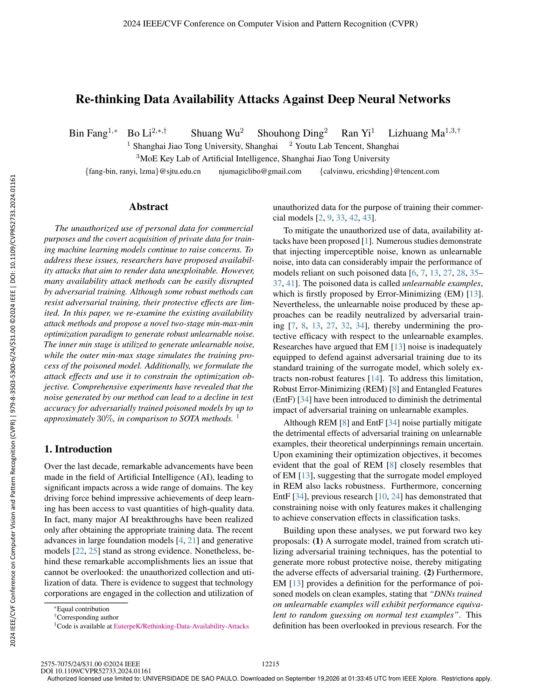

### Página 2

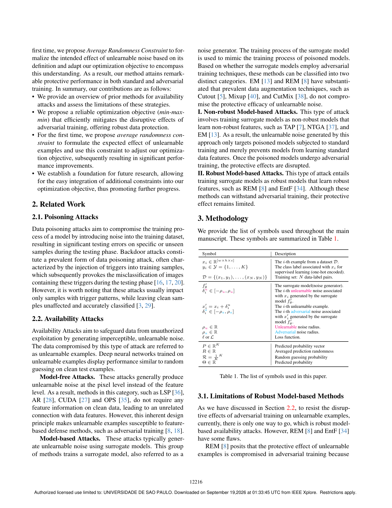

### Página 3

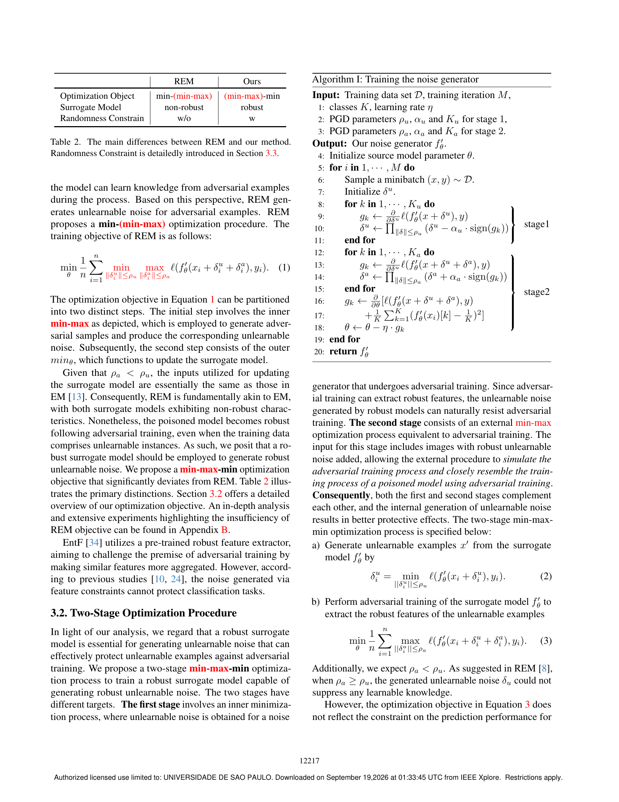

### Página 4

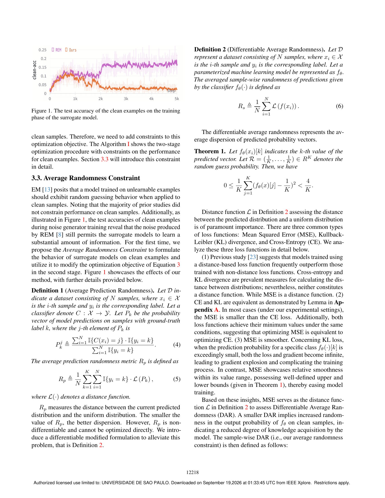

### Página 5

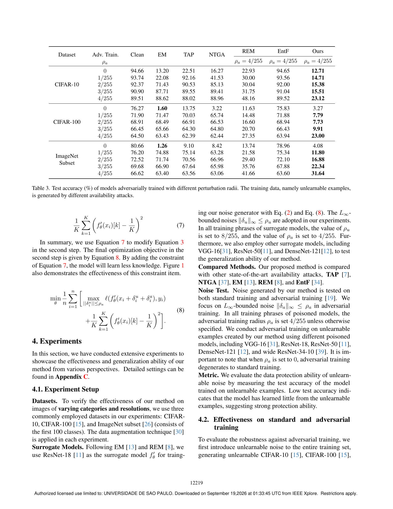

### Página 6

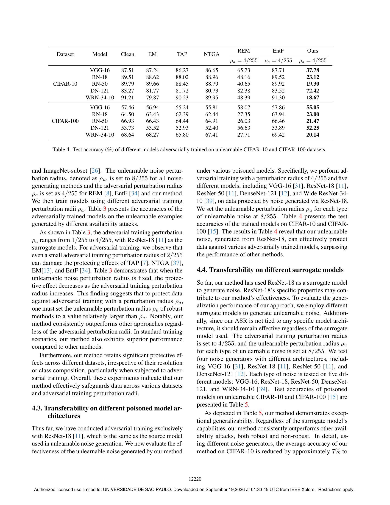

### Página 7

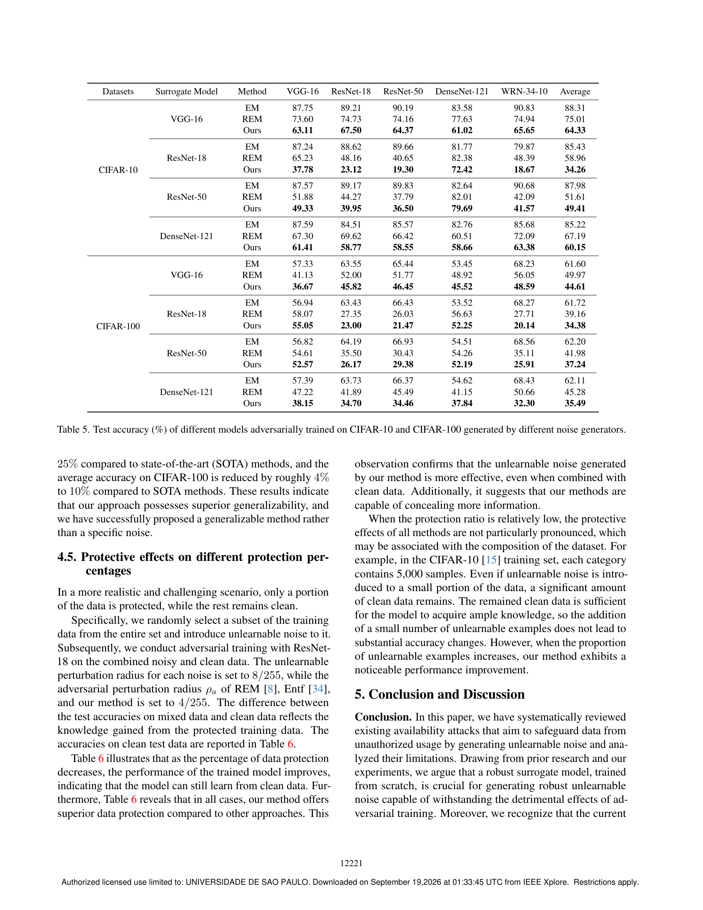

### Página 8

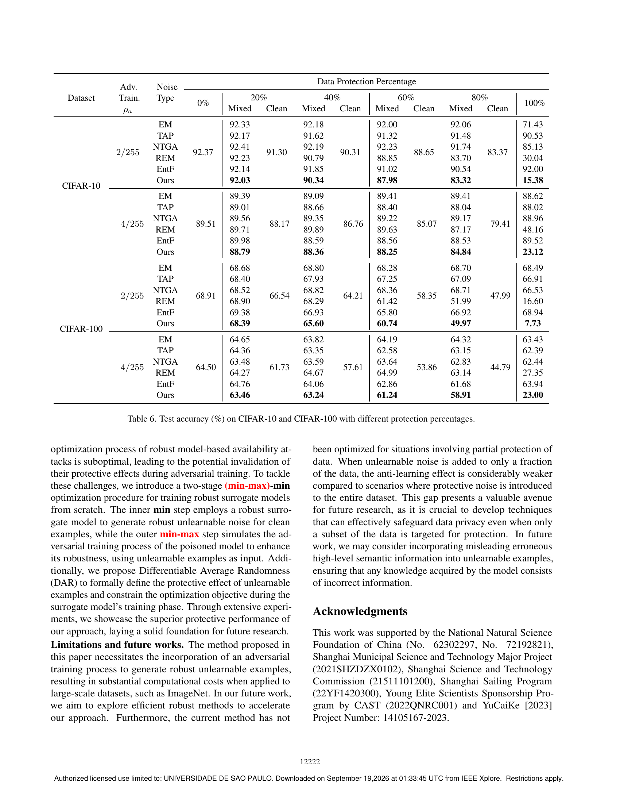

### Página 9

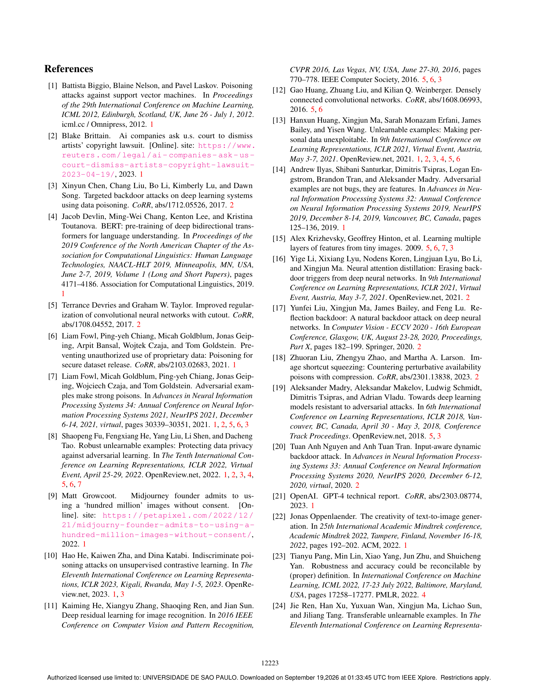

### Página 10

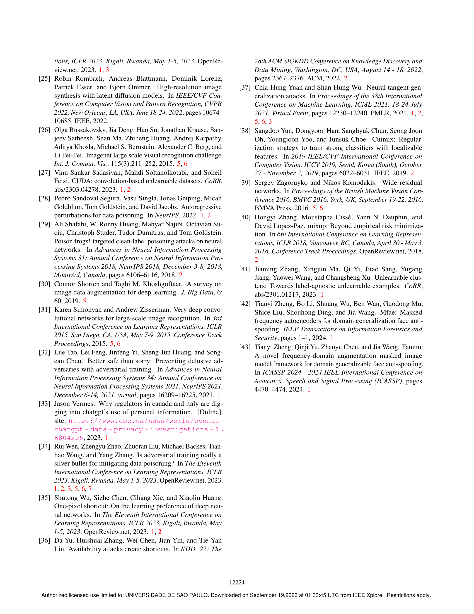

