<!-- MinerU 4.0.9, tier advanced, VLM llama.cpp/Vulkan GPU; automatic extraction, tables require comparison with the PDF. -->

[PDF original](../../The%20Devil%E2%80%99s%20Advocate%3A%20Shattering%20the%20Illusion%20of%20Unexploitable%20Data%20using%20Diffusion%20Models.pdf)

# The Devil’s Advocate:

# Shattering the Illusion of Unexploitable Data using Diffusion Models

Hadi M. Dolatabadi , Sarah Erfani , and Christopher Leckie

School of Computing and Information Systems

The University of Melbourne

Victoria, Australia

{h.dolatabadi, sarah.erfani, caleckie}@unimelb.edu.au

**Abstract—Protecting personal data against exploitation of machine learning models is crucial. Recently, availability attacks have shown great promise to provide an extra layer of protection against the unauthorized use of data to train neural networks. These methods aim to add imperceptible noise to clean data so that the neural networks cannot extract meaningful patterns from the protected data, claiming that they can make personal data “unexploitable.” This paper provides a strong countermeasure against such approaches, showing that unexploitable data might only be an illusion. In particular, we leverage the power of diffusion models and show that a carefully designed denoising process can counteract the effectiveness of the dataprotecting perturbations. We rigorously analyze our algorithm, and theoretically prove that the amount of required denoising is directly related to the magnitude of the data-protecting perturbations. Our approach, called AVATAR, delivers state-of-the-art performance against a suite of recent availability attacks in various scenarios, outperforming adversarial training even under distribution mismatch between the diffusion model and the protected data. Our findings call for more research into making personal data unexploitable, showing that this goal is far from over. Our implementation is available at this repository:** [**https://github.com/hmdolatabadi/AVATAR**](https://github.com/hmdolatabadi/AVATAR)**.**

**Index Terms—neural networks, availability attacks, diffusion models, facial recognition**

## I. INTRODUCTION

Neural networks have achieved great success in various areas of computer vision including object detection [25, 14], semantic segmentation [78, 36], and photo-realistic image/video generation [31, 11, 54]. While the efforts of the community in the development of such models cannot be undermined, this unparalleled success would have been impossible without the abundance of data resources available today [9, 33, 49, 35]. In this regard, social media, and the internet in general, provides a platform that can be crawled easily to create massive datasets. This capability can act both as a blessing and a curse: while the collected data can facilitate learning larger, more accurate neural networks, the users lose control over protecting their personal data from being exploited. This issue has raised increasing concerns about misuse of personal data [27, 26, 5].

Recently, there has been an increasing number of studies on hindering the unauthorized use of personal data for neural network image classifiers [15, 30, 72, 17, 18, 71, 62, 50].

These methods tend to add an imperceptible amount of noise to the clean images so that while the data has the same appearance as the ground-truth, it cannot provide any meaningful patterns for the neural networks to learn. As a result, such approaches, collectively known as availability attacks [4], claim that personal image data can be made unexploitable for the neural networks [30, 71]. While there has been an abundance of research on designing better availability attacks, far too little attention has been paid to counter-attacks that might be employed by adversaries to break such precautionary measures.

Unfortunately, the assumptions of existing availability attacks are far too weak to make the data unexploitable. For example, consider a user who shares their protected photos over their social media. We can clearly see that once the photos are shared, they cannot be protected against all future countermeasures [47]. For instance, consider a corporate entity that aims to train face recognition models by crawling over social media without the consent of the users. While this unauthorized entity might not have unprotected versions of a particular person’s image from his/her social media, they can have a large pre-trained model representing a facial image distribution. Given this threat model, shown in Figure 1, we aim to show that counteracting the protecting perturbations is indeed plausible.

To this end, we show that pre-trained density estimators are powerful tools that can be used to counteract the effects of the data-protecting perturbations, eventually enabling us to exploit protected data. We utilize the power of diffusion models in representing the image data distributions to show that reverse-engineering unexploitable data is easier than what is thought. In particular, given a training dataset, we first diffuse the images by adding a controlled amount of Gaussian noise following the forward process of a pre-trained diffusion model. Then, we denoise the noisy images using the reverse process of the aforementioned model, resulting in a dataset purified from data-protecting perturbations. Theoretically, using contraction properties of stochastic difference equations we prove that the number of diffusion steps required to cancel the data-protecting perturbations is directly influenced by the magnitude of its norm. Thus, protecting personal data using imperceptible perturbations is not possible. We also empirically show that our approach is surprisingly powerful, being able to deliver the state-of-the-art (SOTA) performance against a wide variety of recent availability attacks. Our findings indicate the fragility of unexploitable data, calling for more research to protect personal data.

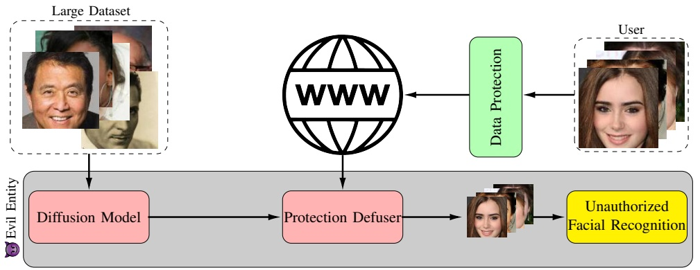

flowchart

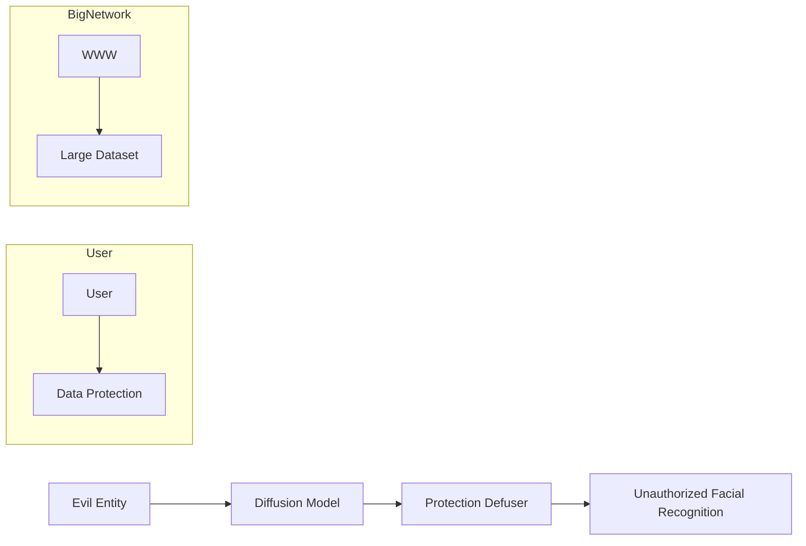

Fig. 1: The threat model considered in this paper. Availability attacks cannot guarantee to protect all the data that exists over the web. A data exploiter might use large density estimators to defuse the data-protecting perturbations and exploit the data.

Diffusion models have been extensively used in various areas. Closely related to our work, Yoon et al. [70] and Nie et al. [42] have employed diffusion models to increase robustness against adversarial attacks. In contrast to these methods, in this paper, we investigate the capabilities of diffusion models as a threat against personal data protected by availability attacks. In particular, we leverage the SOTA diffusion models as a proxy for the true data distribution and argue why unlearnable examples provide a false sense of data privacy.

Our contributions can be summarized as follows:

• We introduce AVATAR as a countermeasure against data availability attacks. To the best of our knowledge, this is the first work that explores the use of diffusion models to circumvent such attacks.
• We show the power of AVATAR in breaking availability attacks over five datasets, four architectures, and seven of the most recent availability attacks. AVATAR achieves the SOTA performance against availability attacks, outperforming adversarial training.
• Our results indicate that even in the absence of the true data distribution, one can use a similar distribution to counteract availability attacks.
• Theoretically, we show that the amount of noise needed to diffuse the data-protecting perturbation is directly related to the magnitude of its norm. This result indicates that achieving both goals of availability attacks (data utility and protection) at the same time is impossible.

## II. RELATED WORK

In this section, we review the related work to our approach.

a) Poisoning and Backdoor Attacks: A considerable number of studies have been published on various types of data poisoning attacks [4, 51, 20]. These attacks aim to pollute the training data so that they can hinder the performance of the machine learning model at test-time [3, 32, 40]. While these methods are quite successful in achieving this goal, they often tend to perform weakly against neural networks [40] and appear to be distinguishable from the clean samples, damaging the utility of the underlying data [68]. Backdoor attacks are a popular family of data poisonings against deep neural networks [23, 2, 63, 12]. Unlike general poisoning attacks, these methods attach triggers to a small fraction of the clean training data so that the model creates an association between the existence of the trigger and a particular class. During inference, the neural network would behave normally on benign samples. However, if the trigger is activated, the model would output the attacker’s desired value due to the existence of a backdoor in the model.

b) Availability Attacks: Motivated to address the lack of personal data privacy, an emerging type of poisoning attacks known as availability attacks have drawn considerable attention. Unlike previous types of poisoning attacks, availability attacks seek to add imperceptible perturbations to the clean training data with two goals in mind. First, the added perturbation should be able to protect the underlying data from being exploited by a neural network during training. Second, the perturbed data should still preserve its normal utility. To understand these constraints, consider a user sharing their photo over their social media. While the user wants to protect their photo from unauthorized use of web-crawlers to train a face recognition model [27] (first constraint), they still wish their photo to appear normal to their audience (second constraint) [30].

Feng et al. [15] propose to produce the poisoning perturbations by training an auto-encoder, whose aim is to get the lowest performance from an auxiliary classifier. In a similar spirit, Tian et al. [62] train a conditional generative adversarial network (GAN) [21] to generate the availability attacks’ perturbation. The training objective is designed to create a spurious correlation between the noisy image and the ground-truth labels. Concurrently, Yu et al. [71] empirically investigate various types of availability attacks and show that almost all of them leverage these spurious features to create a shortcut within neural networks [19]. Yu et al. [71] then propose a fast and scalable approach for perturbation generation by generating randomly-initialized linearly-separable perturbations which can generate availability attacks for an entire dataset in a few seconds. Concurrently, Sandoval-Segura et al. [50] proposed another approach that generates the random noise independent from the data. In this approach, first the beginning rows and columns of each channel are populated with Gaussian noise. Then, an autoregressive process is used to find the value of the remaining pixel values.

Another popular approach to generate availability attacks is via direct optimization. Huang et al. [30] define a bi-level optimization objective to generate error-minimizing noise for data samples and an auxiliary classifier. It is argued that since the perturbed images minimize the auxiliary classifier’s loss, they contain no useful information for any other target classifier to learn, and as such, the model would not exploit them during training. In contrast, Fowl et al. [17] show that using adversarial examples [60, 22] as the poisoned data would make it hard for the classifier to learn any meaningful pattern, and thus, they can serve as a powerful family of availability attacks. While optimization-based availability attacks are potent, they are often computationally demanding and several attempts have been made to ease their computational burden [16, 76].

Compared to various types of availability attacks, preventative measures have received little attention. It has been shown that various data augmentation techniques (such as CutOut [10], Mixup [75], CutMix [73], and Fast Autoaugment [34]) are not able to prevent availability attacks [30, 17, 62, 71]. Tao et al. [61] show that adversarial training [39, 77, 13], originally proposed to enhance robustness against adversarial attacks [60, 22], can be used to train successful classifiers against availability attacks. Later, Fu et al. [18] extended the error-minimizing noise of Huang et al. [30] resulting in perturbations that can even prevent adversarial training from learning over the poisoned data. Despite this, adversarial training has remained one of the strongest defense baselines against availability attacks. In this work, we show that one can outperform adversarial training in an attempt to counteract availability attacks.

c) Diffusion Models: Denoising diffusion probabilistic modeling (DDPM) [55, 28] (also known as score-matching networks [56–58]) are a family of deep generative models that have achieved the SOTA performance in image [11, 67], text-to-image [48], video [54], and 3D-object [46] generation. Diffusion models generally comprise of a forward and a backward process [8]. In the forward process, the model gradually adds noise to the data until it is transformed into Gaussian noise. The backward process is the reverse of the forward process, where the model tries to gradually transform/denoise a Gaussian vector into a data point.

## III. PROPOSED METHOD

This section formally introduces our proposed method, called AVATAR (dAta aVailAbiliTy Attacks defuseR). First, we define our notation and problem settings. Next, we introduce our proposed approach that materializes our threat model and provide a theoretical analysis of our framework. Finally, we discuss the potential advantages of AVATAR compared to existing methods such as adversarial training.

## A. Problem Statement

Let $\mathcal { D } = \{ ( \pmb { x } ^ { ( i ) } , y ^ { ( i ) } ) \} _ { i = 1 } ^ { n }$ be a labeled dataset consisting of n i.i.d. samples $\pmb { x } ^ { ( i ) }$ each with a label $y ^ { ( i ) }$ . Without loss of generality, in this paper, we consider image data $\pmb { x } ^ { ( i ) }   \in   \mathbb { R } ^ { d }$ where d shows the data dimension. Also, we assume that $y ^ { ( i ) }$ takes one of the K possible class values $\{ 1 , 2 , \ldots , K \}$ . Furthermore, let $f _ { \pmb { \theta } } : \mathbb { R } ^ { d } \rightarrow \mathbb { R } ^ { K }$ denote a neural network classifier parameterized by θ that takes an image x and outputs a realvalued vector $z = f _ { \pmb { \theta } } ( \pmb { x } )$ known as the logit. The final decision of the classifier is determined via $\begin{array} { r } { \hat { y }   =   \arg \operatorname* { m a x } _ { j } z _ { j } . } \end{array}$ . To train the classifier, one usually aims to minimize the empirical error between the ground-truth labels and the classifier predictions:

$$
\underset {\boldsymbol {\theta}} {\arg \min} \mathbb {E} _ {(\boldsymbol {x}, y) \in \mathcal {D}} [ \ell \left(f _ {\boldsymbol {\theta}} (\boldsymbol {x}), y\right) ], \tag {1}
$$

where ℓ(·) denotes the cross-entropy loss.

Following the convention in availability attacks, we assume that there exists a data curator that manipulates the dataset D into $\mathcal { D } _ { \mathrm { p r } } = \{ ( \tilde { \pmb { x } } ^ { ( i ) } , y ^ { ( i ) } ) \} _ { i = 1 } ^ { n }$ such that once a neural network is trained over $\mathcal { D } _ { \mathrm { p r } } ,$ it performs poorly over the clean data D:

$$
\underset{\mathcal{D}_{\mathrm{pr}}}{\arg \max}\mathbb{E}_{(\boldsymbol {x},y)\in \mathcal{D}}[\ell (f_{\boldsymbol{\theta}^{*}}(\boldsymbol {x}),y)]
$$

$$
\text {s.t.} \boldsymbol {\theta} ^ {*} = \underset {\boldsymbol {\theta}} {\arg \min} \mathbb {E} _ {(\boldsymbol {x}, y) \in \mathcal {D} _ {\mathrm{pr}}} [ \ell (f _ {\boldsymbol {\theta}} (\boldsymbol {x}), y) ]. \tag {2}
$$

Since each image $\tilde { \pmb { x } } ^ { ( i ) }$ needs to maintain its normal utility, it is assumed that $\left[ \tilde { \pmb { x } } ^ { ( i ) } = \pmb { x } ^ { ( i ) } + \pmb { \delta } ^ { ( i ) } \right.$ . Here, $\delta ^ { ( i ) } \mathrm { { ^ { , } s } }$ are the dataprotecting perturbations such that $\left\| \pmb { \delta } ^ { ( i ) } \right\| _ { p } \; \leq \; \varepsilon$ , where $\left\| \cdot \right\| _ { p }$ denotes the $L _ { p }$ norm.

## B. dAta aVailAbiliTy Attacks defuseR (AVATAR)

As discussed, large pre-trained generative models can pose a threat to availability attacks and personal data protection. In this section, we show how diffusion models, which are the SOTA in image generation, can be leveraged to cancel out the effects of availability attacks.

Recall that availability attacks provide a manipulated version of the original data x that is seemingly unexploitable. At the same time, the protected image $\tilde { \pmb { x } }   =   \pmb { x } + \pmb { \delta }$ should have its normal utility as it is going to be used by the users, e.g., to post over their social media. This condition reflects itself through the constraint that $\| \pmb { \delta } \| _ { p } \leq \varepsilon .$

A trivial idea would be to add random noise to the protected perturbation that might counteract the perturbation, but this is detrimental/ineffective in removing the unlearnable effect [30]. As such, we propose to use a diffusion model for denoising as outlined next.1

1Note that while here we use DDPMs [28] to demonstrate our method, it can be easily extended to other types of diffusion models as they are all different ways of representing the same process [58].

Specifically, let us assume that we have a pre-trained DDPM [28] model that represents the data distribution $x _ { 0 } \sim$ $p _ { \mathrm { d a t a } } ( \pmb { x } )$ . The forward process of this model is represented using a Markov chain of length $T ,$ such that:

$$
\boldsymbol {x} _ {t} = \sqrt {1 - \beta_ {t}} \boldsymbol {x} _ {t - 1} + \sqrt {\beta_ {t}} \boldsymbol {\epsilon} _ {t}, \tag {3}
$$

where $\begin{array} { r c l } { \mathbf { \epsilon } _ { t } } & { \sim } & { \mathcal { N } ( \mathbf { 0 } , \mathbf { I } ) } \\ \end{array}$ is the normal distribution, and $t = 1 , 2 , \ldots , T .$ The constants $\beta _ { t }$ , known as variance schedules, are selected such that $\begin{array} { r c l } { \boldsymbol { x } _ { T } } & { \sim } & { \mathcal { N } ( \mathbf { 0 } , \mathbf { I } ) } \\ \end{array}$ . If we set $\begin{array} { r } { \alpha _ { t } : = \prod _ { s = 1 } ^ { t } \left( 1 - \beta _ { s } \right) } \end{array}$ , then this Markov process can also be performed via a single step [28]:

$$
\boldsymbol {x} _ {t} = \sqrt {\alpha_ {t}} \boldsymbol {x} _ {0} + \sqrt {1 - \alpha_ {t}} \boldsymbol {\epsilon}. \tag {4}
$$

The reverse of this process is also a variational Markov chain which is represented by:

$$
\boldsymbol {x} _ {t - 1} = \frac {1}{\sqrt {1 - \beta_ {t}}} \left(\boldsymbol {x} _ {t} + \beta_ {t} \mathbf {s} _ {\phi} \left(\boldsymbol {x} _ {t}, t\right)\right) + \sqrt {\beta_ {t}} \boldsymbol {\epsilon} _ {t}. \tag {5}
$$

Here, $\mathbf { s } _ { \phi } ( \cdot , t )$ is a network parameterized by $\phi$ representing the score of the noisy data distribution at scale t.

To cancel the effects of the data-protecting perturbations, we propose to first add Gaussian noise to the data. The amount of noise should be adjusted in a way that each image maintains its visual appearance. Otherwise, the semantic information of each image would be lost, and since the reverse process is probabilistic, the original image might not be recovered. In particular, let x˜ be a protected image. We perform the forward process up to a step $t ^ { * } < T$ such that the semantic information of the image is preserved:

$$
\tilde {\boldsymbol {x}} _ {t ^ {*}} = \sqrt {\alpha_ {t ^ {*}}} \tilde {\boldsymbol {x}} + \sqrt {1 - \alpha_ {t ^ {*}}} \boldsymbol {\epsilon}. \tag {6}
$$

Now, we have managed to diminish the effects of the dataprotecting perturbation in $x _ { t ^ { * } }$ . However, this way we would also damage the semantic features of the data which makes it hard to train a neural network model (see the ablation study in Figure 4). To revert to the normal image space, we use the reverse process of our diffusion model to denoise the data:

$$
\bar {\boldsymbol {x}} _ {t - 1} = \frac {1}{\sqrt {1 - \beta_ {t}}} \left(\bar {\boldsymbol {x}} _ {t} + \beta_ {t} \mathbf {s} _ {\phi} \left(\bar {\boldsymbol {x}} _ {t}, t\right)\right) + \sqrt {\beta_ {t}} \boldsymbol {\epsilon} _ {t}. \tag {7}
$$

Recursively solving Equation (7) from $t ^ { * }$ to 1, we get a denoised version of the data which we denote by $\bar { x } = \bar { x } _ { 0 }$ Using this process, , shown in Figure 2, we unlock the entire dataset $\mathcal { D } _ { \mathrm { p r } } ,$ and construct a new one $\mathcal { D } _ { \mathrm { d e } } = \{ ( \bar { \pmb { x } } ^ { ( i ) } , y ^ { ( i ) } ) \}$ for neural network training. Algorithm 1 shows our final algorithm for training a neural network using AVATAR.

## C. Conflicting Assumptions in Availability Attacks

So far, we discussed how by using diffusion models we can nullify the effects of the data-protecting perturbations. Here, we take a theoretical perspective on our proposed solution and show that in this setting, the two constraints of availability attacks conflict with each other. Specifically, from the perspective of availability attacks our result indicates that for a better data protection against AVATAR, we need larger perturbation norms. However, enlarging the perturbation is in

Algorithm 1 dAta aVailAbiliTy Attacks defuseR

**Input**: protected dataset $\mathcal { D } _ { \mathrm { p r } } = \{ ( \tilde { \pmb { x } } ^ { ( i ) } , y ^ { ( i ) } ) \} _ { i = 1 } ^ { n } ,$ pre-trained diffusion model $\mathbf { s } _ { \phi } ( \cdot , t )$

**Output**: trained neural network classifier $f _ { \boldsymbol { \theta } } ( \cdot ) .$

**Parameters**: noise time-step t∗, learning rate α, total epochs E, and batch-size b.

Initialize $\boldsymbol{\theta}$ randomly.
Set $\mathcal{D}_{\text{de}} = \{\}$.
for $(\tilde{\boldsymbol{x}}, y)$ in $\mathcal{D}_{\text{pr}}$ do
    $\bar{\boldsymbol{x}}_{t^*} = \sqrt{\alpha_{t^*}} \tilde{\boldsymbol{x}} + \sqrt{1 - \alpha_{t^*}} \boldsymbol{\epsilon}$.
    for $t$ in $t^*, t^* - 1, \cdots, 0$ do
        $\bar{\boldsymbol{x}}_{t-1} = \frac{1}{\sqrt{1 - \beta_t}} (\bar{\boldsymbol{x}}_t + \beta_t \mathbf{s}_\phi(\bar{\boldsymbol{x}}_t, t)) + \sqrt{\beta_t} \boldsymbol{\epsilon}_t$.
    end for
    Add $(\bar{\boldsymbol{x}}_0, y)$ to the dataset $\mathcal{D}_{\text{de}}$.
end for
for $i = 1, 2, \ldots, E$ do
    Assign $\mathcal{D}_{\text{de}}$ to batches of size $b$ randomly.
    for batch in batches do
        $\boldsymbol{\theta} \leftarrow \text{SGD}(\text{batch}, f_\boldsymbol{\theta}, \alpha)$.
    end for
end for

conflict with retaining data utility which is the ultimate aim of availability attacks as discussed in Section III-B.

**Theorem 1.** Let $\pmb { x } \in \mathbb { R } ^ { d }$ denote a clean image and $\tilde { \pmb { x } } = \pmb { x } + \pmb { \delta }$ its protected version, where δ denotes any arbitrary data protection perturbation. Also, let ${ \bar { \bar { \mathbf { { x } } } } } _ { 0 }$ be the sanitized image using the AVATAR denoising process given in Equations (6) and (7). If we set t∗such that

$$
2 \log \left(\frac {2 \left\| \boldsymbol {\delta} \right\| ^ {2} + 4 d}{\mu \Delta}\right) \leq t ^ {*} \beta_ {t ^ {*}} \leq \frac {\mu \Delta}{4 d},
$$

then the estimation error between the sanitized ${ \bar { \mathbf { x } } } _ { 0 }$ and clean image x can be bounded as:

$$
\mathbb {E} \left[ \| \bar {\boldsymbol {x}} _ {0} - \boldsymbol {x} \| ^ {2} \right] \leq 2 (\mu + 1) \Delta ,
$$

where $\Delta = \mathbb { E } [ \| \pmb { x } _ { 0 } - \pmb { x } \| ^ { 2 } ]$ and $\mu > 0$ is a constant.

Proof. See Appendix A for our proof using the contraction property of stochastic difference equations. □

Theorem 1 states that for a protected image with a larger perturbation norm ∥δ∥, a larger amount of noise (determined by $t ^ { * }  { \beta _ { t ^ { * } } } )$ is required. However, the amount of noise cannot be arbitrarily large as the semantic information of the image might be lost in the process (as indicated by the presence of $\Delta$ in the upper-bound).

## D. AVATAR vs. Adversarial Training

As Tao et al. [61] have demonstrated, adversarial training (AT) [39] could also be used to train successful models over unexploitable data. However, our approach has several key advantages compared to AT:

1) First, AT modifies the learning algorithm, and as such, it needs to be applied separately for training each neural network. In contrast, AVATAR sanitizes the data only once. As a result, AVATAR is more efficient.

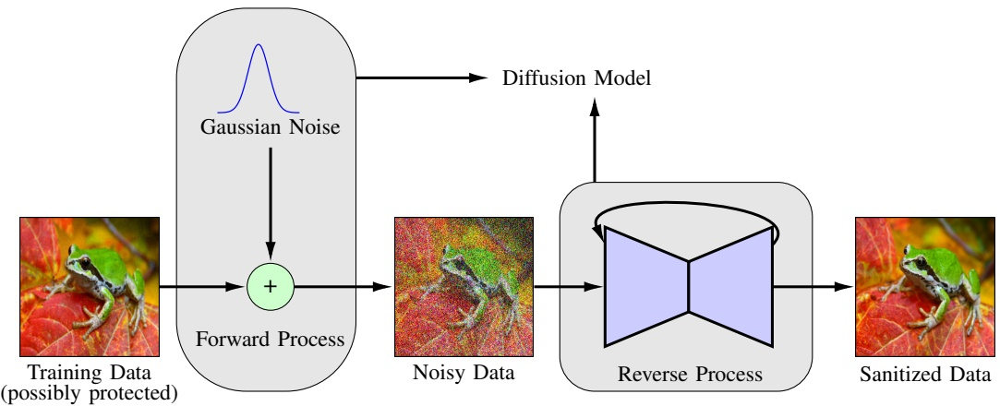

flowchart

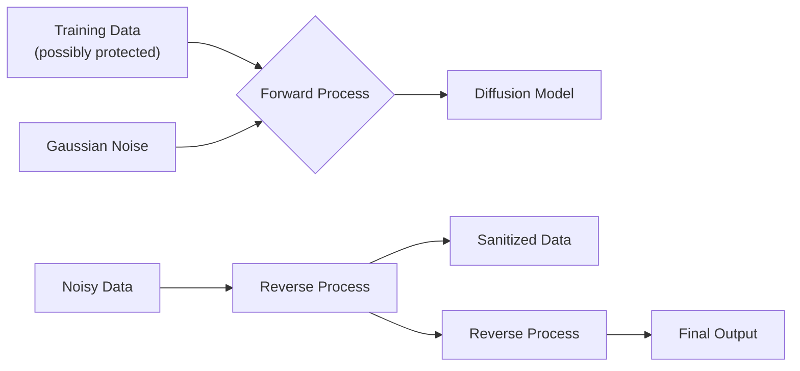

Fig. 2: Overview of AVATAR. According to a pre-trained diffusion model, we first add a controlled amount of Gaussian noise to the training data. Then, we use the reverse diffusion process to denoise the data which is later going to be used for neural network training.

2) Second, as shown by Tsipras et al. [64], AT greatly affects the clean accuracy in its learning process, and as such, might not be the ultimate method for defending against availability attacks.
3) Lastly, as Fu et al. [18] show, one can build unexploitable data against AT that would essentially render AT vulnerable to availability attacks. However, to the best of our knowledge, no adaptive availability attacks have been proposed against diffusion models so far.

## IV. EXPERIMENTAL RESULTS

In this section, we run various experiments to analyze the performance of AVATAR against availability attacks:

1) We conduct extensive experiments on seven SOTA availability attacks and show that given the data distribution, AVATAR can counteract them (Section IV-B).
2) We provide detailed comparisons against various pre-processing techniques (Section IV-C), early stopping (Section IV-D), and adversarial training (Section IV-E) to show that AVATAR delivers the best performance.
3) We provide extensive ablation studies into different assumptions made by AVATAR. First, we show that the training data overlap between the diffusion model and the unlearnable example generation has **no effect** on the performance of AVATAR (Section IV-G). Interestingly, we show that even a similar, different, or even poisoned distribution compared to the true data distribution can counteract availability attacks (Section IV-H).
4) We simulate our scenario given in Figure 1 for the real-world application of facial recognition to show the plausibility of our approach. Again, here we use a diffusion model trained on a different dataset, but we manage to counteract the unlearnable examples for another dataset (Section IV-I).

We also include an extended version of our experimental results in Appendix B.

TABLE I: The classes of CIFAR-10 and their matching ones in the ImageNet-10 dataset.

| CIFAR-10 | IN-10 |
| --- | --- |
| Airplane | Airliner |
| Automobile | Wagon |
| Bird | Humming Bird |
| Cat | Siamese Cat |
| Deer | Ox |
| Dog | Golden Retriever |
| Frog | Tailed Frog |
| Horse | Zebra |
| Ship | Container Ship |
| Truck | Trailer Truck |

## A. Details of Experimental Settings

In this section, we provide the details of our experimental settings.

a) Datasets: In our experiments, we use four different datasets. CIFAR-10 & 100 [33] are 32×32 datasets of colored images, where the classes contain different objects, animals, plants, etc. SVHN [41] is a dataset of house numbers from 0 to 9 in a natural, street view setting. Finally, ImageNet [49] is a dataset of natural images of size 224 × 224 with 1000 classes. In our experiments, we use two simplified versions of this dataset. First, following the convention of prior research, we select the first 100 classes of this dataset, which we refer to as ImageNet (IN)-100. Second, for our distribution mismatch experiments, we follow Huang et al. [30] and select 10 classes of ImageNet that are closely aligned with CIFAR-10 and downscale them to 32×32 size. We call this dataset IN-10. The information on the selected classes can be found in Table I. Finally, we also use the 32×32 version of the ImageNet dataset for some of our experiments, which we denote by IN-1k-32×32.
b) Classifiers: In our experiments, we use four types of neural network image classifiers, namely: ResNet-18 (RN-

18) [25], VGG-16 [53], DenseNet-121 (DN-121) [29], and WideResNet-34 (WRN-34) [74]. For training these classifiers over different datasets and also training objectives (vanilla vs. adversarial training (AT)), we follow two different training conventions. The hyper-parameters of each setting are given in Table II. Furthermore, Table III indicates the setting used for each experiment in the paper.

c) Diffusion Models: For the diffusion models used during the denoising process of AVATAR (shown in Figure 2), we follow the implementation of DiffPure2and use score SDE [58] (for CIFAR-10, CIFAR-100, SVHN, IN-10) and the guided DDPM (for IN-100 and IN-1k-32×32.) [11]. For CIFAR-10 and IN-100, we download the pre-trained versions available online.3for IN-1k-32×32 dataset. Additionally, for CIFAR-100, IN-10, and SVHN we use the PyTorch repository of score SDE [58], and train variance-preserving diffusion models with continuous DDPM++ architecture, similar to the one used for CIFAR-10. The FID score of the trained diffusion models is given in Table IV.

d) Availability Attacks: We use seven SOTA availability attacks in our experiments: DeepConfuse (CON) [15], Neural Tangent Generalization Attacks (NTGA) [72], Errorminimizing Noise (EMN) [30], Targeted Adversarial Poisoning (TAP) [17], Robust EMN (REMN) [18], Shortcut (SHR) [19], and Autoregressive attacks (AR) [50]. The details of each availability attack are given below:

• For CON [15], we use the released protected CIFAR-10 dataset, available online at SHR [71] repository.4 Note that since generating this attack for the CIFAR-10 dataset would take 5-7 days, we just used the available data for CIFAR-10 and skipped generating the attack for the other datasets.
• For NTGA [72], we use their code5to generate availability attacks for our datasets. For CIFAR-10, we used the data published online. For CIFAR-100 and SVHN, we used the online repository, and generate NTGA protected data using the CNN surrogate model, time-step of 64, and block-size of 100 to generate perturbations of magnitude $\left\| \delta \right\| _ { \infty } \leq 8 / 2 5 5$ . Due to limited GPU memory, we used the FNN surrogate model to generate perturbations of magnitude $\| \pmb { \delta } \| _ { \infty } \leq 0 . 1$ for IN-100. The rest of the hyper-parameters were set similarly to CIFAR-100 and SVHN.
• For EMN [30], TAP [17], and REMN [18], we use the online repository of REMN6 which contains an implementation of EMN and TAP as well. We use the default

CIFAR-10 configurations of this repository for CIFAR-10, CIFAR-100, and SVHN. For IN-10, we used the default MiniIN configurations of the REMN code-base.

• Moreover, we use the SHR GitHub repository4to generate shortcut attacks. For CIFAR-10, CIFAR-100, and SVHN, we use the default settings. For IN-100, we use patchsize of 32 as advised by the authors.
• Finally, we use the official data released on the AR GitHub repository for this attack.7

A few samples for each availability attack are shown in Figure 7.

## B. Exploiting Protected Data

Table V shows our results for breaking availability attacks against for four different datasets. As can be seen, AVATAR can significantly improve the performance of neural network training in almost all cases. Moreover, although the training data was produced using diffusion models, the trained neural networks can generalize to unseen test data easily. This trend is more evident in the CIFAR-10 and SVHN datasets where the pre-trained diffusion model can better represent the image data density, as indicated by their low FID scores.

## C. Comparison with Data Augmentation Techniques

AVATAR can be regarded as a type of data pre-processing where the inner mechanics of the learning algorithms are not modified. As such, here we compare our approach with various SOTA data augmentation techniques that can be utilized during model training. To this end, we follow the settings of [30], and adopt four widely used data augmentation techniques. In addition, we employ the JPEG and grayscale pre-processing [38] as well as two blurring techniques in Table VI. Finally, we also test the quantization and total variation minimization (TVM) approaches that have shown to be effective against adversarial attacks [24]. Table VI shows the performance of these methods compared to AVATAR. As shown, our approach outperforms various types of pre-processing/data augmentation methods.

## D. The Effect of Early Stopping

It has been previously shown that early stopping can also be beneficial against availability attacks [30]. As such, here we run the same set of experiments over availability attacks for the CIFAR-10 dataset, but this time we record the highest accuracy attainable during training. Table VII shows our results. As seen, using our approach one achieves stable training, where the variance between the final model accuracy and the highest attainable accuracy is very low. Notably, while these results indicate that existing availability attacks are less powerful than what is thought, early stopping is not sufficient to recover the best model performance. In contrast, AVATAR can significantly cancel the effects of availability attacks.

<small>2[https://github.com/NVlabs/DiffPure](https://github.com/NVlabs/DiffPure)</small>

<small>3For CIFAR-10, we used the checkpoint for the vp/cifar10\_ddpmpp\_deep\_continuous setting on score SDE repository: [https://github.com/yang-song/score sde pytorch](https://github.com/yang-song/score_sde_pytorch). Moreover, we used the unconditional 256 × 256 model available on the guided DDPM code-base for IN-100 expriments: [https://github.com/openai/guided-diffusion.](https://github.com/openai/guided-diffusion)Finally, we use the pre-trained DDPM-IP [43] models available on [https://github.com/forever208/DDPM-IP](https://github.com/forever208/DDPM-IP)</small>

<small>4[https://github.com/dayu11/Availability-Attacks-Create-Shortcuts](https://github.com/dayu11/Availability-Attacks-Create-Shortcuts)</small>

<small>5[https://github.com/lionelmessi6410/ntga](https://github.com/lionelmessi6410/ntga)</small>

<small>6[https://github.com/fshp971/robust-unlearnable-examples](https://github.com/fshp971/robust-unlearnable-examples)</small>

<small>7[https://github.com/psandovalsegura/autoregressive-poisoning](https://github.com/psandovalsegura/autoregressive-poisoning)</small>

TABLE II: Training hyper-parameters used in our experiments.

| Hyper-parameter | Setting #1 | Setting #2 |
| --- | --- | --- |
| Optimizer | SGD | SGD |
| Scheduler | Multi-step | Multi-step |
| Initial lr. | 0.1 | 0.1 |
| lr. decay | 0.1 (@epoch: 80 &amp; 100) | 0.1 (@iter: 16k &amp; 32k) |
| Batch Size | 128 | 128 |
| Training Steps | 120 (epochs) | 40k (iters) |
| Weight Decay | 0.0005 | 0.0005 |
| PGD Steps (for AT only) | - | 10 |
| PGD Step Size (for AT only) | - | 0.8 |

TABLE III: Setting number used for each experiment.

| Experiment | Setting #1 | Setting #2 |
| --- | --- | --- |
| Table V (CIFAR-10) | ✓ | - |
| Table V (CIFAR-100) | ✓ | - |
| Table V (SVHN) | ✓ | - |
| Table V (IN-100) | - | ✓ |
| Table VI | ✓ | - |
| Table VII | ✓ | - |
| Table VIII | ✓ | - |
| Figure 4 | ✓ | - |
| Figure 3 | - | ✓ |

TABLE IV: The FID of the diffusion models used for denoising. \* denotes that the FID has been computed using 10k generated samples only. † indicates that the scores have been adapted from relative literature.

| Dataset | FID | Dataset | FID |
| --- | --- | --- | --- |
| CIFAR-10$^{\dagger}$ | 2.41 | SVHN$^{*}$ | 2.59 |
| CIFAR-10 (TAP)$^{*}$ | 4.11 | CIFAR-100$^{*}$ | 4.85 |
| IN-10$^{*}$ | 17.32 | IN$^{\dagger}$ | 4.59 |

## E. Comparison with Adversarial Training

As mentioned in Section II, adversarial training (AT) [39] is the most successful defense technique against availability attacks [61]. For the next set of experiments, we follow the settings of Fu et al. [18] and compare our approach with AT. To this end, we run two different scenarios. First, we perform AT over the protected data. Then, we run AT over the data that is defused (i.e., counteracted) by AVATAR. In both cases, we vary the perturbation bound ε from 0 to 4, where 0 is the vanilla training. Figure 3 shows our results. Apart from what we discussed in Section III-D, two additional insights are worth mentioning here:

(1) In most cases, AVATAR without AT (i.e., ε = 0) performs on-par or better than AT with $\varepsilon > 0 .$ . Thus, AVATAR delivers the SOTA against availability attacks.
(2) As seen in Figure 3, AT yields the worst performance against REMN [18]. However, our approach can combat

REMN [18] successfully, and it is the first approach that does so.

## F. Setting Diffusion Step t∗

As discussed in Section III-C, setting the diffusion timestep should be performed carefully. Otherwise, either the dataprotecting noise is not eliminated, or the semantic information of the image is lost. Here, we run an ablation study over the diffusion timestep. In particular, for our CIFAR-10 experiments, we run AVATAR with five different timesteps from {0, 100, 200, 300, 400}. Then, we measure the test accuracy of the trained neural networks over the clean test set. As shown in Figure 4, setting t∗too small means that the data-protecting perturbations are not removed. In contrast, setting t∗to a large value might remove the semantic information which in turn damages the generalizability of the trained model. For a more thorough discussion on selecting t∗, please see Appendix B-C.

## G. The Effect of Diffusion Models’ Training Data

It is well-known from the literature that diffusion models are not a mere memorization of their training data [58] and can further enhance the accuracy of down-stream tasks [1, 66]. To empirically eradicate the influence of training data overlap on our results, we perform the following experiment. Apart from our results in Table V, we run a second set of experiments where we create disjoint subsets of training data for training diffusion models and those used as unlearnable examples. Then, we train our in-house diffusion model and perform a similar experiment to that of Table V, but this time with this new, non-overlapping set of data. Finally, we measure the performance over the unseen test data. We report the relative error rate with respect to the clean data performance in Figure 5. As seen, the overlap in diffusion models’ training data has no impact on AVATAR’s final performance. We further validate this through our real-world experiments in Section IV-I.

## H. Distribution Mismatch

To go even further, we show that AVATAR is even resilient to a distribution mismatch between the diffusion model and the training data. In particular, we train three diffusion models over the protected CIFAR-10 dataset with TAP [17], IN-10 which contains 10 classes of ImageNet that are most similar to CIFAR-10 dataset [30] (see Table I for more details), and

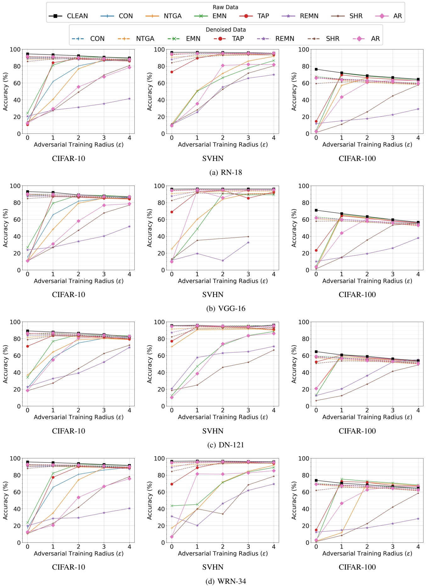

Fig. 3: Test accuracy of CIFAR-10, SVHN, and CIFAR-100 classifiers against availability attacks using adversarial training with different perturbation radii.

TABLE V: Test accuracy (%) of RN-18 architectures trained over data availability attacks on CIFAR-10, CIFAR-100, and SVHN, and ImageNet-100 datasets without and with our denoising approach. The mean and standard deviation are computed over 5 seeds. For our results over other architectures, please see Table X.

<table><tr><td rowspan="2">Data</td><td rowspan="2">Method</td><td rowspan="2">Clean</td><td colspan="6">Data Availability Attacks</td></tr><tr><td>NTGA</td><td>EMN</td><td>TAP</td><td>REMN</td><td>SHR</td><td>AR</td></tr><tr><td rowspan="2">CIFAR-10</td><td>Vanilla</td><td rowspan="2">94.50 ± 0.09</td><td>11.49 ± 0.69</td><td>24.85 ± 0.71</td><td>7.86 ± 0.90</td><td>20.50 ± 1.16</td><td>10.82 ± 0.22</td><td>12.09 ± 1.12</td></tr><tr><td>AVATAR</td><td>87.95 ± 0.28</td><td>90.95 ± 0.10</td><td>90.71 ± 0.19</td><td>88.49 ± 0.24</td><td>85.69 ± 0.27</td><td>91.57 ± 0.18</td></tr><tr><td rowspan="2">SVHN</td><td>Vanilla</td><td rowspan="2">96.29 ± 0.12</td><td>9.65 ± 0.70</td><td>9.13 ± 2.00</td><td>65.97 ± 1.99</td><td>11.55 ± 0.19</td><td>10.59 ± 3.98</td><td>6.76 ± 0.07</td></tr><tr><td>AVATAR</td><td>89.84 ± 0.32</td><td>93.84 ± 0.12</td><td>93.35 ± 0.10</td><td>88.51 ± 0.23</td><td>83.82 ± 0.39</td><td>94.13 ± 0.17</td></tr><tr><td rowspan="2">CIFAR-100</td><td>Vanilla</td><td rowspan="2">75.01 ± 0.41</td><td>1.32 ± 0.31</td><td>2.05 ± 0.18</td><td>14.10 ± 0.19</td><td>10.88 ± 0.33</td><td>1.39 ± 0.10</td><td>2.15 ± 0.46</td></tr><tr><td>AVATAR</td><td>63.98 ± 0.55</td><td>65.73 ± 0.36</td><td>64.99 ± 0.10</td><td>64.88 ± 0.08</td><td>58.52 ± 0.46</td><td>64.54 ± 0.23</td></tr><tr><td rowspan="2">IN-100</td><td>Vanilla</td><td rowspan="2">80.05 ± 0.13</td><td>74.74 ± 0.52</td><td>1.78 ± 0.17</td><td>9.14 ± 0.40</td><td>13.28 ± 0.51</td><td>43.48 ± 1.56</td><td></td></tr><tr><td>AVATAR</td><td>71.08 ± 0.48</td><td>72.84 ± 0.90</td><td>76.52 ± 0.46</td><td>39.79 ± 0.98</td><td>59.85 ± 1.01</td><td></td></tr></table>

TABLE VI: Test accuracy (%) of RN-18 models trained over data availability attacks on CIFAR-10 dataset using different data augmentation/pre-processing techniques. The results are averaged over 5 runs. The best results are highlighted in bold.

<table><tr><td rowspan="2">Method</td><td rowspan="2">Clean</td><td colspan="7">Data Availability Attacks</td></tr><tr><td>CON</td><td>NTGA</td><td>EMN</td><td>TAP</td><td>REMN</td><td>SHR</td><td>AR</td></tr><tr><td>Vanilla</td><td>94.50 ± 0.09</td><td>15.75 ± 0.82</td><td>11.49 ± 0.69</td><td>24.85 ± 0.71</td><td>7.86 ± 0.90</td><td>20.50 ± 1.16</td><td>10.82 ± 0.22</td><td>12.09 ± 1.12</td></tr><tr><td>Cutout</td><td>94.39 ± 0.12</td><td>13.53 ± 0.34</td><td>13.43 ± 1.15</td><td>23.79 ± 1.28</td><td>9.73 ± 1.06</td><td>20.48 ± 1.09</td><td>11.78 ± 0.81</td><td>11.21 ± 1.01</td></tr><tr><td>MixUp</td><td>94.87 ± 0.05</td><td>28.58 ± 2.88</td><td>13.54 ± 0.36</td><td>51.48 ± 0.97</td><td>30.09 ± 1.93</td><td>26.61 ± 1.65</td><td>19.69 ± 0.71</td><td>12.67 ± 1.02</td></tr><tr><td>CutMix</td><td>95.16 ± 0.03</td><td>19.04 ± 2.74</td><td>14.16 ± 1.64</td><td>25.30 ± 1.18</td><td>7.45 ± 1.21</td><td>26.83 ± 1.99</td><td>10.89 ± 0.34</td><td>11.36 ± 0.50</td></tr><tr><td>FAutoAug.</td><td>95.11 ± 0.14</td><td>51.62 ± 1.28</td><td>27.56 ± 2.45</td><td>56.31 ± 1.13</td><td>20.39 ± 0.81</td><td>26.65 ± 0.89</td><td>25.88 ± 0.62</td><td>13.53 ± 0.79</td></tr><tr><td>Median Blur</td><td>85.83 ± 0.71</td><td>15.14 ± 0.38</td><td>28.43 ± 1.41</td><td>26.97 ± 0.39</td><td>57.16 ± 0.75</td><td>23.32 ± 0.69</td><td>17.50 ± 0.38</td><td>14.97 ± 0.40</td></tr><tr><td>Gaus. Blur</td><td>94.33 ± 0.08</td><td>15.36 ± 0.69</td><td>11.86 ± 0.81</td><td>24.08 ± 0.40</td><td>8.87 ± 0.65</td><td>20.89 ± 1.56</td><td>11.39 ± 1.91</td><td>13.39 ± 1.08</td></tr><tr><td>Quantization</td><td>94.57 ± 0.14</td><td>15.17 ± 0.79</td><td>16.29 ± 1.03</td><td>25.38 ± 0.68</td><td>7.38 ± 1.59</td><td>22.33 ± 1.21</td><td>11.12 ± 0.24</td><td>12.87 ± 0.69</td></tr><tr><td>TVM</td><td>73.20 ± 1.32</td><td>42.82 ± 2.00</td><td>47.41 ± 1.37</td><td>54.86 ± 2.17</td><td>70.66 ± 0.58</td><td>19.28 ± 1.12</td><td>25.35 ± 2.54</td><td>34.09 ± 2.07</td></tr><tr><td>Grayscale</td><td>92.89 ± 0.20</td><td>83.30 ± 0.40</td><td>63.21 ± 0.85</td><td>92.09 ± 0.22</td><td>9.57 ± 0.59</td><td>75.84 ± 1.36</td><td>57.13 ± 0.87</td><td>35.88 ± 0.99</td></tr><tr><td>JPEG</td><td>84.99 ± 0.28</td><td>82.87 ± 0.23</td><td>79.26 ± 0.12</td><td>84.65 ± 0.16</td><td>83.44 ± 0.36</td><td>83.66 ± 0.30</td><td>69.03 ± 0.62</td><td>85.03 ± 0.23</td></tr><tr><td>AVATAR (Ours)</td><td>90.16 ± 0.21</td><td>89.43 ± 0.09</td><td>87.95 ± 0.28</td><td>90.95 ± 0.10</td><td>90.71 ± 0.19</td><td>88.49 ± 0.24</td><td>85.69 ± 0.27</td><td>91.57 ± 0.18</td></tr></table>

CIFAR-100. Then, we use these surrogate distributions to sanitize protected CIFAR-10 data and train a neural network over the denoised data. We report our results in Table VIII. Surprisingly, our approach can tolerate the distribution mismatch to some extent. As the diffusion model density gets closer to the true training data, the performance gap is gradually closed. Interestingly, even using a diffusion model that is trained over protected data can be beneficial in removing the effects of availability attacks. Note that according to our threat model discussed in Figure 1, this case is too extreme, meaning that the data protector needs to add a perturbation to all the data on the web which is almost impossible. Interestingly, our method using the sub-optimal CIFAR-100 distribution is still performing better than grayscale and JPEG compression techniques of Liu et al. [38].

These results motivates us to run AVATAR in a real-world case. In particular, we employ the off-the-shelf diffusion model, DDPM-IP [43], that is trained over the 32×32 version of the ImageNet dataset in AVATAR. Then, we re-run our experiments of Table V on CIFAR-10, CIFAR-100, and SVHN using this diffusion model. As this DDPM-IP [43] uses a cosine schedule [11], we need to adjust the value of t∗to reflect this change. As we discuss in Appendix B-C, we set $t ^ { * } \; = \; 2 0 0$ to have an equivalent performance to the linear schedule that was used in our earlier experiments.

TABLE VII: Test accuracy (%) of RN-18 models trained over data availability attacks on CIFAR-10 dataset. The early stopping rows contain the highest achievable accuracy over the course of training. The results are averaged over 5 runs.

<table><tr><td rowspan="2">Method</td><td colspan="7">Data Availability Attacks</td></tr><tr><td>CON</td><td>NTGA</td><td>EMN</td><td>TAP</td><td>REMN</td><td>SHR</td><td>AR</td></tr><tr><td>Vanilla</td><td>15.75 ± 0.82</td><td>11.49 ± 0.69</td><td>24.85 ± 0.71</td><td>7.86 ± 0.90</td><td>20.50 ± 1.16</td><td>10.82 ± 0.22</td><td>12.09 ± 1.12</td></tr><tr><td>+ Early Stopping</td><td>23.99 ± 6.22</td><td>31.71 ± 3.97</td><td>27.23 ± 1.83</td><td>67.13 ± 2.03</td><td>21.90 ± 0.57</td><td>22.72 ± 0.83</td><td>38.78 ± 8.65</td></tr><tr><td>AVATAR (Ours)</td><td>89.43 ± 0.09</td><td>87.95 ± 0.28</td><td>90.95 ± 0.10</td><td>90.71 ± 0.19</td><td>88.49 ± 0.24</td><td>85.69 ± 0.27</td><td>91.57 ± 0.18</td></tr><tr><td>+ Early Stopping</td><td>89.55 ± 0.15</td><td>88.07 ± 0.22</td><td>91.07 ± 0.11</td><td>91.00 ± 0.11</td><td>88.59 ± 0.26</td><td>85.76 ± 0.25</td><td>91.63 ± 0.17</td></tr></table>

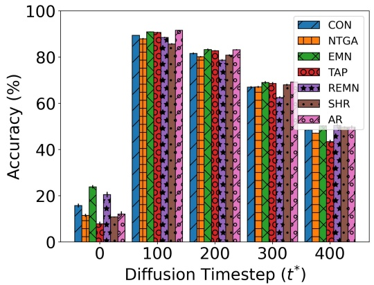

bar

| Diffusion Timestep (t*) | CON (%) | NTGA (%) | EMN (%) | TAP (%) | REMN (%) | SHR (%) | AR (%) |
| --- | --- | --- | --- | --- | --- | --- | --- |
| 0 | ~16 | ~12 | ~24 | ~8 | ~21 | ~11 | ~13 |
| 100 | ~90 | ~88 | ~91 | ~90 | ~89 | ~85 | ~92 |
| 200 | ~82 | ~80 | ~84 | ~83 | ~79 | ~81 | ~83 |
| 300 | ~67 | ~67 | ~69 | ~68 | ~63 | ~69 | ~69 |
| 400 | ~49 | ~48 | ~48 | ~45 | ~49 | ~49 | ~49 |

(a) RN-18

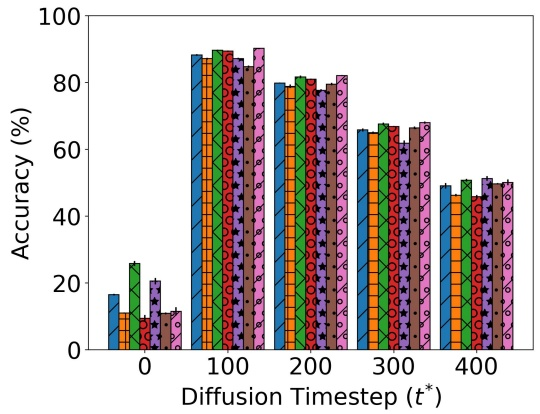

bar

| Diffusion Timestep (t*) | Blue (diagonal stripes) | Orange (solid) | Green (hatched) | Red (star) | Purple (cross-hatch) | Brown (dotted) |
| --- | --- | --- | --- | --- | --- | --- |
| 0 | ~17 | ~12 | ~26 | ~10 | ~21 | ~12 |
| 100 | ~89 | ~88 | ~90 | ~90 | ~87 | ~91 |
| 200 | ~80 | ~79 | ~82 | ~81 | ~78 | ~82 |
| 300 | ~66 | ~65 | ~68 | ~67 | ~63 | ~68 |
| 400 | ~50 | ~46 | ~51 | ~47 | ~51 | ~50 |

(b) VGG-16

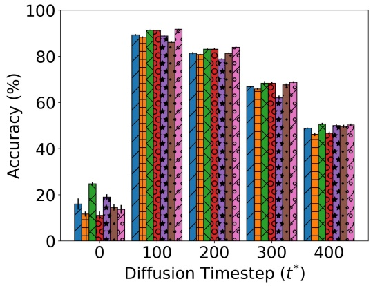

bar

| Diffusion Timestep (t*) | Blue (diagonal stripes) | Orange (solid) | Green (hatched) | Red (cross-hatch) | Purple (star) | Brown (diamond) | Pink (cross-hatch) |
| --- | --- | --- | --- | --- | --- | --- | --- |
| 0 | ~17 | ~12 | ~25 | ~12 | ~20 | ~15 | ~14 |
| 100 | ~90 | ~89 | ~92 | ~92 | ~89 | ~86 | ~92 |
| 200 | ~82 | ~81 | ~84 | ~83 | ~79 | ~79 | ~84 |
| 300 | ~67 | ~66 | ~69 | ~69 | ~63 | ~68 | ~69 |
| 400 | ~49 | ~46 | ~51 | ~47 | ~50 | ~50 | ~50 |

(c) DN-121

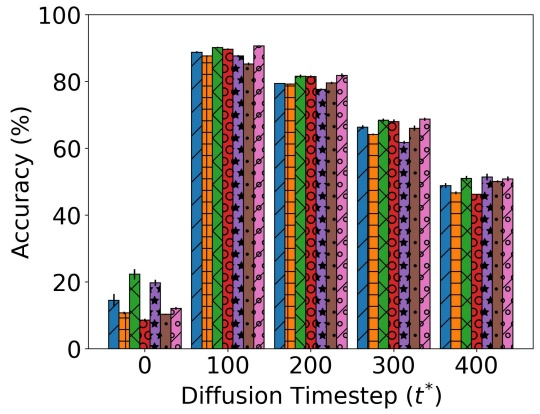

bar

| Diffusion Timestep (t*) | Blue (diagonal stripes) | Orange (solid) | Green (solid) | Red (cross-hatch) | Purple (star) | Brown (cross-hatch) | Pink (diagonal stripes) |
| --- | --- | --- | --- | --- | --- | --- | --- |
| 0 | ~15 | ~11 | ~23 | ~8 | ~20 | ~10 | ~13 |
| 100 | ~89 | ~88 | ~90 | ~90 | ~87 | ~86 | ~91 |
| 200 | ~80 | ~79 | ~83 | ~82 | ~78 | ~79 | ~82 |
| 300 | ~67 | ~64 | ~69 | ~68 | ~62 | ~67 | ~69 |
| 400 | ~49 | ~47 | ~51 | ~47 | ~51 | ~51 | ~51 |

(d) WRN-34

Fig. 4: Effect of changing the forward process diffusion timestep in AVATAR on the final test accuracy in CIFAR-10 classifiers.

Our results are shown in Table IX. As seen, AVATAR is resilient to the choice of the diffusion model. Even though there is a distribution mismatch between our test datasets and ImageNet-32×32, our results are on par with the use of the matching data distribution. These results indicate the realworld value of AVATAR which can serve as a strong baseline against availability attacks.

## I. Real-world Example I: Face Recognition

In Section I, we discussed in detail that the threat model of existing availability attacks is fragile and a malicious adversary might still exploit the personal data. This means that possibly no imperceptible adversary can protect the image data from being maliciously used. To show this, we discussed a realworld example in Section IV following a similar experiment from Huang et al. [30]. In particular, we create a set of clean and protected identities in the WebFace [69] dataset by randomly selecting 50 identities from this dataset. As a result, the remaining 10522 identities constitute our clean data. For all of the identities, we randomly split the data so that 80% of that

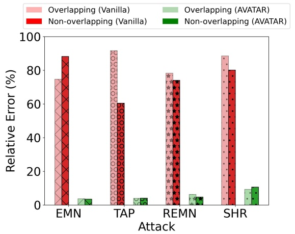

bar

| Attack | Overlapping (Vanilla) (%) | Non-overlapping (Vanilla) (%) | Overlapping (AVATAR) (%) | Non-overlapping (AVATAR) (%) |
| --- | --- | --- | --- | --- |
| EMN | ~75 | ~88 | ~4 | ~4 |
| TAP | ~92 | ~61 | ~4 | ~5 |
| REMN | ~79 | ~74 | ~6 | ~5 |
| SHR | ~89 | ~80 | ~10 | ~11 |

(a) CIFAR-10

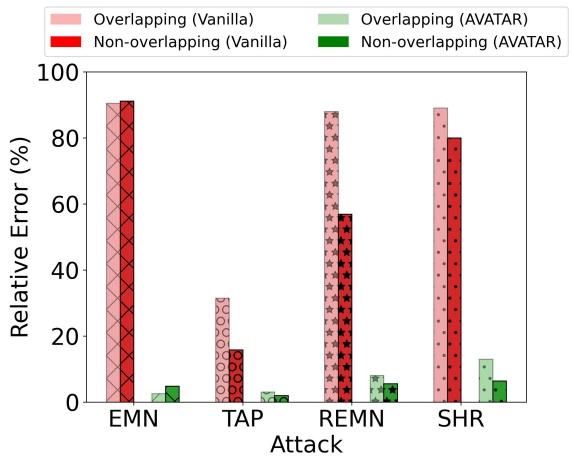

bar

| Attack | Overlapping (Vanilla) (%) | Overlapping (AVATAR) (%) | Non-overlapping (Vanilla) (%) | Non-overlapping (AVATAR) (%) |
| --- | --- | --- | --- | --- |
| EMN | ~90 | ~3 | ~91 | ~5 |
| TAP | ~32 | ~4 | ~16 | ~2 |
| REMN | ~88 | ~8 | ~57 | ~6 |
| SHR | ~89 | ~13 | ~80 | ~7 |

(b) SVHN

Fig. 5: Relative error rate of RN-18 models trained against availability attacks on CIFAR-10 and SVHN averaged over 5 runs. Overlapping indicates that the diffusion model and availability attacks use the same subset as training data. Non-overlapping means that the diffusion model and availability attacks are trained on disjoint subsets of data.

TABLE VIII: Test accuracy (%) of RN-18 models trained over data availability attacks on the CIFAR-10 dataset. For AVATAR, we use different pre-trained distributions over CIFAR-10, poisoned CIFAR-10 (TAP), ImageNet-10 (IN-10) [30], and CIFAR-100. The results are averaged over 5 runs.

<table><tr><td rowspan="2">Distribution</td><td colspan="7">Data Availability Attacks</td></tr><tr><td>CON</td><td>NTGA</td><td>EMN</td><td>TAP</td><td>REMN</td><td>SHR</td><td>AR</td></tr><tr><td>Vanilla</td><td>15.75 ± 0.82</td><td>11.49 ± 0.69</td><td>24.85 ± 0.71</td><td>7.86 ± 0.90</td><td>20.50 ± 1.16</td><td>10.82 ± 0.22</td><td>12.09 ± 1.12</td></tr><tr><td>CIFAR-10 (TAP)</td><td>61.70 ± 2.02</td><td>75.62 ± 3.75</td><td>64.03 ± 0.98</td><td>35.09 ± 2.28</td><td>60.16 ± 1.44</td><td>74.96 ± 2.82</td><td>60.36 ± 2.29</td></tr><tr><td>IN-10</td><td>80.98 ± 0.06</td><td>79.42 ± 0.25</td><td>83.78 ± 0.39</td><td>82.71 ± 0.24</td><td>82.83 ± 0.28</td><td>75.91 ± 0.06</td><td>84.88 ± 0.19</td></tr><tr><td>CIFAR-100</td><td>84.85 ± 0.49</td><td>83.07 ± 0.33</td><td>87.81 ± 0.14</td><td>86.55 ± 0.26</td><td>85.84 ± 0.19</td><td>79.52 ± 0.22</td><td>88.59 ± 0.15</td></tr><tr><td>CIFAR-10</td><td>89.43 ± 0.09</td><td>87.95 ± 0.28</td><td>90.95 ± 0.10</td><td>90.71 ± 0.19</td><td>88.49 ± 0.24</td><td>85.69 ± 0.27</td><td>91.57 ± 0.18</td></tr></table>

TABLE IX: Test accuracy (%) of RN-18 models trained over data availability attacks on CIFAR-10, CIFAR-100, SVHN with our denoising approach using the matching distribution and ImageNet-32×32. The mean and standard deviation are computed over 5 seeds.

<table><tr><td rowspan="2">Data</td><td rowspan="2">Distribution</td><td rowspan="2">Clean</td><td colspan="6">Data Availability Attacks</td></tr><tr><td>NTGA</td><td>EMN</td><td>TAP</td><td>REMN</td><td>SHR</td><td>AR</td></tr><tr><td rowspan="2">CIFAR-10</td><td>CIFAR-10</td><td rowspan="2">94.50 ± 0.09</td><td>87.95 ± 0.28</td><td>90.95 ± 0.10</td><td>90.71 ± 0.19</td><td>88.49 ± 0.24</td><td>85.69 ± 0.27</td><td>91.57 ± 0.18</td></tr><tr><td>ImageNet-32×32</td><td>86.41 ± 0.21</td><td>90.17 ± 0.15</td><td>89.02 ± 0.15</td><td>88.26 ± 0.24</td><td>82.97 ± 0.24</td><td>90.61 ± 0.18</td></tr><tr><td rowspan="2">SVHN</td><td>SVHN</td><td rowspan="2">96.29 ± 0.12</td><td>89.84 ± 0.32</td><td>93.84 ± 0.12</td><td>93.35 ± 0.10</td><td>88.51 ± 0.23</td><td>83.82 ± 0.39</td><td>94.13 ± 0.17</td></tr><tr><td>ImageNet-32×32</td><td>91.32 ± 0.17</td><td>94.82 ± 0.10</td><td>95.01 ± 0.21</td><td>91.00 ± 0.27</td><td>83.12 ± 0.30</td><td>94.29 ± 0.22</td></tr><tr><td rowspan="2">CIFAR-100</td><td>CIFAR-100</td><td rowspan="2">75.01 ± 0.41</td><td>63.98 ± 0.55</td><td>65.73 ± 0.36</td><td>64.99 ± 0.10</td><td>64.88 ± 0.08</td><td>58.52 ± 0.46</td><td>64.54 ± 0.23</td></tr><tr><td>ImageNet-32×32</td><td>65.22 ± 0.55</td><td>67.09 ± 0.18</td><td>66.52 ± 0.25</td><td>66.52 ± 0.15</td><td>58.32 ± 0.56</td><td>66.44 ± 0.17</td></tr></table>

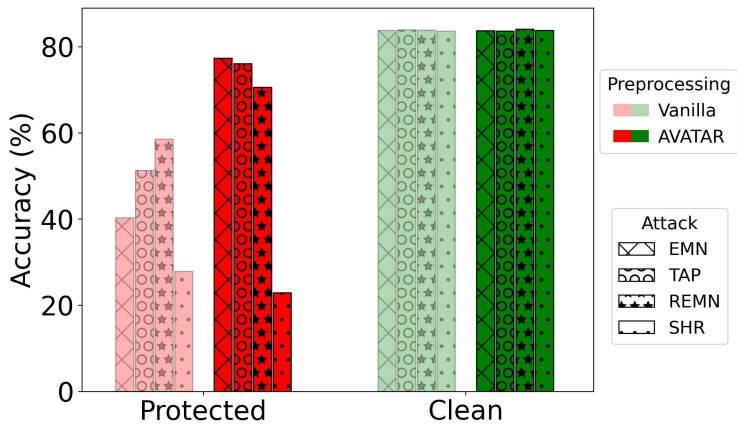

bar

| Category | Preprocessing::Vanilla | Preprocessing::AVATAR |
| --- | --- | --- |
| Protected::EMN | ~40 | ~78 |
| Protected::TAP | ~52 | ~76 |
| Protected::REMN | ~59 | ~71 |
| Protected::SHR | ~28 | ~23 |
| Clean::EMN | ~84 | ~84 |
| Clean::TAP | ~84 | ~84 |
| Clean::REMN | ~84 | ~84 |
| Clean::SHR | ~84 | ~84 |

Fig. 6: Test accuracy for protected vs. clean identities in WebFace [69] facial recognition. The protected users protect their images using data-protecting perturbations. Our approach uses a diffusion model trained over the CelebA [37] dataset. For all the stealthy data-protecting perturbations our approach manages to recover the performance over protected data. The only exception is SHR, which according to Figure 8, leaves a noticeable trace over the image, rendering them not useful anymore.

data is allocated to a training set and the rest is the test set. We assume that the protected identities would add data-protecting perturbations to their images before sharing them. To this end, we use class-wise EMN [30], TAP [17], REMN [18], and SHR [71] with a perturbation radius of $\left\| \delta \right\| _ { \infty } \leq 1 6 / 2 5 5$ . For perturbation generation using the first three attacks, we follow the settings of Huang et al. [30]. Specifically, we select 100 random identities from the CelebA [37] dataset and create an auxiliary dataset consisting of these 100 identities and the 50 protected WebFace [69] identities. Then, using these 150 identities we generate data protecting perturbations against a neural network with 150 classes. For SHR, however, we generate the data for all the 10572 WebFace identities and select the relevant data for protecting our above-mentioned 50 identities. Once we have the protected data, we train an InceptionResNet [59] facial recognition over the training set with or without our approach and evaluate the models over the test set. In our case, we assume that the malicious entity has access to a pre-trained diffusion model over CelebA [37] faces8, and can run AVATAR over the protected data that it acquires from crawling the web. Since the WebFace photos are of size 112 × 112 but the diffusion model generates 256 × 256 images, we use bi-linear up- and down-sampling to connect the two. Like the CIFAR-10 experiments, here we also denoise the data with timestep set to 100. Samples of the WebFace dataset along with the protected data are shown in Figure 8. To evaluate the performance of our method, we test the models over the clean test set and record the recognition accuracy for both the protected and clean identities.9

As shown in Figure 6, AVATAR can recover the recognition accuracy over protected identities in all cases except the

<small>8For this experiment, we use a pre-trained DDPM model over CelebA-HQ: [https://github.com/ermongroup/SDEdit](https://github.com/ermongroup/SDEdit).</small>

<small>9Running the identity overlap removal of Wang et al. [65], we found that only 8 out of 50 protected identities had overlap between CelebA-HQ and WebFace. After removing these identities, we saw no major drop in the final performance of AVATAR.</small>

SHR [71] perturbations. The reason behind this might be twofold. First, we are using a sub-optimal diffusion model as both the domain and, more importantly, size of the images have a mismatch. Second, looking at Figure 8, we see that while the SHR perturbations can protect the data, they trade the stealthiness of the original data due to their large patches. As such, the images would lose their utility. Now, the question is:

## Can we protect the data using stealthy patterns without losing the data utility?

Interestingly, our theoretical result in Theorem 1 says that this might not be possible. According to Theorem 1, if the data curator wants to makes the denoising process harder, they need to increase the data-protecting perturbation. This increase is naturally at odds with the data utility, since by adding more powerful perturbations we lose the data utility.

## V. CONCLUSION

In this paper, we introduced a countermeasure against data protection algorithms that use availability attacks. In particular, we show that by adding a controlled amount of Gaussian noise to the images and subsequently denoising them one can eliminate data-protecting perturbations. To this end, we use the forward and reverse diffusion processes of pre-trained models. We theoretically analyze our approach and show that the amount of Gaussian noise required to defuse the data-protecting perturbations is directly related to their norm. We conduct extensive experiments over various availability attacks. Our experiments demonstrate the superiority of our approach compared to adversarial training, setting a new SOTA defense against availability attacks. AVATAR demonstrates brittleness of availability attacks and calls for more research to protect personal data. Future work involves investigating the applicability of AVATAR to other models such as text-to-image generative models [52] and its relationship with techniques such as randomized smoothing [7].

## ACKNOWLEDGMENTS

This research was undertaken using the LIEF HPC-GPGPU Facility hosted at the University of Melbourne. This Facility was established with the assistance of LIEF Grant LE170100200. Sarah Erfani is in part supported by Australian Research Council (ARC) Discovery Early Career Researcher Award (DECRA) DE220100680. Moreover, this research was partially supported by the ARC Centre of Excellence for Automated Decision-Making and Society (CE200100005), and funded partially by the Australian Government through the Australian Research Council.

## REFERENCES

[1] Shekoofeh Azizi, Simon Kornblith, Chitwan Saharia, Mohammad Norouzi, and David J. Fleet. Synthetic data from diffusion models improves imagenet classification. CoRR, abs/2304.08466, 2023.
[2] Mauro Barni, Kassem Kallas, and Benedetta Tondi. A new backdoor attack in CNNs by training set corruption without label poisoning. In Proceedings of the IEEE International Conference on Image Processing (ICIP), pages 101–105, 2019.
[3] Battista Biggio, Blaine Nelson, and Pavel Laskov. Poisoning attacks against support vector machines. In Proceedings of the 29th International Conference on Machine Learning (ICML), pages 1467–1474, 2012.
[4] Battista Biggio and Fabio Roli. Wild patterns: Ten years after the rise of adversarial machine learning. Pattern Recognition, 84:317–331, 2018.
[5] Abeba Birhane and Vinay Uday Prabhu. Large image datasets: A pyrrhic win for computer vision? In Proceedings of the IEEE Winter Conference on Applications of Computer Vision (WACV), pages 1536–1546, 2021.
[6] Hyungjin Chung, Byeongsu Sim, and Jong Chul Ye. Come-closer-diffuse-faster: Accelerating conditional diffusion models for inverse problems through stochastic contraction. In Proceedings of the IEEE/CVF Conference on Computer Vision and Pattern Recognition (CVPR), pages 12403–12412, 2022.
[7] Jeremy Cohen, Elan Rosenfeld, and J. Zico Kolter. Certified adversarial robustness via randomized smoothing. In Proceedings of the International Conference on Machine Learning (ICML), pages 1310–1320, 2019.
[8] Florinel-Alin Croitoru, Vlad Hondru, Radu Tudor Ionescu, and Mubarak Shah. Diffusion models in vision: A survey. CoRR, abs/2209.04747, 2022.
[9] Jia Deng, Wei Dong, Richard Socher, Li-Jia Li, Kai Li, and Fei-Fei Li. ImageNet: A large-scale hierarchical image database. In Proceedings of the IEEE Conference on Computer Vision and Pattern Recognition (CVPR), pages 248–255, 2009.
[10] Terrance Devries and Graham W. Taylor. Improved regularization of convolutional neural networks with cutout. CoRR, abs/1708.04552, 2017.
[11] Prafulla Dhariwal and Alexander Quinn Nichol. Diffusion models beat gans on image synthesis. In Advances
in Neural Information Processing Systems 34: Annual Conference on Neural Information Processing Systems (NeurIPS), pages 8780–8794, 2021.
[12] Hadi M. Dolatabadi, Sarah M. Erfani, and Christopher Leckie. COLLIDER: A robust training framework for backdoor data. In Proceedings of the 16th Asian Conference on Computer Vision (ACCV), pages 681–698, 2022.
[13] Hadi M. Dolatabadi, Sarah M. Erfani, and Christopher Leckie. $\ell _ { \infty } .$ -robustness and beyond: Unleashing efficient adversarial training. In Proceedings of the 17th European Conference on Computer Vision (ECCV), pages 467–483, 2022.
[14] Alexey Dosovitskiy, Lucas Beyer, Alexander Kolesnikov, Dirk Weissenborn, Xiaohua Zhai, Thomas Unterthiner, Mostafa Dehghani, Matthias Minderer, Georg Heigold, Sylvain Gelly, Jakob Uszkoreit, and Neil Houlsby. An image is worth 16x16 words: Transformers for image recognition at scale. In Proceedings of the 9th International Conference on Learning Representations (ICLR), 2021.
[15] Ji Feng, Qi-Zhi Cai, and Zhi-Hua Zhou. Learning to confuse: Generating training time adversarial data with auto-encoder. In Advances in Neural Information Processing Systems 32: Annual Conference on Neural Information Processing Systems (NeurIPS), pages 11971–11981, 2019.
[16] Liam Fowl, Ping-yeh Chiang, Micah Goldblum, Jonas Geiping, Arpit Bansal, Wojtek Czaja, and Tom Goldstein. Preventing unauthorized use of proprietary data: Poisoning for secure dataset release. CoRR, abs/2103.02683, 2021.
[17] Liam Fowl, Micah Goldblum, Ping-yeh Chiang, Jonas Geiping, Wojciech Czaja, and Tom Goldstein. Adversarial examples make strong poisons. In Proceedings of the Advances in Neural Information Processing Systems 34: Annual Conference on Neural Information Processing Systems (NeurIPS), pages 30339–30351, 2021.
[18] Shaopeng Fu, Fengxiang He, Yang Liu, Li Shen, and Dacheng Tao. Robust unlearnable examples: Protecting data privacy against adversarial learning. In Proceedings of the 10th International Conference on Learning Representations (ICLR), 2022.
[19] Robert Geirhos, Jorn-Henrik Jacobsen, Claudio ¨ Michaelis, Richard S. Zemel, Wieland Brendel, Matthias Bethge, and Felix A. Wichmann. Shortcut learning in deep neural networks. Nature Machine Intelligence, 2(11):665–673, 2020.
[20] Micah Goldblum, Dimitris Tsipras, Chulin Xie, Xinyun Chen, Avi Schwarzschild, Dawn Song, Aleksander Madry, Bo Li, and Tom Goldstein. Dataset security for machine learning: Data poisoning, backdoor attacks, and defenses. IEEE Transactions of Pattern Analysis and Machine Intelligence, 45(2):1563–1580, 2023.
[21] Ian J. Goodfellow, Jean Pouget-Abadie, Mehdi Mirza, Bing Xu, David Warde-Farley, Sherjil Ozair, Aaron C. Courville, and Yoshua Bengio. Generative adversarial
nets. In Proceedings of the Advances in Neural Information Processing Systems 27: Annual Conference on Neural Information Processing Systems (NeurIPS), pages 2672–2680, 2014.
[22] Ian J. Goodfellow, Jonathon Shlens, and Christian Szegedy. Explaining and harnessing adversarial examples. In Proceedings of the 3rd International Conference on Learning Representations (ICLR), 2015.
[23] Tianyu Gu, Brendan Dolan-Gavitt, and Siddharth Garg. BadNets: Identifying vulnerabilities in the machine learning model supply chain. CoRR, abs/1708.06733, 2017.
[24] Chuan Guo, Mayank Rana, Moustapha Cisse, and Lau- ´ rens van der Maaten. Countering adversarial images using input transformations. In Proceedings of the 6th International Conference on Learning Representations (ICLR), 2018.
[25] Kaiming He, Xiangyu Zhang, Shaoqing Ren, and Jian Sun. Deep residual learning for image recognition. In Proceedings of the IEEE Conference on Computer Vision and Pattern Recognition (CVPR), pages 770–778, 2016.
[26] Kashmir Hill. The secretive company that might end privacy as we know it. The New York Times, 2020.
[27] Kashmir Hill and Aaron Krolik. How photos of your kids are powering surveillance technology. The New York Times, 2019.
[28] Jonathan Ho, Ajay Jain, and Pieter Abbeel. Denoising diffusion probabilistic models. In Advances in Neural Information Processing Systems 33: Annual Conference on Neural Information Processing Systems (NeurIPS), 2020.
[29] Gao Huang, Zhuang Liu, Laurens van der Maaten, and Kilian Q. Weinberger. Densely connected convolutional networks. In Proceedings of the IEEE Conference on Computer Vision and Pattern Recognition (CVPR), pages 2261–2269, 2017.
[30] Hanxun Huang, Xingjun Ma, Sarah Monazam Erfani, James Bailey, and Yisen Wang. Unlearnable examples: Making personal data unexploitable. In Proceedings of the 9th International Conference on Learning Representations (ICLR), 2021.
[31] Tero Karras, Samuli Laine, Miika Aittala, Janne Hellsten, Jaakko Lehtinen, and Timo Aila. Analyzing and improving the image quality of StyleGAN. In Proceedings of the IEEE/CVF Conference on Computer Vision and Pattern Recognition (CVPR), pages 8107–8116, 2020.
[32] Pang Wei Koh and Percy Liang. Understanding blackbox predictions via influence functions. In Proceedings of the 34th International Conference on Machine Learning (ICML), pages 1885–1894, 2017.
[33] Alex Krizhevsky and Geoffrey Hinton. Learning multiple layers of features from tiny images. Master’s thesis, Department of Computer Science, University of Toronto, 2009.
[34] Sungbin Lim, Ildoo Kim, Taesup Kim, Chiheon Kim, and Sungwoong Kim. Fast autoaugment. In Advances in Neural Information Processing Systems 32: Annual Conference on Neural Information Processing Systems
(NeurIPS), pages 6662–6672, 2019.
[35] Tsung-Yi Lin, Michael Maire, Serge J. Belongie, James Hays, Pietro Perona, Deva Ramanan, Piotr Dollar, and ´ C. Lawrence Zitnick. Microsoft COCO: common objects in context. In Proceedings of the 13th European Conference on Computer Vision (ECCV), pages 740–755, 2014.
[36] Huayao Liu, Jiaming Zhang, Kailun Yang, Xinxin Hu, and Rainer Stiefelhagen. CMX: cross-modal fusion for RGB-X semantic segmentation with transformers. CoRR, abs/2203.04838, 2022.
[37] Ziwei Liu, Ping Luo, Xiaogang Wang, and Xiaoou Tang. Deep learning face attributes in the wild. In Proceedings of the IEEE International Conference on Computer Vision (ICCV), pages 3730–3738, 2015.
[38] Zhuoran Liu, Zhengyu Zhao, and Martha Larson. Image shortcut squeezing: Countering perturbative availability poisons with compression. In Proceedings of the 40th International Conference on Machine Learning (ICML), 2023.
[39] Aleksander Madry, Aleksandar Makelov, Ludwig Schmidt, Dimitris Tsipras, and Adrian Vladu. Towards deep learning models resistant to adversarial attacks. In Proceedings of the 6th International Conference on Learning Representations (ICLR), 2018.
[40] Luis Munoz-Gonz ˜ alez, Battista Biggio, Ambra Demon- ´ tis, Andrea Paudice, Vasin Wongrassamee, Emil C. Lupu, and Fabio Roli. Towards poisoning of deep learning algorithms with back-gradient optimization. In Proceedings of the 10th ACM Workshop on Artificial Intelligence and Security (AISec@CCS), pages 27–38, 2017.
[41] Yuval Netzer, Tao Wang, Adam Coates, Alessandro Bissacco, Bo Wu, and Andrew Y Ng. Reading digits in natural images with unsupervised feature learning. In NeurIPS Workshop on Deep Learning and Unsupervised Feature Learning, 2011.
[42] Weili Nie, Brandon Guo, Yujia Huang, Chaowei Xiao, Arash Vahdat, and Animashree Anandkumar. Diffusion models for adversarial purification. In International Conference on Machine Learning (ICML), pages 16805–16827, 2022.
[43] Mang Ning, Enver Sangineto, Angelo Porrello, Simone Calderara, and Rita Cucchiara. Input perturbation reduces exposure bias in diffusion models. In Proceedings of the International Conference on Machine Learning (ICML), pages 26245–26265, 2023.
[44] Quang-Cuong Pham. Analysis of discrete and hybrid stochastic systems by nonlinear contraction theory. In Proceedings of the 10th International Conference on Control, Automation, Robotics and Vision (ICARCV), pages 1054–1059, 2008.
[45] Quang-Cuong Pham, Nicolas Tabareau, and Jean-Jacques E. Slotine. A contraction theory approach to stochastic incremental stability. IEEE Transactions on Automatic Control, 54(4):816–820, 2009.
[46] Ben Poole, Ajay Jain, Jonathan T. Barron, and Ben Mildenhall. DreamFusion: Text-to-3D using 2D diffusion. In Proceedings of the 11th International Conference
on Learning Representations (ICLR), 2023.
[47] Evani Radiya-Dixit, Sanghyun Hong, Nicholas Carlini, and Florian Tramer. Data poisoning won’t save you \` from facial recognition. In Proceedings of the 10th International Conference on Learning Representations (ICLR), 2022.
[48] Robin Rombach, Andreas Blattmann, Dominik Lorenz, Patrick Esser, and Bjorn Ommer. High-resolution image ¨ synthesis with latent diffusion models. In Proceedings of the IEEE/CVF Conference on Computer Vision and Pattern Recognition (CVPR), pages 10674–10685, 2022.
[49] Olga Russakovsky, Jia Deng, Hao Su, Jonathan Krause, Sanjeev Satheesh, Sean Ma, Zhiheng Huang, Andrej Karpathy, Aditya Khosla, Michael S. Bernstein, Alexander C. Berg, and Fei-Fei Li. ImageNet large scale visual recognition challenge. International Journal of Computer Vision (IJCV), 115(3):211–252, 2015.
[50] Pedro Sandoval-Segura, Vasu Singla, Jonas Geiping, Micah Goldblum, Tom Goldstein, and David W. Jacobs. Autoregressive perturbations for data poisoning. In Advances in Neural Information Processing Systems 35: Annual Conference on Neural Information Processing Systems (NeurIPS), 2022.
[51] Avi Schwarzschild, Micah Goldblum, Arjun Gupta, John P. Dickerson, and Tom Goldstein. Just how toxic is data poisoning? A unified benchmark for backdoor and data poisoning attacks. In Proceedings of the 38th International Conference on Machine Learning (ICML), pages 9389–9398, 2021.
[52] Shawn Shan, Jenna Cryan, Emily Wenger, Haitao Zheng, Rana Hanocka, and Ben Y. Zhao. Glaze: Protecting artists from style mimicry by text-to-image models. In Proceedings of the USENIX Security Symposium, pages 2187–2204, 2023.
[53] Karen Simonyan and Andrew Zisserman. Very deep convolutional networks for large-scale image recognition. In Proceedings of the 3rd International Conference on Learning Representations (ICLR), 2015.
[54] Uriel Singer, Adam Polyak, Thomas Hayes, Xi Yin, Jie An, Songyang Zhang, Qiyuan Hu, Harry Yang, Oron Ashual, Oran Gafni, Devi Parikh, Sonal Gupta, and Yaniv Taigman. Make-a-video: Text-to-video generation without text-video data. In Proceedings of the 11th International Conference on Learning Representations (ICLR), 2023.
[55] Jascha Sohl-Dickstein, Eric A. Weiss, Niru Maheswaranathan, and Surya Ganguli. Deep unsupervised learning using nonequilibrium thermodynamics. In Proceedings of the 32nd International Conference on Machine Learning (ICML), pages 2256–2265, 2015.
[56] Yang Song and Stefano Ermon. Generative modeling by estimating gradients of the data distribution. In Advances in Neural Information Processing Systems 32: Annual Conference on Neural Information Processing Systems (NeurIPS), pages 11895–11907, 2019.
[57] Yang Song and Stefano Ermon. Improved techniques
for training score-based generative models. In Advances in Neural Information Processing Systems 33: Annual Conference on Neural Information Processing Systems (NeurIPS), pages 12438–12448, 2020.
[58] Yang Song, Jascha Sohl-Dickstein, Diederik P. Kingma, Abhishek Kumar, Stefano Ermon, and Ben Poole. Scorebased generative modeling through stochastic differential equations. In Procceding of the 9th International Conference on Learning Representations (ICLR), 2021.
[59] Christian Szegedy, Sergey Ioffe, Vincent Vanhoucke, and Alexander A. Alemi. Inception-v4, inception-resnet and the impact of residual connections on learning. In Proceedings of the 31st AAAI Conference on Artificial Intelligence, pages 4278–4284, 2017.
[60] Christian Szegedy, Wojciech Zaremba, Ilya Sutskever, Joan Bruna, Dumitru Erhan, Ian J. Goodfellow, and Rob Fergus. Intriguing properties of neural networks. In Proceedings of the 2nd International Conference on Learning Representations (ICLR), 2014.
[61] Lue Tao, Lei Feng, Jinfeng Yi, Sheng-Jun Huang, and Songcan Chen. Better safe than sorry: Preventing delusive adversaries with adversarial training. In Advances in Neural Information Processing Systems 34: Annual Conference on Neural Information Processing Systems (NeurIPS), pages 16209–16225, 2021.
[62] Qi Tian, Kun Kuang, Kelu Jiang, Furui Liu, Zhihua Wang, and Fei Wu. ConfounderGAN: Protecting image data privacy with causal confounder. In Advances in Neural Information Processing Systems 35: Annual Conference on Neural Information Processing Systems (NeurIPS), 2022.
[63] Brandon Tran, Jerry Li, and Aleksander Madry. Spectral signatures in backdoor attacks. In Proceedings of the Advances in Neural Information Processing Systems 31: Annual Conference on Neural Information Processing Systems (NeurIPS), pages 8011–8021, 2018.
[64] Dimitris Tsipras, Shibani Santurkar, Logan Engstrom, Alexander Turner, and Aleksander Madry. Robustness may be at odds with accuracy. In Proceedings of the 7th International Conference on Learning Representations (ICLR), 2019.
[65] Feng Wang, Jian Cheng, Weiyang Liu, and Haijun Liu. Additive margin softmax for face verification. IEEE Signal Processing Letters, 25(7):926–930, 2018.
[66] Zekai Wang, Tianyu Pang, Chao Du, Min Lin, Weiwei Liu, and Shuicheng Yan. Better diffusion models further improve adversarial training. In Proceedings of the 40th International Conference on Machine Learning (ICML), 2023.
[67] Yilun Xu, Shangyuan Tong, and Tommi S. Jaakkola. Stable target field for reduced variance score estimation. In Proceedings of the 11th International Conference on Learning Representations (ICLR), 2023.
[68] Chaofei Yang, Qing Wu, Hai Li, and Yiran Chen. Generative poisoning attack method against neural networks. CoRR, abs/1703.01340, 2017.
[69] Dong Yi, Zhen Lei, Shengcai Liao, and Stan Z. Li.
Learning face representation from scratch. CoRR, abs/1411.7923, 2014.
[70] Jongmin Yoon, Sung Ju Hwang, and Juho Lee. Adversarial purification with score-based generative models. In Proceedings of the 38th International Conference on Machine Learning (ICML), pages 12062–12072, 2021.
[71] Da Yu, Huishuai Zhang, Wei Chen, Jian Yin, and Tie-Yan Liu. Availability attacks create shortcuts. In Proceedings of the 28th ACM SIGKDD Conference on Knowledge Discovery and Data Mining, pages 2367–2376, 2022.
[72] Chia-Hung Yuan and Shan-Hung Wu. Neural tangent generalization attacks. In Proceedings of the 38th International Conference on Machine Learning (ICML), pages 12230–12240, 2021.
[73] Sangdoo Yun, Dongyoon Han, Sanghyuk Chun, Seong Joon Oh, Youngjoon Yoo, and Junsuk Choe. CutMix: Regularization strategy to train strong classifiers with localizable features. In Proceedings of the IEEE/CVF International Conference on Computer Vision (ICCV), pages 6022–6031, 2019.
[74] Sergey Zagoruyko and Nikos Komodakis. Wide residual networks. In Proceedings of the British Machine Vision Conference (BMVC), 2016.
[75] Hongyi Zhang, Moustapha Cisse, Yann N. Dauphin, ´ and David Lopez-Paz. mixup: Beyond empirical risk minimization. In Proceedings of the 6th International Conference on Learning Representations (ICLR), 2018.
[76] Hengtong Zhang, Jing Gao, and Lu Su. Data poisoning attacks against outcome interpretations of predictive models. In Proceedings of the 27th ACM SIGKDD Conference on Knowledge Discovery and Data Mining, pages 2165–2173, 2021.
[77] Hongyang Zhang, Yaodong Yu, Jiantao Jiao, Eric P. Xing, Laurent El Ghaoui, and Michael I. Jordan. Theoretically principled trade-off between robustness and accuracy. In Proceedings of the 36th International Conference on Machine Learning (ICML), pages 7472–7482, 2019.
[78] Wujie Zhou, Jinfu Liu, Jingsheng Lei, Lu Yu, and Jenq-Neng Hwang. GMNet: graded-feature multilabellearning network for rgb-thermal urban scene semantic segmentation. IEEE Transactions on Image Processing, 30:7790–7802, 2021.

# The Devil’s Advocate:

# Shattering the Illusion of Unexploitable Data using Diffusion Models

## APPENDIX A PROOFS

Here we provide our proof for Theorem 1. First, we provide the theoretical results that would be used in our proof. Then, we re-state Theorem 1 and provide its detailed proof. Our proofs heavily borrow from the contraction properties of stochastic difference equations [44, 45, 6].

**Theorem 2** (Discrete stochastic contraction [44, 6]). Let

$$
\boldsymbol {x} _ {t - 1} = \mathbf {h} \left(\boldsymbol {x} _ {t}, t\right) + \sigma \left(\boldsymbol {x} _ {t}, t\right) \boldsymbol {\epsilon} _ {t}, \tag {8}
$$

denote a stochastic difference equation where:

(a) h : $\mathbb { R } ^ { d } \times \mathbb { N } \rightarrow \mathbb { R } ^ { d }$ is a contraction mapping, i.e., for every $t \in$ N there exists a $\lambda _ { t } \in [ 0 , 1 )$ such that

$$
\| \mathbf {h} (\boldsymbol {x}, t) - \mathbf {h} (\boldsymbol {y}, t) \| \leq \lambda_ {t} \| \boldsymbol {x} - \boldsymbol {y} \| \quad \forall \boldsymbol {x}, \boldsymbol {y} \in \mathbb {R} ^ {d}, \tag {9}
$$

(b) $\sigma : \mathbb { R } ^ { d } \times \mathbb { N } \rightarrow$ R is a function such that for every $t \in \mathbb { N }$ and $\pmb { x } \in \mathbb { R } ^ { d }$

$$
\left. \operatorname{Tr} \left(\sigma (\boldsymbol {x}, t) \mathbf {I} \sigma (\boldsymbol {x}, t)\right) \leq C _ {t}, \right. \tag {10}
$$

(c) and $\mathbf { \epsilon } _ { t } \sim \mathcal { N } ( \mathbf { 0 } , \mathbf { I } )$

Then, for two sample trajectories $x _ { t - 1 }$ and $\bar { x } _ { t - 1 }$ that satisfy Equation (8) we have:

$$
\mathbb {E} \left[ \left\| \boldsymbol {x} _ {t - 1} - \bar {\boldsymbol {x}} _ {t - 1} \right\| ^ {2} \right] \leq \lambda_ {t} ^ {2} \mathbb {E} \left[ \left\| \boldsymbol {x} _ {t} - \bar {\boldsymbol {x}} _ {t} \right\| ^ {2} \right] + 2 C _ {t}. \tag {11}
$$

Using Theorem 2 and Equation (5) we can get the following result [6].

**Corollary 2.1.** The reverse diffusion process of DDPMs are contracting stochastic difference equations.

Proof. Our proof closely follows that of Chung et al. [6]. Specifically, we need to show that for the reverse diffusion process given in Equation (5), the conditions of Equations (9) and (10) hold. To show this, note that if we set:

$$
\mathbf {h} (\boldsymbol {x} _ {t}, t) = \frac {1}{\sqrt {1 - \beta_ {t}}} \left(\boldsymbol {x} _ {t} + \beta_ {t} \mathbf {s} _ {\phi} (\boldsymbol {x} _ {t}, t)\right)
$$

and

$$
\sigma (\boldsymbol {x} _ {t}, t) = \sqrt {\beta_ {t}}
$$

then Equations (5) and (8) coincide. Using Lemma A.1. from Chung et al. [6], one can show that for

$$
\lambda_ {t} = \sqrt {1 - \beta_ {t}} \frac {1 - \alpha_ {t - 1}}{1 - \alpha_ {t}} \tag {12}
$$

and

$$
C _ {t} = d \beta_ {t} \tag {13}
$$

the conditions of Equations (9) and (10) are satisfied. As such, for two reverse sample trajectories $x _ { t - 1 }$ and $\bar { x } _ { t - 1 }$ that satisfy the reverse diffusion process of Equation (5), Equation (11) holds. □

Next, we present two lemmas that are going to be used in our proof of Theorem 1.

**Lemma 1** ([6]). For $\lambda _ { t }   ^ { \prime }   s$ given in Equation (12) the following holds:

$$
\prod_ {s = 1} ^ {t ^ {*}} \lambda_ {s} ^ {2} \leq \exp (- \frac {t ^ {*} \beta_ {t ^ {*}}}{2}). \tag {14}
$$

Proof. See Lemma C.1. in [6].

**Lemma 2.** For two random vectors x and y we have:

$$
\mathbb {E} \left[ \| \mathbf {x} + \mathbf {y} \| ^ {2} \right] \leq 2 \mathbb {E} \left[ \| \mathbf {x} \| ^ {2} \right] + 2 \mathbb {E} \left[ \| \mathbf {y} \| ^ {2} \right]. \tag {15}
$$

Proof. We know that:

$$
\begin{array}{l} \mathbb {E} \left[ \left\| \mathbf {x} + \mathbf {y} \right\| ^ {2} \right] = \mathbb {E} \left[ \left\| \mathbf {x} \right\| ^ {2} \right] + \mathbb {E} \left[ \left\| \mathbf {y} \right\| ^ {2} \right] + 2 \mathbb {E} \left[ \mathbf {x} ^ {\top} \mathbf {y} \right] \\ \leq 2 \mathbb {E} \left[ \| \mathbf {x} \| ^ {2} \right] + 2 \mathbb {E} \left[ \| \mathbf {y} \| ^ {2} \right], \\ \end{array}
$$

where the last inequality follows from the fact that E $\begin{array} { r } { \mathbb { E } \left[ \| \mathbf { x } - \mathbf { y } \| ^ { 2 } \right] \geq 0 . } \end{array}$

We are now ready to prove our theoretical result.

**Theorem 1** (restated). Let $\pmb { x } \in \mathbb { R } ^ { d }$ denote a clean image and $\tilde { \pmb { x } } = \pmb { x } + \pmb { \delta }$ its protected version, where δ denotes any arbitrary data protection perturbation. $A l s o ,$ let ${ \bar { \bar { \mathbf { x } } } } _ { 0 }$ be the sanitized image using the AVATAR denoising process given in Equations (6) and (7). If we set $t ^ { * }$ such that

$$
2 \log \left(\frac {2 \left\| \boldsymbol {\delta} \right\| ^ {2} + 4 d}{\mu \Delta}\right) \leq t ^ {*} \beta_ {t ^ {*}} \leq \frac {\mu \Delta}{4 d},
$$

then the estimation error between the sanitized ${ \bar { \bar { \mathbf { x } } } } _ { 0 }$ and clean image x can be bounded as:

$$
\mathbb {E} \left[ \| \bar {\boldsymbol {x}} _ {0} - \boldsymbol {x} \| ^ {2} \right] \leq 2 (\mu + 1) \Delta ,
$$

where $\Delta = \mathbb { E } [ \left\| \pmb { x } _ { 0 } - \pmb { x } \right\| ^ { 2 } ]$ and $\mu > 0$ is a constant.

Proof. We are looking to find an upper-bound for the estimation error between the sanitized image and its clean version. Using Lemma 2 we can write:

$$
\begin{array}{l} \mathbb {E} \left[ \| \bar {\boldsymbol {x}} _ {0} - \boldsymbol {x} \| ^ {2} \right] = \mathbb {E} \left[ \| (\bar {\boldsymbol {x}} _ {0} - \boldsymbol {x} _ {0}) + (\boldsymbol {x} _ {0} - \boldsymbol {x}) \| ^ {2} \right] \\ \left| \leq 2 \mathbb {E} \left[ \left\| \bar {\boldsymbol {x}} _ {0} - \boldsymbol {x} _ {0} \right\| ^ {2} \right] + 2 \mathbb {E} \left[ \left\| \boldsymbol {x} _ {0} - \boldsymbol {x} \right\| ^ {2} \right] \right| \\ \leq 2 \mathbb {E} \left[ \left\| \bar {\boldsymbol {x}} _ {0} - \boldsymbol {x} _ {0} \right\| ^ {2} \right] + 2 \Delta . \tag {16} \\ \end{array}
$$

Now, we need to find an upper-bound for the first term. To this end, we are going to use the contraction property of the DDPMs (Corollary 2.1). In particular, given the noisy versions of the clean x and the protected image $\tilde { \pmb { x } } = \pmb { x } + \pmb { \delta }$ , in other words:

$$
\boldsymbol {x} _ {t ^ {*}} = \sqrt {\alpha_ {t ^ {*}}} \boldsymbol {x} + \sqrt {1 - \alpha_ {t ^ {*}}} \epsilon_ {0}
$$

$$
\tilde {\boldsymbol {x}} _ {t ^ {*}} = \sqrt {\alpha_ {t ^ {*}}} \tilde {\boldsymbol {x}} + \sqrt {1 - \alpha_ {t ^ {*}}} \boldsymbol {\epsilon} _ {0} ^ {\prime}, \tag {17}
$$

we know that both $x _ { 0 }$ and ${ \bar { \bar { \mathbf { x } } } } _ { 0 }$ satisfy the reverse diffusion process, or:

$$
\boldsymbol {x} _ {t - 1} = \frac {1}{\sqrt {1 - \beta_ {t}}} \left(\boldsymbol {x} _ {t} + \beta_ {t} \mathbf {s} _ {\phi} (\boldsymbol {x} _ {t}, t)\right) + \sqrt {\beta_ {t}} \boldsymbol {\epsilon} _ {t}
$$

$$
\bar {\boldsymbol {x}} _ {t - 1} = \frac {1}{\sqrt {1 - \beta_ {t}}} \left(\bar {\boldsymbol {x}} _ {t} + \beta_ {t} \mathbf {s} _ {\phi} \left(\bar {\boldsymbol {x}} _ {t}, t\right)\right) + \sqrt {\beta_ {t}} \boldsymbol {\epsilon} _ {t} ^ {\prime}, \quad \forall t \in \{1, 2, \dots , t ^ {*} \}, \tag {18}
$$

where $\mathbf { \epsilon } _ { t } , \mathbf { \epsilon } _ { t } ^ { \prime } \sim \mathcal { N } ( \mathbf { 0 } , \mathbf { I } )$ . As such, we can treat $x _ { 0 }$ and ${ \bar { \mathbf { x } } } _ { 0 }$ as two sample trajectories of the same stochastic difference equation. Thus, by recursively applying Equation (11) we would get:

$$
\mathbb {E} \left[ \| \bar {\boldsymbol {x}} _ {0} - \boldsymbol {x} _ {0} \| ^ {2} \right] \leq \mathbb {E} \left[ \| \bar {\boldsymbol {x}} _ {t ^ {*}} - \boldsymbol {x} _ {t ^ {*}} \| ^ {2} \right] \prod_ {s = 1} ^ {t ^ {*}} \lambda_ {s} ^ {2} + 2 \sum_ {s = 1} ^ {t ^ {*}} C _ {s} \prod_ {r = 1} ^ {s - 1} \lambda_ {r} ^ {2}. \tag {19}
$$

Now, let us consider each term on the RHS of Equation (19) separately. For the red term, we can write:

$$
\begin{array}{l} \mathbb {E} \left[ \left\| \tilde {\boldsymbol {x}} _ {t ^ {*}} - \boldsymbol {x} _ {t ^ {*}} \right\| ^ {2} \right] \stackrel {(1)} {=} \mathbb {E} \left[ \left\| \sqrt {\alpha_ {t ^ {*}}} (\tilde {\boldsymbol {x}} - \boldsymbol {x}) + \sqrt {1 - \alpha_ {t ^ {*}}} \left(\boldsymbol {\epsilon} _ {0} ^ {\prime} - \boldsymbol {\epsilon} _ {0}\right) \right\| ^ {2} \right] \\ \stackrel {(2)} {=} \mathbb {E} \left[ \left\| \sqrt {\alpha_ {t ^ {*}}} \boldsymbol {\delta} + \sqrt {1 - \alpha_ {t ^ {*}}} \left(\boldsymbol {\epsilon} _ {0} ^ {\prime} - \boldsymbol {\epsilon} _ {0}\right) \right\| ^ {2} \right] \\ = \left\| \sqrt {\alpha_ {t ^ {*}}} \boldsymbol {\delta} \right\| ^ {2} + \mathbb {E} \left[ \left\| \sqrt {1 - \alpha_ {t ^ {*}}} (\boldsymbol {\epsilon} _ {0} ^ {\prime} - \boldsymbol {\epsilon} _ {0}) \right\| ^ {2} \right] + 2 \sqrt {\alpha_ {t ^ {*}}} \sqrt {1 - \alpha_ {t ^ {*}}} \boldsymbol {\delta} ^ {\top} \mathbb {E} \left[ \boldsymbol {\epsilon} _ {0} ^ {\prime} - \boldsymbol {\epsilon} _ {0} \right] \\ \stackrel {(3)} {=} \alpha_ {t ^ {*}} \| \boldsymbol {\delta} \| ^ {2} + \left(1 - \alpha_ {t ^ {*}}\right) \mathbb {E} \left[ \left\| \left(\boldsymbol {\epsilon} _ {0} ^ {\prime} - \boldsymbol {\epsilon} _ {0}\right) \right\| ^ {2} \right]. \tag {20} \\ \end{array}
$$

where (1) is derived from Equation (17), (2) holds since $\tilde { \pmb { x } } = \pmb { x } + \pmb { \delta } ,$ and (3) is valid as $\boldsymbol { \epsilon } _ { 0 } , \boldsymbol { \epsilon } _ { 0 } ^ { \prime } \sim \mathcal { N } ( \mathbf { 0 } , \mathbf { I } )$ . Given that:

$$
\boldsymbol {\epsilon} _ {0} ^ {\prime} - \boldsymbol {\epsilon} _ {0} \sim \mathcal {N} (\mathbf {0}, 2 \mathbf {I}),
$$

we can simplify Equation (20) as:

$$
\mathbb {E} \left[ \| \bar {\boldsymbol {x}} _ {t ^ {*}} - \boldsymbol {x} _ {t ^ {*}} \| ^ {2} \right] = \alpha_ {t ^ {*}} \| \boldsymbol {\delta} \| ^ {2} + 2 (1 - \alpha_ {t ^ {*}}) \mathbb {E} [ \chi ],
$$

where $\chi$ follows the chi-squared distribution with d degrees of freedom. Using the fact that $0 < \alpha _ { t ^ { * } } < 1$ , we can finally write:

$$
\begin{array}{l} \mathbb {E} \left[ \| \bar {\boldsymbol {x}} _ {t ^ {*}} - \boldsymbol {x} _ {t ^ {*}} \| ^ {2} \right] = \alpha_ {t ^ {*}} \| \boldsymbol {\delta} \| ^ {2} + 2 (1 - \alpha_ {t ^ {*}}) d \\ \leq \| \boldsymbol {\delta} \| ^ {2} + 2 d. \tag {21} \\ \end{array}
$$

Using Lemma 1, for the blue term in Equation (19) we can write:

$$
\prod_ {s = 1} ^ {t ^ {*}} \lambda_ {s} ^ {2} \leq \exp (- \frac {t ^ {*} \beta_ {t ^ {*}}}{2}). \tag {22}
$$

Finally, for the green term we have:

$$
\begin{array}{l} 2 \sum_ {s = 1} ^ {t ^ {*}} C _ {s} \prod_ {r = 1} ^ {s - 1} \lambda_ {r} ^ {2} \stackrel {(1)} {=} 2 \sum_ {s = 1} ^ {t ^ {*}} d \beta_ {s} \prod_ {r = 1} ^ {s - 1} \lambda_ {r} ^ {2} \\ \left| \stackrel {(2)} {\leq} 2 \sum_ {s = 1} ^ {t ^ {*}} d \beta_ {s} \right| \\ \stackrel {(3)} {\leq} 2 d t ^ {*} \beta_ {t ^ {*}}. \tag {23} \\ \end{array}
$$

Here, (1) is the result of Equation (13), (2) holds since $0 < \lambda_{r} < 1$ (see Equation (12)), and (3) is derived from $0 < \beta _ { 1 } < \cdots < \beta _ { t } < 1$

Putting Equations (21) to (23) together, we have:

$$
\mathbb {E} \left[ \| \bar {\boldsymbol {x}} _ {0} - \boldsymbol {x} _ {0} \| ^ {2} \right] \leq \left(\| \boldsymbol {\delta} \| ^ {2} + 2 d\right) \exp \left(- \frac {t ^ {*} \beta_ {t ^ {*}}}{2}\right) + 2 d t ^ {*} \beta_ {t ^ {*}}. \tag {24}
$$

Given that:

$$
2 \log \left(\frac {2 \left\| \boldsymbol {\delta} \right\| ^ {2} + 4 d}{\mu \Delta}\right) \leq t ^ {*} \beta_ {t ^ {*}} \leq \frac {\mu \Delta}{4 d},
$$

we can simplify Equation (24) as:

$$
\begin{array}{l} \mathbb {E} \left[ \| \bar {\boldsymbol {x}} _ {0} - \boldsymbol {x} _ {0} \| ^ {2} \right] \leq \left(\| \boldsymbol {\delta} \| ^ {2} + 2 d\right) \exp \left(- \frac {t ^ {*} \beta_ {t ^ {*}}}{2}\right) + 2 d t ^ {*} \beta_ {t ^ {*}} \\ \leq \left(\| \boldsymbol {\delta} \| ^ {2} + 2 d\right) \frac {\mu \Delta}{2 \left\| \boldsymbol {\delta} \right\| ^ {2} + 4 d} + 2 d \frac {\mu \Delta}{4 d} \\ \leq \mu \Delta . \tag {25} \\ \end{array}
$$

Replacing Equation (25) into Equation (16), the proof can be completed.

## APPENDIX B

## ADDITIONAL EXPERIMENTAL RESULTS

In this section, we provide additional experiments and insights that were omitted from the main paper due to space limitations.

## A. Denoising Samples

Figures 7 and 8 include samples from the protected IN-100 and WebFace datasets alongside their denoised ones. As seen, AVATAR can successfully recover the benign data except cases where the perturbations are sever enough to remain visible. In these cases, however, the protected data has lost its normal utility due to the visibility of the protecting perturbation.

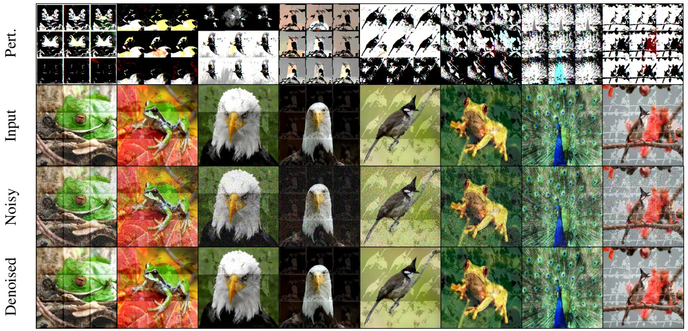

text_image

Pert.
Input
Noisy
Denoised

(a) NTGA [72]

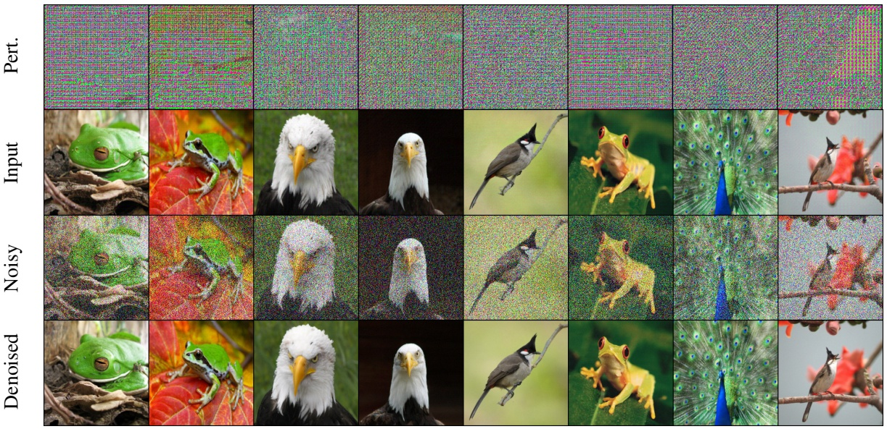

text_image

Pert.
Input
Noisy
Denoised

(b) EMN [30]

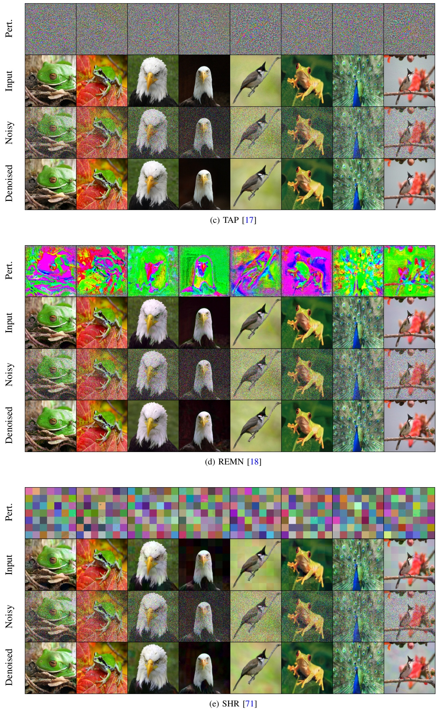

Fig. 7: Samples from IN-100 dataset. For each attack, we show the perturbation, the protected image, the noisy version of the image, and the denoised one using AVATAR.

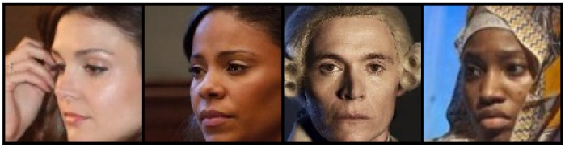

natural_image

Four portrait photos of women in different settings, no visible text or symbols

Clean Image

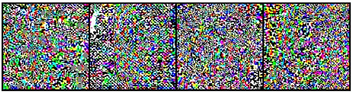

natural_image

Four-panel abstract pattern with colorful pixelated blocks (no text or symbols)

Perturbation

natural_image

Sequence of eight portrait photos showing different facial expressions and makeup, no visible text or symbols

Protected Image

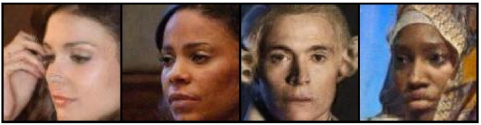

natural_image

Four portrait photos of women in different poses, no visible text or symbols

Denoised Image

(a) EMN [30]

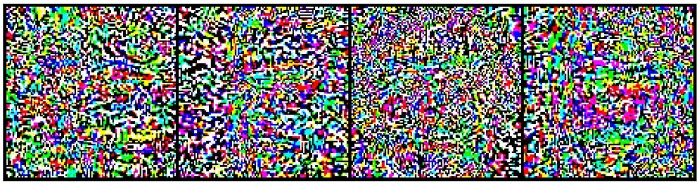

natural_image

Four-panel abstract pattern with pixelated textures and no visible text or symbols

Perturbation

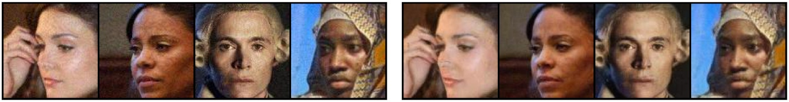

natural_image

Sequence of eight portrait photos showing different facial expressions and hairstyles, no visible text or symbols

Protected Image

natural_image

Four portrait photos of women in different poses, no visible text or symbols

Denoised Image

(b) TAP [17]

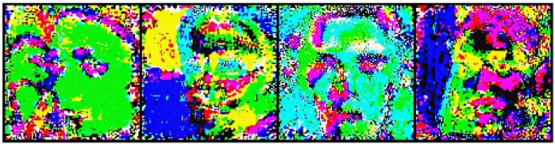

natural_image

Four-panel abstract pattern with colorful pixelated shapes (no text or symbols)

Perturbation

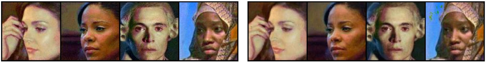

natural_image

Sequence of eight portrait photos showing different facial expressions and eye makeup, no text or symbols present

Protected Image

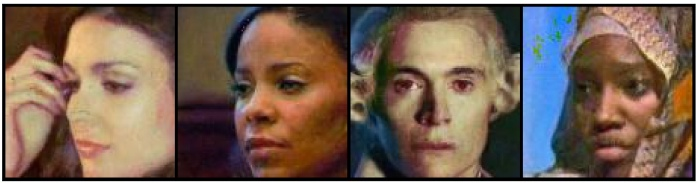

natural_image

Four portrait photos of women in different poses, no visible text or symbols

Denoised Image

(c) REMN [30]

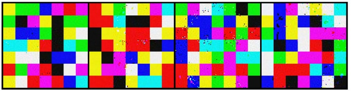

natural_image

Colorful abstract pattern with no text or symbols

Perturbation

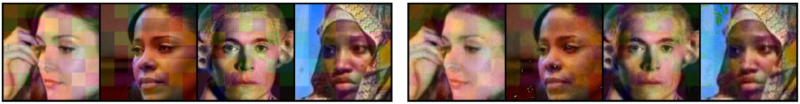

natural_image

Sequence of eight portrait photos showing different facial expressions and colors, no text or symbols present

Protected Image

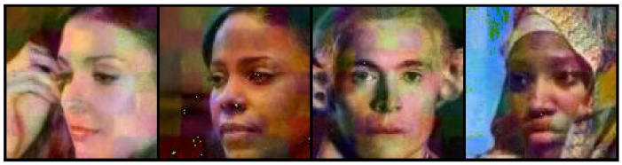

natural_image

Four portrait photos of women in different poses, no visible text or symbols

Denoised Image

(d) SHR [71]

Fig. 8: Samples from the WebFace [69] dataset. In each case, we generate the data-protecting perturbations with a maximum magnitude of 16/255. For denoising, we use AVATAR based on a diffusion model pre-trained on the CelebA [37] dataset. As seen, the SHR [71] perturbations leave a noticeable pattern over the protected data, which put their utility (e.g., posting over the social media) under question. Nevertheless, since they have a more global structure, they remain persistent even after denoising.

## B. Extended Experimental Results over Different Architectures

In Table V, we presented our results on training RN-18 models over protected data. To show the applicability of our approach across various architectures, we also report our results for three additional architectures, namely DN-121, VGG-16, and WRN-34, in Table X. Similar to our RN-18 experiments, AVATAR delivers the best performance against protected data.

## C. On Selecting Diffusion Step $t ^ { * }$

In Figure 4, we demonstrated that setting t∗ = 100 delivers a consistent performance across different architectures. However, chances are that practitioners may want to replace the diffusion model used in AVATAR with one of their own. In such cases, the diffusion model might have different characteristics compared to the ones used in this paper. In this part, we present two methods for setting t∗.

1) Using the $\alpha _ { t }$ Curves: A na¨ıve approach in selecting a suitable diffusion timestep $t ^ { * }$ is using the $\alpha _ { t }$ curves between the new diffusion model and a reference model. Specifically, since the value of $\alpha _ { t }$ in Equation (3) controls the amount of disruptive noise, we can use the value of $\alpha _ { t }$ to guide our hyper-parameter selection. To this end, we can find an equivalent $t ^ { * }$ such that the value of $\alpha _ { t ^ { * } }$ is set to an acceptable value. This is because if too much disruptive noise is required to be added to the data to counteract the protecting perturbation, it means that the data has already been corrupted so much that it has lost its utility in the first place.

We demonstrate this approach for selecting the timestep $t ^ { * }$ for our IN-1k-32×32 experiments in Table IX. As discussed in Section IV-H, for this new experiment we want to use a guided diffusion model (DDPM-IP [43]) which uses a cosine schedule for sampling. As per our prior experience, we know that an acceptable value for $t ^ { * }$ using a linear scheduler is 100. As such, we can draw the $\alpha _ { t }$ curve for both cases, and find an equivalent $t ^ { * }$ for the cosine scheduler in DDPM-IP. As shown in Figure 9, we can see that in this new case we should set $t ^ { * } = 2 0 0$ to get an equivalent $\alpha _ { t }$ as the one which we previously used for the CIFAR-10 experiments.

2) Using Reconstruction Quality: Another approach to set a viable value for the diffusion timestep $t ^ { * }$ is through controlling a desirable reconstruction quality. Recall that the goal of availability attacks is to preserve the normal utility of the data. As such, they usually aim to add imperceptible perturbations to the data. This assumption can help us in selecting a good value for $t ^ { * }$ . In particular, having a small portion of clean data, we can run the denoising process of AVATAR on these benign data and record a reconstruction Peak-to-Signal-Noise-Ratio (PSNR) for different values of $t ^ { * }$ . In general, as we move towards larger t∗, the PSNR drops. We can set an acceptable level of PSNR value, for example 22dB, to select t∗. Beyond that, the PSNR drops so significantly that both the clean and protected data become unreasonably noisy, losing their utility.

To demonstrate this point through our IN-1k-32×32 experiments in Table IX, we have reported AVATAR’s reconstruction PSNR for different values of t in Table XI. As seen, while $t ^ { * } = 1 0 0$ reaches a PSNR value of 22.52dB when we use a linear scheduler for sampling, we can still get a reasonable PSNR of 23.71dB for $t ^ { * } = 2 0 0$ in DDPM-IP. Therefore, we can pick $t ^ { * } = 2 0 0$ for denoising using the IN-1k-32×32 model.

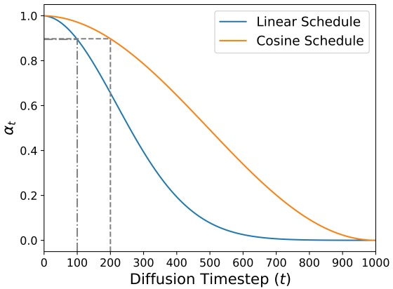

line

| Diffusion Timestep (t) | Linear Schedule \((\alpha t)\) | Cosine Schedule \((\alpha t)\) |
| --- | --- | --- |
| 0 | 1.0 | 1.0 |
| 100 | ~0.9 | ~0.98 |
| 200 | ~0.65 | ~0.9 |
| 300 | ~0.4 | ~0.8 |
| 400 | ~0.2 | ~0.65 |
| 500 | ~0.1 | ~0.5 |
| 600 | ~0.05 | ~0.35 |
| 700 | ~0.02 | ~0.2 |
| 800 | ~0.01 | ~0.1 |
| 900 | ~0.0 | ~0.05 |
| 1000 | 0.0 | 0.0 |

Fig. 9: The $\alpha _ { t }$ curve for linear vs. cosine sampling schedulers.

TABLE XI: Reconstruction PSNR for clean CIFAR-10 dataset. The mean and standard deviation are computed over 1000 random samples as the validation set.

<table><tr><td rowspan="2">Scheduler</td><td colspan="4">Diffusion Timestep (t)</td></tr><tr><td>50</td><td>100</td><td>150</td><td>200</td></tr><tr><td>Linear</td><td>25.19 ± 4.16</td><td>22.52 ± 3.32</td><td>20.83 ± 2.92</td><td>19.54 ± 2.61</td></tr><tr><td>Cosine</td><td>31.20 ± 1.50</td><td>27.49 ± 1.51</td><td>25.27 ± 1.50</td><td>23.71 ± 1.50</td></tr></table>

## D. Additional Experimental Results over Different Combination of Availability Attacks

A scenario that might happen in the real-world is that different classes use a different type of protection. To simulate this scenario, we choose five of the best performing availability attacks, namely CON (C), NTGA (N), TAP (T), REMN (R), and SHR (S), based on our results in Table V to protect four classes of the CIFAR-10 dataset. We create different combinations of these five attacks to protect the four classes, resulting in five distinct combinations which we name CNTR, NTRS, RSCN, SCNT, and TRSC. We use AVATAR to defuse the entire dataset, which includes both protected and unprotected classes. To this end, we use our setting from Section IV-H and use DDPM-IP models pre-trained over the IN-1k-32×32 dataset. We then train RN-18 models over protected and defused data. Our results have been reported as confusion matrices in Figure 11. As seen, our model is attack-agnostic and can revive the normal data.

## E. Additional Experimental Results over Different Perturbation Norms

Another interesting use-case might happen when different classes use a different perturbation norm to protect their data. We designed an experiment on CIFAR-10 to test this case. For these experiments, we first choose four classes of the CIFAR-10 randomly and aim to protect them with availability attacks. We then use four distinct levels of protection, from ε = 4 to $\varepsilon   =   3 2$ , to protect these selected classes. Figure 10 shows a few samples for each of the availability attacks used in this scenario. Like the previous experiment, again we use our settings from Section IV-H to run these experiments. As seen in the confusion matrices of Figure 12, AVATAR performance decreases as we increase the perturbation norm. This is in line with our theoretical insights: to protect the data against AVATAR, we need larger perturbations. However, a larger perturbation means losing the regular utility of the data.

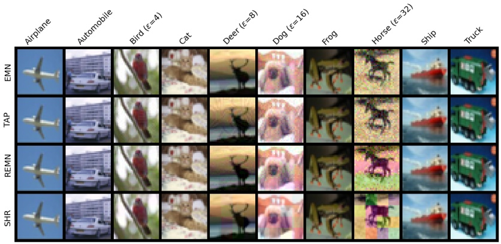

heatmap

| Category | Airplane | Automobile | Bird \((\epsilon=4)\) | Cat | Deer \((\epsilon=8)\) | Dog \((\epsilon=16)\) | Frog | Horse \((\epsilon=32)\) | Ship | Truck |
| --- | --- | --- | --- | --- | --- | --- | --- | --- | --- | --- |
| EMN | 1 | 1 | 1 | 1 | 1 | 1 | 1 | 1 | 1 | 1 |
| TAP | 1 | 1 | 1 | 1 | 1 | 1 | 1 | 1 | 1 | 1 |
| REMN | 1 | 1 | 1 | 1 | 1 | 1 | 1 | 1 | 1 | 1 |
| SHR | 1 | 1 | 1 | 1 | 1 | 1 | 1 | 1 | 1 | 1 |

Fig. 10: Samples from protected CIFAR-10 datasets with four different availability attacks. We have selected four classes to protect, where in each case we use a different perturbation norm to protect the data. The protecting perturbations become extremely visible as we increase their norm.

TABLE X: Test accuracy (%) of various neural network architectures trained over data availability attacks on CIFAR-10, CIFAR-100, SVHN, and ImageNet-100 datasets without and with our denoising approach. The mean and standard deviation are computed over 5 seeds.

<table><tr><td rowspan="2" colspan="2">Data Model</td><td rowspan="2">Method</td><td rowspan="2">Clean</td><td colspan="6">Data Availability Attacks</td></tr><tr><td>NTGA</td><td>EMN</td><td>TAP</td><td>REMN</td><td>SHR</td><td>AR</td></tr><tr><td rowspan="8">CIFAR-10</td><td rowspan="2">RN-18</td><td>Vanilla</td><td rowspan="2">94.50 ± 0.09</td><td>11.49 ± 0.69</td><td>24.85 ± 0.71</td><td>7.86 ± 0.90</td><td>20.50 ± 1.16</td><td>10.82 ± 0.22</td><td>12.09 ± 1.12</td></tr><tr><td>AVATAR</td><td>87.95 ± 0.28</td><td>90.95 ± 0.10</td><td>90.71 ± 0.19</td><td>88.49 ± 0.24</td><td>85.69 ± 0.27</td><td>91.57 ± 0.18</td></tr><tr><td rowspan="2">VGG-16</td><td>Vanilla</td><td rowspan="2">93.22 ± 0.05</td><td>11.02 ± 0.15</td><td>25.82 ± 0.74</td><td>9.42 ± 1.03</td><td>20.58 ± 0.96</td><td>10.88 ± 0.28</td><td>11.49 ± 1.23</td></tr><tr><td>AVATAR</td><td>87.13 ± 0.27</td><td>89.71 ± 0.16</td><td>89.38 ± 0.17</td><td>87.17 ± 0.22</td><td>84.74 ± 0.30</td><td>90.21 ± 0.15</td></tr><tr><td rowspan="2">DN-121</td><td>Vanilla</td><td rowspan="2">94.62 ± 0.14</td><td>11.63 ± 1.08</td><td>24.73 ± 0.81</td><td>11.09 ± 1.69</td><td>19.02 ± 1.21</td><td>14.57 ± 1.36</td><td>13.67 ± 1.91</td></tr><tr><td>AVATAR</td><td>88.33 ± 0.35</td><td>91.33 ± 0.21</td><td>91.24 ± 0.16</td><td>88.83 ± 0.24</td><td>86.12 ± 0.29</td><td>91.77 ± 0.15</td></tr><tr><td rowspan="2">WRN-34</td><td>Vanilla</td><td rowspan="2">93.87 ± 0.07</td><td>10.72 ± 0.37</td><td>22.31 ± 1.55</td><td>8.59 ± 0.43</td><td>19.71 ± 0.95</td><td>10.33 ± 0.14</td><td>12.09 ± 0.43</td></tr><tr><td>AVATAR</td><td>87.64 ± 0.19</td><td>90.19 ± 0.21</td><td>89.64 ± 0.24</td><td>87.64 ± 0.28</td><td>85.22 ± 0.42</td><td>90.71 ± 0.14</td></tr><tr><td rowspan="8">SVHN</td><td rowspan="2">RN-18</td><td>Vanilla</td><td rowspan="2">96.29 ± 0.12</td><td>9.65 ± 0.70</td><td>9.13 ± 2.00</td><td>65.97 ± 1.99</td><td>11.55 ± 0.19</td><td>10.59 ± 3.98</td><td>6.76 ± 0.07</td></tr><tr><td>AVATAR</td><td>89.84 ± 0.32</td><td>93.84 ± 0.12</td><td>93.35 ± 0.10</td><td>88.51 ± 0.23</td><td>83.82 ± 0.39</td><td>94.13 ± 0.17</td></tr><tr><td rowspan="2">VGG-16</td><td>Vanilla</td><td rowspan="2">95.94 ± 0.12</td><td>23.24 ± 8.42</td><td>9.13 ± 2.00</td><td>63.81 ± 2.77</td><td>10.87 ± 0.43</td><td>9.45 ± 3.69</td><td>10.87 ± 5.09</td></tr><tr><td>AVATAR</td><td>89.75 ± 0.19</td><td>93.61 ± 0.14</td><td>93.03 ± 0.26</td><td>87.01 ± 0.41</td><td>82.03 ± 0.48</td><td>93.73 ± 0.14</td></tr><tr><td rowspan="2">DN-121</td><td>Vanilla</td><td rowspan="2">96.47 ± 0.12</td><td>19.06 ± 5.84</td><td>30.49 ± 5.53</td><td>69.04 ± 1.80</td><td>11.48 ± 2.09</td><td>10.54 ± 3.45</td><td>10.23 ± 3.64</td></tr><tr><td>AVATAR</td><td>90.52 ± 0.13</td><td>94.39 ± 0.24</td><td>94.05 ± 0.18</td><td>88.76 ± 0.53</td><td>84.35 ± 0.71</td><td>94.61 ± 0.10</td></tr><tr><td rowspan="2">WRN-34</td><td>Vanilla</td><td rowspan="2">96.35 ± 0.07</td><td>23.24 ± 8.42</td><td>18.57 ± 7.00</td><td>70.72 ± 1.23</td><td>18.10 ± 10.17</td><td>6.84 ± 0.15</td><td>9.04 ± 2.47</td></tr><tr><td>AVATAR</td><td>90.26 ± 0.16</td><td>94.29 ± 0.12</td><td>94.01 ± 0.28</td><td>89.34 ± 0.35</td><td>83.50 ± 0.47</td><td>94.60 ± 0.12</td></tr><tr><td rowspan="8">CIFAR-100</td><td rowspan="2">RN-18</td><td>Vanilla</td><td rowspan="2">75.01 ± 0.41</td><td>1.32 ± 0.31</td><td>2.05 ± 0.18</td><td>14.10 ± 0.19</td><td>10.88 ± 0.33</td><td>1.39 ± 0.10</td><td>2.15 ± 0.46</td></tr><tr><td>AVATAR</td><td>63.98 ± 0.55</td><td>65.73 ± 0.36</td><td>64.99 ± 0.10</td><td>64.88 ± 0.08</td><td>58.52 ± 0.46</td><td>64.54 ± 0.23</td></tr><tr><td rowspan="2">VGG-16</td><td>Vanilla</td><td rowspan="2">72.03 ± 0.06</td><td>1.16 ± 0.03</td><td>1.94 ± 0.19</td><td>15.25 ± 0.57</td><td>9.11 ± 0.54</td><td>1.57 ± 0.33</td><td>2.42 ± 0.38</td></tr><tr><td>AVATAR</td><td>62.00 ± 0.34</td><td>63.60 ± 0.26</td><td>62.69 ± 0.21</td><td>62.38 ± 0.30</td><td>56.38 ± 0.41</td><td>62.27 ± 0.34</td></tr><tr><td rowspan="2">DN-121</td><td>Vanilla</td><td rowspan="2">77.47 ± 0.33</td><td>1.87 ± 0.34</td><td>2.41 ± 0.40</td><td>15.94 ± 0.25</td><td>8.94 ± 0.49</td><td>1.81 ± 0.23</td><td>2.34 ± 0.48</td></tr><tr><td>AVATAR</td><td>65.84 ± 0.41</td><td>67.86 ± 0.22</td><td>67.27 ± 0.18</td><td>66.85 ± 0.20</td><td>60.16 ± 0.24</td><td>66.78 ± 0.43</td></tr><tr><td rowspan="2">WRN-34</td><td>Vanilla</td><td rowspan="2">73.39 ± 0.43</td><td>1.51 ± 0.18</td><td>1.94 ± 0.24</td><td>12.00 ± 0.45</td><td>9.16 ± 0.61</td><td>1.37 ± 0.19</td><td>1.90 ± 0.24</td></tr><tr><td>AVATAR</td><td>61.62 ± 0.36</td><td>63.49 ± 0.32</td><td>62.68 ± 0.34</td><td>62.52 ± 0.32</td><td>56.64 ± 0.60</td><td>62.57 ± 0.26</td></tr><tr><td rowspan="8">ImageNet-100</td><td rowspan="2">RN-18</td><td>Vanilla</td><td rowspan="2">80.05 ± 0.13</td><td>74.74 ± 0.52</td><td>1.78 ± 0.17</td><td>9.14 ± 0.40</td><td>13.28 ± 0.51</td><td>43.48 ± 1.56</td><td></td></tr><tr><td>AVATAR</td><td>71.08 ± 0.48</td><td>72.84 ± 0.90</td><td>76.52 ± 0.46</td><td>39.79 ± 0.98</td><td>59.85 ± 1.01</td><td></td></tr><tr><td rowspan="2">VGG-16</td><td>Vanilla</td><td rowspan="2">79.16 ± 0.30</td><td>73.98 ± 0.45</td><td>1.54 ± 0.24</td><td>9.30 ± 0.39</td><td>12.04 ± 0.15</td><td>72.10 ± 0.68</td><td></td></tr><tr><td>AVATAR</td><td>70.78 ± 0.56</td><td>73.34 ± 0.50</td><td>76.25 ± 0.19</td><td>39.74 ± 0.44</td><td>67.22 ± 0.54</td><td></td></tr><tr><td rowspan="2">DN-121</td><td>Vanilla</td><td rowspan="2">79.66 ± 0.25</td><td>75.16 ± 0.22</td><td>4.58 ± 0.31</td><td>19.28 ± 0.84</td><td>15.46 ± 0.77</td><td>31.47 ± 1.01</td><td></td></tr><tr><td>AVATAR</td><td>73.41 ± 0.23</td><td>75.96 ± 0.48</td><td>77.96 ± 0.48</td><td>48.20 ± 0.32</td><td>54.24 ± 0.65</td><td></td></tr><tr><td rowspan="2">WRN-34</td><td>Vanilla</td><td rowspan="2">74.46 ± 0.52</td><td>68.38 ± 1.17</td><td>1.22 ± 0.15</td><td>8.20 ± 0.28</td><td>10.45 ± 0.28</td><td>52.95 ± 4.13</td><td></td></tr><tr><td>AVATAR</td><td>64.20 ± 0.76</td><td>66.33 ± 1.01</td><td>70.34 ± 0.85</td><td>29.89 ± 0.66</td><td>58.24 ± 1.47</td><td></td></tr></table>

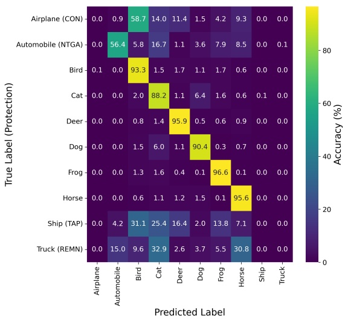

heatmap

| True Label (Protection) | Airplane (CON) | Automobile (NTGA) | Bird | Cat | Deer | Dog | Frog | Horse | Ship | Truck |
| --- | --- | --- | --- | --- | --- | --- | --- | --- | --- | --- |
| Airplane (CON) | 0.0 | 0.9 | 58.7 | 14.0 | 11.4 | 1.5 | 4.2 | 9.3 | 0.0 | 0.0 |
| Automobile (NTGA) | 0.0 | 56.4 | 5.8 | 16.7 | 1.1 | 3.6 | 7.9 | 8.5 | 0.0 | 0.1 |
| Bird | 0.1 | 0.0 | 93.3 | 1.5 | 1.7 | 1.1 | 1.7 | 0.6 | 0.0 | 0.0 |
| Cat | 0.0 | 0.0 | 2.0 | 88.2 | 1.1 | 6.4 | 1.6 | 0.6 | 0.1 | 0.0 |
| Deer | 0.0 | 0.0 | 0.8 | 1.4 | 95.9 | 0.5 | 0.6 | 0.9 | 0.0 | 0.0 |
| Dog | 0.0 | 0.0 | 1.5 | 6.0 | 1.1 | 90.4 | 0.3 | 0.7 | 0.0 | 0.0 |
| Frog | 0.0 | 0.0 | 1.3 | 1.6 | 0.4 | 0.1 | 96.6 | 0.1 | 0.0 | 0.0 |
| Horse | 0.0 | 0.0 | 0.6 | 1.1 | 1.2 | 1.5 | 0.1 | 95.6 | 0.0 | 0.0 |
| Ship (TAP) | 0.0 | 4.2 | 31.1 | 25.4 | 16.4 | 2.0 | 13.8 | 7.1 | 0.0 | 0.0 |
| Truck (REMN) | 0.0 | 15.0 | 9.6 | 32.9 | 2.6 | 3.7 | 5.5 | 30.8 | 0.0 | 0.0 |

Vanilla Training

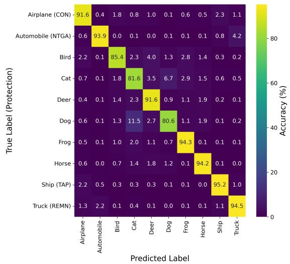

heatmap

| True Label (Protection) | Airplane (CON) | Automobile (NTGA) | Bird | Cat | Deer | Dog | Frog | Horse | Ship | Truck |
| --- | --- | --- | --- | --- | --- | --- | --- | --- | --- | --- |
| Airplane (CON) | 91.6 | 0.4 | 1.8 | 0.8 | 1.0 | 0.1 | 0.6 | 0.5 | 2.3 | 1.1 |
| Automobile (NTGA) | 0.6 | 93.9 | 0.0 | 0.1 | 0.0 | 0.1 | 0.1 | 0.1 | 0.8 | 4.2 |
| Bird | 2.2 | 0.1 | 85.4 | 2.3 | 4.0 | 1.3 | 2.8 | 1.4 | 0.3 | 0.2 |
| Cat | 0.7 | 0.1 | 1.8 | 81.6 | 3.5 | 6.7 | 2.9 | 1.5 | 0.6 | 0.5 |
| Deer | 0.4 | 0.1 | 1.4 | 2.3 | 91.6 | 0.9 | 1.1 | 1.9 | 0.2 | 0.1 |
| Dog | 0.6 | 0.1 | 1.3 | 11.5 | 2.7 | 80.6 | 1.1 | 1.9 | 0.1 | 0.2 |
| Frog | 0.5 | 0.1 | 1.0 | 2.0 | 1.1 | 0.7 | 94.3 | 0.1 | 0.1 | 0.1 |
| Horse | 0.6 | 0.0 | 0.7 | 1.4 | 1.8 | 1.2 | 0.1 | 94.2 | 0.1 | 0.0 |
| Ship (TAP) | 2.2 | 0.5 | 0.3 | 0.3 | 0.3 | 0.1 | 0.1 | 0.0 | 95.2 | 1.0 |
| Truck (REMN) | 1.3 | 2.2 | 0.1 | 0.4 | 0.1 | 0.0 | 0.1 | 0.1 | 1.1 | 94.5 |

AVATAR

(a) CNTR

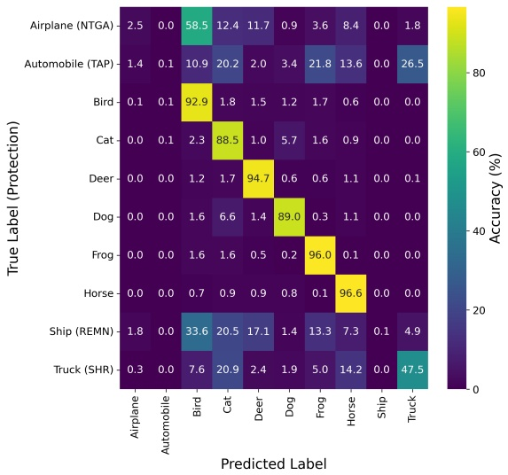

heatmap

| True Label (Protection) | Airplane (NTGA) | Automobile (TAP) | Bird | Cat | Deer | Dog | Frog | Horse | Ship | Truck |
| --- | --- | --- | --- | --- | --- | --- | --- | --- | --- | --- |
| Airplane (NTGA) | 2.5 | 0.0 | 58.5 | 12.4 | 11.7 | 0.9 | 3.6 | 8.4 | 0.0 | 1.8 |
| Automobile (TAP) | 1.4 | 0.1 | 10.9 | 20.2 | 2.0 | 3.4 | 21.8 | 13.6 | 0.0 | 26.5 |
| Bird | 0.1 | 0.1 | 92.9 | 1.8 | 1.5 | 1.2 | 1.7 | 0.6 | 0.0 | 0.0 |
| Cat | 0.0 | 0.1 | 2.3 | 88.5 | 1.0 | 5.7 | 1.6 | 0.9 | 0.0 | 0.0 |
| Deer | 0.0 | 0.0 | 1.2 | 1.7 | 94.7 | 0.6 | 0.6 | 1.1 | 0.0 | 0.1 |
| Dog | 0.0 | 0.0 | 1.6 | 6.6 | 1.4 | 89.0 | 0.3 | 1.1 | 0.0 | 0.0 |
| Frog | 0.0 | 0.0 | 1.6 | 1.6 | 0.5 | 0.2 | 96.0 | 0.1 | 0.0 | 0.0 |
| Horse | 0.0 | 0.0 | 0.7 | 0.9 | 0.9 | 0.8 | 0.1 | 96.6 | 0.0 | 0.0 |
| Ship (REMN) | 1.8 | 0.0 | 33.6 | 20.5 | 17.1 | 1.4 | 13.3 | 7.3 | 0.1 | 4.9 |
| Truck (SHR) | 0.3 | 0.0 | 7.6 | 20.9 | 2.4 | 1.9 | 5.0 | 14.2 | 0.0 | 47.5 |

Vanilla Training

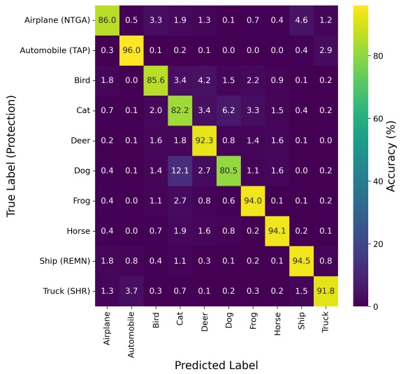

heatmap

| True Label (Protection) | Airplane (NTGA) | Automobile (TAP) | Bird | Cat | Deer | Dog | Frog | Horse | Ship | Truck (SHR) |
| --- | --- | --- | --- | --- | --- | --- | --- | --- | --- | --- |
| Airplane (NTGA) | 86.0 | 0.5 | 3.3 | 1.9 | 1.3 | 0.1 | 0.7 | 0.4 | 4.6 | 1.2 |
| Automobile (TAP) | 0.3 | 96.0 | 0.1 | 0.2 | 0.1 | 0.0 | 0.0 | 0.0 | 0.4 | 2.9 |
| Bird | 1.8 | 0.0 | 85.6 | 3.4 | 4.2 | 1.5 | 2.2 | 0.9 | 0.1 | 0.2 |
| Cat | 0.7 | 0.1 | 2.0 | 82.2 | 3.4 | 6.2 | 3.3 | 1.5 | 0.4 | 0.2 |
| Deer | 0.2 | 0.1 | 1.6 | 1.8 | 92.3 | 0.8 | 1.4 | 1.6 | 0.1 | 0.0 |
| Dog | 0.4 | 0.1 | 1.4 | 12.1 | 2.7 | 80.5 | 1.1 | 1.6 | 0.0 | 0.2 |
| Frog | 0.4 | 0.0 | 1.1 | 2.7 | 0.8 | 0.6 | 94.0 | 0.1 | 0.1 | 0.2 |
| Horse | 0.4 | 0.0 | 0.7 | 1.9 | 1.6 | 0.8 | 0.2 | 94.1 | 0.2 | 0.1 |
| Ship (REMN) | 1.8 | 0.8 | 0.4 | 1.1 | 0.3 | 0.1 | 0.2 | 0.1 | 94.5 | 0.8 |
| Truck (SHR) | 1.3 | 3.7 | 0.3 | 0.7 | 0.1 | 0.2 | 0.3 | 0.2 | 1.5 | 91.8 |

AVATAR

(b) NTRS

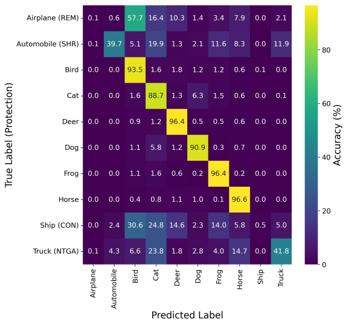

heatmap

| True Label (Protection) | Airplane (REM) | Automobile (SHR) | Bird | Cat | Deer | Dog | Frog | Horse | Ship | Truck |
| --- | --- | --- | --- | --- | --- | --- | --- | --- | --- | --- |
| Airplane (REM) | 0.1 | 0.6 | 57.7 | 16.4 | 10.3 | 1.4 | 3.4 | 7.9 | 0.0 | 2.1 |
| Automobile (SHR) | 0.1 | 39.7 | 5.1 | 19.9 | 1.3 | 2.1 | 11.6 | 8.3 | 0.0 | 11.9 |
| Bird | 0.0 | 0.0 | 93.5 | 1.6 | 1.8 | 1.2 | 1.2 | 0.6 | 0.1 | 0.0 |
| Cat | 0.0 | 0.0 | 1.6 | 88.7 | 1.3 | 6.3 | 1.5 | 0.6 | 0.0 | 0.1 |
| Deer | 0.0 | 0.0 | 0.9 | 1.2 | 96.4 | 0.5 | 0.5 | 0.6 | 0.0 | 0.0 |
| Dog | 0.0 | 0.0 | 1.1 | 5.8 | 1.2 | 90.9 | 0.3 | 0.7 | 0.0 | 0.0 |
| Frog | 0.0 | 0.0 | 1.1 | 1.6 | 0.6 | 0.2 | 96.4 | 0.2 | 0.0 | 0.0 |
| Horse | 0.0 | 0.0 | 0.4 | 0.8 | 1.1 | 1.0 | 0.1 | 96.6 | 0.0 | 0.0 |
| Ship (CON) | 0.0 | 2.4 | 30.6 | 24.8 | 14.6 | 2.3 | 14.0 | 5.8 | 0.5 | 5.0 |
| Truck (NTGA) | 0.1 | 4.3 | 6.6 | 23.8 | 1.8 | 2.8 | 4.0 | 14.7 | 0.0 | 41.8 |

Vanilla Training

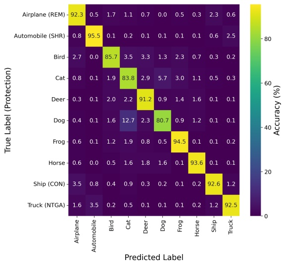

heatmap

| True Label (Protection) | Airplane (REM) | Automobile (SHR) | Bird | Cat | Deer | Dog | Frog | Horse | Ship | Truck (NTGA) |
| --- | --- | --- | --- | --- | --- | --- | --- | --- | --- | --- |
| Airplane (REM) | 92.3 | 0.5 | 1.7 | 1.1 | 0.7 | 0.0 | 0.5 | 0.3 | 2.3 | 0.6 |
| Automobile (SHR) | 0.8 | 95.5 | 0.1 | 0.2 | 0.1 | 0.1 | 0.1 | 0.1 | 0.6 | 2.5 |
| Bird | 2.7 | 0.0 | 85.7 | 3.5 | 3.3 | 1.3 | 2.3 | 0.7 | 0.3 | 0.2 |
| Cat | 0.8 | 0.1 | 1.9 | 83.8 | 2.9 | 5.7 | 3.0 | 1.1 | 0.5 | 0.3 |
| Deer | 0.3 | 0.1 | 2.0 | 2.2 | 91.2 | 0.9 | 1.4 | 1.6 | 0.1 | 0.1 |
| Dog | 0.4 | 0.1 | 1.6 | 12.7 | 2.3 | 80.7 | 0.9 | 1.2 | 0.1 | 0.1 |
| Frog | 0.6 | 0.1 | 1.2 | 1.9 | 0.8 | 0.5 | 94.5 | 0.1 | 0.1 | 0.2 |
| Horse | 0.6 | 0.0 | 0.5 | 1.6 | 1.8 | 1.6 | 0.1 | 93.6 | 0.1 | 0.1 |
| Ship (CON) | 3.5 | 0.8 | 0.4 | 0.9 | 0.3 | 0.2 | 0.1 | 0.2 | 92.6 | 1.2 |
| Truck (NTGA) | 1.6 | 3.5 | 0.2 | 0.5 | 0.1 | 0.1 | 0.1 | 0.2 | 1.2 | 92.5 |

AVATAR

(c) RSCN

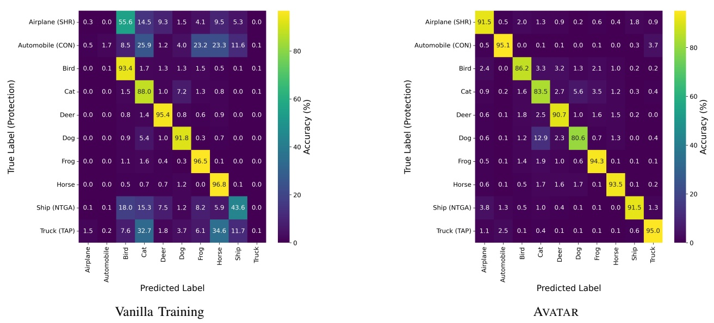

(d) SCNT

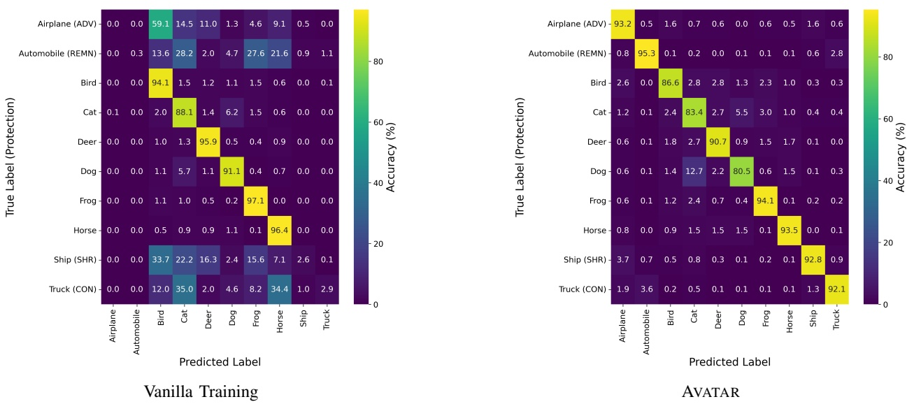

(e) TRSC

Fig. 11: The confusion matrices of RN-18 classifiers trained over CIFAR-10 dataset. In each case, we use a different combination of availability attacks to protect some of the classes. For AVATAR, we follow our settings for the experiments in Table IX and use a DDPM-IP pre-trained over the IN-1k-32×32 dataset.

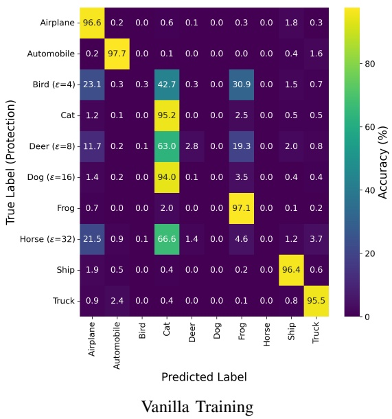

heatmap

| True Label (Protection) | Airplane | Automobile | Bird | Cat | Deer | Dog | Frog | Horse | Ship | Truck |
| --- | --- | --- | --- | --- | --- | --- | --- | --- | --- | --- |
| Airplane | 96.6 | 0.2 | 0.0 | 0.6 | 0.1 | 0.0 | 0.3 | 0.0 | 1.8 | 0.3 |
| Automobile | 0.2 | 97.7 | 0.0 | 0.1 | 0.0 | 0.0 | 0.0 | 0.0 | 0.4 | 1.6 |
| \(Bird (\epsilon=4)\) | 23.1 | 0.3 | 0.3 | 42.7 | 0.3 | 0.0 | 30.9 | 0.0 | 1.5 | 0.7 |
| Cat | 1.2 | 0.1 | 0.0 | 95.2 | 0.0 | 0.0 | 2.5 | 0.0 | 0.5 | 0.5 |
| \(Deer (\epsilon=8)\) | 11.7 | 0.2 | 0.1 | 63.0 | 2.8 | 0.0 | 19.3 | 0.0 | 2.0 | 0.8 |
| \(Dog (\epsilon=16)\) | 1.4 | 0.2 | 0.0 | 94.0 | 0.1 | 0.0 | 3.5 | 0.0 | 0.4 | 0.4 |
| Frog | 0.7 | 0.0 | 0.0 | 2.0 | 0.0 | 0.0 | 97.1 | 0.0 | 0.1 | 0.2 |
| \(Horse (\epsilon=32)\) | 21.5 | 0.9 | 0.1 | 66.6 | 1.4 | 0.0 | 4.6 | 0.0 | 1.2 | 3.7 |
| Ship | 1.9 | 0.5 | 0.0 | 0.4 | 0.0 | 0.0 | 0.2 | 0.0 | 96.4 | 0.6 |
| Truck | 0.9 | 2.4 | 0.0 | 0.4 | 0.0 | 0.0 | 0.1 | 0.0 | 0.8 | 95.5 |

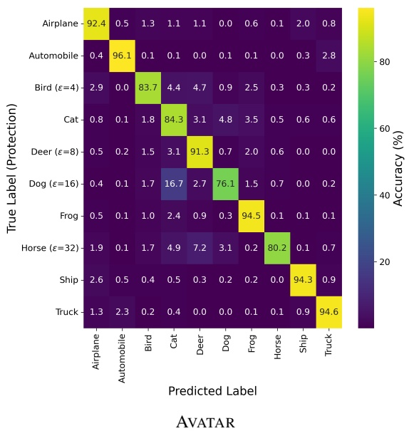

heatmap

| True Label (Protection) | Airplane | Automobile | Bird | Cat | Deer | Dog | Frog | Horse | Ship | Truck |
| --- | --- | --- | --- | --- | --- | --- | --- | --- | --- | --- |
| Airplane | 92.4 | 0.5 | 1.3 | 1.1 | 1.1 | 0.0 | 0.6 | 0.1 | 2.0 | 0.8 |
| Automobile | 0.4 | 96.1 | 0.1 | 0.1 | 0.0 | 0.1 | 0.1 | 0.0 | 0.3 | 2.8 |
| \(Bird (\epsilon=4)\) | 2.9 | 0.0 | 83.7 | 4.4 | 4.7 | 0.9 | 2.5 | 0.3 | 0.3 | 0.2 |
| Cat | 0.8 | 0.1 | 1.8 | 84.3 | 3.1 | 4.8 | 3.5 | 0.5 | 0.6 | 0.6 |
| \(Deer (\epsilon=8)\) | 0.5 | 0.2 | 1.5 | 3.1 | 91.3 | 0.7 | 2.0 | 0.6 | 0.0 | 0.0 |
| \(Dog (\epsilon=16)\) | 0.4 | 0.1 | 1.7 | 16.7 | 2.7 | 76.1 | 1.5 | 0.7 | 0.0 | 0.2 |
| Frog | 0.5 | 0.1 | 1.0 | 2.4 | 0.9 | 0.3 | 94.5 | 0.1 | 0.1 | 0.1 |
| \(Horse (\epsilon=32)\) | 1.9 | 0.1 | 1.7 | 4.9 | 7.2 | 3.1 | 0.2 | 80.2 | 0.1 | 0.7 |
| Ship | 2.6 | 0.5 | 0.4 | 0.5 | 0.3 | 0.2 | 0.2 | 0.0 | 94.3 | 0.9 |
| Truck | 1.3 | 2.3 | 0.2 | 0.4 | 0.0 | 0.0 | 0.1 | 0.1 | 0.9 | 94.6 |

(a) EMN [30]

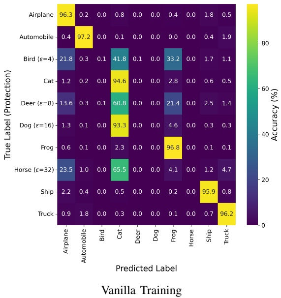

heatmap

| True Label (Protection) | Airplane | Automobile | Bird | Cat | Deer | Dog | Frog | Horse | Ship | Truck |
| --- | --- | --- | --- | --- | --- | --- | --- | --- | --- | --- |
| Airplane | 96.3 | 0.2 | 0.0 | 0.8 | 0.0 | 0.0 | 0.4 | 0.0 | 1.8 | 0.5 |
| Automobile | 0.4 | 97.2 | 0.0 | 0.1 | 0.0 | 0.0 | 0.0 | 0.0 | 0.4 | 1.9 |
| \(Bird (\epsilon=4)\) | 21.8 | 0.3 | 0.1 | 41.8 | 0.1 | 0.0 | 33.2 | 0.0 | 1.7 | 1.1 |
| Cat | 1.2 | 0.2 | 0.0 | 94.6 | 0.0 | 0.0 | 2.8 | 0.0 | 0.6 | 0.5 |
| \(Deer (\epsilon=8)\) | 13.6 | 0.3 | 0.1 | 60.8 | 0.0 | 0.0 | 21.4 | 0.0 | 2.5 | 1.4 |
| \(Dog (\epsilon=16)\) | 1.3 | 0.1 | 0.0 | 93.3 | 0.0 | 0.0 | 4.6 | 0.0 | 0.3 | 0.3 |
| Frog | 0.6 | 0.1 | 0.0 | 2.3 | 0.0 | 0.0 | 96.8 | 0.0 | 0.1 | 0.1 |
| \(Horse (\epsilon=32)\) | 23.5 | 1.0 | 0.0 | 65.5 | 0.0 | 0.0 | 4.1 | 0.0 | 1.2 | 4.7 |
| Ship | 2.2 | 0.4 | 0.0 | 0.5 | 0.0 | 0.0 | 0.2 | 0.0 | 95.9 | 0.8 |
| Truck | 0.9 | 1.8 | 0.0 | 0.3 | 0.0 | 0.0 | 0.1 | 0.0 | 0.7 | 96.2 |

heatmap

| True Label (Protection) | Airplane | Automobile | Bird | Cat | Deer | Dog | Frog | Horse | Ship | Truck |
| --- | --- | --- | --- | --- | --- | --- | --- | --- | --- | --- |
| Airplane | 93.4 | 0.5 | 1.2 | 1.2 | 0.8 | 0.0 | 0.5 | 0.1 | 1.7 | 0.7 |
| Automobile | 0.6 | 95.7 | 0.1 | 0.1 | 0.1 | 0.1 | 0.0 | 0.1 | 0.4 | 2.8 |
| \(Bird (\epsilon=4)\) | 2.3 | 0.0 | 86.4 | 3.6 | 3.8 | 0.7 | 2.4 | 0.4 | 0.2 | 0.2 |
| Cat | 0.9 | 0.2 | 2.3 | 84.0 | 2.5 | 5.1 | 3.6 | 0.4 | 0.5 | 0.4 |
| \(Deer (\epsilon=8)\) | 0.7 | 0.1 | 2.5 | 3.8 | 89.2 | 0.8 | 1.9 | 0.8 | 0.2 | 0.0 |
| Dog \((\epsilon=16)\) | 0.4 | 0.1 | 2.1 | 16.1 | 2.5 | 76.8 | 1.3 | 0.5 | 0.0 | 0.3 |
| Frog | 0.6 | 0.1 | 1.2 | 2.4 | 0.7 | 0.6 | 94.0 | 0.1 | 0.1 | 0.1 |
| \(Horse (\epsilon=32)\) | 1.8 | 0.0 | 1.9 | 5.3 | 5.0 | 3.2 | 0.3 | 82.0 | 0.2 | 0.4 |
| Ship | 2.4 | 0.6 | 0.3 | 0.9 | 0.3 | 0.1 | 0.1 | 0.0 | 94.2 | 1.0 |
| Truck | 1.4 | 2.4 | 0.2 | 0.5 | 0.1 | 0.0 | 0.1 | 0.1 | 1.0 | 94.2 |

(b) TAP [17]

heatmap

| True Label (Protection) | Airplane | Automobile | Bird | Cat | Deer | Dog | Frog | Horse | Ship | Truck |
| --- | --- | --- | --- | --- | --- | --- | --- | --- | --- | --- |
| Airplane | 96.6 | 0.2 | 0.0 | 0.8 | 0.0 | 0.0 | 0.4 | 0.0 | 1.7 | 0.4 |
| Automobile | 0.3 | 97.2 | 0.0 | 0.1 | 0.0 | 0.0 | 0.0 | 0.0 | 0.4 | 1.9 |
| \(Bird (\epsilon=4)\) | 23.1 | 0.3 | 0.1 | 44.3 | 0.0 | 0.0 | 29.7 | 0.0 | 1.6 | 0.9 |
| Cat | 1.0 | 0.1 | 0.0 | 95.5 | 0.0 | 0.0 | 2.4 | 0.0 | 0.6 | 0.4 |
| \(Deer (\epsilon=8)\) | 13.1 | 0.2 | 0.0 | 62.4 | 0.3 | 0.0 | 20.6 | 0.0 | 2.4 | 1.0 |
| \(Dog (\epsilon=16)\) | 1.4 | 0.2 | 0.0 | 94.2 | 0.0 | 0.0 | 3.5 | 0.0 | 0.4 | 0.3 |
| Frog | 0.6 | 0.0 | 0.0 | 2.0 | 0.0 | 0.0 | 97.3 | 0.0 | 0.1 | 0.1 |
| \(Horse (\epsilon=32)\) | 22.9 | 0.7 | 0.0 | 67.4 | 0.0 | 0.0 | 4.5 | 0.0 | 1.0 | 3.5 |
| Ship | 1.9 | 0.5 | 0.0 | 0.5 | 0.0 | 0.0 | 0.2 | 0.0 | 96.2 | 0.7 |
| Truck | 0.8 | 2.0 | 0.0 | 0.3 | 0.0 | 0.0 | 0.0 | 0.0 | 0.8 | 96.0 |

heatmap

| True Label (Protection) | Predicted Label::Airplane | Predicted Label::Automobile | Predicted Label::Bird | Predicted Label::Cat | Predicted Label::Deer | Predicted Label::Dog | Predicted Label::Frog | Predicted Label::Horse | Predicted Label::Ship | Predicted Label::Truck |
| --- | --- | --- | --- | --- | --- | --- | --- | --- | --- | --- |
| Airplane | 92.8 | 0.5 | 1.6 | 1.0 | 0.6 | 0.0 | 0.7 | 0.0 | 2.1 | 0.7 |
| Automobile | 0.5 | 95.8 | 0.0 | 0.1 | 0.1 | 0.0 | 0.1 | 0.0 | 0.4 | 3.0 |
| \(Bird (\epsilon=4)\) | 2.5 | 0.0 | 86.0 | 4.1 | 3.3 | 1.2 | 2.5 | 0.0 | 0.2 | 0.2 |
| Cat | 0.9 | 0.1 | 2.3 | 84.4 | 3.1 | 4.2 | 3.7 | 0.0 | 0.6 | 0.6 |
| \(Deer (\epsilon=8)\) | 0.8 | 0.1 | 3.3 | 4.3 | 88.2 | 0.9 | 2.2 | 0.0 | 0.1 | 0.1 |
| \(Dog (\epsilon=16)\) | 0.8 | 0.1 | 3.0 | 31.4 | 3.7 | 58.6 | 2.2 | 0.0 | 0.0 | 0.3 |
| Frog | 0.5 | 0.0 | 1.2 | 2.9 | 0.6 | 0.5 | 94.1 | 0.0 | 0.1 | 0.1 |
| \(Horse (\epsilon=32)\) | 7.2 | 0.2 | 5.7 | 21.4 | 44.7 | 14.1 | 0.9 | 3.0 | 0.6 | 2.2 |
| Ship | 2.5 | 0.3 | 0.3 | 0.7 | 0.1 | 0.1 | 0.2 | 0.0 | 94.4 | 1.4 |
| Truck | 1.4 | 2.3 | 0.2 | 0.5 | 0.2 | 0.0 | 0.2 | 0.0 | 1.0 | 94.3 |

(c) REMN [18]

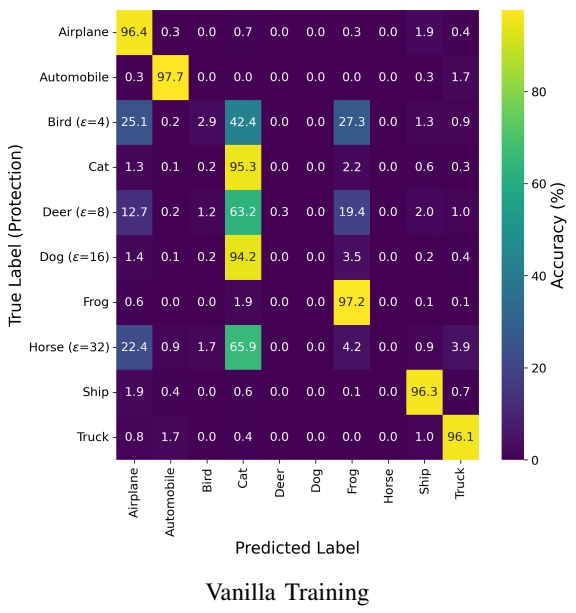

heatmap

| True Label (Protection) | Airplane | Automobile | Bird | Cat | Deer | Dog | Frog | Horse | Ship | Truck |
| --- | --- | --- | --- | --- | --- | --- | --- | --- | --- | --- |
| Airplane | 96.4 | 0.3 | 0.0 | 0.7 | 0.0 | 0.0 | 0.3 | 0.0 | 1.9 | 0.4 |
| Automobile | 0.3 | 97.7 | 0.0 | 0.0 | 0.0 | 0.0 | 0.0 | 0.0 | 0.3 | 1.7 |
| \(Bird (\epsilon=4)\) | 25.1 | 0.2 | 2.9 | 42.4 | 0.0 | 0.0 | 27.3 | 0.0 | 1.3 | 0.9 |
| Cat | 1.3 | 0.1 | 0.2 | 95.3 | 0.0 | 0.0 | 2.2 | 0.0 | 0.6 | 0.3 |
| \(Deer (\epsilon=8)\) | 12.7 | 0.2 | 1.2 | 63.2 | 0.3 | 0.0 | 19.4 | 0.0 | 2.0 | 1.0 |
| \(Dog (\epsilon=16)\) | 1.4 | 0.1 | 0.2 | 94.2 | 0.0 | 0.0 | 3.5 | 0.0 | 0.2 | 0.4 |
| Frog | 0.6 | 0.0 | 0.0 | 1.9 | 0.0 | 0.0 | 97.2 | 0.0 | 0.1 | 0.1 |
| \(Horse (\epsilon=32)\) | 22.4 | 0.9 | 1.7 | 65.9 | 0.0 | 0.0 | 4.2 | 0.0 | 0.9 | 3.9 |
| Ship | 1.9 | 0.4 | 0.0 | 0.6 | 0.0 | 0.0 | 0.1 | 0.0 | 96.3 | 0.7 |
| Truck | 0.8 | 1.7 | 0.0 | 0.4 | 0.0 | 0.0 | 0.0 | 0.0 | 1.0 | 96.1 |

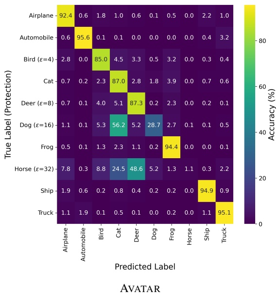

heatmap

| True Label (Protection) | Airplane | Automobile | Bird | Cat | Deer | Dog | Frog | Horse | Ship | Truck |
| --- | --- | --- | --- | --- | --- | --- | --- | --- | --- | --- |
| Airplane | 92.4 | 0.6 | 1.8 | 1.0 | 0.6 | 0.1 | 0.5 | 0.0 | 2.2 | 1.0 |
| Automobile | 0.6 | 95.6 | 0.1 | 0.1 | 0.0 | 0.0 | 0.0 | 0.0 | 0.4 | 3.2 |
| \(Bird (\epsilon=4)\) | 2.8 | 0.0 | 85.0 | 4.5 | 3.3 | 0.5 | 3.2 | 0.0 | 0.3 | 0.4 |
| Cat | 0.7 | 0.2 | 2.3 | 87.0 | 2.8 | 1.8 | 3.9 | 0.0 | 0.7 | 0.6 |
| \(Deer (\epsilon=8)\) | 0.7 | 0.1 | 4.0 | 5.1 | 87.3 | 0.2 | 2.3 | 0.0 | 0.2 | 0.1 |
| Dog \((\epsilon=16)\) | 1.1 | 0.1 | 5.3 | 56.2 | 5.2 | 28.7 | 2.7 | 0.1 | 0.1 | 0.5 |
| Frog | 0.5 | 0.1 | 1.3 | 2.3 | 1.1 | 0.2 | 94.4 | 0.0 | 0.0 | 0.1 |
| \(Horse (\epsilon=32)\) | 7.8 | 0.3 | 8.8 | 24.5 | 48.6 | 5.2 | 1.3 | 1.1 | 0.3 | 2.2 |
| Ship | 1.9 | 0.6 | 0.2 | 0.8 | 0.4 | 0.2 | 0.2 | 0.0 | 94.9 | 0.9 |
| Truck | 1.1 | 1.9 | 0.1 | 0.5 | 0.1 | 0.0 | 0.2 | 0.0 | 1.1 | 95.1 |

(d) SHR [71]

Fig. 12: The confusion matrices of RN-18 classifiers trained over CIFAR-10 dataset. For each availability attack, we use four different perturbation norms to protect a randomly selected set of classes. For AVATAR, we follow our settings for the experiments in Table IX and use a DDPM-IP pre-trained over the IN-1k-32×32 dataset.

Páginas originales para cotejo

### Página 1

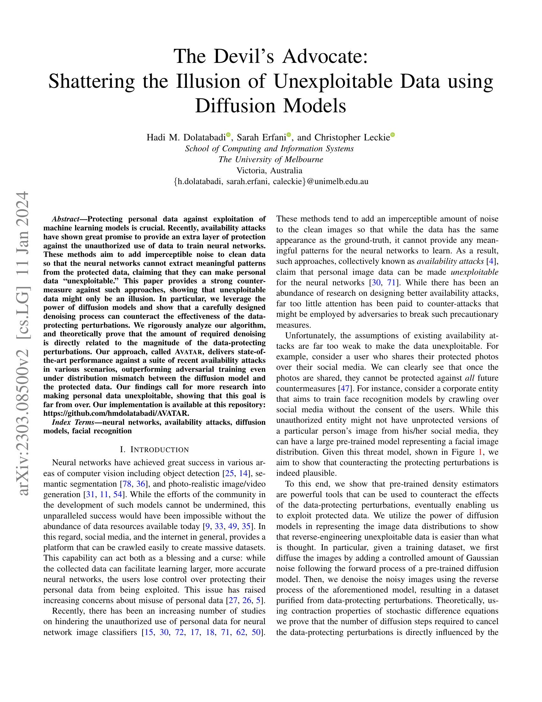

### Página 2

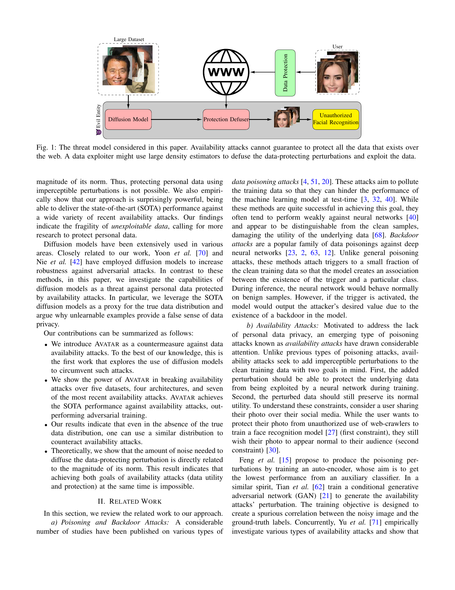

### Página 3

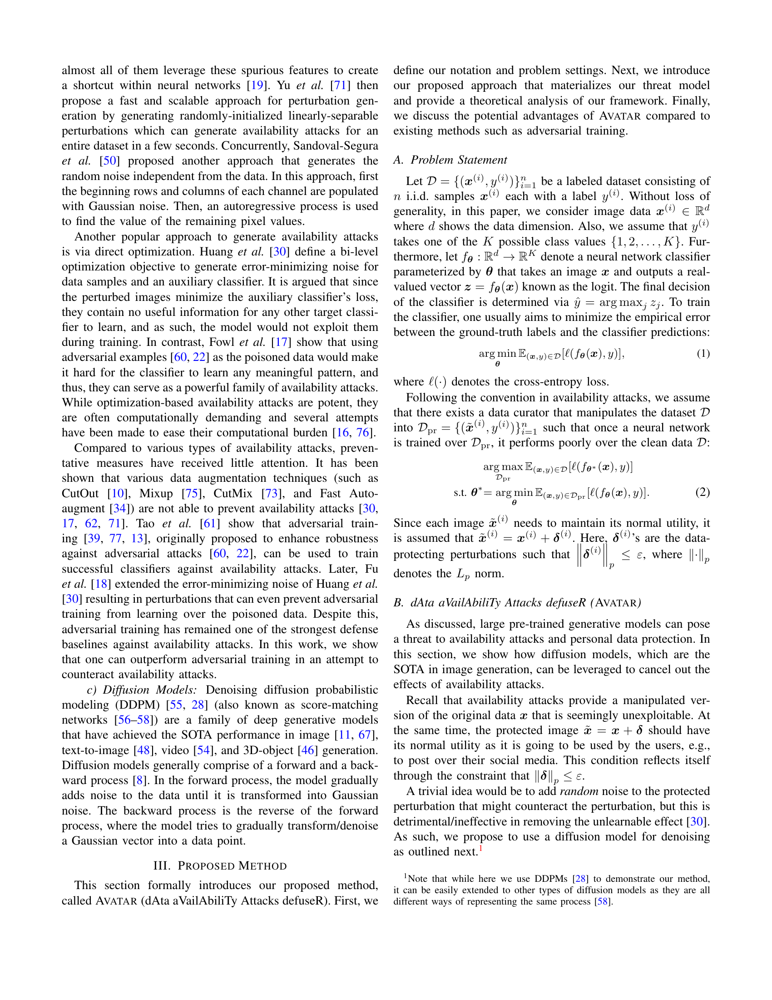

### Página 4

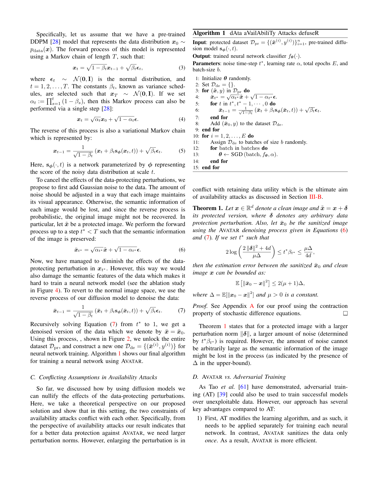

### Página 5

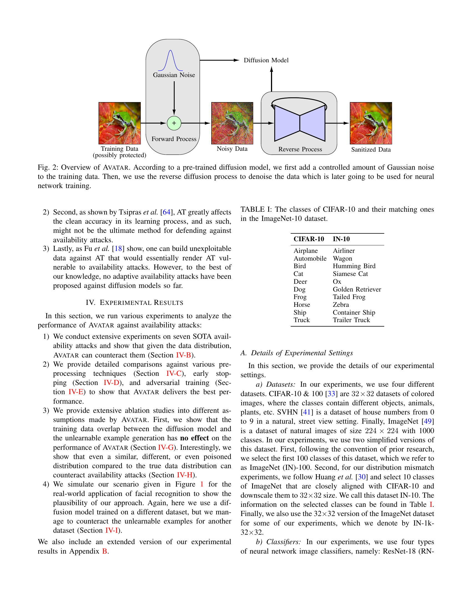

### Página 6

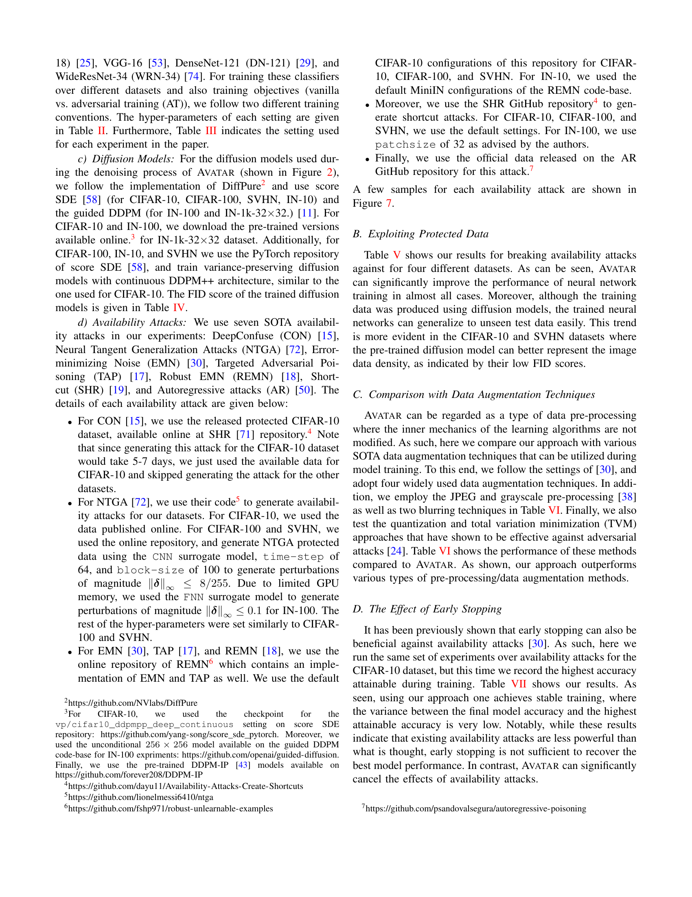

### Página 7

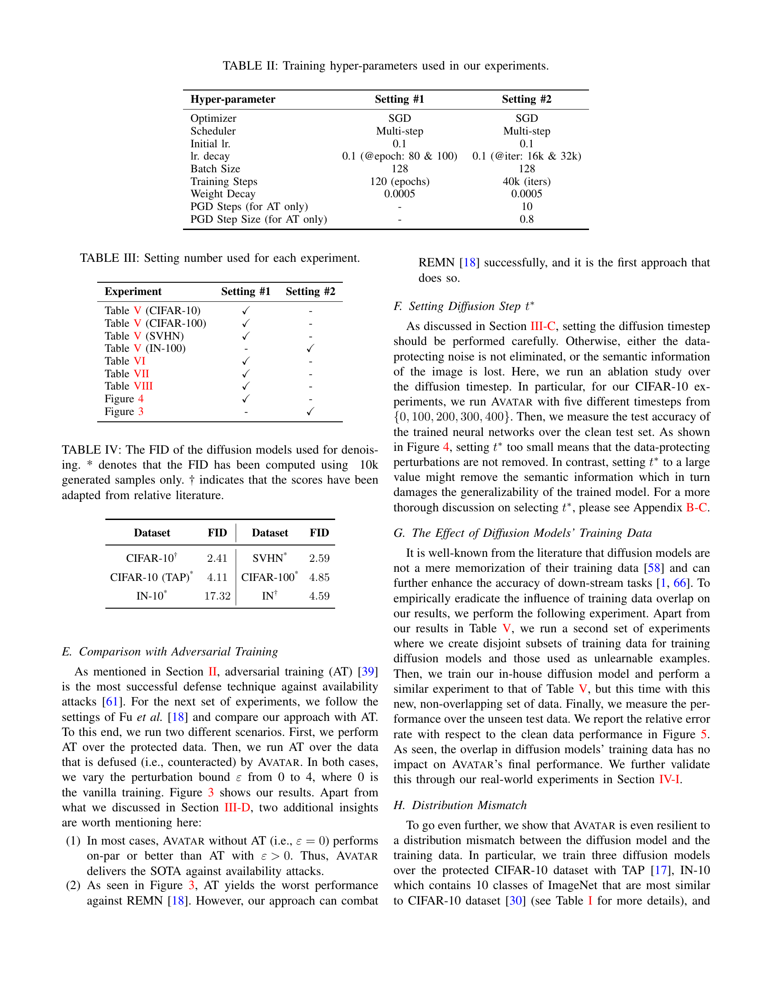

### Página 8

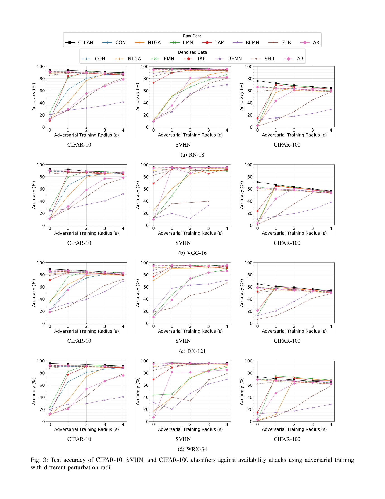

### Página 9

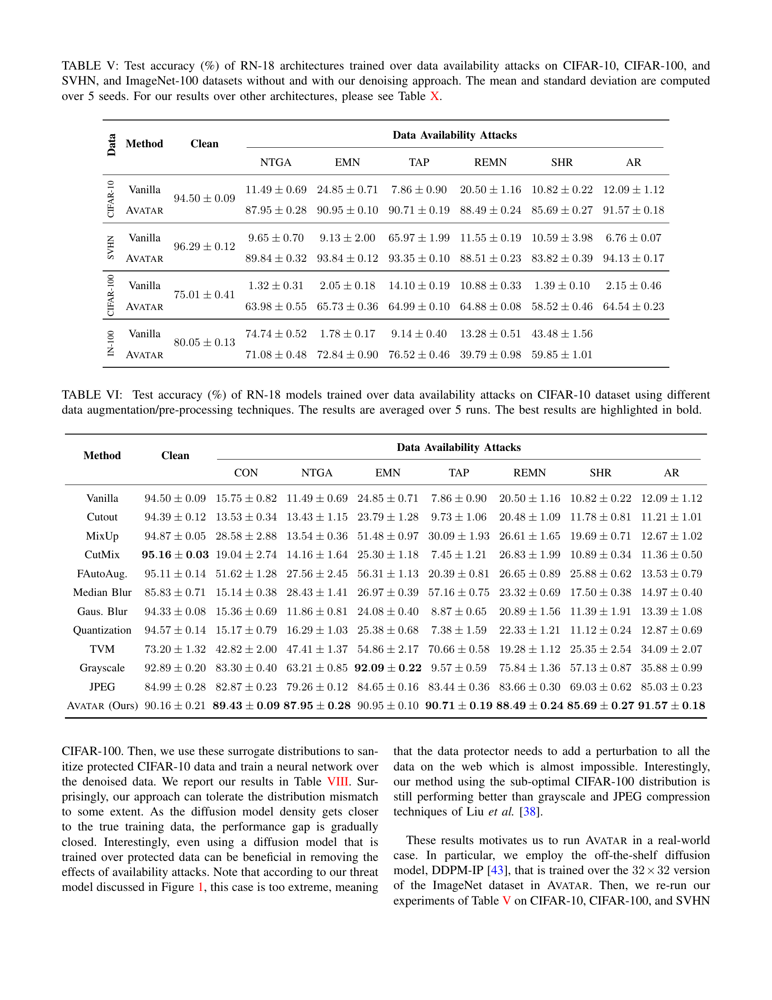

### Página 10

### Página 11

### Página 12

### Página 13

### Página 14

### Página 15

### Página 16

### Página 17

### Página 18

### Página 19

### Página 20

### Página 21

### Página 22

### Página 23

### Página 24

### Página 25

### Página 26

### Página 27

### Página 28

### Página 29

